# A History of syzkaller: Major Feature Additions and Revolutionary Design Changes

> **Who this is for.** You are curious about how large automated bug-hunting systems are built, but you do not want to read academic papers and you do not yet speak fluent kernel-security jargon. This chapter explains *what syzkaller is*, *how it got that way*, and — most importantly — *which design decisions you can steal for your own automation projects*.
>
> Everything here is derived from the actual git history of the repository (12,914 commits as of this writing), not from blog posts.

---

## 0. The 60-second version

syzkaller is a robot that finds bugs in operating system kernels. It does this by:

1. Reading a **machine-readable description** of the kernel's API (which system calls exist, what arguments they take).
2. **Generating** random-but-plausible sequences of those calls.
3. **Running** them inside a disposable virtual machine.
4. Watching **which lines of kernel code got executed** (coverage), and keeping the inputs that reached new code.
5. Noticing when the kernel **crashes**, then automatically shrinking the input down to a minimal **reproducer** and reporting it.

The whole thing runs unattended for years at a time. That "runs unattended for years" requirement is the single biggest force shaping its design, and you will see it driving almost every change below.

### Vocabulary decoder

Before the history, here are the words you need. Keep this table handy.

| Term | Plain meaning |
|---|---|
| **syscall** (system call) | The only doorway from a normal program into the kernel. `open`, `read`, `ioctl` are syscalls. Attack surface = the set of syscalls. |
| **fuzzing** | Feeding a program lots of semi-random inputs to see if it breaks. |
| **coverage** | A record of which code locations executed during a run. Used as a score: "did this input teach us anything new?" |
| **KCOV** | The Linux kernel feature that reports coverage. syzkaller's eyes. |
| **KASAN** | A kernel feature that detects memory-corruption bugs the moment they happen, instead of letting them silently corrupt things. syzkaller's bug detector. |
| **corpus** | The saved collection of interesting inputs — syzkaller's long-term memory. |
| **mutation** | Making a small random change to an existing input. |
| **reproducer** | A minimal, self-contained program that triggers a specific crash on demand. The deliverable you hand a developer. |
| **syzlang** | syzkaller's own little language for describing syscalls. |
| **executor** | The small C++ program that runs inside the VM and actually performs the syscalls. |
| **manager** | The Go program running on your host that orchestrates everything. |
| **VM / instance** | A throwaway virtual machine running the kernel under test. Expected to crash; that is the point. |
| **DUT** | "Device Under Test" — the machine being fuzzed, especially when it is real hardware rather than a VM. |

---

## 1. How to read a project's history yourself

This is a transferable skill, so let us do it explicitly. A good first question for any unfamiliar codebase is: **"what did the author write *first*, and what did they rewrite *most*?"**

The command below walks the first 100 commits that touched Go files, sums the lines added + removed in each, and shows the five biggest:

```bash
git log --reverse --format='%H' -- '*.go' |
head -100 |
while read c; do
    changes=$(git show --numstat --format='' "$c" -- '*.go' |
        awk '$1 ~ /^[0-9]+$/ && $2 ~ /^[0-9]+$/ {sum += $1 + $2} END {print sum+0}')
    echo "$changes $c"
done |
sort -nr |
head -5
```

Result on this repository:

| Lines changed | Commit | Date | Subject |
|---:|---|---|---|
| **8025** | `874c5754b` | 2015-10-12 | **initial commit** |
| 2264 | `6922b20d3` | 2015-12-11 | sys: workaround Go compiler bug |
| 1021 | `a63ac433a` | 2015-11-30 | sys: add userfaultfd syscall |
| 985 | `b7800fb0a` | 2015-11-30 | sys: describe some additional syscalls |
| 894 | `9d1895c1b` | 2015-11-29 | add support for bpf syscall |

Two things jump out, and both are lessons.

**Lesson 1: the architecture was present on day one.** The initial commit is not a toy. It is 8,025 lines across 37 files, and the directory names are already the ones you will recognize in today's tree:

```
cover/        fuzzer/       ipc/          manager/      master/
prog/         rpctype/      sys/          sysgen/
tools/execlog tools/execprog tools/prog2c tools/stress
vm/local      vm/qemu
```

Dmitry Vyukov landed a *complete vertical slice*: a description language and its compiler (`sysgen/`, `sys/`), an in-memory program representation with generation/mutation/minimization/serialization (`prog/`), a coverage model (`cover/`), an inter-process channel to the executor (`ipc/`), a fuzzing loop (`fuzzer/`), an orchestrator (`manager/`), VM backends (`vm/qemu`, `vm/local`), and debugging tools. Everything since has been *deepening* those boxes, not replacing the box diagram.

> **Takeaway for your own projects:** if you are building an automation pipeline, sketch the full end-to-end slice first — even if each stage is 100 lines and dumb. A working skeleton lets you measure, and measuring is what tells you which stage deserves the next 10,000 lines.

**Lesson 2: commits 2–5 are an accident, and the accident was later designed away.** Look closer at those four commits. They are all "add some syscall descriptions," yet each churns ~1,000 lines of `sys/sys.go`. Why? Because in 2015 the *generated* Go code produced from the description files was **checked into the repository**. Adding one syscall re-numbered everything downstream and produced an enormous diff.

That friction was eventually eliminated in two steps:

- `0d0fbbe73` (2016-08-26) *"overhaul syscall description generation process"* — generation moved into the build (`make generate`), so humans edit only `.txt` files.
- `79910ad71` (2025-01-23) *"sys/syz-sysgen: serialize descriptions as gob and embed"* — `sys/sys.go` was **deleted** entirely. Descriptions are now compiled into a compressed binary blob that is embedded into the binary and decoded lazily at startup.

> **Takeaway:** if your biggest diffs are in generated files, that is a design smell, not a fact of life. Generated artifacts belong in the build, not in review.

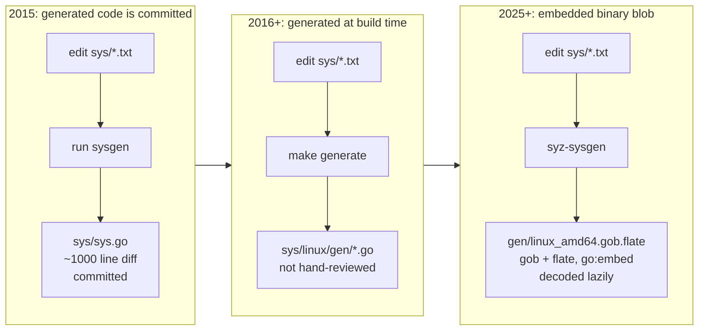

---

## 2. The architecture that was there from the start

Before walking the timeline, here is the shape of the machine. This diagram is roughly true for 2015 *and* for today; only the internals of the boxes changed.

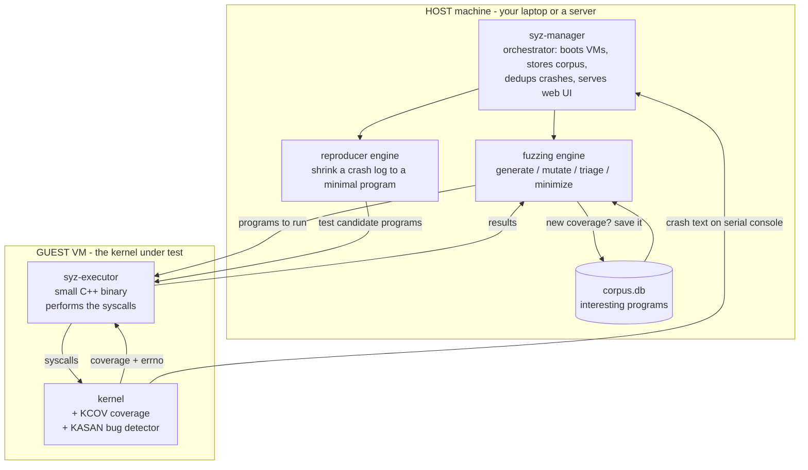

The crucial asymmetry: **coverage and results come back over a structured channel, but crashes come back as plain console text.** A crashing kernel cannot politely serialize a message for you — it can only print to the serial port before dying. Almost all of syzkaller's robustness machinery exists to handle that asymmetry.

---

## 3. The timeline

The chart below is the shape of eleven years at a glance. **If you want the year-by-year list of every serious design change with its commit, jump to §9** — this one is for orientation, that one is for study.

```mermaid
timeline
    title syzkaller design eras
    section 2015 Foundations
        Oct 2015 : initial commit, full vertical slice
                 : call priorities, choice table
                 : lkvm and qemu backends
        Dec 2015 : kmemleak support, first extra bug detector
                 : master removed, naming overhaul
                 : descriptions split into per-subsystem .txt files
    section 2016-2017 Industrialization
        Jan 2016 : adopt upstream KCOV
                 : qemu -snapshot for disposable disks
                 : sandboxing moved into the executor
        Aug 2016 : description generation moved into the build
        Nov 2016 : syz-hub, cross-instance corpus sharing
        Apr-May 2017 : fault injection, input smashing
                     : pkg/ast, a real parser for descriptions
        Jun 2017 : syz-ci, continuous kernel build and test
                 : dashboard app, later known as syzbot
        Aug-Sep 2017 : comparison hints, pkg/compiler static checks
        Sep-Oct 2017 : fuchsia, windows, freebsd, netbsd targets
                     : one IPC protocol for every OS
    section 2018-2023 Hardening
        Feb 2018 : signal split from raw coverage
                 : squashed ANY, mutating opaque blobs
        May-Jun 2018 : pkg/bisect, pkg/build, pkg/vcs
                     : runtime host feature detection
        Aug 2018 : pkg/runtest, descriptions become testable
        Oct 2019 : KCSAN, the data-race detector
        Dec 2019 : corpus rotation, enabled then disabled then revived
        Oct 2020 : pkg/kconfig, kernel configs as data
        Jun 2021 : syz-verifier, differential testing
        2022 : asset storage, subsystem routing, pkg/image
    section 2024 The great refactor
        Feb 2024 : pkg/fuzzer, engine extracted from the VM
        Mar 2024 : pkg/corpus as its own package
        Apr 2024 : pkg/vminfo, machine check moves to the host
        May 2024 : pkg/flatrpc schema, queue layers
        Jun 2024 : executor runner mode, syz-fuzzer deleted
        Jul 2024 : vm/dispatcher, qemu snapshot fuzzing
        Aug 2024 : coveragedb, coverage across time
        Oct 2024 : focus areas replace the coverage filter
        Nov-Dec 2024 : ifaceprobe, declextract rewrite
    section 2025-2026 Automation of automation
        Jan 2025 : descriptions embedded as gob blob
        Sep 2025 : pkg/kfuzztest, in-kernel fuzz targets
        Nov 2025 : pkg/codesearch, pkg/updater
        Dec 2025 : syz-verifier rebuilt on the new engine
        Jan 2026 : pkg/aflow, agentic workflows
        Apr 2026 : lore-relay, AI results into mailing lists
        Jun 2026 : pkg/execbackend, pluggable execution
        Aug-Sep 2026 : crosvm and firecracker backends
```

---

## 4. Era 1 (2015): the foundations

### 4.1 Declarative descriptions instead of hand-written harnesses

The single most consequential decision in syzkaller is that **the API surface is data, not code**. A traditional fuzzing harness is a C program you write by hand for one interface. syzkaller instead reads lines like:

```
open(file filename, flags flags[open_flags], mode flags[open_mode]) fd
read(fd fd, buf buffer[out], count len[buf])
close(fd fd)
```

and derives *everything* from them: how to generate a call, how to mutate one argument without breaking the others, how to serialize a program to text, how to produce an equivalent C program, how to minimize it.

Notice what the `fd` return type does. `open` *produces* an `fd`; `read` and `close` *consume* one. That one fact gives the fuzzer an ordering constraint for free — it knows `read` should come after `open`, and it knows to pass the result along:

```
r0 = open(&(0x7f0000000000)="./file0", 0x3, 0x9)
read(r0, &(0x7f0000000000), 42)
close(r0)
```

Random bytes will essentially never produce a valid file descriptor. Descriptions are how syzkaller gets past the front door. (`eef80b3d7`, 2015-12-28, split the single description file into per-subsystem files — the organizational change that made thousands of community contributions possible.)

> **Takeaway:** when fuzzing a *structured* interface, invest in a model of the structure. Random mutation of a well-formed input beats random bytes by orders of magnitude, and a declarative model lets contributors extend coverage without touching your engine.

### 4.2 Call priorities (`c9b915608`, 2015-10-14, two days in)

"Initial support for call priorities" appeared almost immediately. The problem: given that you just generated `socket(...)`, what call should come next? Uniform random choice wastes almost all your time.

syzkaller builds a **choice table**: a matrix where entry `[X][Y]` estimates how useful it is to add call `Y` to a program that already contains call `X`. It is seeded from two sources:

- **Static similarity** — do these two calls traffic in the same types? A call that *produces* a resource gets a high score paired with calls that *consume* it.
- **Dynamic co-occurrence** — in the corpus we have accumulated, which calls actually appear together?

That this landed on day three tells you the author already knew that *input selection*, not input generation, is where fuzzing efficiency lives. (Details in `mutation-design.md`.)

### 4.3 Two VM backends on day one

`vm/qemu` and `vm/local` both shipped in the initial commit, and `lkvm` followed four days later (`587db99ba`). From the beginning the VM was an **interface**, not a hardcoded `qemu` invocation. Today that interface has backends for QEMU, GCE, Azure, adb (Android phones), bhyve, VMware, VirtualBox, gVisor, crosvm, Firecracker, proxyapp, and — the one that matters for embedded work — **`isolated`**, which drives real hardware over nothing but SSH.

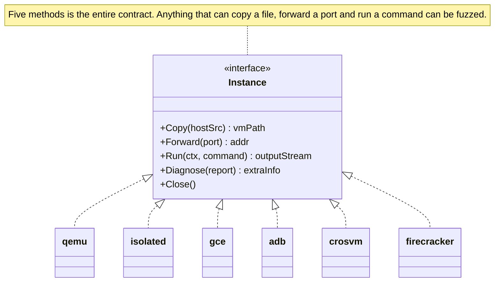

> **Takeaway:** the narrow interface is the feature. Five methods — copy a file in, forward a port, run a command, ask for diagnostics, shut down — is enough to abstract over "emulated VM," "cloud instance," "Android phone over USB," and "an embedded board on your desk."

### 4.4 The "master" that became "hub"

The initial commit contained a `master/` directory. On 2015-12-17, `8e7ca7c5f` *"remove master and naming overhaul"* deleted it; the role came back in Nov 2016 as **`syz-hub`** (`cd74cc9cf`). Hub's job is narrow and clear: let multiple independent syz-manager instances (different kernels, different configs, different people) **trade corpus programs and reproducers** without sharing anything else.

This is worth noticing as a pattern: the first attempt at a central coordinator was wrong, got deleted, and the eventual replacement had a much smaller job description.

---

## 5. Era 2 (2016–2017): from a tool into an institution

### 5.1 KCOV (`d5c2595f0`, 2016-01-19)

Early syzkaller used a custom kernel patch for coverage. In January 2016 it adopted **upstream KCOV**, which had just been merged into Linux. That is the moment syzkaller stopped being "a tool that needs a patched kernel" and became "a tool that works on the kernel you already have."

> **Takeaway:** if your automation needs instrumentation in the target, getting that instrumentation upstreamed is leverage. It converts your project from a research prototype into infrastructure.

### 5.2 `qemu -snapshot` (`dfd341e34`, 2016-01-19, same day)

Adding `-snapshot` makes QEMU write disk changes to a temporary overlay that is discarded on exit. The fuzzer can corrupt the filesystem freely; the next boot is pristine. **Disposability became a property of the system rather than a cleanup routine.**

> **Takeaway:** prefer "throw it away and make a new one" over "clean up after yourself." Cleanup code is a bug farm; recreation is idempotent.

### 5.3 syz-ci (`6573032ff`, 2017-06-19) and the dashboard (`61d1beb28`, 2017-06-22)

Three days apart, two pieces landed that changed what syzkaller *is*:

- **syz-ci** continuously fetches kernel trees, builds them, runs syz-manager against them, and restarts everything on update. It turns one fuzzing session into a perpetual service.
- **dashboard/app** is the web service that became **syzbot** — the thing that files bug reports, tracks which are fixed, emails maintainers, and runs patch tests.

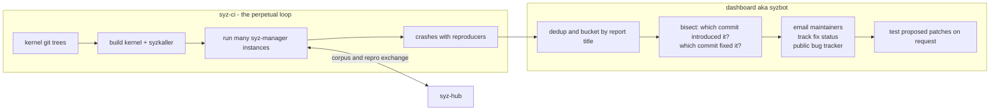

The fuzzer finds bugs in hours. Getting a bug *fixed* takes a human reading a report, which means the report must be good: deduplicated, bisected, routed to the right maintainer, with a C reproducer attached. **Most of the engineering after 2017 is about report quality, not bug discovery rate.**

> **Takeaway:** for any bug-finding automation, the output pipeline is at least as much work as the finder. A finding nobody acts on has zero value. Budget for deduplication, attribution, and triage from the start.

### 5.4 Comparison hints (`07c84b670`, 2017-08-16)

*"executor, ipc: modify the IO between KCOV ↔ executor ↔ fuzzer"* is the plumbing commit for a powerful trick. Some kernels can report not just *which* code ran but *which comparisons happened and with what operand values*. So if the kernel executed `if (header->magic == 0xCAFEBABE)` and your input had `0x41414141` there, the fuzzer learns the magic number and splices it into the input.

This is how a fuzzer guesses a 32-bit magic value in one try instead of four billion. (Details in `mutation-design.md`, section on hints.)

### 5.5 Multi-OS support (Sep–Oct 2017)

Within six weeks: Fuchsia (`8cb7d3dcf`), Windows (`af442a22d`), FreeBSD (`179a86088`), then NetBSD, OpenBSD, Darwin, Akaros, Trusty. The description language and the engine turned out to be OS-agnostic; only the executor's syscall-invocation layer and the VM backend are OS-specific.

That is retroactive proof that the 2015 layering was correct.

### 5.6 Sandboxing moved *into* the executor (`aa1b7fe3a`, `1e06d2baf`, Jan 2016)

A subtle but load-bearing change. Early on, isolating the fuzzed program was the host's problem. Two commits twenty days after KCOV landed moved it inside: *"executor: start moving sandboxing code into executor"*, then *"executor: new namespace-based sandbox."*

Why does that matter? Because the sandbox has to be **part of the reproducer**. If the host sets up namespaces and then runs a program, the C reproducer you hand a kernel developer will not reproduce anything — the developer does not have your host. By pushing sandbox setup into the same C source the executor and the reproducer share, "run under `sandbox=namespace`" becomes a property of the *program*, portable to any machine.

This is the first appearance of a theme that dominates the rest of the project: **anything required to reproduce a bug must live on the target side of the boundary.** (What each sandbox actually does is in `syz-execprog-design.md` §2.10.)

### 5.7 Execution stages: fault injection and smashing (`8f58526cb`, 2017-04-07; `ffb5c7319`, 2017-05-25)

Until 2017 the loop had one mode: pick a program, run it, look at coverage. Two commits six weeks apart introduced the idea that **different inputs deserve different amounts of attention.**

`ffb5c7319` added *smashing*, and its commit message is the entire design rationale in three lines:

> Do 100 random mutations for each new input added to corpus. The idea is to give each new input some initial boost. Smash is also the right place for e.g. fault injection.

So a program that just earned its way into the corpus gets a burst of concentrated mutation, on the theory that a newly discovered code path has more unexplored neighbours than an old one. And "smash is the right place for fault injection" predicted the integration of `8f58526cb`, which systematically makes kernel memory allocations fail one at a time — exercising the error-handling paths that normal execution never reaches, and that are consequently full of bugs.

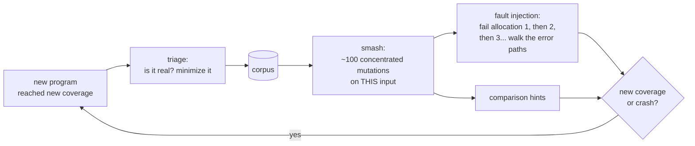

> **Takeaway:** a fuzzing loop with one uniform mode is leaving value on the table. Split work into *stages* with different budgets — cheap breadth for most inputs, expensive depth for the promising ones. The 2024 queue layers (§7.4) are the industrial version of this idea.

### 5.8 Descriptions get a real compiler (`127a9c2b6` May 2017 → `pkg/compiler`, Aug–Sep 2017)

The 2015 description handling was a pragmatic hack: `sysgen` parsed the `.txt` files loosely and emitted Go. In 2017 that was replaced by a proper front end.

- `127a9c2b6` (2017-05-22) *"pkg/ast: new parser for sys descriptions"* — a real tokenizer and abstract syntax tree, with positions, so errors can say *which line*.
- `a3857c4e9`, `e2ffb4fc9` (Aug 2017) moved constant handling out of the generator and into `pkg/compiler`.
- `4074aed7c` *"more static error checking"*, `a7206b24c` *"check and generate types"*, `b06c1bd32` *"verify validity of len targets"*, `8c64b078d` *"detect resources without ctors"* (Aug–Sep 2017).

That last one is the most interesting check in the list. "A resource without a constructor" means the descriptions declare a type that calls *consume* but nothing *produces* — so the fuzzer can never make a valid one, and every call taking it is dead weight. Before this check, that mistake was invisible; after it, it is a compile error.

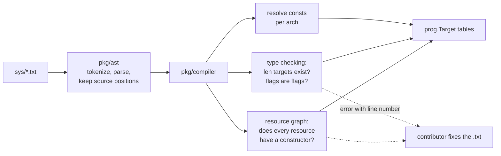

> **Takeaway:** the moment a DSL has outside contributors, its error messages become a feature. A loose parser that accepts bad input and misbehaves later costs every contributor an afternoon; a strict compiler with line numbers costs them thirty seconds. (The full language and compiler are in `syzlang-design.md`.)

### 5.9 One IPC protocol for every OS (`85b1f93f8`, 2017-10-16)

*"executor, pkg/ipc: unify ipc protocol between linux and other OSes."* After the multi-OS land rush, Linux and everything else had drifted into separate host↔executor protocols. Unifying them is unglamorous consolidation work, but it is what made the *next* six OS ports cheap, and it is the direct ancestor of `pkg/flatrpc` (§7.3).

> **Takeaway:** after a burst of "make it work for N targets," budget a consolidation pass. The second implementation of a protocol teaches you what the abstraction should have been; the fifth one just multiplies the maintenance.

---

## 6. Era 3 (2018–2023): hardening

This stretch has fewer headline-grabbing commits and a lot of load-bearing work. The theme is **"survive the real world."** It is also the era in which syzkaller stopped being one program and became a *family of packages* — seventeen of today's `pkg/` directories were created in these six years.

### 6.1 Signal is not coverage (`04cbdbd1a`, 2018-02-20)

*"syz-fuzzer: prioritize signal from successful syscalls."* The commit message is two sentences, and it introduces a distinction the engine still rests on:

> Signal on successful syscalls is more valuable than signal on unsuccessful syscalls.

**Coverage** is the raw set of code locations that executed. **Signal** is the derived, prioritized feedback the fuzzer actually optimizes. They are not the same thing, and conflating them wastes effort: if a syscall returns `EINVAL`, the coverage it produced is mostly argument-validation code. Thousands of distinct invalid inputs all "discover" the same rejection paths, and a fuzzer that rewards them will happily spend a week cataloguing ways to fail.

This change gave signal a *priority* dimension, and it is why `pkg/signal` exists as a separate package — it was created by this very commit. The same idea reappears in the per-call coverage bracket (`syz-execprog-design.md` §2.4) and in corpus weighting (`mutation-design.md` §3).

> **Takeaway:** your feedback metric is a design decision, not a measurement. "Did the code run" is cheap to collect and easy to over-reward. Ask what you actually want more of, and encode *that* in the metric.

### 6.2 Mutating things you cannot describe (`9fe8aa42c`, 2018-02-24)

*"prog: add arbitrary mutation of complex structs"* — the origin of `prog/any.go` and of what syzkaller calls **squashing**.

The problem: descriptions are always incomplete. A netlink message or an `ioctl` payload may be modelled as a precise struct for the cases somebody wrote down, and a struct is *rigid* — the mutator can only change fields it knows about. Squashing converts a structured argument into one opaque byte blob (`ANY`), lets the mutator treat it as raw bytes, and so reaches encodings nobody described.

This is a deliberate, controlled retreat from the "model the input" principle, and knowing *when* to retreat is the insight. Precision gets you through the front door; opacity lets you explore the room. (Mechanics in `syzlang-design.md` §1.7; the mutation weight it gets in `mutation-design.md` §4.)

### 6.3 Descriptions become testable (`2763e04c2` Jul 2018, `5ba57bfe1` Aug 2018)

`tools/syz-runtest` plus `pkg/runtest` — *"a package for syzkaller program unit-testing"* — and the `sys/linux/test/` directory of hand-written programs with expected outcomes.

Before this, the only way to know whether a description was *correct* (as opposed to syntactically valid) was to watch coverage and squint. After it, a contributor could write "this program should succeed, this one should return `EINVAL`" and have CI check it against a real kernel. Descriptions stopped being unverifiable folklore.

> **Takeaway:** if your system's behaviour is driven by data files, those data files need a test harness as much as your code does. Otherwise their quality decays silently, and you will not find out for years.

### 6.4 Runtime feature detection (`06ece2ca6`, 2018-06-12)

You cannot assume the kernel under test supports KASAN, or network namespaces, or `/dev/kvm`. At startup syzkaller probes the live machine: it tries each feature, tries each syscall, reads the files it needs, and **disables what does not work** — then prints a "machine check" report.

This is why the same binary works on a ten-year-old distro kernel and on today's linux-next, and it is the single most important feature if you plan to point syzkaller at an embedded board whose kernel you do not control. (The probe moved from the guest to the host in 2024 — §7.8.)

### 6.5 syz-ci decomposed into reusable packages (May–Aug 2018)

syz-ci shipped in 2017 as a monolith. A year later it was taken apart:

| Commit | Date | Package | Job |
|---|---|---|---|
| `4e1c0dbae` | 2018-05-10 | `pkg/bisect` | given a reproducer, find the commit that caused it and the one that fixed it |
| `2407e7407` | 2018-05-14 | `pkg/instance` | build an image, boot it, test a patch — the primitives bisection needs |
| `94ef62054` | 2018-06-21 | `pkg/build` | per-OS kernel build recipes |
| `43da5e3a1` | 2018-06-27 | `pkg/vcs` | git operations: fetch, checkout, bisect, parse commits |
| `fbedd425b` | 2018-08-01 | `pkg/mgrconfig` | the config schema, validated in one place |

The ordering is the lesson: **bisection came first and forced the rest.** "Build this revision and test it" had to become a library call before "do that forty times in a binary search" could exist — and once it was a library call, syz-ci, the dashboard's patch-testing feature, and bisection all shared it.

> **Takeaway:** when a new feature needs a capability your monolith only has internally, extracting that capability *is* the feature's real cost — and the extraction is usually worth more than the feature.

### 6.6 New bug detectors, roughly one per year

A fuzzer is only as good as its oracle. Without a detector, memory corruption just means the kernel keeps running with wrong data. syzkaller's answer was to integrate every detector the kernel grew, and the pattern is always the same: enable it, learn to parse its report format, learn which of its reports are noise.

| Detector | First support | What it catches |
|---|---|---|
| kmemleak | `cf2089138`, 2015-12-03 | memory that is allocated and never freed |
| KASAN | 2016, alongside KCOV | use-after-free and out-of-bounds, at the moment of access |
| KMSAN | 2018 (report formats, `327060ba9`, Mar 2018) | use of uninitialized memory |
| KCSAN | `b2f369e56`, 2019-10-04 | data races between concurrent threads |

KCSAN is the instructive one. A race detector reports nothing unless two threads genuinely run concurrently, which means the *executor* had to grow real threaded execution and the *fuzzer* had to start caring about call scheduling and `async` annotations. A new detector is rarely just a config option; it usually demands something from the generator.

> **Takeaway:** detection and generation are coupled. Adding an oracle that observes a new class of misbehaviour usually means teaching your generator to produce the conditions that oracle needs.

### 6.7 Corpus rotation: the honest experiment (Dec 2019 → Oct 2020)

This is the best story in the repository for anyone who wants to learn how to run an experiment in production, because the whole thing is written down plainly in three commit messages.

**`6b36d3386`** (2019-12-30) *"syz-manager: corpus rotation"*:

> Use a random subset of syscalls/corpus/coverage for each individual VM run. Hypothesis is that this should allow fuzzer to get more coverage find more bugs in saturated state (stuck in local optimum).

The problem being attacked is real: after weeks of fuzzing, the corpus is enormous and the fuzzer keeps re-exploring its favourite neighbourhoods. Giving each VM a random *slice* of the world should push different instances into different local optima.

**`6a8d39b1f`** (2020-01-07), eight days later — *"disable corpus rotation"*:

> Temporary disable corpus rotation b/c we suspect it negatively affects fuzzing. But we don't have hard data, and the easiest way to check is to disable and see what happens.

**`c1ff9c10c`** (2020-10-01), nine months later — *"re-enable corpus rotation"*:

> Let's give it another chance since the previous coverage drop wasn't completely conclusive. Few changes that may help: do rotation at 1/5 instead of 1/3 rate; don't send triage candidates to rotated VMs, since they may not have required syscalls enabled; don't send new inputs/coverage to rotated VMs, let them run in complete isolation.

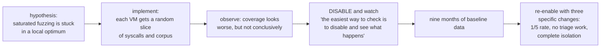

Three things to steal here. The hypothesis was **written down before** the implementation, so it could be judged. When the result was ambiguous, the response was to **remove the change and measure the baseline** rather than argue about it. And the re-enable was not a revert of the revert: it named three concrete reasons the first attempt had been unfair to itself — notably that rotated VMs were being handed triage work they could not perform, because the syscalls those programs needed were in the half that got rotated away.

> **Takeaway:** in a system whose output is a noisy rate (bugs per week), "it felt better" is not evidence. State the hypothesis, keep the off-switch, and when you cannot tell, turn it off and watch. That is cheaper than a debate.

### 6.8 Kernel configs as data (`9b8ec29c5`, 2020-10-15)

`pkg/kconfig` parses and manipulates `.config` files programmatically. That sounds like plumbing; it is what lets syzbot say "build this kernel *with* KASAN and *without* the debug option that causes false positives," generate a config per sanitizer, and attach the exact config to a bug report. The kernel's build configuration became a first-class, diffable, machine-editable artifact instead of a blob somebody pasted.

### 6.9 syz-verifier: fuzzing without coverage (`f96cd674a`, 2021-06-23)

A genuinely different idea, worth attention because it survived. Run the *same* program on *two different kernels* and compare the results. No coverage needed, no crash needed — a **difference** in return values is itself the bug signal.

This catches a class of bug the main fuzzer is blind to: silent behavioural regressions, where neither kernel crashes but one of them returns the wrong answer. The tool went quiet for years, then was rebuilt on the modern engine in Dec 2025 (§8.6) — which is itself a demonstration of what the 2024 refactor bought.

> **Takeaway:** a crash is not the only possible oracle. Differential testing — two implementations, same input, compare — needs no instrumentation in the target at all, and it finds *correctness* bugs rather than memory-safety bugs.

### 6.10 Making a report actionable (2022)

Three packages in one year, all about the handoff to a human:

- **`pkg/asset`** (`6db8af716`, 2022-07-15): crash logs, kernel images, and disk images involved in a reproducer get uploaded to cloud storage, so a developer can boot *the exact environment* instead of recreating it.
- **`pkg/subsystem`** (`2083933ab`, 2022-12-14): map a guilty file to a kernel subsystem to a maintainer list. Started deliberately small — the commit says *"for now, recognize just the vfs subsystem"* — and grew by evidence.
- **`pkg/image`** (`8482d3c10`, 2022-12-17): image compression factored out of `prog`, because disk images attached to reproducers needed more careful handling than a one-liner.

### 6.11 Crash reports become a subsystem

`pkg/report` is, by commit count, one of the most-touched packages in the tree. Scroll its log and you will find hundreds of entries like *"detect corrupted task hung reports," "don't blame kcov," "filter out more corrupted reports due to fault injection," "allow up to 15 lines from Call Trace to first frame."*

What it does: recognize oops formats, classify them (`KASAN: use-after-free`, `KCSAN: data-race`, `general protection fault`, `no output from test machine`), extract the guilty frame and file, and decide whether a report is *corrupted* (the console output got garbled) or *suppressed* (a known-uninteresting pattern).

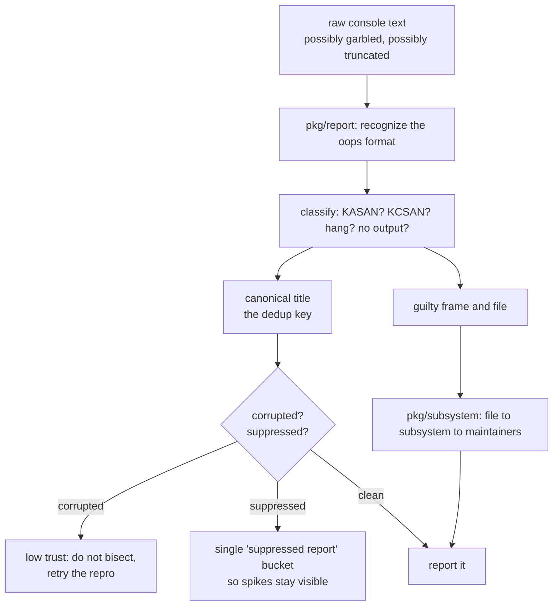

> **Takeaway:** in long-running automation, *parsing messy real-world output* is a first-class subsystem, not a utility function. Plan for inputs that are truncated, interleaved, and lying to you.

---

## 7. Era 4 (2024): the great refactor — the most instructive year

2024 is where a mature codebase got restructured on purpose. If you read only one section of this chapter, read this one, because every change here is a recognizable software-engineering pattern.

### 7.1 The old shape and its problem

Until 2024 there were **two** Go programs:

- `syz-manager` on the host: boots VMs, keeps the corpus, handles crashes.
- `syz-fuzzer` **inside each VM**: the fuzzing brain — generation, mutation, triage, minimization — talking to the local executor and to the manager over RPC.

Putting the brain inside the VM has a fatal property: **the brain dies with the kernel.** Every crash destroyed in-flight state. Each VM had its own partial view of coverage, so the N VMs duplicated each other's work. Debugging meant debugging a process inside a crashing virtual machine. And the corpus lived in two places at once.

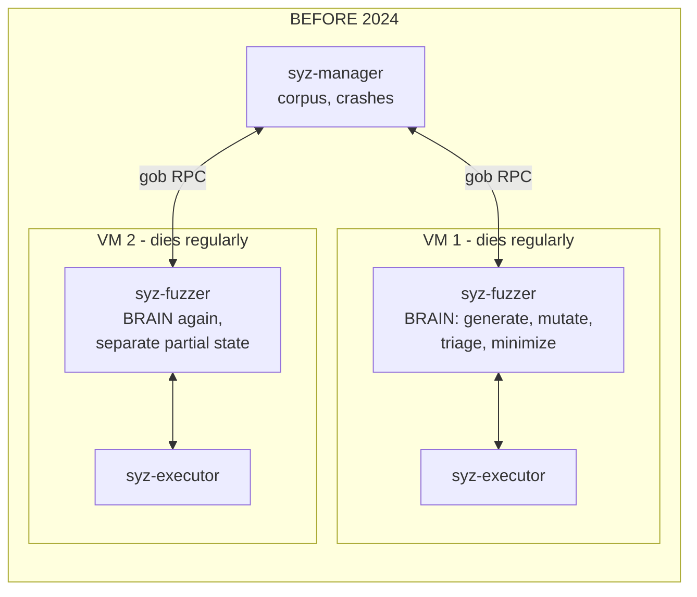

### 7.2 The move: engine out of the VM

A sequence of commits inverted this:

| Commit | Date | What it did |
|---|---|---|
| `c35c26ec6` | 2024-02-16 | `pkg/fuzzer`: factor out the fuzzing engine as a library |
| `fc090d205` | 2024-03-13 | `pkg/corpus`: corpus becomes its own package with its own tests |
| `7009aebcd` | 2024-04-16 | `pkg/vminfo`: the machine check moves to the host (§7.8) |
| `a3ce1723b` | 2024-05-02 | `pkg/flatrpc`: a declared binary wire schema |
| `03820adae` | 2024-05-03 | `pkg/fuzzer/queue`: execution requests become a composable pipeline |
| `e16e2c9a4` | 2024-06-04 | **executor runner mode — `syz-fuzzer/`, `pkg/ipc/` and `pkg/host/` are all deleted** |
| `0ec273733` | 2024-06-27 | `pkg/rpcserver` split into focused files |
| `fc2b08301` | 2024-07-02 | `vm/dispatcher`: a generic instance pool |

The result: **one brain on the host, dumb hands in the VMs.**

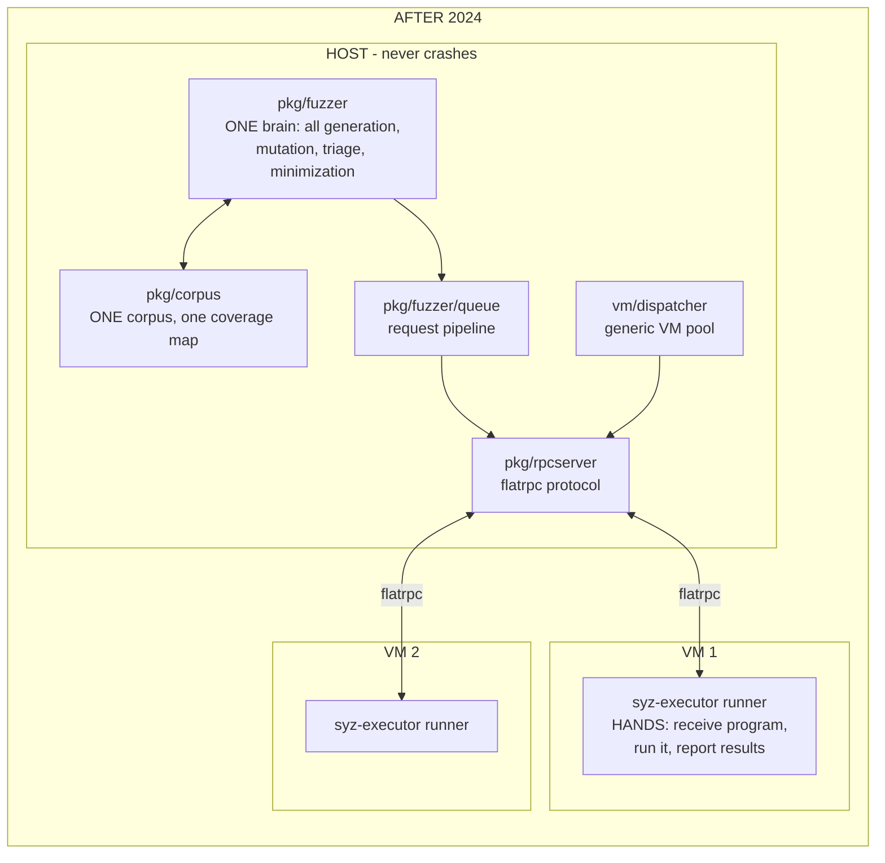

Four things got better at once:

1. **State survives crashes.** A dying VM loses only the programs currently in flight, and those get automatically re-queued on another VM.
2. **No duplicated work.** One coverage map means VM 7 never re-discovers what VM 3 already found.
3. **Debuggable and testable.** The engine is now a Go library you can unit-test on your laptop with no VM at all. (`cb2d8b3ae`, 2024-09-04, added rpcserver unit tests with mocks — a thing that was simply impossible before.)
4. **Smaller guest footprint.** Only one C++ binary needs to be copied into the VM, which matters enormously for embedded targets with tiny filesystems.

> **Takeaway — the general principle:** *put durable state where it will not be destroyed, and put only the untrusted, expendable work in the dangerous place.* This applies far beyond kernel fuzzing: browser sandboxes, CI runners, robotics, anything with a component you expect to lose.

### 7.3 `pkg/flatrpc`: a schema instead of "whatever Go encodes"

The old protocol was Go's `gob` encoding — convenient, but it means your wire format is defined by your Go structs, which the C++ executor cannot read. The new protocol is a **FlatBuffers schema** (`pkg/flatrpc/flatrpc.fbs`): an explicit, language-neutral, versioned description of every message, from which both Go and C++ code is generated.

It also enabled a zero-copy trick: the executor builds its result structures *directly in shared memory*, and the host-side runner reads them without a parse step.

The schema documents its own hazards. One comment is a gem:

> Changing `exec_flags` between executions does not cause executor process restart. Changing `env_flags`/`sandbox_arg` does cause process restart.

That one line encodes a performance-critical invariant that used to live only in somebody's head.

> **Takeaway:** when two languages or two machines must agree on bytes, write the schema down. "The struct is the schema" works until the day it doesn't, and that day is expensive.

### 7.4 `pkg/fuzzer/queue`: composition instead of special cases

Every execution is a `Request` flowing through stackable layers, each with one job:

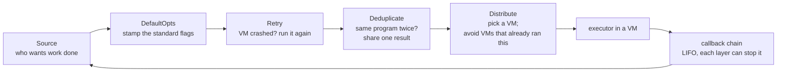

And the *priority* among competing work is itself a composed object:

```
Order(
    triageCandidateQueue,     # highest: vet programs loaded from disk
    candidateQueue,
    triageQueue,              # vet newly discovered programs
    Alternate(smashQueue, 3), # deep-dive on good inputs, but only 2 of every 3 slots
    Callback(genFuzz),        # fallback: generate or mutate something new
)
```

`Order` takes the first layer with work available. `Alternate(q, 3)` returns nothing every third call, which prevents a greedy stage from starving the others. The scheduling policy is readable in five lines instead of being scattered through an if-else thicket.

> **Takeaway:** when you have N kinds of work with different priorities, build a tiny combinator library instead of a scheduler full of special cases. You will change the policy more often than you expect.

### 7.5 `vm/dispatcher`: VMs as a resource pool

Before: the manager had bespoke loops for "boot a VM to fuzz," "boot a VM to reproduce a crash," "boot a VM to test a patch." After: a **generic pool**, one goroutine per slot, each looping forever:

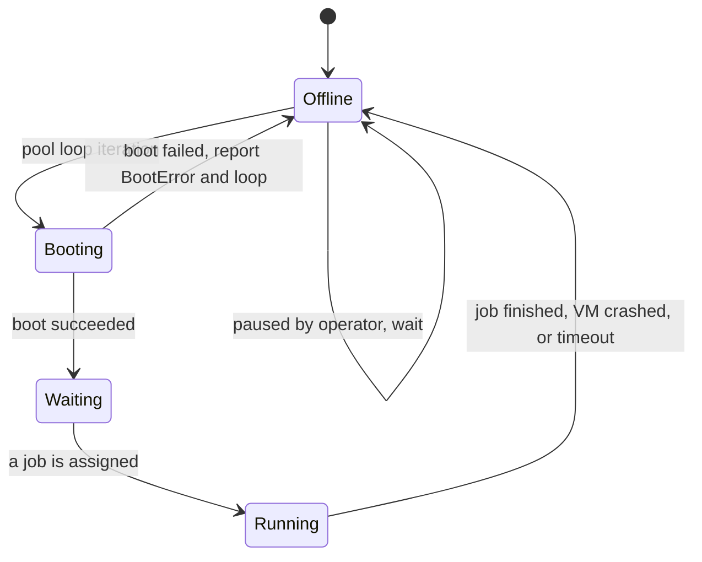

A boot failure is not an exception; it is just an item pushed onto the `BootErrors` channel and the next loop iteration. `ReserveForRun(n)` temporarily steals `n` slots for reproduction work; `TogglePause` lets a human freeze fuzzing from the web UI without killing the process.

> **Takeaway:** model unreliable workers as a pool of *restartable slots*, and treat failure as data on a channel rather than as an error to propagate. "It crashed" should be an ordinary event in the main loop.

### 7.6 Snapshot fuzzing (`4d77b9fe7`, 2024-07-05)

An ambitious one. Normally each program runs in a VM that accumulates state — previous programs' leftover files, sockets, memory pressure — which makes results non-deterministic and forces periodic reboots. Snapshot mode captures the VM once after boot with QEMU's `savevm`, then restores it with `loadvm` before every single program.

The prize is **determinism**: every program sees byte-identical kernel state, so a crash either reproduces or it does not. Flakiness largely disappears, and the fuzzer can relax the expensive "run it 3 to 5 times to check it was not a fluke" deflaking step down to 2 runs (`mutation-design.md` §1).

The price is the interesting part. Restoring a snapshot **destroys every network connection**, including the SSH session and the RPC socket — the code says so plainly: *"all network connections (including ssh) will break once we start restoring snapshots."* So a faster, more deterministic core forced a redesign of the transport (shared memory instead of TCP), of logging (`/dev/kmsg` instead of stdout), and of the VM job lifecycle. Three subsystems changed to make one loop faster.

*(The two-phase backend that implements this — boot over RPC, close the server, then switch to shared memory — is in `syz-manager-on-board-structure.md` §7, which is where the orchestration lives.)*

> **Takeaway:** determinism is worth restructuring your transport for. But notice the shape of the cost: performance work is rarely local. Before you optimize a hot path, ask which surrounding assumptions it will invalidate.

### 7.7 Automating the descriptions themselves

Descriptions were syzkaller's great strength and its great bottleneck: humans wrote all of them, by hand, by reading kernel source. 2024 attacked that from two directions:

- **`tools/syz-declextract` + `pkg/declextract`** (`3d5fb491e` Jul 2024, rewritten `b2c5a234a` Dec 2024): a **clang-based static extractor** that reads the kernel's own source — including its compilation database, so it knows the real compiler flags — and emits syzlang into `sys/linux/auto.txt`.
- **`pkg/ifaceprobe`** (`4f0d9df00`, Nov 2024): a **dynamic prober**, run as `syz-manager -mode iface-probe`. It boots a real kernel, globs the filesystem to find every `/dev/*`, `/sys/*`, `/proc/*` entry, opens each one, calls `ioctl` on it, and records which kernel functions got reached. Output: `interfaces.json`.

The two feed each other. Static analysis knows the *shape* of a `file_operations` struct but not which device file reaches it; dynamic probing knows "opening `/dev/foo` lands in these functions." Combine them and you can attach real device paths to statically discovered handlers.

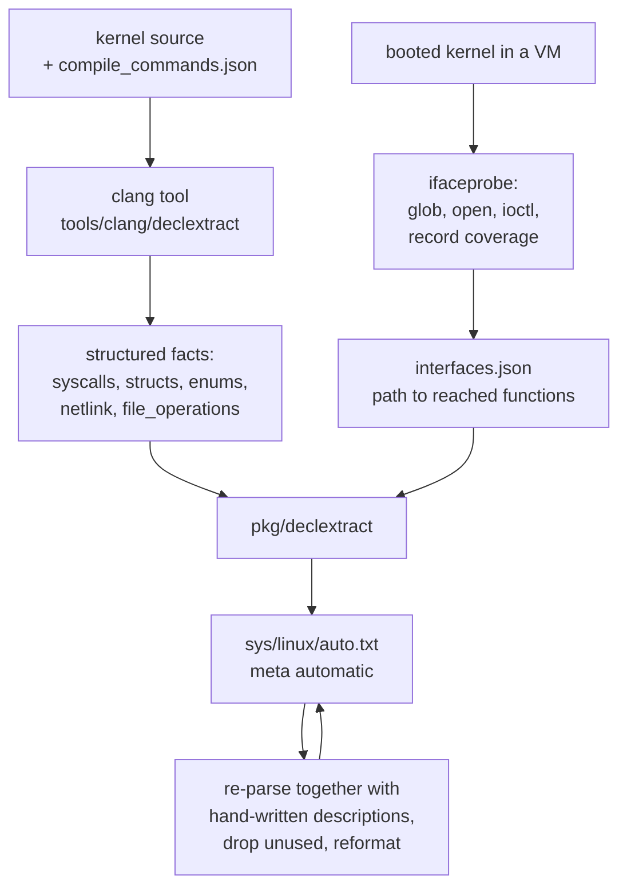

That re-parse loop is a nice detail: auto-generated descriptions reference hand-written types, so the generator compiles the *combined* set, discovers what ended up unused, strips it, and rewrites its own output. Generated code that cleans up after itself.

> **Takeaway:** static and dynamic analysis have complementary blind spots. Static sees all the code but not which paths are reachable in practice; dynamic sees reality but only the reality it happened to touch. Fusing them beats either alone.

### 7.8 The prerequisite nobody mentions: `pkg/vminfo` (`7009aebcd`, 2024-04-16)

§7.2 tells the story as "the brain moved to the host." But you cannot move the brain while the brain depends on *knowing things only the guest knows*. `syz-fuzzer` was the component that read `/proc/cpuinfo`, probed which syscalls worked, enumerated kernel modules, and checked whether KASAN was on. All of that is guest-local knowledge, and all of it was parsed by Go code running in the guest.

`pkg/vminfo` inverted the relationship, and the commit message states the real motive outright:

> This moves significant part of logic from the target to host (#1541), eventually this will allow us to switch target code from Go to C++. [...] now it merely reads the gives set of files and returns contents. The rest of the parsing happens on the host.

The new protocol is almost insultingly simple. The host asks: *give me the contents of these files.* The guest reads them and returns bytes. The host does every bit of interpretation.

```mermaid
sequenceDiagram
    participant H as HOST pkg/vminfo
    participant G as GUEST executor
    H->>G: RequiredFiles(): /proc/cpuinfo, /proc/modules, ...
    G->>H: raw bytes, no interpretation
    H->>H: MachineInfo(): parse per-OS, per-arch
    H->>G: probe these N syscalls
    G->>H: for each: worked / failed with errno
    H->>H: decide the enabled syscall set
    Note over H: all policy on the host;<br/>the guest is a file reader
```

Two payoffs. First, the guest side shrank to something expressible in C++, which is what allowed `syz-fuzzer` to be deleted two months later. Second — and this is the part worth stealing — **moving the decision to the host fixed bugs by itself.** `22ee48a28` ("check enabled syscalls on the host") lists what changed when the same logic ran in a different place: `socket$inet_icmp` became *enabled* because the old check ran in the init namespace where a sysctl forbade ping sockets, while fuzzing actually happens in a fresh network namespace where it is allowed. `get_thread_area` became *disabled* on amd64 because it appears in `/proc/kallsyms` but only works in 32-bit mode. Four Bluetooth socket families became disabled because `bt_sock_create()` checks `init_net` and refuses outright.

Every one of those was a silent miscalibration — the fuzzer either skipping a reachable syscall or wasting slots on an impossible one — and none of them was found by reading the code. They surfaced because the logic was *relocated*, which forced someone to diff the before and after.

> **Takeaway:** when you move logic across a boundary, diff the decisions it makes before and after. The differences are not regressions to be papered over; they are the bugs the old location was hiding.

### 7.9 Focus areas replace the coverage filter (`9a199dec5`, `479141f70`, 2024-10-24)

The old `cover_filter` was a boolean mask: these files are interesting, everything else is ignored. Useful for "fuzz only the driver I just wrote," but all-or-nothing.

Focus areas generalize it into **weights**. The config comment states the contract precisely:

> The probability of selecting a program from an area is at least `Weight / sum of weights`. If `FocusAreas` is non-empty, by default all kernel code not covered by any filter will be ignored. To focus fuzzing on some areas, but to consider the rest of the code as well, add a record with an empty `Filter`, but non-empty weight.

```json
"focus_areas": [
    {"name": "net", "filter": {"files": ["^net"]}, "weight": 10.0},
    {"weight": 1.0}
]
```

That second entry — empty filter, weight 1 — is the design detail. It converts an exclusive filter into a *bias*: ten times the attention on networking, but the rest of the kernel still gets a tenth of the budget, so a bug just outside your area of interest is still findable. `pkg/corpus` keeps a separate corpus per area so programs are selected proportionally, and `pkg/stat` reports progress per area. Filters can match files, functions, or raw PC lists with per-PC weights. `cover_filter` is still accepted and marked `DEPRECATED!` in the config schema.

> **Takeaway:** prefer weights to booleans in any "what should I pay attention to" knob. A boolean filter forces users to choose between focus and completeness; a weight lets them say "mostly this" and keeps the long tail reachable. Leave an escape-hatch entry that means "everything else, a little."

### 7.10 Coverage gains a time axis (Apr–Aug 2024)

`pkg/covermerger` (`f10afd693`, 2024-04-26), `pkg/spanner` (`a6c8cb149`, Jul 2024) and `pkg/coveragedb` (`9bd464fce`, Aug 2024) do something the original coverage code never attempted: **persist coverage across kernel versions and merge it over time.**

Single-run coverage answers "what did this session reach?" A coverage *database* answers much better questions. Which files has syzkaller never touched in a year? Did last month's new descriptions actually move the number? Which subsystem is regressing? Merging across versions is the hard part, since line numbers shift under you — hence a package whose entire job is reconciling coverage from different source revisions.

In the same stretch, `pkg/manager` (`8d09a3b3b`, Aug 2024) pulled the repro loop out of the `syz-manager` binary as *"a potentially reusable piece of functionality"* — and the reuse arrived sixteen months later when `syz-verifier` was rebuilt on it (§8.6).

> **Takeaway:** a metric you only observe per-run is a dashboard; a metric you store over time is a management tool. The second one changes what you work on.

---

## 8. Era 5 (2025–2026): automating the automation

### 8.1 Descriptions become an embedded blob (`79910ad71`, 2025-01-23)

`sys/sys.go` finally died. Descriptions are now compiled per-OS-per-architecture into `gen/<os>_<arch>.gob.flate` — Go's `gob` serialization through a `flate` compressor — embedded with `go:embed` and decoded **lazily**, only for the target you actually use. A `syz-manager` built for twelve architectures no longer pays for eleven of them at startup.

The hash of that blob *is* the `SYZ_REVISION` constant compiled into the executor. At connection time the manager compares its own revision against the executor's and refuses to talk if they differ — because mismatched description tables mean the executor would silently run the *wrong syscalls* with correct-looking indices. A content hash as a compatibility check: cheap, and it makes a whole class of baffling bug reports impossible.

> **Takeaway:** when two binaries must share a generated table, hash the table and verify it at handshake. Silent index skew is one of the worst debugging experiences available.

### 8.2 `pkg/kfuzztest` (`9a3002038`, 2025-09-15)

A different idea entirely: instead of reaching deep kernel functions through the narrow syscall doorway, let kernel developers **annotate internal functions as fuzz targets** and call them directly. syzkaller reads `vmlinux`'s DWARF debug info, discovers those targets and their argument constraints, and generates syzlang for them at runtime.

This blurs the line between "system fuzzer" and "unit-test fuzzer" — the same engine, corpus, and reporting pipeline, aimed at a function instead of a syscall.

### 8.3 `pkg/execbackend` (`fc63d1254`, 2026-06-01)

Execution itself became an interface with pluggable implementations: the classic RPC-over-TCP backend, the snapshot backend, and test helpers. The manager no longer knows *how* programs reach a kernel.

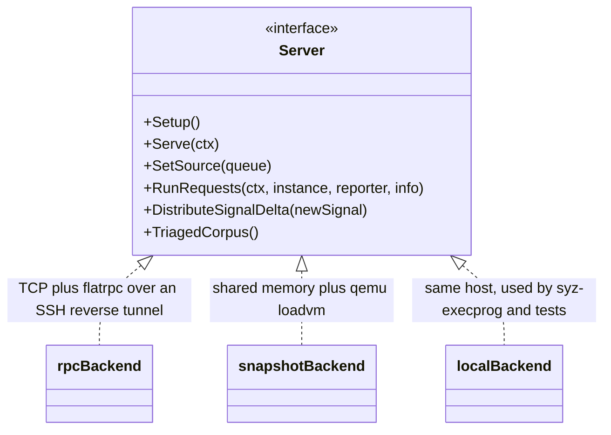

### 8.4 `pkg/aflow` (`45d8f0796` onward, Jan 2026): agentic workflows

The newest and most speculative layer. `pkg/aflow` is a framework for **LLM-driven workflows** over syzkaller's primitives, with named tools an AI agent can call:

- `execute-seed` — run this syzlang program in a VM, give me back a cached ID plus which calls failed
- `get-executed-program` — show me the program behind that ID and its per-call errors
- `read-syz-spec`, `syz-grepper` — browse and search the description files
- coverage tools keyed by that same execution ID

Plus workflows: bug-fix patching, KCSAN assessment, use-after-free moderation.

Two design details are worth stealing even if you never use an LLM:

**Content-addressed caching.** An execution's cache key is a hash of (kernel commit, kernel config, disk image, VM type, VM config, program). Ask for the same tuple twice and no VM boots. When an agent explores by trial and error, that turns a VM-boot-bound loop into a cache-hit-bound loop.

**Errors as teaching material.** When a program fails to parse, the tool does not return "syntax error." It returns a `BadCallError` carrying a reminder of the relevant syzlang syntax rules. The error message is written for the consumer — which happens to be a language model, but the same discipline helps humans.

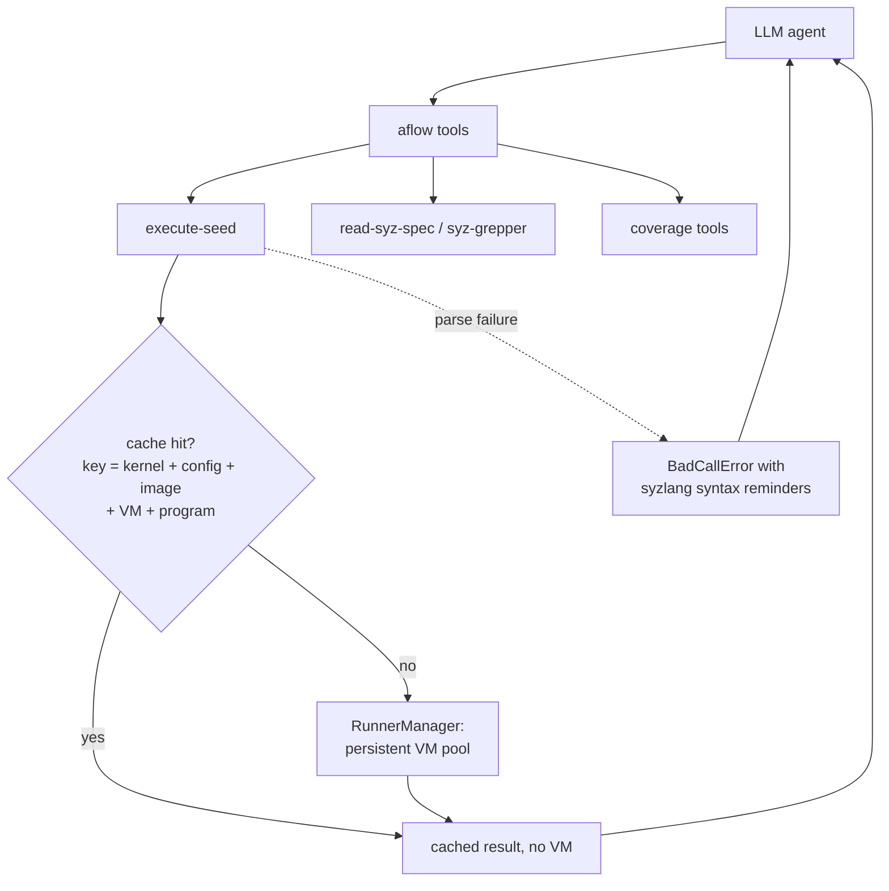

Architecturally, `pkg/aflow`'s runner is the *same* pattern as `syz-execprog`: a local RPC server, an executor in runner mode, a `queue.Source`. The 2024 refactor is what made this layer a few hundred lines instead of a fork of the project.

### 8.5 More backends (2025–2026)

VirtualBox (`f7988ea49`, Nov 2025), crosvm (`f5ad0fe2f`, Aug 2026), Firecracker (`a475c03a3`, Sep 2026). Eleven years on, new VM backends are still routine additions — the day-one interface held.

`3c3cdf19a` (Sep 2026) is a smaller but characteristic change: gVisor stopped being built from source and started being consumed as a **release tarball**. The same move as `qemu -snapshot` in 2016, one level up — stop reproducing an environment, start downloading a known-good one.

### 8.6 syz-verifier, rebuilt (Dec 2025 – Jan 2026)

The 2021 differential tester (§6.9) had its own RPC server, its own executor plumbing, and its own stats — a parallel copy of infrastructure that the 2024 refactor had meanwhile made generic. In December 2025 the copy was deleted:

- `22fca2542` (2025-12-04) *"prototype for new syz-verifier with new rpcserver and fuzzer"*
- `1687812d1` (2025-12-04) *"remove old rpc server, executor, monitor and stats"*
- `bd964999c` (2025-12-07) *"refactor corpus management"*, shared with `pkg/manager`
- `445a654a8` (2026-01-13) *"transform syz-verifier from coverage-discovery fuzzer to kernel comparison tool for pre-learned corpus"*

That last commit is the clarifying one. The original tool tried to be both a discoverer *and* a comparator; the rebuilt one only compares, and takes its inputs from a corpus some other process already learned. One job, one component, reusing the engine for everything else.

> **Takeaway:** when shared infrastructure finally arrives, go back and delete the private copies. A fork that was justified when the mainline could not serve you becomes pure maintenance cost the moment it can — and the rewrite is usually also the moment you notice the component was doing two jobs.

### 8.7 Tooling around the kernel's source and the kernel's community

Four packages from 2025–2026 that are not about fuzzing at all, which is itself the point — syzkaller's surface has expanded into everything *adjacent* to a bug report:

| Package | Date | What it does |
|---|---|---|
| `pkg/kcov` (`c9f0a9924`) | 2025-09-15 | KCOV handling as a standalone Go package, no longer welded into the fuzzer |
| `pkg/codesearch` (`280ea308c`) | 2025-11-17 | a second clang tool (after declextract) that indexes a kernel build so you can ask "show me the source of this function," "show me its comment," "what is defined in this file" |
| `pkg/updater` (`a6deb8053`) | 2025-11-24 | self-update logic factored out of syz-ci |
| `pkg/gerrit` (`5f1dd8561`) | 2026-01-29 | a Gerrit client, for the kernel's Gerrit-based review instance |
| `pkg/lore-relay` (`ce741359c`) | 2026-04-07 | polls the dashboard and the `lore` mail archive together, to relay AI job results into real mailing-list threads |

`pkg/codesearch` is the one to watch: it exists because an LLM agent (§8.4) needs to *read the kernel* to reason about a bug, and grep is not a good enough interface. Note the reuse — it *"follows conventions and build procedure of the declextract tool,"* so the clang-tool infrastructure built in 2024 for description extraction got a second, unrelated consumer.

`pkg/lore-relay` is the honest end of the output pipeline. A finding that lives only in a web dashboard is a finding most maintainers will never see; kernel work happens in mailing-list threads, so the report has to arrive there. Eleven years after the first commit, the project is still working on principle §5.

And then there is `pkg/dungeon` (`15d477690`, 2026-02-17), which ranks kernel contributors on a *gamified leaderboard* with XP, levels, RPG classes derived from subsystem tags, and "Kingdoms" derived from email domains. It is a joke with a serious premise: syzkaller's bottleneck has been human attention since 2017, and this is an attempt to make fixing syzbot bugs feel rewarding. Whether it works is beside the point — it is the clearest possible statement of where the project believes its constraint lies.

---

## 9. Year by year: every serious design change, first to current

The era chapters above group changes by *theme*. This section groups them by *year*, because that is the view you want when you are trying to answer "what mattered, and when?" Each year gets one sentence of theme and a table of the changes that actually altered the design.

The **Kind** column is the part to read first:

| Kind | Meaning |
|---|---|
| `DESIGN` | changed the shape of the system — where code lives, who owns state, what the boundaries are |
| `FEATURE` | added a capability without moving the walls |
| `ORACLE` | added a new way to *detect* that something is wrong |
| `TARGET` | added a new OS or a new kind of machine to fuzz |
| `PROCESS` | changed how the project builds, tests, or reports |

If you only study three years, study **2015** (the whole architecture appears at once), **2024** (it gets restructured on purpose), and **2017** (it stops being a tool and becomes a service).

### 9.1 2015 — the whole machine, in one commit

Everything that syzkaller is was sketched in October, and the remaining months were spent discovering that the sketch held.

| Date | Commit | Change | Kind |
|---|---|---|---|
| 10-12 | `874c5754b` | **initial commit**: descriptions + compiler + `prog` + coverage + IPC + fuzzer + manager + QEMU/local backends, 8,025 lines | `DESIGN` |
| 10-14 | `c9b915608` | call priorities and the choice table — *input selection* recognized as the real problem on day two | `DESIGN` |
| 10-16 | `587db99ba` | lkvm backend: a third VM backend proves the interface is an interface | `TARGET` |
| 12-03 | `cf2089138` | kmemleak support — the first detector beyond "it crashed" | `ORACLE` |
| 12-17 | `8e7ca7c5f` | `master/` deleted: the first central coordinator was wrong (§4.4) | `DESIGN` |
| 12-28 | `eef80b3d7` | descriptions split into per-subsystem files — the change that made mass contribution possible | `PROCESS` |

### 9.2 2016 — stop needing a special kernel, start being disposable

Two commits on one day in January changed what syzkaller *requires* of the world, and a third moved sandboxing to the side of the boundary that can reproduce a bug.

| Date | Commit | Change | Kind |
|---|---|---|---|
| 01-19 | `d5c2595f0` | adopt **upstream KCOV** — no more custom kernel patch (§5.1) | `DESIGN` |
| 01-19 | `dfd341e34` | `qemu -snapshot`: disposability becomes a property, not a cleanup routine (§5.2) | `DESIGN` |
| 01-20 / 01-22 | `aa1b7fe3a`, `1e06d2baf` | **sandboxing moves into the executor**, so the sandbox can ship inside the reproducer (§5.6) | `DESIGN` |
| 08-26 | `0d0fbbe73` | description generation moves into the build; humans stop reviewing generated Go (§1) | `PROCESS` |
| 11-17 | `cd74cc9cf` | **syz-hub**: independent managers trade corpus and reproducers, and nothing else (§4.4) | `FEATURE` |

### 9.3 2017 — from a tool into an institution

The busiest design year after 2015. Execution gained *stages*, descriptions gained a real compiler, the project gained a service that never stops, and the engine turned out to be OS-agnostic.

| Date | Commit | Change | Kind |
|---|---|---|---|
| 04-07 | `8f58526cb` | **fault injection**: systematically fail allocations to reach error paths (§5.7) | `FEATURE` |
| 05-22 | `127a9c2b6` | `pkg/ast`: a real parser with source positions, so errors name a line (§5.8) | `DESIGN` |
| 05-25 | `ffb5c7319` | **smashing**: new corpus inputs get ~100 concentrated mutations — different inputs deserve different budgets (§5.7) | `DESIGN` |
| 06-19 | `6573032ff` | **syz-ci**: fetch, build, fuzz, restart, forever. One session becomes a service (§5.3) | `DESIGN` |
| 06-22 | `61d1beb28` | **dashboard app** — what became syzbot. Report quality becomes the product (§5.3) | `DESIGN` |
| 08-16 | `07c84b670` | KCOV↔executor↔fuzzer IO rework: the plumbing for **comparison hints** (§5.4) | `FEATURE` |
| 08-28 → 09-04 | `a7206b24c`, `b06c1bd32`, `8c64b078d` | `pkg/compiler` **static checking**: type checks, `len` targets, resources with no constructor (§5.8) | `PROCESS` |
| 09-20 → 10-23 | `8cb7d3dcf`, `af442a22d`, `179a86088`, `e72955082` | Fuchsia, Windows, FreeBSD, NetBSD in six weeks (§5.5) | `TARGET` |
| 10-16 | `85b1f93f8` | one IPC protocol for every OS — consolidation after the land rush (§5.9) | `DESIGN` |

### 9.4 2018 — the feedback metric and the monolith both get taken apart

The year syzkaller stopped treating coverage as its objective, learned to mutate things it could not describe, and broke syz-ci into libraries so that bisection could exist.

| Date | Commit | Change | Kind |
|---|---|---|---|
| 02-20 | `04cbdbd1a` | **signal ≠ coverage**: feedback from successful calls outranks feedback from rejections; `pkg/signal` is born (§6.1) | `DESIGN` |
| 02-24 | `9fe8aa42c` | **squashed ANY**: mutate a described struct as opaque bytes, reaching encodings nobody wrote down (§6.2) | `DESIGN` |
| 05-10 | `4e1c0dbae` | `pkg/bisect`: find the commit that caused a bug and the one that fixed it (§6.5) | `FEATURE` |
| 05-14 | `2407e7407` | `pkg/instance`: build-boot-test as a library call — bisection's prerequisite (§6.5) | `DESIGN` |
| 06-12 | `06ece2ca6` | **runtime feature detection**: probe the live machine, disable what does not work (§6.4) | `DESIGN` |
| 06-21 / 06-27 | `94ef62054`, `43da5e3a1` | `pkg/build`, `pkg/vcs`: kernel builds and git become reusable (§6.5) | `DESIGN` |
| 07-25 / 08-03 | `2763e04c2`, `5ba57bfe1` | **`pkg/runtest`**: descriptions get unit tests with expected outcomes (§6.3) | `PROCESS` |
| 08-01 | `fbedd425b` | `pkg/mgrconfig`: one validated config schema | `PROCESS` |

### 9.5 2019 — a race detector, and a hypothesis written down

| Date | Commit | Change | Kind |
|---|---|---|---|
| 10-04 | `b2f369e56` | **KCSAN**: data-race detection, which forces the executor to actually run things concurrently (§6.6) | `ORACLE` |
| 12-30 | `6b36d3386` | **corpus rotation**: each VM gets a random slice of the world, to escape local optima (§6.7) | `FEATURE` |

### 9.6 2020 — measure, then revert, then measure again

A quiet year in features and a loud one in method: the rotation experiment ran its full arc, and kernel configuration became machine-editable.

| Date | Commit | Change | Kind |
|---|---|---|---|
| 01-07 | `6a8d39b1f` | rotation **disabled** — *"the easiest way to check is to disable and see what happens"* (§6.7) | `PROCESS` |
| 09-29 | `df5aa83a3` | `pkg/kcidb`: publish results to the kernel CI common database | `FEATURE` |
| 10-01 | `c1ff9c10c` | rotation **re-enabled** with three named fixes, nine months later (§6.7) | `PROCESS` |
| 10-15 | `9b8ec29c5` | `pkg/kconfig`: `.config` as a parsed, diffable artifact (§6.8) | `DESIGN` |

### 9.7 2021 — an oracle that needs no instrumentation

| Date | Commit | Change | Kind |
|---|---|---|---|
| 06-23 | `f96cd674a` | **syz-verifier**: run one program on two kernels, compare results. A *difference* is the bug signal (§6.9) | `ORACLE` |
| 07-28 | `5bfcec7df` | `pkg/auth`: authentication factored out of the dashboard for reuse by syz-hub | `PROCESS` |

### 9.8 2022 — the last mile to a human

| Date | Commit | Change | Kind |
|---|---|---|---|
| 07-15 | `6db8af716` | **`pkg/asset`**: upload the kernel image and disk image a reproducer needs, so a developer boots *your* environment (§6.10) | `FEATURE` |
| 12-14 | `2083933ab` | `pkg/subsystem`: guilty file → subsystem → maintainer list. Started with vfs alone (§6.10) | `FEATURE` |
| 12-17 | `8482d3c10` | `pkg/image`: image compression leaves `prog` (§6.10) | `PROCESS` |

### 9.9 2023 — consolidation

No structural change worth a row. `pkg/report`, descriptions, and the dashboard absorbed hundreds of incremental commits. Worth knowing that such years exist: the 2024 refactor was possible *because* the preceding year was spent on tests and cleanup rather than new structure.

### 9.10 2024 — the great refactor

Every row here is a recognizable software-engineering pattern, which is why §7 covers this year in depth. Net effect: **one brain on the host, dumb hands in the VMs.**

| Date | Commit | Change | Kind |
|---|---|---|---|
| 02-16 | `c35c26ec6` | `pkg/fuzzer`: the engine becomes a host-side library (§7.2) | `DESIGN` |
| 03-13 | `fc090d205` | `pkg/corpus`: one corpus, one coverage map, its own tests (§7.2) | `DESIGN` |
| 04-16 | `7009aebcd` | **`pkg/vminfo`**: the machine check moves to the host — the prerequisite for everything below (§7.8) | `DESIGN` |
| 04-26 | `f10afd693` | `pkg/covermerger`: merge coverage across kernel revisions (§7.10) | `FEATURE` |
| 05-02 | `a3ce1723b` | **`pkg/flatrpc`**: an explicit, language-neutral wire schema replacing Go `gob` (§7.3) | `DESIGN` |
| 05-03 | `03820adae` | `pkg/fuzzer/queue`: execution as composable layers, priority as a 5-line expression (§7.4) | `DESIGN` |
| 06-04 | `e16e2c9a4` | **executor runner mode; `syz-fuzzer/`, `pkg/ipc/`, `pkg/host/` deleted** (§7.2) | `DESIGN` |
| 07-02 | `fc2b08301` | `vm/dispatcher`: VMs as a pool of restartable slots; boot failure is a channel message (§7.5) | `DESIGN` |
| 07-05 | `4d77b9fe7` | **snapshot fuzzing**: `loadvm` before every program, buying determinism at the cost of the transport (§7.6) | `DESIGN` |
| 07-29 → 12-02 | `3d5fb491e`, `b2c5a234a` | `syz-declextract`: a clang tool that reads kernel source and writes syzlang (§7.7) | `FEATURE` |
| 08-28 | `9bd464fce` | `pkg/coveragedb`: coverage gains a time axis (§7.10) | `FEATURE` |
| 08-30 | `8d09a3b3b` | `pkg/manager`: the repro loop becomes reusable — and is reused in Dec 2025 (§7.10) | `DESIGN` |
| 10-24 | `9a199dec5` | **focus areas**: attention becomes a weight, not a boolean filter (§7.9) | `DESIGN` |
| 11-26 | `4f0d9df00` | `pkg/ifaceprobe`: boot a kernel, open every device file, record what it reaches (§7.7) | `FEATURE` |

### 9.11 2025 — fuzz targets inside the kernel, and the engine starts paying dividends

| Date | Commit | Change | Kind |
|---|---|---|---|
| 01-23 | `79910ad71` | descriptions become an embedded `gob`+`flate` blob; **`sys/sys.go` finally deleted**; its hash becomes the handshake check (§8.1) | `DESIGN` |
| 09-15 | `9a3002038` | **`pkg/kfuzztest`**: read `vmlinux` DWARF, discover annotated in-kernel fuzz targets, generate syzlang for them at runtime (§8.2) | `FEATURE` |
| 09-15 | `c9f0a9924` | `pkg/kcov`: KCOV handling as a standalone package (§8.7) | `PROCESS` |
| 11-06 | `f7988ea49` | VirtualBox backend (§8.5) | `TARGET` |
| 11-17 | `280ea308c` | `pkg/codesearch`: a second clang tool, so an agent can *read* the kernel (§8.7) | `FEATURE` |
| 11-24 | `a6deb8053` | `pkg/updater` factored out of syz-ci (§8.7) | `PROCESS` |
| 12-04 | `22fca2542`, `1687812d1` | **syz-verifier rebuilt** on the shared rpcserver and fuzzer; its private copies deleted (§8.6) | `DESIGN` |

### 9.12 2026 — agents, and the community as the bottleneck

| Date | Commit | Change | Kind |
|---|---|---|---|
| 01-02 | `45d8f0796` | **`pkg/aflow`**: LLM-driven workflows over syzkaller primitives, with content-addressed execution caching (§8.4) | `DESIGN` |
| 01-13 | `445a654a8` | syz-verifier narrowed to one job: compare kernels over a pre-learned corpus (§8.6) | `DESIGN` |
| 01-29 | `5f1dd8561` | `pkg/gerrit`: a client for the kernel's Gerrit review instance (§8.7) | `FEATURE` |
| 02-17 | `15d477690` | `pkg/dungeon`: a gamified contributor leaderboard — a statement about where the bottleneck is (§8.7) | `FEATURE` |
| 04-07 | `ce741359c` | `pkg/lore-relay`: relay AI job results into real mailing-list threads (§8.7) | `FEATURE` |
| 06-01 | `fc63d1254` | **`pkg/execbackend`**: execution itself becomes an interface — RPC, snapshot, local (§8.3) | `DESIGN` |
| 08-07 | `f5ad0fe2f` | crosvm backend (§8.5) | `TARGET` |
| 09-02 | `a475c03a3` | Firecracker backend (§8.5) | `TARGET` |
| 09-11 | `3c3cdf19a` | gVisor consumed as a release tarball instead of built from source (§8.5) | `PROCESS` |

### 9.13 What the shape of this list tells you

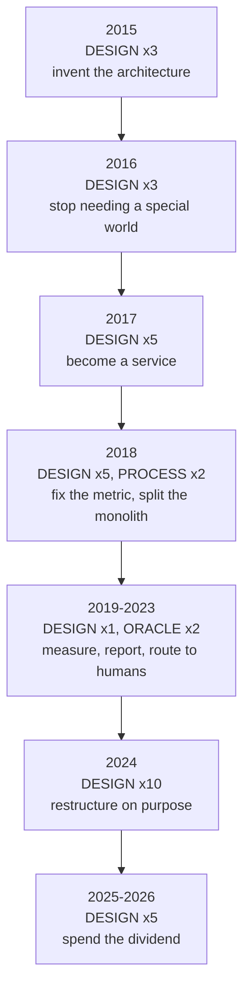

Three patterns a learner should take away:

**Design changes cluster; features do not.** 2015, 2017 and 2024 hold over half the `DESIGN` rows between them. In between are long stretches of `FEATURE`, `ORACLE` and `PROCESS` work. A codebase that restructures continuously never stabilizes; one that never restructures ossifies. syzkaller does it in bursts, and each burst is preceded by a stretch of tests and cleanup — 2023 produced no structural change at all, and 2024 was possible because of it.

**The hard changes are relocations, not additions.** Look at what the `DESIGN` rows actually say: coverage moves from a patch to upstream, sandboxing moves into the executor, the machine check moves to the host, the engine moves out of the VM, the wire format moves from implicit to declared, execution moves behind an interface. Almost none of them add a capability. They move an existing one to a better side of a boundary — and *that* is what unlocked the next round of features.

**Capability arrives years after the enabling change.** `pkg/manager` became reusable in Aug 2024 and was reused in Dec 2025. The clang-tool infrastructure built for descriptions in 2024 got an unrelated second consumer in Nov 2025. `pkg/aflow` is a few hundred lines rather than a fork of the project *only* because of the 2024 refactor. When you are judging whether a restructuring was worth it, the evidence shows up on a multi-year delay.

---

## 10. The five design principles worth stealing

Compressing eleven years into things you can apply this week:

### 1. Model the input, do not guess it
Random bytes cannot produce a valid file descriptor. A declarative model of your target's interface — even a partial, slightly wrong one — multiplies your effective throughput. And making the model *data* rather than *code* lets other people extend your coverage without understanding your engine.

### 2. Keep durable state out of the blast radius
The 2024 refactor's whole point. Identify what you cannot afford to lose and what you expect to die, and put a narrow protocol between them. In-flight work can be re-queued; accumulated knowledge cannot be re-derived.

### 3. Design for the failure as the normal case
VMs crash — that is the *goal*, not an exception. So boot failure is a channel message, a restart is the next loop iteration, and every request carries retry semantics. If your automation's happy path is the only path you designed, it will spend its life in the unhappy one.

### 4. Make the schema explicit at every boundary
A FlatBuffers schema between Go and C++. A content hash of the description tables verified at handshake. A declarative VM-type registry. Every place two components must agree, the agreement is written down and checked at runtime.

### 5. The output pipeline is half the system
syzkaller can find a crash in minutes. Turning that into a *fixed bug* requires deduplication, symbolization, minimization, C-reproducer generation, bisection, subsystem routing, and maintainer email — years of engineering, most of it after the fuzzer already worked. Findings nobody acts on are worth nothing.

---

## 11. Where to go next: the component map

Five documents cover syzkaller's design. Each takes a **different aspect** of the system, deliberately — this table is the index, and it is also the completeness check. Read the column headings as: *"if I want to know X about component Y, which document?"*

| Core component | **History** (why it exists) | **manager-on-board** (how it is orchestrated) | **execprog-design** (how one program runs) | **mutation-design** (how choices are made) | **syzlang-design** (how the API is modelled) |
|---|---|---|---|---|---|
| **Descriptions / syzlang** | §4.1 the decision to make the API *data* | — | §2.2 the text form you actually read | §8 the 1%-ignore-the-range policy | **primary**: language, compiler, consts, `syz-sysgen` |
| **Program model** (`Prog`/`Call`/`Arg`) | — | — | **primary**: §2.2, the four representations | §4–5 what gets mutated | §2 how `prog.Type` is instantiated |
| **Arena / memory layout** | — | — | **primary**: §2.3, fixed base + relative offsets | — | §1.7 squashed ANY |
| **Copyin instruction stream** | §7.3 why a schema | — | **primary**: §2.3 *interpreted* | — | — |
| **C reproducer** (`pkg/csource`) | §5.3 why report quality matters | §8 `strace_bin` config | **primary**: §5.7 the *same source, compiled* | — | — |
| **KCOV / coverage collection** | §5.1 upstreaming as leverage | §3.3 noticing a crash | **primary**: §2.4 the per-call bracket | — | — |
| **Signal vs coverage** | §6.1 the 2018 decision to prioritize success | — | §4.8 the storage distinction | §3 how priority is used | — |
| **Corpus** | §7.2 made its own package; §6.7 the rotation experiment | §1.2 preloaded concurrently | **primary**: §4 storage, `pkg/db`, versioning | §3 selection and weighting | — |
| **Generation** | §4.2 call priorities on day two | — | — | **primary**: §8 value distributions | §1.4 resources as ordering |
| **Mutation** | §6.2 squashed ANY, the controlled retreat | — | — | **primary**: §4–5 operators and weights | — |
| **Execution stages** (smash, fault inject) | §5.7 why inputs get different budgets | — | — | **primary**: §1, §7 smash and hint limits | — |
| **Focus areas / coverage filter** | **primary**: §7.9 weights replacing a boolean | — | — | §3 how weighting composes | — |
| **Bug detectors** (KASAN, KCSAN, leak) | §6.6 one oracle per year, and what each one cost | §6 what the report pipeline sees | §2.4 why `slowdown` exists | — | — |
| **Differential testing** (`syz-verifier`) | §6.9 an oracle needing no coverage; §8.6 rebuilt | — | — | — | — |
| **Description testing** (`pkg/runtest`) | §6.3 data files need tests too | — | — | — | §4 the test format |
| **Choice table** | §4.2 the original idea | — | — | **primary**: §6 static + `2*sqrt` dynamic | §1.4 the resource graph it reads |
| **Hints** (`KCOV_TRACE_CMP`) | §5.4 the plumbing commit | — | §2.7 the `-hints` flag | **primary**: §7 `shrinkExpand`, limiter | — |
| **Minimization** | — | — | §4.7 *corpus* set-cover; §5.5 *repro* shrinking | §1 the signal-preserving predicate | — |
| **Triage / deflaking** | — | §1.3 the phase that gates it | — | **primary**: §1 the 3-of-5 statistics | — |
| **Queue layers** | §7.4 composition over special cases | — | **primary**: §3 the layer stack | §1 `Order`/`Alternate` as priority | — |
| **Wire protocol** (flatrpc) | §7.3 schema at the boundary | §4 the handshake | §2.7 flags → the two bitmasks | — | §2.4 the revision hash check |
| **Executor** | §7.2 reduced to "dumb hands" | §3.2 `RunRequests` per boot | **primary**: §2.4, §2.6 pseudo-syscalls | — | §2.4 `syscalls.h`, `SYZ_REVISION` |
| **Sandboxes** | — | §8 the config key | **primary**: §2.10 what each one does | — | — |
| **VM abstraction** | §4.3 the five-method interface | **primary**: §2 registration, QEMU args | — | — | — |
| **VM lifecycle / dispatcher** | §7.5 pool of restartable slots | **primary**: §3.1 `Loop`, `runInstance` | — | — | — |
| **Bare metal / `isolated`** | §4.3 one backend among many | **primary**: §5 pstore, repair, power cycle | — | — | — |
| **Machine check** | §6.4 runtime feature detection; §7.8 moved to the host | **primary**: §4 the probe-then-swap trick | — | — | §2.4 why revisions must match |
| **Crash detection / reports** | §6.11 parsing as a subsystem | **primary**: §3.3, §6 the pipeline | — | — | — |
| **Reproducer extraction** | §5.3 the output pipeline | §1.2 `reproVMs` budget | **primary**: §5 the whole algorithm | — | — |
| **Snapshot mode** | §7.6 why, and what it cost | **primary**: §7 the two-phase backend | — | §1 why it needs less deflaking | — |
| **Description automation** | §7.7 static + dynamic fusion | §1.1 `-mode iface-probe` | — | — | **primary**: §3 declextract, ifaceprobe |
| **Agentic layer** (`pkg/aflow`) | §8.4 the newest layer | — | §6 cached execution | — | §6 `syzspec` index/buckets |

### Deliberately not covered

Honest about the edges, so you know what you are not getting:

| Not covered | Why |
|---|---|
| `syz-hub` internals | Only the role is described (History §4.4). It is a small corpus-exchange service; nothing in it teaches a transferable pattern. |
| Dashboard / syzbot internals | App Engine web service. History §5.3 gives the role and why it matters; the implementation is product, not design. |
| Bisection (`pkg/bisect`) | Mentioned in History §6. It is a build-and-test loop around git; conceptually simple, operationally fiddly. |
| Coverage *reports* (`pkg/cover`, `syz-cover`, the web UI) | execprog-design §2.5 covers emitting raw PCs, which is the design-relevant half. Rendering HTML from them is tooling. |
| `pkg/report` regex corpus | The *architecture* is in manager-on-board §3.3 and §6. The hundreds of per-OS patterns are data, not design. |
| Fault injection, KCSAN, leak checking | Named where they appear. Each is a kernel feature syzkaller enables, not syzkaller design. |

### Suggested reading order

```mermaid
flowchart LR
    H["History<br/>what exists and why"] --> S["syzlang-design<br/>how the API is modelled"]
    S --> E["execprog-design<br/>how ONE program runs"]
    E --> M["mutation-design<br/>how the next one is chosen"]
    M --> O["manager-on-board<br/>how it runs unattended"]
    O --> V["syzkaller-vs-libfuzzer<br/>which parts are inherent<br/>to coverage-guided fuzzing"]
    V --> L1["rust-clone-lab-userspace<br/>Part 1: build one against<br/>a target you wrote"]
    L1 --> L2["rust-clone-lab<br/>Part 2: build one against<br/>a kernel and a board"]
```

The order matters: you cannot understand mutation before you understand what a program *is*, and you cannot appreciate the manager's complexity until you have seen what a single execution requires. The libFuzzer comparison comes before the lab on purpose — it is most useful once you know what syzkaller's components *are*, because its job is to sort them into "every coverage-guided fuzzer needs this," "this is the price of a typed input," and "this is the price of a target that can kill you." That sorting is what the two-part lab then builds against, userspace first.

---

## Appendix: verifying any claim in this chapter

Every statement above is checkable. Useful recipes:

```bash
# When was a package or file introduced?
git log --format='%ad %h %s' --date=short --diff-filter=A --reverse -- 'pkg/fuzzer/fuzzer.go'

# When was something deleted? (Finding the deletion often explains the replacement.)
git log --format='%ad %h %s' --date=short --diff-filter=D -- 'syz-fuzzer/fuzzer.go'

# What did a commit actually change?
git show --stat 874c5754bb22dbf77d6b600ff91f0f4f1fc5073a

# Which files change together most often? (reveals hidden coupling)
git log --format='---' --name-only -- '*.go' | sort | uniq -c | sort -rn | head -30

# Who owns a subsystem, and what is the current rationale?
git log -p --follow pkg/fuzzer/job.go | grep -A5 'deflake'
```

Two habits that pay off in any codebase:

- **Read the comments next to the constants.** syzkaller's magic numbers come with their reasoning attached. `pkg/fuzzer/job.go` explains that "a program that reproduces 80% of the time will pass deflake with 94% probability." `prog/prio.go` opens with the honest admission: *"the current implementation is very basic, there is no theory behind any constants."* That candor tells you exactly which knobs are tuned and which are guesses.
- **Read deletions, not just additions.** `master/` being deleted in 2015 and `syz-fuzzer/` in 2024 are the two most informative events in this history. What a project removes tells you what it learned.
