# Mutation Design: How syzkaller Decides What to Try Next

> **Who this is for.** You understand roughly what a fuzzer does. Now you want to know the part nobody explains: **where do the numbers come from?** Why is splice weighted 200 and remove-call 10? Why does a program with more coverage get picked more often, and by exactly how much?
>
> This document is a tour of every priority computation in syzkaller, with the actual constants. By the end you should be able to build a comparable priority system for your own tool — and, importantly, know which of syzkaller's numbers are principled and which are admitted guesses.

---

## 0. The one-paragraph summary

A fuzzer's throughput is fixed by hardware. Its *productivity* is decided entirely by what it chooses to run next. syzkaller makes that choice at **five nested levels**, each with its own priority scheme:

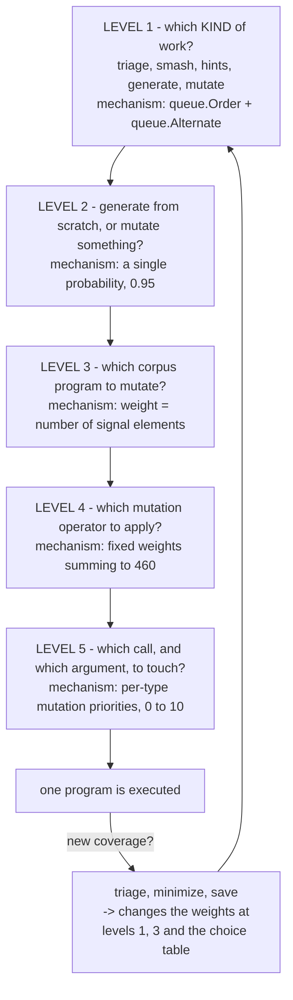

And one more, orthogonal: **which syscall should follow which** — the *choice table*, used when generating or inserting a call.

Everything below is one of those six mechanisms.

---

## 1. Level 1: which kind of work?

The fuzzer is not a single loop. At any moment several *kinds* of work compete for the next execution slot. `pkg/fuzzer/fuzzer.go`, `execQueues`:

```go
ret.source = queue.Order(
    ret.triageCandidateQueue,
    ret.candidateQueue,
    ret.triageQueue,
    queue.Alternate(ret.smashQueue, skipQueue),
    queue.Callback(fuzzer.genFuzz),
)
```

with `skipQueue := 3` normally, or `2` when testing a patch.

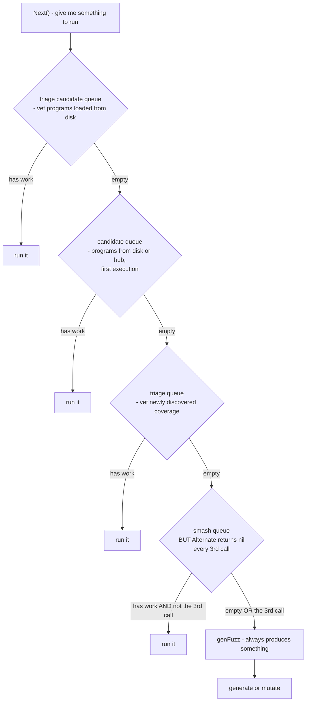

### Why this order

`queue.Order` is strict priority: the first layer with work wins. The ordering expresses a policy:

1. **Triage beats everything.** When a program shows new coverage, you must confirm it is real (not a one-off flake) and minimize it *before* building on it. Deferring triage means the corpus accumulates unverified junk that every subsequent mutation inherits.
2. **Candidates beat triage of fuzzer-found inputs.** Programs loaded from `corpus.db` or received from the hub are known-valuable; get them into the corpus fast so mutation has good material.
3. **Smash is throttled, not starved.** `Alternate(smashQueue, 3)` returns nothing every third call, so smashing takes at most 2 of every 3 available slots. Smashing is deep exploitation of one good input — valuable, but it must not monopolize the fuzzer.
4. **`genFuzz` is the floor.** `Fuzzer.Next()` panics on nil, and the `Callback` layer always produces something, so there is always work.

> **Pattern worth stealing:** express a multi-stage scheduling policy as a composition of tiny combinators. `Order` plus `Alternate` is five readable lines. The alternative — a scheduler function full of counters and `if` branches — is where starvation bugs hide.

### What each job type does

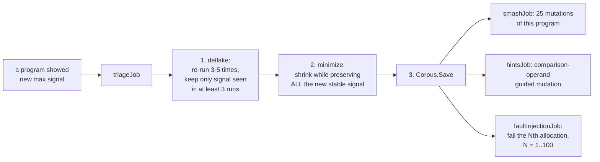

### The deflake constants, and the reasoning behind them

This is the best-documented set of numbers in the codebase (`pkg/fuzzer/job.go`):

| Constant | Value | Applies to |
|---|---|---|
| `deflakeNeedRuns` | 3 | newly discovered programs |
| `deflakeMaxRuns` | 5 | newly discovered programs |
| `deflakeNeedCorpusRuns` | 2 | programs being re-triaged from corpus |
| `deflakeMinCorpusRuns` | 4 | corpus re-triage |
| `deflakeMaxCorpusRuns` | 6 | corpus re-triage |
| `deflakeTotalCorpusRuns` | 20 | corpus re-triage upper bound |
| `deflakeNeedSnapshotRuns` | 2 | snapshot mode |

The source states the design goal: pick the signal common to **3 out of 5** runs, because *"a program that reproduces 80% of time will pass deflake() with a 94% probability."* That is a real statistical statement you can check — the chance of at least 3 successes in 5 Bernoulli(0.8) trials.

Corpus re-triage uses the laxer 2-of-6 threshold, and the comment says why: re-adding thousands of corpus programs with strict thresholds would *"create lots of duplicate work for minimization/hints/smash/fault injection."* Different confidence requirements for different stakes.

Snapshot mode needs only 2 runs, because snapshot execution is deterministic — there is far less to deflake.

The mechanism is a ladder of intersections:

```go
for j := needRuns - 1; j > 0; j-- {
    intersect := info.signals[j-1].Intersection(thisSignal)
    info.signals[j].Merge(intersect)
}
info.signals[0].Merge(thisSignal)
```

After the loop, `signals[k]` holds the signal seen in **at least k+1 runs**, so `signals[needRuns-1]` is the stable signal. Elegant: one array gives you every confidence level at once.

Each repeat also carries an `Avoid` list naming the executors that already ran it, so repeats land on *different* VMs. A coverage element that only appears on VM 3 is a property of VM 3's state, not of the program.

> **Pattern worth stealing:** when validating a noisy measurement, state your confidence target numerically, pick thresholds that achieve it, and **write the probability in the comment**. Six months later nobody will remember whether 3-of-5 was principled or arbitrary.

### Minimization's predicate

`triageJob.minimize` runs `prog.Minimize` with a predicate that accepts a reduction only if:

```go
info.newStableSignal.Intersection(mergedSignal).Len() == info.newStableSignal.Len()
```

Every bit of the new stable signal must survive. Minimization is *signal-preserving by construction* — the shrunk program is guaranteed to still reach the new code.

A second guard, `reexecutionSuccess`, refuses to turn a succeeding call into a failing one. The comment: *"Successful calls are much more valuable."* A program where `openat` fails and `ioctl` therefore returns `EBADF` is technically shorter and technically still triggers the coverage, but it is a worse program — it has stopped exercising the thing you care about.

---

## 2. Level 2: generate or mutate?

`genFuzz` in `pkg/fuzzer/fuzzer.go` is almost comically simple for how much it decides:

```go
mutateRate := 0.95
if !fuzzer.Config.Coverage {
    // If we don't have real coverage signal, generate programs
    // more frequently because fallback signal is weak.
    mutateRate = 0.5
}
...
if rnd.Float64() < mutateRate { req = mutateProgRequest(fuzzer, rnd) }
if req == nil { req = genProgRequest(fuzzer, rnd) }
if fuzzer.Config.Collide && rnd.Intn(3) == 0 {
    req = &queue.Request{Prog: randomCollide(req.Prog, rnd), ...}
}
```

**95% mutate, 5% generate** — when coverage works.

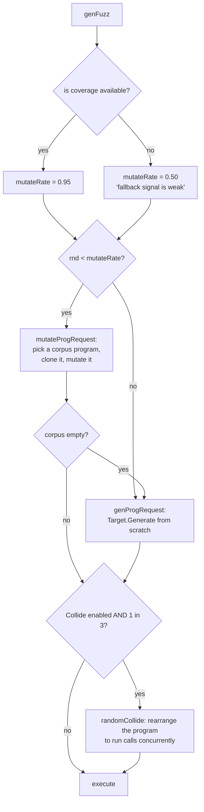

The 95/5 split says: **accumulated knowledge is worth about twenty times more than fresh randomness.** A corpus program already got past the front door — it opened the right device, got a valid file descriptor, set up the right socket state. Throwing that away to generate from scratch wastes that work.

But when coverage is unavailable, syzkaller falls back to a weak signal derived from syscall numbers and errnos. With a weak score function, "interesting" is nearly meaningless, so the corpus is less trustworthy and exploration deserves equal weight. **The exploit/explore ratio is tied to how much you trust your feedback.** That is a genuinely insightful piece of design.

`randomCollide` creates concurrency to find race conditions: 20% of the time `DoubleExecCollide`, otherwise a mix of `DupCallCollide`, `AssignRandomAsync`, and `AssignRandomRerun`.

> **Pattern worth stealing:** make your explore/exploit ratio a function of feedback quality, not a constant. If your score function degrades, automatically shift toward exploration.

---

## 3. Level 3: which corpus program to mutate?

### The weighted picker

`pkg/corpus/prio.go` — about twenty lines doing a lot of work:

```go
type ProgramsList struct {
    progs    []*prog.Prog
    sumPrios int64
    accPrios []int64   // cumulative sums
}

func (pl *ProgramsList) saveProgram(p *prog.Prog, prio int) {
    if prio == 0 { prio = 1 }
    pl.sumPrios += int64(prio)
    pl.accPrios = append(pl.accPrios, pl.sumPrios)
    pl.progs = append(pl.progs, p)
}

func (pl *ProgramsList) chooseProgram(r *rand.Rand) *prog.Prog {
    randVal := r.Int63n(pl.sumPrios) + 1
    idx := sort.Search(len(pl.accPrios), func(i int) bool {
        return pl.accPrios[i] >= randVal
    })
    return pl.progs[idx]
}
```

This is the standard **cumulative-weight array + binary search**, and it is the single most reusable snippet in syzkaller.

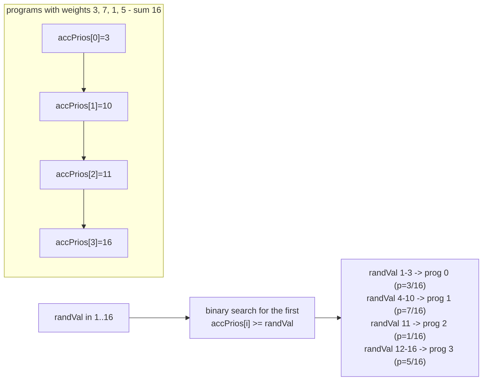

O(log n) selection, O(1) amortized insertion, exact proportionality. The `prio == 0 → 1` floor guarantees nothing becomes permanently unreachable.

### The weight: `len(Signal)`

In `Corpus.Save`, a new item is registered as `corpus.saveProgram(inp.Prog, len(inp.Signal))`. **The weight is the number of signal elements the program produced.**

So a program that covered 200 new edges is 200× more likely to be chosen for mutation than one that covered 1. The reasoning is a bet: a program that touched a lot of code sits in a rich neighbourhood, and small perturbations are more likely to reach something new.

Two gotchas worth knowing if you read the code:

- When an *existing* program is re-saved with merged signal, `saveProgram` is **not** called again. Its selection weight stays at the value computed on first insertion until the next `Corpus.Minimize()` recomputes everything. A deliberate simplification: weights are approximate anyway, and minimization runs regularly.
- `Corpus.Minimize` must clear the program lists **in place**, because the statistics objects hold pointers into those structs. The comment says so. A reminder that observability can constrain your data structures.

### Focus areas: a second layer on top

`Corpus.ChooseProgram` adds an optional outer selection when `focus_areas` is configured:

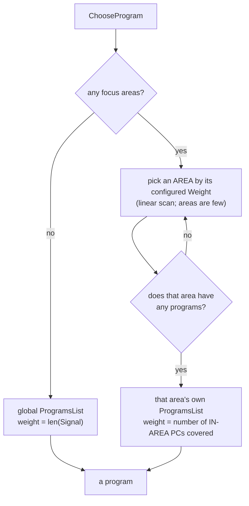

Note the two different weight functions:

- **Globally**: weight = signal count — "how much did this teach us?"
- **Within an area**: weight = `inAreaPCs(item.Cover)`, the count of covered PCs that fall inside the area — "how much of *this specific code* does it touch?"

This is the mechanism for "fuzz my new driver specifically." You give a list of source files or functions, and a weight; programs touching that code get selected disproportionately. An area with an empty `CoverPCs` list reuses the global list, which lets you express "spend 70% of effort on my driver, 30% on everything else."

(The area selection loop is weighted but slightly skewed in its current implementation — worth knowing if you need exact proportions.)

> **Pattern worth stealing:** the cumulative-weight picker generalizes to any "sample proportional to importance" problem. And note the composition: a weighted choice of *categories*, then a weighted choice *within* the category. Two simple layers express priorities that would be awkward as one flat distribution.

---

## 4. Level 4: which mutation operator?

Now we are inside `prog/mutation.go`, and this is where the famous numbers live.

```go
var DefaultMutateOpts = MutateOpts{
    ExpectedIterations: 5,
    MutateArgCount:     3,

    SquashWeight:     50,
    SpliceWeight:     200,
    InsertWeight:     100,
    MutateArgWeight:  100,
    RemoveCallWeight: 10,
}
```

Total weight = **460**. So per iteration:

| Operator | Weight | Probability | What it does |
|---|---:|---:|---|
| `splice` | 200 | **43.5%** | insert *all* calls of a random corpus program at a random position |
| `insertCall` | 100 | **21.7%** | generate one new call and insert it, biased toward the end |
| `mutateArg` | 100 | **21.7%** | change one or more arguments of one call |
| `squashAny` | 50 | **10.9%** | flatten a structured pointer argument into raw bytes, then mutate the bytes |
| `removeCall` | 10 | **2.2%** | delete a random call |

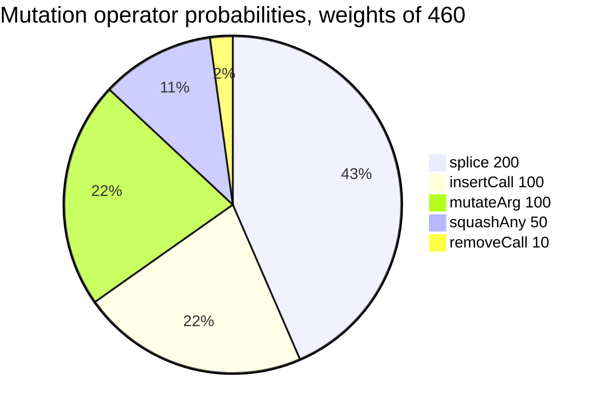

### Reading the weights as a philosophy

**Splice dominates at 43.5%.** Splicing takes an entire other corpus program and injects it. That is aggressive — it can double the program length and create interactions between two unrelated subsystems. It is the highest-variance operator and it gets the highest weight, which tells you syzkaller is betting on **cross-pollination between known-good building blocks** over careful local edits. This is the same intuition behind crossover in genetic algorithms.

**Remove-call is nearly absent at 2.2%.** Shrinking is handled by the dedicated minimization pass, which is signal-preserving and far smarter than random deletion. A mutation operator that only destroys information deserves almost no budget.

**Squash at 10.9% is a type-system escape hatch.** Normally arguments are mutated in a type-respecting way: an `int32[0:10]` stays in range, a pointer stays a valid pointer. But real bugs often need *malformed* structures — a length field that disagrees with the buffer, a nested pointer that is garbage. `squashAny` converts a typed argument tree into an opaque byte blob and then applies raw byte mutations. The type system stops protecting you, which is the point.

There is a good ordering detail in `squashAny`: it calls `analyze()` *before* mutating the blob, with a comment explaining that *"after mutation the blob can grow out of bounds of the data area and analyze will crash with out-of-bounds access."* Order of operations as a correctness property.

### The loop and `ExpectedIterations`

```go
for stop, ok := false, false; !stop; stop = ok && len(p.Calls) != 0 && r.oneOf(opts.ExpectedIterations) {
    // pick and apply one operator; ok = did it succeed
}
```

Read the termination condition carefully: the loop stops with probability 1/5 **only after a *successful* mutation** (`ok` must be true). A failed operator — splice with an empty corpus, squash with nothing squashable, insert when already at the call limit — costs nothing and the loop retries.

So the **expected number of applied mutations is 5**, and the actual count is geometrically distributed: sometimes 1, sometimes 15. That distribution matters. Always applying exactly one mutation explores too locally; always applying ten overshoots. A geometric distribution covers both scales.

The comment on `squashAny` acknowledges the weights are only nominal: *"Not all calls have anything squashable, so this has lower priority in reality."* The *effective* probability of each operator depends on how often it is applicable, which varies by program. The declared weights are an upper bound.

> **Pattern worth stealing:** `stop = ok && oneOf(N)` — retry failures for free, and make the number of *successful* steps geometrically distributed with a stated mean. Two lines, and it handles both "operator not applicable" and "vary the step size."

### Inside `mutateArg`: the inner loop

```go
for stop, ok := false, false; !stop; stop = ok && r.oneOf(ctx.opts.MutateArgCount) {
```

Same pattern, `MutateArgCount = 3`, so **expected 3 argument mutations** per `mutateArg` invocation. After each, `patchConditionalFields` fixes up any conditional union fields that no longer satisfy their conditions, and `assignSizesCall` recomputes length fields — so the program stays internally consistent.

### `insertCall` and the end bias

```go
idx := r.biasedRand(len(p.Calls)+1, 5)
```

`biasedRand(n, k)` returns a value in `[0, n)` where the probability of `n-1` is **k times** the probability of `0`. With `k = 5`, inserting near the end of the program is 5× more likely than at the beginning.

Why: syzkaller programs are built up as a pipeline — open, configure, use. The interesting *new* action usually belongs at the end, after the setup already in the program. Inserting at position 0 typically just produces an unrelated prefix.

The implementation is a closed-form inverse-CDF sample of a linear density:

```go
nf, kf := float64(n), float64(k)
rf := nf * (kf/2 + 1) * r.Float64()
bf := (-1 + math.Sqrt(1+2*kf*rf/nf)) * nf / kf
return int(bf)
```

`biasedRand` is reused throughout: array lengths, filename lengths, blob append sizes, and `resourceCentric`'s call-chain length.

---

## 5. Level 5: which call, and which argument?

### Choosing a call: weight by argument complexity

```go
func chooseCall(p *Prog, r *randGen) int {
    for _, c := range p.Calls {
        var totalPrio float64
        ForeachArg(c, func(arg Arg, ctx *ArgCtx) {
            prio, stopRecursion := arg.Type().getMutationPrio(...)
            totalPrio += prio
            ctx.Stop = stopRecursion
        })
        prioSum += totalPrio
        callPriorities = append(callPriorities, prioSum)
    }
    if prioSum == 0 { return -1 } // All calls are without arguments.
    return sort.SearchFloat64s(callPriorities, prioSum*r.Float64())
}
```

Same cumulative-array trick again, at a third level. **A call's weight is the sum of its arguments' mutation priorities.** So `ioctl$SOMETHING` with a 200-byte nested struct gets picked far more often than `close(fd)`, which has essentially nothing worth changing.

This is the right instinct: mutation budget should flow to where there is something to mutate.

### Choosing an argument: `mutationArgs`

`collectArg` walks every argument of the chosen call and builds the same cumulative array, skipping:

- priority `dontMutate` (0)
- output-direction args, unless they are buffers or arrays (an output scalar's value is overwritten by the kernel anyway)
- fixed-size zero-length args

It uses a `[16]mutationArg` stack buffer to avoid allocating in the hot path — a detail worth noting for anyone writing a fuzzer in a GC'd language. Then `chooseArg` does `goal := prioSum * r.Float64()` and a binary search.

### The priority table: every number

Scale (`prog/mutation.go`):

```go
maxPriority = 10.0
minPriority = 1.0
dontMutate  = 0.0
```

| Type | Priority | Reasoning |
|---|---|---|
| `ArrayType` | **10** (0 if fixed length) | changing element count and order is high-value structural mutation |
| `BufferType` (compressed) | **10** | *"Prioritise mutation of compressed buffers, e.g. disk images"* — filesystem images are a rich bug source |
| `StructType` / `UnionType` with a special generator | **10**, and stop recursing | the hand-written generator knows best; do not also fiddle with its fields |
| `UnionType`, non-special, >1 field | **10** | switching the active union variant is a big semantic change |
| `IntType`, range of ≤256 values | **10** | a small range means every value is probably meaningful; try them all |
| `BufferType`, general | **8** (`0.8 × max`) | byte blobs are great mutation targets |
| `FlagsType` | `rangeSizePrio(len(Vals))`, **+1 if bitmask** | bitmask flags get a bonus: *"the mutation will include more possible operations (bitwise operations)"* |
| `ProcType` | **5** (`0.5 × max`) | per-process value; moderately interesting |
| `ResourceType` | **5** | re-pointing at a different resource is meaningful but constrained |
| `VmaType` | **5** | memory-mapping arguments |
| `PtrType` | **3** (`0.3 × max`); **0** if already a special pointer | pointer *targets* are mutated via their own args; the pointer itself less so. The source admits: *"TODO: we ought to mutate this, but we don't have code for this yet"* |
| `IntType`, no range | `log2(bits) + 1` → **4** for 8-bit, **6** for 32-bit, **7** for 64-bit | wider integers have more to explore |
| `IntType`, range >256 | same as plain | a wide range behaves like an unconstrained int |
| `LenType` | **1** (`0.1 × max`); **0** for KFuzzTest | *"Mutating LenType only produces 'incorrect' results according to descriptions"* — occasionally that is exactly what you want, so not zero |
| `ConstType` | **0** | it is a constant |
| `CsumType` | **0** | recomputed automatically |
| `BufferType`, output and fixed length | **0** | the kernel overwrites it |
| `BufferType`, string with exactly 1 value | **0** | *"effectively consts (and frequently file names)"* |
| `ArrayType`, fixed length | **0** | nothing to change |
| `UnionType` with 1 field, non-special | **0** | no alternative to switch to |

`rangeSizePrio(size)`:

```go
case size == 0:  0
case size == 1:  1                                    // minPriority
default:         min(size/3 + 4, 9)
```

With the comment: *"The threshold is 15 because most of the calls have <= 15 possible values for a flag."* At size 15 you get `15/3 + 4 = 9`, the cap. So flag sets of 15 or more values all sit at 9, and smaller sets scale down.

`ConstType.mutate` and `CsumType.mutate` both `panic()` — they are unreachable precisely because their priority is `dontMutate`. The panic is an assertion that the priority table and the mutator table agree.

### The honest comment

Right above the priority functions:

> `// TODO: find a way to estimate optimal priority values.`
> `// Assign a priority for each type. The boolean is the reference type and it has`
> `// the minimum priority, since it has only two possible values.`

This is the most valuable comment in the file. These numbers are **informed guesses anchored on one reference point** (a boolean = minimum priority), not the output of an optimization process. Knowing that tells you:

- do not treat them as sacred
- if you build something similar, picking a reference case and scaling relative to it is a perfectly respectable methodology
- there is genuine research opportunity here, and the authors know it

> **Pattern worth stealing:** when you must invent a weighting, pick one anchor case you understand completely, define its weight, express everything else as a multiple, and *document that this is what you did*.

### Blob mutation: the byte-level operators

When the chosen target is raw bytes, `mutateData` picks uniformly among 7 operators:

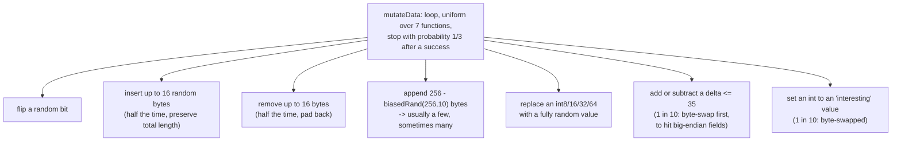

`maxBlobLen = 100 << 10` (100 KB) caps growth. `maxDelta = 35` bounds arithmetic nudges — small deltas find off-by-one and boundary bugs; large random values are covered by operator 5.

The byte-swap variants exist because kernel code handles network and filesystem data in big-endian. Without them, a length field in a network header would be nearly unreachable.

---

## 6. The choice table: which syscall follows which

This is the orthogonal mechanism — used when *generating* a program or *inserting* a call, not when mutating an existing one. It is also the one with the most interesting math.

The file header in `prog/prio.go` states both the model and the caveat:

> For a given pair of calls X and Y, the priority is our guess as to whether additional of call Y into a program containing call X is likely to give new coverage or not. The current algorithm has two components: static and dynamic. [...] **Note: the current implementation is very basic, there is no theory behind any constants.**

### The two components

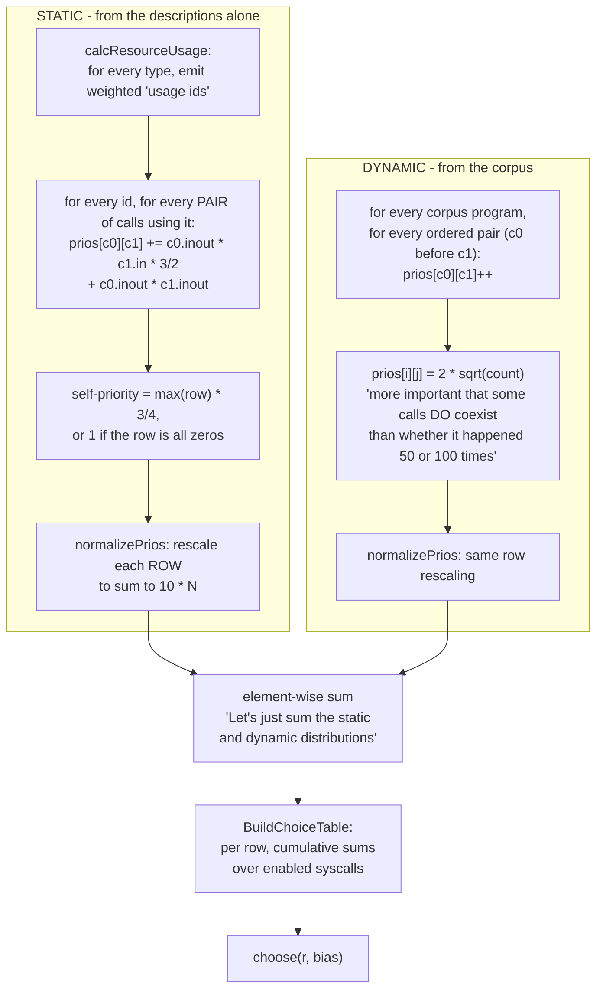

### The static component in detail

`calcResourceUsage` walks every type in every syscall and emits weighted "usage ids" — tokens meaning "this call traffics in this kind of thing":

| Type | Usage id | Weight |
|---|---|---|
| `ResourceType`, most precise kind | `res-k1-k2-...` | **10** |
| `ResourceType`, intermediate kinds in the inheritance chain | `res-k1-...` | **2** |
| `ResourceType` listed in `AuxResources` | `res<Name>` | **1** |
| `PtrType` to struct/union/array | `ptrto-<elem name>` | **10** |
| `BufferFilename` | `filename` | **10** (forced `DirIn`) |
| `BufferString`/`BufferGlob` with a sub-kind | `str-<SubKind>` | **2** |
| `VmaType` | `vma` | **5** |
| plain int, blob, text | — | nothing |

Then for every usage id and every pair of calls that both use it:

```go
prios[w0.call][w1.call] += w0.inout*w1.in*3/2 + w0.inout*w1.inout
```

The asymmetry is the whole point. `w.in` is the weight for input-ish directions; `w.inout` is the overall weight. The `* 3/2` on the `inout × in` term means **"c0 produces the thing, c1 consumes it"** scores 1.5× higher than a generic co-occurrence. The source says so:

> A higher priority will be assigned when c0 is a call that produces a resource and c1 a call that uses that resource.

Which is correct: knowing `socket` should be followed by `connect` is vastly more useful than knowing `connect` and `bind` are vaguely related.

Self-priority gets `max(row) * 3/4` — *"have to be high, but not too high."* Calling the same syscall twice is often valuable (open two files, two sockets) but should not dominate.

### The dynamic component and the square root

```go
// It's more important that some calls do coexist than whether
// it happened 50 or 100 times.
// Let's use sqrt() to lessen the effect of large counts.
prios[i][j] = int32(2.0 * math.Sqrt(float64(val)))
```

This is the most transferable idea in the whole document. Raw co-occurrence counts have a brutal rich-get-richer dynamic: a pair appearing 10,000 times would swamp everything, the fuzzer would generate almost nothing else, which would make that pair appear even more often, and the distribution would collapse.

The square root compresses the dynamic range. 100 occurrences → 20; 10,000 occurrences → 200. Still ordered correctly, but a 100× count difference becomes a 10× priority difference. Frequent pairs stay favoured without becoming an attractor.

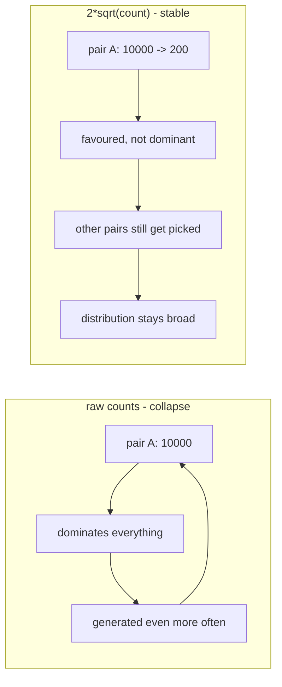

> **Pattern worth stealing:** apply a concave transform (sqrt, log) to frequency counts before using them as weights. Any system that feeds its own output back as input needs this, or it collapses onto its early preferences.

### Row normalization

`normalizePrios(prios, n)` rescales **each row** so it sums to `10 × N`, where N is the number of generatable syscalls. Applied to static and dynamic *separately*, before summing.

Two effects. First, the two components end up comparable in magnitude, so summing is meaningful — otherwise whichever happened to produce bigger numbers would dominate. Second, every row is a proper distribution, so "given call X, choose the next call" has consistent semantics regardless of how many relationships X has.

### `choose`: the 5% escape hatch

```go
func (ct *ChoiceTable) choose(r *rand.Rand, bias int) int {
    if r.Intn(100) < 5 {
        // Let's make 5% decisions totally at random.
        return ct.calls[r.Intn(len(ct.calls))].ID
    }
    if bias < 0 { bias = ct.calls[r.Intn(len(ct.calls))].ID }
    run := ct.runs[bias]
    runSum := int(run[len(run)-1])
    x := int32(r.Intn(runSum) + 1)
    return sort.Search(len(run), func(i int) bool { return run[i] >= x })
}
```

**5% of choices ignore the table entirely.** This is the epsilon in epsilon-greedy: a guaranteed floor of exploration so that a syscall the model considers worthless still gets tried occasionally. Without it, any syscall the priority model undervalues would be permanently invisible — and since the model is explicitly "basic, no theory behind the constants," it certainly undervalues some.

The `bias` parameter comes from `generateCall`:

```go
biasCall := -1
if insertionPoint > 0 {
    insertionCall := p.Calls[r.Intn(insertionPoint)].Meta
    if !insertionCall.Attrs.NoGenerate {
        // We must be careful not to bias towards a non-generatable call.
        biasCall = insertionCall.ID
    }
}
idx := s.ct.choose(r.Rand, biasCall)
```

A **random earlier call** in the program biases the choice of the new one. Not the immediately preceding call — a random one from the prefix — so a program can develop coherence with any of its earlier parts, not just the last.

### Regeneration cadence

```go
regenerateEveryProgs := 333
if len(fuzzer.Config.Corpus.Programs()) < 100 {
    regenerateEveryProgs = 33
}
```

With a comment that is refreshingly direct: *"There were no deep ideas nor any calculations behind these numbers."*

Rebuilding the table is O(N²) in syscall count, so you cannot do it constantly. But the dynamic component depends on the corpus, which grows. Early on, when the corpus is tiny, every addition changes the picture a lot — hence 33. Later, 333.

---

## 7. Hints: when the kernel tells you the answer

Comparison hints deserve their own section because they are qualitatively different: not a guess, but **information extracted from the kernel's own execution**.

### The problem

```c
if (header->magic != 0xCAFEBABE)
    return -EINVAL;
/* the interesting code */
```

Random mutation needs about 2³² attempts to guess that. Even with the "interesting values" list, `0xCAFEBABE` is not on it.

### The mechanism

With `ExecFlagCollectComps`, an instrumented kernel reports every comparison it performed and both operand values. So you learn: "at PC 0x... the kernel compared `0x41414141` with `0xCAFEBABE`." Your input contained `0x41414141`. Substitute.

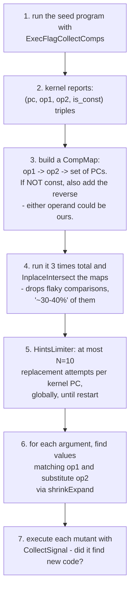

### `shrinkExpand`: handling casts

This is the clever part. The kernel rarely compares your value verbatim — it casts first:

```c
void f(u32 v) {
    if ((u8)v == 0xab) { ... }
}
```

You passed `0x1234`. The kernel compared `0x34` against `0xab`. Naively substituting gives you `0xab`, losing the upper bytes. The right answer is `0x12ab` — **splice the replacement into the low byte and keep the rest**:

```go
replacer := (v &^ mask) | newV
```

`shrinkExpand` tries widths `{8, 4, 2, 1, -4, -2, -1}` where negative means sign-extension (skipped unless the sign bit is set), and for each width tries **both little- and big-endian** interpretations. The comment explains why big-endian matters:

> kernel code does not convert the data (i.e. not `ntohs(pkt->proto) == ETH_P_BATMAN`), but instead converts the constant

So a network-protocol comparison appears as a byte-swapped constant, and only big-endian matching finds it.

It also skips replacements that are already in `specialIntsSet` — the magic-value list used during generation — because *"we insert special ints (like 0) with high probability, so we don't try to replace to special ints here."* No point spending a hint on a value you were going to try anyway. A nice piece of de-duplication between two independent mechanisms.

### `HintsLimiter`: a bound on enthusiasm

```go
const N = 10  // replacement attempts per kernel PC, globally
```

The rationale: *"We are getting too many generated candidates, the fuzzer may not keep up with them at all (hints jobs keep growing infinitely). If a hint indeed came from the input w/o transformation, then we should guess it on the first attempt."*

A single hints job can produce thousands of candidates. Unbounded, hint jobs grow faster than the fuzzer drains them and crowd out everything else. The 10-per-PC cap is a cheap global throttle with a solid argument: if the hint is real, it works almost immediately.

### What is excluded, and why

`generateHints` skips several argument kinds:

| Skipped | Reason |
|---|---|
| output-direction args | the kernel writes them |
| `ProcType` | *"Random proc will not pass validation"* |
| `BufferFilename` | *"can generate escaping paths"* — a hint could produce `../../etc/passwd` |
| strings with declared values | *"frequently file names or complete enumerations... Mutating these may be useful iff we intercept strcmp"* |
| const args ≤ 8 bits | *"Very small arg, hopefully we can guess it w/o hints help"* — 256 values is cheap to brute force |
| data args ≤ 3 bytes | same |

And for compressed buffers (disk images), it steps 4 bytes at a time: *"For images we consider only 4/8-byte aligned ints. This is enough to handle all magic numbers and checksums."* Also notable: it unmaps the decompressed buffer before executing, because *"since hints jobs are executed round-robin, we can have thousands of them running"* — thousands of simultaneously-decompressed disk images would exhaust memory.

> **Pattern worth stealing:** if you can observe your target's internal decisions, that beats guessing by orders of magnitude. But budget it — a high-yield source of candidates will bury your scheduler unless you cap it.

---

## 8. Generation: the values syzkaller picks

Even the 5% "generate from scratch" path is full of tuned distributions. `prog/rand.go`:

### `randInt`: the integer distribution

```go
v := r.rand64()
switch {
case r.nOutOf(100, 182):            v %= 10              // ~55%  tiny
case bits >= 8 && r.nOutOf(50, 82): v = specialInts[...] // ~27%  a magic value
case r.nOutOf(10, 32):              v %= 256             // ~7%
case r.nOutOf(10, 22):              v %= 4 << 10         // ~4%
case r.nOutOf(10, 12):              v %= 64 << 10        // ~4%
default:                            v %= 1 << 31         // ~3%
}
switch {
case r.nOutOf(100, 107):            // leave as is        ~93%
case r.nOutOf(5, 7):   v = uint64(-int64(v))             // ~5%  negate
default:               v <<= uint(r.Intn(int(bits)))     // ~2%  shift
}
```

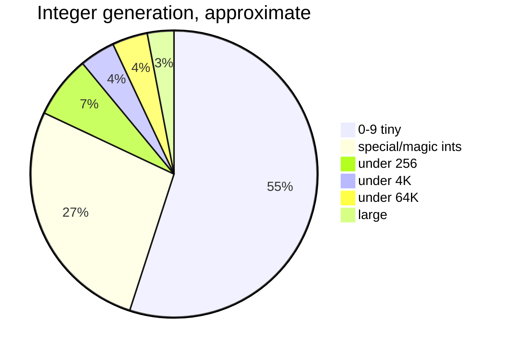

**55% of generated integers are single digits.** That looks wrong until you think about it: real arguments are overwhelmingly small — flags, small counts, indices, enum values. A uniformly random 64-bit integer is almost always a nonsense argument that gets rejected with `EINVAL` before reaching any interesting code.

**27% are drawn from `specialInts`**, the hand-curated magic-value list:

```
0..16, 64, 127, 128, 129, 255, 256, 257, 511, 512,
1023, 1024, 1025, 2047, 2048, 4095, 4096,
2^15 - 1, 2^15, 2^15 + 1,    2^16 - 1, 2^16, 2^16 + 1,
2^31 - 1, 2^31, 2^31 + 1,    2^32 - 1, 2^32, 2^32 + 1,
2^63 - 1, 2^63, 2^63 + 1,    2^64 - 1
```

Every one is a boundary: page sizes, type limits, signed/unsigned transitions, off-by-one neighbours. `specialIntIndex` lets `randInt` sample only values that fit the requested width. These values are where integer-overflow and buffer-size bugs live.

### `randRangeInt`: ignoring the description on purpose

```go
if r.oneOf(100) {
    // Generate a random value for the given type size.
    return r.randInt(bitSize)
}
```

**1% of the time, a declared range is ignored entirely.** This connects directly to a documented policy from `docs/syscall_descriptions.md`:

> When specifying integer/string flags or integer fields stick with the official expected values only. [...] It's hard for the fuzzer to come up with correct complex syscall sequences, and the descriptions are meant to help with this. Coming up with unexpected integer values is easy and the fuzzer does not need help here.

So: humans describe the *intended* interface; the fuzzer independently supplies the *unintended* values. Two reasons this division is right. Descriptions stay readable and maintainable — nobody sprinkles `-1` and `INT_MAX` into thousands of fields by hand. And when the fuzzer's value-generation logic improves, every description benefits at once.

`flags` has a similar escape: `oneOf(100)` for a fully random value, and `oneOf(50)` for 0 (*"frequently special"*). For non-bitmask flags with one declared value, there is a special walk-up/walk-down mutation, *"especially important during mutation when len(vv) == 1, otherwise in that case we produce almost no randomness."*

> **Pattern worth stealing:** keep your *model of correct input* separate from your *source of incorrect input*. Do not pollute the specification with adversarial cases — generate them generically.

### Special pointers

```go
if !r.inGenerateResource && r.oneOf(1000) {
    index := r.rand(len(r.target.SpecialPointers))
    return MakeSpecialPointerArg(a, dir, index), nil
}
```

1-in-1000, a pointer becomes a "special" value — NULL, a known-bad address, a kernel address. Rare on purpose: most calls with a bad pointer fail immediately with `EFAULT` and teach you nothing, but the occasional one finds a missing `access_ok` check. Capped at 16 special pointers per target.

### Resources: reuse vs create

`ResourceType.generate` uses `nOutOf(8, 10)` — **80% reuse an existing resource, 20% create a new one.** Reuse keeps programs coherent (operate on the file you opened); creation enables new scenarios (open a second file).

Two deliberate anomalies:

- `r.oneOf(50)` accepts a *looser* kind-prefix match when reusing — e.g. a generic `fd` where `fd_sock` was asked for.
- `r.oneOf(1000)` in `createResource` deliberately *"spoof[s] resource subkind"*, cross-wiring a compatible-but-wrong resource type.

Both exist because **type confusion is a bug class.** Passing a socket fd to a call expecting an inotify fd is exactly the kind of thing kernel code gets wrong. The description's type system would prevent it; these two probabilities deliberately break it.

### `resourceCentric`: lifting a working scenario

The cleverest generator. To produce a valid resource, instead of synthesizing the setup calls, it:

1. finds a corpus program containing a compatible, initialized resource,
2. clones that program with an argument mapping,
3. walks its calls **backwards**, keeping only those transitively related to that resource,
4. truncates to `2 + biasedRand(len(calls)-1, 10)` calls — *"more calls could offer more interesting programs."*

So it extracts a *working minimal setup sequence* from proven-good material. This is how syzkaller reaches interfaces requiring six calls of setup — it does not rediscover the setup, it copies it.

---

## 9. How to build a priority system: the recipe

Pulling it together, here is the transferable methodology.

### 1. Identify every point where you make a choice

Write them down as a hierarchy. syzkaller's: which job kind → generate or mutate → which program → which operator → which call → which argument → which value. Six to seven nested choices. Each needs a policy, even if the policy is "uniform."

### 2. Pick the right mechanism for each level

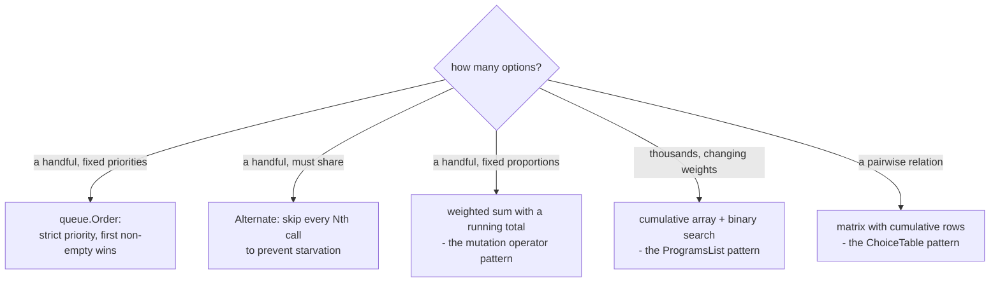

### 3. Choose weights by anchoring

Pick the case you understand best, assign it a weight, express everything else as a multiple. syzkaller anchors the type priorities on "a boolean has 2 values, so it gets the minimum." Then: a 15-value flag set is 9× a boolean; a byte blob is 8×; an array is 10×.

Document that you did this. The `// TODO: find a way to estimate optimal priority values` comment is doing real work — it tells every future reader "these are guesses, improve them."

### 4. Always include a random floor

The 5% uniform choice in `choose()`. Your model is wrong in ways you cannot predict; a small unconditional exploration budget limits the damage. 5% costs almost nothing and makes "permanently invisible option" impossible.

### 5. Damp any feedback loop

If a quantity influences what you generate, and what you generate influences that quantity, apply a concave transform. `2*sqrt(count)`. Without it the distribution collapses onto whatever happened first.

### 6. Make the exploit/explore ratio depend on feedback quality

95% exploitation with real coverage, 50% without. When your score function is unreliable, the things it scored highly are not actually better.

### 7. Validate noisy measurements with a stated confidence target

3-of-5 runs, chosen because it passes an 80%-reliable program 94% of the time. Write the arithmetic in the comment.

### 8. Cap any high-yield candidate source

`HintsLimiter` N=10. A mechanism that produces candidates faster than you consume them will starve everything else, no matter how good its candidates are.

### 9. Separate the specification from the adversarial input

Descriptions say what is *intended*; generation independently supplies the *unintended*. Keeps the spec maintainable and makes improvements global.

### 10. Keep the quality signal attached

Signal priority bits (call succeeded, no squashed args) make set-cover minimization prefer programs a human can read. Equivalent-but-nicer is worth tracking.

---

## 10. The complete picture

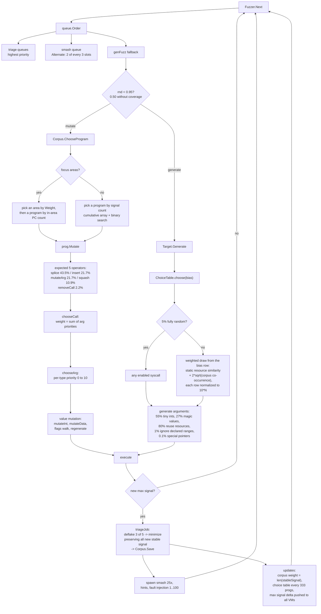

---

## 11. Reading the code yourself

| Question | Start here |
|---|---|
| How is work prioritized? | `pkg/fuzzer/fuzzer.go` → `execQueues`, `genFuzz`, `Next` |
| What are the job types? | `pkg/fuzzer/job.go` → `triageJob`, `smashJob`, `hintsJob`, `faultInjectionJob` |
| How does deflaking work? | `pkg/fuzzer/job.go` → the deflake constants and `deflake`, `stopDeflake` |
| How is a corpus program chosen? | `pkg/corpus/prio.go` → `ProgramsList`, `chooseProgram`, `ChooseProgram` |
| What are the mutation weights? | `prog/mutation.go` → `DefaultMutateOpts`, `MutateWithOpts` |
| What are the per-type priorities? | `prog/mutation.go` → every `getMutationPrio`, plus `rangeSizePrio` |
| How is the choice table built? | `prog/prio.go` → `CalculatePriorities`, `calcStaticPriorities`, `calcResourceUsage`, `calcDynamicPrio`, `normalizePrios`, `choose` |
| How are values generated? | `prog/rand.go` → `randInt`, `specialInts`, `randRangeInt`, `flags`, `biasedRand`, `createResource`, `resourceCentric` |
| How do hints work? | `prog/hints.go` → `CompMap`, `MutateWithHints`, `generateHints`, `shrinkExpand`, `HintsLimiter` |
| How does minimization work? | `prog/minimization.go` → `MinimizeMode`, `Minimize`; and `pkg/manager/seeds.go` → `ReminimizeSubset` |
| What is signal vs coverage? | `pkg/signal/signal.go` → `DiffRaw`, `Merge`, `Minimize`; `pkg/fuzzer/fuzzer.go` → `signalPrio`; `pkg/fuzzer/cover.go` → `Cover` |

A closing suggestion: grep the codebase for `oneOf(`, `nOutOf(`, and `biasedRand(`. Every hit is a tuned probability with a comment nearby explaining it. Reading them in sequence is the fastest way to absorb the project's accumulated intuition about what inputs actually find bugs.
