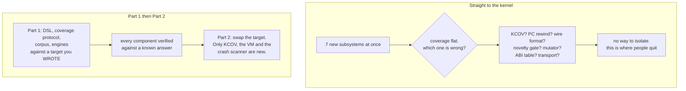
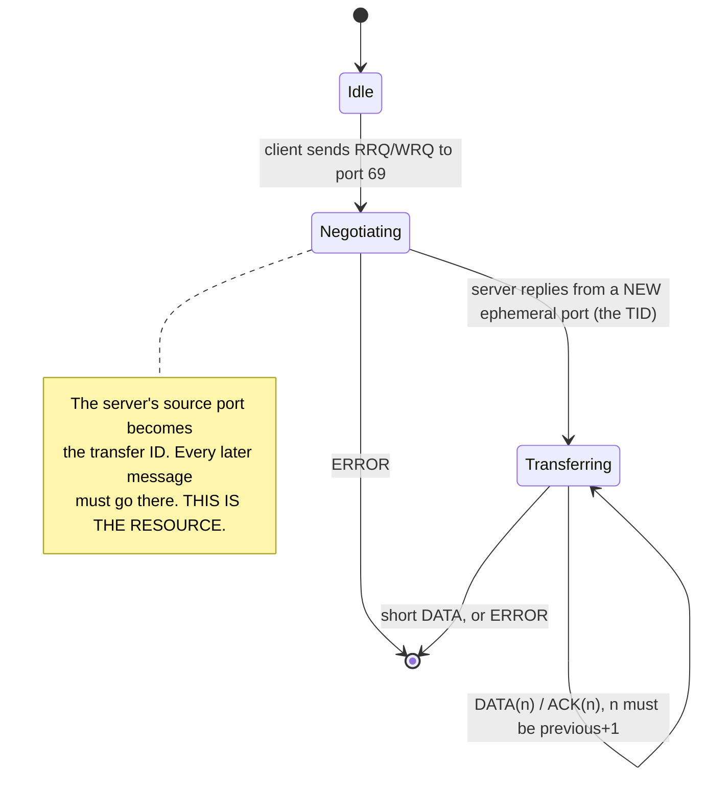
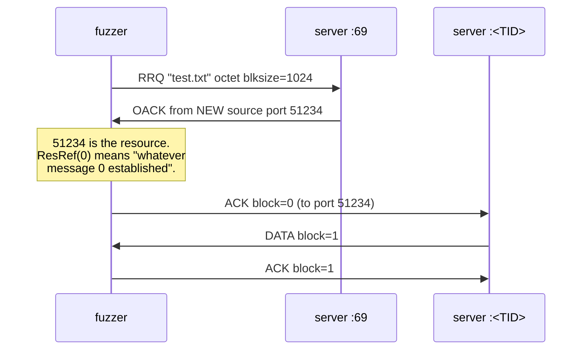
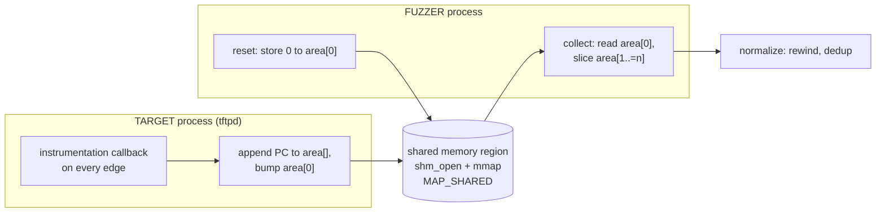
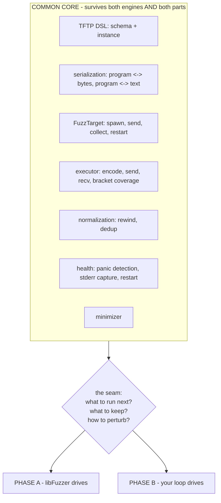
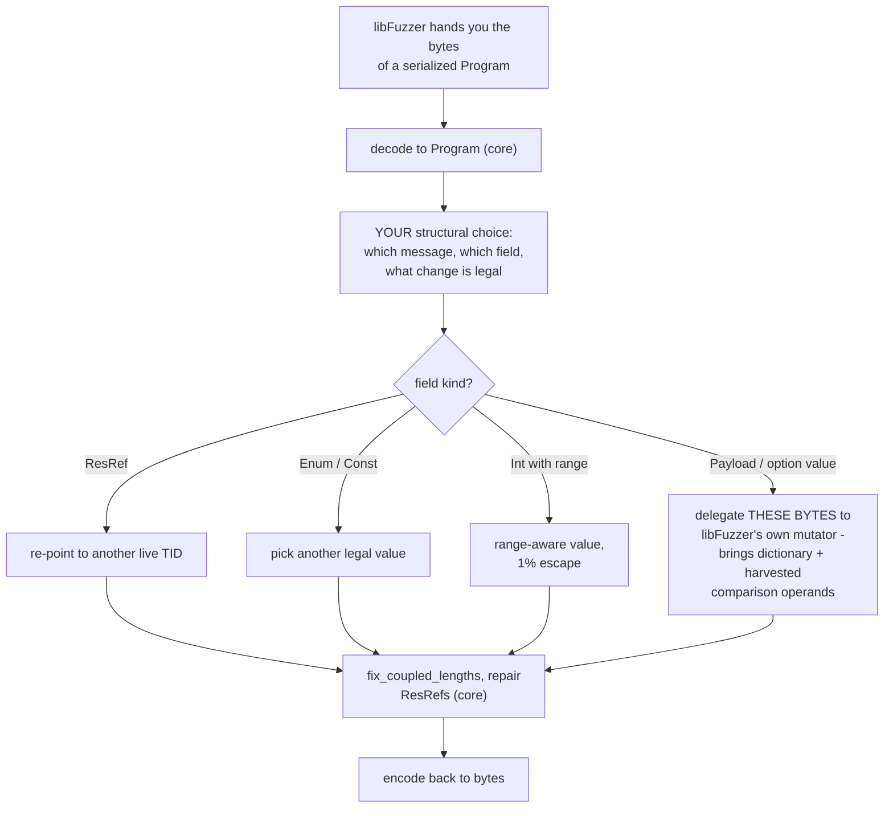
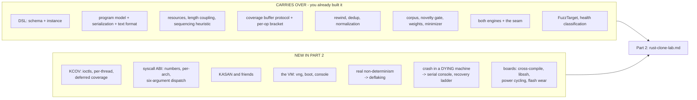
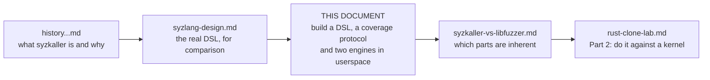

# DIY Lab, Part 1: A Structured-Input Fuzzer in Userspace

> **Who this is for.** You want to build a syzkaller-shaped fuzzer and understand every piece of it. You are going to do that against a Linux kernel in Part 2. First you are going to do it against a **200-line UDP server you wrote yourself**, because every hard idea in syzkaller is easier to learn when you can attach a debugger to the target.
>
> **This is Part 1 of a two-part lab.**
>
> | | Target | What it teaches | Where |
> |---|---|---|---|
> | **Part 1** (this document) | a TFTP server you write, then deliberately break | the **structured-input DSL**, the coverage protocol, corpus economics, the two-engine seam | here |
> | **Part 2** | a real Linux kernel, local VM and bare-metal board | KCOV, KASAN, crash survival, VM recovery, boards, flakiness | `rust-clone-lab.md` |
>
> **Part 1 is a rehearsal for Part 2, deliberately.** Part 2 fuzzes **the same TFTP protocol, rewritten as a Rust kernel module.** The protocol, the DSL, the planted bugs and the corpus all carry over; what changes is that the code now runs in kernel space, a bug kills the machine instead of a process, and coverage comes from KCOV instead of a shared-memory region you built. Keeping the target identical makes the kernel the only variable.
>
> **Do Part 1 first.** The reason is in §0.1, and it is the single most important structural decision in this lab.

---

## 0. Why a userspace rehearsal comes first

### 0.1 The quitting problem

The kernel lab asks you to get seven unfamiliar things right simultaneously: a KCOV ioctl protocol, a syscall ABI table, a wire format, a VM transport, a novelty gate, a mutator, and a crash scanner. A coverage-guided fuzzer that is wrong **fails quietly** — it keeps running and prints plausible numbers. So when coverage does not climb, you have seven suspects and no way to interrogate any of them.

That is the point at which people stop.

Everything in that list except KCOV, the VM, and the crash scanner is **not actually about kernels.** You can learn it against a target that:

- you wrote, so you know exactly what the correct answer is;
- runs in a normal process, so `gdb`, `println!`, and `strace` all work;
- restarts in microseconds instead of booting;
- contains bugs *you planted*, so "did my fuzzer find it?" has a definite answer;
- cannot destroy your filesystem, brick a board, or require a serial cable.

Then you meet the kernel already knowing what a working feedback loop looks like.



### 0.2 The structural analogy: a UDP server is a kernel in miniature

This is the part worth internalizing, because it is what makes Part 1 a rehearsal rather than a detour. Fuzz a TFTP server **as a separate process over a UDP socket** — not as an in-process function call — and the shape of the problem is the same as the kernel's, component for component:

| Kernel (Part 2) | Userspace TFTP (Part 1) |
|---|---|
| a syscall | a UDP datagram carrying one TFTP operation |
| syzlang descriptions | your TFTP protocol DSL (§3) |
| a resource (`fd`) | the server's ephemeral transfer ID (§3.5) |
| KCOV shared buffer | a shared-memory counter region **you implement** (§4) |
| KASAN | a Rust panic, plus ASAN for the `unsafe` parts (§2.3) |
| the guest VM | the target process |
| rebooting the VM | restarting the process |
| serial console | the target's stderr |
| `flatrpc` over a socket | your wire format over UDP |
| `FuzzTarget` trait | **the same trait**, different impl |
| `vng` | nothing — just `Command::spawn` |
| 1–1,000 exec/s | 10,000+ exec/s |

Three of those rows are the reason this works at all:

**The target is in a different address space.** So you cannot cheat by calling a function. You must build a wire format, ship inputs across a boundary, and get coverage back — which is exactly the problem the kernel poses, minus the virtualization.

**The target can die independently.** A panic kills the server, not your fuzzer. You must detect that, restart it, and attribute the crash. That is the VM-lifecycle problem at 1/1000th the cost.

**You implement the coverage protocol yourself.** §4 has you build a shared-memory region whose first word is a count and whose tail is a list of addresses. That is not *like* KCOV. That **is** KCOV's protocol, reimplemented by you in userspace. When Part 2 hands you `/sys/kernel/debug/kcov`, you will already have written its client.

### 0.3 What transfers, and what does not

Be clear about the limits so you do not expect Part 1 to teach what only a kernel can.

| Transfers to Part 2 unchanged | Only a kernel teaches it |
|---|---|
| the DSL, schema-vs-instance, resources, length coupling | real syscall ABI quirks, per-arch syscall numbers |
| the program model, serialization, text format | the arena and fixed-address pointer encoding |
| the coverage buffer protocol and the per-operation bracket | KCOV ioctls, per-thread enable, deferred/remote coverage |
| corpus, novelty gate, weighted selection, minimization | genuine non-determinism and the need for deflaking |
| the engine seam and both engines | crash-in-a-dying-machine, serial consoles, power-cycle recovery |
| the `FuzzTarget` trait | boards, cross-compilation, flash wear |

The honest summary: **Part 1 teaches the search and the model. Part 2 teaches survival.**

---

## 1. The target: a TFTP server, written correctly first

### 1.1 Why TFTP

You need a target that is small enough to write in an evening and structured enough to need a real DSL. TFTP is almost suspiciously well suited:

- **The whole protocol is five message types** and fits on one page (§1.2).
- It is **stateful** — a transfer has a handshake, a sequence, and a termination — so single-message fuzzing is visibly inadequate and you need *programs*, not inputs.
- It has a **resource**: the server picks an ephemeral port for the transfer and every later message must use it. That is a file descriptor in all but name.
- It has **length coupling**: the negotiated `blksize` option determines how long a `DATA` payload may be.
- It is **UDP**, so there is no connection state in the kernel to confuse your "is the target alive?" logic, and a malformed datagram cannot be rejected by a framing layer before your code sees it.
- Real interoperable implementations exist (`tftp-hpa`, `busybox tftp`), so you can check your server is correct before you start breaking it.

Write both ends. The **server** is the fuzz target. The **client** is how you prove the server works and how you learn the protocol — and you will throw most of it away once the fuzzer generates its own messages.

### 1.2 The protocol in one page

TFTP is RFC 1350, with options from RFC 2347/2348/2349. All integers are **big-endian**, which is itself a useful detail — your DSL has to model endianness, and the kernel's `int16be` types exist for the same reason.

```
RRQ  / WRQ   | opcode u16 = 1 or 2 | filename str0 | mode str0 | (opt str0, value str0)* |
DATA         | opcode u16 = 3      | block u16     | payload 0..=blksize                 |
ACK          | opcode u16 = 4      | block u16     |
ERROR        | opcode u16 = 5      | errcode u16   | message str0                        |
OACK         | opcode u16 = 6      | (opt str0, value str0)*                             |
```

- `str0` is a NUL-terminated ASCII string.
- `mode` is one of `netascii`, `octet`, `mail` (case-insensitive).
- `errcode` is 0–7.
- Default block size is **512**. A `DATA` payload shorter than the block size terminates the transfer.
- Options worth modelling: `blksize` (RFC 2348, valid range **8–65464**), `timeout` (RFC 2349, 1–255), `tsize` (RFC 2349).

The state machine, which is what makes this a *program* rather than an *input*:



### 1.3 Build it correct

Keep the server deliberately plain. One `UdpSocket` on port 69 for new requests, one per active transfer, a `HashMap<Tid, Transfer>` of state, a parse function per opcode. No async runtime — a blocking loop is easier to reason about and fast enough.

The shape that matters for the lab is the **parse boundary**, because that is where you will plant bugs and where coverage will be interesting:

```rust
// The one function the fuzzer is really attacking.
// Deliberately fallible and deliberately total: every byte sequence
// must produce either a Packet or an Err, never a panic. In the
// correct version. That invariant is what the bug patches violate.
pub fn parse(buf: &[u8]) -> Result<Packet, ParseError> { /* ... */ }

pub enum Packet {
    Rrq { filename: String, mode: Mode, opts: Vec<(String, String)> },
    Wrq { filename: String, mode: Mode, opts: Vec<(String, String)> },
    Data { block: u16, payload: Vec<u8> },
    Ack  { block: u16 },
    Error { code: u16, msg: String },
    Oack { opts: Vec<(String, String)> },
}
```

Serve files out of one directory, chosen by a command-line argument. Never the real filesystem — point it at a scratch directory, the same discipline as Part 2's `--overlay-rwdir`.

### 1.4 Milestone U0 — interoperate before you break anything

```bash
mkdir -p /tmp/tftproot && echo hello > /tmp/tftproot/test.txt
cargo run --release -p tftpd -- --root /tmp/tftproot --port 6969 &

# A real, independent implementation must be able to talk to you.
busybox tftp -g -r test.txt -l /tmp/out.txt 127.0.0.1 6969 && cat /tmp/out.txt
```

If a third-party client can read a file from your server, your protocol understanding is correct. **Do not skip this.** Every later "my fuzzer found nothing" question has a much smaller search space once you know the target is right.

---

## 2. The bug patch series

Now break it on purpose. Keep the correct version on `main` and each bug on its own branch or behind its own feature flag, so you can enable exactly one and ask "does the fuzzer find *this*?"

### 2.1 The seven bugs, and the kernel bug class each one stands for

| # | Bug | How to plant it | Kernel analogue | Found by |
|---|---|---|---|---|
| 1 | **Unclamped `blksize`** | accept the option without checking RFC 2348's 8–65464; use it as a `Vec::with_capacity` | missing bounds check on a user-supplied size | panic / OOM |
| 2 | **Unterminated filename** | scan for the NUL without checking you are still inside the datagram | out-of-bounds read | panic (slice index) |
| 3 | **ACK for a block never sent** | `self.sent[block as usize - 1]` with no range check | array underflow / OOB | panic (underflow) |
| 4 | **`tsize` integer overflow** | parse into `i32`, multiply by block count, use as a capacity | integer overflow into allocation | panic / OOM |
| 5 | **Transfer map never evicted** | insert into the `HashMap<Tid, Transfer>` and never remove on error paths | memory leak (the kmemleak class) | RSS growth |
| 6 | **Use-after-free in option parsing** | keep a `&str` into a buffer you reuse, via a small `unsafe` block | the real KASAN use-after-free | **ASAN only** |
| 7 | **Path traversal** | join the filename to the root without normalizing `..` | a logic bug with no memory error | **an assertion you write** |

Bugs 1–4 need a multi-message program to reach, not a single malformed datagram: you must complete the handshake before `DATA`/`ACK` are even parsed. That is the entire argument for structured, stateful fuzzing, and you will watch it play out.

### 2.2 Why bug 7 is the most instructive one

Bugs 1–5 announce themselves: the process dies, and anything watching stderr notices. Bug 6 needs ASAN. **Bug 7 produces no error at all** — the server happily serves `/etc/passwd` and returns success. Coverage-guided fuzzing will *reach* it on the first afternoon and report nothing, because nothing went wrong as far as any sanitizer is concerned.

The fix is to write the oracle yourself:

```rust
// The property you actually care about, checked at the boundary.
debug_assert!(
    resolved.starts_with(&self.root_canonical),
    "path escape: {resolved:?} is outside {:?}", self.root_canonical
);
```

This is the single most transferable lesson in Part 1: **a fuzzer finds what your oracle can see.** syzkaller finds memory-safety bugs because KASAN is watching; it does not find "the kernel returned the wrong answer" because nothing is checking. That is also exactly why `syz-verifier` exists (`syzkaller-vs-libfuzzer.md` §6.9) — differential testing is an oracle for the class sanitizers cannot see.

### 2.3 Oracles available to you in userspace

| Oracle | Enable with | Catches | Kernel equivalent |
|---|---|---|---|
| **Rust panic** | free, always on | index out of bounds, unwrap, overflow in debug | KASAN OOB, BUG() |
| **debug assertions** | `debug_assert!`, or `-C debug-assertions=on` in release | integer overflow, your own invariants | `CONFIG_DEBUG_*`, `WARN_ON` |
| **ASAN** | `RUSTFLAGS="-Zsanitizer=address"` (nightly) | use-after-free in `unsafe` code | KASAN |
| **LSAN** | ASAN's leak check at exit | bug 5 | kmemleak |
| **your assertions** | you write them | logic bugs like bug 7 | nothing in syzkaller — this is the gap |
| **RSS ceiling** | the fuzzer watches `/proc/<pid>/statm` | bug 5 while running | `rss_limit`, OOM detection |

A Rust panic is a *better* oracle than it looks: it is deterministic, it prints a precise location, and it exits with a distinctive status. Treat `thread 'main' panicked at src/parse.rs:142` as your KASAN report — same role, better formatting.

### 2.4 Milestone U1 — reproduce every bug by hand

For each of the seven, write a small program by hand that triggers it, and keep those as your **seed corpus**. You need this for three reasons: it proves the bug is reachable, it proves your oracle sees it, and in §8 it is how you measure whether an engine finds in minutes what you found by reading the code.

---

## 3. The DSL: the chapter that matters most

syzkaller's descriptions are its single highest-leverage component and the hardest to appreciate from the outside. This is where you build one.

### 3.1 Why build the DSL here rather than in Part 2

In the kernel lab, a Rust `const` table is the right answer and a DSL is over-engineering — twenty syscalls do not justify a parser (`rust-clone-lab.md` §5.2). That advice is correct, and it means **the kernel lab never makes you confront what a description language is for.**

TFTP flips the economics. The protocol is small, but its structure is *recursive and coupled* in a way a flat table handles badly: options are repeated key/value pairs, a payload's length depends on a negotiated value, and a block number depends on history. You will feel the pressure that produced syzlang, at a scale where you can satisfy it in 300 lines.

You are not building a parser for a text language. You are building the **schema layer** that a text language would compile *into* — which is the part that carries the value. If you want the text front end afterwards, §3.8 is the bridge.

### 3.2 What TFTP exercises, mapped onto syzlang

Use this table to check your schema is actually a rehearsal and not a toy:

| syzlang feature | `syzlang-design.md` | Where TFTP needs it |
|---|---|---|
| sized integers, endianness | §1.1 `int16be` | every opcode and block number |
| `const` | §1.1 | opcode discriminants |
| `flags` / enum | §1.2 | `mode`, `errcode` 0–7, option names |
| `string` with terminator | §1.3 | `filename`, `mode`, option keys and values |
| `len[...]` coupling | §1.3 | `blksize` ↔ `DATA` payload length |
| **`resource`** | §1.4 | the server's transfer ID (§3.5) |
| `$variant` instead of unions | §1.6 | one schema per opcode (§3.3) |
| arrays of structs | §1.3 | the option list |
| squash to opaque bytes | §1.7 | option *values*, which are text-encoded numbers |
| *(not expressible)* | — | block-number sequencing (§3.7) |

Nine of the ten rows are things you will implement. The tenth is the honest limit of the approach, and knowing *which* thing a DSL cannot say is worth as much as the nine it can.

### 3.3 The schema

Same split as the kernel lab (`rust-clone-lab.md` §5.1 and §5.5): a static **schema** describing what is legal, and an owned **instance** that gets generated and mutated. Keep them apart from the first commit; conflating them is the most common way these designs rot.

```rust
/// One field of one message type. The schema. Static, never mutated.
pub enum FieldKind {
    /// Fixed value. Opcode discriminants.
    Const { bits: u8, be: bool, val: u64 },
    /// An integer, optionally range-limited. Block numbers, error codes.
    Int { bits: u8, be: bool, range: Option<(u64, u64)> },
    /// One of an enumerated set. Modes, option names.
    Enum { vals: &'static [&'static str] },
    /// NUL-terminated string.
    Str0 { max: usize },
    /// Raw bytes whose length may be coupled to a negotiated value.
    Payload { len: LenSpec },
    /// The transfer ID. Consume a resource produced by an earlier message.
    Res(ResKind),
    /// Zero or more (key, value) string pairs.
    OptList { max_pairs: usize },
}

pub enum LenSpec {
    /// A literal bound.
    Upto(usize),
    /// "as long as the blksize negotiated in message N permits"
    NegotiatedBlksize { from: usize },
}

pub enum ResKind { Tid }

pub struct MsgDesc {
    pub name: &'static str,
    pub opcode: u16,
    pub fields: &'static [FieldKind],
    /// Does a reply to this message create a transfer ID?
    pub produces: Option<ResKind>,
}
```

And the table — **one entry per opcode**, which is the `$variant` trick (`rust-clone-lab.md` §5.4) replacing unions and conditional fields:

```rust
pub static MSGS: &[MsgDesc] = &[
    MsgDesc {
        name: "rrq", opcode: 1,
        fields: &[
            FieldKind::Const { bits: 16, be: true, val: 1 },
            FieldKind::Str0 { max: 255 },                               // filename
            FieldKind::Enum { vals: &["octet", "netascii", "mail"] },   // mode
            FieldKind::OptList { max_pairs: 4 },
        ],
        produces: Some(ResKind::Tid),      // the server's reply port
    },
    MsgDesc {
        name: "data", opcode: 3,
        fields: &[
            FieldKind::Const { bits: 16, be: true, val: 3 },
            FieldKind::Res(ResKind::Tid),
            FieldKind::Int { bits: 16, be: true, range: None },         // block
            FieldKind::Payload { len: LenSpec::NegotiatedBlksize { from: 0 } },
        ],
        produces: None,
    },
    // ack, error, oack, wrq ...
];
```

### 3.4 The instance

```rust
/// What you generate, mutate, minimize, serialize and store.
pub struct Program { pub msgs: Vec<Msg> }

pub struct Msg {
    /// Index into MSGS. Not a reference — same reasoning as the kernel lab.
    pub desc: usize,
    pub fields: Vec<Field>,
}

pub enum Field {
    Imm(u64),
    Bytes(Vec<u8>),
    Text(String),
    /// "use the transfer ID that message N established"
    ResRef(usize),
    Opts(Vec<(String, String)>),
}
```

Note the collapse: seven `FieldKind`s become five `Field`s, because `Const`, `Int` and `Enum` are all just values once a choice has been made. The schema needs the distinction so the mutator knows what is legal; the instance does not.

### 3.5 Resources: the transfer ID is a file descriptor

This is the concept to get right, because it is the one that makes generated programs non-trivial — in TFTP exactly as in the kernel.



Three properties that make it a true analogue of an `fd`:

- **It is produced, not chosen.** The server picks the port. A fuzzer that guesses port numbers never completes a handshake, exactly as `ioctl(rand(), ...)` never clears `EBADF`.
- **It is resolved at execution time, not generation time.** The program says `ResRef(0)`; the executor substitutes whatever port the server actually used. Identical to the kernel lab's copyout-index mechanism.
- **A failed producer must not abort the program.** If the `RRQ` was rejected, later messages go to a port nobody is listening on and simply get no reply. That is correct behaviour and still produces coverage in error paths.

Keep syzkaller's 80/20 bias: reuse a live TID 80% of the time, open a new transfer 20%.

### 3.6 Length coupling: the first genuinely hard field

`blksize` is negotiated in the `RRQ`, echoed in the `OACK`, and then constrains every `DATA` payload. So the legal length of field 3 of message 7 depends on a *string value* in field 3 of message 0.

That is `len[...]` in syzlang, and it is why syzkaller has a whole pass (`assignSizes`) that runs after every mutation. Yours is smaller but has the same obligation:

```rust
/// Call at the end of EVERY mutation operator. The kernel lab's fix_lens(),
/// one level harder because the governing value lives in another message
/// and is stored as text.
pub fn fix_coupled_lengths(prog: &mut Program) {
    let blksize = prog.negotiated_blksize().unwrap_or(512);
    for msg in &mut prog.msgs {
        if MSGS[msg.desc].name != "data" { continue; }
        if let Some(Field::Bytes(payload)) = msg.fields.last_mut() {
            payload.truncate(blksize);
        }
    }
}
```

And then the deliberate exception, which is the whole point of fuzzing: **1% of the time, skip the fix.** Your schema says what the protocol intends; the fuzzer must independently supply the unintended. That is how bug 1 gets found, and it is the same 1-in-100 range escape the kernel lab copies from `prog/rand.go`.

### 3.7 Sequencing: what a DSL cannot express

`ACK(n)` is only meaningful if the peer sent `DATA(n)`. That is not a type constraint, a length coupling, or a resource — it is an *arithmetic relation over execution history*, and no version of syzlang can state it. syzkaller has the same hole: descriptions cannot say "this argument must be the previous return value plus one."

Three honest options, and you should know which one you picked:

| Approach | Cost | Consequence |
|---|---|---|
| Ignore it; let block numbers be random `u16` | 0 lines | most programs desynchronize after one message. Still finds bugs 1, 2, 3. |
| **A generator-only heuristic**: when emitting `ACK`, use last-seen block +1 with 90% probability | ~20 lines | **recommended.** Deep transfers become reachable without touching the schema. |
| Model it as a resource with arithmetic | large | you are now designing a protocol-aware state machine, which is a different project |

Pick the middle one, and notice what you just learned: **generation-time heuristics are where a description language's expressiveness runs out.** syzkaller's choice table and its `createResource` logic live in exactly that gap.

### 3.8 Text serialization — adopt syzkaller's format

Store programs as text, for the same reasons as the kernel lab: you can `cat` your corpus, `grep` it, and hand-edit a reproducer.

```
r0 = rrq("test.txt", octet, {blksize: "1024"})
ack(r0, 0x0)
data(r0, 0x1, "aabbcc...")
error(r0, 0x2, "disk full")
```

`r0` is the transfer ID; the resemblance to `r0 = openat$ptmx(...)` is deliberate. About 60 lines to emit, 100 to parse. Write the parser before you have a corpus you care about, or your corpus is write-only.

### 3.9 Milestone U2 — the DSL round-trips and interoperates

Three gates, in order:

1. **Round-trip.** `parse(serialize(p)) == p` for 10,000 generated programs. A property test, not an example.
2. **Wire-correct.** A generated `RRQ` encoded to bytes is byte-identical to what `busybox tftp` sends for the same request. Capture one with `tcpdump -x` and compare. This is the check that proves your schema matches reality — the userspace equivalent of `pahole` verifying a struct layout.
3. **Non-trivial.** A generated 10-message program completes a real file transfer at least sometimes. If it never does, your resource handling is broken, and that is the single most likely place for it to be broken.

---

## 4. Coverage: implement KCOV, in userspace

This chapter is the one that pays off most directly in Part 2, because you are going to build KCOV's exact protocol with your own hands.

### 4.1 The shape you are rehearsing

```
area[0]              = number of addresses collected   <-- the fuzzer resets this
area[1 ..= area[0]]  = the addresses
```

That is KCOV. A shared buffer, a count in the first slot, a list after it, reset by storing zero. You are going to build the same thing between two userspace processes, and the only difference in Part 2 is that the kernel provides it for you via an `ioctl` instead of you creating it with `shm_open`.



### 4.2 Getting the instrumentation

Build the target with SanitizerCoverage's `trace-pc-guard` mode and provide the callbacks yourself. On Rust this is a nightly flag, so check it against your toolchain before designing around it:

```bash
# Nightly only. Verify the exact flag on YOUR toolchain with: rustc +nightly -Z help
RUSTFLAGS="-Zsanitizer-coverage-level=3 -Zsanitizer-coverage-trace-pc-guard" \
  cargo +nightly build --release -p tftpd
```

You then implement two symbols in the target:

| Symbol | Called | You do |
|---|---|---|
| `__sanitizer_cov_trace_pc_guard_init(start, stop)` | once at startup | `shm_open` the region, `mmap` it, number the guards |
| `__sanitizer_cov_trace_pc_guard(guard)` | on every edge | if the guard is unseen, append the return address and bump `area[0]` |

Two details that are the same two details KCOV has:

- **Keep it branch-light.** This runs on every edge. A compare, a store, an increment. Nothing else.
- **Bound it.** When `area[0]` reaches capacity, stop appending and let the fuzzer see the overflow — exactly KCOV's overflow condition.

If you are on stable and want to skip nightly for now, Phase A (§6) can use `cargo-fuzz`, which brings its own instrumentation. But do build this by hand before Part 2; it is 60 lines and it is the whole point of the chapter.

### 4.3 The bracket, per operation

```rust
for (i, msg) in prog.msgs.iter().enumerate() {
    let bytes = encode(msg, &established)?;

    cov.reset();                                  // <-- immediately before
    let reply = sock.send_to(&bytes, dest)?;      // the operation under test
    let got   = recv_with_timeout(&sock, TIMEOUT);
    let pcs   = cov.collect();                    // <-- immediately after

    results.push(MsgResult { index: i, reply: got, pcs });
}
```

Same three lines, same high correctness-to-length ratio, same failure mode if you get it wrong: reset once at the start and collect once at the end, and you can only ever report "the program touched these lines."

One userspace-specific wrinkle worth noticing, because it is the same problem as the kernel's deferred coverage (`rust-clone-lab.md` §4.4): UDP is asynchronous. The server may still be processing when you read the counters. Either wait for the reply before collecting — which is what the code above does, and why the request/response shape matters — or accept that some coverage lands in the next message's bracket.

### 4.4 Normalization

Both adjustments from Part 2 apply, for the same reasons:

- **Rewind one instruction.** `trace-pc-guard` gives you the address after the call, like KCOV. Apply `pc - 5` on x86-64 once, at the boundary where you store PCs.
- **Deduplicate before storing.** A parse loop hits the same edges thousands of times.

Because this is all one machine, you can *verify* the rewind rather than trusting it: symbolize a few PCs with `addr2line -e target/release/tftpd` and check the line numbers land on the calls you expect. In Part 2 you will have no such luxury, and this is where to form the habit.

### 4.5 Milestone U3 — coverage is real and responsive

```
reset, send a malformed 2-byte datagram, collect   ->  tens of PCs
reset, send a valid RRQ, collect                   ->  hundreds of PCs
the two sets differ substantially
symbolizing 5 PCs from the RRQ run lands inside parse_rrq
```

That last line is the gate. If your PCs do not symbolize to the function you know ran, your rewind or your guard numbering is wrong, and you want to find that out now rather than in Part 2 against a kernel.

---

## 5. The core and the seam

Exactly the architecture of `rust-clone-lab.md` §19, instantiated for this target. Build it this way and swapping engines — and later swapping *targets* — costs nothing.



The `FuzzTarget` trait is **the same four methods** you will use in Part 2 — which is the point of introducing it here:

```rust
pub trait FuzzTarget {
    fn deploy(&mut self) -> anyhow::Result<String>;  // userspace: spawn the server
    fn exec(&mut self, prog: &Program) -> anyhow::Result<Response>;
    fn drain_console(&mut self) -> String;           // userspace: the child's stderr
    fn reset(&mut self) -> anyhow::Result<()>;       // userspace: kill and respawn
}
```

`ProcessTarget` in Part 1, `VirtmeTarget` and `BoardTarget` in Part 2. `reset()` here is `child.kill()` plus a respawn and a fresh coverage region — roughly fifteen lines, where Part 2's is a power-cycle ladder. Same contract.

Health classification is also the same three-way split, and worth building now because it is where Part 2 gets hard:

| Verdict | Userspace signal | Part 2 signal |
|---|---|---|
| `Ok` | reply received, process alive | response decoded over the wire |
| `Crashed` | process exited, stderr has `panicked at` or `AddressSanitizer` | oops text on the serial console |
| `Unreachable` | no reply, process alive but wedged, or RSS over ceiling | no output, heartbeat stopped |

---

## 6. Phase A — the libFuzzer engine

**Goal: a working fuzzer today, and a trustworthy search against which to debug everything in §3 and §4.**

### 6.1 The two ways to attach libFuzzer, and why the harder one is the right one

| | In-process (`cargo-fuzz`) | Out-of-process (over UDP) |
|---|---|---|
| Setup | `cargo fuzz init`, one harness file | the coverage bridge of §4 |
| Coverage | native, automatic | through your shared-memory region |
| Target crash | kills the engine too | the engine survives, you restart the child |
| Speed | very fast | fast enough |
| Rehearses Part 2? | **no** | **yes — this is the kernel's shape** |

Do **both**, in this order. `cargo-fuzz` first, because it gets you a climbing coverage number in an afternoon and validates your parser and DSL. Then move the target out of process, because that is the configuration that teaches you what Part 2 will require.

For the in-process version the whole harness is a decode plus a call:

```rust
// fuzz_targets/parse.rs
#![no_main]
libfuzzer_sys::fuzz_target!(|data: &[u8]| {
    let _ = tftpd::parse(data);     // must never panic, in the correct version
});
```

Crate versions confirmed at the time of writing: `cargo-fuzz` 0.13.2, `libfuzzer-sys` 0.4.13, `arbitrary` 1.5.0.

That one-liner will find bugs 1 and 2 within minutes, and **it will never find bugs 3, 4 or 7**, because those need a completed handshake. Watching it plateau is the most convincing possible argument for the rest of this document.

### 6.2 Bridging your coverage into libFuzzer

For the out-of-process version, libFuzzer's own instrumentation sees only your harness, not the child. The supported bridge is the one `rust-clone-lab.md` §19.4 describes: a user-defined section of 8-bit counters that libFuzzer clears before each execution and folds into its feature space with hit-count bucketing.

Map each kernel... each *target* PC into a slot in that region, accept collisions beyond its fixed capacity, and you get libFuzzer's corpus, its entropy-based scheduling, and its hit-count buckets over coverage you collected yourself. Per-message attribution does not survive the seam — report the union to the engine and keep the detail in your own records.

### 6.3 Structured mutation through the custom-mutator hook

A byte-level mutator on a serialized TFTP program destroys it far more often than it improves it: flip a byte in a `str0` and the parse desynchronizes, flip the opcode and the message means something else entirely.

So own the mutator, and delegate only the genuinely unstructured parts back down:



A dictionary is unusually effective here and costs nothing — `-dict` with `"octet"`, `"netascii"`, `"blksize"`, `"timeout"`, `"tsize"` hands the engine every protocol keyword. Note what that is: a **dictionary is a degenerate description language**, the weakest useful form of the thing §3 builds properly. Comparing how far the dictionary alone gets you against how far your DSL gets you is the cleanest measurement in Part 1.

### 6.4 Milestone U4 — Phase A finds the bugs it can

| Gate | Expected |
|---|---|
| `cargo fuzz run parse` finds bug 1 or 2 | minutes |
| the same run never finds bug 3, 4 or 7 | confirm by leaving it overnight |
| out-of-process run, libFuzzer's `ft:` counter climbs then flattens | **your bridge works** |
| with the custom mutator, bug 3 becomes reachable | handshakes now complete |

The third row is the one that eliminates five sources of doubt at once: if a mature engine consumes your coverage and behaves normally, then your instrumentation, your rewind, your dedup, your wire format and your DSL encoding are all correct.

---

## 7. Phase B — your own engine

**Goal: own the search, against a target and a coverage pipeline you have already proven.**

Build the components from `rust-clone-lab.md` §8–§9, unchanged in design: the corpus with its novelty gate, weighted selection by novel-PC count, the generator, the three mutation operators, the minimizer, and the driver loop with its cheap-check-first ordering.

Two things differ from the kernel version, both instructive.

**Determinism is nearly free here.** A single-threaded UDP server, restarted per program, is almost perfectly reproducible. Run a program twice and you get the same PCs. So the deflaking machinery that §8.5 of Part 2 argues for is *not needed* in Part 1 — and that is worth noticing rather than glossing over, because it isolates the variable. When Part 2's coverage counts start bouncing, you will know it is the kernel and not your code.

If you want to feel flakiness before you meet it for real, make the server spawn a thread per transfer and add a retransmission timer. Coverage immediately becomes non-reproducible, and the 2-of-3 intersection from Part 2 §8.5 becomes measurably necessary. **This is the single best optional exercise in Part 1.**

**Minimization is far more visible.** A generated 20-message program that triggers bug 3 reduces to three messages: `rrq`, `ack`, `ack`. You can read both, and read the diff. In the kernel lab the same algorithm produces something you mostly have to trust.

### 7.1 Milestone U5 — your engine is competitive

| Gate | Expected |
|---|---|
| coverage climbs and plateaus | the loop closes |
| mutation of corpus programs beats pure generation | the corpus is earning its keep |
| all of bugs 1–5 found unattended | the oracle plumbing works |
| bug 6 found with ASAN enabled | sanitizer integration works |
| bug 7 found once you add the assertion, and **not before** | you understand what an oracle is |
| a 20-message crasher minimizes to under 5 | minimization preserves the signal |

---

## 8. A/B: the measurement Part 1 exists to make

Run both engines against the same target, the same DSL, the same bug, for the same wall-clock time. This is cheap here — minutes, not days — which is why Part 1 is the right place to do it.

| Measure | What a difference tells you |
|---|---|
| **time to find each bug** | the headline, and here you have ground truth: you planted them |
| unique PCs after 1 / 10 / 60 minutes | search efficiency, independent of the oracle |
| corpus size at equal coverage | a much bigger corpus for the same PCs means your novelty gate is admitting noise |
| execs/sec | if Phase B is much slower at equal coverage, check the cost ordering |
| **bugs found with the DSL vs. with `-dict` alone** | what the description language is actually worth |

That last row is the experiment nobody runs and everybody should. It puts a number on syzkaller's central bet — that modelling the input beats mutating bytes — on a target where you can verify the answer.

Expect Phase A to win on raw PC count (entropy-based scheduling and hit-count buckets are hard to beat) and Phase B to win on **time-to-bug for bugs 3, 4 and 7**, because those need structural validity Phase A's byte mutators cannot maintain. If you see that split, you have reproduced syzkaller's thesis with your own hands.

---

## 9. Throughput

| Configuration | Execs/sec | Bottleneck |
|---|---:|---|
| in-process `cargo-fuzz` on `parse()` | 50,000+ | the parser itself |
| out-of-process, restart per program | ~200–500 | process spawn |
| out-of-process, persistent server, restart on crash | ~5,000–20,000 | UDP round trip, coverage reads |
| *(Part 2, kernel, one VM per program)* | ~1 | VM boot |
| *(Part 2, kernel, persistent)* | ~100–1,000 | transport |

Note the four orders of magnitude. **That gap is the real argument for Part 1**: an experiment that takes a week against a kernel takes a minute here. Do your thinking at 10,000 exec/s, then carry the conclusions to the kernel.

---

## 10. Pitfalls

| Pitfall | Symptom | Fix |
|---|---|---|
| Target rebuilt without the coverage flags | always 0 PCs | run `nm` on the binary and look for `sanitizer_cov` symbols |
| PC rewind missing | symbolized lines land one past the real one | one `previous_instruction_pc` at the boundary; verify with `addr2line` (§4.4) |
| Collecting coverage before the reply arrives | sporadic missing coverage | wait for the reply, or accept bleed into the next bracket (§4.3) |
| Coverage region not reset between programs | everything looks novel, then nothing does | reset per message, not per program |
| Reusing the shared-memory name across runs | stale coverage from a dead child | unlink on startup, or include the pid |
| TID not resolved at execution time | handshakes never complete; coverage plateaus early | `ResRef` resolves against *results*, not the program (§3.5) |
| `fix_coupled_lengths` not called after mutation | every `DATA` rejected | call it at the end of every operator (§3.6) |
| Block numbers fully random | transfers desynchronize after one message | the +1 generation heuristic (§3.7) |
| Fuzzing release build with overflow checks off | bug 4 invisible | `-C debug-assertions=on` even in release |
| Server root pointed at a real directory | bug 7 serves your actual `/etc/passwd` | a scratch directory, always |
| Child zombies accumulating | fd exhaustion after hours | `wait()` in `reset()` |
| No RSS ceiling | bug 5 looks like a hang | watch `/proc/<pid>/statm`, treat growth as a finding |
| Expecting the in-process harness to find stateful bugs | it never will | that is the lesson, not a defect (§6.1) |

---

## 11. Graduating to Part 2

When Milestone U5 passes, you own working implementations of everything in the left column. Part 2 replaces only the right column.



The component-by-component map, which doubles as a checklist:

| Part 1 component | Part 2 section | What changes |
|---|---|---|
| **the TFTP target itself** | **§2.4** | **the same protocol, rewritten as a Rust kernel module — so the kernel is the only variable** |
| TFTP DSL | §5.1–5.4, §2.4.6 | becomes a *nested* description inside a `write()` buffer, with a tiny syscall table around it |
| `Program` / `Msg` / `Field` | §5.5 | `Msg` → `Call`; five `Field`s → three `Arg`s; your TFTP message model survives one level down |
| your shared-memory coverage region | §4.1 | the kernel provides it; you `ioctl` and `mmap` instead of `shm_open` |
| per-message bracket | §4.2 | identical, around a syscall instead of a `send_to` |
| PC rewind | §6.1 | identical, plus per-arch values for boards |
| wire format over UDP | §6 | same framing, carried over virtiofs or libssh |
| `ProcessTarget` | §3.1, §15.1 | `VirtmeTarget`, `BoardTarget` — same trait |
| `reset()` = kill and respawn | §15.7 | becomes the recovery ladder ending in cut power |
| stderr capture | §15.6 | becomes the serial console, the only panic-surviving channel |
| corpus, novelty, weights, minimizer | §8 | unchanged |
| both engines | §19–§20 | the argument is already made; §19.4 adds the kernel-specific analysis |
| *(not needed — deterministic)* | §8.5 | deflaking becomes mandatory |

Read Part 2's §19 and §20 anyway when you get there. They re-examine the engine seam with the four capabilities that are *hard* specifically because the target is a kernel: per-call attribution across the libFuzzer boundary, type-aware hint substitution, deflaking, and crash survival. Having built both engines here, that chapter reads as analysis rather than instruction.

---

## 12. Command reference

```bash
# --- the target ---
cargo build --release -p tftpd
mkdir -p /tmp/tftproot && echo hello > /tmp/tftproot/test.txt
./target/release/tftpd --root /tmp/tftproot --port 6969 &

# Interoperability gate (U0) - a third-party client must work
busybox tftp -g -r test.txt -l /tmp/out.txt 127.0.0.1 6969

# Capture real traffic to validate your encoder against the wire (U2)
sudo tcpdump -i lo -x -s0 'udp port 6969'

# --- oracles ---
# overflow checks in release, so bug 4 is visible
RUSTFLAGS="-C debug-assertions=on" cargo build --release -p tftpd
# ASAN for bug 6 (nightly)
RUSTFLAGS="-Zsanitizer=address" cargo +nightly build --target x86_64-unknown-linux-gnu -p tftpd

# --- coverage instrumentation (nightly; verify flags with: rustc +nightly -Z help) ---
RUSTFLAGS="-Zsanitizer-coverage-level=3 -Zsanitizer-coverage-trace-pc-guard" \
  cargo +nightly build --release -p tftpd
nm target/release/tftpd | grep sanitizer_cov     # confirm the callbacks linked

# Symbolize collected PCs - verify your rewind (U3)
addr2line -e target/release/tftpd -f -i -p 0x55f3a1b2c3d4

# --- Phase A: libFuzzer ---
cargo install cargo-fuzz                          # 0.13.2 at time of writing
cargo fuzz init && cargo fuzz run parse
cargo fuzz run parse -- -dict=tftp.dict -use_value_profile=1
cargo fuzz run parse -- -runs=2000000 -print_final_stats=1
cargo fuzz tmin parse fuzz/artifacts/parse/crash-<hash>

# --- Phase B: your engine ---
cargo run --release -p fuzzer -- --target process --bug 3 --minutes 10

# --- A/B (section 8) ---
for e in libfuzzer own; do
  cargo run --release -p fuzzer -- --engine $e --bug 3 --minutes 30 --log ab-$e.csv
done
```

---

## 13. Reading order



You can read `syzlang-design.md` before or after this document, and it is worth doing both: before, for a sense of what a mature description language contains; after, because §3 here will have made you care about the parts that previously looked like syntax.
