# DIY Lab, Part 2: A Minimal Coverage-Guided Syscall Fuzzer in Rust

> **Who this is for.** You have read how syzkaller works and you want to build the thing yourself, in Rust, to actually understand it. You are **not** trying to produce a syzkaller alternative. You want the smallest program that genuinely closes the coverage feedback loop against a real Linux kernel.
>
> **Do Part 1 first: `rust-clone-lab-userspace.md`.** It builds the same fuzzer — structured-input DSL, coverage protocol, corpus, both engines — against a TFTP server you write and then deliberately break. Everything except KCOV, the VM, and crash survival is easier to learn there, because the target runs in a normal process you can attach a debugger to. Part 1 §11 is the component-by-component map of what carries over. If you skip it, you will be debugging seven unfamiliar subsystems at once against a target that fails silently, which is where people stop.
>
> | | Target | Teaches |
> |---|---|---|
> | **Part 1** — `rust-clone-lab-userspace.md` | a TFTP server you wrote, in userspace | the DSL, the coverage protocol, corpus economics, the engine seam |
> | **Part 2** — this document | **the same TFTP server, rewritten as a Rust kernel module** (§2.4), on a VM and a board | KCOV, KASAN, crash survival, VM and board recovery, flakiness |
>
> Keeping the protocol identical across both parts is deliberate: it makes the **kernel** the only variable, so when something gets harder you know why. §2.4.1 is the argument.
>
> **Two targets are covered here.** §2–§14 use **virtme-ng** on your laptop, which deletes an enormous amount of the work. §15 points the same fuzzer at a **bare-metal embedded board over the network** — which is where the drivers nobody has fuzzed actually live. The design supports both because of one four-method trait introduced in §3.1, the same trait Part 1 introduced.
>
> Deciding *what else to delete* is the real subject of this document.
>
> **Two routes through Part 2.** §1–§18 build one fuzzer with a search you write yourself. **§19–§20 re-examine the modular two-engine design** that Part 1 had you build, this time asking which capabilities are hard *specifically because the target is a kernel*. If you came from Part 1 you already own both engines; §19.4 is the new material.

---

## 0. The thesis: what is actually core

syzkaller is roughly 200,000 lines across Go, C++, and descriptions. The part that makes it a *fuzzer* — rather than a bug-tracking product — is a loop you can write in about **2,000 lines of Rust**:

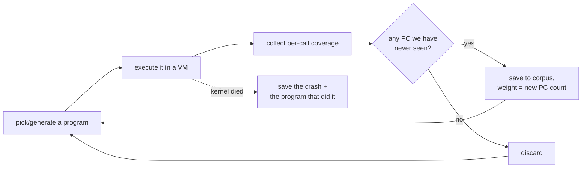

Everything else in syzkaller exists to serve one of three goals that **do not apply to a lab**:

| syzkaller goal | Why it costs so much | Does your lab need it? |
|---|---|---|
| Fuzz **every** kernel interface | needs a description *language*, a compiler, per-arch constant extraction, 3,000+ syscall descriptions | No. Twenty syscalls on one subsystem teaches you everything. |
| Run **unattended for years** across many machines | needs VM pools, boot-error recovery, RPC protocols, corpus databases with repair, saturation detectors | No. One VM, restarted on crash, is fine. |
| Produce reports a **stranger can act on** | needs deduplication, symbolization, C reproducer generation, bisection, maintainer routing, a dashboard | No. You are the only consumer. |

So the lean-core rule for this lab:

> **Build the feedback loop. Buy the environment from virtme-ng. Skip the product.**

The rest of this document is that sentence, made specific.

---

## 1. Buy / build / skip

This is the single most important table here. Read it before writing any code.

### Tier 1 — BUILD. This *is* the project.

| Component | Rough size | Why it cannot be bought |
|---|---:|---|
| **Call table** (your "descriptions", as Rust data) | 150 ln | The shape of the API you are fuzzing is the input to everything else. |
| **Program model** (calls + typed args + resource refs) | 200 ln | Mutation, minimization, and serialization all need it. |
| **Guest executor** (KCOV bracket + raw syscall dispatch) | 300 ln | This is the measurement apparatus. Nothing else can do it. |
| **Wire format** (host ↔ guest program/result encoding) | 200 ln | Must match your program model. |
| **Corpus** (novelty gate + weighted pick + persistence) | 150 ln | The memory of the fuzzer. |
| **Generator + mutator** | 400 ln | The search. |
| **Minimizer** | 80 ln | Turns a 30-call blob into a readable 3-call repro; cheapest high-value feature you will write. |
| **Crash detection** (scan console text) | 100 ln | Without this you are measuring coverage, not finding bugs. |
| **Host driver** (boot, feed, collect, restart) | 250 ln | The orchestration glue. |

**≈ 1,800–2,500 lines.** That is a weekend-to-fortnight project, and it will find real bugs in an obscure driver.

**Where each one is taught.** Use this to check you have not skipped a load-bearing piece:

| Tier 1 component | Taught in | Defines |
|---|---|---|
| Call table | §5.1–5.4 | `ArgKind`, `SyscallDesc`, `ResState` |
| **Program model** | **§5.5** | **`Program`, `Call`, `Arg`, `remove_call`** |
| Guest executor — coverage | §4.1–4.4 | `Kcov`, the reset/collect bracket |
| **Guest executor — dispatch** | **§4.5** | **`raw_syscall`, `resolve_args`, buffer allocation** |
| Wire format | §6 | request/response bytes, `PC_REWIND` |
| Corpus | §8.1–8.5 | `Corpus`, novelty gate, weighted pick, text persistence |
| Minimizer | §8.6 | `minimize` |
| Generator + mutator | §9 | `generate`, `rand_int`, `mutate`, `biased_rand` |
| Crash detection | §10 | `scan`, `normalize_title` |
| **Host driver** | **§7.1–7.3 (transport), §7.4 (the loop)** | **`FuzzTarget` impls, `main()`** |

The three in bold are the ones every other snippet silently depends on — a `Program` is what the mutator mutates, `raw_syscall` is what the KCOV bracket brackets, and the driver loop is what decides when to pay for deflaking. Read those before you start typing.

### Tier 2 — BUY from virtme-ng. Zero lines.

| What syzkaller builds | What you type instead |
|---|---|
| `pkg/build` — kernel compilation | `vng -b -f kcov.config` |
| Disk image creation, `create-image.sh`, debootstrap | nothing — virtme-ng exports **your host root filesystem** to the guest |
| `pkg/instance` — copying `syz-executor` into the VM | nothing — your `target/release/executor` is *already visible* in the guest at the same path |
| `vm/qemu` — QEMU command-line assembly, `archConfigs` | `vng --run ./arch/x86/boot/bzImage` |
| SSH key generation, `sshd` config, `WaitForSSH` | `vng --ssh` / `--console`, or avoid it entirely with `--exec` |
| Port forwarding, reverse tunnels | `--rwdir` (virtiofs) or vsock |
| `vm/vm.go` console capture | vng's stdout **is** the guest console |
| Boot timeout handling | `timeout 60 vng ...` |
| `pkg/instance/dump.go` — kdump crash kernel + `makedumpfile`, 100 retries | `vng --debug` then `vng --dump core.elf` (host-side QMP; see §14.1) |

### Tier 3 — SKIP. These look core and are not.

| Skipped | Why it is safe to skip | When you would reconsider |
|---|---|---|
| **syzlang + compiler + `syz-extract`** | A DSL pays off at 3,000 syscalls contributed by hundreds of people. At 20 syscalls, a Rust `const` table is *better*: type-checked, no build step, jump-to-definition. | You want outside contributors. |
| **Signal with priority bits** | syzkaller hashes edges and attaches a 2-bit quality score so set-cover prefers clean programs. Raw PC sets work fine for a small corpus. | Your corpus exceeds ~5,000 programs. |
| **The choice table** (static + `2*sqrt` dynamic priority matrix) | It solves "which of 3,000 syscalls comes next." With 20, uniform choice plus resource-aware ordering is within noise. | You scale past ~200 syscalls. |
| **Triage / deflaking** (3-of-5 runs) | You will get some flaky coverage and a slightly dirty corpus. Acceptable. | Coverage counts bounce so much you cannot tell progress. |
| **flatrpc / a real RPC protocol** | Files in a shared directory, or one program per boot. | You need >100 exec/s. |
| **VM pool / dispatcher** | One VM. `loop { boot(); fuzz_until_dead(); }` | You want throughput. |
| **Sandbox modes** | `sandbox=none`, i.e. just run as root in the guest. | Never, for a lab. |
| **Snapshot mode** | Pure throughput optimization. **vng does not support it, and virtiofs blocks it** — see §14.2. | Never. |
| **C reproducer generation** | You can hand-translate a 3-call program in five minutes. | You want to report upstream. |
| **Hub, dashboard, bisection, assets, email** | Product features. | Never. |
| **Multi-OS, multi-arch** | One OS (Linux). **Three arches** for the bare-metal lab — and the per-arch surface is tiny: `libc::SYS_*`, one `if` for PC rewind, three cross-linkers. See §15.4. | A fourth OS. |
| **Comparison hints** (`KCOV_TRACE_CMP`) | Highest value-per-line of anything in Tier 3, but useless until the base loop works. | Phase 4, after you are stuck on a magic-number check. |

### The arena: the one judgement call

syzkaller maps a 16 MiB region at a fixed address (`0x200000000000` on x86-64) and writes every pointer as a relative offset. It is the reason a syzbot `repro.syz` is replayable at all.

**You need it if** you want to run unmodified syzbot reproducers or need byte-identical memory layout across runs.
**You can skip it in phase 1** if you only care about your own programs — let the guest executor allocate buffers itself and hand the syscall real addresses.

My recommendation: **skip it for Lab 1–4, add it in Lab 5.** Build the loop first. Adding the arena later is a contained change to the wire format and the executor, and by then you will understand why every detail of it exists.

---

## 2. Lab 0 — the environment

### 2.1 Kernel config

Create `kcov.config`:

```
CONFIG_KCOV=y
CONFIG_KCOV_INSTRUMENT_ALL=y
CONFIG_KCOV_ENABLE_COMPARISONS=y
CONFIG_DEBUG_FS=y
CONFIG_DEBUG_INFO_DWARF_TOOLCHAIN_DEFAULT=y
CONFIG_KASAN=y
CONFIG_KASAN_INLINE=y
CONFIG_DEBUG_KMEMLEAK=n
CONFIG_RANDOMIZE_BASE=n
CONFIG_FRAME_POINTER=y

# For the Rust TFTP module that is this lab's target (§2.4)
CONFIG_RUST=y
CONFIG_SAMPLES=y
CONFIG_SAMPLES_RUST=y
# Without these two, bug 4 wraps silently instead of panicking (§2.4.7).
# The top-level Makefile turns them into -Cdebug-assertions / -Coverflow-checks.
CONFIG_RUST_DEBUG_ASSERTIONS=y
CONFIG_RUST_OVERFLOW_CHECKS=y
```

Why each one:

- **`KCOV` + `KCOV_INSTRUMENT_ALL`** — the coverage source. Without `INSTRUMENT_ALL` you only get coverage from files that opted in.
- **`KCOV_ENABLE_COMPARISONS`** — only needed in Lab 8 (hints). Enable now; it costs performance but saves a rebuild.
- **`DEBUG_FS`** — `/sys/kernel/debug/kcov` lives in debugfs. virtme-ng's init already mounts it (`mount -t debugfs debugfs /sys/kernel/debug`), so there is nothing for you to do.
- **`KASAN` + `KASAN_INLINE`** — your bug detector. Without it, a use-after-free silently corrupts memory and you never see it. This is what converts "the kernel kept running" into a loud report.
- **`RANDOMIZE_BASE=n`** — KASLR off, so a PC collected in one boot means the same thing in the next. With KASLR on you must subtract the per-boot kernel base before comparing PCs across boots, and you will get this wrong at least once.
- **`FRAME_POINTER`** — better stack traces in reports.

Build and sanity-boot:

```bash
cd ~/linux
vng -b -f kcov.config            # build with your config fragment on top
vng --run . --exec "ls -l /sys/kernel/debug/kcov"
```

If that last command prints a file, your environment is done. That is the entire "setup" chapter that syzkaller spends three documents on.

### 2.2 What virtme-ng actually gives you

Verified against the installed virtme-ng (1.41):

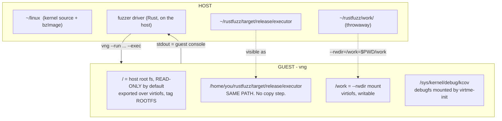

The three facts that matter:

1. **The host root filesystem is the guest root filesystem** (read-only by default, via virtiofs with a 9p fallback). A binary you `cargo build` on the host runs in the guest at the identical path. There is **no deploy step**. This alone deletes `pkg/instance` from your project.
2. **`--rwdir=guestpath=hostpath`** gives a writable shared directory, also virtiofs. This is your transport.
3. **virtme-ng's stdout is the guest console.** Kernel oops text appears on your terminal — or in the pipe your driver reads. This deletes `vm/vm.go`'s output merger.

### 2.3 Safety: read this before your first fuzzing run

**Your host filesystem is mounted in the guest.** A coverage-guided syscall fuzzer generates random `write`, `unlink`, `rename`, `mount`, and `ioctl` calls. That is the entire point of it.

| Risk | Mitigation |
|---|---|
| Fuzzer writes into your source tree via `--rwdir` | Point `--rwdir` at a **dedicated throwaway directory**. Never your repo, never `$HOME`. |
| Fuzzer damages the host root | **Do not pass `--rw`.** The default read-only root is your seatbelt. virtme-ng's own help warns: *"this can be dangerous for the host filesystem!"* |
| Guest needs a writable scratch dir for file-creating syscalls | Use **`--overlay-rwdir`** — writable in the guest, discarded, **read-only on the host**. This is exactly the right primitive. |
| Programs that mount filesystems or touch block devices | Keep `--disk` unset; give the guest only a tmpfs or loop device you created. |
| A kernel bug corrupting virtiofs state | Accept it. The guest is disposable; make sure nothing irreplaceable is reachable from it. |

A safe invocation skeleton:

```bash
vng --run ~/linux \
    --rwdir=/work=$PWD/work \          # transport only; disposable
    --overlay-rwdir=/scratch \         # guest-writable, host-safe
    --memory 2G --cpus 2 \
    --exec "/path/to/executor --once /work/req.bin /work/res.bin"
```

Make your executor `chdir("/scratch")` before running any program. Cheap, and it keeps file-creating syscalls away from anything shared.

### 2.4 The lab target: TFTP again, this time as a Rust kernel module

§2.1–§2.3 gave you a kernel to fuzz. This section gives you something *worth* fuzzing — and the recommendation is to write it yourself, in Rust, as a kernel module implementing the **same TFTP protocol you already attacked in userspace in Part 1.**

#### 2.4.1 Why the same protocol twice

Because it makes the kernel the only variable.

Part 1 had you build a TFTP DSL, a corpus, two engines, and seven planted bugs against a userspace server. If Part 2's target is a *different* thing — some vendor `/dev` node, an old CVE — then when your fuzzer underperforms you cannot tell whether the cause is the kernel environment or the fact that you are now modelling an unfamiliar interface. Keep the protocol identical and the comparison becomes clean:

| Held constant from Part 1 | Changed in Part 2 |
|---|---|
| the TFTP protocol and its state machine | the code runs in kernel space |
| your DSL: opcodes, options, `blksize` coupling, the TID resource | the transport is a syscall, not a UDP socket from userspace |
| the planted bug series | a bug now kills the **machine**, not a process |
| the corpus, novelty gate, mutator, minimizer | coverage comes from KCOV, not your own shm region |
| your knowledge of where the bugs are | the oracle is KASAN and the console, not a Rust backtrace on stderr |

Four more reasons this target is a good one:

- **You wrote it, so you know the answers.** Every "did my fuzzer find it?" question has a definite yes or no.
- **Protocol parsing in the kernel is where real remote CVEs live.** You are rehearsing a realistic shape, not a toy.
- **Rust makes the bug placement deliberate.** Safe Rust turns most memory errors into panics; a genuine use-after-free needs an `unsafe` block you wrote on purpose. That forces you to be explicit about which oracle each bug is testing (§2.4.7).
- **It is small.** A TFTP parser plus a misc device is a few hundred lines, and you already know the protocol.

#### 2.4.2 The make-or-break fact: KCOV *does* instrument Rust kernel code

This deserves stating with evidence, because the entire plan collapses without it, and it is not obvious. From `scripts/Makefile.kcov` in the kernel tree:

```make
kcov-rflags-y                                 += -Cpasses=sancov-module
kcov-rflags-y                                 += -Cllvm-args=-sanitizer-coverage-level=3
kcov-rflags-y                                 += -Cllvm-args=-sanitizer-coverage-trace-pc
kcov-rflags-$(CONFIG_KCOV_ENABLE_COMPARISONS) += -Cllvm-args=-sanitizer-coverage-trace-compares

export RUSTFLAGS_KCOV := $(kcov-rflags-y)
```

Read that carefully, because it gives you more than you might expect:

- `-sanitizer-coverage-trace-pc` is the Rust equivalent of the C side's `-fsanitize-coverage=trace-pc`. **Your Rust module's edges land in the same KCOV buffer as the rest of the kernel**, indistinguishable to your executor.
- `-sanitizer-coverage-trace-compares` under `CONFIG_KCOV_ENABLE_COMPARISONS` means **comparison hints work on Rust code too** — so the §16 item 1 upgrade applies to your own module, and the magic numbers it will teach you are the TFTP opcodes and option strings you wrote.
- `coverage-level=3` is edge-level, matching the C side.

KASAN likewise, from `scripts/Makefile.kasan`:

```make
RUSTFLAGS_KASAN := -Zsanitizer=kernel-address ...      # generic KASAN
RUSTFLAGS_KASAN := -Zsanitizer=kernel-hwaddress ...    # CONFIG_KASAN_SW_TAGS
```

And per-file control works the same way for Rust objects as for C — `scripts/Makefile.lib` consults `KCOV_INSTRUMENT_<file>.o`, then `KCOV_INSTRUMENT`, then `CONFIG_KCOV_INSTRUMENT_ALL`. So you can switch instrumentation off for one file if you ever need a control experiment.

Net effect: **with `CONFIG_KCOV_INSTRUMENT_ALL=y` from §2.1, your Rust module is instrumented with no extra work.** You do not add flags; you just build it as part of the kernel.

#### 2.4.3 Build it in-tree

Out-of-tree Rust modules are possible but awkward, and the kernel's own Rust documentation does not describe the workflow. In-tree is both easier and — the deciding factor — the thing that gets your module instrumented automatically by the config you already set.

Add to your config fragment:

```
CONFIG_RUST=y
CONFIG_SAMPLES=y
CONFIG_SAMPLES_RUST=y
```

Then check the toolchain before anything else, because Rust-for-Linux is strict about versions:

```bash
cd ~/linux
make LLVM=1 rustavailable      # the single most useful diagnostic; read its output
```

It will tell you precisely what is missing — a `rustc` outside the supported range, a missing `rust-src` component, no `bindgen`. Fix that first; nothing else in this section works until `rustavailable` is happy.

Put your module where the samples live, modelled on the one that already exists:

```
samples/rust/
├── rust_misc_device.rs     # <-- YOUR TEMPLATE. Read this first.
└── rust_tftp.rs            # <-- your module
```

`samples/rust/rust_misc_device.rs` is a complete, working misc device with three ioctls, and it is the shortest path to a module that registers, opens, and handles `ioctl`. Copy its skeleton and replace the body.

#### 2.4.4 Two attack surfaces, built in this order

The module can expose its parser two ways, and **the order matters because the second one breaks something on purpose.**

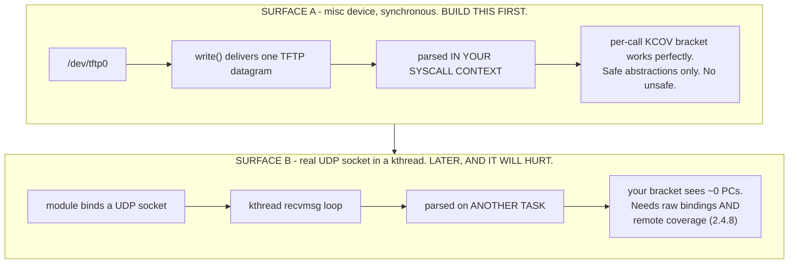

Surface A is the whole lab. Surface B is an optional advanced exercise whose real purpose is to make you *feel* why `KCOV_REMOTE_ENABLE` exists.

#### 2.4.5 Surface A: the misc device

Everything here is covered by upstream safe abstractions, which is why it is the starting point. The pieces, all verified present in the tree:

| What you need | Where it comes from |
|---|---|
| register `/dev/tftp0` | `kernel::miscdevice::{MiscDevice, MiscDeviceOptions, MiscDeviceRegistration}` |
| handle `open`, `read`, `write`, `ioctl` | the `MiscDevice` trait: `open`, `read_iter`, `write_iter`, `ioctl(me, file, cmd, arg)` |
| ioctl command codes | `kernel::ioctl::{_IO, _IOR, _IOW, _IOWR}` — the *same* macros your fuzzer's call table should use |
| copy from/to userspace | `kernel::uaccess::{UserSliceReader, UserSliceWriter}` |

A minimal surface, deliberately small so the call table stays small:

| Entry point | Purpose |
|---|---|
| `open("/dev/tftp0")` | creates one independent server instance; the fd **is** the resource |
| `write(fd, pkt, len)` | deliver one TFTP datagram to the parser. **This is the hot path and the real attack surface.** |
| `read(fd, buf, len)` | retrieve the reply datagram the server produced |
| `ioctl(fd, TFTP_SET_OPTS, &opts)` | configure: strict option validation on/off, max transfers, root policy — this is also your **bug switch** |
| `ioctl(fd, TFTP_GET_STATS, &stats)` | transfers, bytes, errors — useful as a sanity oracle |
| `ioctl(fd, TFTP_RESET, NULL)` | drop all transfer state |

Derive the ioctl numbers **once** and share them. The module uses `kernel::ioctl::_IOW::<TftpOpts>('T' as u32, 0x01)`; your fuzzer's call table needs the same integer. Put the type byte and the numbers in a comment block in both files and verify with `pahole` once the kernel is built (§5.4) — a mismatched `_IOC_SIZE` is a silent `ENOTTY` and precisely the failure §5.4 warns about.

#### 2.4.6 The real payoff: your Part 1 DSL becomes a nested description

This is the insight that makes the whole two-part structure click.

With Surface A the syscall table is *tiny* — six entries, one of which matters. All of the interesting structure is in the **payload of `write()`**, and that payload is a TFTP datagram, which you already have a complete typed model for from Part 1 §3.

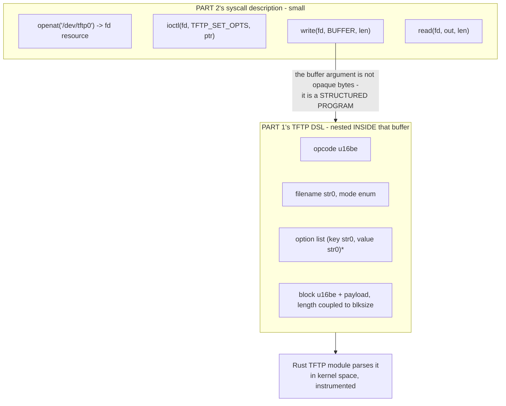

**This is exactly what syzkaller does**, and it is one of the least obvious things about it. A syscall argument is frequently not a flat buffer but a whole nested grammar: netlink messages inside `sendmsg`, USB descriptors inside a gadget write, an entire filesystem image inside `mount`. syzkaller models those with the same type system it uses for syscall arguments, which is why `syzlang-design.md` spends so long on structs, arrays and length coupling.

Two concrete consequences for your implementation:

**Your mutator needs two levels.** The outer level picks calls and resources — this is §9.3's three operators. The inner level mutates the TFTP message inside the buffer, and that is the mutator you already wrote in Part 1. Compose them: when `mutate_arg` lands on the `write` buffer, hand it to the Part 1 mutator rather than flipping bytes.

**`fix_lens` now runs at two levels too.** The syscall's `len` argument must match the buffer length (§5.5), *and* the TFTP `DATA` payload must respect the negotiated `blksize` (Part 1 §3.6). Get either wrong and every write is rejected.

That two-level structure is the single biggest thing Part 1 buys you here. Without it you would be writing `ArgKind::Buf { len: Range(0, 4096) }` and feeding the kernel random bytes, which reaches the opcode switch and stops.

#### 2.4.7 The bug series, and what changes in kernel space

Carry over the same seven bugs from Part 1 §2.1, each behind its own `Cargo`-free feature switch — a module parameter or a `TFTP_SET_OPTS` flag is easiest, so you can enable exactly one without rebuilding.

What changes is the **manifestation**, and that is the lesson:

| Part 1 bug | In userspace | In the Rust kernel module |
|---|---|---|
| 1. unclamped `blksize` | panic / OOM in one process | `BUG:` on the console, or the allocator refusing; machine may survive |
| 2. unterminated filename | panic on slice index | kernel panic — **slice bounds checks are still there in kernel Rust** |
| 3. ACK for a block never sent | underflow panic | same, as a kernel `BUG:` |
| 4. `tsize` integer overflow | panic with debug assertions | panics only if `CONFIG_RUST_OVERFLOW_CHECKS=y`; otherwise it wraps silently |
| 5. transfer map never evicted | RSS growth | **kernel memory leak** — `kmemleak`, or just OOM eventually |
| 6. use-after-free via `unsafe` | ASAN | **KASAN** — this is the one that exercises your real oracle |
| 7. path traversal | your own assertion | your own `pr_warn` plus an assertion; no sanitizer sees it |

Two things worth being explicit about, because they are easy to get wrong:

**Safe Rust is a weaker test of KASAN than C would be.** Bugs 1, 2 and 3 become clean panics rather than silent corruption, because the bounds checks are still compiled in. That is good engineering and bad for exercising your detector. **So bug 6 is not optional here** — write one deliberate `unsafe` lifetime violation, so you have at least one finding that only KASAN can catch. Otherwise you will have built a KASAN-enabled kernel and never confirmed KASAN works.

**A kernel panic is your crash signal, and it looks different from a userspace one.** A Rust panic in kernel context goes through the kernel's panic path, so what your §10 scanner sees on the console is `Kernel panic` or `BUG:`, with a Rust backtrace embedded. Add `rust_begin_unwind` and `panicked at` to the `PATTERNS` list in §10 — the stock list is written for C kernel code and will otherwise classify your own module's panics as generic.

#### 2.4.8 Surface B, and discovering why remote coverage exists

Optional, and the most instructive thing in this section if you have the time.

Make the module bind a real UDP socket and process datagrams in a kernel thread. Two obstacles, both educational:

**There is no socket abstraction for Rust in the kernel.** Verified: `rust/kernel/net/` contains only `netlink.rs` and `phy`. So a UDP listener means raw `bindings::` calls — `sock_create_kern`, `kernel_bind`, `kernel_recvmsg` — inside `unsafe` blocks. That is a legitimate finding about the current state of Rust-for-Linux, and a reminder that "write it in Rust" does not mean "write it in safe Rust" when you are at the edges.

**Your per-call coverage bracket goes blind.** This is the real point. The datagram is now parsed on a *kernel thread*, not on the task that called `write()`. §4.4 warned about exactly this for workqueues and softirqs; now you have caused it deliberately, and you can watch your PC count for the parse code drop to near zero while the parser demonstrably runs.

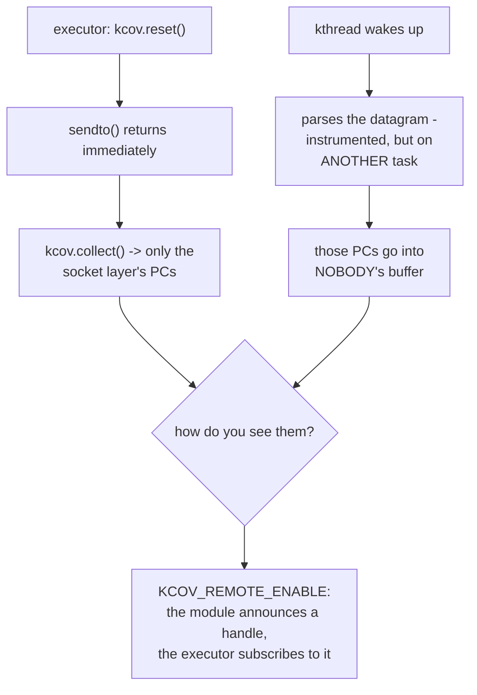

The fix is the mechanism syzkaller uses for USB and for softirq network processing. The kernel side, from `include/linux/kcov.h`:

```c
void kcov_remote_start(u64 handle);
void kcov_remote_stop(void);
static inline void kcov_remote_start_common(struct kcov_common_handle_id id);
```

Your module wraps its parse call in `kcov_remote_start_common(id)` / `kcov_remote_stop()`, where `id` identifies the instance. The executor side opens KCOV as usual and then issues `KCOV_REMOTE_ENABLE` with a `struct kcov_remote_arg` carrying the handles it wants to collect. The handle encoding, from `include/uapi/linux/kcov.h`:

| Field | Value |
|---|---|
| `KCOV_SUBSYSTEM_COMMON` | `0x00ull << 56` |
| `KCOV_SUBSYSTEM_USB` | `0x01ull << 56` |
| `KCOV_SUBSYSTEM_MASK` | `0xffull << 56` |
| `KCOV_INSTANCE_MASK` | `0xffffffffull` |
| `struct kcov_remote_arg` | `{ trace_mode, area_size, num_handles, common_handle, handles[] }` |

So a handle is a subsystem byte in the top bits and a 32-bit instance id in the bottom. Pick a `common_handle` per open fd and you get coverage attributed to *your* transfer instead of whatever else the kthread is doing.

Build Surface B only after Surface A is finding bugs. It is strictly harder, it needs `unsafe`, and its lesson — that asynchronous kernel work is invisible to a naive bracket — is one you can only appreciate once the naive bracket is working.

#### 2.4.9 Milestone gates for the target

Before Lab 1, the target itself needs to pass:

| Gate | Check |
|---|---|
| **T0** | `make LLVM=1 rustavailable` prints success |
| **T1** | the module builds in-tree and loads; `/dev/tftp0` appears |
| **T2** | a hand-written `write()` of a valid `RRQ` produces a sensible reply via `read()` — the protocol works, exactly as Part 1's U0 gate |
| **T3** | `nm` or `objdump` confirms sancov callbacks in the module's object, **or** simpler: your `--selftest` collects a nonzero PC count from a `write()` to `/dev/tftp0` |
| **T4** | enable bug 6, trigger it by hand, and see a **KASAN** report on the console — your oracle is proven before you trust the fuzzer |

T3 and T4 are the two that people skip and should not. T3 proves Rust instrumentation actually reached your code; T4 proves the detector you are relying on is switched on and reporting. Both fail silently otherwise, and both are much harder to diagnose once an automated loop is running on top of them.

---

## 3. Architecture of the clone

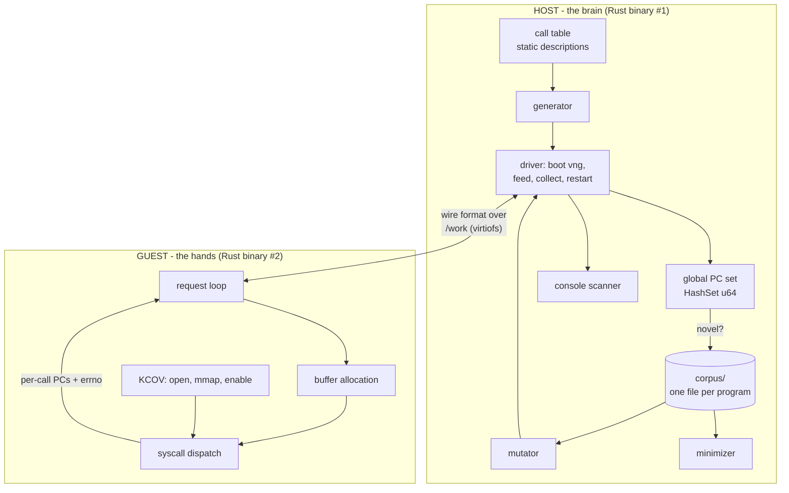

Two binaries from one Cargo workspace:

```
rustfuzz/
├── Cargo.toml              # workspace
├── common/                 # shared: wire format, program model, call table
│   └── src/{lib,prog,wire,table}.rs
├── fuzzer/                 # HOST binary: generate, mutate, corpus, drive vng
│   └── src/{main,corpus,mutate,generate,driver,crash}.rs
└── executor/               # GUEST binary: KCOV + dispatch
    └── src/{main,kcov,run}.rs
```

**The host/guest split is the one architectural decision to get right, and syzkaller took nine years to settle it.** Before 2024 the fuzzing brain ran *inside* the VM and died with every kernel crash. Start where syzkaller ended up: **all durable state on the host, nothing but execution in the guest.** The guest binary should have no knowledge of the corpus, coverage history, or mutation. It takes a program, runs it, reports back.

### 3.1 The one abstraction to build on day one

Put a trait between the driver loop and the thing being fuzzed. Four methods — the same shape as syzkaller's `vmimpl.Instance`:

```rust
pub trait FuzzTarget {
    fn deploy(&mut self) -> anyhow::Result<String>;   // make the executor runnable
    fn exec(&mut self, prog: &Program) -> anyhow::Result<Response>;
    fn drain_console(&mut self) -> String;            // output since last call
    fn reset(&mut self) -> anyhow::Result<()>;        // must work after a panic
}
```

With virtme-ng, `deploy` is a no-op and `reset` kills a process. With a **bare-metal board over the network** (§15), `deploy` is a copy or a read-only mount and `reset` is a power-cycle ladder — but *nothing above the trait changes*. If instead you hardcode `Command::new("vng")` into the driver, retrofitting a second target later is a day of annoying work. Writing the trait now costs twenty minutes, and §15 is the payoff.

Dependencies — keep it short:

```toml
[dependencies]
libc = "0.2"          # raw syscall(), ioctl numbers
nix = { version = "0.29", features = ["ioctl", "mman"] }
rand = "0.8"
blake3 = "1"           # content-addressed corpus filenames
anyhow = "1"

# Host side only, and only for the bare-metal target (§15.5).
# Wraps libssh (libssh.org). The `vendored` feature builds libssh from source,
# so you do not need libssh-dev installed. Alternatives: `ssh2` (wraps the
# unrelated libssh2), or `russh` (pure Rust, no C dependency).
libssh-rs = { version = "0.3", features = ["vendored"], optional = true }
```

No serde in the wire format. Hand-roll it — it is 200 lines, you want byte-level control, and you will be debugging it with `xxd`.

---

## 4. Lab 1 — the executor: KCOV in ~80 lines

Build this first, standalone, before any fuzzer exists. It is the piece that can actually fail for interesting reasons.

### 4.1 The KCOV protocol

Verified against `executor/executor_linux.h`:

```rust
// /sys/kernel/debug/kcov ioctls. Derivation:
//   _IOC(dir, type, nr, size) = (dir << 30) | (size << 16) | (type << 8) | nr
//   type = 'c' = 0x63
const KCOV_INIT_TRACE: u64 = 0x8008_6301; // _IOR('c', 1, u64):  dir=2, size=8
const KCOV_ENABLE:     u64 = 0x0000_6364; // _IO('c', 100)
const KCOV_DISABLE:    u64 = 0x0000_6365; // _IO('c', 101)
const KCOV_RESET_TRACE:u64 = 0x0000_6368; // _IO('c', 104)

const KCOV_TRACE_PC:  u64 = 0;
const KCOV_TRACE_CMP: u64 = 1;

const COVER_ENTRIES: usize = 64 << 10;  // syzkaller uses 512<<10; 64K is plenty here
```

> **These constants are x86/arm/arm64/riscv only.** They use the asm-generic `_IOC` encoding. MIPS, PowerPC, SPARC and Alpha encode direction differently, so `KCOV_INIT_TRACE` is `0x40086301` and `KCOV_ENABLE` is `0x20006364` there. If you will ever target one of those, compute the numbers with `nix`'s `ioctl_*` macros rather than pasting them — see §15.4.

The buffer layout is the thing to internalize, because it is almost too simple:

```
area[0]            = number of PCs collected   <-- writable by you
area[1 ..= area[0]] = the PCs
```

So:

- **reset** = `area[0] = 0`. That is all. (syzkaller literally does `*(uint64*)cov->data = 0`.)
- **collect** = read `area[0]`, then slice `area[1..=n]`.
- **overflow** = `area[0]` reached the capacity; syzkaller checks `(size + 2) * 8 > data_size` conservatively.

```rust
pub struct Kcov {
    fd: i32,
    area: *mut u64,
    entries: usize,
}

impl Kcov {
    pub fn open() -> anyhow::Result<Self> {
        let fd = unsafe {
            libc::open(c"/sys/kernel/debug/kcov".as_ptr(), libc::O_RDWR)
        };
        anyhow::ensure!(fd >= 0, "open /sys/kernel/debug/kcov: {}", errno());

        // Size is in ENTRIES, not bytes.
        let r = unsafe { libc::ioctl(fd, KCOV_INIT_TRACE as _, COVER_ENTRIES) };
        anyhow::ensure!(r == 0, "KCOV_INIT_TRACE: {}", errno());

        let len = COVER_ENTRIES * 8;
        let area = unsafe {
            libc::mmap(std::ptr::null_mut(), len,
                       libc::PROT_READ | libc::PROT_WRITE,
                       libc::MAP_SHARED, fd, 0)
        };
        anyhow::ensure!(area != libc::MAP_FAILED, "mmap kcov: {}", errno());

        // Must be enabled per-thread, from the thread that will run the syscalls.
        let r = unsafe { libc::ioctl(fd, KCOV_ENABLE as _, KCOV_TRACE_PC) };
        anyhow::ensure!(r == 0, "KCOV_ENABLE: {}", errno());

        Ok(Self { fd, area: area as *mut u64, entries: COVER_ENTRIES })
    }

    #[inline]
    pub fn reset(&self) {
        unsafe { std::ptr::write_volatile(self.area, 0) };
    }

    pub fn collect(&self) -> (Vec<u64>, bool) {
        let n = unsafe { std::ptr::read_volatile(self.area) } as usize;
        let overflow = n + 2 > self.entries;
        let n = n.min(self.entries - 1);
        let pcs = unsafe { std::slice::from_raw_parts(self.area.add(1), n) }.to_vec();
        (pcs, overflow)
    }
}
```

### 4.2 The bracket — the whole reason this works

```rust
for (i, call) in prog.calls.iter().enumerate() {
    let args = resolve_args(call, &results, &mut arena)?;   // §4.5

    kcov.reset();                                   // <-- immediately before
    let (ret, err) = unsafe { raw_syscall(CALLS[call.desc].nr, &args) };
    let (pcs, overflow) = kcov.collect();           // <-- immediately after

    results.push(CallResult { index: i, retval: ret, errno: err, pcs, overflow });
}
```

**Nothing else in the project has as high a correctness-to-lines ratio as those three lines.** Reset before, drain after. Get the bracket wrong — reset once at the start, drain once at the end — and you can only ever report "the program touched these lines," which cannot answer the question anybody asks.

### 4.3 Milestone 1 (do not proceed until this passes)

```bash
cargo build --release -p executor
vng --run ~/linux --exec "$PWD/target/release/executor --selftest"
```

`--selftest` should: open KCOV, reset, call `getpid()`, collect, and print the PC count. Expected output is a nonzero, *stable-ish* count in the tens:

```
[executor] kcov: 64K entries, fd 3
[executor] getpid() = 1, 23 PCs, overflow=false
[executor] SELFTEST PASS
```

If you get **0 PCs**: `KCOV_ENABLE` was called on a different thread than the syscall, or `CONFIG_KCOV_INSTRUMENT_ALL` is off.
If `KCOV_INIT_TRACE` fails with `EINVAL`: you passed a byte count instead of an entry count, or you called it twice on one fd.
If `open` fails with `ENOENT`: debugfs is not mounted — but virtme-ng mounts it, so suspect a kernel built without `CONFIG_DEBUG_FS`.

### 4.4 Two KCOV facts that will bite you later

**Coverage is per-thread.** `KCOV_ENABLE` applies to the calling task. If you later add threaded execution (to stop a blocking syscall from stalling the program), each thread needs its own fd, its own mmap, and its own `KCOV_ENABLE`. syzkaller gives every thread a `cover_t`.

**Some work happens after your syscall returns.** Workqueues, timers, RCU callbacks, softirq packet processing — triggered by your call, executed later, on another task. Your per-call bracket cannot see it. syzkaller handles this with a second coverage object (`extra_cov`) using `KCOV_REMOTE_ENABLE`, reported as unattributed "extra" coverage. **Skip this in the lab** and know that you are blind to deferred work — which is why a networking fuzzer built this way will seem to plateau early.

### 4.5 The other half of the executor: dispatch

§4.1–4.4 covered the measurement. This is the thing being measured, and it is the other half of the Tier-1 "guest executor" line item.

#### The calling convention gotcha

```rust
/// Dispatch one syscall.
///
/// IMPORTANT, and the source of a classic bug: the KERNEL returns `-errno`
/// in its result register, but libc's `syscall()` wrapper converts that into
/// `-1` plus a thread-local `errno`. If you write `if ret < 0 { -ret }` you
/// will report errno 1 for everything. Normalise here, once.
unsafe fn raw_syscall(nr: i64, a: &[u64; 6]) -> (i64, i32) {
    *libc::__errno_location() = 0;
    let ret = libc::syscall(
        nr as libc::c_long,
        a[0] as libc::c_long, a[1] as libc::c_long, a[2] as libc::c_long,
        a[3] as libc::c_long, a[4] as libc::c_long, a[5] as libc::c_long,
    ) as i64;
    let err = if ret == -1 { *libc::__errno_location() } else { 0 };
    (ret, err)
}
```

Six arguments always, zero-padded — that is the Linux limit on every architecture you will target, and passing six when the syscall wants two is harmless. `libc::syscall` is variadic and works identically on x86-64, arm64 and riscv64, so you need no inline assembly. (`nix::errno::Errno::last()` is the tidier way to read errno if you prefer.)

#### Resolving a `Program` into actual syscall arguments

The guest's job is to turn the three `Arg` variants (§5.5) into six `u64`s:

```rust
/// A simple bump allocator for buffer arguments. One mmap, reused per program.
pub struct Arena { base: *mut u8, len: usize, used: usize }

impl Arena {
    pub fn new(len: usize) -> anyhow::Result<Self> {
        let base = unsafe {
            libc::mmap(std::ptr::null_mut(), len,
                       libc::PROT_READ | libc::PROT_WRITE,
                       libc::MAP_PRIVATE | libc::MAP_ANONYMOUS, -1, 0)
        };
        anyhow::ensure!(base != libc::MAP_FAILED, "arena mmap failed");
        Ok(Self { base: base as *mut u8, len, used: 0 })
    }
    pub fn reset(&mut self) { self.used = 0; }
    /// Copy `data` in and return a pointer the kernel can use.
    pub fn put(&mut self, data: &[u8]) -> anyhow::Result<u64> {
        let off = (self.used + 7) & !7;                  // 8-byte align
        anyhow::ensure!(off + data.len() <= self.len, "arena exhausted");
        unsafe { std::ptr::copy_nonoverlapping(data.as_ptr(), self.base.add(off), data.len()) };
        self.used = off + data.len();
        Ok(self.base as u64 + off as u64)
    }
}

fn resolve_args(call: &Call, done: &[CallResult], arena: &mut Arena)
    -> anyhow::Result<[u64; 6]>
{
    let mut out = [0u64; 6];
    for (i, arg) in call.args.iter().enumerate().take(6) {
        out[i] = match arg {
            Arg::Imm(v)            => *v,
            Arg::Buf { data, .. }  => arena.put(data)?,
            // The dataflow edge: use what that earlier call actually returned.
            Arg::ResRef(n)         => done.get(*n)
                                          .map(|r| r.retval as u64)
                                          .unwrap_or(u64::MAX),   // producer failed
        };
    }
    Ok(out)
}
```

Three things worth noticing:

**`ResRef` is resolved against results, not against the program.** `openat` may return fd 3 on one boot and fd 7 on the next; the program says "whatever call 0 returned" and stays correct either way. This is syzkaller's copyout-index mechanism in eight lines.

**A failed producer must not abort the program.** If call 0 returned `-1`, call 1 gets `u64::MAX` as its fd and fails with `EBADF`. That is *correct behaviour* — syzkaller does the same thing, and those failing programs still produce coverage in the kernel's error paths, which is where plenty of bugs live.

**`arena.reset()` between programs, not between calls.** Arguments must stay valid for the whole program, because a later call may read a buffer an earlier call wrote.

> This bump allocator is the ancestor of syzkaller's fixed-address arena (`syz-execprog-design.md` §2.3). The difference is that syzkaller maps at a *fixed* address so that pointers can be written as relative offsets in the program text, which is what makes a syzbot reproducer replayable. You do not need that yet — see "The arena: the one judgement call" in §1.

#### Executor entry points

Give the guest binary exactly four modes. Each maps to a transport stage:

| Mode | Used by | Behaviour |
|---|---|---|
| `--selftest` | milestone 1 | open KCOV, run `getpid()`, print the PC count, exit |
| `--once REQ RES` | virtme-ng stage 1 (§7.1) | read one request file, write one response file, exit |
| `--stdio` | board stage 1' (§15.5) | read one request from stdin, write the response to stdout, exit |
| `--connect ADDR` | stage 2/2' | dial the host, then serve requests forever |

All four share one `run_program(&Program, &Kcov, &mut Arena) -> Response`. The modes are twenty lines of argument parsing around it.

---

## 5. Lab 2 — descriptions, as Rust data

This is where you consciously refuse to build syzlang.

### 5.1 The type model

Four features of syzlang carry ~80% of its value. Implement exactly those:

```rust
#[derive(Clone, Copy, PartialEq)]
pub enum Dir { In, Out, InOut }

#[derive(Clone, Copy, PartialEq, Eq, Hash)]
pub enum ResKind { Fd, FdTty, FdSock, FdLoop }   // a tiny hierarchy

#[derive(Clone, Copy)]
pub enum ArgKind {
    /// A fixed value. Command codes, magic constants.
    Const(u64),
    /// An integer, optionally range-limited.
    Int { bits: u8, range: Option<(u64, u64)> },
    /// One of an enumerated set, OR-combined if `bitmask`.
    Flags { vals: &'static [u64], bitmask: bool },
    /// A pointer to a buffer the executor allocates.
    Buf { dir: Dir, len: LenSpec },
    /// Consume a resource produced by an earlier call.
    Res(ResKind),
    /// The length of another argument, by index.
    Len(usize),
}

#[derive(Clone, Copy)]
pub enum LenSpec { Fixed(usize), Range(usize, usize) }

pub struct SyscallDesc {
    pub name: &'static str,
    pub nr: i64,
    pub args: &'static [ArgKind],
    /// What resource this call's return value becomes, if any.
    pub produces: Option<ResKind>,
}
```

And a table. Pick **one subsystem** — a single `/dev` node, one ioctl family — and describe it properly. If you are using the Rust TFTP module from §2.4, that subsystem is `/dev/tftp0`, and the table is unusually small because most of the structure lives in the `write()` payload instead (§2.4.6). The `ptmx` example below is the generic shape; §2.4.5 lists the TFTP module's six entry points.

```rust
pub static CALLS: &[SyscallDesc] = &[
    SyscallDesc {
        name: "openat$ptmx", nr: libc::SYS_openat,
        args: &[
            ArgKind::Const(-100i64 as u64),                       // AT_FDCWD
            ArgKind::Const(PATH_PTMX),                            // "/dev/ptmx"
            ArgKind::Flags { vals: &[O_RDWR, O_NONBLOCK, O_NOCTTY], bitmask: true },
            ArgKind::Const(0),
        ],
        produces: Some(ResKind::FdTty),
    },
    SyscallDesc {
        name: "ioctl$TIOCSPTLCK", nr: libc::SYS_ioctl,
        args: &[
            ArgKind::Res(ResKind::FdTty),
            ArgKind::Const(0x4004_5431),                          // TIOCSPTLCK
            ArgKind::Buf { dir: Dir::In, len: LenSpec::Fixed(4) },
        ],
        produces: None,
    },
    SyscallDesc {
        name: "write$tty", nr: libc::SYS_write,
        args: &[
            ArgKind::Res(ResKind::FdTty),
            ArgKind::Buf { dir: Dir::In, len: LenSpec::Range(0, 4096) },
            ArgKind::Len(1),
        ],
        produces: None,
    },
    // ... 15 more
];
```

### 5.2 Why this beats a DSL at this scale

| | syzlang | Rust table |
|---|---|---|
| Build step | parse → check → consts → gen → gob → embed | none |
| Constant values | `syz-extract` compiles a C program against kernel headers, per arch | `libc::` constants, or a `const` you typed |
| Type errors | caught by `pkg/compiler`'s 12 check passes | caught by `rustc` |
| Navigation | grep | jump-to-definition |
| Cost of 3,000 syscalls | amortized, worth it | unbearable |
| Cost of 20 syscalls | all overhead | ~150 lines |

The crossover is somewhere around a few hundred syscalls contributed by more than one person. **You will never reach it in a lab**, so do not pay for it.

One thing you *do* inherit for free: **constants that do not exist on your kernel become compile errors**, which is arguably better than syzkaller's "record it as `???` and disable the syscall at runtime."

### 5.3 The one piece of syzlang semantics you must copy: resources

Resources are not a convenience — they are *the* mechanism that gets the fuzzer past the front door. `ioctl` needs a file descriptor from a specific `open`. Random integers never produce one.

```rust
/// Live resources during generation. The whole of syzkaller's `prog/analysis.go`
/// state tracking, reduced to what you need.
#[derive(Default)]
pub struct ResState {
    live: HashMap<ResKind, Vec<usize>>,  // kind -> indices of producing calls
}

impl ResState {
    /// Resources are substitutable up the hierarchy: FdTty satisfies Fd.
    fn compatible(have: ResKind, want: ResKind) -> bool {
        have == want || (want == ResKind::Fd && have != ResKind::Fd)
    }

    pub fn pick(&self, want: ResKind, rng: &mut impl Rng) -> Option<usize> {
        let mut candidates: Vec<usize> = self.live.iter()
            .filter(|(k, _)| Self::compatible(**k, want))
            .flat_map(|(_, v)| v.iter().copied())
            .collect();
        candidates.sort_unstable();              // determinism
        candidates.choose(rng).copied()
    }

    pub fn record(&mut self, kind: ResKind, call_idx: usize) {
        self.live.entry(kind).or_default().push(call_idx);
    }
}
```

And in the generator: when a chosen call needs `Res(k)` and nothing compatible is live, **insert a producer first**. That loop is the lean version of syzkaller's `createResource`, and it is what makes generated programs non-trivial.

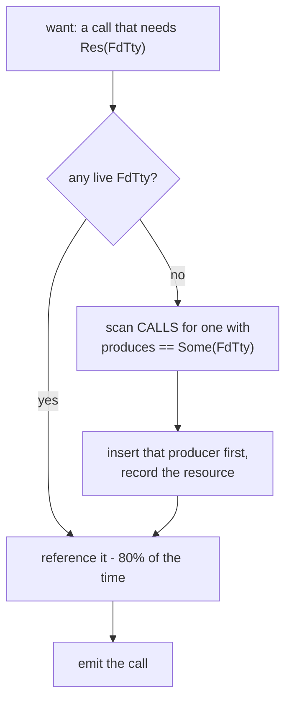

Keep syzkaller's 80/20 bias here (`nOutOf(8, 10)`): **reuse an existing resource 80% of the time, create a new one 20%.** Reuse keeps programs coherent — operate on the file you opened; creation enables new scenarios — open a second file.

### 5.4 What "knowing the kernel" actually means — and where to get it

It is often said that syzkaller's `.txt` descriptions are how it "knows the kernel structure." That is true in one specific sense and misleading in two others, and the distinction decides what you must build.

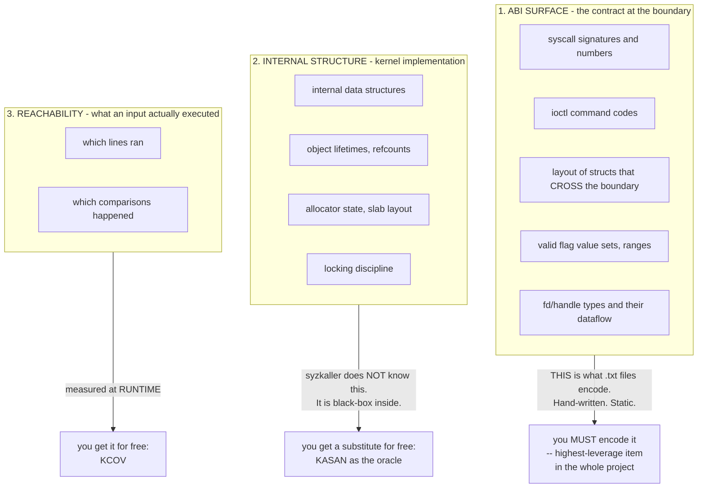

**So: syzkaller does not know the kernel's internals. It knows the contract at the boundary, and it observes the inside through two instruments — KCOV tells it where the code went, KASAN tells it when something broke.** That division is why the project is portable across six operating systems: the descriptions model the API, and the instrumentation handles everything behind it.

For your lab this is good news twice over. You must encode category 1 — and it is genuinely non-negotiable, because `ioctl(rand(), rand(), rand())` never clears `EBADF`. But categories 2 and 3 you get from kernel config flags you already set in Lab 0.

#### The format is not the knowledge

What the `.txt` *format* buys, and whether you need it:

| The format gives you | Needed at 20 syscalls? |
|---|---|
| A parser plus ~12 semantic check passes | No — `rustc` type-checks your table |
| Per-arch constant extraction by compiling C against kernel headers | No — `libc::` constants, one target |
| Low-friction contribution by hundreds of people | No |
| `syz-check` validation against kernel DWARF | **The need is real; the mechanism is replaceable** — see below |
| gob serialization, embedding, revision hashing | No |

So: **copy the knowledge, skip the language.** The one capability in that list you genuinely need is the last interesting one — a way to be sure your struct layouts are *right*.

#### Getting struct layouts right: use `pahole`, not your eyes

This is the single most common way a hand-built syscall fuzzer quietly fails. You transcribe an ioctl argument struct from a header, get a field order or a padding hole wrong, and from then on every call returns `EINVAL` — or worse, succeeds while fuzzing the wrong bytes. Coverage plateaus and you blame the mutator.

syzkaller solves this with `syz-extract` (constants from real headers) plus `syz-check` (descriptions diffed against kernel DWARF). You can get the same guarantee from one command, because you already built a kernel with debug info:

```bash
# Exact layout, sizes, offsets and padding holes, straight from your vmlinux
pahole -C sock_fprog ~/linux/vmlinux
pahole -C usbdevfs_ctrltransfer ~/linux/vmlinux

# Everything matching a prefix, when you are exploring a subsystem
pahole --sizes ~/linux/vmlinux | grep -i ptm
```

`pahole` reads DWARF, so what it prints is what the compiler actually produced for *your* build — including padding, which is where hand-transcription goes wrong. Output looks like:

```
struct sock_fprog {
        unsigned short             len;                  /*     0     2 */
        /* XXX 6 bytes hole, try to pack */
        struct sock_filter *       filter;               /*     8     8 */

        /* size: 16, cachelines: 1, members: 2 */
        /* sum members: 10, holes: 1, sum holes: 6 */
};
```

That six-byte hole is exactly the kind of thing you would never guess, and getting it wrong shifts every subsequent field.

Two more sources worth knowing:

```bash
# Constant values, without transcribing them: ask the compiler, like syz-extract does
echo '#include <linux/usbdevice_fs.h>
#include <stdio.h>
int main(){ printf("%lu\n", (unsigned long)USBDEVFS_CONTROL); }' > /tmp/c.c \
  && gcc -o /tmp/c /tmp/c.c && /tmp/c

# Walk live kernel data structures in a dump (see §14.1)
drgn -c core.elf -s ~/linux/vmlinux
```

The `drgn` line is where this section and §14 meet: the memory-dump capability is not just for post-mortem triage, it is also how you *verify your model of the kernel's structures against a running kernel*. That is the closest a lab gets to `syz-check`, and it costs nothing to set up.

#### The lean modelling trick: variants instead of unions

syzkaller models "this ioctl's argument struct depends on the command code" with conditional union fields, which required a desugaring pass in the compiler (see `syzlang-design.md` §1.6). You do not need any of that machinery. Describe each command as its **own call**:

```rust
// Not one ioctl with a union argument. Three calls.
"ioctl$USBDEVFS_CONTROL"   => args: [Res(FdUsb), Const(USBDEVFS_CONTROL),   Buf{..}]
"ioctl$USBDEVFS_BULK"      => args: [Res(FdUsb), Const(USBDEVFS_BULK),      Buf{..}]
"ioctl$USBDEVFS_SETCONFIG" => args: [Res(FdUsb), Const(USBDEVFS_SETCONFIG), Buf{..}]
```

This is exactly syzkaller's `$variant` convention, and at lab scale it fully replaces unions and conditional fields. More table rows, zero compiler machinery — and each variant gets its own independently-mutated argument shape, which is what you wanted anyway.

### 5.5 The program model: what you actually mutate

§5.1 defined the *schema*. This defines the *instance* — and it is the type that every other part of the project touches, so getting its shape right matters more than anything else in this section.

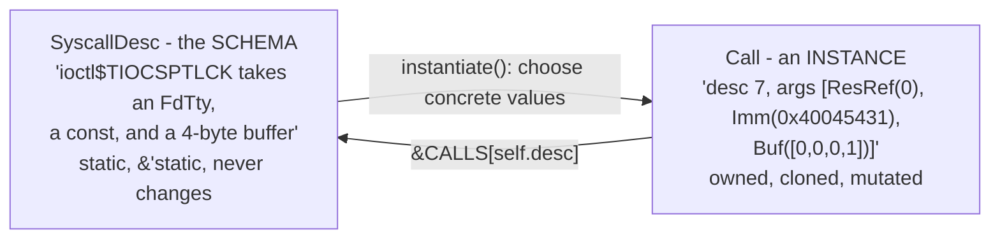

```rust
/// One concrete, executable program. THIS is what you generate, mutate,
/// minimize, serialize, store in the corpus and ship over the wire.
#[derive(Clone, Debug, Default, PartialEq)]
pub struct Program {
    pub calls: Vec<Call>,
}

#[derive(Clone, Debug, PartialEq)]
pub struct Call {
    /// Index into `CALLS`, not a reference. Keeps `Program` cheap to clone
    /// and trivially serializable, and you can always recover the schema
    /// with `&CALLS[self.desc]` when you need to mutate type-correctly.
    pub desc: usize,
    /// Invariant: args.len() == CALLS[desc].args.len()
    pub args: Vec<Arg>,
}

#[derive(Clone, Debug, PartialEq)]
pub enum Arg {
    /// A concrete integer. Const, Int, Flags and Len all collapse to this
    /// once a value has been chosen.
    Imm(u64),
    /// Bytes the executor will place in a buffer and pass a pointer to.
    Buf { dir: Dir, data: Vec<u8> },
    /// "Use the return value of call N." A dataflow edge, not a value.
    ResRef(usize),
}
```

Four design decisions in there, each of which you will be glad of later:

**`desc: usize`, not `&'static SyscallDesc`.** A reference would work and is tempting. An index makes `Program` `Clone` without lifetime gymnastics, serializes as four bytes, survives being written to a corpus file and read back, and lets you compare two programs with `==`. The schema is one array lookup away whenever you need it.

**Six `ArgKind`s collapse into three `Arg`s.** `Const`, `Int`, `Flags` and `Len` are all just numbers once instantiated — the *schema* needs to distinguish them so the mutator knows what values are legal, but the *instance* does not. Fewer variants means less code in the wire format, the mutator, and the text serializer. (This is also why the wire format in §6 has exactly three `kind` tags.)

**`ResRef(usize)` by call index.** Matches the wire format's `kind=2`, matches syzkaller's copyout indices, and keeps programs valid regardless of what fds the kernel actually hands out.

**`Len` is resolved at instantiate time, and re-resolved after mutation.** `ArgKind::Len(i)` means "the length of argument *i*". After any mutation that changes a buffer, walk the call and fix every `Len` arg, or you get `EFAULT`/`EINVAL` forever:

```rust
pub fn fix_lens(call: &mut Call) {
    let desc = &CALLS[call.desc];
    for (i, kind) in desc.args.iter().enumerate() {
        if let ArgKind::Len(target) = kind {
            let n = match &call.args[*target] {
                Arg::Buf { data, .. } => data.len() as u64,
                _ => 0,
            };
            call.args[i] = Arg::Imm(n);
        }
    }
}
```

That is syzkaller's `assignSizesCall`, at lab scale. Call it at the end of every mutation operator.

#### `remove_call`: where naive minimizers break

§8.6 warned about this. Here is the actual fix, and it is worth reading closely because the index arithmetic is easy to get subtly wrong:

```rust
impl Program {
    /// Remove call `idx`, then repair every dataflow edge.
    pub fn remove_call(&mut self, idx: usize) {
        self.calls.remove(idx);
        // After removal: new[j] == old[j] for j < idx, new[j] == old[j+1] for j >= idx.
        // A resource is always produced before it is used, so only calls now at
        // index >= idx can reference idx or beyond. Two cases:
        //     ResRef(n), n  > idx  ->  shifted down by one
        //     ResRef(n), n == idx  ->  DANGLING; its producer is gone
        let mut dangling = Vec::new();
        for (i, call) in self.calls.iter_mut().enumerate().skip(idx) {
            for arg in &mut call.args {
                if let Arg::ResRef(n) = arg {
                    if *n == idx { dangling.push(i); }
                    else if *n > idx { *n -= 1; }
                }
            }
        }
        // Highest index first, so earlier indices stay valid as we recurse.
        for i in dangling.into_iter().rev() {
            self.remove_call(i);
        }
    }
}
```

Dropping the dependents is the simple correct policy. syzkaller instead re-points the dangling reference at a *default value* for that resource type, which preserves more of the program — a good second-iteration improvement, and the reason its minimizer gets smaller results than yours will.

#### Text serialization: adopt syzkaller's format

§8.4 stores the corpus as text. Make that text syzkaller-compatible so your programs and real syzbot reproducers are mutually intelligible:

```
r0 = openat$ptmx(0xffffffffffffff9c, &(0x7f0000000000)='/dev/ptmx\x00', 0x2, 0x0)
ioctl$TIOCSPTLCK(r0, 0x40045431, &(0x7f0000000040)=0x0)
```

- `Arg::Imm(v)` → `0x{v:x}`
- `Arg::Buf{data}` → `&(0x7f0000000000)="hex"` — the address is cosmetic at this stage (your executor bump-allocates), but emitting it keeps the format readable by syzkaller's tooling and means adding a real arena later changes nothing in the text
- `Arg::ResRef(n)` → `r{n}`, with `r{i} = ` prefixed to call `i` when something references it

Roughly 60 lines for `to_text` and 100 for `from_text`. The parse direction is optional at first — but write it before you have a corpus you care about, because without it your saved corpus is write-only.

---

## 6. Lab 3 — the wire format

Length-prefixed, little-endian, hand-rolled. Resist serde: you want to read it in `xxd` when the guest rejects it.

```
REQUEST
  u32  magic = 0x52465A51 ("RFZQ")
  u32  version
  u32  n_calls
  repeat n_calls:
      i64  syscall_nr
      u8   n_args
      repeat n_args:
          u8  kind          0=imm 1=buf 2=resref
          -- kind 0: u64 value
          -- kind 1: u32 len, u8 dir, len bytes
          -- kind 2: u32 call_index  (use that call's return value)

RESPONSE
  u32  magic = 0x52465A52 ("RFZR")
  u32  n_calls
  repeat n_calls:
      i64  retval
      u8   flags        bit0 executed, bit1 finished, bit2 cover_overflow
      u32  n_pcs
      repeat n_pcs: u64 pc
```

Three design notes that matter more than the byte layout:

**`resref` is a call index, not a value.** The guest resolves it from its own result table. This is syzkaller's `arg_result` / copyout-index mechanism, and it is why a program works regardless of whether `openat` returns fd 3 or fd 7.

**Per-call PCs, not a program-level union.** Your response format should make it *impossible* to lose attribution. If the wire format has one PC list, you have already lost.

**A version field, from commit one.** You will change this format five times. A magic-and-version mismatch that fails loudly beats a guest silently misreading a struct.

### 6.1 Coverage PCs: the adjustment you must not skip

KCOV reports the address **after** the instrumented call — a return address. Feed that to `addr2line` and you get the *next* source line.

```rust
/// KCOV reports return addresses; rewind one instruction to get the call site.
/// Tie it to the compile target so a cross-build picks the right value up. See §15.4.
pub const PC_REWIND: u64 = if cfg!(target_arch = "x86_64") { 5 }
    else if cfg!(target_arch = "s390x") { 6 }
    else if cfg!(target_arch = "mips64") { 8 }
    else { 4 };   // aarch64, arm, riscv64, powerpc64, loongarch64

pub fn previous_instruction_pc(pc: u64) -> u64 { pc - PC_REWIND }
```

Apply it **once, at the boundary where you emit or store PCs** — not at each call site, not left to the consumer. syzkaller does this in `pkg/cover/backend/pc.go` with a per-arch table.

Then symbolize on the host:

```bash
addr2line -e ~/linux/vmlinux -f -i -p 0xffffffff81234567
```

Get the rewind wrong and every answer is off by one instruction, in a way that still looks completely plausible. That is the kind of bug that survives review.

---

## 7. Lab 4 — transport, and why virtme-ng makes this easy

Three stages, in order. **Do not skip to stage 3.**

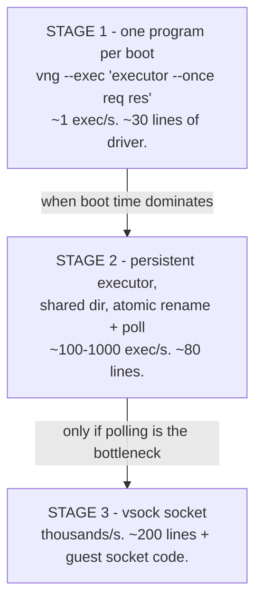

### 7.1 Stage 1 — one program per boot

```rust
fn exec_once(prog: &Program, work: &Path) -> anyhow::Result<Outcome> {
    fs::write(work.join("req.bin"), wire::encode_request(prog))?;
    let _ = fs::remove_file(work.join("res.bin"));

    let out = Command::new("vng")
        .arg("--run").arg(&self.kernel)
        .arg(format!("--rwdir=/work={}", work.display()))
        .arg("--overlay-rwdir=/scratch")
        .arg("--memory").arg("2G")
        .arg("--exec")
        .arg(format!("{} --once /work/req.bin /work/res.bin", self.executor_guest_path))
        .output()?;                           // stdout+stderr = guest console

    let console = String::from_utf8_lossy(&out.stdout).into_owned();
    if let Some(title) = crash::scan(&console) {
        return Ok(Outcome::Crash { title, console });
    }
    match fs::read(work.join("res.bin")) {
        Ok(buf) => Ok(Outcome::Done(wire::decode_response(&buf)?)),
        Err(_)  => Ok(Outcome::NoResult { console }),   // hang, or executor died
    }
}
```

That is a complete, working fuzzer backend. At roughly one execution per second you will still watch coverage climb for the first hour, which is enough to validate the entire loop. **Get here on day one.**

Note `--overlay-rwdir=/scratch`: writable in the guest, discarded on exit, read-only on the host. Have your executor `chdir` there.

### 7.2 Stage 2 — persistent executor over the shared directory

Boot once, run thousands of programs. Your intuition about the host-mounted path is exactly right, with one caveat.

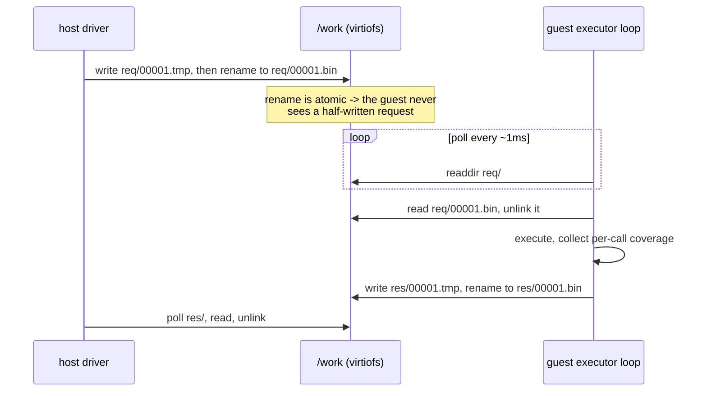

Rules that make this reliable:

1. **Write to a temp name, then `rename`.** Atomic on both virtiofs and 9p. Without it you will read truncated requests and spend an evening blaming your wire format.
2. **Poll, do not rely on inotify.** Filesystem notification over virtiofs/9p is not dependable. A 1 ms `sleep` costs nothing at these rates.
3. **Prefer virtiofs over 9p.** virtme-ng picks virtiofs automatically when `virtiofsd` is available and falls back to 9p. 9p with `cache=loose` can delay metadata visibility; if requests seem to arrive late, check which one you got and try removing `--force-9p`.
4. **Sequence numbers, not a single filename.** Reusing `req.bin` invites the guest to re-read a stale file.
5. **Keep a heartbeat.** The guest touches `work/alive` every second. If it stops advancing while the console is silent, the kernel is wedged — that is your "no output" detector, and it is the one syzkaller timeout tier you genuinely need.

A pragmatic hybrid worth noting: if polling coherence gives you trouble, `vng --console` / `--console-client` already sets up a **vsock** channel, and `--ssh` gives you SSH over vsock. Either lets you stream length-prefixed binary over a socket with no filesystem involved. That is stage 3 arriving early, and it is a legitimate shortcut if virtiofs misbehaves on your setup.

### 7.3 Why you need no RPC protocol

syzkaller has `pkg/flatrpc` — a FlatBuffers schema, generated Go and C++, a cookie handshake, revision checks, shared-memory result building. It needs all of that because the executor is C++, the manager is Go, they may be built from different trees, and throughput matters.

**You have Rust on both sides, built from one workspace, with a shared `common` crate.** Type agreement is enforced by the compiler. The handshake is `magic + version`. Keep it that way.

### 7.4 The driver loop: what actually composes all of this

The third bold item from the §1 audit. It is short, but the *ordering* inside it is the thing to get right.

```rust
fn main() -> anyhow::Result<()> {
    let mut target: Box<dyn FuzzTarget> = match std::env::args().nth(1).as_deref() {
        Some("board") => Box::new(BoardTarget::new("192.168.9.2", "/tmp/executor")?),
        _             => Box::new(VirtmeTarget::new("~/linux")?),
    };
    target.deploy()?;

    let mut corpus = Corpus::load("corpus")?;
    let mut rng    = rand::thread_rng();
    let mut recent = VecDeque::with_capacity(64);   // for crash attribution
    let mut execs  = 0u64;

    loop {
        // Level 2 of the priority hierarchy (mutation-design.md §2):
        // 95% mutate an existing program, 5% generate from scratch.
        let prog = if corpus.is_empty() || rng.gen::<f64>() >= 0.95 {
            generate(&mut rng, 20)
        } else {
            let mut p = corpus.choose(&mut rng).unwrap().prog.clone();
            mutate(&mut p, &corpus, &mut rng);
            p
        };

        match classify(target.as_mut(), &prog) {       // §15.6 for the board version
            Health::Ok(resp) => {
                // ---- THE CHEAP CHECK FIRST. This ordering is the point. ----
                let cover = resp.union_cover();
                if corpus.any_novel(&cover) {
                    // Only now is it worth paying 3x for deflaking (§8.5) ...
                    let stable = stable_cover(target.as_mut(), &prog)?;
                    if corpus.any_novel(&stable) {
                        // ... and N x for minimization (§8.6).
                        let small = minimize(target.as_mut(), &prog, &stable);
                        corpus.consider(&small, &stable);
                        corpus.save_to_disk("corpus")?;
                    }
                }
            }
            Health::Crashed { title, console } => {
                save_crash(&title, &console, &prog, &recent)?;
                target.reset()?;
            }
            Health::Unreachable => target.reset()?,
        }

        if recent.len() == 64 { recent.pop_front(); }
        recent.push_back(prog);
        execs += 1;
        if execs % 100 == 0 {
            eprintln!("{execs} execs | {} PCs | {} corpus", corpus.pc_count(), corpus.len());
        }
    }
}
```

**The nested novelty check is the single most important line of the loop.** One execution is cheap. Deflaking costs 3×. Minimization costs one execution per call removal attempt — 20–30× for a generated program. If you deflake and minimize everything, you spend 99% of your budget on inputs that taught you nothing.

So: run once, check novelty against the raw coverage; only if it *looks* new do you spend on confirming it is really new; only if it survives that do you spend on shrinking it.

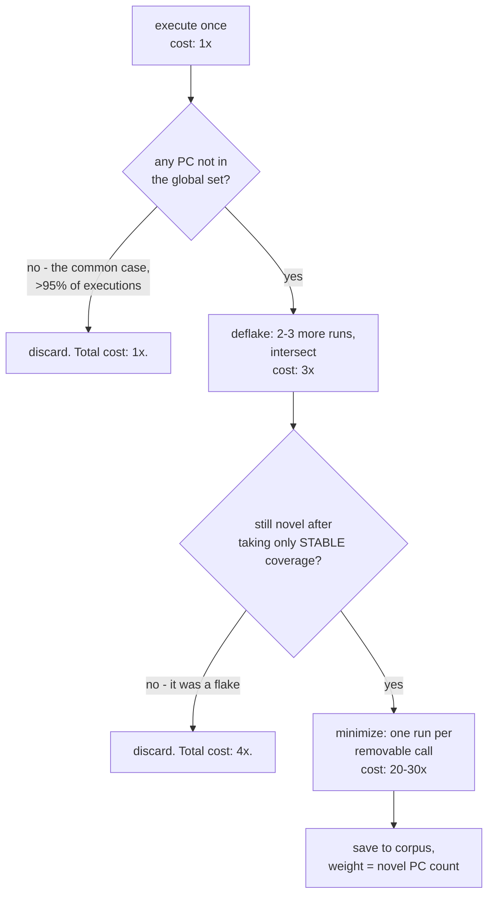

This is exactly syzkaller's pipeline shape — `processResult` checks `addRawMaxSignal` first and only *then* starts a `triageJob`, which deflakes and only then minimizes. You are reproducing the same economics with none of the machinery.

Two smaller things in the loop that matter:

**`recent` is a bounded ring, and it goes into the crash record.** Kernels frequently die from something several programs back; the program executing at panic time is a suspect, not a conviction. Saving the last 64 gives you something to bisect by hand. (syzkaller automates exactly this in `pkg/repro`.)

**`target.reset()` on `Unreachable`, not just on `Crashed`.** A hang with a silent console is still a dead target. If you only reset on recognized crashes, your fuzzer will spin forever against a wedged machine reporting zero coverage.

---

## 8. Lab 5 — the corpus

The user-facing question "how do I manage a corpus" has a shorter answer than syzkaller's implementation suggests.

### 8.1 The data structure

```rust
pub struct Corpus {
    items: Vec<Item>,
    /// Every PC ever observed. The novelty gate.
    seen: HashSet<u64>,
    /// Cumulative weights, parallel to `items`, for O(log n) weighted choice.
    acc: Vec<u64>,
    total: u64,
}

pub struct Item {
    pub prog: Program,
    /// Selection weight = how many PCs this program contributed when added.
    pub weight: u64,
    pub cover: Vec<u64>,
}
```

### 8.2 The novelty gate

This is the entire decision procedure:

```rust
pub fn consider(&mut self, prog: &Program, cover: &[u64]) -> bool {
    let novel: Vec<u64> = cover.iter().copied()
        .filter(|pc| !self.seen.contains(pc))
        .collect();
    if novel.is_empty() {
        return false;                         // learned nothing; discard
    }
    for pc in &novel { self.seen.insert(*pc); }
    self.push(prog.clone(), novel.len() as u64, cover.to_vec());
    true
}
```

**That is the whole of coverage-guided fuzzing.** Everything else — signal priorities, deflaking, set-cover minimization, saturation detection — is refinement that syzkaller needs at scale and you do not need yet.

### 8.3 Weighted selection: the one algorithm to copy verbatim

syzkaller's `pkg/corpus/prio.go` is about twenty lines and is the most reusable snippet in the project:

```rust
fn push(&mut self, prog: Program, weight: u64, cover: Vec<u64>) {
    let w = weight.max(1);                    // floor: nothing becomes unreachable
    self.total += w;
    self.acc.push(self.total);
    self.items.push(Item { prog, weight: w, cover });
}

pub fn choose(&self, rng: &mut impl Rng) -> Option<&Item> {
    if self.items.is_empty() { return None; }
    let target = rng.gen_range(1..=self.total);
    let idx = self.acc.partition_point(|&a| a < target);
    Some(&self.items[idx])
}
```

Cumulative-weight array plus binary search: O(log n) proportional sampling, O(1) amortized insert.

**Weight = number of novel PCs contributed.** A program that opened up 200 new edges is 200× more likely to be chosen for mutation than one that added 1. The bet: a program that reached a lot of code sits in a rich neighbourhood, so small perturbations are more likely to reach something new. The `max(1)` floor guarantees nothing becomes permanently invisible.

### 8.4 Persistence: do not build a database

syzkaller has `pkg/db` — a custom append-oriented key-value log with flate compression, tombstones, compaction, two version numbers, and partial-recovery semantics. It needs that for hundreds of thousands of programs.

**You have hundreds. Use the filesystem:**

```
corpus/
├── 3a7f1c9e....prog     # filename = blake3(serialized program)
├── 8b2d04f1....prog
└── ...
```

```rust
pub fn save_to_disk(&self, dir: &Path) -> anyhow::Result<()> {
    for item in &self.items {
        let text = item.prog.to_text();                  // human-readable!
        let hash = blake3::hash(text.as_bytes()).to_hex();
        let path = dir.join(format!("{}.prog", &hash[..16]));
        if !path.exists() {
            let tmp = path.with_extension("tmp");
            fs::write(&tmp, &text)?;
            fs::rename(&tmp, &path)?;                    // atomic
        }
    }
    Ok(())
}
```

What you get for free: content addressing (identical programs cannot duplicate), atomic writes, crash safety, partial recovery (a corrupt file is one unparseable file), and — the big one — **you can `cat` your corpus**. When something looks wrong, `grep -l ioctl corpus/*.prog` answers questions a binary database cannot.

Store **text, not a binary encoding.** Debuggability beats density by a mile at this scale. Adopt syzkaller's text form so your programs are mutually intelligible with real syzbot reproducers.

### 8.5 Flakiness: what you are choosing to live with

A kernel is not deterministic. Run the same program twice and the PC sets differ — timing, scheduling, prior state, interrupt arrival. So a program can enter your corpus for coverage it will never produce again.

syzkaller's answer is `triageJob`: run 3–5 times, keep only signal present in at least 3 runs, *then* minimize, *then* save. With a documented justification — a program that reproduces 80% of the time passes 3-of-5 with 94% probability.

**Your options, in increasing cost:**

| Approach | Cost | Consequence |
|---|---|---|
| Accept flakiness | 0 lines | corpus accumulates some junk; coverage counts bounce; you cannot fully trust "new coverage" |
| **2-of-3 intersection** | ~25 lines | removes most of it; **recommended starting point** |
| 3-of-5, syzkaller-style | ~60 lines | diminishing returns at lab scale |

The 2-of-3 version:

```rust
pub fn stable_cover(&mut self, prog: &Program) -> anyhow::Result<HashSet<u64>> {
    let a = self.exec(prog)?.union_cover();              // HashSet<u64>
    let b = self.exec(prog)?.union_cover();
    let mut stable: HashSet<u64> = a.intersection(&b).copied().collect();

    // The two runs disagreed a lot: get a third opinion.
    if stable.len() * 4 < a.len() * 3 {
        let c = self.exec(prog)?.union_cover();
        let ac: HashSet<u64> = a.intersection(&c).copied().collect();
        stable.extend(ac);                               // seen in >= 2 of 3
    }
    Ok(stable)
}
```

Only gate corpus admission on *stable* coverage. Note that this triples your execution cost for candidates, which is exactly why stage-2 transport matters.

### 8.6 Minimization: 80 lines, enormous payoff

A generated program is 20–30 calls, most irrelevant. A corpus of such programs is slow to execute and impossible to read.

```rust
pub fn minimize(&mut self, prog: &Program, target: &HashSet<u64>) -> Program {
    let mut best = prog.clone();
    let mut i = best.calls.len();
    while i > 0 {
        i -= 1;
        if best.calls.len() == 1 { break; }
        let mut candidate = best.clone();
        candidate.remove_call(i);              // must also fix up resource refs
        if let Ok(cov) = self.stable_cover(&candidate) {
            let got: HashSet<u64> = cov.into_iter().collect();
            if target.is_subset(&got) {        // all target PCs preserved
                best = candidate;
            }
        }
    }
    best
}
```

Two details worth stealing from syzkaller:

**Iterate backwards.** Later calls are more often removable, and removing from the end avoids re-indexing resource references you have already checked.

**`remove_call` must repair dataflow.** If you delete the call that produced `r0`, every reference to `r0` must be redirected or the dependent calls removed too. This is where a naive minimizer produces programs that no longer run. Keep a `Vec<Option<usize>>` remap and apply it to all later `resref` args.

Also copy the guard: **never minimize below one call.** syzkaller's comment is practical — a zero-call program makes the executor exit immediately, which looks like a different failure.

---

## 9. Lab 6 — generation and mutation

### 9.1 Generation

```rust
pub fn generate(rng: &mut impl Rng, n_calls: usize) -> Program {
    let mut prog = Program::default();
    let mut res = ResState::default();
    while prog.calls.len() < n_calls {
        let desc = CALLS.choose(rng).unwrap();
        // Insert producers for any resource this call needs but we do not have.
        for arg in desc.args {
            if let ArgKind::Res(k) = arg {
                if res.pick(*k, rng).is_none() {
                    if let Some(p) = find_producer(*k) {
                        let idx = prog.push(instantiate(p, rng, &res));
                        res.record(*k, idx);
                    }
                }
            }
        }
        let idx = prog.push(instantiate(desc, rng, &res));
        if let Some(k) = desc.produces { res.record(k, idx); }
    }
    prog
}
```

### 9.2 Value generation: copy syzkaller's distribution

This is a place where naive uniform randomness costs you most of your throughput. syzkaller's `randInt` is roughly:

```rust
pub fn rand_int(rng: &mut impl Rng, bits: u8) -> u64 {
    let v = match rng.gen_range(0..100) {
        0..=54  => rng.gen_range(0..10u64),                   // ~55% single digits
        55..=81 => *SPECIAL_INTS.choose(rng).unwrap(),        // ~27% magic values
        82..=88 => rng.gen::<u64>() % 256,
        89..=92 => rng.gen::<u64>() % (4 << 10),
        93..=96 => rng.gen::<u64>() % (64 << 10),
        _       => rng.gen::<u64>() % (1 << 31),
    };
    truncate(v, bits)
}

/// Every one of these is a boundary: page sizes, type limits,
/// signed/unsigned transitions, and their off-by-one neighbours.
pub static SPECIAL_INTS: &[u64] = &[
    0, 1, 2, 3, 4, 5, 6, 7, 8, 9, 10, 11, 12, 13, 14, 15, 16,
    64, 127, 128, 129, 255, 256, 257, 511, 512,
    1023, 1024, 1025, 2047, 2048, 4095, 4096,
    (1<<15)-1, 1<<15, (1<<15)+1,   (1<<16)-1, 1<<16, (1<<16)+1,
    (1<<31)-1, 1<<31, (1<<31)+1,   (1<<32)-1, 1<<32, (1<<32)+1,
    (1<<63)-1, 1<<63, (1<<63)+1,   u64::MAX,
];
```

**55% single digits** looks wrong until you consider that real arguments are overwhelmingly small — flags, counts, indices, enum values. A uniformly random u64 is almost always rejected with `EINVAL` before reaching anything interesting.

Also copy the **1-in-100 range escape**: when an argument has a declared range, ignore it 1% of the time and generate freely. Your table says what is *intended*; the fuzzer independently supplies the *unintended*. Keeping those separate is why you never pollute your descriptions with `-1` and `INT_MAX`.

### 9.3 Mutation: three operators, not five

syzkaller has five with weights summing to 460 (splice 200, insert 100, mutate-arg 100, squash 50, remove-call 10). Start with three:

| Operator | Weight | Share | Notes |
|---|---:|---:|---|
| `splice` | 200 | 50% | insert all calls of another corpus program at a random position |
| `insert_call` | 100 | 25% | generate one new call, biased toward the end |
| `mutate_arg` | 100 | 25% | change one argument of one call |

Skip `squash` (needs the ANY machinery) and `remove_call` (minimization does it better and signal-preservingly).

```rust
pub fn mutate(prog: &mut Program, corpus: &Corpus, rng: &mut impl Rng) {
    let (mut applied, mut done) = (false, false);
    while !done {
        applied = match rng.gen_range(0..400) {
            0..=199   => splice(prog, corpus, rng),
            200..=299 => insert_call(prog, rng),
            _         => mutate_arg(prog, rng),
        };
        // Stop with probability 1/5, but only AFTER a successful mutation.
        done = applied && rng.gen_range(0..5) == 0;
    }
}
```

That termination condition is worth understanding. Failed operators (splice with an empty corpus, insert at the call limit) cost nothing and retry for free; the **expected number of applied mutations is 5**, geometrically distributed. Sometimes 1, sometimes 15. Always applying exactly one explores too locally; always applying ten overshoots. The geometric distribution covers both scales, for two lines of code.

For `insert_call`, copy the end bias — syzkaller uses `biasedRand(n+1, 5)`, making the last position 5× more likely than the first, because programs are pipelines (open, configure, use) and the interesting new action usually belongs at the end:

```rust
/// Random value in [0, n) where n-1 is k times more likely than 0.
pub fn biased_rand(rng: &mut impl Rng, n: usize, k: usize) -> usize {
    if n <= 1 { return 0; }
    let (nf, kf) = (n as f64, k as f64);
    let r = nf * (kf / 2.0 + 1.0) * rng.gen::<f64>();
    (((-1.0 + (1.0 + 2.0 * kf * r / nf).sqrt()) * nf / kf) as usize).min(n - 1)
}
```

---

## 10. Lab 7 — crash detection

Without this you have a coverage meter, not a fuzzer.

```rust
static PATTERNS: &[(&str, &str)] = &[
    ("BUG: KASAN:",            "KASAN"),
    ("BUG: KMSAN:",            "KMSAN"),
    ("WARNING: ",              "WARNING"),
    ("BUG: unable to handle",  "fault"),
    ("general protection fault", "GPF"),
    ("kernel BUG at",          "BUG"),
    ("Kernel panic",           "panic"),
    ("INFO: task .* blocked",  "hung task"),
    ("BUG: soft lockup",       "lockup"),
    // Rust-in-kernel panics, for the §2.4 module. The stock list above is
    // written for C kernel code and will miss these or mis-bucket them.
    ("rust_begin_unwind",      "rust panic"),
    ("panicked at",            "rust panic"),
];

pub fn scan(console: &str) -> Option<String> {
    for line in console.lines() {
        for (pat, _kind) in PATTERNS {
            if line.contains(pat) {
                return Some(normalize_title(line));
            }
        }
    }
    None
}
```

`normalize_title` strips addresses and offsets so that `foo_release+0x1a/0x80` and `foo_release+0x22/0x80` deduplicate to the same bucket. That is your entire dedup strategy, and at lab scale it is enough.

What to skip, and know you are skipping: syzkaller's `pkg/report` is thousands of lines of per-OS regexes that classify reports, extract the guilty frame and file, detect *corrupted* reports (garbled console output), and *suppress* known-uninteresting patterns. You are getting a coarse approximation. Mostly that is fine; occasionally you will chase one bug thinking it is two.

Two things that are cheap and worth having:

**Save everything.** On a crash, write the console text, the program, and your whole recent program history to `crashes/<title_hash>/`. Disk is free; a crash you cannot investigate is wasted.

**Keep the last N programs.** The program executing when the kernel died is your prime suspect, but kernels die from something several programs back. syzkaller's reproducer extraction bisects the whole log for exactly this reason.

---

## 11. Milestones

Each one is a hard gate. Do not proceed past a failing milestone.

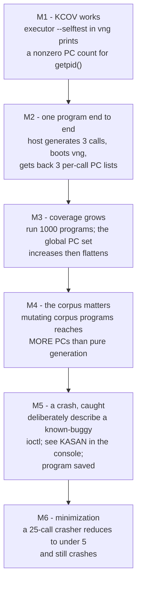

**M4 is the real test of the whole idea.** Run two configurations for an hour each: pure random generation, versus 95% mutation of corpus programs. If the corpus-driven run does not reach substantially more PCs, your feedback loop is broken somewhere — most likely the novelty gate is admitting everything (check that PCs are stable across runs and that you applied the PC rewind consistently), or your mutator is destroying programs rather than perturbing them.

**For M5, do not wait for a real bug.** This is what §2.4 is for: the Rust TFTP module ships with seven bugs you planted yourself, behind individual switches. Enable one, and you know both that the bug is reachable and what the fuzzer should have found. Enable **bug 6** — the deliberate `unsafe` use-after-free — for the version of M5 that actually proves KASAN is working, since the other six manifest as Rust panics that would fire with no sanitizer at all (§2.4.7).

A fuzzer you have never seen catch a crash is a fuzzer you do not know works. A KASAN-enabled kernel in which you have never seen a KASAN report is worse: you will attribute the silence to the fuzzer.

---

## 12. Throughput expectations

Be realistic, so you do not optimize the wrong thing.

| Configuration | Execs/sec | Bottleneck |
|---|---:|---|
| Stage 1, one program per boot, microvm | ~0.5–1 | VM boot (~0.3–1 s with microvm + KVM) |
| Stage 1, `--disable-microvm` | ~0.2–0.5 | full-machine boot |
| Stage 2, persistent executor, virtiofs polling | ~100–1,000 | polling latency, KCOV mmap reads |
| Stage 2 with 2-of-3 deflaking | ÷3 for candidates | by design |
| syzkaller, one VM, for reference | ~1,000s | — |

The lesson: **stage 1 is 1,000× slower than syzkaller and still perfectly adequate to validate the loop.** Only move to stage 2 once you have something whose coverage you want to grow for hours.

Cheap wins before you reach for vsock: `--memory 2G` (KASAN is hungry), `--cpus 2`, keep microvm enabled, and batch several programs per request so one round trip amortizes.

---

## 13. Pitfalls, ranked by how long they will cost you

| Pitfall | Symptom | Fix |
|---|---|---|
| **KASLR left on** | PCs from different boots never match; coverage never plateaus; corpus explodes | `CONFIG_RANDOMIZE_BASE=n`, or subtract the per-boot kernel base |
| **PC rewind missing or wrong** | coverage maps to the line *after* the real one | one `previous_instruction_pc` at the emit boundary |
| **`KCOV_ENABLE` on the wrong thread** | always 0 PCs | enable on the thread that runs the syscalls |
| **`KCOV_INIT_TRACE` given bytes** | `EINVAL` | the argument is a count of **entries** |
| **Coverage drained per program** | cannot attribute to a call | reset before / collect after *each* call |
| **Non-atomic shared-dir writes** | sporadic wire-format errors | temp file + `rename` |
| **`remove_call` leaves dangling resource refs** | minimized programs stop working | remap indices for all later `resref` args |
| **Fuzzing with `--rw`** | host filesystem damage | never; use `--overlay-rwdir` for guest scratch |
| **No heartbeat** | hangs look like silence forever | guest touches a file each second; host times out |
| **Flaky coverage ignored** | corpus fills with junk; progress unmeasurable | 2-of-3 intersection |
| **Reusing one request filename** | guest re-reads stale requests | sequence numbers |
| **Buffer args with no length arg** | syscalls fail with `EFAULT`/`EINVAL` forever | call `fix_lens()` at the end of every mutation operator (§5.5) |
| **Treating libc's `syscall()` return as `-errno`** | every failing call reports errno 1 | it is `-1` plus `errno`; normalise once in `raw_syscall` (§4.5) |
| **Deflaking/minimizing every execution** | ~99% of the budget spent on inputs that taught you nothing | cheap novelty check first, then pay (§7.4) |
| **Debian kernel booted without `nokaslr`** | PCs never match across boots | `nokaslr` on the cmdline, or `CONFIG_RANDOMIZE_BASE=n` (§15.8) |
| **`CONFIG_NET_9P_VIRTIO` mistaken for 9p-tcp support** | `mount -t 9p -o trans=tcp` fails with `EINVAL` | only relevant if you ignore §15.5 and mount a network FS anyway; you need `CONFIG_NET_9P_FD` |
| **Wrong struct layout, hand-transcribed** | every ioctl returns `EINVAL`, or you fuzz the wrong bytes; coverage plateaus and you blame the mutator | `pahole -C struct_name vmlinux` — never transcribe padding by eye (§5.4) |
| **Module's ioctl numbers derived twice, differently** | every ioctl returns `ENOTTY` | one `_IOW::<T>` definition, same type byte and nr in module and call table; check `_IOC_SIZE` with `pahole` (§2.4.5) |
| **Rust module built without `rustavailable` passing** | build fails obscurely, or silently skips the module | `make LLVM=1 rustavailable` first, and read it (§2.4.3) |
| **Assuming Rust kernel code is not instrumented** | you skip the target entirely, or add flags by hand | `RUSTFLAGS_KCOV` already does it; `CONFIG_KCOV_INSTRUMENT_ALL` is enough (§2.4.2) |
| **Only safe-Rust bugs planted** | KASAN never fires; you cannot tell whether it works | plant at least one `unsafe` use-after-free — bug 6 (§2.4.7) |
| **Rust panics not in the crash pattern list** | your module's own crashes bucket as "WARNING" or go unnoticed | add `rust_begin_unwind` and `panicked at` (§10) |
| **Parsing moved to a kthread without remote coverage** | PC count for the parser drops to near zero while it demonstrably runs | `kcov_remote_start_common` + `KCOV_REMOTE_ENABLE` (§2.4.8) |
| **Only the outer `len` fixed after mutation, not `blksize`** | every `write()` rejected; coverage stops at the opcode switch | `fix_lens` at the syscall level *and* `fix_coupled_lengths` inside the payload (§2.4.6) |
| **`--debug` left on during fuzzing** | microvm auto-disabled, boots get slower, QMP port 3636 collides | `--debug` is for phase-2 triage only (§14.1) |
| **Board: legacy syscalls in the call table** | will not compile for arm64/riscv64 (no `open`, `stat`, `poll`, `dup2`, `pipe`...) | use the `*at`/`*2` forms and `libc::SYS_*`, never literals (§15.4) |
| **Board: PC rewind still 5 on arm64** | every symbolized line one instruction off, plausibly | tie `PC_REWIND` to `cfg!(target_arch)` (§15.4, §6.1) |
| **Board: `gnu` instead of `musl` target** | `GLIBC_2.34 not found` on the target rootfs | the three `*-unknown-linux-musl` targets, static (§15.3) |
| **Board: no serial console** | panics truncate; you see "connection lost" and nothing | USB-TTL adapter, or pstore/ramoops (§15.6) |
| **Board: one-phase reboot wait** | you connect to a dying system and read nonsense | wait for SSH to *fail*, then to succeed (§15.7) |
| **Board: no power-control rung** | unattended fuzzing stops at the first hard hang | `uhubctl`/relay/PoE before you start (§15.7) |
| **Board: spawning `ssh`/`scp` per program** | 50–200 ms per execution; "is the board gone?" is a regex over OpenSSH's English | one libssh session, typed errors (§15.5) |
| **Board: treating executor exit as board death** | power-cycles on every program that kills the executor; throughput collapses | classify channel EOF vs session error vs timeout (§15.5.3) |
| **Board: fuzzing the net stack over an SSH transport** | first interesting bug takes the session with it | expected; read the result on serial, or move the transport to the UART (§15.5.8) |
| **Board: writing request files to eMMC/SD** | dead flash in days | stdio or socket; tmpfs for scratch (§15.9) |

---

## 14. Two tempting capabilities: memory dump and VM snapshot

Both of these exist in syzkaller, both sound like they belong in a serious fuzzer, and they land on **opposite sides** of the lean-core line. Worth separating carefully.

### 14.1 Memory dump — buy it, but keep it out of the loop

**Verdict: Tier 2. Zero lines of your code, high triage value, and it must never run inside the fuzzing loop.**

vng exposes this through QMP, and its implementation is worth knowing precisely:

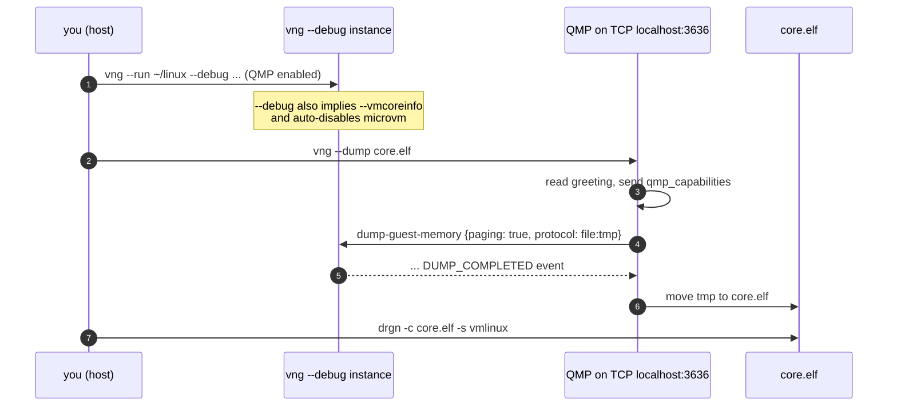

Three implementation facts, from vng's source:

- It connects to **QMP on hardcoded TCP port 3636**, sends `qmp_capabilities`, then `dump-guest-memory` with `paging: true` and `protocol: file:<tmp>`, and waits for the `DUMP_COMPLETED` event.
- `paging: true` makes QEMU walk the guest page tables, so the result carries **virtual** addresses — which is what makes it analyzable rather than a raw RAM blob. The default output format is ELF, consumable by `drgn` and `crash`.
- `--debug` turns on `--vmcoreinfo`, whose comment in the source says it is *"required by drgn memory dumps"*, and **auto-disables microvm** because microvm *"seems to produce incomplete memory dumps."*

#### Why this is a far better deal than syzkaller's version

syzkaller's `pkg/instance/dump.go` runs **inside the guest**, in a kdump crash kernel:

```go
maxRetries = 100
retrySleep = 3 * time.Second
cmd = "makedumpfile -F -c -d 0 /proc/vmcore"
```

That needs `kexec`/kdump configured in the image, a `crashkernel=` memory reservation, `makedumpfile` installed, a one-hour timeout, and up to 100 retries because nobody knows when the crash kernel will finish booting. There is even a TODO admitting they cannot trigger the panic themselves because they do not want `CONFIG_MAGIC_SYSRQ` enabled during fuzzing.

vng does the same job **from the host, with zero guest cooperation.** This is the single largest effort reduction virtme-ng offers after the rootfs, and it is worth wiring up on day one.

#### But: three reasons it cannot live in the fuzzing loop

| Constraint | Consequence |
|---|---|
| QMP port **3636 is hardcoded** | only one `--debug` instance at a time; blocks any multi-VM plan |
| `--debug` **disables microvm** | boot gets measurably slower — exactly what you cannot afford at ~1 exec/s |
| A dump is hundreds of MB | writing one per crash fills a disk in an afternoon |

syzkaller reaches the same conclusion from the other direction: it dumps only when `rep.Panicked`, and `HasMemoryDump` keeps **just one dump per crash title** — *"Keep only one memory dump to save disk space."*

#### The right pattern: two phases

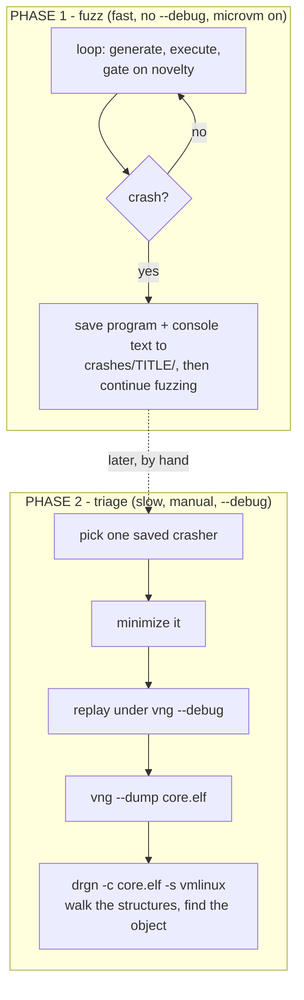

This mirrors how syzkaller separates fuzzing from reproduction, and it keeps the expensive, serialized, disk-hungry capability off the hot path. **Do not add a `--debug` code path to your driver.** Add a one-line shell recipe to your README and run it by hand:

```bash
# Phase 2, by hand
vng --run ~/linux --debug --rwdir=/work=$PWD/work --overlay-rwdir=/scratch \
    --exec "$PWD/target/release/executor --once /work/repro.bin /work/res.bin" &
sleep 20 && vng --dump core.elf
drgn -c core.elf -s ~/linux/vmlinux
```

The genuine payoff is `drgn`: a Python REPL over kernel data structures. For understanding *why* a use-after-free happened — which object, which refcount, which list — it beats reading a KASAN report by a wide margin, and syzkaller users mostly do not have it conveniently. Treat it as a **learning instrument**, which for a lab is the point.

### 14.2 VM snapshot — skip it, and note that vng does not offer it

**Verdict: Tier 3. Skip. Two independent reasons, either of which is sufficient.**

#### Reason 1: vng has no snapshot support

I checked. The word "snapshot" appears in vng's help twice — *"a virtualized snapshot of your live system"* and *"copy-on-write snapshot"* — and both refer to the **host filesystem export**, not to VM state. There is no `savevm`/`loadvm` anywhere in the codebase. The only VM-state feature is `--dump`, which is one-way.

You *could* drive it yourself: `--debug` gives you QMP on port 3636, and QMP speaks `human-monitor-command` for `savevm`/`loadvm` just as syzkaller's `vm/qemu/snapshot_linux.go` does.

#### Reason 2: virtiofs blocks it anyway

`savevm` requires every attached device to be migratable, and **vng's root filesystem is a `vhost-user-fs` (virtiofs) device**, whose state lives in an external `virtiofsd` process that `savevm` cannot capture. Expect `savevm` to fail with a non-migratable-device error. Confirm on your own setup in one command:

```bash
vng --run ~/linux --debug --exec "sleep 60" &
printf '{"execute":"qmp_capabilities"}\n{"execute":"human-monitor-command","arguments":{"command-line":"savevm test"}}\n' \
  | nc localhost 3636
```

The ways out all defeat the purpose: `--force-9p` swaps one non-migratable transport for another; a real disk image via `--disk` means building a rootfs, which is the main thing vng was saving you. Note also that `--debug` disables microvm, so you would be snapshotting the slow machine type.

#### Reason 3: even if it worked, look at what it cost syzkaller

Snapshot mode is the most invasive subsystem in the project. Restoring a snapshot **destroys every network connection**, including SSH and the RPC socket. So syzkaller had to:

- move the transport to shared memory — two `ivshmem` devices plus an undocumented doorbell handshake over a unix socket;
- redirect the executor's logging to `/dev/kmsg`, because its stdout no longer goes anywhere;
- add a whole second execution backend (`pkg/execbackend/snapshot.go`) with a two-phase lifecycle: boot normally for the machine check, then **close the RPC server** and switch to shared memory;
- handle the subtlety that returning from the job function on an empty queue would make the dispatcher reboot the VM and throw away the snapshot — so it sleeps 10 ms and polls instead.

For your lab, that is a transport rewrite plus a second backend.

#### The one argument *for* snapshot, and why it still loses

Snapshot's real prize is not speed, it is **determinism**: every program sees byte-identical kernel state, so coverage stops being flaky and you can skip deflaking entirely.

That is genuinely attractive — it would delete §8.5. But price it out:

| Approach | Cost | Gets you |
|---|---|---|
| 2-of-3 coverage intersection (§8.5) | **~25 lines**, 3× exec cost on candidates only | most of the flakiness gone |
| VM snapshot | transport rewrite + second backend + fighting virtiofs | flakiness gone, plus throughput |

**25 lines versus a rewrite, for the same outcome you actually care about.** Take the 25 lines.

### 14.3 Summary

| Capability | Verdict | Reasoning |
|---|---|---|
| **Memory dump** via `vng --dump` | **Buy — Tier 2, triage only** | Costs nothing, replaces syzkaller's entire kdump apparatus, and `drgn` is an excellent learning tool. But port 3636 is hardcoded, `--debug` disables microvm, and dumps are huge — so phase 2 only, never in the loop. |
| **VM snapshot** | **Skip — Tier 3** | vng does not support it, virtiofs blocks it, and its only lab-relevant benefit (determinism) is available for 25 lines. |
| **The knowledge in the `.txt` files** | **Build — Tier 1, highest leverage** | Non-negotiable. But it is the *ABI-surface knowledge* that is core, not the syzlang format. Encode it in Rust; verify layouts with `pahole`; see §5.4. |

---

## 15. Targeting a real board over the network

Everything so far assumed virtme-ng on your laptop. Now the target is an embedded board on your desk, connected by Ethernet, with the fuzzer still running on the laptop. This is syzkaller's `isolated` VM backend territory, and it is where kernel fuzzing stops being an exercise — the drivers that only exist on real silicon are exactly the ones nobody has fuzzed.

The headline: **the design already works, and the reason is the host/guest split you were told to adopt in §3.** But there is one abstraction you must put in place *before* you write the driver, and about ten concrete things that change.

### 15.1 Why this works: the `Target` trait

All durable state — corpus, coverage history, mutation, minimization, crash records — lives on the host. The guest binary is dumb: take a program, run it, report back. So swapping a local VM for a board over the network touches exactly one module.

Put this behind your driver on day one. Four methods, deliberately the same shape as syzkaller's `vmimpl.Instance`:

```rust
/// The only thing that differs between a local VM and a board on your desk.
pub trait FuzzTarget {
    /// Make the executor available and return the path to invoke it by.
    /// virtme-ng: a no-op (host rootfs is already exported).
    /// Board: one SFTP write into a tmpfs, once per build (§15.5.1).
    fn deploy(&mut self) -> anyhow::Result<String>;

    /// Run one program; return per-call results.
    /// Err means the target is no longer usable, not that the program failed.
    fn exec(&mut self, prog: &Program) -> anyhow::Result<Response>;

    /// Everything the target has printed since the last call.
    /// virtme-ng: vng's stdout. Board: the serial port.
    fn drain_console(&mut self) -> String;

    /// Force the target back to a known-good state. MUST work after a panic.
    /// virtme-ng: kill the process; the next boot is clean.
    /// Board: the recovery ladder in §15.7.
    fn reset(&mut self) -> anyhow::Result<()>;
}
```

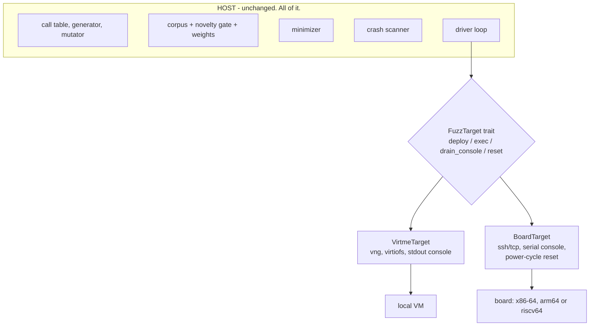

That trait is the entire portability story, and it is four methods because syzkaller discovered over nine years that four is enough. If you hardcode `Command::new("vng")` into your driver, retrofitting this later is a day of annoying work; writing it now costs twenty minutes.

### 15.2 What actually changes

| Concern | virtme-ng | Board over the network |
|---|---|---|
| **Rootfs** | host's, exported read-only | the board's own. No sharing. |
| **Executor deployment** | none — same path, already visible | **cross-compile**, then one SFTP write per build over the same libssh session (§15.5.1) |
| **Architecture** | x86-64, same as host | **x86-64 / arm64 / riscv64** — see §15.4; less per-arch work than you expect |
| **Transport** | virtiofs shared dir | one **libssh** session: SFTP to deploy, an exec channel for programs (§15.5) |
| **Kernel deployment** | `vng --run bzImage` | flash / TFTP+U-Boot / `kexec` / modules-only |
| **Reset after panic** | kill the process | **a recovery ladder ending in cut power** |
| **Console** | vng's stdout | **serial UART**, or pstore |
| **Coverage volume** | free (shared memory) | crosses a 100 Mbit link — dedup first |
| **Scratch space** | `--overlay-rwdir`, discarded | tmpfs you mount; **never the eMMC** |
| **Timeouts** | host-speed | board may be 5–20× slower; scale them |
| **Safety risk** | your host filesystem | your board's flash / the board itself |

Three of those are genuinely new engineering: cross-compilation (§15.3–15.4), console capture (§15.6), and reset (§15.7). The rest are configuration.

### 15.3 Cross-compilation: static musl, three targets

Your biggest loss is the "no deploy step" advantage. Your biggest win in getting it back is that **Rust cross-compiles to a static musl binary trivially**, which sidesteps the entire problem of matching the board's libc.

The lab targets exactly three architectures. All three have a Rust musl target and a Debian cross-toolchain:

| Arch | Rust target | Debian cross-compiler |
|---|---|---|
| x86-64 | `x86_64-unknown-linux-musl` | native |
| arm64 | `aarch64-unknown-linux-musl` | `gcc-aarch64-linux-gnu` |
| riscv64 | `riscv64gc-unknown-linux-musl` | `gcc-riscv64-linux-gnu` |

```bash
rustup target add x86_64-unknown-linux-musl \
                  aarch64-unknown-linux-musl \
                  riscv64gc-unknown-linux-musl
sudo apt install gcc-aarch64-linux-gnu gcc-riscv64-linux-gnu

cargo build --release --target aarch64-unknown-linux-musl -p executor
file target/aarch64-unknown-linux-musl/release/executor
# ELF 64-bit LSB executable, ARM aarch64, statically linked
```

`.cargo/config.toml`:

```toml
[target.x86_64-unknown-linux-musl]
rustflags = ["-C", "target-feature=+crt-static"]

[target.aarch64-unknown-linux-musl]
linker = "aarch64-linux-gnu-gcc"
rustflags = ["-C", "target-feature=+crt-static"]

[target.riscv64gc-unknown-linux-musl]
linker = "riscv64-linux-gnu-gcc"
rustflags = ["-C", "target-feature=+crt-static"]
```

A one-line build-all, which is what you want in a Makefile:

```bash
for t in x86_64 aarch64 riscv64gc; do
    suffix=$([ $t = riscv64gc ] && echo "" || echo "")
    cargo build --release --target ${t}-unknown-linux-musl -p executor
done
```

**Use `musl`, not `gnu`.** A statically linked musl binary is one file with no runtime dependencies — it runs on a Debian rootfs, a BusyBox initramfs, a Yocto image, anything. The `gnu` targets dynamically link and will fail with "GLIBC_2.34 not found" on exactly the older images you are most likely to meet. This single choice removes the entire class of deployment problems that make people give up on bare-metal fuzzing.

The host-side `fuzzer` binary stays native — only `executor` cross-compiles. Which is another dividend of the host/guest split: **only the dumb half has to cross-compile.**

Getting that binary onto the board is one SFTP write over the libssh session you already hold open, re-done only when the binary's hash changes. §15.5 is the whole transport design, including why it is a linked library rather than a spawned `scp`.

### 15.4 Per-arch work for x86-64 / arm64 / riscv64 — less than you expect

Four things in the lab were quietly x86-64-specific. Scoping to these three architectures makes two of them disappear and reduces a third to a single `if`.

#### 1. The KCOV ioctl numbers are identical on all three ✓

This is the good news, and worth stating plainly because it is easy to assume otherwise.

The constants in §4.1 use the **asm-generic `_IOC` encoding**: `_IOC_NONE=0`, `_IOC_WRITE=1`, `_IOC_READ=2`, 14 size bits, direction at bit 30. **x86-64, arm64 and riscv64 all use asm-generic.** So `KCOV_INIT_TRACE = 0x80086301`, `KCOV_ENABLE = 0x6364` and `KCOV_DISABLE = 0x6365` are correct, unchanged, on every target in your lab. No per-arch ioctl code, no `nix` macros needed.

<details>
<summary>The exception, for reference only</summary>

MIPS, PowerPC, SPARC and Alpha override the encoding (`_IOC_NONE=1`, `_IOC_READ=2`, `_IOC_WRITE=4`, 13 size bits, direction at bit 29), giving `KCOV_INIT_TRACE = 0x40086301` and `KCOV_ENABLE = 0x20006364`. If you ever add a MIPS router to the lab, compute the codes with `nix`'s `request_code_read!` / `request_code_none!` macros instead of pasting literals. Out of scope here.
</details>

#### 2. Syscall numbers: two ABI families, not three

`openat` is **257 on x86-64** and **56 on both arm64 and riscv64** — because arm64 and riscv64 both use the *generic* syscall ABI (`include/uapi/asm-generic/unistd.h`), so they share numbers almost entirely.

What matters more than the numbers is that **the generic ABI never got the legacy syscalls.** On arm64 *and* riscv64 there is no `open`, `stat`, `lstat`, `poll`, `dup2`, `fork`, `vfork`, `pipe`, `mkdir`, `rmdir`, `unlink`, `symlink`, `link`, `rename`, `chmod`, `chown`, `select`, `epoll_create`, or 32-bit `getdents`. Use the `*at` and `*2` forms, which exist everywhere:

| Instead of | Use |
|---|---|
| `open` | `openat(AT_FDCWD, ...)` |
| `stat` / `lstat` | `newfstatat` |
| `unlink` / `rmdir` | `unlinkat` |
| `mkdir` | `mkdirat` |
| `rename` | `renameat2` |
| `dup2` | `dup3` |
| `pipe` | `pipe2` |
| `poll` | `ppoll` |

The enforcement mechanism is free: a table written against `libc::SYS_open` **will not compile** for aarch64 or riscv64. Let `libc` carry the numbers and never hardcode:

```rust
// Good: libc resolves per target arch at compile time, and a syscall that
// does not exist on this arch is a compile error rather than a runtime ENOSYS.
SyscallDesc { name: "openat$ptmx", nr: libc::SYS_openat, .. }

// Bad: 2 is `open` on x86-64 and `write` on arm64. Silently wrong.
SyscallDesc { name: "open$ptmx", nr: 2, .. }
```

**This is the moment you understand why syzkaller has per-arch `.const` files and a `syz-extract` step.** You have met the problem that toolchain exists to solve; your answer is `libc` + `rustc`, which is cheaper and, for three architectures, entirely sufficient.

If one of your target devices only exists on one arch, gate the table entry rather than the whole build:

```rust
#[cfg(target_arch = "aarch64")]
pub static SOC_CALLS: &[SyscallDesc] = &[ /* the vendor's /dev/foo ioctls */ ];
#[cfg(not(target_arch = "aarch64"))]
pub static SOC_CALLS: &[SyscallDesc] = &[];
```

#### 3. PC rewind: two values

```rust
/// KCOV reports return addresses; rewind one instruction to the call site.
/// x86-64: 5 (the length of `call rel32`). arm64 and riscv64: 4 (fixed-width).
pub const PC_REWIND: u64 = if cfg!(target_arch = "x86_64") { 5 } else { 4 };
```

That is the whole of it for your three arches. Note this constant must match the **target** architecture, so it belongs in the guest executor or in code compiled per target — not in the host fuzzer, which is always native x86-64. If you apply the rewind on the host (as §6.1 suggests), pass the arch along with the results or key it off which target you are driving.

#### 4. `pahole` and `addr2line` need the target's `vmlinux` and cross binutils

```bash
# arm64
pahole -C my_ioctl_args ~/kernels/arm64/vmlinux
aarch64-linux-gnu-addr2line -e ~/kernels/arm64/vmlinux -f -i -p 0xffff800008123456

# riscv64
pahole -C my_ioctl_args ~/kernels/riscv64/vmlinux
riscv64-linux-gnu-addr2line -e ~/kernels/riscv64/vmlinux -f -i -p 0xffffffff80123456
```

Struct layouts genuinely differ across these three — alignment rules and padding are not the same — so the §5.4 `pahole` discipline matters *more* here, not less. Keep one `vmlinux` per arch and key your symbolizer off which board you are talking to.

#### Summary: the real per-arch surface

| Concern | Per-arch work for x86-64 / arm64 / riscv64 |
|---|---|
| KCOV ioctl codes | **none** — identical on all three |
| KCOV buffer protocol | **none** — identical |
| Syscall numbers | `libc::SYS_*`; avoid legacy syscalls, use `*at` forms |
| PC rewind | one `if`: 5 or 4 |
| Cross-compile | three target triples, two cross-linkers |
| `vmlinux` + binutils | one set per arch |
| Program model, wire format, corpus, mutator | **none** — all arch-neutral |

Which is the real lesson: **the fuzzer is arch-neutral; only the measurement boundary and the toolchain are not.** That is why syzkaller supports nine architectures with per-arch data rather than per-arch code.

### 15.5 Transport over the network: one libssh session

The decision that shapes this whole section: **nothing gets installed or configured on the target beyond an SSH server and your executor binary.** No NFS client, no 9p transport, no `diod`, no FUSE, no `sshfs`, no kernel config for any of it. The board runs the distro's `sshd` — which Debian already has — and that is the entire target-side requirement.

That is a deliberate narrowing. syzkaller's `isolated` backend also drives boards over SSH, so the shape is proven; what is restricted here is the use case. One board, one fuzzer, one kernel, no fleet. Given that, the transport can be a **small module you own** rather than a general mechanism, and the right way to build it is to link the SSH library rather than spawn the SSH command.

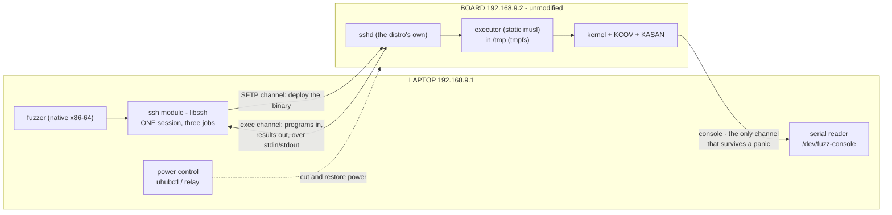

Direct Ethernet between laptop and board, static addresses, no DHCP server needed:

```bash
# On the laptop
sudo ip addr add 192.168.9.1/24 dev enp0s31f6
sudo ip link set enp0s31f6 up
# On the board (via serial, in your init or a startup script)
ip addr add 192.168.9.2/24 dev eth0 && ip link set eth0 up
```

#### Why not just spawn `ssh` and `scp`

Shelling out works, and it is the right first thing to type. It stops being right quickly, for reasons that are all about **what you can observe**:

| Spawning `ssh`/`scp` | Linking libssh |
|---|---|
| a process fork+exec per program (~5–20 ms) plus a TCP and crypto handshake unless you configure `ControlMaster` | one session, one handshake, for the whole campaign |
| failures arrive as an **exit code and English on stderr** — you must regex `"Connection refused"` vs `"Connection timed out"` vs `"Broken pipe"` | typed errors, and the session object itself knows whether it is still alive |
| cannot distinguish "the executor exited" from "the board is gone" | channel EOF versus session error — two different objects (§15.5.3) |
| `ControlMaster` sockets leak across reboots and must be reaped | you own the session lifetime; `reset()` drops it |
| timeouts come from `ConnectTimeout` and `ServerAliveInterval` strings | `SshOption::Timeout` and per-read timeouts in code |
| three processes in your pipeline on every execution | none |

The second and third rows are the real argument. A bare-metal fuzzer spends most of its engineering effort answering *"is the target still there?"*, and `Command::new("ssh")` gives you the worst possible interface for that question.

**Crate choice**, verified at the time of writing:

| Crate | Wraps | Notes |
|---|---|---|
| **`libssh-rs` 0.3.8** | **libssh** (libssh.org) | what this section assumes. Exposes `Session`, `Channel`, `Sftp`, `SftpFile`, `SshOption`, `AuthStatus`, `PollStatus`. Has `vendored` and `vendored-openssl` features, so it can build libssh from source and you do not need `libssh-dev` on the laptop. |
| `ssh2` 0.9.6 | libssh2 (a *different* library) | mature and widely used; a fine alternative, but note `libssh` and `libssh2` are unrelated projects |
| `russh` 0.64.1 | nothing — pure Rust | no C dependency at all; worth considering if you would rather not link a C library |

#### 15.5.1 The module: one session, three jobs

Keep it under 200 lines and give it exactly three responsibilities. The point of the module is that **everything above it sees `FuzzTarget`'s four methods** (§15.1) and nothing about SSH.

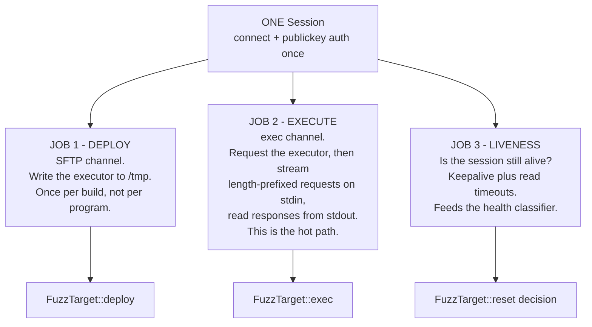

The API map, using `libssh-rs` names so you can find them in the docs:

| Job | Calls |
|---|---|
| session setup | `Session::new`, `set_option(SshOption::Hostname / Port / User / Timeout / LogLevel)`, `connect()`, `userauth_publickey_auto(None)` → `AuthStatus::Success` |
| deploy | `session.sftp()` → `Sftp`, `sftp.open(path, flags, mode)` → `SftpFile`, write the bytes, then one exec channel to `chmod +x` |
| execute | `session.new_channel()`, `channel.open_session()`, `channel.request_exec("/tmp/executor --stdio")`, then `channel.stdin().write_all(req)` and read from `channel.stdout()` |
| liveness | `session.is_connected()`, `PollStatus` from a timed read, `session.get_error()` |

Two design notes that matter more than the API:

**Deploy is not per program.** Hash the executor locally, keep the hash on the board in a sidecar file, and re-upload only when it changes. A 2 MB static binary over 100 Mbit is ~0.2 s — negligible once per build, ruinous per execution. This is the libssh answer to the "no deploy step" convenience virtme-ng gave you, and it is close enough: `cargo build` then run, with one SFTP write in between.

**One exec channel, many programs.** Request the executor once in `--stdio` mode, then keep writing requests into the same channel's stdin. The executor loops on stdin until EOF. No per-program process, no per-program channel, no per-program handshake — this is stage 2′ (§15.5.4) and it is where the throughput is.

#### 15.5.2 Transport does not mean console

Worth stating before the implementation detail, because it is the trap: the SSH session rides TCP, which rides the NIC driver, which rides the kernel you are breaking. **When the kernel panics, the session dies mid-sentence and takes the oops with it.**

So the module above is the *control* channel, not the *reporting* channel. The serial console (§15.6) remains the only path that survives a panic, and it stays completely independent — a different cable, a different thread, opened once at startup and never closed. libssh changes how you talk to a healthy board. It changes nothing about how you learn why an unhealthy one died.

#### 15.5.3 Error classification: the actual payoff

This is why the module is worth writing. A bare-metal fuzzer must answer three questions after every execution, and they demand three different responses:

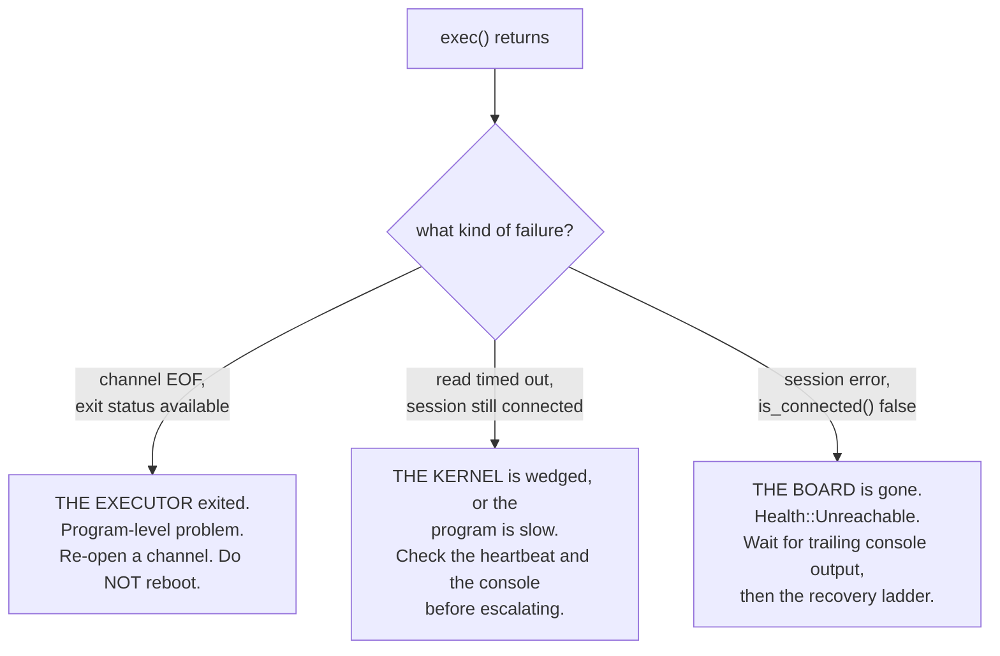

With `Command::new("ssh")` all three arrive as a non-zero exit status and a line of English, and you end up pattern-matching OpenSSH's diagnostics — which change between versions. With a linked library the three are distinguishable by *type*: a channel that reported EOF and an exit status is a different object from a session whose `is_connected()` has gone false.

Getting this wrong is expensive in a specific way. Treat case A as case C and you power-cycle the board every time a program makes the executor exit, so throughput collapses and you never find out why. Treat case C as case A and you re-open channels forever against a dead board, reporting zero coverage, which is the failure mode §7.4 warns about in the driver loop.

Map the three onto the `Health` enum from §15.6 and the driver loop needs no SSH knowledge at all.

#### 15.5.4 The stage ladder

Same discipline as §7: do not skip to the fast one.

| Stage | Shape | Rate | When |
|---|---|---|---|
| **1′** | one exec channel per program, over the one session | ~50–200 exec/s | first. Simple, and already 50–200× faster than virtme-ng stage 1 because nothing boots. |
| **2′** | one exec channel for the campaign, requests streamed on stdin | ~200–2,000 exec/s | once per-channel setup dominates |

Note that stage 1′ with a persistent *session* is already much faster than `Command::new("ssh")` per program, because the handshake is amortized without any `ControlMaster` configuration. You get most of the win from the session, and the rest from the channel.

#### 15.5.5 Who dials whom — and why libssh makes the question go away

syzkaller has the executor dial *out* to the manager, because its executor speaks a separate RPC protocol and the manager must therefore be reachable; `Forward()` sets up a reverse tunnel for it. That design survives NAT and DHCP, which matters for a fleet.

With an SSH exec channel you do not need any of it. **The channel is already bidirectional**, so requests and responses share one connection that the laptop opened:

| | syzkaller: board dials laptop | this lab: laptop dials board over SSH |
|---|---|---|
| Extra listening port | yes, on the laptop | none |
| Reverse tunnel | yes | none |
| Survives the board changing address | yes | no — you want a static address anyway |
| Reconnect after reboot | automatic, the board retries | explicit, `reset()` rebuilds the session |
| Inbound firewall rule on the board | none needed | `sshd` only |

For one board on a direct Ethernet link with a static address, the right trade is clearly the second column: no tunnel, no second protocol, no listener, and reconnection becomes an explicit step in `reset()` where you can see it. The two-phase reboot wait in §15.7 is exactly that step.

#### 15.5.6 Coverage volume: deduplicate before you send

On virtme-ng, coverage crosses shared memory and is free. Over 100 Mbit Ethernet inside an SSH channel it is not — and it is now also inside a crypto layer, so it costs CPU on both ends. A single syscall into a filesystem can produce tens of thousands of PCs; at 8 bytes each that is hundreds of KB per program.

Do what syzkaller's `ExecFlagDedupCover` does — **deduplicate in the guest, before transmission**:

```rust
pub fn collect_deduped(&self) -> (Vec<u64>, bool) {
    let (mut pcs, overflow) = self.collect();
    pcs.sort_unstable();
    pcs.dedup();
    (pcs, overflow)
}
```

A tight loop in a driver hits the same PCs thousands of times; dedup typically cuts the payload by 10–100×. Keep the raw trace only when you specifically want execution *order*. If you still saturate the link, delta-encode the sorted list with varints — sorted PCs compress extremely well, and it is ~30 lines. SSH will also compress for you if you ask (`SshOption` has a compression setting), but doing it yourself in the executor is cheaper than compressing already-redundant bytes.

#### 15.5.7 What this choice deletes

Worth tallying, because the simplification is larger than it looks. Choosing a single libssh session over a network filesystem removes:

| Removed | Was needed for |
|---|---|
| `CONFIG_NFS_FS`, `CONFIG_9P_FS`, `CONFIG_NET_9P`, `CONFIG_NET_9P_FD`, `CONFIG_FUSE_FS` | mounting the laptop's build directory on the board |
| a `diod` or NFS server on the laptop | the same |
| `nfsroot` boot arguments and a netboot-capable BSP | the full "edit anything and it is live" workflow |
| `soft,timeo=50,retrans=2` tuning and the D-state hang ambiguity | keeping a `hard` mount from blocking forever in the subsystem you are fuzzing |
| coverage noise from the NFS/FUSE client running inside the kernel under test | nothing — it was pure confound |
| a decision table about which subsystems make a network mount unsafe | choosing between five mount options |

The last two rows are the ones that justify the decision on their own. A network-FS client is a large, historically buggy kernel subsystem, and mounting one inside the kernel under test means **its** coverage pollutes your novelty gate and **its** bugs contaminate your results. Running only `sshd` keeps the kernel under test as close to the one you actually care about as a networked setup allows.

#### 15.5.8 The hazard that survives

One problem does not go away, and it is the same rule as before in a smaller form:

> **If you are fuzzing the network stack or the NIC driver, your transport is inside the blast radius.**

SSH rides TCP rides the driver you are breaking. The first interesting bug takes the session with it. Three options, in order of preference:

| Approach | Cost |
|---|---|
| Accept it: every net-stack finding also kills the session, and the serial console is where you read the result | free, and usually fine — you were going to reset anyway |
| Move the transport to the **serial line** as well: run the executor over the UART at 115200, slow but independent of the network | ~50 lines, and the stage ladder collapses to roughly 1 exec/s |
| Use a second NIC on a different driver for the transport | hardware you may not have |

For everything that is *not* networking — camera ISP, GPIO, i2c, crypto accelerators, input, DRM, MMC, the vendor's `/dev/*` nodes, which is where the unfuzzed drivers actually are — the SSH session is simply never in the way, and this entire concern is moot.

#### 15.5.9 A note on the path not taken

Earlier drafts of this lab reached for a **network filesystem** here — mount the laptop's build directory on the board over NFS or 9p-over-TCP, and recover virtme-ng's "your freshly built binary is simply there" property exactly. It is a real option, it is how a great deal of embedded Linux development is normally done, and `nfsroot` gets closest of all to the vng experience.

It was dropped for one reason that outweighs the convenience: **it puts a large, historically buggy kernel subsystem inside the kernel under test, on the hot path.** The NFS or FUSE client's coverage then pollutes the novelty gate, its bugs contaminate your results, and a `hard` mount wedged by your own fuzzing hangs in uninterruptible sleep — which is indistinguishable from the bug class you are hunting. §15.5.7 lists everything that choice would have added.

One SFTP write per build gets you 95% of the convenience with none of that. If you want the last 5% and you are fuzzing something far from networking and filesystems, a read-only NFS mount of the build directory is defensible — just keep it off the request/response path, which should stay on the exec channel where failures are unambiguous (§15.5.3).

### 15.6 The console: your only channel that survives a panic

This is the single biggest difference from a VM, and it is the thing that will silently cost you bugs if you get it wrong.

On virtme-ng, the console is a pipe from QEMU and you can read it right up to the moment the kernel dies. On a board, you are watching over Ethernet — and **a kernel panic kills the network stack before the oops finishes printing.** You lose exactly the output you needed.

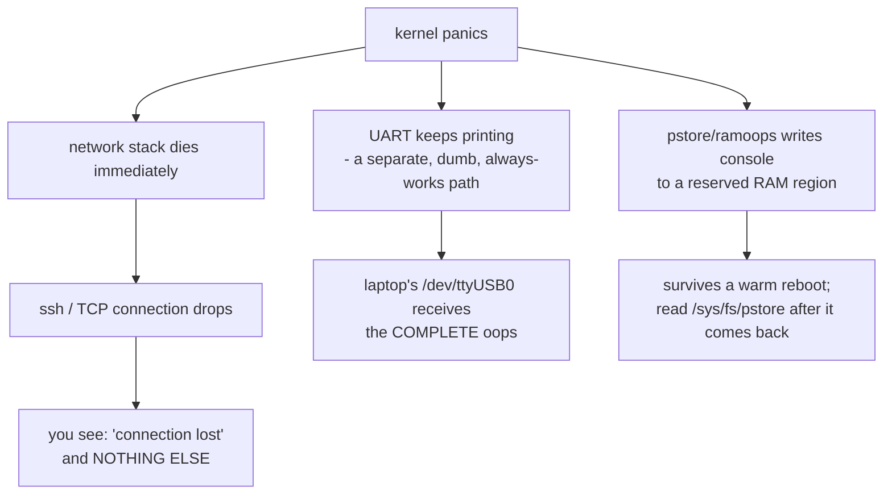

Three options, in order of preference:

**1. Serial UART — do this.** A $3 USB-TTL adapter on the board's debug header. The kernel prints to it with no driver stack, no network, no allocation. It works while the kernel is dying, which is the only time you care.

```
# board kernel cmdline
console=ttyS0,115200 earlycon
```

Read it continuously on the laptop, in a background thread, into a ring buffer:

```rust
// Open once at startup and NEVER close it. The console is the one thing
// that must keep recording while the board is unreachable.
let port = serialport::new("/dev/ttyUSB0", 115_200)
    .timeout(Duration::from_millis(50))
    .open()?;
std::thread::spawn(move || {
    let mut buf = [0u8; 4096];
    loop {
        if let Ok(n) = port.read(&mut buf) {
            console_ring.lock().unwrap().extend_from_slice(&buf[..n]);
        }
    }
});
```

Two practical notes: give yourself a `udev` rule so the adapter is always `/dev/fuzz-console` rather than `ttyUSB0` vs `ttyUSB1` depending on plug order; and make sure nothing else (`minicom`, `screen`, ModemManager) holds the port — `systemctl mask ModemManager` saves confusion.

**2. pstore / ramoops — the fallback when there is no serial header.** A reserved RAM region that survives a warm reboot. Needs `CONFIG_PSTORE`, `CONFIG_PSTORE_RAM`, `CONFIG_PSTORE_CONSOLE`, and a memory region declared either in the device tree or on the cmdline:

```
ramoops.mem_address=0x50000000 ramoops.mem_size=0x100000 ramoops.console_size=0x80000
```

Then, *after* the board comes back:

```bash
cat /sys/fs/pstore/console-ramoops-0   # the complete oops
rm /sys/fs/pstore/console-ramoops-0    # clear it, or you re-read stale crashes
```

This is exactly syzkaller's `isolated` backend `pstore: true` path, including the `rm` — and the `rm` is not optional, or every subsequent crash reports the first one.

**3. netconsole — do not rely on it.** It shares the network stack that just died. Useful for warnings, useless for panics.

#### Merging two crash signals

Your crash scanner now has two inputs, and must combine them:

```rust
pub enum Health { Ok(Response), Crashed { title: String, console: String }, Unreachable }

fn classify(&mut self, exec: anyhow::Result<Response>) -> Health {
    let console = self.drain_console();
    if let Some(title) = crash::scan(&console) {
        return Health::Crashed { title, console };   // serial told us. Authoritative.
    }
    match exec {
        Ok(resp) => Health::Ok(resp),
        Err(_) => {
            // Network dropped but the console is silent. Give the UART a moment —
            // the oops may still be arriving. syzkaller waits ~10s for trailing output.
            std::thread::sleep(Duration::from_secs(10));
            let console = self.drain_console();
            match crash::scan(&console) {
                Some(title) => Health::Crashed { title, console },
                None => Health::Unreachable,         // hang, or a dead NIC
            }
        }
    }
}
```

That 10-second wait for trailing output is lifted straight from syzkaller's `vm/vm.go`, and it is the difference between a complete report and a truncated one.

### 15.7 The recovery ladder

A VM you kill. A board that has hard-hung does not respond to anything software can do. **Without a bottom rung that cuts power, unattended bare-metal fuzzing ends at the first hard hang** — which, if you are doing this right, is within the first hour.

```mermaid
flowchart TB
    R0["reset() called"] --> R1{"ssh responds?"}
    R1 -->|yes| R2["ssh 'reboot'"]
    R1 -->|no| R4
    R2 --> R3["WAIT FOR IT TO GO DOWN<br/>poll ssh until it FAILS"]
    R3 --> R3b["then wait for ssh to succeed<br/>(up to ~5 min)"]
    R3b -->|came back| OK["re-deploy if needed, done"]
    R3b -->|timeout| R4["CUT POWER<br/>uhubctl / relay / PoE / smart plug"]
    R4 --> R5["wait 3 s, restore power"]
    R5 --> R6["wait for ssh, up to ~5 min"]
    R6 -->|came back| OK
    R6 -->|timeout| FAIL["give up LOUDLY:<br/>stop fuzzing, page a human"]
```

Two things here are non-obvious and both come from syzkaller's `isolated` backend:

**The two-phase wait.** You cannot `ssh reboot` and then wait for SSH to work, because **SSH keeps working for several seconds during shutdown.** You would immediately "succeed", connect to a dying system, and get nonsense. So: first poll until SSH *fails* (it is going down), *then* poll until it succeeds (it came back). syzkaller's `waitForReboot` does precisely this, and it is the kind of code you only write after being burned.

```rust
fn wait_for_reboot(&self, timeout: Duration) -> anyhow::Result<()> {
    let t0 = Instant::now();
    // Phase 1: wait for it to go DOWN.
    while self.ssh_ok() {
        anyhow::ensure!(t0.elapsed() < timeout, "board never went down");
        std::thread::sleep(Duration::from_secs(1));
    }
    // Phase 2: wait for it to come BACK.
    let t1 = Instant::now();
    while !self.ssh_ok() {
        anyhow::ensure!(t1.elapsed() < timeout, "board never came back");
        std::thread::sleep(Duration::from_secs(1));
    }
    Ok(())
}
```

**Escalate, then fail loudly.** The last rung is not "retry forever" — it is stop and tell someone. A fuzzer silently looping on a bricked board for eight hours is worse than one that stops after five minutes.

#### Power control options

| Mechanism | Cost | Notes |
|---|---|---|
| **`uhubctl`** on a per-port-power USB hub | ~$20 | board powered over USB. `uhubctl -a off -l 1-1 -p 2`. Simplest if it fits. |
| USB relay board | ~$10 | cuts the barrel-jack supply. Works for anything. |
| PoE switch port | you may have one | `snmpset` to toggle the port. Clean if the board is PoE. |
| Smart plug with a local API | ~$15 | crude but effective; avoid cloud-only models. |
| syzkaller's trick | $0 | write `0` then `1` to `/sys/bus/usb/devices/<n>/authorized` — de-authorize and re-authorize a USB device. Works when the board is USB-powered. |

Also set the board's **hardware watchdog** if it has one (`/dev/watchdog`, `CONFIG_WATCHDOG`): a userspace pinger that stops pinging when the kernel wedges gives you a free self-reboot for many hang classes, without any power hardware.

### 15.8 The kernel: Debian source plus a config fragment

You are using Debian's kernel as the base rather than a minimal vanilla build. That is a sensible choice — the board boots a known-good config with working drivers — but it brings three specific problems. All three are solvable in one pass.

#### What Debian's stock kernel does and does not give you

| Feature you need | Debian stock | What to do |
|---|---|---|
| `CONFIG_KCOV` | **not enabled** | must rebuild |
| `CONFIG_KCOV_INSTRUMENT_ALL` | n/a | must rebuild |
| `CONFIG_KASAN` | **not enabled** (far too slow for a distro) | must rebuild |
| `CONFIG_DEBUG_FS` | enabled | nothing |
| `sshd` | installed and running | nothing — **this is your entire transport requirement** (§15.5) |
| `CONFIG_RANDOMIZE_BASE` (KASLR) | **enabled** | **boot with `nokaslr` — no rebuild needed** |
| Full DWARF for `pahole` | split into `linux-image-*-dbg` | install that, or use your own build's `vmlinux` |

Two of those are worth calling out.

**KASLR can be turned off at boot, not at build.** Add `nokaslr` to the kernel command line and PCs become comparable across boots without rebuilding anything. Since you are rebuilding anyway for KCOV, set `CONFIG_RANDOMIZE_BASE=n` too — but `nokaslr` is the thing to remember when you boot *someone else's* kernel.

**Notice what is *not* in that table.** No `CONFIG_NFS_FS`, no `CONFIG_9P_FS`, no `CONFIG_NET_9P_FD`, no `CONFIG_FUSE_FS`. Choosing a libssh session over a network filesystem (§15.5.7) means the transport needs nothing from the kernel you are building beyond a working NIC driver — which you needed anyway. That is four fewer symbols to verify and four fewer subsystems compiled into the kernel under test.

#### The config fragment

Create `lab.config`. This is additive — `merge_config.sh` applies it on top of Debian's config:

```
# --- coverage: the whole point ---
CONFIG_KCOV=y
CONFIG_KCOV_INSTRUMENT_ALL=y
CONFIG_KCOV_ENABLE_COMPARISONS=y
CONFIG_DEBUG_FS=y

# --- bug detection: without this the kernel just keeps running ---
CONFIG_KASAN=y
CONFIG_KASAN_INLINE=y

# --- comparable PCs across boots ---
# CONFIG_RANDOMIZE_BASE is not set

# --- symbolization and pahole ---
CONFIG_DEBUG_INFO_DWARF_TOOLCHAIN_DEFAULT=y
# CONFIG_DEBUG_INFO_REDUCED is not set
CONFIG_FRAME_POINTER=y

# --- no transport symbols needed: the libssh session rides sshd (§15.5.7) ---

# --- crash capture when there is no serial header (§15.6) ---
CONFIG_PSTORE=y
CONFIG_PSTORE_RAM=y
CONFIG_PSTORE_CONSOLE=y

# --- let you induce a panic to test reset() (§15.10 step 8) ---
CONFIG_MAGIC_SYSRQ=y

# --- free self-recovery for many hang classes (§15.7) ---
CONFIG_WATCHDOG=y
```

Three per-arch notes:

- **KASAN flavours.** Generic KASAN works on all three. On **arm64** you may prefer `CONFIG_KASAN_SW_TAGS=y` instead of `KASAN_INLINE` — substantially cheaper in memory, which matters on a small board. **riscv64** supports generic KASAN only. **x86-64** generic + inline is the fast default.
- **riscv64** needs `CONFIG_RISCV_ISA_ZICBOM` etc. from Debian's config — do not strip them; that is why you start from Debian's config rather than `defconfig`.
- `CONFIG_RANDOMIZE_BASE` exists on all three; the `nokaslr` cmdline works on all three too.

#### Building it, and cutting the build time

Debian's config builds roughly four thousand modules. A naive rebuild is an hour or more per arch. `localmodconfig` fixes that, and the trick is that it can read the module list from the *board*:

```bash
# 1. Get the source
sudo apt install linux-source-$(uname -r | cut -d- -f1) || apt source linux
tar xf /usr/src/linux-source-*.tar.xz && cd linux-source-*

# 2. Start from the config the board is actually running
scp root@192.168.9.2:/boot/config-$(ssh root@192.168.9.2 uname -r) .config
ssh root@192.168.9.2 lsmod > /tmp/board.lsmod

# 3. Keep only the modules the board loads  -> build time drops ~10x
make LSMOD=/tmp/board.lsmod localmodconfig

# 4. Layer the lab fragment on top
./scripts/kconfig/merge_config.sh -m .config ../lab.config
make olddefconfig

# 5. Build .deb packages, cross if needed
make -j$(nproc) bindeb-pkg                                     # x86-64
make ARCH=arm64   CROSS_COMPILE=aarch64-linux-gnu- -j$(nproc) bindeb-pkg
make ARCH=riscv   CROSS_COMPILE=riscv64-linux-gnu- -j$(nproc) bindeb-pkg
```

`merge_config.sh` is the right tool and worth knowing: it applies your fragment, warns loudly about any symbol it could not set (usually because a dependency is missing), and leaves everything else alone. **Read its warnings** — a silently dropped `CONFIG_KCOV` is a confusing afternoon.

Then install on the board:

```bash
scp ../linux-image-*.deb root@192.168.9.2:/tmp/
ssh root@192.168.9.2 'dpkg -i /tmp/linux-image-*.deb && reboot'
```

Keep the `vmlinux` from each build — `pahole` and `addr2line` need it, and the `.deb` only carries a stripped image.

```bash
mkdir -p ~/kernels/arm64 && cp vmlinux ~/kernels/arm64/
```

#### Getting a new kernel onto the board: four tiers

Pick the laziest one that works.

| Tier | How | Iteration | Use when |
|---|---|---|---|
| **Modules only** | build the kernel once with KCOV+KASAN, install it, then `scp` rebuilt `.ko` files | **seconds** | you are fuzzing one driver — **start here** |
| `dpkg -i` + reboot | the flow above | ~2 min | normal kernel iteration on a Debian rootfs |
| TFTP + U-Boot | board netboots `Image` + DTB from the laptop | ~30 s | no writable rootfs, or you iterate constantly |
| Flash the image | vendor tooling, `dd` to SD | minutes, wears flash | last resort |

The modules-only path deserves emphasis: build the base kernel **once** per arch with `CONFIG_KCOV_INSTRUMENT_ALL=y`, install it, and after that only ever rebuild the one driver you are poking at. `INSTRUMENT_ALL` means your freshly built out-of-tree module is instrumented with no extra flags — which is also how you build a *deliberately buggy* module for milestone M5'.

A TFTP setup, for reference:

```bash
sudo apt install tftpd-hpa
sudo cp arch/arm64/boot/Image /srv/tftp/
# U-Boot, at the board's prompt
setenv serverip 192.168.9.1; setenv ipaddr 192.168.9.2
setenv bootargs 'console=ttyS0,115200 earlycon nokaslr root=/dev/mmcblk0p2'
tftp 0x80080000 Image; tftp 0x83000000 board.dtb
booti 0x80080000 - 0x83000000
```

Automating U-Boot means driving its prompt over the serial port you already opened in §15.6 — "interrupt autoboot, type these commands" is maybe 40 lines of Rust, and it turns kernel iteration into part of `reset()`.

### 15.9 Flash and memory: two constraints a VM does not have

**Do not write to the board's flash in the fuzzing loop.** eMMC and SD cards have limited write endurance, and a fuzzer doing thousands of iterations an hour will kill a cheap SD card in days. Concretely:

- Pipe requests and responses over **stdin/stdout or a socket**, never through files on the board.
- Put the executor and all scratch space on **tmpfs**: `mount -t tmpfs -o size=64M tmpfs /tmp` and `chdir("/tmp")` before running programs.
- Mount the board's root **read-only** if the BSP allows it. This is the bare-metal equivalent of virtme-ng's `--overlay-rwdir`, and it is your protection against the fuzzer corrupting the rootfs you need to boot.
- If you are fuzzing filesystem code, give it a **loop device backed by a tmpfs file**, not a real partition.

**Memory.** KASAN costs roughly 1/8 of address space for its shadow plus a real memory overhead; on a 512 MB board that is tight and you may see the OOM killer instead of bug reports. Options in order: use a board with ≥2 GB; or `CONFIG_KASAN_SW_TAGS` on arm64, which is substantially cheaper than generic KASAN; or fall back to `CONFIG_SLUB_DEBUG` + `CONFIG_DEBUG_PAGEALLOC`, which catch less but cost less. Your KCOV buffer is `64K entries × 8 B = 512 KB` per thread — negligible either way.

**Timeouts.** A board can be 5–20× slower than your laptop. Scale every timeout by a `slowdown` factor, exactly as syzkaller does (`Timeouts(slowdown)`; its `Scale` is capped at 3 while the per-syscall timeout scales linearly). Unscaled timeouts make a healthy board look permanently hung.

### 15.10 Bring-up checklist

Do these in order. Each is a gate.

```mermaid
flowchart TB
    C1["1. Serial console works<br/>you can see the boot log on /dev/ttyUSB0"] --> C2
    C2["2. Network works both ways<br/>laptop pings board AND board pings laptop"] --> C3
    C3["3. Unattended SSH works<br/>key-based, no password, BatchMode=yes"] --> C4
    C4["4. Power control works<br/>you can cut and restore power from a script"] --> C5
    C5["5. Kernel has KCOV<br/>ls -l /sys/kernel/debug/kcov on the board"] --> C6
    C6["6. Cross-compiled executor runs<br/>SFTP it over, run --selftest,<br/>nonzero PC count"] --> C7
    C7["7. M2' - one program end to end<br/>over ssh, per-call PCs come back"] --> C8
    C8["8. M5' - a deliberate crash is caught<br/>on the SERIAL console, and reset() recovers"]
```

Step 4 before step 7 is deliberate. **Verify you can recover the board before you start trying to crash it.** And step 8 is the real acceptance test: induce a panic (`echo c > /proc/sysrq-trigger` if `CONFIG_MAGIC_SYSRQ` is on), confirm the complete oops arrives on serial, confirm `reset()` brings the board back, confirm fuzzing resumes. A bare-metal fuzzer that has never been observed to recover from a panic does not work yet.

Note the debugfs difference: virtme-ng mounted it for you. On the board, do it yourself, in your startup script:

```bash
mount -t debugfs debugfs /sys/kernel/debug
mount -t tmpfs -o size=64M tmpfs /tmp
ip addr add 192.168.9.2/24 dev eth0 && ip link set eth0 up
# No executor line: the fuzzer starts it through the SSH exec channel (§15.5.1),
# so a reboot needs no coordination beyond sshd coming back up.
```

That is syzkaller's `startup_script` config option, and it is the right place for all per-boot setup. Note how little is in it — debugfs, a tmpfs, an address. Everything else the transport needs is `sshd`, which the distro already starts.

### 15.11 Safety, revisited

The bare-metal risk profile is **better in one way and worse in another** than virtme-ng.

| | virtme-ng | Board |
|---|---|---|
| Your laptop's filesystem | **exposed** — mounted in the guest | **not exposed at all** |
| Damage from a kernel bug | contained to the VM | the board's flash, possibly its bootloader |
| Worst realistic outcome | lost work in a shared dir | **a bricked board** |
| Recovery | restart a process | re-flash, or desolder a chip |

Concretely: keep a known-good recovery image and a documented reflash procedure *before* you start. Avoid fuzzing anything that writes to the boot partition, the bootloader environment, or eFuses — if the subsystem you are describing can touch MTD, bootloader env, or secure-boot state, carve those devices out of your call table deliberately. And prefer a board you can afford to lose over the one prototype your team shares.

The flip side is a genuine advantage: because your laptop is not reachable from the guest at all, you can run the fuzzer with far less paranoia than the virtme-ng setup requires.

### 15.12 Expected throughput

| Setup | Execs/sec | Bottleneck |
|---|---:|---|
| virtme-ng, one program per boot | ~0.5–1 | VM boot |
| **Board, exec channel per program (stage 1′)** | **~50–200** | channel setup on a held-open session |
| virtme-ng, persistent + virtiofs | ~100–1,000 | polling |
| **Board, one exec channel, streamed (stage 2′)** | **~200–2,000** | syscall cost on the board |

The board is *faster* than virtme-ng stage 1 because nothing boots per program. For the subsystems that only exist on real hardware, this is not a compromise — it is the only option that fuzzes them at all.

---

## 16. What to add next, in value order

Once M6 passes, these are the highest-value additions:

1. **Comparison hints** (`KCOV_TRACE_CMP`). Highest value per line in the whole project. The kernel tells you the magic numbers it compared against; splice them into your input. Turns an unreachable `if (magic == 0xCAFEBABE)` into a one-try guess. ~150 lines: a second KCOV mode, a `HashMap<u64, HashSet<u64>>` of comparisons, and `shrink_expand` to handle narrowing casts.
2. **The arena.** Needed the moment you want to replay a real syzbot reproducer. Fixed mmap at `0x200000000000`, 16 MiB, pointers as relative offsets, one addition at write time. See `syz-execprog-design.md` §2.3.
3. **Threaded execution.** One thread per call so a blocking syscall cannot stall the program. Each thread needs its own KCOV fd and mmap.
4. **Multiple VMs.** `Vec<Driver>` plus a work queue. Do this only after stage-2 transport, and keep the corpus single-owner on the host.
5. **C reproducer emission.** Mechanical once the program model exists, and it is what makes a finding reportable upstream.

And the things to **keep refusing**, no matter how tempting: a description language, an RPC schema, a corpus database, a VM pool abstraction, a web dashboard, multi-arch support. Each one is correct for syzkaller and wrong for you. The moment you need two of them, you are no longer building a lab — you are building a syzkaller alternative, and the honest move at that point is to contribute to syzkaller instead.

---

## 17. Mapping back to syzkaller

For when you want to read the original after building yours:

| Your component | syzkaller equivalent | Their size |
|---|---|---|
| `common/table.rs` | `sys/linux/*.txt` + `pkg/ast` + `pkg/compiler` + `sys/syz-extract` + `sys/syz-sysgen` | ~15,000 ln + 90,000 ln of descriptions |
| `common/prog.rs` | `prog/prog.go`, `prog/types.go` | ~3,000 ln |
| `common/wire.rs` | `pkg/flatrpc/*` + `prog/encodingexec.go` + `prog/decodeexec.go` | ~4,000 ln |
| `executor/kcov.rs` | `executor/executor_linux.h` cover functions | ~300 ln |
| `executor/run.rs` | `executor/executor.cc` | ~2,000 ln |
| `fuzzer/corpus.rs` | `pkg/corpus/*` + `pkg/db` + `pkg/manager/seeds.go` | ~2,500 ln |
| `fuzzer/mutate.rs` | `prog/mutation.go` + `prog/rand.go` + `prog/prio.go` | ~3,500 ln |
| `fuzzer/minimize` | `prog/minimization.go` | ~550 ln |
| `fuzzer/crash.rs` | `pkg/report/*` | ~10,000 ln |
| `fuzzer/driver.rs` | `vm/*` + `pkg/instance` + `vm/dispatcher` + `pkg/rpcserver` | ~12,000 ln |
| `fuzzer/ssh.rs` (libssh: one session, SFTP + exec channel) | `vm/isolated` + `vm/vmimpl` SSH helpers + `pkg/rpcserver` reverse tunnel | ~1,500 ln |
| *(`vng --dump` + `drgn`)* | `pkg/instance/dump.go` — kdump crash kernel, `makedumpfile`, 100 retries | ~120 ln + image setup |
| *(nothing)* | `pkg/repro`, `pkg/csource`, `syz-hub`, `dashboard/`, `syz-ci`, `pkg/bisect`, `pkg/aflow` | ~60,000 ln |
| *(nothing — see §14.2)* | `vm/qemu/snapshot_linux.go` + `pkg/execbackend/snapshot.go` + ivshmem doorbell | ~700 ln + transport rewrite |

Your ~2,000 lines against their ~200,000. The ratio is not a criticism of either — it is the price of the three goals in §0. Knowing precisely which 1% you are building, and why the other 99% exists, is the actual outcome of this lab.

---

## 18. Reference: commands you will use constantly

```bash
# Build the kernel with your fuzzing config
vng -b -f kcov.config -j $(nproc)

# Sanity-check the environment
vng --run ~/linux --exec "ls -l /sys/kernel/debug/kcov"

# Run the executor selftest
cargo build --release
vng --run ~/linux --exec "$PWD/target/release/executor --selftest"

# One program, safely
vng --run ~/linux \
    --rwdir=/work=$PWD/work \
    --overlay-rwdir=/scratch \
    --memory 2G --cpus 2 \
    --exec "$PWD/target/release/executor --once /work/req.bin /work/res.bin"

# Interactive poking (shell in the guest)
vng --run ~/linux --rwdir=/work=$PWD/work --overlay-rwdir=/scratch

# Persistent VM + separate control channel (stage 2/3)
vng --run ~/linux --rwdir=/work=$PWD/work --console &
vng --console-client

# Symbolize collected PCs
addr2line -e ~/linux/vmlinux -f -i -p $(cat work/pcs.txt)

# Verify which shared-fs backend you got (inside the guest)
mount | grep -E 'virtiofs|9p'

# --- The lab target: the Rust TFTP module (§2.4) ---

# Prerequisite check. Read the output; nothing works until this passes.
make LLVM=1 rustavailable

# Build the kernel with the module in-tree
vng -b -f kcov.config -j $(nproc)

# T1: does the device appear?
vng --run ~/linux --exec "ls -l /dev/tftp0"

# T3: is YOUR RUST CODE instrumented? (nonzero PCs from a write to the module)
vng --run ~/linux --rwdir=/work=$PWD/work \
    --exec "$PWD/target/release/executor --selftest-tftp"

# Confirm sancov callbacks reached the Rust object
nm ~/linux/samples/rust/rust_tftp.o | grep -i sanitizer_cov | head

# T4: prove KASAN works before trusting the fuzzer. Enable bug 6 and trigger it.
vng --run ~/linux --exec "$PWD/target/release/repro-bug6" 2>&1 | grep -A20 'KASAN'

# Symbolize a PC that landed in your module
addr2line -e ~/linux/vmlinux -f -i -p 0xffffffffc0123456

# Exact layout of your ioctl argument struct, both sides must agree
pahole -C tftp_opts ~/linux/vmlinux

# --- Modelling the ABI (Lab 2, §5.4) ---

# Exact struct layout from YOUR build's DWARF, including padding holes
pahole -C sock_fprog ~/linux/vmlinux
pahole --sizes ~/linux/vmlinux | grep -i ptm

# --- Crash triage (phase 2, §14.1). Never in the fuzzing loop. ---

# Boot with QMP + vmcoreinfo enabled (note: --debug disables microvm)
vng --run ~/linux --debug \
    --rwdir=/work=$PWD/work --overlay-rwdir=/scratch \
    --exec "$PWD/target/release/executor --once /work/repro.bin /work/res.bin" &

# Dump guest memory over QMP (port 3636 is hardcoded; one instance at a time)
vng --dump core.elf

# Walk kernel data structures in the dump
drgn -c core.elf -s ~/linux/vmlinux

# --- Bare-metal board target (§15) ---

# Cross-compile the executor, static, no libc dependency
rustup target add aarch64-unknown-linux-musl
cargo build --release --target aarch64-unknown-linux-musl -p executor
file target/aarch64-unknown-linux-musl/release/executor   # expect "statically linked"

# Direct Ethernet, laptop side
sudo ip addr add 192.168.9.1/24 dev enp0s31f6 && sudo ip link set enp0s31f6 up

# Deploy, option A: copy on change (safest; no kernel involvement)
# Deploy: one SFTP write per build, over the session you already hold (§15.5.1).
# Shown here as the shell equivalent so you can sanity-check by hand first:
scp target/aarch64-unknown-linux-musl/release/executor root@192.168.9.2:/tmp/
# ... then replace it with the libssh module. Nothing is installed on the board.

# Confirm the ONLY target-side requirement is satisfied
ssh root@192.168.9.2 'systemctl is-active ssh && ls -l /sys/kernel/debug/kcov'

# Board per-boot setup (startup script) - no mounts of laptop filesystems
mount -t debugfs debugfs /sys/kernel/debug
mount -t tmpfs -o size=64M tmpfs /tmp
# the executor is started BY the exec channel, not by the startup script

# Serial console - the only channel that survives a panic
picocom -b 115200 /dev/ttyUSB0            # by hand
cat /dev/ttyUSB0 | tee console.log        # or logged

# pstore fallback, after the board comes back
ssh root@192.168.9.2 'cat /sys/fs/pstore/console-ramoops-0; rm /sys/fs/pstore/console-ramoops-0'

# Power cycle (bottom rung of the recovery ladder)
uhubctl -a off -l 1-1 -p 2 && sleep 3 && uhubctl -a on -l 1-1 -p 2

# Symbolize with the TARGET's vmlinux and cross binutils
aarch64-linux-gnu-addr2line -e ~/linux-arm64/vmlinux -f -i -p 0xffff800008123456
pahole -C my_ioctl_args ~/linux-arm64/vmlinux

# Induce a panic on purpose, to verify console capture + reset() (M5')
ssh root@192.168.9.2 'echo c > /proc/sysrq-trigger'
```

### Source references for the mechanisms copied here

| Mechanism | syzkaller source |
|---|---|
| KCOV open / mmap / enable / reset / collect | `executor/executor_linux.h` → `cover_open`, `cover_mmap`, `cover_enable`, `cover_reset`, `cover_collect` |
| Per-call bracket | `executor/executor.cc` → `cover_reset` / `cover_collect` around the dispatch |
| PC rewind table | `pkg/cover/backend/pc.go` → `PreviousInstructionPC`, `instructionLen` |
| Weighted corpus selection | `pkg/corpus/prio.go` → `ProgramsList`, `chooseProgram` |
| Novelty gate | `pkg/fuzzer/cover.go` → `addRawMaxSignal`; `pkg/signal/signal.go` → `DiffRaw` |
| Mutation weights and loop | `prog/mutation.go` → `DefaultMutateOpts`, `MutateWithOpts` |
| Integer distribution, special ints | `prog/rand.go` → `randInt`, `specialInts`, `biasedRand` |
| Resource reuse/create bias | `prog/rand.go` → `ResourceType.generate`, `createResource` |
| Deflaking thresholds and rationale | `pkg/fuzzer/job.go` → the `deflake*` constants |
| Minimization | `prog/minimization.go` → `Minimize`, `removeCalls` |
| Arena base and size | `sys/targets/targets.go` → `defaultDataOffset`, `NumPages`; `executor/executor_linux.h` → `os_init` |

---

## 19. Two engines, one core: the modular route

> **This chapter is deliberately abstract.** Everything before it is implementation — types, constants, code you can paste. This chapter and §20 are *architecture*: boundaries, responsibilities, and what can and cannot cross them. There is almost no code, on purpose. The decisions here are about where to cut, and a cut is easier to judge as a diagram than as a struct.
>
> **If you did Part 1, you have already built this.** `rust-clone-lab-userspace.md` §5–§7 had you implement the common core, the seam, a libFuzzer engine and your own engine against a TFTP server. So read this chapter for the part Part 1 could not teach: **which of those capabilities get harder, or stop working, specifically because the target is a kernel.** That is §19.4, and it is the new material. §19.1–§19.3 are a recap you can skim.

### 19.1 The idea

Nothing in §4–§15 forces you to write the search yourself. The search — *what to run next, what to keep* — is a replaceable component, and there is a mature implementation of it sitting in your clang installation.

Part 1 made this concrete at userspace scale. The same split applies here, with the same two engines behind one seam:

| | **Engine A** | **Engine B** |
|---|---|---|
| Search provided by | LLVM libFuzzer | your own code (§8–§9) |
| You write | a harness, a mutator, a coverage bridge | corpus, scheduler, mutator, novelty gate, deflaker |
| Rough size | ~400 lines on top of the core | ~900 lines on top of the core |
| Time to first coverage climb | an afternoon | a week |
| What you learn | the *environment*: KCOV, cross-compiling, consoles, recovery | the *search*: corpus economics, scheduling, flakiness, the cost ordering |

The point is not to pick one. It is that **if the seam is in the right place, the second engine is a drop-in replacement for the first** — and then you can run them against the same target, the same call table, and the same kernel, and measure your own engine against a professional baseline. That measurement is worth more than either engine alone.

```mermaid
flowchart TB
    subgraph core["COMMON CORE - written once, used by both"]
        K["call table + program model<br/>the ABI knowledge"]
        S["serialization: program to bytes"]
        T["FuzzTarget: virtme-ng or board"]
        X["guest executor: KCOV bracket + dispatch"]
        N["coverage normalization: rewind, dedup"]
        C["crash scanner + crash records + reset ladder"]
        M["minimizer"]
    end
    core --> SEAM{"the seam"}
    SEAM --> EA["ENGINE A<br/>libFuzzer drives.<br/>Corpus, scheduling, novelty,<br/>byte mutation: theirs."]
    SEAM --> EB["ENGINE B<br/>your loop drives.<br/>Corpus, scheduling, novelty,<br/>type-aware mutation: yours."]
    EA --> SAME["the SAME kernel,<br/>the SAME call table,<br/>comparable coverage numbers"]
    EB --> SAME
```

### 19.2 What belongs in the common core

The test for core membership is simple: **would both engines need it, unchanged?** Everything that answers yes is core, and it is more than half the lab.

| Core component | Why it is engine-agnostic | Lab section |
|---|---|---|
| **Call table / ABI knowledge** | Neither engine can invent `TIOCSPTLCK`. This is the highest-leverage thing you own and it is untouched by the choice. | §5.1–5.4 |
| **Program model** | Both engines need *something* to run. One mutates it directly; the other mutates its byte encoding. | §5.5 |
| **Serialization** | Engine B stores programs in a corpus directory; Engine A *requires* programs to be byte arrays, because that is what a libFuzzer corpus entry is. Same encoding serves both. | §5.5, §6 |
| **`FuzzTarget`** | Where the kernel lives is orthogonal to how inputs are chosen. | §3.1, §15.1 |
| **Guest executor** | KCOV bracket and syscall dispatch. The measurement apparatus does not care who asked. | §4 |
| **Coverage normalization** | PC rewind and dedup happen before anything consumes coverage. | §6.1, §15.5 |
| **Crash detection and records** | §19.4 shows libFuzzer contributes *nothing* here. Unambiguously core. | §10 |
| **Reset / recovery ladder** | Same. | §15.7 |
| **Minimizer** | Both want small programs; neither engine can shrink *calls* for you. | §8.6 |

What is left for an engine is startlingly small — three questions:

1. **What do I run next?**
2. **Is what came back worth keeping?**
3. **How do I perturb something I am keeping?**

That is the whole of the swappable part. Corpus, scheduling, novelty bookkeeping and mutation policy are the answers to those three questions, and nothing else in the lab is.

### 19.3 The seam, and the inversion of control hiding inside it

Here is the one structural surprise, and designing around it is most of the work of this chapter.

**libFuzzer owns `main()`.** Building with `-fsanitize=fuzzer` links libFuzzer's own entry point, and from then on *it* calls *you*, once per input, through a callback. Your engine-B loop is the opposite: you call everything.

```mermaid
flowchart TB
    subgraph a["ENGINE A - libFuzzer drives"]
        A1["libFuzzer main()"] --> A2["pick + mutate (its corpus)"]
        A2 --> A3["calls YOUR harness<br/>with a byte array"]
        A3 --> A4["you: decode, execute, report coverage"]
        A4 --> A1
    end
    subgraph b["ENGINE B - you drive"]
        B1["your main()"] --> B2["your corpus: pick"]
        B2 --> B3["your mutator"]
        B3 --> B4["you: execute, gate, minimize"]
        B4 --> B1
    end
```

If you let that difference leak into the core, you will end up with two cores. The fix is a discipline, not a mechanism:

> **Write the core as a set of passive services, never as a loop.** No function in the core may call "get the next program" or "decide what to keep." The core offers: encode, decode, execute, normalize, scan for crashes, reset, minimize. Both drivers compose those; neither is embedded in them.

Two practical consequences worth knowing up front:

- libFuzzer has a documented way to hand control over *explicitly* rather than stealing `main` — build the instrumentation without its entry point and call its driver yourself, passing your callback. That means **one binary can host both engines**, selected by a flag, with one shared core linked once. It also makes the inversion visible in your own source instead of implied by a link-time trick.
- The callback's return value is the only channel back to the engine, and it carries almost nothing: accept the input, or tell the engine not to keep it regardless of coverage. There is no "the target is gone, please wait," and no "this input was interesting for a reason you cannot see." §19.4 is largely a catalogue of what that narrow channel cannot carry.

Stated as an interface, the seam is two operations in each direction and nothing else:

```
core, offered to either driver:
    encode / decode        program  <->  bytes
    execute                program  ->   observation { per-call coverage, retvals, health }
    normalize              raw PCs  ->   comparable PCs
    scan_console                     ->   optional crash title
    reset                            ->   target usable again
    minimize               program, target coverage -> smaller program

driver, provided by whichever engine:
    run_forever(core)
```

Keep that list from growing and the second engine really is a drop-in. Let `execute` start returning scheduling hints, or let the core own a corpus, and you have quietly chosen Engine B forever.

### 19.4 Can libFuzzer carry the four hard capabilities?

`syzkaller-vs-libfuzzer.md` identifies four things syzkaller has that libFuzzer does not. If Engine A is to be more than a toy, we need to know which of them survive the seam. The answers are genuinely different from each other, which is what makes this a useful exercise.

#### Capability 1 — per-call coverage attribution: **partially, and the workaround is instructive**

The obstacle is not KCOV. It is that **libFuzzer's unit of feedback is one callback invocation.** It clears its counters immediately before calling you and collects features immediately after you return. A program of eight syscalls produces one feature set.

First, a prerequisite that is easy to miss: libFuzzer's own instrumentation cannot see the kernel at all. `-fsanitize=fuzzer` instruments *your harness*; the kernel is instrumented by KCOV. These are two unrelated coverage sources, so Engine A needs a **bridge** — a region of counters that your code owns and libFuzzer treats as coverage. libFuzzer supports exactly this: a specially-named section of 8-bit counters, defined by user code, which it clears before each execution and folds into its feature space using the same hit-count bucketing as compiled-in coverage. Conceptually:

```mermaid
flowchart LR
    K["kernel KCOV<br/>list of PCs per call"] --> R["normalize:<br/>rewind, dedup"]
    R --> H["map PC to a slot<br/>in the bridge region"]
    H --> B["bridge counters<br/>user-defined section,<br/>fixed size, chosen up front"]
    B --> F["libFuzzer CollectFeatures<br/>treats it as coverage,<br/>with hit-count buckets"]
    F --> C["its corpus and<br/>scheduling decisions"]
```

Two properties of that bridge shape the design. It is **fixed-size and statically allocated**, so you choose a capacity in advance and accept hash collisions beyond it — a collision means two kernel PCs look like one feature, which costs you sensitivity but nothing else. And because libFuzzer buckets hit counts, you get something syzkaller does not have for free: a PC reached three times and three hundred times become different features.

Now, attribution. Three conceptual options:

| Option | How | Verdict |
|---|---|---|
| **One syscall per input** | each libFuzzer input is a single call | Attribution becomes trivial and sequences become impossible. Rejected — sequences are the entire point of syscall fuzzing. |
| **Union to the engine, detail to you** | report the program's union into the bridge; keep per-call coverage in your own observation record | **Recommended.** The engine only ever asks "is this novel?", which the union answers. Your minimizer and your crash records keep the detail. |
| **Encode the call index into the feature identity** | the bridge slot is chosen from *(call index, PC)*, not PC alone | Works, and it makes the engine's own novelty notion call-attributed — "this PC, reached by call 2" differs from "reached by call 5". Costs a multiplication of the feature space and therefore a larger corpus, the same pathology libFuzzer's own docs warn about for value profiling. Worth trying as an experiment; not the default. |

What you cannot recover either way: libFuzzer's input-shrinking works on *bytes* and knows nothing of call boundaries, so **per-call minimization stays yours** regardless. Which is fine — it is in the core already.

#### Capability 2 — type-aware hint substitution: **yes, and this is the best part of Engine A**

Hints have two halves, and they land on opposite sides of the seam.

**Harvesting** is easy and the result is better than syzkaller's. The kernel reports comparison operands through KCOV's comparison mode. libFuzzer's comparison-interception entry points are *public symbols*, so your harness can call them directly with operands the kernel observed. Doing so gets you both of libFuzzer's halves at once: the operands land in its table of recent compares, where its mutator can splice them, **and** the operand distance becomes a feature — so an input that gets a check from twenty bits wrong to three bits wrong is rewarded as progress even though no new code ran.

That gradient is the single most valuable thing libFuzzer has that syzkaller does not. Engine A gets it by calling a function.

One honest caveat: those entry points derive the comparison's identity from *their own caller's address*, so every operand you inject from one place in your harness looks like it came from the same comparison site. That collapses one dimension of the value-profile index and blurs distinct kernel checks together. You can live with it, or spread the injection across several call sites to synthesize distinct identities — a hack worth knowing about and not worth doing until you have measured that it matters.

**Substitution** is the half that must stay yours. libFuzzer splices a harvested value at a position it guesses, into a flat buffer. Type-awareness means placing a 32-bit value into an argument whose declared type can hold a 32-bit value, which requires the program model — core knowledge the engine does not have.

The seam that resolves this is libFuzzer's **custom mutator** hook. Supply one and you own mutation entirely. But note the all-or-nothing behaviour (`syzkaller-vs-libfuzzer.md` §4.1): a custom mutator *replaces* the default operator set rather than joining it. So you cannot have both "their thirteen byte operators" and "your type-aware operators" by default.

The resolution is the design worth recommending, and it is more elegant than either extreme:

```mermaid
flowchart TB
    START["libFuzzer hands your mutator<br/>the bytes of a program"] --> DEC["decode to a Program<br/>(core)"]
    DEC --> PICK["YOUR type-aware step:<br/>choose a call, choose an argument,<br/>decide what kind of change is legal"]
    PICK --> Q{"what kind of argument?"}
    Q -->|"resource ref"| R["re-point it at another<br/>live producer - type-aware"]
    Q -->|"flags / enum"| FL["pick another legal<br/>combination - type-aware"]
    Q -->|"opaque buffer"| BY["delegate THESE BYTES ONLY<br/>back to libFuzzer's byte mutator,<br/>which brings its dictionary<br/>and harvested operands with it"]
    R --> FIX["fix lengths, repair dataflow<br/>(core)"]
    FL --> FIX
    BY --> FIX
    FIX --> ENC["encode back to bytes"]
```

You keep structural decisions; you delegate byte-level work on the one region where bytes are genuinely unstructured, and that delegation carries libFuzzer's dictionary and harvested comparison operands along with it. libFuzzer exposes its own mutator as a callable function for exactly this purpose. **Type-awareness and operand harvesting both survive, and they survive together.**

#### Capability 3 — deflaking: **poorly, and the awkwardness is the lesson**

libFuzzer believes the first observation. When your callback returns, whatever you put in the bridge region is taken as fact and committed to its global feature set. There is no re-run, no confirmation, no notion of a provisional observation.

You can of course run the program three times inside your harness and report only the intersection. That works. The problem is *when* you must decide to do it.

```mermaid
flowchart TB
    subgraph eb["ENGINE B - the cost ordering of 7.4 is expressible"]
        B1["execute once - 1x"] --> B2{"novel against<br/>MY global set?"}
        B2 -->|"no, >95% of the time"| B3["discard. Total 1x."]
        B2 -->|yes| B4["now pay 3x to deflake"]
        B4 --> B5["then pay 20-30x to minimize"]
    end
    subgraph ea["ENGINE A - it is not"]
        A1["harness is called"] --> A2{"is this input novel?"}
        A2 --> A3["UNKNOWABLE HERE.<br/>Reporting coverage is what<br/>TELLS the engine. The answer<br/>arrives after you return."]
        A3 --> A4["so: deflake EVERYTHING (3x always),<br/>or keep your OWN novelty set<br/>to do the cheap check first"]
    end
```

Both exits are unsatisfying. Deflaking everything triples the cost of the 95% of executions that teach you nothing — precisely the economic mistake §7.4 exists to warn about. Keeping your own shadow set of seen PCs so you can do the cheap check first works, but you have then built the novelty gate the engine was supposed to provide, and two components now disagree about what has been seen.

**Verdict: do not deflake in Phase 1.** Accept a dirty corpus and bouncing coverage counts, and write down that you are accepting it. This is the one capability where Engine A is simply worse, and feeling that — watching a number you cannot trust — is a better argument for §8.5 than any paragraph.

The general lesson is bigger than this lab: libFuzzer's determinism requirement is **architectural, not incidental.** It is not a missing feature; it is a consequence of treating the first observation as truth, which is the thing that lets the engine be fast.

#### Capability 4 — crash survival: **not at all, and that is clarifying**

First, where does the engine run? The choice is forced.

| Engine A placement | What happens on a kernel crash |
|---|---|
| **Inside the guest** (harness = executor) | The machine dies and takes the engine's in-memory state with it. This is exactly the pre-2024 `syz-fuzzer` problem (`history...md` §7.1). `-fork=N` does not help: a dead machine is not a dead child process. |
| **On the host** (harness does a round trip to a remote executor) | The engine survives. **This is the only viable placement.** |

So Engine A runs on the host, and each callback invocation becomes a network or filesystem round trip. That discards libFuzzer's in-process speed advantage entirely — but you never had it, because your target was always a kernel on the other side of a boundary.

Now the deeper problem. libFuzzer's crash model is *"the process that found the bug is the process that dies, and its last breath is to write the artifact."* When the thing that dies is a **different machine**, none of that applies:

- Your harness survives, so the callback must return normally — and a normal return tells the engine nothing happened.
- There is no return value meaning "the target is gone, pause while I power-cycle it." The channel carries accept-or-reject and nothing more. Rejecting even has the wrong effect: it tells the engine *not to keep* the input, when a crasher is the one input you most want to keep.
- libFuzzer's own timeout and memory watchdogs police the *harness* process, not the kernel. A wedged board shows up as your transport blocking, and the engine's watchdog may then kill your harness in the middle of its recovery ladder. Set those limits generously and do your own timing.

**Verdict: crash detection, console capture, crash records, and the reset ladder are 100% yours in both engines.** That is not a disappointment — it is the cleanest result in this chapter. It means the entire crash subsystem belongs unambiguously in the common core with no engine-specific variants, which is one less axis of variation to design for.

### 19.5 The scorecard

```mermaid
flowchart TB
    subgraph gain["ENGINE A GIVES YOU - free, and some of it better than yours"]
        G1["corpus storage and dedup"]
        G2["rarity-weighted scheduling<br/>(entropy-based; better derived than yours)"]
        G3["hit-count bucketing<br/>(syzkaller has NO equivalent)"]
        G4["comparison-distance gradient<br/>(syzkaller has NO equivalent)"]
        G5["byte mutators + dictionary"]
        G6["corpus merge / minimize tooling"]
    end
    subgraph keep["YOU STILL WRITE - core, both engines"]
        K1["ABI knowledge + program model"]
        K2["type-aware mutation decisions"]
        K3["per-call attribution detail"]
        K4["per-call minimization"]
        K5["crash detect / records / reset"]
    end
    subgraph lose["ENGINE A COSTS YOU"]
        L1["deflaking is awkward or wasteful"]
        L2["cheap-check-first ordering<br/>is not expressible"]
        L3["the engine owns main()"]
        L4["coverage must squeeze through<br/>a fixed-size bridge"]
    end
```

| Capability | Carried by libFuzzer? | Must live in the core |
|---|---|---|
| Corpus, dedup, scheduling, novelty bookkeeping | **yes** | — |
| Byte-level mutation, dictionary | **yes** | — |
| Hit-count buckets, comparison-distance features | **yes**, and syzkaller lacks both | — |
| Corpus minimization tooling | **yes** | — |
| Per-call coverage attribution | **partial** — union, or index-encoded features | the detail |
| Type-aware substitution | **via the custom-mutator seam** | the decisions |
| Deflaking | **no** | yes, awkwardly |
| Crash detection, reset, records | **no** | yes, cleanly |
| ABI knowledge, program model | **no** | yes |

Read the bottom three rows together and the shape of the answer appears: **libFuzzer can supply the search, but not the model and not the survival.** Which is the same split `syzkaller-vs-libfuzzer.md` §17.2 arrived at from the other direction — shared fuzzing core, price of a typed input, price of a hostile target. Engine A buys you the first group and nothing else, which is exactly as much as its design promises.

---

## 20. Phase ordering for the kernel: borrow the search, then write it

> Still abstract. This chapter is a sequencing argument, not a tutorial.

### 20.1 Why this order, and not either alternative

Part 1 §0.1 made the general case for rehearsing before you reach the kernel. This section makes the narrower case for *which engine to point at the kernel first*, and the trade-off is about **which thing you are confused about at any moment.**

```mermaid
flowchart TB
    subgraph r1["ROUTE 1 - own engine only (the original 1-18)"]
        X1["week 1: KCOV, transport, executor"] --> X2["week 2: corpus, mutator, driver"]
        X2 --> X3{"coverage not climbing.<br/>WHY?"}
        X3 --> X4["could be the KCOV bracket,<br/>the PC rewind, the novelty gate,<br/>the mutator, the scheduler,<br/>the wire format..."]
        X4 --> X5["every subsystem is new<br/>and unproven at once"]
    end
    subgraph r2["ROUTE 2 - libFuzzer only"]
        Y1["afternoon: harness + bridge"] --> Y2["coverage climbs. It works."]
        Y2 --> Y3["you never learn WHY<br/>the search works"]
        Y3 --> Y4["'using' without 'understanding'"]
    end
    subgraph r3["ROUTE 3 - RECOMMENDED: A then B"]
        Z1["phase 1: libFuzzer<br/>debug the KERNEL ENVIRONMENT<br/>against a search you can trust"] --> Z2["phase 2: your engine<br/>debug the SEARCH against<br/>an environment you can trust"]
        Z2 --> Z3["A/B them: a baseline to<br/>be measured against"]
    end
```

Route 1's real failure mode is not difficulty, it is **simultaneous uncertainty.** When nothing is working, the fault could be in any of seven new subsystems, and a coverage-guided fuzzer fails *quietly* — it keeps running and reports plausible-looking numbers. Debugging "my KCOV bracket is wrong" while also debugging "my corpus weighting is wrong" is far harder than doing either alone.

Route 2 is the one to resist. You get a working fuzzer and no model of why it works. The moment you hit a limit — deflaking, per-call attribution, anything in §19.4 — you have no basis for judging what to do, because you never owned the part that would have to change. (If you did Part 1, you have already escaped this trap: you wrote an engine, against a target where you could check the answer.)

Route 3 isolates the uncertainty in both directions, which is the entire argument for it.

**If you came from Part 1,** the ordering collapses pleasantly: you already have Engine B's design and most of its code, so Phase 1 here is a short detour whose only job is to validate the *kernel-specific* half — KCOV, the VM, the crash path — before you trust your own search against it.

### 20.2 Phase 1: the libFuzzer prototype

**Goal: prove the environment, with a search you are entitled to trust.**

What you build, all of it core except the last two items:

```mermaid
flowchart LR
    P1["call table<br/>20 syscalls, one subsystem"] --> P2["program model<br/>+ serialization"]
    P2 --> P3["guest executor<br/>KCOV bracket + dispatch"]
    P3 --> P4["FuzzTarget<br/>virtme-ng first"]
    P4 --> P5["harness<br/>decode, execute, bridge coverage"]
    P5 --> P6["custom mutator<br/>type-aware, delegating bytes down"]
```

Phase 1 milestones, which are the existing ones with a different gate on M3 and M4:

| Gate | What it proves | Maps to |
|---|---|---|
| **P1** KCOV selftest returns a nonzero PC count | the measurement apparatus works | M1, §4.3 |
| **P2** one program executes end to end, per-call PCs return | transport and wire format work | M2 |
| **P3** libFuzzer's own `cov:`/`ft:` counters climb | **the bridge works** — a professional engine agrees your coverage is real | M3, by proxy |
| **P4** a deliberate bug is caught, console captured, target reset | crash path works | M5 |
| **P5** the same loop runs against a board | `FuzzTarget` is honest | §15.10 |

**P3 is the one that makes this route worth it.** If libFuzzer's feature count climbs and then flattens the way it does on any normal target, your KCOV bracket, your PC rewind, your dedup and your transport are all correct — because a known-good search is consuming them and behaving normally. You have eliminated five sources of doubt without having written a single line of search code.

And note what Phase 1 does *not* let you avoid. Everything in §4 (KCOV), §5 (the ABI table), §6.1 (PC rewind), §10 (crash scanning) and §15 (boards, consoles, recovery) is unchanged and mandatory. The hard, specific, kernel-shaped parts of the lab are all still there. libFuzzer deletes the search, not the subject.

### 20.3 The handover: what Phase 1 leaves you holding

Before Phase 2, write down what you observed. Three things will be concretely unsatisfying, and each one is the motivation for a specific piece of Engine B — which is the pedagogical payoff of doing them in this order.

| What you will notice in Phase 1 | What it motivates |
|---|---|
| Coverage counts bounce; the corpus fills with entries that never reproduce their coverage | §8.5 deflaking — and now you *want* it rather than being told to build it |
| 3× cost if you deflake everything, or a duplicated novelty set if you do not | §7.4's cheap-check-first ordering, and why the seam has to move |
| Minimized programs are small in bytes but still eight calls long | §8.6 per-call minimization |
| You cannot easily ask "which call reached this PC?" | §19.4's attribution problem, and why syzkaller drains per call |
| The engine's corpus is opaque — you cannot read it | §8.4's "store text, you can `cat` your corpus" |

That list is the real curriculum. Each row is a limitation you *encountered* rather than read about, and Phase 2 is the response.

**If you did Part 1, three of those rows will already be familiar** — the opaque corpus, the byte-level minimization, and the attribution gap all show up there too, because they are properties of the seam rather than of the kernel. The one that is genuinely new here is the first: in userspace your target was deterministic enough that coverage counts held still. Against a kernel they will not, and that is the row to pay attention to.

### 20.4 Phase 2: your engine

**Goal: own the search, against an environment you have already proven.**

Now build §8 and §9 — corpus, novelty gate, weighted selection, generation, mutation, deflaking, the driver loop — and leave every core component untouched. Because the seam exists, the switch is a flag.

```mermaid
flowchart TB
    subgraph unch["UNCHANGED from phase 1"]
        U1["call table"]
        U2["program model + serialization"]
        U3["guest executor"]
        U4["FuzzTarget: vng and board"]
        U5["crash scanner + records + reset"]
        U6["coverage normalization"]
        U7["minimizer"]
    end
    subgraph new["NEW in phase 2 - this is the lesson"]
        N1["corpus + novelty gate"]
        N2["weighted selection"]
        N3["generator"]
        N4["mutator, now driving itself"]
        N5["deflaking"]
        N6["the driver loop, with the<br/>cheap-check-first ordering"]
    end
    unch --> SEAM{"same seam"}
    new --> SEAM
    SEAM --> OUT["fuzz the same kernel,<br/>same call table"]
```

Two things you now get that Phase 1 could not give you, both of which were *impossible* at the other seam rather than merely absent:

- **The cost ordering.** Your loop knows whether an input is novel before deciding what to spend on it, so cheap-check-first becomes expressible. §19.4's capability 3 is not a feature you are adding; it is a structural possibility you have just created.
- **Per-call attribution as a first-class input to decisions**, not just a record you keep on the side. Your minimizer can ask which call produced which PC.

And one thing you should consider *keeping* from Phase 1 rather than reimplementing: hit-count bucketing and the comparison-distance gradient. Both are in the engine layer, both are cheap to port into your own novelty gate, and syzkaller itself has neither. Having used them, you are in an unusually good position to judge whether they are worth it — which is an opinion very few people fuzzing kernels actually hold.

### 20.5 The payoff: A/B on one target

This is the part that neither route alone can offer, and the reason to accept the extra abstraction cost of the seam.

Run both engines against the same kernel, the same call table, the same board, for the same wall-clock time. Compare:

| Measure | What a difference tells you |
|---|---|
| Unique kernel PCs after one hour, four hours, a day | the headline. If Engine B loses badly, something in your search is broken, and you know the environment is not at fault. |
| Corpus size for the same PC count | a much larger corpus for equal coverage means your novelty gate is admitting noise — probably flakiness you are not filtering. |
| Executions per second | if Engine B is much slower at equal coverage, you are over-paying for deflaking or minimization. Check the ordering. |
| Time to first crash | the measure that actually matters, and the noisiest. Needs repeated runs before you believe it. |
| Coverage reached by generation alone vs. mutation of corpus | this is M4 (§11), and running it on both engines tells you whether the difference is your mutator or your scheduler. |

Expect to lose some of these at first, and treat that as the experiment working. A mature engine with entropy-based scheduling and hit-count buckets *should* be hard to beat; the informative outcome is *which* measure you lose on, because that points at which of the three engine questions (§19.2) you answered badly.

There is also a real possibility worth naming: Engine B may beat Engine A on unique kernel PCs **because** of type-aware mutation and resource-aware generation, even while losing on raw executions per second. That outcome is the entire thesis of syzkaller, reproduced at lab scale by your own hand — which is a considerably stronger way to learn it than being told.

### 20.6 If you only have time for one

Honest guidance, since not everyone has a fortnight:

| Your situation | Do this |
|---|---|
| You want to find a bug in a specific driver, soon | **Engine A only.** It is a legitimate tool, not a toy; you still write the ABI table, which is where the leverage is anyway. |
| You want to understand coverage-guided fuzzing | **Part 1, all of it.** It is the cheapest complete version of this lesson, and it is where writing your own engine is a one-week job rather than a three-week one. |
| You want both engines against a kernel, and have the time | **A then B**, with the seam from day one. |
| You are teaching this | **Part 1, then Part 2 Phase 1, then Part 2 Phase 2.** Part 1 gives students a working fuzzer in one session against a target they can debug; Part 2 gives them the reasons every component exists. |

What to avoid in all cases: building Engine B *and then* bolting libFuzzer on afterwards. By then the core will have grown a corpus, a loop, and opinions about scheduling, and the seam will have to be excavated rather than designed. The seam is twenty minutes at the start (§3.1 makes the same argument about `FuzzTarget`) and a day of unpicking later.

### 20.7 How this changes the buy/build/skip table

§1 tiers components for a single-engine lab. With the modular route, one row moves and one row splits:

| §1 said | Modular route says |
|---|---|
| Corpus, generator, mutator, novelty gate: **Tier 1 BUILD** | **Tier 1 in Phase 2; Tier 2 BUY in Phase 1.** The search is the one Tier-1 group that turns out to be purchasable. |
| Comparison hints: **Tier 3 SKIP** until phase 4 | **Available in Phase 1 for roughly the cost of a function call** — and you get the distance gradient, which was never on the table before. Promote it. |
| Everything else in Tier 1 | unchanged, and now visibly engine-independent, which is a stronger justification than "you will need it" |
| Tier 2 (virtme-ng) and Tier 3 (product features) | unchanged |

The one-line summary of both chapters:

> **The search is replaceable. The model of the kernel's ABI, and everything required to survive the kernel dying, are not.** Phase 1 proves that by borrowing a search; Phase 2 proves you understood it by writing one.
