# syz-execprog Design: Running One Program, Storing a Corpus, Building a Reproducer

> **Who this is for.** `syz-manager` is the full factory. `syz-execprog` is the hand tool — the thing you copy onto a target machine to answer "does *this exact program* do *that exact thing*?" It is also the engine behind automatic reproducer extraction.
>
> This document covers four connected topics: the **five-stage pipeline** that turns a reproducer file into per-call kernel coverage (the core, §1–§2), how requests flow through the queue (§3), how the corpus is stored and loaded (§4), and how a crash log becomes a minimal reproducer (§5).

---

## 0. Where `syz-execprog` sits

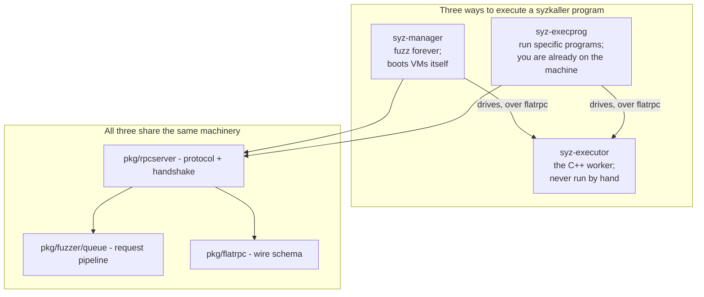

The important structural fact: **`syz-execprog` is not a simplified reimplementation** of the execution path — it shares it with `syz-manager` (details in §2.8). It differs only in *who supplies the programs*: a file instead of a fuzzing engine.

The three jobs it does:

1. **Manual testing / debugging.** Copy it plus `syz-executor` into a VM or onto a board, run a program, see what each syscall returned.
2. **Reproducer verification.** `pkg/repro` invokes it hundreds of times with varying options while narrowing down a crash.
3. **Unguided stress fuzzing** (`-stress`). A poor-man's fuzzer for targets `syz-manager` cannot drive yet — the usual first step when porting syzkaller to a new OS or an exotic board.

---

## 1. Scope, and the five-stage pipeline

### 1.1 What "replay" means here

The headline use case is narrow and worth stating precisely:

> **Run an unmodified syzbot reproducer, and find out which call reached which kernel line.**

Three words in that sentence carry weight.

**Unmodified.** You paste the `repro.syz` attachment from a syzbot bug report, byte for byte. No hand-editing of addresses, no rewriting pointers, no stripping annotations. If a tool requires you to touch the file, every bug report becomes a transcription exercise and transcription errors become fake "does not reproduce" results.

**Which call.** Not "the program reached these lines" but "**call #3, `ioctl$TIOCSPTLCK`, reached these lines**." Per-call attribution is the entire point. A program-level coverage union tells you the program touched the driver; per-call attribution tells you *which syscall* is the one that walks into the bug, which is the first question any kernel developer asks.

**Kernel line.** Coverage comes back as raw program counters. Turning those into `drivers/tty/pty.c:432` requires both a correct PC adjustment and a symbolization step, and getting the adjustment wrong shifts every answer by one instruction.

### 1.2 Scope boundaries

| In scope | Out of scope |
|---|---|
| **Verbatim replay** — the default mode. Execute exactly what the file says. | `syz-manager` — the full orchestrator that boots VMs, keeps a corpus, and files bugs. |
| **`-stress`** — a local unguided fuzzer: generate and mutate on this machine, loop forever. | Coverage *reports* (HTML, source annotation). `syz-execprog` emits raw PC files; `syz-cover` renders them. |
| **`prog2c`** — emit a standalone C program instead of executing. | Crash deduplication, bisection, dashboards. |

Keeping replay as the default and fuzzing as a flag is the right default. The common case — "I have one program and a question about it" — must be the zero-ceremony case.

### 1.3 The pipeline

```
repro.syz  ──▶ ⓿ which form? ──▶ ① deserialise ──▶ ② arena ──▶ ③ execute ──▶ ④ coverage
                     │                                              ╎
                     ├─▶ corpus.db (binary key-value)               ├╌▶ syz_* pseudo-syscalls
                     ├─▶ execution log (markers + oops text)        ├╌▶ -stress (mutate + loop)
                     └─▶ bare program text                          └╌▶ prog2c (standalone C)
```

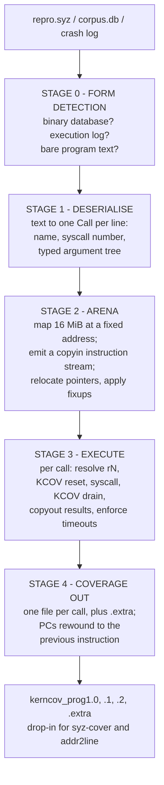

Two of these five stages carry the whole design, and they are the two that a casual reader skips. They get their own sections below, but here is the thesis up front:

**The arena is why this file format is replayable at all.** Every pointer in a reproducer is written as an offset from a fixed textual base. Map one region at one known address, lay the arguments into it, and those textual pointers become real addresses — *without the interpreter needing to understand the types they point at*. That is the trick that makes a from-scratch reimplementation feasible: you need a memory layout engine, not a type system.

**Coverage is drained per call, not per program.** A KCOV reset immediately before each syscall and a drain immediately after is what lets the report say "call #3 reached these lines." Without that bracketing you can only report a union, and a union cannot answer the question anybody actually asked.

---

## 2. The core: from a file to per-call coverage

### 2.1 Stage 0 — which form is this file?

`syz-execprog` accepts three input shapes and identifies them by trial, not by extension or magic byte:

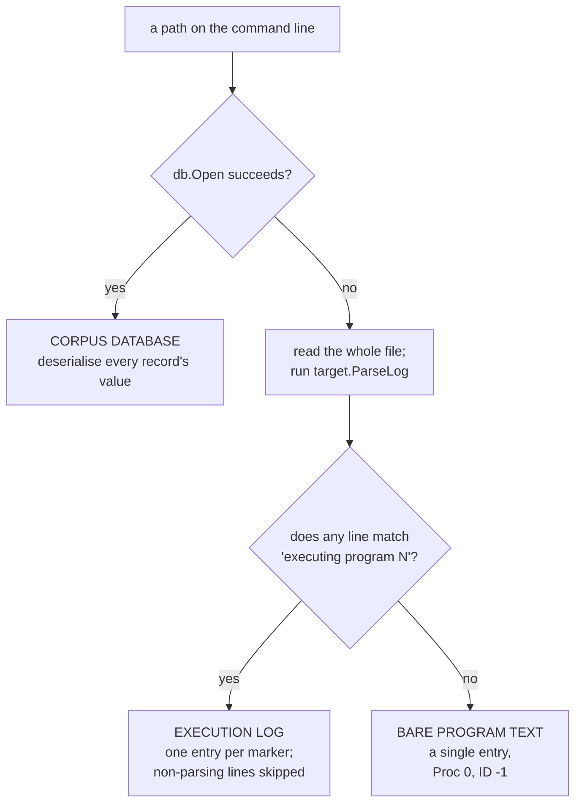

The implementation is three lines of intent:

```go
for _, fn := range files {
    if corpus, err := db.Open(fn, false); err == nil {
        // binary key-value database: deserialize every record
        continue
    }
    data, _ := os.ReadFile(fn)
    for _, entry := range target.ParseLog(data, mode) { ... }
}
```

#### Why `ParseLog` is more interesting than it looks

`prog/parse.go` does not have a grammar for "log file." It has a **recovery loop**:

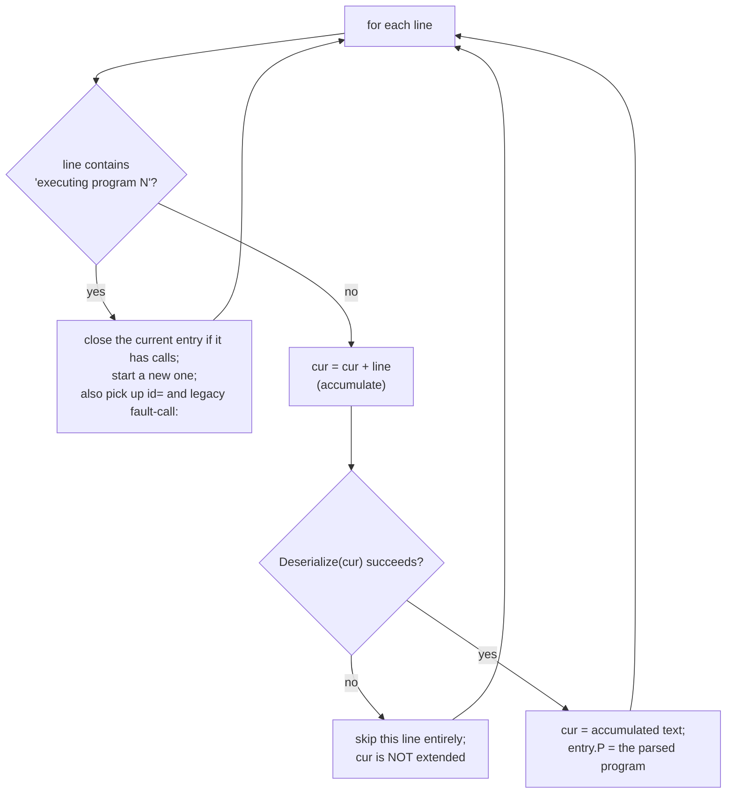

After every appended line it re-parses the whole accumulated buffer and keeps the longest prefix that still parses. A line that does not parse is silently dropped and does **not** poison the accumulator.

That single design choice is what makes a crash log directly executable. A real log looks like this:

```
executing program 2:
r0 = openat$ptmx(0xffffffffffffff9c, &(0x7f0000000000)='/dev/ptmx\x00', 0x2, 0x0)
[  412.881004] ------------[ cut here ]------------
ioctl$TIOCSPTLCK(r0, 0x40045431, &(0x7f0000000040)=0x0)
[  412.883102] BUG: KASAN: use-after-free in foo_release+0x1a/0x80
```

The kernel oops text is interleaved with the program text, arbitrarily, mid-program. No separator, no escaping, no guarantee a line is not cut in half by a `printk` from another CPU. A strict parser rejects the file. The accumulate-and-retry parser extracts both calls and ignores the noise.

And because a file with no `executing program` marker just produces one entry, a bare program file works with the same code path. There is no third parser.

> **Pattern worth stealing:** when parsing output that is interleaved with content you do not control, make the parser *subtractive* — accumulate, attempt, discard what fails — rather than demanding a well-formed stream. You get tolerance of arbitrary noise for about ten lines of code.

#### The one thing to be careful about

`ParseLog` silently skips lines it cannot parse, including lines that are *meant* to be program text but contain a typo or an unknown syscall. A reproducer that loses a call to a parse failure will run and not reproduce, and nothing will tell you a call went missing. Always check the call count:

```
[execprog] 3 calls, arena at 0x200000000000
```

Printing the parsed call count at startup turns a silent truncation into an obvious discrepancy against the file you fed in. If the file has five calls and the tool says three, stop and find out why before concluding anything.

### 2.2 Stage 1 — deserialise

A program exists in four representations, and knowing which one you are holding prevents most confusion:

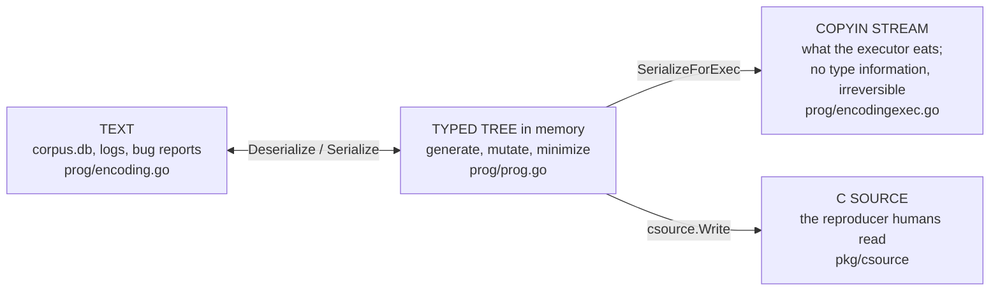

Stage 1 is the left-hand arrow; stage 2 is the middle one. The right-hand arrow is `prog2c`.

The text form is a line-per-call language whose only job is to be exactly round-trippable:

```
r0 = openat$ptmx(0xffffffffffffff9c, &(0x7f0000000000)='/dev/ptmx\x00', 0x2, 0x0)
ioctl$TIOCSPTLCK(r0, 0x40045431, &(0x7f0000000040)=0x0) (fail_nth: 2)
write$binfmt_elf64(r0, &(0x7f0000000100)=ANY=[@ANYBLOB="7f454c46"], 0x4) (async)
```

| Syntax | Meaning |
|---|---|
| `r0 = ` | capture this call's return value into resource slot `r0` |
| `openat$ptmx` | syscall `openat`, description variant `$ptmx` — resolves to a syscall number plus a typed signature |
| `0xffffffffffffff9c` | a plain integer argument (here, `AT_FDCWD`) |
| `&(0x7f0000000000)` | a pointer, written as *textual base + offset* |
| `='/dev/ptmx\x00'` | the bytes to place at that offset |
| `=ANY=[@ANYBLOB="..."]` | a squashed argument — raw bytes where a typed structure would normally be |
| `r0` used as an argument | read resource slot `r0` |
| `(fail_nth: 2)` | call property: inject a failure at the 2nd allocation inside this call |
| `(async)` | call property: do not wait for this call to finish before starting the next |

Deserialization produces one `Call` per line, each holding a **typed argument tree**:

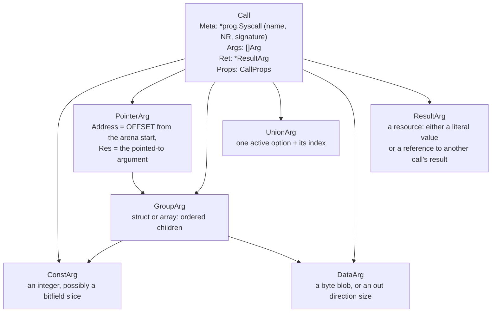

Three of these matter disproportionately for replay:

**`PointerArg.Address` is a relative offset, not an address.** This is the single most important representational decision in the format, and it is easy to miss because the text shows an absolute-looking number. In `prog/encoding.go`:

```go
const encodingAddrBase = 0x7f0000000000

func (target *Target) serializeAddr(arg *PointerArg) string {
    // ... prints 0x<encodingAddrBase + arg.Address>
}

func (p *parser) parseAddr() (uint64, uint64, error) {
    // ... addr -= encodingAddrBase
}
```

Serialization adds `0x7f0000000000`; parsing subtracts it. So `&(0x7f0000000040)` means **"offset 0x40 into the data region,"** and `0x7f0000000000` is a *display convention* with no runtime meaning at all. The real mapping address is chosen independently, per architecture (next section). That decoupling is what lets one reproducer text run on amd64, arm64, and a 32-bit target that map the arena at three different addresses.

**`ResultArg` is a dataflow edge, not a value.** `r0` is not "the number 3." It is "whatever the first call returned." At serialization time each capturing call is assigned a **copyout index**, and each use of `r0` becomes a reference to that index. The interpreter maintains a result table. This is why a reproducer survives being run on a machine where `openat` happens to return fd 7 instead of fd 3.

**Call properties are per-call, not per-program.** `fail_nth`, `async`, and `rerun` ride along with the individual call. A reproducer that needs "fail the third kmalloc inside call #2, and run call #4 without waiting" expresses that inline, and a replay tool that ignores properties will run a syntactically identical program with completely different semantics — and not reproduce. Properties are cheap to parse and easy to forget; they are a common source of "the reproducer doesn't work in my tool."

### 2.3 Stage 2 — the arena

This is the stage that makes everything else possible, so it gets the most detail.

#### The problem

A reproducer says "pass a pointer to this 64-byte structure." For that to mean anything, those 64 bytes must exist, at a known address, laid out exactly as the original run laid them out — because the bug may depend on *where* things sit relative to each other, not just on their contents. And nested pointers inside that structure must point at other regions that also exist.

#### The solution: one fixed mapping, offsets everywhere

Map a single region at a fixed address and express every pointer as an offset into it.

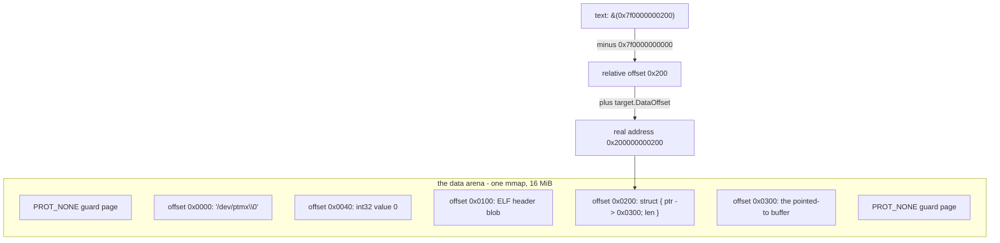

The numbers, all verified in the source:

| Property | Value | Where |
|---|---|---|
| Textual base | `0x7f0000000000` | `prog/encoding.go`, `encodingAddrBase` |
| Real base, 64-bit non-ARM | `0x200000000000` | `sys/targets/targets.go`, `defaultDataOffset()` |
| Real base, ARM / ARM64 | `0x20000000` | same |
| Real base, 32-bit | `0x80000000` | same |
| Arena size | **16 MiB** | `target.NumPages = (16 << 20) / target.PageSize` |
| Exposed to the executor as | `SYZ_DATA_OFFSET`, `SYZ_NUM_PAGES`, `SYZ_PAGE_SIZE` | generated `executor/defs.h` |

The comment next to `0x200000000000` explains the choice and is worth reading, because it is a list of real constraints rather than a round number:

> An address from ASAN's 64-bit HighMem area. `0x200000000000` works both for arm64 and amd64. [...] During real fuzzing, we don't build with ASAN, so the address should not matter much as long as it's far enough from the area allocated by `malloc()`. Another restriction is that on Starnix the available memory space ends at `0x400000000000`.

So: far from the heap, inside ASAN's shadow-compatible range so an ASAN build of the executor still works, and below a platform ceiling. ARM gets a different value because the usable address space is narrower there.

#### The mapping itself

```c
os_init(argc, argv, (char*)SYZ_DATA_OFFSET, SYZ_NUM_PAGES * SYZ_PAGE_SIZE);
```

and on Linux (`executor/executor_linux.h`):

```c
// Surround the main data mapping with PROT_NONE pages to make virtual address layout more consistent
// across different configurations (static/non-static build) and C repros.
// One observed case before: executor had a mapping above the data mapping (output region),
// while C repros did not have that mapping above, as the result in one case VMA had next link,
// while in the other it didn't and it caused a bug to not reproduce with the C repro.
mmap(data - SYZ_PAGE_SIZE, SYZ_PAGE_SIZE, PROT_NONE, MAP_ANON|MAP_PRIVATE|MAP_FIXED_EXCLUSIVE, -1, 0);
mmap(data, data_size, PROT_READ|PROT_WRITE|PROT_EXEC, MAP_ANON|MAP_PRIVATE|MAP_FIXED_EXCLUSIVE, -1, 0);
mmap(data + data_size, SYZ_PAGE_SIZE, PROT_NONE, MAP_ANON|MAP_PRIVATE|MAP_FIXED_EXCLUSIVE, -1, 0);
```

Four details, each load-bearing:

1. **`MAP_FIXED_EXCLUSIVE`, not `MAP_FIXED`.** On Linux this expands to `MAP_FIXED_NOREPLACE`. Plain `MAP_FIXED` would *silently unmap* whatever was already there — including, potentially, part of the executor itself. The exclusive variant fails loudly instead, and the code checks the returned address and calls `failmsg` on mismatch. A fixed mapping that silently clobbers is a debugging nightmare; one that refuses is a clear error.

2. **`PROT_EXEC`.** Some programs write machine code into the arena and jump to it (`syz_execute_func`). The arena is writable *and* executable.

3. **The two `PROT_NONE` guard pages.** The comment records an actual incident: a bug reproduced under the executor but not under the generated C reproducer, because the executor happened to have another mapping directly above the arena and the C program did not, which changed the kernel's VMA linked list, which changed the bug's behaviour. Pinning the neighbourhood with explicit guard pages makes the virtual-address layout identical in both. This is the level of environmental control that "reproducible" actually requires.

4. **The arena is reused, not recreated.** It is mapped once per executor process and overwritten per program. Which means leftover bytes from the previous program are still there unless overwritten — another reason reproducers specify their layout explicitly.

#### Laying the data out: the copyin instruction stream

Here is where upstream syzkaller differs from the obvious implementation, and the difference is instructive.

The obvious approach is two passes in the interpreter: walk the argument tree assigning offsets, then walk again writing bytes. syzkaller splits the work across the process boundary instead:

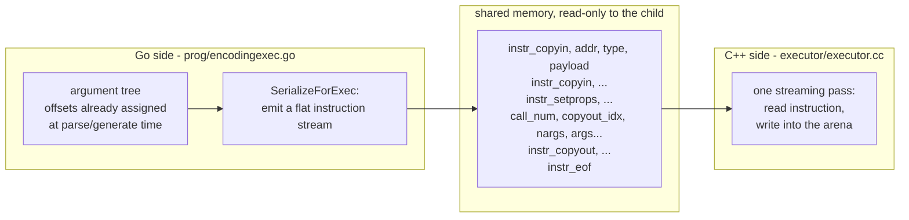

Offsets are not assigned by a layout pass at execution time — a `PointerArg` already carries its `Address` from the moment it was parsed or generated. What crosses the boundary is a **program for a tiny stack-free interpreter**, and the C++ side is a single `for(;;)` loop with a `switch`.

The instruction set is small. From `executor/executor.cc`:

```c
read_input(&input_pos);              // total number of calls
for (;;) {
    uint64 call_num = read_input(&input_pos);
    if (call_num == instr_eof) break;
    if (call_num == instr_copyin) {
        char* addr = (char*)(read_input(&input_pos) + SYZ_DATA_OFFSET);
        uint64 typ = read_input(&input_pos);
        switch (typ) { ... }
    }
    ...
}
```

Note the first line of the copyin handler: **`read_input() + SYZ_DATA_OFFSET`**. That single addition is the entire relocation mechanism. Every address in the stream is relative; the executor rebases it against whatever the arena base is on this architecture.

There is a small encoding trick in that loop worth noticing: instructions share the *call number* slot, encoded as negative sentinels, so the interpreter needs no separate tag byte:

| Sentinel | Value | Meaning |
|---|---:|---|
| `instr_eof` | −1 | end of the program |
| `instr_copyin` | −2 | write a value into the arena |
| `instr_copyout` | −3 | read a value out, into a result slot |
| `instr_setprops` | −4 | set call properties for the next call |
| *anything else* | ≥ 0 | a real syscall number — execute it |

The six argument kinds, and what each one has to handle:

| Kind | Payload | What the executor does |
|---|---|---|
| `arg_const` | value, size, `bf`, `bf_off`, `bf_len` | `copyin(addr, val, size, bf, bf_off, bf_len)` — a plain store, or a **read-modify-write for a bitfield**, honouring big/little-endian bitfield ordering |
| `arg_addr32` / `arg_addr64` | a relative offset | store `offset + SYZ_DATA_OFFSET` through a `uint32*` or `uint64*` cast — **nested pointer relocation**, 32- or 64-bit wide |
| `arg_result` | meta (size, bitfield), result reference | `read_result()` to look up a captured return value, then `copyin` — this is how `rN` reaches *inside* a structure, not just into an argument slot |
| `arg_data` | length + inline bytes | `memcpy(addr, input_pos, size)`, bounds-checked against the input buffer (`fail("data arg overflow")`) |
| `arg_csum` | size, kind, chunk list | compute an **internet checksum** over a list of chunks and store it |
| *(instruction)* `instr_setprops` | per-call properties | set `fail_nth` / `async` / `rerun` for the next call |

The checksum case deserves a closer look, because it is the one that cannot be precomputed:

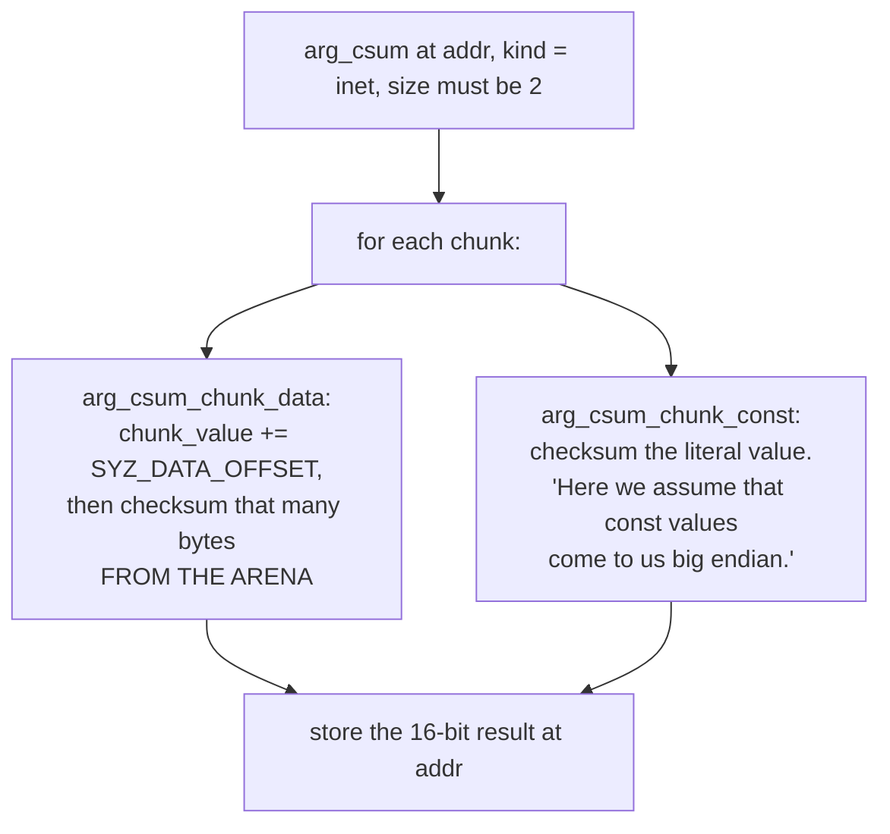

A network packet's checksum covers bytes that include relocated pointers and values resolved from `rN`, so it can only be computed *after* everything else is in place, *in the target's address space*. Hence a dedicated instruction that runs late and reads back out of the arena. A tool that skips checksum computation will produce packets the kernel drops at the first validation check — and the program will run cleanly while reproducing nothing.

#### The other fixups, and where they live

Not every "fixup" happens in the arena pass, and knowing which is which saves time:

| Fixup | Where it happens | Note |
|---|---|---|
| Bitfield insertion | arena pass, inside `copyin` | needs the surrounding byte, so read-modify-write |
| Nested pointer relocation | arena pass, `arg_addr32/64` | the only reason the stream needs a base at all |
| Internet checksum | arena pass, `arg_csum`, late | must read the finished bytes back |
| `len` / `bytesize` / `bitsize` fields | **Go side**, `assignSizesCall` | computed before serialization; by the time bytes are written they are plain constants |
| `AUTO` values and addresses | **Go side**, at deserialization | `AUTO` is resolved to a concrete value/offset while parsing; the executor never sees it |
| Compressed disk images (zlib) | **inside the pseudo-syscall** | `syz_mount_image` calls `puff_zlib_to_file` at execution time; the arena holds the *compressed* bytes |

That last row is a genuine trap. A 2 MB filesystem image appears in the reproducer as a compressed blob. The arena stores it compressed; decompression happens when `syz_mount_image` runs, inside the executor. A replay tool that decompresses eagerly will blow the 16 MiB arena; one that never decompresses will mount garbage.

> **Pattern worth stealing:** put relocation in one place and make it one arithmetic operation. syzkaller's entire pointer-fixup story is "the stream is relative, add the base on read." Everything else — nesting, checksums, bitfields — composes on top of that, and the format stays portable across architectures with different address spaces for free.

### 2.4 Stage 3 — execute

Per call, in order:

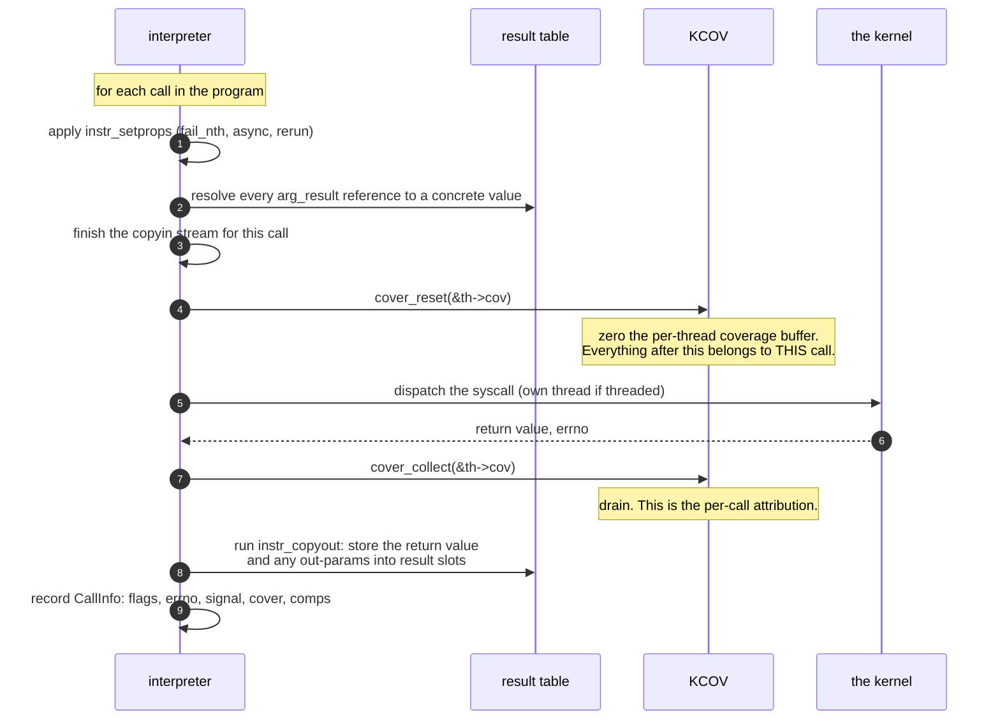

#### Why the reset/drain bracket is the whole ballgame

KCOV is a single per-thread buffer that accumulates PCs until you reset it. So attribution is purely a question of *when you reset and when you read*:

```mermaid
flowchart TB
    subgraph bad["program-level collection"]
        B1["reset once"] --> B2["call 0"] --> B3["call 1"] --> B4["call 2"] --> B5["drain once"]
        B5 --> B6["result: 'the program<br/>reached 1200 lines'<br/>- which call? unknown"]
    end
    subgraph good["per-call collection"]
        G1["reset"] --> G2["call 0"] --> G3["drain -> 61 PCs"]
        G3 --> G4["reset"] --> G5["call 1"] --> G6["drain -> 4 PCs"]
        G6 --> G7["reset"] --> G8["call 2"] --> G9["drain -> 843 PCs"]
        G9 --> G10["result: 'call 2, ioctl$TIOCSPTLCK,<br/>reached these 843 lines'"]
    end
```

In the source, `cover_reset(&th->cov)` sits immediately before the syscall dispatch in the thread execution path and `cover_collect(&th->cov)` immediately after completion. Both are guarded by `cover_collection_required()` so a run without coverage pays nothing.

There is a subtlety the code calls out: if a thread is still busy with a previous (blocked) syscall, it will not receive the next one and therefore will not perform its own `cover_reset` — which is part of why threaded mode and coverage attribution interact, and why each thread has its own `cov` object rather than there being one global buffer.

#### `extra` coverage: the work that belongs to nobody

Some kernel execution triggered by your syscall happens *later*, on another thread — a workqueue item, a timer, an RCU callback, softirq processing of a packet you just sent. By the time it runs, your syscall has returned and its coverage buffer has been drained.

syzkaller handles this with a second, separate coverage object, `extra_cov`, collected independently of any call and reported as "extra." The gating condition in the source is `flag_extra_coverage && !flag_comparisons` — extra coverage is incompatible with comparison collection, because comparison data is already per-call and far larger.

This is why the output has a `.extra` file alongside the per-call ones. Coverage that genuinely cannot be attributed to a call is reported as such rather than being silently dropped or misattributed to whichever call happened to be running. Honest unattributed data beats confident wrong data.

#### Timeout tiers

Three nested budgets, all derived in `sys/targets/targets.go`:

| Tier | Base | Scaling | Purpose |
|---|---|---|---|
| **Syscall** | 50 ms | `× slowdown` | one call blocked too long; mark it `blocked`/`unfinished` and move on |
| **Program** | 5 s | `× Scale` | the whole program is stuck; abandon it, report `hanged` |
| **No output** | 5 min | `× Scale` | the *machine* produced nothing; assume the kernel is dead |

with `Scale = min(slowdown, 3)`, and two derived values: `VMRunningTime` = 1 hour × Scale (how long one VM fuzzes before a planned restart) and `NoOutputRunningTime` = NoOutput + 1 minute.

The `slowdown` factor is why `-slowdown N` exists. Under QEMU TCG emulation or heavy instrumentation (KASAN + KCSAN + lockdep), a kernel can be an order of magnitude slower. Without scaling, every call would hit the 50 ms syscall timeout and every program would look hung. Note that `Scale` is capped at 3 while the syscall timeout scales linearly — a deliberate asymmetry: individual calls get proportionally more time, but you do not want a 10× slowdown to turn a 5-minute no-output window into 50 minutes of waiting on a dead machine.

The syscall and program timeouts are communicated to the executor in the connection handshake as `syscall_timeout_ms` and `program_timeout_ms`, alongside `slowdown`. The executor enforces them locally, because a host-side timeout cannot interrupt a syscall that is blocked in the kernel.

#### Threaded vs sequential

| | `-threaded=1` (default) | `-threaded=0` |
|---|---|---|
| Each call runs on | its own thread | the main thread, in order |
| A blocking call | is left blocked; execution continues | stalls everything |
| Output ordering | interleaved | strictly top-to-bottom |
| Use for | reproducing real behaviour, anything with `async` | **debugging descriptions** |

`-threaded=0` is the right default *for a human reading output*, which is why the canonical debugging recipe uses it. But a reproducer that depends on a blocking call never returning, or that uses `(async)`, will not reproduce without threading. If a syzbot repro fails under `-threaded=0`, try the default before concluding anything.

### 2.5 Stage 4 — coverage output

With `-coverfile=kerncov`, each executed program writes one file per call plus one for extra coverage:

```
kerncov_prog1.0        <- call 0
kerncov_prog1.1        <- call 1
kerncov_prog1.2        <- call 2
kerncov_prog1.extra    <- background/deferred work
kerncov_prog2.0        <- second program, or second repeat
...
```

The naming comes from `dumpCoverage`:

```go
coverFile := fmt.Sprintf("%s_prog%v", ctx.coverFile, ctx.resultIndex.Add(1))
for i, inf := range info.Calls {
    ctx.dumpCallCoverage(fmt.Sprintf("%v.%v", coverFile, i), inf)
}
if info.Extra != nil {
    ctx.dumpCallCoverage(fmt.Sprintf("%v.extra", coverFile), info.Extra)
}
```

The program index is a monotonically increasing counter, so `-repeat=3` on one program yields `_prog1`, `_prog2`, `_prog3` — each repeat separately attributable, which is how you spot a call whose coverage is unstable.

Each file is one hex PC per line. And there is one transformation applied on the way out that you must not skip:

```go
for _, pc := range info.Cover {
    prev := backend.PreviousInstructionPC(sysTarget, "", pc)
    fmt.Fprintf(buf, "0x%x\n", prev)
}
```

#### Why the PC is rewound

KCOV reports the address **after** the instrumented call — the return address, not the call site. Feed that to `addr2line` and you get the *next* source line, or the first line of the following statement, or (at a basic-block boundary) a completely unrelated line.

`PreviousInstructionPC` subtracts one instruction length:

| Arch | Bytes subtracted |
|---|---|
| amd64, 386 | 5 |
| arm64, arm, ppc64le, riscv64, loong64 | 4 |
| s390x | 6 |
| mips64le | 8 |
| gVisor | 0 — *"gVisor coverage returns real PCs that don't need adjustment"* |

On fixed-width ISAs this is exact. On x86 it is the length of a `call rel32`, which is what the instrumentation emits, so it is exact for the instrumented case too.

Get this wrong and every answer is subtly off — attributing coverage to the line *after* the real one. That is the kind of error that survives review because the output still looks plausible.

> **Pattern worth stealing:** when your measurement apparatus reports a position systematically offset from the thing you care about, correct for it **at the boundary where you emit data**, once, in a named function with the per-platform table in it. Not at each call site, and not left to the consumer.

#### A note on a union file

Upstream `syz-execprog` writes **only** the per-call files and `.extra` — there is no combined/union coverage file. If you want one, it is `sort -u` across the per-call files, and it is worth generating because `syz-cover` and most downstream tooling happily accept a single PC list:

```bash
sort -u kerncov_prog1.* > kerncov.log
bin/syz-cover --kernel_src=$KSRC --kernel_obj=$KOBJ kerncov.log
```

Producing both — per-call files for attribution, a union for a quick overall report — is a sensible extension, just be aware the union is additional, not something upstream emits.

### 2.6 Pseudo-syscalls: the part that silently breaks replay

Not every line in a reproducer is a real syscall. syzkaller defines **pseudo-syscalls**: `syz_`-prefixed operations implemented in the executor's C++ rather than in the kernel. Upstream Linux descriptions declare **46** of them, with around 52 implementations in `executor/*.h` once architecture variants are counted.

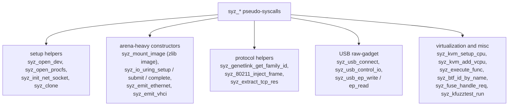

They exist because some kernel interfaces cannot be driven by a single syscall with declarable arguments. `syz_mount_image` has to create a memfd, decompress a zlib image into it, set up a loop device, and mount it — four syscalls and a decompressor, which no description language could express as one call signature. From the engine's point of view a pseudo-syscall is an ordinary call: it has a number, an entry in the generated `syscalls[]` table, and a typed signature.

Which makes them the most dangerous part of reimplementing replay, for one reason:

**A pseudo-syscall that you do not implement is usually the step that triggers the bug.** `syz_open_dev$foo` is how the reproducer gets the file descriptor. `syz_mount_image` is how it gets the corrupted filesystem. `syz_usb_connect` is how it attaches the malicious device. Those are not incidental setup — they *are* the attack.

So the failure mode matters enormously:

| Behaviour on an unimplemented pseudo-syscall | Consequence |
|---|---|
| **Return 0 (pretend success)** | the worst option. Subsequent calls get a bogus fd, run against the wrong object, and the program completes with no errors and no bug. You lose an afternoon. |
| **Abort the program** | safe but unhelpful: you cannot replay a reproducer that uses one unimplemented helper among five. |
| **Return `ENOSYS`, and say so at startup** | the right trade: downstream calls fail visibly with `EBADF`, and you were warned before you began. |

Which is why announcing it is worth a line of output:

```
[execprog] will return ENOSYS: syz_kvm_setup_cpu, syz_80211_inject_frame
[execprog] 3 calls, arena at 0x200000000000
```

Two facts, printed before a single syscall runs: *what this run cannot do*, and *what it thinks it is about to do*. If the bug then fails to reproduce, the first line is right there in the log, and nobody wonders.

> **Pattern worth stealing:** when partially implementing an interface, make the gap **loud at the boundary** — fail the unimplemented operation with a real error and enumerate the gaps at startup. A stub returning success converts a missing feature into a silent wrong answer, and silent wrong answers cost more than missing features.

### 2.7 Flags, and the two bitmasks they become

```bash
syz-execprog [flags] file-with-programs-or-corpus.db ...
```

| Flag | What it controls |
|---|---|
| `-executor` | path to `syz-executor` (default `./syz-executor`) |
| `-repeat N` | run the program set N times; `0` = forever |
| `-procs N` | how many parallel processes execute programs |
| `-threaded` | one thread per call so a blocking call cannot stall the rest (default **true**) |
| `-cover` | collect coverage feedback signal |
| `-coverfile F` | dump raw per-call coverage to `F_progN.*` |
| `-dedupcover` | deduplicate coverage inside the executor before sending |
| `-hints` | do a comparison-collection run and print the hint candidates |
| `-sandbox` | `none` / `setuid` / `namespace` / `android` |
| `-sandbox_arg` | numeric argument to the sandbox setup |
| `-debug` | verbose executor output — **the flag you want when debugging descriptions** |
| `-stress` | unguided local fuzzing mode |
| `-syscalls` | comma-separated syscall list for `-stress` |
| `-enable` / `-disable` | feature selection |
| `-slowdown N` | scale timeouts for emulation or heavy instrumentation |
| `-gdb` | launch the executor under gdb |
| `-unsafe` | relaxed program deserialization |
| `-glob` | run a glob-expansion request instead of a program |

The canonical debugging invocation, from `docs/syscall_descriptions.md`:

```bash
syz-execprog -debug -threaded=0 mytest
```

#### The two bitmasks

Flags collapse into exactly two bitmask fields, and the split between them is a performance contract:

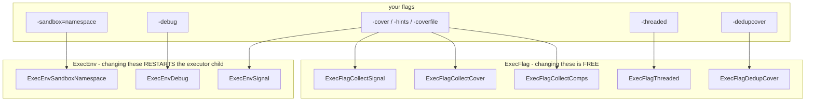

The rule is stated in the schema itself (`pkg/flatrpc/flatrpc.fbs`):

> Changing `exec_flags` between executions does not cause executor process restart. Changing `env_flags`/`sandbox_arg` does cause process restart.

The reason is physical. A sandbox is established when the process is created — it drops privileges, enters namespaces, sets up mounts — so changing it means a new process. Per-execution options like "collect coverage this time" are conditionals inside the loop. The fuzzer relies on this: it varies `ExecFlags` per request freely and treats `EnvFlags` changes as expensive. The executor enforces it from the other side, restarting its child when `env_flags` or `sandbox_arg` differ from last time, when the request type changes, or every **600** executions regardless (`kRestartEvery`) to bound state accumulation.

> **Pattern worth stealing:** separate your options into "cheap to change" and "requires a restart," and *say so in the schema*. Otherwise some future caller toggles an expensive option in a hot loop and nobody understands why throughput collapsed.

### 2.8 The plumbing: one local RPC server, one executor child

Here is the claim from §0, made concrete. `syz-execprog` starts the same RPC server as `syz-manager`, performs the same handshake, runs the same machine check, and feeds requests through the same `queue.Source` interface — it just supplies the programs from a file.

```mermaid
sequenceDiagram
    autonumber
    participant M as execprog main
    participant S as rpcserver (in-process)
    participant E as syz-executor runner (child)

    M->>M: parse flags, load programs (stage 0 + 1)
    M->>S: RunLocal(ctx, LocalConfig{...})
    S->>S: force RPC=":0" (any free port), init stats
    S->>S: Setup(): listen
    S->>S: go Serve(ctx)
    S->>E: spawn: executor runner 0 localhost PORT
    Note over S,E: identical handshake to syz-manager:<br/>Hello / ConnectRequest / ConnectReply /<br/>InfoRequest / InfoReply
    S->>S: machine check: probe features and syscalls
    S->>M: MachineChecked(features, syscalls)
    M->>M: OR the detected feature flags into defaultOpts;<br/>return queue.DefaultOpts(ctx, opts)
    Note over M: execprog itself IS the queue.Source
    loop until programs x repeat are done
        S->>M: Next()
        M->>S: Request{Prog, ExecOpts, OnDone: ctx.Done}
        S->>E: ExecRequest (the copyin stream, stage 2)
        E->>E: stage 3: execute, collect coverage
        E->>S: ExecResult{ProgInfo, output, hanged, error}
        S->>M: req.Done(result) -> print, dump coverage (stage 4)
    end
    M->>M: completed == len(progs)*repeat -> cancel the context
```

Two subtleties the source comments call out:

- **The RPC server must outlive the executor.** If the server shuts down first, the executor hits a closed socket and dies with a confusing `SYZFAIL`. So the server runs in a goroutine with its own context, and the executor's context is cancelled first.
- **`TriagedCorpus` is signalled immediately.** In the fuzzer there is a corpus-triage phase during which the executor restarts more often. `syz-execprog` has no triage phase, so it tells the executor straight away.

The upshot: a program behaving differently under `syz-execprog` than under `syz-manager` is genuinely surprising and worth investigating, because the execution path is the same code.

#### What comes back

```
CALL 0: signal 52, coverage 61 errno 0
CALL 1: signal 3, coverage 4 errno 9 unfinished blocked
```

| Flag | Meaning |
|---|---|
| `CallFlagExecuted` | the call was started — not all are, if an earlier call failed |
| `CallFlagFinished` | the call returned; absent means it blocked and we stopped waiting |
| `CallFlagBlocked` | the call blocked |
| `CallFlagFaultInjected` | fault injection fired in this call |
| `CallFlagCoverageOverflow` | the coverage buffer filled; **data for this and later calls was lost** |

`errno 0` is success. In a test you expected to pass, any non-zero errno means your description is wrong, a prerequisite call failed, or the kernel lacks the feature. The quick triage table:

| errno | Usual cause |
|---|---|
| `ENOSYS` | the syscall or pseudo-syscall is not available here |
| `EINVAL` on the first call | argument types or flag values are wrong |
| `EBADF` on a later call | the earlier call did not actually produce the resource you think it did |
| `EPERM` / `EACCES` | sandbox too restrictive — try `-sandbox=none` |

**`CallFlagCoverageOverflow` is the one to watch with `-coverfile`.** The executor builds results *directly in shared memory* with an allocator that deliberately refuses to grow, so a raw (non-deduplicated) coverage trace from a syscall that touches a lot of code exhausts the output region, and the calls after it lose their data — silently, except for this flag. Pass `-dedupcover` with `-coverfile` unless you specifically need a raw trace. The flag's own help text warns about exactly this.

### 2.9 What a from-scratch reimplementation has to get right

If you are writing your own replay tool rather than using `syz-execprog` — a reasonable thing to do for a constrained target, or to understand the format — this is the checklist, ordered by how expensive the mistake is.

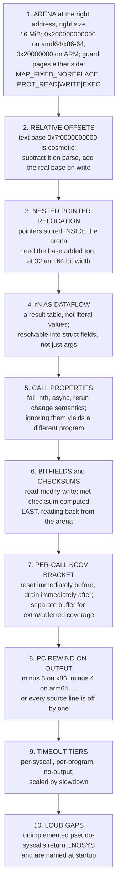

The three that most often go wrong, and the symptom each produces:

| Mistake | Symptom | Why it is hard to spot |
|---|---|---|
| Nested pointers not relocated | reproducer runs, returns `EFAULT` somewhere in the middle, no bug | the top-level pointer works, so most calls succeed |
| Coverage drained per program | report cannot say which call reached the code | the numbers look fine; they are just not answering the question |
| Unimplemented pseudo-syscall returns 0 | program completes cleanly and reproduces nothing | **no error anywhere** |

#### Proving it works

The only meaningful acceptance test for a replay tool is end-to-end: **take a real reproducer for a known bug, run it, and confirm the kernel reports that bug.** Anything short of that — the file parses, the arena maps, calls return 0 — is consistent with a tool that reproduces nothing.

A good selftest bundles the reproducer *and* the expected crash signature:

```
selftest 4: replay the bundled sample repro
  expect: KASAN: use-after-free in ...
  result: PASS (crash signature matched)
```

That test exercises the entire chain at once: form detection, deserialization, arena layout with nested pointers, `rN` dataflow, pseudo-syscall setup, per-call coverage, and the timeout tiers. If it passes, the pieces agree with each other. Unit tests on the arena layout cannot tell you that.

> **Pattern worth stealing:** for a reimplementation, the acceptance test is not "does my output look like theirs" but "does the end-to-end effect still happen." Bundle a known-positive case with its expected observable outcome, and run it in CI. A reimplementation without one is a hypothesis.

---

### 2.10 Sandboxes: what `-sandbox` actually changes

`-sandbox` appears in every invocation, in `ExecEnv` as a restart-forcing bit, in `csource.Options`, and in the reproducer simplification ladder. It is never obvious what the four values *do*, and one of them has a misleading name.

The implementations are `do_sandbox_none`, `do_sandbox_setuid`, `do_sandbox_namespace` and `do_sandbox_android` in `executor/common_linux.h`.

| Value | What the test process gets | Use when |
|---|---|---|
| `none` | **not actually "nothing"** — see below | maximum reach; the default for `syz-execprog`, and required by `-mode iface-probe` |
| `setuid` | drops to an unprivileged uid | you want code paths that check credentials, and to limit damage |
| `namespace` | a full set of namespaces plus a pivoted root | fuzzing with containment; the common `syz-manager` choice |
| `android` | setuid plus Android's uid/gid and SELinux conventions, tuned by `sandbox_arg` | Android targets |

#### `sandbox=none` is a misnomer

Even "none" does real setup:

```c
static int do_sandbox_none(void)
{
    // CLONE_NEWPID takes effect for the first child of the current process,
    // so we do it before fork to make the loop "init" process of the namespace.
    if (unshare(CLONE_NEWPID)) { debug("unshare(CLONE_NEWPID): %d\n", errno); }
    int pid = fork();
    if (pid != 0)
        return wait_for_loop(pid);
    sandbox_common();
    drop_caps();
    if (unshare(CLONE_NEWNET)) { debug("unshare(CLONE_NEWNET): %d\n", errno); }
    ...
```

So `none` still unshares the **PID namespace** — so the loop process becomes a pid-1 that reaps everything the program spawns — and the **network namespace**, so generated packets cannot escape onto your real network. It also calls `sandbox_common()` and `drop_caps()`. It means *"no privilege reduction beyond the hygiene we always need"*, not *"no isolation."*

The `unshare` failures are deliberately non-fatal; the comment explains that `sandbox=none` is used in tests that often run as non-root.

#### Why this is a design decision, not a config detail

Three consequences that will affect your results:

**It selects which bugs you can reach.** Code behind `capable(CAP_NET_ADMIN)` is unreachable under `setuid`. Conversely some bugs *only* trigger for unprivileged users, because the privileged path takes a different branch. Your sandbox choice picks a region of the kernel.

**It is the most expensive option to change.** The sandbox is established when the process is created, so it lives in `ExecEnv` and changing it forces an executor restart (§2.7). That placement is not arbitrary.

**It is the last thing the reproducer simplifier strips.** `progSimplifies` tries `Sandbox = "none"` fourth, and `cSimplifies` goes further to `Sandbox = ""` — which also clears every net/USB/cgroup option. A reproducer that still needs `sandbox=namespace` asks the developer for more setup, so the ladder tries hardest to remove it, last and completely. And removing it entirely is what triggers the inlining in §5.7 that makes the C file short.

> **Pattern worth stealing:** when a setting changes both *what your tool can observe* and *what your output asks of its consumer*, it is not configuration — it is part of the design, and it deserves to be named in the artifact you ship.

---
## 3. The queue: how requests actually flow

Both `syz-manager` and `syz-execprog` push work through `pkg/fuzzer/queue`. It is a set of small composable layers, and understanding it explains a lot of otherwise-mysterious behaviour.

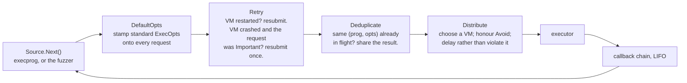

### The `OnDone` callback chain

`Request.OnDone(cb)` builds a **LIFO** chain: the most recently installed callback runs first, and it only chains to the previous one if it returns `true`. Returning `false` stops processing entirely.

That one convention implements retry and deduplication without any special cases in the core:

- `Retry` installs a callback. On `Restarted`, it resubmits the request and returns `false` — so the original requester never learns that a VM died mid-flight. It just takes longer.
- `Deduplicate` installs a callback that fans one result out to every waiter for the same request hash.

### `Status` values and what they mean for you

| Status | Meaning | Does the caller stop? |
|---|---|---|
| `Success` | it ran | no |
| `Restarted` | the executor process restarted; no result | no |
| `ExecFailure` | the executor reported an error | yes |
| `Crashed` | the VM crashed while this was executing | yes |
| `Hanged` | the program did not finish | yes |

### `Avoid` and the Distributor

During triage the fuzzer wants to run the same program on a *different* VM, to tell real coverage from a quirk of one machine's state. `Request.Avoid` lists executors to stay away from; the `Distributor` delays such a request while another VM has been recently active, and after about 1000 scheduling ticks gives up and runs it anywhere (counting the violation in a stat). A soft constraint with a bounded wait, rather than a hard one that could deadlock.

### The signal filter: a nice piece of defensive design

When results come back, `convertCallInfo` canonicalizes coverage addresses across kernel modules and then does something important: **if any signal address falls outside the kernel's text range, it discards all signal and coverage for that call.** It also drops comparison hints where both operands look like kernel pointers.

Why: the executor runs inside the sandbox, which is to say inside code the fuzzer is actively trying to break. A corrupted or malicious executor could report fabricated coverage and poison the corpus with garbage that looks maximally interesting. Range-checking the feedback is cheap insurance.

> **Pattern worth stealing:** treat feedback from an untrusted component as *input to be validated*, not as ground truth. Your fuzzer's score function is an attack surface.

---

## 4. How the corpus works

The corpus is syzkaller's long-term memory: the set of programs worth keeping because each one reaches code nothing else reaches.

### 4.1 The on-disk format: `pkg/db`

`workdir/corpus.db` is a simple append-oriented key-value log:

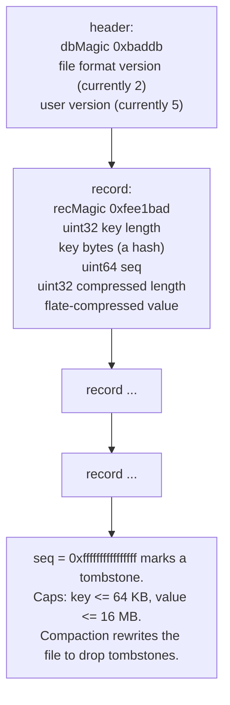

- **Key = hash of the serialized program.** Content addressing means the same program can never appear twice, and "is this already in the corpus?" is a map lookup.
- **Values are flate-compressed.** Program text is highly repetitive; compression is a large win on a corpus of hundreds of thousands of entries.
- **`Open(filename, repair)` can return a usable database *and* an error.** A corpus file truncated by a power cut is partially recoverable: read what you can, report the problem, compact. Losing a few programs is vastly better than losing all of them.

> **Pattern worth stealing:** for a cache or corpus — data that is valuable but regenerable — prefer partial recovery over strict validation. "I recovered 99.8% and logged the rest" beats "corrupt, starting over."

### 4.2 The user version: forcing re-work after an upgrade

The second version number in the header is the interesting one. `CurrentDBVersion = 5`, and `versionToFlags` maps an old version to a set of per-program flags:

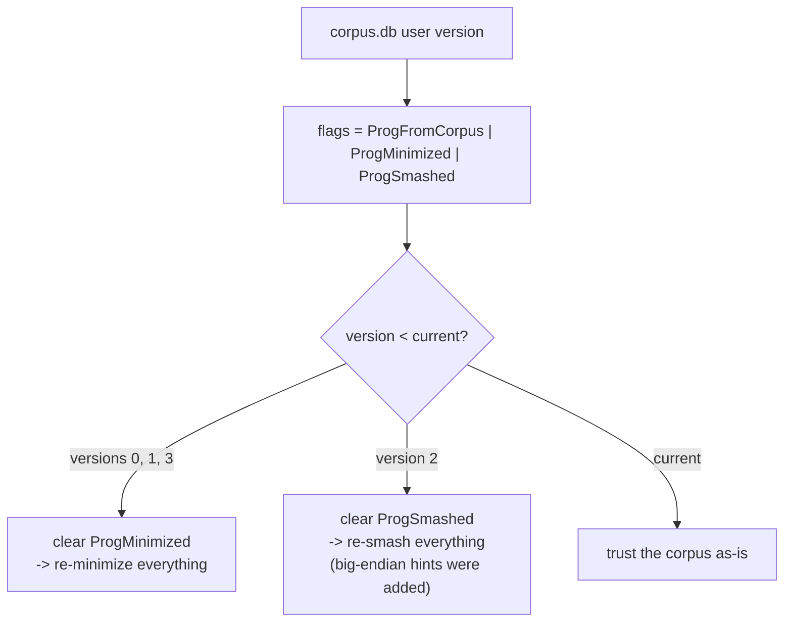

The design problem: syzkaller improves. A corpus minimized by 2019's minimizer is worse than one minimized today. But re-minimizing a huge corpus on every start costs hours. Solution: bump the version when an improvement lands, and let the version difference decide what needs redoing.

There is a cautionary comment in the source about this: clearing `ProgSmashed` for version 4 *"led to perpetual corpus retriage on slow syzkaller instances"* and was reverted. A one-line change that made slow instances never finish warming up.

### 4.3 Gradual re-work: `ReminimizeSubset` and `ResmashSubset`

Rather than only reacting to version bumps, every start re-does a small slice of work:

| Function | What it targets | How much |
|---|---|---|
| `ReminimizeSubset` | the largest ~10% of programs, and anything above `ReminimizeThreshold = 15` calls | up to 1% of the corpus, capped at 50 programs |
| `ResmashSubset` | a random subset | up to 0.5% of the corpus, capped at 25 programs |

The comment explains the reasoning: *"programs that do more than 15 system calls are to be treated with suspicion and re-minimized"* — minimization is probabilistic because the kernel is flaky, so some programs escape under-minimized. And the fuzzing algorithms get smarter over time, so old programs deserve another pass eventually.

> **Pattern worth stealing:** continuous background re-processing of a small, bounded slice beats a periodic "rebuild everything." It is self-limiting, it needs no maintenance window, and quality improves monotonically.

### 4.4 Loading: `LoadSeeds`

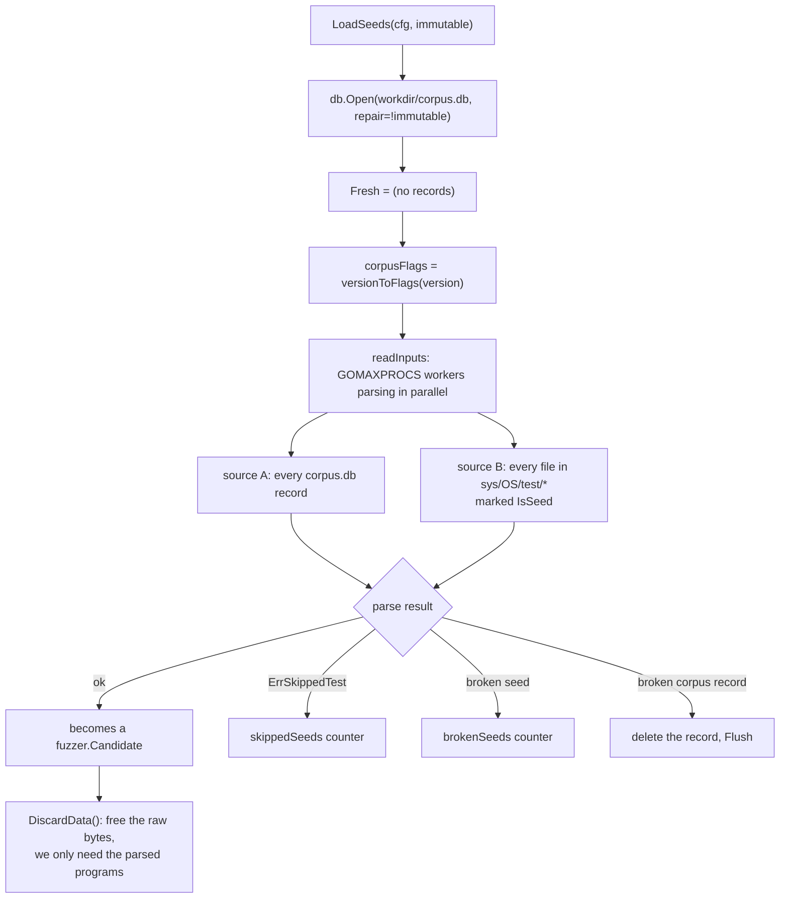

Note that seeds from `sys/<OS>/test/*` get only the `ProgMinimized` flag, **not** `ProgFromCorpus`. The comment: *"Seeds are not considered 'from corpus' (won't be rerun multiple times) b/c they are tried on every start anyway."* Hand-written seed programs are a permanent injection of known-good scenarios, not accumulated knowledge.

### 4.5 Filtering against the live machine

`FilterCandidates(candidates, enabledSyscalls, dropMinimize)` reconciles a corpus built on one kernel with the kernel actually in front of you:

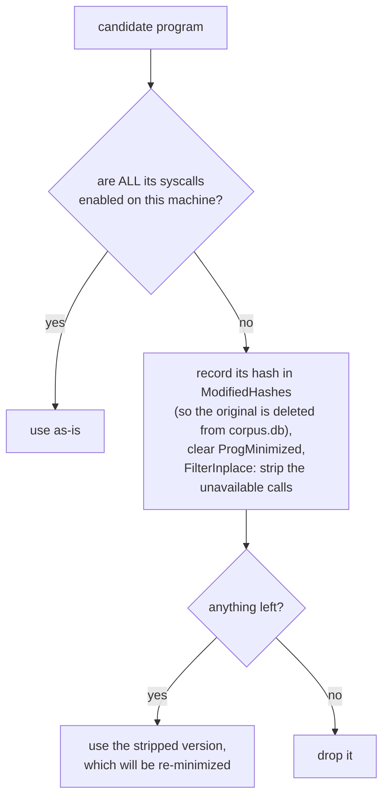

Back in `syz-manager`, when `preserve_corpus` is set, the hashes of the stripped programs are remembered in `disabledHashes` so that minimization does not purge them — you might boot a kernel tomorrow that has those syscalls again, and you do not want to have thrown the programs away. This is why moving one `corpus.db` between different kernel configurations is safe.

### 4.6 In memory: `pkg/corpus`

```mermaid
classDiagram
    class Corpus {
        +progsMap
        +signal
        +cover
        +focusAreas
        +Save(NewInput)
        +ChooseProgram(rand)
        +Minimize(cover)
        +CallCover()
    }
    class Item {
        +Sig
        +Call
        +Prog
        +HasAny
        +Signal
        +Cover
        +Updates
    }
    class NewInput {
        +Prog
        +Call
        +Signal
        +Cover
        +RawCover
    }
    Corpus "1" --> "many" Item
    NewInput --> Corpus : Save
```

| Field | Meaning |
|---|---|
| `Corpus.progsMap` | program hash → `Item` |
| `Corpus.signal` | the union of all items' signal |
| `Corpus.cover` | the union of all items' coverage |
| `Corpus.focusAreas` | per-area weighted pickers |
| `Item.Sig` | hash of the serialized program — its identity |
| `Item.Call` | which call this item is "for" |
| `Item.HasAny` | does it contain squashed arguments? |
| `Item.Updates` | up to 32 recent update records |

`Save()` has two paths:

- **New program:** build an `Item`, insert it, and register it in the weighted picker with **priority equal to the number of signal elements**. More new coverage → proportionally more likely to be chosen for future mutation.
- **Existing program:** build a *new* `Item` (items are treated as immutable, so concurrent readers never see a torn update) with signal and coverage merged, and an appended update record — capped at 32, because a program relevant to many syscalls would otherwise grow without bound.

> The *selection* side of this — how the weighted picker works, how focus areas layer on top, and why the weight is signal count — is covered in `mutation-design.md` §3. Here we only care about the storage and persistence side.

Either way it merges into the global signal/coverage sets and emits a `NewItemEvent` on a channel. In `syz-manager` that channel feeds `corpusInputHandler`, which writes the program into `corpus.db` and flushes. **Persistence is a side effect of a channel send, not a call inside `Save`** — the corpus package has no idea a file exists.

> **Pattern worth stealing:** emit domain events; let somebody else decide to persist them. `pkg/corpus` is unit-testable with no filesystem because of this one choice.

### 4.7 Minimization: a set-cover problem

`Corpus.Minimize()` runs periodically. It answers: "what is the smallest subset of programs that still covers everything we have ever covered?"

```mermaid
flowchart TB
    A["all items, each with a Signal set"] --> B["sort: prefer no-squashed-args first,<br/>then fewer calls<br/>(smaller programs run faster)"]
    B --> C["signal.Minimize: greedy set cover.<br/>For each signal element, keep the single<br/>input with the highest priority for it.<br/>Return the distinct winners."]
    C --> D["rebuild progsMap from the winners"]
    D --> E["clear the weighted lists IN PLACE<br/>(stat objects hold pointers into them)"]
    E --> F["re-insert survivors, recomputing<br/>every selection weight"]
```

The trigger logic in the manager is careful:

- **Never before `phaseTriagedCorpus`.** During triage we are actively adding inputs; minimizing would thrash, and the loaded corpus was presumably already minimal.
- **Only on 3% growth** (`currSize > lastMinCorpus*103/100`). Minimization is not free.

Right after minimizing, the manager does a **per-syscall sanity check** against corpus explosion:

```mermaid
flowchart TB
    CC["for each syscall, look at<br/>count and coverage in the corpus"] --> W{"coverage enabled?"}
    W -->|yes| Y1{"count < 1000?"}
    Y1 -->|yes| ACC["accept everything"]
    Y1 -->|no| Y2{"count < 3000 AND<br/>cover/count >= 10?"}
    Y2 -->|yes| ACC
    Y2 -->|no| SAT["mark saturated:<br/>log 'coverage for X has saturated,<br/>not accepting more inputs'"]
    W -->|no| N1{"count < 300?"}
    N1 -->|yes| ACC
    N1 -->|no| SAT
    SAT --> FILTER["NewInputFilter now rejects<br/>new inputs for this syscall"]
```

The numbers come with their empirical justification in the source: *"real coverage for the most saturated syscalls is ~30-60 per program (even when we have a thousand of them). For explosion case coverage tend to be much lower (~0.3-5 per program)."* So a syscall accumulating thousands of programs that each add almost nothing is a symptom — a buggy description, broken fallback coverage, a KCOV bug — and the system clamps it rather than letting the corpus bloat.

> **Pattern worth stealing:** any accumulating store needs a saturation detector. Define what "unhealthy growth" looks like numerically, detect it, log it in plain language, and clamp. Note how it logs *which* syscall saturated — enough to go fix the root cause.

### 4.8 Signal vs coverage: two similar things with different jobs

This distinction confuses everyone at first. (`mutation-design.md` covers how signal *priority* is used by the fuzzer; here we only need the storage distinction.)

| | **Signal** | **Coverage** |
|---|---|---|
| Type | `map[element]priority` | a set of program counters |
| Purpose | the fuzzer's novelty score | human-facing reports; focus-area matching |
| Carries priority? | yes, 0–3 | no |
| Collected by | `ExecFlagCollectSignal` | `ExecFlagCollectCover` |
| Used for | "is this input new?", corpus weight, set cover | the web UI coverage report |

The priority byte is computed by `signalPrio`:

- bit 1 set if the call **succeeded** (`errno == 0`)
- bit 0 set if the call has **no squashed/ANY arguments**
- `0` for "extra" coverage not attributable to a specific call

When two programs produce the same signal element, the higher-priority one wins the set cover. So syzkaller systematically prefers **programs whose calls actually succeed and whose arguments are still properly typed** — exactly the programs a human can read and a developer can act on.

> **Pattern worth stealing:** when deduplicating equivalent artifacts, attach a quality score and keep the best one. Equivalent-but-nicer is not the same as equivalent.

### 4.9 Max signal and the distributed filter

One more piece. `pkg/fuzzer/Cover` holds:

- `maxSignal` — every signal element ever observed, including flakes
- `newSignal` — the elements discovered since the last distribution

`addRawMaxSignal` is the novelty gate: it computes the difference against `maxSignal`, and an empty difference means "we have seen all of this, nothing to do." Otherwise the difference is merged into both sets and returned.

Periodically (`fuzzerLoop`, twice a second) the manager grabs the delta and calls `DistributeSignalDelta`, which pushes it to every connected executor in 50,000-element batches. The executors use it to **filter at the source** — not even reporting coverage the host already knows about. On a mature corpus that is a large bandwidth saving, and it is only possible because there is one authoritative coverage map on the host (a direct dividend of the 2024 refactor).

---

## 5. From a crash log to a minimal reproducer

This is where `syz-execprog` earns its keep. `pkg/repro` is a search algorithm whose oracle is "boot a VM, run some programs, did the kernel crash with the right title?" — a very expensive oracle, so the algorithm is built around minimizing calls to it.

### 5.1 The input

A crash log is console output interleaving program announcements with kernel messages:

```
executing program 0:
r0 = openat$foo(...)
ioctl$BAR(r0, ...)
executing program 1:
socket$nl(...)
...
[  412.883102] BUG: KASAN: use-after-free in foo_release+0x1a/0x80
```

So you know roughly 100 programs ran and one of them did it. Maybe. It could also be a combination, or a timing accident, or program 7 interacting with leftover state from program 3.

### 5.2 The overall algorithm

```mermaid
flowchart TB
    L["crash log"] --> P["ParseLog: extract program entries"]
    P --> Z{"any programs?"}
    Z -->|no| ERR["ErrEmptyCrashLog:<br/>the kernel crashed before<br/>we executed anything"]
    Z -->|yes| R["Reporter.Parse: get the crash title,<br/>type, start position, and which<br/>executor was named"]
    R --> TRUNC["drop every entry that started<br/>AFTER the crash began"]
    TRUNC --> EP["STEP 1 - extractProg:<br/>find the guilty program"]
    EP --> MP["STEP 2 - minimizeProg:<br/>remove calls and simplify args"]
    MP --> FAST{"fast mode?"}
    FAST -->|yes| REL
    FAST -->|no| EC["STEP 3 - extractC:<br/>can we build a C reproducer?"]
    EC --> SIMP{"got a C repro?"}
    SIMP -->|yes| SC["STEP 4a - simplifyC:<br/>strip C-level options"]
    SIMP -->|no| SP["STEP 4b - simplifyProg:<br/>strip execution options"]
    SC --> REL
    SP --> REL["STEP 5 - calculateReliability:<br/>run up to 10 times, stop at 3 crashes"]
    REL --> CHK{"reliability >= 0.15?"}
    CHK -->|no| REJ["reject: too flaky to be useful"]
    CHK -->|yes| OUT["Result{Prog, Opts, CRepro,<br/>Report, Reliability}"]
```

### 5.3 The timeout ladder

> Not to be confused with the executor's **timeout tiers** in §2.4. Those bound one syscall, one program, and one silent machine. This ladder is how much wall-clock budget `repro` gives a whole *test attempt* before deciding it did not crash.

Every test runs with a time budget, and repro tries three, shortest first:

| Rung | Value |
|---|---|
| 1 | `max(30s, 3 × program timeout)` |
| 2 | `max(100s, 20 × program timeout)` |
| 3 | `NoOutputRunningTime` |

Shortest first because most bugs are fast, and a short budget means more attempts per unit time. The ladder is specialized by crash type:

- **No title** ("lost connection", "no output"): keep only rungs 1 and 3 — these are either fast or require the full no-output window.
- **Memory leak**: drop rung 1 — leak detection is inherently slow.
- **Hang**: keep only rung 3, by definition.
- **Fast mode**: just `{30s, 5m}`.

> **Pattern worth stealing:** when your oracle has a tunable cost, search the cheap settings first and escalate. And let the *kind* of question skip rungs that cannot possibly answer it.

### 5.4 Step 1: finding the guilty program

```mermaid
flowchart TB
    S["candidate entries"] --> H{"did the crash report<br/>name an executor?"}
    H -->|yes| H1["try THAT entry first<br/>- a strong hint from the kernel"]
    H -->|no| H2["lastEntries: the last entry of<br/>each proc, in reverse order<br/>- recent is more likely guilty"]
    H1 --> T
    H2 --> T["for each timeout rung:"]
    T --> SINGLE["extractProgSingle:<br/>run each candidate ALONE"]
    SINGLE --> OK{"crashed?"}
    OK -->|yes| FOUND["done: one program is enough"]
    OK -->|no| BIS{"more than one entry?"}
    BIS -->|no| NEXT["try the next timeout rung"]
    BIS -->|yes| WHOLE["replay the ENTIRE log first"]
    WHOLE --> W{"did that crash?"}
    W -->|no| GIVEUP["give up immediately:<br/>if the whole log does not reproduce,<br/>no subset will"]
    W -->|yes| BISECT["bisectProgs: binary search<br/>over the entry list,<br/>max 6 chunks (2 in fast mode)"]
    BISECT --> CONCAT["concatenateProgs:<br/>individually minimize each survivor,<br/>then splice them into ONE program"]
```

Three details that are each a hard-won lesson:

**Replay the whole log before bisecting.** If running all 100 programs does not crash, the bug needed something not in the log — timing, hardware state, a different kernel — and bisection would burn hours proving nothing. One test saves the whole search.

**Pin the entry the report named.** `bisectProgs` uses a `keepFn` that prevents bisection from discarding the entry the kernel itself pointed at. Trust the kernel's hint.

**`ErrTooManyChunks` aborts.** If bisection fragments past 6 chunks, the crash is flaky and bisection results are noise. Stop rather than produce a confidently wrong answer.

### 5.5 Steps 2–4: shrinking in two dimensions

A reproducer has two kinds of complexity, and both get attacked.

**The program** — `prog.Minimize` with `MinimizeCrash` mode. It removes calls, simplifies arguments, and resets call properties, re-testing after each change. The predicate refuses to go below one call, with a practical reason in the comment: *"otherwise tools/syz-execprog will immediately exit."*

**The execution options** — the environment needed to trigger it. `progSimplifies` tries, in order:

1. drop `Threaded` (only if not colliding)
2. drop `Repeat` — also clears cgroups and net-reset, and sets `Procs = 1`
3. set `Procs = 1`
4. set `Sandbox = "none"`

and `cSimplifies` extends that with stripping each individual feature: network injection, net devices, net reset, cgroups, binfmt_misc, close-fds, devlink PCI, NIC VF, USB, VHCI, WiFi, 802.15.4, tmpdir, segv handling.

Why this matters so much: a reproducer that says *"run this 100 times, in 8 parallel processes, in a network namespace, with USB emulation and cgroups"* is nearly useless to a developer. One that says *"compile this C file and run it once"* gets fixed. Each stripped option is a smaller ask.

```mermaid
flowchart LR
    A["crash log<br/>100 programs,<br/>8 procs, threaded,<br/>repeat, full sandbox"] --> B["1 guilty program<br/>same options"]
    B --> C["3 calls<br/>same options"]
    C --> D["3 calls<br/>1 proc, no repeat,<br/>sandbox none"]
    D --> E["a 40-line C file<br/>that crashes the kernel"]
```

There is a guard worth noting: `checkOpts` forbids combining "no repeat" with a timeout of a minute or more. A non-repeating C reproducer that simply returns would sit there doing nothing until the timeout, and get misdiagnosed as "no output from test machine."

### 5.6 The verdict function: not every crash counts

`getVerdict` decides whether a test "crashed," and it is deliberately picky:

```mermaid
flowchart TB
    RUN["run the candidate<br/>(retry up to 3 times on infrastructure error)"] --> N{"any report?"}
    N -->|no| NO["not crashed"]
    N -->|yes| SUP{"suppressed?"}
    SUP -->|yes| NO
    SUP -->|no| LEAK{"chasing a leak but<br/>got a non-leak report?"}
    LEAK -->|yes| NO
    LEAK -->|no| PRIO{"is this a LOW-priority report?<br/>LostConnection, NoOutput,<br/>SyzFailure, UnexpectedReboot"}
    PRIO -->|"yes, and we already saw<br/>a high-priority crash"| NO
    PRIO -->|no| STRICT{"strict mode?"}
    STRICT -->|"yes, and this title is new"| NO
    STRICT -->|no| YES["CRASHED: record the title,<br/>keep the report"]
```

The low-priority filter prevents a classic failure: you are narrowing down a use-after-free, and one attempt happens to lose the SSH connection. If "lost connection" counted as success, the algorithm would wander off and produce a reproducer for a network glitch. Once a *real* crash has been seen, infrastructure noise stops counting.

Strict mode is used after a successful simplification: having found a simpler variant, re-verify it produces a title we have *already* seen, not some third bug.

### 5.7 Producing the C reproducer: one source, two compilations

The C reproducer is syzbot's actual deliverable — the thing a kernel developer receives and runs. It is also the place where an obvious design trap was avoided, which makes it worth more than the two paragraphs it usually gets.

#### The trap

A C reproducer must do everything the executor does: map the arena at the right address, lay out arguments, resolve `rN` dataflow, compute checksums, set up the sandbox, spawn threads, run the repeat loop, honour per-call timeouts. That is the executor's whole job.

So the naive design is **two implementations** — the C++ executor, and a Go code generator that emits equivalent C. They would drift within weeks, and every divergence becomes "the repro doesn't reproduce" with no explanation.

#### What syzkaller does instead

`executor/common_linux.h` is **the same source file compiled into both.** It is littered with guards — 180 occurrences of `SYZ_EXECUTOR` — selecting which consumer is being built:

```c
static int do_sandbox_none(void)
{
    if (unshare(CLONE_NEWPID)) { debug("unshare(CLONE_NEWPID): %d\n", errno); }
    int pid = fork();
    if (pid != 0)
        return wait_for_loop(pid);
#if SYZ_EXECUTOR || SYZ_VHCI_INJECTION
    initialize_vhci();
#endif
    sandbox_common();
    drop_caps();
#if SYZ_EXECUTOR || SYZ_NET_DEVICES
    initialize_netdevices_init();
#endif
    ...
```

`SYZ_EXECUTOR` is defined when building the executor, so the executor gets *every* feature. For a reproducer, `SYZ_EXECUTOR` is undefined and only the `SYZ_*` features that program actually needs are defined — which is exactly what `simplifyC` (§5.5) is pruning when it strips `NetInjection`, `Cgroups`, `USB` and so on.

```mermaid
flowchart TB
    SRC["executor/common*.h<br/>ONE source, 180 SYZ_EXECUTOR guards:<br/>sandboxes, netdev setup, loop structure,<br/>threading, timeouts, pseudo-syscalls"]
    SRC -->|"-DSYZ_EXECUTOR<br/>everything on"| EX["syz-executor<br/>a general interpreter:<br/>reads the copyin stream at runtime"]
    SRC -->|"SYZ_EXECUTOR undefined<br/>+ only the features this prog needs"| CS["createCommonHeader:<br/>preprocess, substitute, emit"]
    CS --> REPRO["repro.c<br/>straight-line C:<br/>the SAME operations, unrolled"]
    PROG["the program"] -->|"copyin/copyout/csum<br/>emitted as C statements"| CS
```

`pkg/csource/csource.go` fills a template with values computed from the program:

| Placeholder | Filled with |
|---|---|
| `SANDBOX_FUNC` | `do_sandbox_none` / `_setuid` / `_namespace` / `_android` |
| `MMAP_DATA` | `target.DataMmapProg()` — **the arena mmap, emitted as explicit syscalls** |
| `SYSCALLS` | the program's calls as straight-line C |
| `RESULTS` | `uint64 r[N] = {...}` — the `rN` result table |
| `PROCS`, `REPEAT_TIMES` | from the simplified options |
| `CALL_TIMEOUT_MS` | base timeout plus a per-call term for any call with a `timeout` attribute |
| `ASYNC_CONDITIONS` | `call == 3 \|\| call == 7` for calls marked `(async)` |

And crucially, `csource.go` has its own `copyin`, `copyout` and `generateCsumInet` functions. They emit **the same operations as the executor's instruction interpreter (§2.3), but unrolled into C statements** rather than interpreted from a stream. Same semantics, two execution strategies:

| | Executor | C reproducer |
|---|---|---|
| Arena | `mmap` in `os_init` at `SYZ_DATA_OFFSET` | `MMAP_DATA`: the same mapping as explicit syscalls |
| Argument layout | interpret `instr_copyin` from shared memory | `memcpy`/assignment statements, unrolled |
| `rN` | `read_result()` from a table | `r[3]` — a C array |
| Checksums | `arg_csum` instruction, computed at runtime | `csum_inet_*` calls emitted inline |
| Feature setup | all compiled in, selected by flags | only the needed `#define`s |

> **Pattern worth stealing:** when you need the same behaviour in an interpreter and in generated code, do not write it twice — write it once in the target language and make the interpreter one of its build configurations. The alternative is two implementations that agree today and diverge silently.

#### The inlining that makes minimal repros readable

One detail explains why a good syzbot reproducer is so short:

```go
if !ctx.opts.Threaded && !ctx.opts.Repeat && ctx.opts.Sandbox == "" {
    // This inlines syscalls right into main for the simplest case.
    replacements["SANDBOX_FUNC"] = replacements["SYSCALLS"]
    replacements["SYSCALLS"] = "unused"
}
```

When `simplifyC` has succeeded in stripping threading, repetition *and* the sandbox, the calls go directly into `main()` — no loop scaffolding, no fork, no helper function. You get a 30-line file a developer reads in ten seconds. Every option `simplifyC` manages to remove is not just a smaller ask operationally; it makes the artifact *shorter*.

`repro` then compiles the result and tests it — a C reproducer that does not actually reproduce is worse than none — and skips the attempt entirely if `target.BrokenCompiler` is set. `csource` is also exposed standalone as `syz-prog2c`.

### 5.8 Optional: strace

If `strace_bin` is configured, the manager runs the finished reproducer under `strace` up to twice, keeping the output **only if it produced the same bug**. The reasoning in the source: *"We only want to save strace output if it resulted in the same bug. Otherwise, it will be hard to reproduce on syzbot and will confuse users."* A syscall trace of a *different* crash is an active liability in a bug report.

### 5.9 The log is the deliverable too

`repro.Stats` records `TotalTime`, `ExtractProgTime`, `MinimizeProgTime`, `SimplifyProgTime`, `ExtractCTime`, `SimplifyCTime`, plus the full narrative log of everything tried. On failure, that log is what gets reported — so a human can see *how far* it got and *why* it gave up. Logs get truncated to a 512 KB prefix plus a 512 KB suffix before upload, because they can be enormous.

---

## 6. The modern layer: cached execution for agents

`pkg/aflow` is syzkaller's newest layer — tools an AI agent can call. The `execute-seed` tool is a good illustration of what a *second-generation* API on top of all the above looks like.

```mermaid
flowchart TB
    IN["ReproSyz: a syzlang program as text"] --> PARSE["Deserialize in Strict mode"]
    PARSE -->|"parse error"| TEACH["BadCallError carrying<br/>deserializationErrorHelp:<br/>a reminder of syzlang syntax rules"]
    PARSE --> RESER["RE-SERIALIZE the parsed program<br/>'so that the cache key is calculated correctly'"]
    RESER --> KEY["cache key = hash of:<br/>kernel commit + kernel config hash<br/>+ image hash + VM type<br/>+ VM config hash + program hash"]
    KEY --> HIT{"cached?"}
    HIT -->|yes| RET["return the cached result.<br/>NO VM BOOTS."]
    HIT -->|no| RUN["RunnerManager.Submit:<br/>persistent VM pool.<br/>Forces CollectCover + CollectSignal<br/>+ Threaded, ReturnError, ReturnOutput."]
    RUN --> STORE["store: CallErrors, Coverage,<br/>BugTitle, Report, console output"]
    STORE --> RET
    RET --> OUT["ExecutionCachedID + CallErrors"]
```

Four decisions here are worth copying regardless of whether an LLM is involved:

**Canonicalize before hashing.** The program is parsed and then re-serialized before the cache key is computed, so two textually different but semantically identical programs hit the same cache entry. Without this the cache would be nearly useless, because callers format things inconsistently.

**Hash the whole environment.** The key includes the kernel commit, the config, the disk image, the VM type, and the VM config. A result is only reusable in the environment that produced it — and saying so explicitly means you can never serve a stale answer after a kernel rebuild.

**Return a handle, not a blob.** `ExecutionCachedID` is the currency: pass it to the coverage tools to explore what the program reached, or to `get-executed-program` to recover the program text. The consumer pulls only what it needs.

**Force threaded mode, and say why.** The code comment: threaded mode is forced *"to allow blocking calls to not hang the persistent VM pool execution."* In a pool shared by many requests, one blocking syscall must not stall everyone.

And the detail most worth internalizing: **errors are written to teach**. A parse failure returns the syzlang syntax rules, not just "invalid input." The consumer here is a language model, but the same discipline makes error messages better for humans. An error message is a chance to prevent the next mistake.

---

## 7. Practical recipes

### Debug a description you just wrote

```bash
# in the VM, with syz-execprog and syz-executor copied in
./syz-execprog -debug -threaded=0 mytest
```

Read the errnos against the triage table in §2.8. If the program behaves differently with `-threaded=0` than with the default, it depends on a blocking or `async` call — see §2.4.

### Check what a corpus program reaches

```bash
./syz-execprog -cover -coverfile=/tmp/cov -dedupcover myprog
sort -u /tmp/cov_prog1.* > /tmp/cov.log     # optional union, for syz-cover
```

Per-call files are `/tmp/cov_prog1.0`, `.1`, ... plus `.extra`. See §2.5 for the naming and the PC rewind, and §2.8 for why `-dedupcover` matters here.

### Collect comparison hints

```bash
./syz-execprog -hints -output myprog
```

Prints `ncomps` (comparisons observed) and `ncandidates` (mutation candidates derived). A program with high `ncomps` is touching a lot of value checks — a good place to look for magic numbers.

### Stress a new target with no `syz-manager` support

```bash
./syz-execprog -stress -procs=4 -syscalls=openat,read,write,close corpus.db
```

With a corpus it alternates between random generation and mutating corpus programs; without one it generates only. This is the bootstrap mode for a new OS or an exotic board.

### Run a single program many times to test flakiness

```bash
./syz-execprog -repeat=100 -procs=1 myrepro
```

### Validate the description test suite

```bash
make && bin/syz-manager -config manager.config -mode run-tests
```

Boots multiple VMs and runs `sys/<OS>/test/*` across sandboxes, threading modes, repeat counts, and coverage settings. Slow but thorough. For a single test while developing, use the `syz-execprog` recipe above instead.

---

## 8. Takeaways

1. **One fixed mapping plus relative offsets makes a memory snapshot portable.** The arena is the central idea: `0x7f0000000000` in the text is cosmetic, every pointer is an offset, and relocation is one addition of `SYZ_DATA_OFFSET` at read time. A replay tool needs a layout engine, not a type system.
2. **Control the environment, not just the input.** Guard pages around the arena exist because a differing VMA neighbour once made a bug not reproduce. "Reproducible" means the layout too.
3. **Bracket your measurement at the granularity you want to report.** KCOV reset immediately before and drain immediately after each syscall is the only reason the output can say "call #3 reached these lines" rather than offering a useless union.
4. **Correct systematic measurement offsets once, at the emit boundary.** `PreviousInstructionPC` subtracts one instruction because KCOV reports return addresses. Skip it and every source line is wrong in a way that still looks plausible.
5. **Make partial implementations loud.** An unimplemented pseudo-syscall returns `ENOSYS` and is named at startup. A stub returning success converts a missing feature into a silent wrong answer.
6. **Make diagnostic output re-ingestible.** syzkaller's crash log is a valid input file, and `ParseLog` tolerates arbitrary interleaved kernel text by accumulating and retrying. That property is the foundation of automatic reproducer extraction.
7. **One execution path, many front-ends.** `syz-execprog`, `syz-manager`, and the agent runner all use the same RPC server, handshake, and queue. Divergent code paths produce divergent bugs.
8. **Separate cheap and expensive options, and document which is which.** `ExecFlag` vs `ExecEnv` — one is free to change, the other forces a process restart.
9. **Content-address everything.** The corpus is keyed by program hash; executions are cached by environment hash; compatibility is checked by description-table hash.
10. **Partial recovery beats strict validation** for regenerable data. A truncated `corpus.db` yields what it can and logs the rest.
11. **Give accumulating stores a saturation detector** with numeric thresholds, plain-language logging, and a clamp.
12. **Expensive oracles demand a careful search.** The repro algorithm tests the whole log before bisecting, pins the entry the kernel named, escalates timeouts, aborts on excessive flakiness, and refuses low-reliability answers.
13. **Shrink along every axis your consumer cares about.** Fewer calls *and* fewer required options *and* a C file instead of a tool invocation. "Minimal" means minimal to the human who has to read it.
14. **Validate feedback from components you do not trust.** Coverage addresses outside the kernel text range are discarded wholesale.
15. **Write errors for your consumer.** A parse failure that includes the syntax rules costs one extra constant and saves everyone a round trip.
16. **For a reimplementation, the acceptance test is end-to-end.** Bundle a known reproducer with its expected crash signature. Anything less is consistent with a tool that reproduces nothing.

---

## 9. Reading the code yourself

| Question | Start here |
|---|---|
| How does execprog work? | `tools/syz-execprog/execprog.go` → `main`, `machineChecked`, `Next`, `Done`, `loadPrograms`, `dumpCoverage` |
| **How are log files and bare programs parsed?** | `prog/parse.go` → `ParseLog` — the accumulate-and-retry loop |
| **Where is the textual pointer base?** | `prog/encoding.go` → `encodingAddrBase`, `serializeAddr`, `parseAddr` |
| **Where is the real arena address and size?** | `sys/targets/targets.go` → `defaultDataOffset()`, and `target.NumPages = (16 << 20) / PageSize` |
| **How is the arena mapped?** | `executor/executor_linux.h` → `os_init` (guard pages, `MAP_FIXED_EXCLUSIVE`, `PROT_EXEC`) |
| **What is the copyin instruction stream?** | `prog/encodingexec.go` (writer, read the header comment), `prog/decodeexec.go` (opcodes), `executor/executor.cc` (interpreter, the `instr_copyin` switch) |
| **Where is per-call KCOV bracketed?** | `executor/executor.cc` → `cover_reset` / `cover_collect` around the syscall dispatch; `extra_cov` for deferred work |
| **Why are PCs rewound?** | `pkg/cover/backend/pc.go` → `PreviousInstructionPC`, `instructionLen` |
| **Where are the timeout tiers defined?** | `sys/targets/targets.go` → `Timeouts(slowdown)` |
| **Which pseudo-syscalls exist?** | `grep -h '^syz_' sys/linux/*.txt \| sort -u`; implementations in `executor/common*.h` |
| How does the local server start? | `pkg/rpcserver/local.go` → `LocalConfig`, `RunLocal`, `RunInstance` |
| What is the wire format? | `pkg/flatrpc/flatrpc.fbs` — read the comments, they carry the invariants |
| How are results converted? | `pkg/rpcserver/runner.go` → `sendRequest`, `handleExecResult`, `convertCallInfo` |
| How does the queue compose? | `pkg/fuzzer/queue/queue.go` → `Request.OnDone`, `Order`, `Alternate`, `Deduplicate`; `retry.go`; `distributor.go` |
| How does the corpus work? | `pkg/corpus/corpus.go`, `prio.go`, `minimize.go` |
| What is the DB format? | `pkg/db/db.go` → the serialize/deserialize pair |
| How is the corpus loaded? | `pkg/manager/seeds.go` → `LoadSeeds`, `versionToFlags`, `FilterCandidates`, `ReminimizeSubset` |
| How does repro work? | `pkg/repro/repro.go` → `Run`, `repro`, `extractProg`, `bisectProgs`, `minimizeProg`, `simplifyProg`, `getVerdict` |
| How is C generated? | `pkg/csource/csource.go`, plus `tools/syz-prog2c` |
| What does the executor do? | `executor/executor_runner.h` → `Runner::Handshake`, `Proc::Execute`; `executor/executor.cc` → `main`, `realloc_output_data` |
| How does cached agent execution work? | `pkg/aflow/tool/syzlang/execute.go`, `pkg/aflow/action/crash/execute_seed.go`, `pkg/aflow/runner.go` |
