# syz-manager On-Board Structure: Startup, VM Automation, and Bare-Metal Targets

> **Who this is for.** You want to understand how an unattended fuzzing service actually boots itself, launches virtual machines, survives their deaths, and — critically for embedded work — how the same machinery drives a **real board on your desk** instead of a VM.
>
> Every claim here is grounded in the source. File and line references use the form `syz-manager/manager.go:264` so you can jump straight there.

---

## 0. The mental model in one picture

`syz-manager` is a **supervisor**. It owns nothing dangerous and does the dangerous work in disposable children.

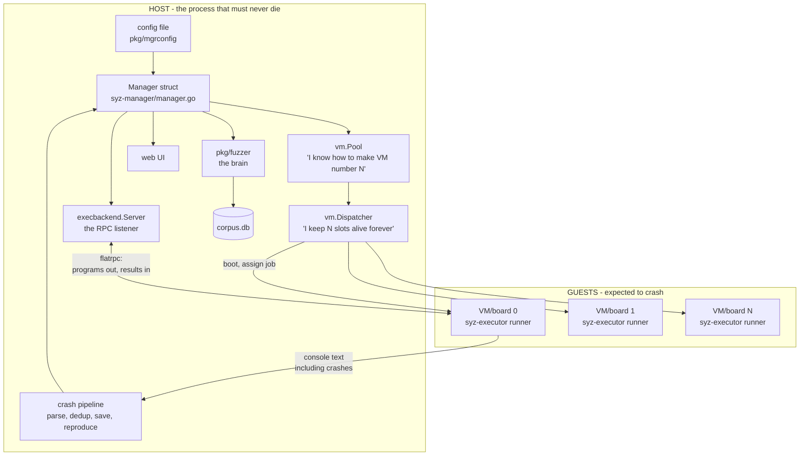

Three separations are doing all the work:

1. **Pool vs Dispatcher.** The *pool* knows how to construct one VM. The *dispatcher* keeps a fixed number of slots perpetually alive, restarting whatever dies. Construction and lifecycle are different problems.
2. **Dispatcher vs RPC server.** The dispatcher boots machines; the RPC server hands out work. They meet only through a per-VM function call.
3. **Structured channel vs console text.** Results arrive over a binary protocol. Crashes arrive as text scraped off a serial port, because a dying kernel cannot do anything better.

---

## 1. Startup, step by step

### 1.1 `main()` — config and mode selection

`syz-manager/manager.go`, `main()`:

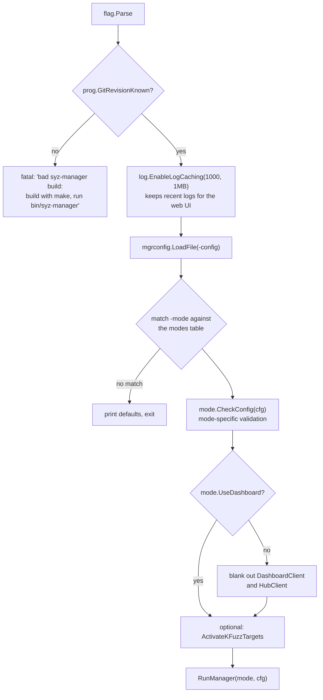

The `GitRevisionKnown` check deserves a note. syz-manager refuses to run if it was built with a bare `go build`, because the git revision is stamped in by the `Makefile` and **the executor inside the VM will refuse to talk to a manager whose revision does not match its own**. Catching that at startup rather than at first VM connection saves a confusing debugging session.

#### The six modes

The same binary is six tools, selected by `-mode` (`manager.go`, the `modes` table):

| Mode | What it does | Dashboard | Loads corpus | Exits when |
|---|---|---|---|---|
| `fuzzing` | the default: fuzz forever | yes | yes | never |
| `smoke-test` | boot VMs, run simple programs, confirm fuzzing is possible at all | no | no | after machine check; non-zero exit on any crash |
| `corpus-triage` | vet the existing corpus and stop | no | yes | when triage finishes |
| `corpus-run` | replay corpus programs continuously | no | yes | never |
| `run-tests` | run `sys/<os>/test/*` as a test suite | no | no | when tests finish |
| `iface-probe` | discover kernel interfaces dynamically, write `workdir/interfaces.json` | no | no | when the probe finishes |

The `Mode` struct is just declarative flags — `UseDashboard`, `LoadCorpus`, `ExitAfterMachineCheck`, `FailOnCrashes`, and an optional `CheckConfig` function. `iface-probe` uses that hook to reject configurations it cannot work with: snapshot mode, any sandbox other than `none`, or coverage disabled.

> **Pattern worth stealing:** express mode differences as *data* in a table, not as branches scattered through the code. Adding a seventh mode means adding a row.

**`smoke-test` is the mode you will use most when bringing up a new target.** It answers "is my kernel built correctly, does my VM config work, can programs run at all?" in a couple of minutes, with a clean exit code and a `workdir/report.json` if the kernel oopsed. Start there, always, before a long fuzzing run.

### 1.2 `RunManager()` — the assembly line

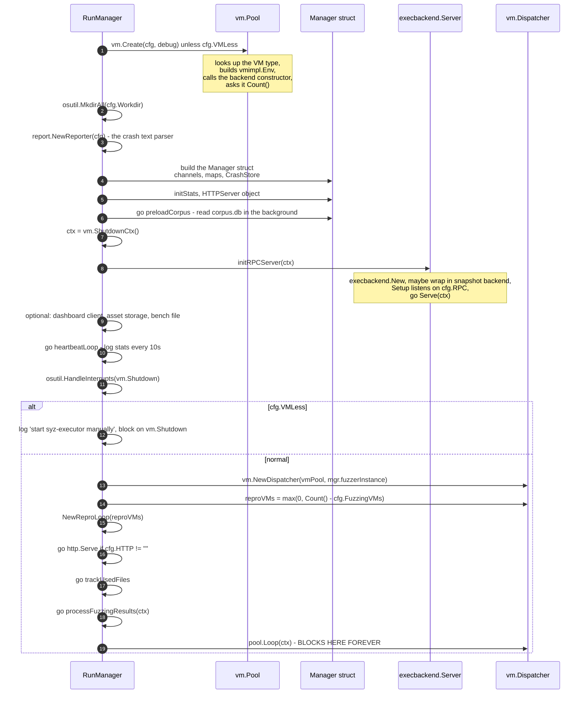

Several details are load-bearing:

**The corpus loads concurrently with the VM boot.** `go mgr.preloadCorpus()` reads and parses `corpus.db` — potentially hundreds of thousands of programs — while VMs are booting, which takes tens of seconds anyway. The result is handed over on the `corpusPreload` channel, and whoever needs it first blocks on `<-mgr.corpusPreload`. Free parallelism from a channel handoff.

**`vm.ShutdownCtx()` is a global stop signal.** There is one package-level `vm.Shutdown` channel; closing it cancels a context that every loop in the program watches. `osutil.HandleInterrupts` wires Ctrl-C to it. One cancellation source, everywhere.

**`trackUsedFiles` is a guardrail against your own mistakes.** Every 30 seconds it stats `syz-executor`, `syz-execprog`, the SSH key, `vmlinux`, and the disk image, comparing modification times against startup. If any changed, it exits with a blunt message: *"don't modify files that syz-manager uses. exiting to prevent harm."* Rebuilding syzkaller while a manager is running used to produce weeks of inexplicable results.

> **Pattern worth stealing:** long-running automation should detect that its own inputs changed underneath it and fail loudly. Silent inconsistency is far more expensive than a crash.

**`reproVMs = max(0, Count() - cfg.FuzzingVMs)`** encodes the fuzz/reproduce tradeoff. If you have 16 machines and set `fuzzing_vms: 12`, then at most 4 can be borrowed for reproduction work. Reproduction is expensive — it reboots a machine over and over — so you cap it.

### 1.3 The phase state machine

The manager is not uniformly busy; it moves through phases, and each unlocks behaviour:

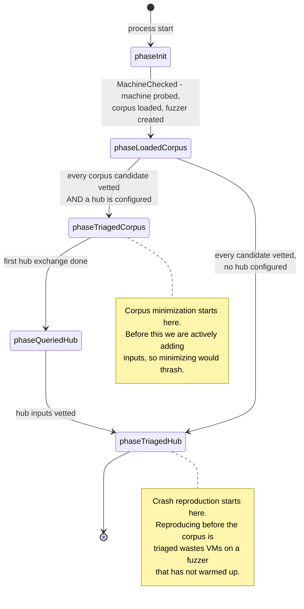

`setPhaseLocked` panics on a repeated transition — a deliberate assertion that the state machine is linear. `NeedRepro` returns false while `phase < phaseLoadedCorpus`.

> **Pattern worth stealing:** a startup *sequence* with explicit phases beats a pile of booleans. Expensive background activities should be gated on "the system has warmed up," and that condition deserves a name.

---

## 2. From config to a running QEMU

### 2.1 Type registration: how the right backend gets picked

*(The five-method `Instance` interface itself, and why a narrow contract was the right call, is in `history-...-design-changes.md` §4.3. Here: how a backend gets selected and constructed.)*

Each VM backend registers itself in an `init()` function (`vm/vmimpl/vmimpl.go`, `Register`):

```go
type Type struct {
    Ctor        ctorFunc
    Overcommit  bool // syz-ci may create more instances than Count()
    Preemptible bool // lost connections are expected, not bugs
}
```

- QEMU: `Overcommit: true` — virtual, make as many as you like.
- GCE: `Overcommit: true, Preemptible: true` — cloud VMs vanish without warning, so a lost connection containing `SYZ-EXECUTOR: PREEMPTED` is translated into `ErrPreempted` rather than reported as a kernel bug.
- `isolated` (bare metal): **neither flag** — there are exactly as many boards as there are boards.

`vm/vm.go` blank-imports every backend package, so importing `vm` populates the registry. `vm.Create` looks up `vmimpl.Types[cfg.Type]`, builds a `vmimpl.Env` (name, OS, arch, workdir, image, SSH key and user, timeouts, snapshot flag, and the **raw JSON** of the `vm` config section), and calls the constructor. The constructor parses that JSON into its own config struct — which is why each VM type documents its own `vm` keys.

Note: **in `-debug` mode the instance count is forced to 1.** Debugging N interleaved VM logs is not a thing anyone wants.

### 2.2 The QEMU boot sequence

`vm/qemu/qemu.go`, `instance.boot()`:

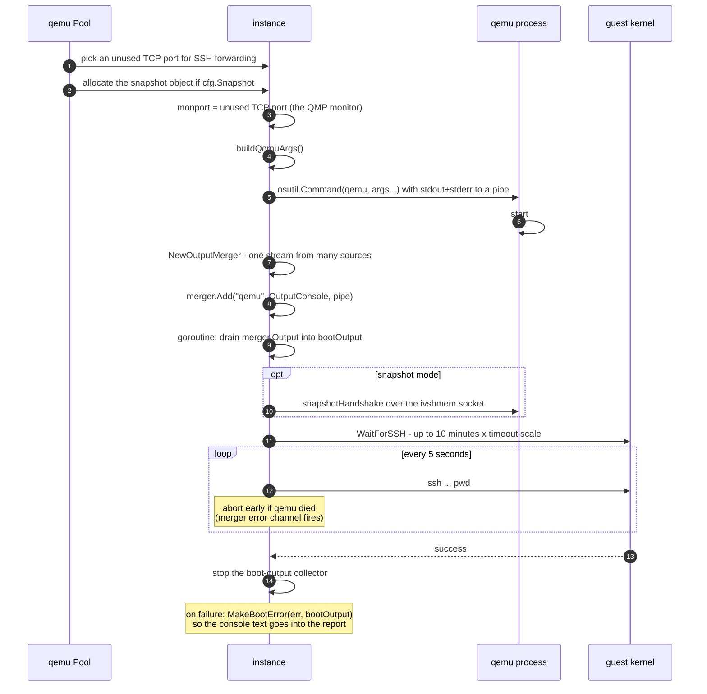

### 2.3 `buildQemuArgs()` — the command line, annotated

Understanding this is the difference between "QEMU doesn't boot" being a mystery and being a five-minute fix. The argument list is assembled in a fixed order:

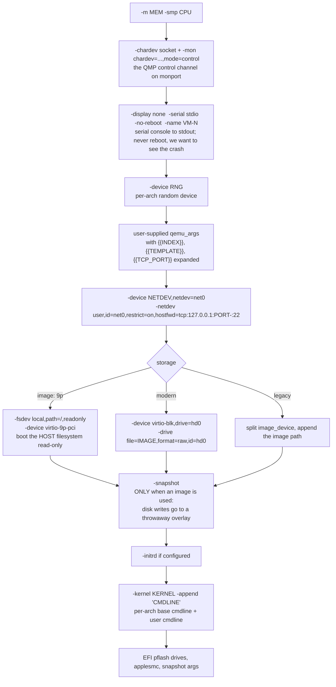

The two lines to internalize:

**`hostfwd=tcp:127.0.0.1:PORT-:22` plus `restrict=on`.** QEMU's user-mode networking forwards a host port to the guest's SSH port, and `restrict=on` prevents the guest from reaching anything else on your network. A fuzzer *will* generate programs that send packets. You do not want those packets leaving your machine.

**`-snapshot`.** Disk writes land in a temporary overlay and are discarded. Default `true` in the QEMU config (`snapshot` key), and distinct from `mgrconfig.Snapshot`, which means *VM-state snapshot fuzzing* — an unfortunate name collision worth remembering.

Also worth knowing: the per-arch defaults live in `archConfigs` and are substantial. `linux/amd64` gets `-enable-kvm -cpu host,migratable=off`, an `e1000` NIC, `virtio-rng-pci`, and cmdline `root=/dev/sda console=ttyS0`. `linux/arm64` gets `-machine virt,virtualization=on,gic-version=max -cpu max,...` and `console=ttyAMA0`. If you are targeting a new architecture, `archConfigs` is the first place to look.

**Resilience detail:** `Pool.Create` wraps the constructor in a retry loop of up to 1000 attempts for transient failures — `"could not set up host forwarding rule"`, `"Device or resource busy"`, `"Address already in use"` — because with 32 VMs starting at once, port races happen. But `ErrCantSSH` returns immediately: that is a kernel that did not boot, which is a *finding*, not a flake.

### 2.4 `Forward()`: how the guest reaches the manager

This is the one piece of plumbing that confuses everyone, so here it is explicitly.

The manager's RPC server listens on the **host**. The executor runs in the **guest** and must dial it. `Forward(port)` returns the address the guest should use — but for QEMU it adds *no* QEMU option at all:

```go
func (inst *instance) Forward(port int) (string, error) {
    ...
    inst.forwardPort = port
    return fmt.Sprintf("localhost:%v", port), nil
}
```

The tunnel is created later, by `Run()`, which passes `forwardPort` to `vmimpl.SSHArgsForward`, which adds **`-R <port>:127.0.0.1:<port>`** — a *reverse* SSH tunnel. So:

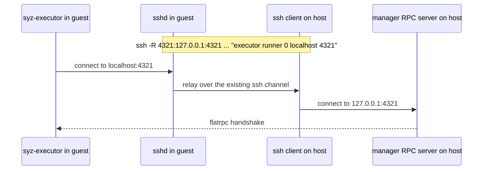

The RPC server never needs a routable address. It can listen on `127.0.0.1` with port `0` (the default `cfg.RPC` is `":0"`, meaning "pick any free port"), and the SSH connection you already needed carries the traffic. One fewer firewall conversation, and it works identically for a QEMU guest and a board across the room.

By contrast, GCE's `Forward` returns a real internal IP — cloud VMs can route to each other, so no tunnel is needed.

> **Pattern worth stealing:** if you already have one authenticated channel to a remote machine, multiplex over it rather than opening a second listening port. SSH reverse tunnels are free and need no firewall changes.

---

## 3. The per-VM lifecycle: dispatcher and `RunRequests`

### 3.1 The dispatcher loop

`vm/dispatcher/pool.go`. `Loop(ctx)` starts **one goroutine per slot**, each of which is simply:

```go
for ctx.Err() == nil {
    p.runInstance(ctx, inst)
}
```

That is the whole restart mechanism. A VM crash, a boot failure, a timeout — all of them are just `runInstance` returning, and the loop goes around again.

```mermaid
sequenceDiagram
    autonumber
    participant L as slot goroutine
    participant P as Pool
    participant C as creator (vm.Pool.Create)
    participant J as job (mgr.fuzzerInstance)

    L->>P: waitUnpaused() - block while a human paused us
    L->>L: status = Booting
    L->>C: creator(ctx, index)
    alt boot failed
        C-->>L: error
        L->>P: reportBootError - push onto the BootErrors channel
        Note over L: return; the outer loop boots again
    end
    C-->>L: instance
    L->>P: BootTime.Save(elapsed)
    L->>L: status = Waiting
    opt slot reserved for reproduction
        L->>L: block until a job arrives, or the slot is released
    end
    L->>L: status = Running
    L->>J: job(ctx, instance, updateInfo)
    J-->>L: returns when the VM crashed or the time budget ran out
    L->>L: deferred: instance.Close(), status = Offline
```

Note `reportBootError`: it first tries a non-blocking send, and if the channel (capacity 16) is full it logs `"WARNING: boot error channel is full!"` and then blocks. If every VM is failing to boot, you get a warning rather than a silent pile-up.

`ReserveForRun(n)` is how the reproduction loop borrows machines: it marks `n` slots as reserved, which *forces those VMs to restart* into a "wait for an explicit job" state. `TogglePause` freezes everything from the web UI. Both are expressed as state transitions on the same slots rather than as separate subsystems.

### 3.2 `RunRequests`: what the per-VM job actually does

`pkg/execbackend/rpc.go`, `rpcBackend.RunRequests(ctx, inst, reporter, updInfo)` — the function the dispatcher calls once per VM boot:

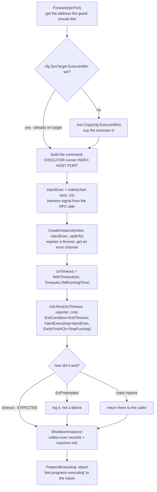

Three things here are the difference between a usable bug report and an unusable one:

**The normal exit is a timeout.** `vm.ExitTimeout` is the *allowed* exit condition: a VM that runs for its full `VMRunningTime` budget and then gets killed is a success. Anything else is suspicious. Inverting the usual "exit 0 means success" convention matches reality — this VM's job was to keep going until we stopped it.

**`injectExec` solves a nasty liveness problem.** The VM monitor declares "no output from test machine" if nothing appears on the console for `NoOutput` seconds. But a healthy fuzzing VM is quiet — results go over the RPC socket, not the console. So the RPC server pokes the `injectExec` channel whenever it sees progress, and the monitor treats that as liveness. Without it, every healthy VM would be reported as hung.

**`PrependExecuting` attaches the smoking gun.** When a crash report comes back, the manager prepends the list of programs that were executing at that moment. That list is what `pkg/repro` later bisects to find the guilty program. Without it, a crash log is just text.

### 3.3 Output monitoring: how a crash is actually noticed

`vm/vm.go`, `monitorExecution()` is one `select` loop over five cases:

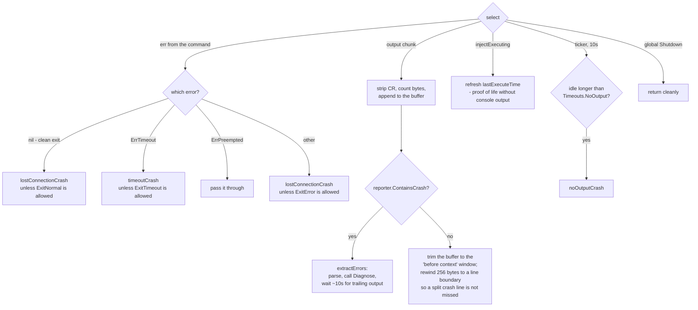

Two details that look paranoid and are not:

- **The 256-byte rewind.** Console output arrives in arbitrary chunks. A crash signature can be split across two chunks. So after trimming the buffer, the scan position rewinds to a line boundary 256 bytes back. Miss this and you drop real bugs.
- **`Diagnose` runs after the crash is detected.** For QEMU on Linux it dumps lockdep state and, for most report types, `info registers` for every vCPU over the QEMU monitor. That extra context is appended after a `VM DIAGNOSIS:` marker. You get it only because the monitor noticed the crash *while the VM was still alive*.

---

## 4. The RPC handshake and the machine check

Before any fuzzing happens, manager and executor negotiate. This is where syzkaller discovers what the kernel in front of it can actually do.

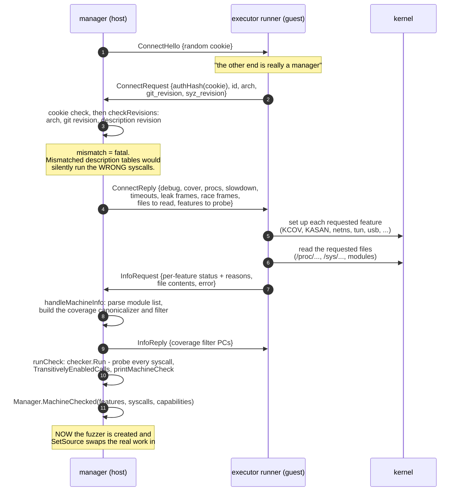

### Why this is clever

**The executor starts out serving probe programs, not fuzzing programs.** The RPC server's work source begins as a `vminfo.Checker` wrapped in a swappable `DynamicSource`. Feature and syscall detection is done by *running little programs through the exact same pipeline* that fuzzing will use. Then `SetSource` atomically swaps the fuzzer in. No separate probing code path, and the probe path is tested every single run.

**`TransitivelyEnabledCalls` reasons about dependencies.** If `openat$foo` does not exist on this kernel, nothing can produce an `fd_foo` resource, so every `ioctl$FOO_*` that needs one is also disabled. The resource graph from the descriptions gives you that transitive closure for free.

**The "machine check" report is your primary debugging tool.** It lists every disabled syscall with a reason, every unreadable file, and every feature with its status. When a new target produces fewer bugs than expected, read it first.

**The revision check uses a content hash.** `syz_revision` is the hash of the compiled description blob (see `syzlang-design.md`). If the manager and executor were built from different trees, syscall indices may have shifted, and the executor would obediently run syscall #412 when the manager meant #411. Comparing hashes at handshake makes that impossible.

---

## 5. Bare metal: the `isolated` backend

This is the section that matters if you work on embedded products. Your target is a board on your desk or in a rack: it has specific hardware, a kernel you built for it, and no hypervisor. You cannot `-snapshot` it, you cannot pick its IP, and if it hangs you may need to cut its power.

### 5.1 What `isolated` assumes

From `vm/isolated/isolated.go` — the entire config:

```go
type Config struct {
    Host          string   `json:"host"`           // host ip addr the DUT can reach
    Targets       []string `json:"targets"`        // (hostname|ip)(:port)? per machine
    TargetDir     string   `json:"target_dir"`     // working dir on the DUT - REQUIRED
    TargetReboot  bool     `json:"target_reboot"`  // reboot the DUT on repair
    USBDevNums    []string `json:"usb_device_num"` // /sys/bus/usb/devices/ for power cycling
    StartupScript string   `json:"startup_script"` // run after each startup
    Pstore        bool     `json:"pstore"`         // fetch crash logs from /sys/fs/pstore
    SystemSSHCfg  bool     `json:"system_ssh_cfg"` // allow ~/.ssh/config
}
```

The assumption set is deliberately minimal: **"I can SSH to this machine, and there is a writable directory on it."** That is all. Registered with neither `Overcommit` nor `Preemptible` — there are exactly `len(Targets)` machines, no more, and a lost connection is a real event.

A working config, from `docs/linux/setup_linux-host_isolated.md`:

```json
{
    "target": "linux/amd64",
    "http": "127.0.0.1:56741",
    "rpc": "127.0.0.1:0",
    "sshkey": "/path/to/optional/sshkey",
    "workdir": "/syzkaller/workdir",
    "kernel_obj": "/linux-next",
    "syzkaller": "/go/src/github.com/google/syzkaller",
    "sandbox": "setuid",
    "type": "isolated",
    "vm": {
        "targets": [ "10.0.0.1" ],
        "pstore": false,
        "target_dir": "/home/user/tmp/syzkaller",
        "target_reboot": false
    }
}
```

Note what is *absent*: no `image`, no `kernel`, no `cmdline`. **The isolated backend never deploys a kernel.** You build and install the kernel on the DUT yourself, with the right options:

```
CONFIG_KCOV=y
CONFIG_DEBUG_INFO=y
CONFIG_KASAN=y
CONFIG_KASAN_INLINE=y
# CONFIG_RANDOMIZE_BASE is not set   <- KASLR off; coverage symbolization works much better
```

`kernel_obj` still points at the build directory on your host, because that is where `vmlinux` lives and symbolization needs it. The DUT runs the kernel; the host interprets its addresses.

### 5.2 QEMU vs isolated, side by side

```mermaid
flowchart TB
    subgraph Q["QEMU - virtual"]
        Q1["Pool.Create: fork a qemu process"]
        Q2["kernel + image supplied by config"]
        Q3["-snapshot: disk resets every boot"]
        Q4["reset = kill and relaunch, ~10s"]
        Q5["console = qemu stdout, always available"]
        Q6["Forward: reverse ssh tunnel to localhost"]
        Q7["Diagnose: lockdep dump + info registers over QMP"]
        Q1-->Q2-->Q3-->Q4-->Q5-->Q6-->Q7
    end
    subgraph I["isolated - physical"]
        I1["Pool.Create: just repair() over ssh"]
        I2["kernel pre-installed by YOU"]
        I3["no snapshot: state persists forever"]
        I4["reset = ssh reboot, or USB power cycle"]
        I5["console = a SECOND ssh running dmesg"]
        I6["Forward: returns cfg.Host:port"]
        I7["Diagnose: read /sys/fs/pstore after reboot"]
        I1-->I2-->I3-->I4-->I5-->I6-->I7
    end
```

### 5.3 `repair()`: bringing a board to a known state

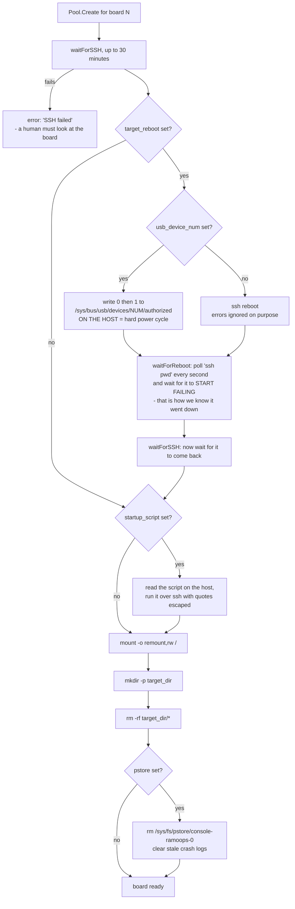

The two-phase reboot detection in `waitForReboot` is the kind of thing you only write after being burned. Naively you would `ssh reboot` and then wait for SSH to work. But SSH keeps working for several seconds *during* shutdown — so you would immediately "succeed," connect to a dying system, and get nonsense. So: **first wait for SSH to fail** (the machine is going down), **then wait for SSH to succeed** (it came back up).

The `usb_device_num` path is the embedded engineer's safety net. When a kernel is wedged hard enough that `reboot` cannot run, writing to `/sys/bus/usb/devices/<num>/authorized` on the *host* de-authorizes and re-authorizes a USB device — typically a USB-controlled relay or a USB-powered board. That is a physical power cycle driven from software, and it is what makes multi-week unattended bare-metal fuzzing possible. Note the validation in `ctor`: if you supply `usb_device_num`, you must supply exactly one per target.

`startup_script` is where you put anything the board needs before each run: loading a module, bringing up an interface, mounting a test filesystem, setting a GPIO.

> **Pattern worth stealing:** for any flaky remote resource, write an explicit `repair()` that drives it to a known state, and escalate: soft retry → soft reboot → hard power cycle → give up loudly. Most "flaky hardware" is really "no recovery ladder."

### 5.4 Getting crash output off a board: `pstore`

On a VM, the serial console is a pipe from the hypervisor and you can read it right up to the moment the kernel dies. On a board you are reading `dmesg` over SSH — and a kernel panic kills the network stack *before* the oops text finishes arriving. You lose exactly the output you needed.

`pstore` fixes this. It is a kernel feature that writes the dying kernel's console output into persistent storage — typically a reserved RAM region that survives a warm reboot (ramoops), sometimes flash — and exposes it after boot as `/sys/fs/pstore/console-ramoops-0`.

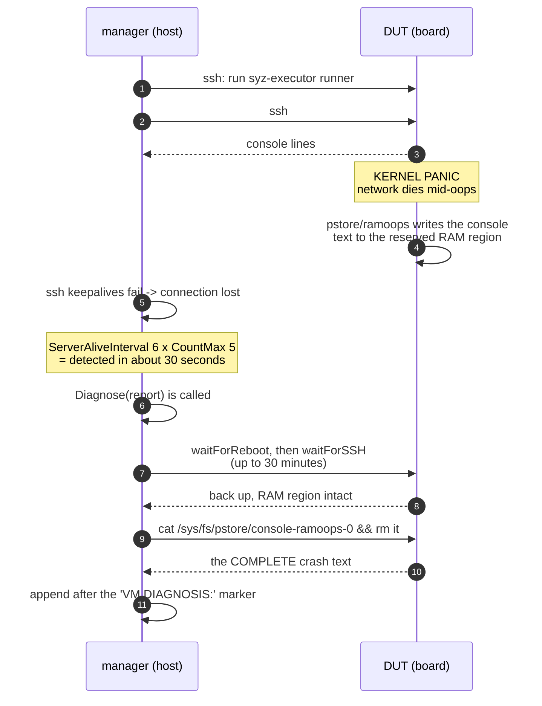

Two implementation details worth copying. First, with `pstore` enabled the SSH console connection adds `-o ServerAliveInterval=6 -o ServerAliveCountMax=5`, so a dead board is detected in about 30 seconds instead of hanging for the TCP timeout. Second, the console comes from a *separate* SSH connection running `dmesg`, which means the merged output stream has three sources — `dmesg` as the console, plus the job's stdout and stderr. If the job connection dies, the console connection may still deliver a few more lines.

> **Pattern worth stealing:** when your failure mode destroys your own observability channel, add a channel that survives the failure. Persistent-RAM logging, a hardware watchdog with a log, a separate management interface — pick one *before* you need it.

### 5.5 Reverse SSH on bare metal

`Forward` returns `cfg.Host + ":" + port`, and the tunnel is again the `-R` flag added by `SSHArgsForward`. For this to work the DUT's `sshd` must allow it:

```
# on the DUT
$ grep Forwarding /etc/ssh/sshd_config
AllowTcpForwarding yes
```

This is the single most common bare-metal setup failure. If `AllowTcpForwarding` is `no`, the executor starts, cannot dial the manager, and you get a timeout with no useful message.

If you cannot use an SSH key at all — some locked-down boards — the documentation suggests multiplexing an existing interactive connection:

```
# ~/.ssh/config on the host
Host *
    ControlMaster auto
    ControlPath ~/.ssh/control:%h:%p:%r
```

Log in once by hand, leave it open, and every `ssh`/`scp` syzkaller runs reuses that authenticated channel. You also need `"system_ssh_cfg": true` in the `vm` section, because by default the SSH helpers pass `-F /dev/null` to ignore your personal config for reproducibility.

### 5.6 What you give up, and what to do about it

| Lost on bare metal | Consequence | Mitigation |
|---|---|---|
| `-snapshot` disk reset | state accumulates: leftover files, mangled network config, filled disks | `startup_script` that resets what matters; a read-only root with a tmpfs overlay; periodic reimaging |
| Fast reset | a reboot is 30s to several minutes, not 10s | `target_reboot: false` when you can get away with it; prefer `sandbox: setuid` or `namespace` so damage is contained |
| Reliable console | panics truncate the oops | `pstore` / ramoops, or a real serial capture device |
| Elastic instance count | `Count() == len(targets)`; no `Overcommit` | more boards, or accept lower throughput |
| Snapshot fuzzing | not available | n/a |
| KASLR-free symbolization by default | coverage maps poorly to source | `# CONFIG_RANDOMIZE_BASE is not set` |

And the compensating advantage, which is the whole reason to do this: **you are fuzzing the real driver, on the real silicon, with the real DMA, the real interrupt timing, and the real vendor BSP code.** A huge fraction of embedded kernel code — the parts most likely to be buggy — simply does not exist under QEMU. No amount of VM fuzzing finds a bug in a camera ISP driver.

### 5.7 A bring-up checklist

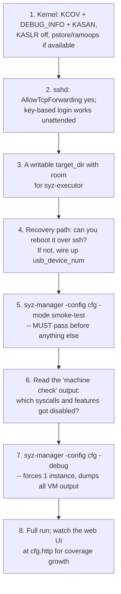

Step 5 is non-negotiable. Step 7 is how you debug step 5 failing: `-debug` forces a single instance and streams everything to the console, which is the only sane way to see why a board is not cooperating.

---

## 6. The crash pipeline

Back on the host, `processFuzzingResults` is a single goroutine consuming three channels:

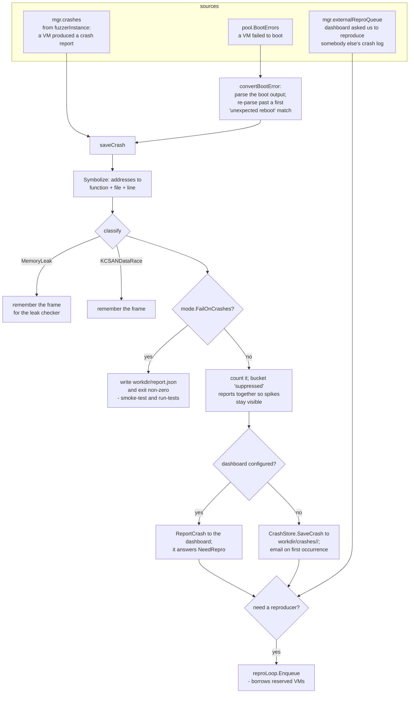

Points worth noticing:

- **Boot errors are crashes too.** A kernel that fails to boot is a bug, and `convertBootError` parses the boot output as a report. The subtlety: it re-parses past a first `UnexpectedReboot` match, because otherwise every boot failure would be titled "unexpected kernel reboot" and they would all deduplicate into one useless bucket.
- **Suppressed reports get one shared bucket.** Rather than dropping known-uninteresting reports silently, they are all retitled `"suppressed report"` and counted. If that counter spikes, something changed and you can see it.
- **Who decides to reproduce varies.** With a dashboard, the dashboard decides (it knows what it has already seen globally). Standalone, `needLocalRepro` checks whether a reproducer already exists for this title and whether the attempt budget is used up.
- **Memory-leak mode is special.** Leak checking is very slow, so when the leak feature is on, the manager does not bother reproducing non-leak crashes on that instance.

---

## 7. Snapshot mode: the two-phase backend

*(Why this exists and what it cost the project is in `history-of-major-feature-additions-and-revolutionary-design-changes.md` §7.6. This section is the orchestration: how the backend is wired and what the dispatcher has to tolerate.)*

When `cfg.Snapshot` is set, the backend is wrapped in a snapshot decorator with a two-phase life:

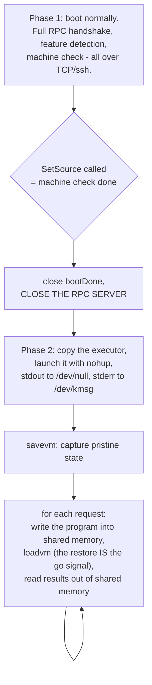

Why the RPC server gets closed: restoring a VM snapshot destroys every network connection, including SSH and the RPC socket. So after the machine check there is nothing to talk to — communication moves to a shared-memory region (QEMU `ivshmem`), and the executor's logging moves to `/dev/kmsg` because its stdout no longer goes anywhere.

One more detail that shows how much care the dispatcher interaction needs: when the request queue is momentarily empty, the snapshot loop **sleeps 10ms and polls again** rather than returning. Returning would end the job, which the dispatcher would interpret as "VM finished" and reboot the machine — throwing away the snapshot. The source comment says exactly this.

> **Pattern worth stealing:** when you optimize a hot path, re-examine every assumption the surrounding framework makes. Here, "the job function returning means the work is done" was true for eleven years and became wrong.

---

## 8. Configuration reference for the paths described above

| Config key | Effect |
|---|---|
| `type` | selects the VM backend: `qemu`, `isolated`, `gce`, `adb`, `none`, ... |
| `vm` | raw JSON handed to that backend's constructor; its keys are backend-specific |
| `http` | web UI address; empty disables the UI entirely |
| `rpc` | RPC listen address; default `":0"` = any free port, which the SSH tunnel then forwards |
| `workdir` | holds `corpus.db`, `crashes/`, and per-instance `instance-N/` directories |
| `procs` | parallel test processes per VM; clamped to the max PID count; forced to 1 under `-debug` |
| `fuzzing_vms` | floor on machines kept for fuzzing; the rest may be borrowed for reproduction |
| `sandbox` / `sandbox_arg` | `none`, `setuid`, `namespace`, `android` — how much the test process is contained |
| `cover` | enable coverage-guided fuzzing; required by `iface-probe` |
| `snapshot` | VM-state snapshot fuzzing (**not** the same as QEMU's `-snapshot` disk flag) |
| `reproduce` | enable automatic reproducer extraction |
| `sshkey` / `ssh_user` | credentials passed into every backend |
| `kernel_obj` | host-side kernel build dir; needed for symbolization even on bare metal |
| `executor_bin_on_target` / `execprog_bin_on_target` | the binaries are pre-installed on the target; skip the copy |

The derived value `VMLess` comes from `type: "none"`. In that mode the manager starts the RPC server and then tells you to launch `syz-executor` yourself — handy for a target that has no automation path at all, and the first stepping stone when porting to new hardware.

---

## 9. Takeaways

1. **Separate "how to build one" from "keep N alive."** `vm.Pool` constructs; `vm.Dispatcher` supervises. One goroutine per slot, `for ctx.Err() == nil { runInstance() }`, and restart becomes a loop iteration instead of a subsystem.
2. **A five-method interface abstracts over everything.** Copy a file, forward a port, run a command, diagnose, close. That contract covers emulators, cloud VMs, phones, and embedded boards.
3. **Multiplex over the channel you already have.** Reverse SSH tunnels mean the manager needs no routable address and no firewall rules, identically for a local VM and a remote board.
4. **Plan for losing your observability channel.** `injectExec` keeps a quiet-but-healthy VM from being declared hung; `pstore` recovers the oops text that the network dropped.
5. **Bare metal needs a recovery ladder.** Soft retry, soft reboot, hard USB power cycle, then fail loudly. Without the bottom rung, unattended hardware fuzzing ends on the first hard hang.
6. **Probe, do not assume.** The machine check runs real programs through the real pipeline to discover what the kernel supports, then prints a report. The same code path serves probing and fuzzing, so it is exercised every run.
7. **Verify build compatibility at the handshake.** Comparing a content hash of the generated description tables turns a whole class of silent index-skew bugs into a clear startup error.

---

## 10. Reading the code yourself

| Question | Start here |
|---|---|
| How does startup work? | `syz-manager/manager.go` → `main`, `RunManager`, `initRPCServer` |
| How is a QEMU command line built? | `vm/qemu/qemu.go` → `archConfigs`, `ctor`, `boot`, `buildQemuArgs` |
| How does bare metal work? | `vm/isolated/isolated.go` → `Config`, `Pool.Create`, `repair`, `Run`, `Diagnose` |
| How are VMs supervised? | `vm/dispatcher/pool.go` → `Loop`, `runInstance`, `ReserveForRun`, `TogglePause` |
| How is a crash detected? | `vm/vm.go` → `monitorExecution`, `appendOutput`, `extractErrors` |
| What is the RPC protocol? | `pkg/flatrpc/flatrpc.fbs`, then `pkg/rpcserver/rpcserver.go` and `runner.go` |
| What happens per VM boot? | `pkg/execbackend/rpc.go` → `RunRequests` |
| How are SSH commands built? | `vm/vmimpl/util.go` → `sshArgs`, `SSHArgsForward`, `WaitForSSH`, `SCP` |
| What config keys exist? | `pkg/mgrconfig/config.go`, with defaults in `load.go` |
