# syzkaller vs. LLVM libFuzzer: a component-by-component comparison

> **Who this is for.** You have read the other chapters and you understand roughly how syzkaller works. Now you want to know how it relates to *the* coverage-guided fuzzer most people meet first — LLVM's libFuzzer. Which parts are the same idea wearing different clothes? Which parts exist in one and are simply absent from the other, and why?
>
> This matters practically. If you are building your own fuzzer (see the two-part `rust-clone-lab-userspace.md` → `rust-clone-lab.md`), the answer tells you which of syzkaller's 28 core components are *inherent to coverage-guided fuzzing* and which are *the price of fuzzing a kernel*. The first group you must build. The second group you may be able to skip.
>
> **Sources.** Everything about libFuzzer here is read out of `compiler-rt/lib/fuzzer/` and `llvm/docs/LibFuzzer.md` in a local LLVM checkout, with file and function names given so you can check. Everything about syzkaller is read out of this repository.

---

## 0. The 60-second answer

Both tools run the same loop:

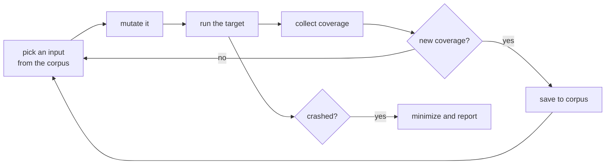

That loop is where they agree, and the agreement is deep — both independently arrived at corpus weighting by feature rarity, at comparison-operand harvesting, at set-cover corpus minimization, and at a "focus" mechanism for concentrating on one function. Those convergences are the strongest evidence available that these are the *right* ideas, not accidents of one codebase.

Everything else differs, and all of the differences trace back to a single pair of facts:

| | libFuzzer | syzkaller |
|---|---|---|
| The input is | a flat array of bytes | a *program*: a sequence of typed syscalls with dependencies between them |
| The target lives | in the same process as the fuzzer | in a separate kernel, in a VM you expect to destroy |

Read the libFuzzer documentation's own list of situations where it is the wrong tool (`LibFuzzer.md`, FAQ "When libFuzzer is not a good solution for a problem?"):

> * If the test inputs are validated by the target library and the validator asserts/crashes on invalid inputs, in-process fuzzing is not applicable.
> * Bugs in the target library may accumulate without being detected.
> * It is harder to protect the in-process fuzzer from excessive memory consumption and infinite loops in the target library.
> * The target library should not have significant global state that is not reset between the runs.
> * Many interesting target libraries are not designed in a way that supports the in-process fuzzer interface (e.g. require a file path instead of a byte array).
> * If the target library runs persistent threads (that outlive execution of one test) the fuzzing results will be unreliable.

Every single bullet describes an operating system kernel. A kernel rejects invalid input by design, accumulates corrupted state silently, cannot be protected from itself by the thing running inside it, *is* global state, takes file descriptors rather than byte arrays, and runs persistent kernel threads by definition.

**syzkaller is not a better libFuzzer. It is what the loop above turns into when every one of libFuzzer's preconditions is false.**

### Status note

`LibFuzzer.md` opens with a disclaimer worth knowing:

> The original authors of libFuzzer have stopped active work on it and switched to working on another fuzzing engine, Centipede. LibFuzzer is still fully supported in that important bugs will get fixed. However, please do not expect major new features or code reviews, other than for bug fixes.

So this is a comparison against a stable, mature, maintenance-mode design — which actually makes it a better teaching object. Nothing here is going to shift under you.

---

## 1. Vocabulary bridge

The two projects use different words for the same things. This table is the decoder; the rest of the chapter assumes it.

| libFuzzer word | syzkaller word | What it is |
|---|---|---|
| **unit** / **input** | **program** (`prog.Prog`) | one thing you feed the target |
| `LLVMFuzzerTestOneInput` | **executor** | the code that actually runs the target |
| **feature** (`ft:`) | **signal** | the prioritized, derived feedback the engine optimizes |
| **coverage** (`cov:`) | **coverage** / raw PCs | the raw set of code locations reached |
| **corpus** | **corpus** | same word, same meaning |
| **InputInfo** | corpus `Item` | one corpus entry plus its bookkeeping |
| **energy** (entropic power schedule) | corpus **weight** / priority | how often this entry gets chosen |
| **TORC** (table of recent compares) | **hints** | comparison operands harvested from the target |
| **dictionary** | — (roughly: `const` values in syzlang) | interesting byte sequences to splice in |
| **focus function** | **focus area** | concentrate effort on one part of the code |
| `-merge=1` | corpus **minimization** | shrink a corpus without losing coverage |
| `-minimize_crash` | **reproducer minimization** (`pkg/repro`) | shrink a crashing input |
| `-fork=N` | **VM pool** (`vm/dispatcher`) | survive crashes by isolating execution |
| **artifact** (`crash-<sha1>`) | **reproducer** (`repro.syz` + C program) | the deliverable you hand a developer |

---

## 2. The two architectures, side by side

The single most important structural difference is where the boundary between "fuzzer" and "target" falls.

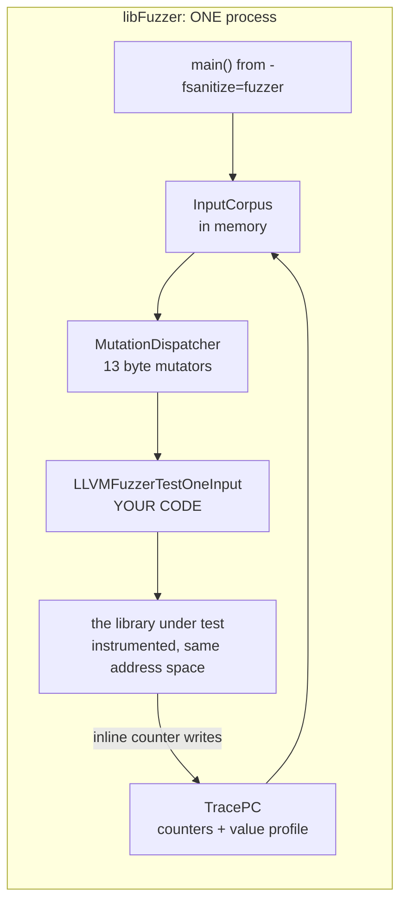

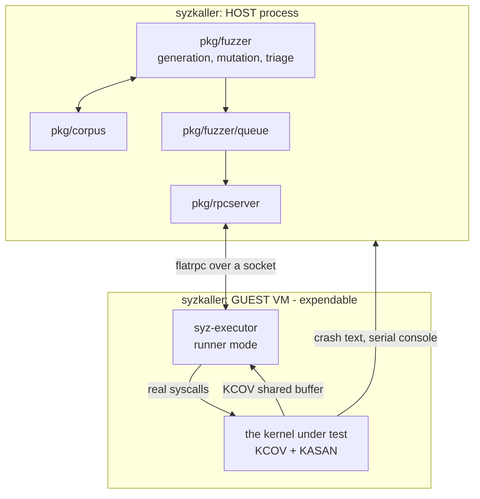

Three consequences fall straight out of those pictures.

**A crash means something completely different.** In libFuzzer, a crash is the *end of the campaign*: `Fuzzer::CrashCallback` (`FuzzerLoop.cpp:226`) prints a stack trace, writes the input to `crash-<sha1>`, and calls `_Exit(Options.ErrorExitCode)` with the comment `// Stop right now.` In syzkaller, a crash is an ordinary event — the VM dies, the dispatcher boots a new one, in-flight requests get re-queued, and the loop keeps running for another year.

**libFuzzer has no transport, and therefore no transport problems.** There is no serialization, no wire schema, no handshake, no revision check, no shared-memory arena, no copyin instruction stream. The fuzzer passes a `uint8_t*` to a function. Roughly a third of syzkaller's core components exist *only* because that pointer has to cross a machine boundary.

**libFuzzer's feedback is a pointer dereference; syzkaller's is an ioctl plus a buffer read.** Instrumentation writes directly into counter arrays in the fuzzer's own address space. syzkaller has to ask the kernel to start recording, read a shared buffer, and ship the result back.

> **Takeaway:** when you compare two systems, find the boundary first. Almost every difference in component count between these two projects is a consequence of one being in-process and the other being cross-machine.

---

## 3. The compatibility matrix

This is the centerpiece. It walks syzkaller's core components — the same list used in `history-of-major-feature-additions-and-revolutionary-design-changes.md` §11 — and asks what libFuzzer has in its place.

Verdicts:

- **SAME** — the same idea, implemented differently. Portable knowledge.
- **CONVERGENT** — invented independently on both sides, which is why it is worth trusting.
- **ANALOGOUS** — comparable role, but the difference in kind matters.
- **ABSENT (by design)** — libFuzzer does not need it, because of its preconditions.
- **ABSENT (gap)** — libFuzzer does not have it and arguably suffers for it.
- **N/A** — meaningless in libFuzzer's model.

| syzkaller core component | libFuzzer counterpart | Verdict |
|---|---|---|
| Descriptions / syzlang | none; optional `LLVMFuzzerCustomMutator` and hand-written harness | **ABSENT (by design)** |
| Program model (`Prog`/`Call`/`Arg`) | `Unit` = `std::vector<uint8_t>` | **ANALOGOUS** — different in kind (§4) |
| Resources and ordering | none | **ABSENT (by design)** |
| Arena / fixed memory layout | none — pointers are the harness's problem | **N/A** |
| Copyin instruction stream | none — the input *is* the bytes | **N/A** |
| Executor | `LLVMFuzzerTestOneInput` + `Fuzzer::ExecuteCallback` | **ANALOGOUS** — in-process (§8) |
| Pseudo-syscalls | none | **ABSENT (by design)** |
| Sandboxes | none | **ABSENT (by design)** |
| KCOV / coverage collection | SanitizerCoverage inline 8-bit counters + PC tables | **SAME** (§5) |
| PC adjustment per architecture | `TracePC::GetNextInstructionPc` | **CONVERGENT** (§5.4) |
| Signal (prioritized feedback) | features, `TracePC::CollectFeatures` | **SAME**, and libFuzzer's is richer (§6) |
| Per-call coverage bracket | per-*input* `TPC.ResetMaps()` | **ANALOGOUS** — granularity differs (§6.3) |
| Corpus storage | `InputCorpus` + a directory of hash-named files | **SAME** (§9) |
| Corpus weighting | entropic power schedule, `InputInfo::UpdateEnergy` | **CONVERGENT** (§9.2) |
| Choice table (call-to-call priority) | none — there is no notion of a call sequence | **ABSENT (by design)** |
| Generation from nothing | none — needs seeds; starts from a 1-byte input | **ABSENT (by design)** (§7.3) |
| Mutation operators | 13 byte-level mutators, `FuzzerMutate.cpp` | **ANALOGOUS** — different alphabet (§7) |
| Mutation weighting | **uniform random** choice among mutators | **ABSENT (gap)** (§7.2) |
| Hints (`KCOV_TRACE_CMP`) | TORC4/TORC8/TORCW + value profile + auto-dictionary | **CONVERGENT** (§10) |
| Corpus minimization | `-merge=1`, `-merge_inner=2` set-cover, `-reduce_inputs` | **CONVERGENT** (§11) |
| Reproducer minimization | `-minimize_crash=1` | **SAME** (§11.3) |
| Triage / deflaking | none — determinism is a stated *requirement* | **ABSENT (by design)** (§12) |
| Queue layers | none | **ABSENT (by design)** |
| Wire protocol (flatrpc) | none | **N/A** |
| Machine check / feature detection | `TracePC::PrintModuleInfo` checks table consistency only | **ABSENT (by design)** |
| VM abstraction | none; `-fork=N` spawns processes | **ANALOGOUS** — much weaker (§8.2) |
| VM lifecycle / dispatcher | `-jobs`/`-workers` process supervision, `FuzzerFork.cpp` | **ANALOGOUS** (§8.2) |
| Crash detection | POSIX signal handlers + sanitizer reports | **ANALOGOUS** — far simpler (§13) |
| Crash report parsing (`pkg/report`) | none — the sanitizer formats the report | **ABSENT (by design)** (§13) |
| Deduplication by report title | none — artifacts are deduped by input hash only | **ABSENT (gap)** (§13.2) |
| C reproducer generation | the artifact file *is* the reproducer | **ANALOGOUS** — libFuzzer's is better (§14) |
| Bug oracles | ASAN / MSAN / UBSAN / LSAN | **SAME** (§13.3) |
| Focus areas | `TracePC::SetFocusFunction` + data-flow trace | **CONVERGENT** (§15) |
| Snapshot / determinism mode | none needed — the process is reset by construction | **ABSENT (by design)** |
| Description automation | none | **ABSENT (by design)** |

Counting: of syzkaller's components, roughly a third are **SAME or CONVERGENT** (the fuzzing core), a third are **ABSENT by design** (the cost of structured input and of a hostile target), and a third are **N/A or weak analogues** (the cost of crossing a machine boundary).

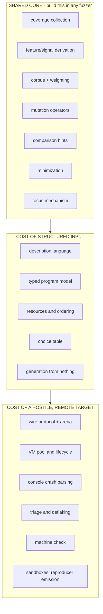

> **Takeaway for your own project:** the left box is mandatory, the middle box is optional and expensive, the right box is only needed if your target can take the fuzzer down with it. The two-part lab is built on exactly this split: Part 1 builds the left and middle boxes against a userspace target, Part 2 adds the right box, buying most of it from virtme-ng.

---

## 4. The input: bytes versus a typed program

This is the root difference, so it comes first.

libFuzzer's input type is in its entrypoint signature, which never changes:

```cpp
extern "C" int LLVMFuzzerTestOneInput(const uint8_t *Data, size_t Size);
```

That is the whole contract. The engine knows nothing about what the bytes mean. syzkaller's input, by contrast, is a tree of typed objects compiled from a declarative description, which the engine understands well enough to mutate one field without invalidating its neighbours.

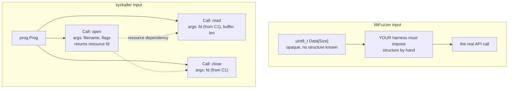

### 4.1 Who pays the structure cost

Both tools must bridge "random bytes" to "a valid API call." They put the bridge in different places, and this is the single most useful thing to understand about the comparison.

| | libFuzzer | syzkaller |
|---|---|---|
| Where structure lives | in **your harness**, as C++ code | in **the engine**, driven by `.txt` descriptions |
| Who writes it | the person fuzzing this one library | contributors, once, shared by everyone |
| Who can extend it | someone who can write C++ and rebuild | someone who can edit a text file |
| Cost of a mistake | silently wasted executions | a compile error with a line number (`pkg/compiler`) |
| Mutation awareness | the mutator does not know the structure | the mutator knows every field's type |

libFuzzer's answer to structured inputs is the custom-mutator escape hatch — `LLVMFuzzerCustomMutator`, registered in `MutationDispatcher::ConfigureMutators` and documented under "User-supplied mutators", which points at Google's *Structure-Aware Fuzzing* guide. Note what happens when you use it (`FuzzerMutate.cpp`):

```cpp
if (EF->LLVMFuzzerCustomMutator)
  Mutators.push_back({&MutationDispatcher::Mutate_Custom, "Custom"});
else
  Mutators = DefaultMutators;
```

Supplying a custom mutator **replaces** the entire default mutator set with your single function. libFuzzer does not try to blend structured and unstructured mutation; it hands you the wheel. syzkaller's equivalent decision point is `prog/any.go` squashing (`history...md` §6.2), which goes the *other* direction: it takes a structured argument and deliberately degrades it to opaque bytes so byte-level mutation can reach encodings the description does not cover.

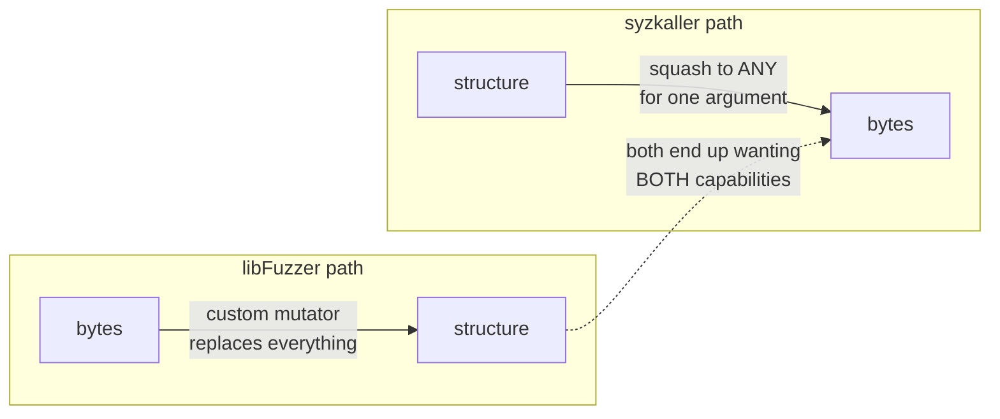

Each project started at one end and built a bridge to the other. Neither bridge is symmetric: libFuzzer's is all-or-nothing per target, syzkaller's is per-argument and reversible.

> **Takeaway:** "structured or unstructured mutation" is a false choice, and both projects discovered it. If you build a fuzzer for a typed interface, plan for a per-field escape hatch to raw bytes from the beginning — it is much harder to add later than to design in.

### 4.2 What the engine can do with structure

Concretely, here is what syzkaller's engine can do that libFuzzer's cannot, purely because it knows the type of what it is holding:

- **Honour dependencies.** `read` needs the `fd` that `open` returned. syzkaller tracks it as a resource; libFuzzer has no concept of one call's output being another's input.
- **Mutate within a domain.** A `flags[open_flags]` argument is mutated by picking a different valid flag combination, not by flipping a random bit in a 64-bit word.
- **Keep lengths consistent.** `len[buf]` is recomputed when `buf` changes. In libFuzzer, a length field and its buffer are just bytes that drift out of agreement.
- **Insert and remove whole calls.** `InsertWeight` and `RemoveCallWeight` in `prog/mutation.go` operate on the *sequence*. libFuzzer's nearest equivalents, `InsertRepeatedBytes` and `EraseBytes`, are unaware they might be cutting a record in half.
- **Serialize to something human-readable.** A syzkaller program round-trips to text a person can read and edit; a libFuzzer unit is a blob of bytes you inspect with `xxd`.

The price is the entire middle box of §3's diagram: a language, a compiler, a type system, a resource graph, and a choice table.

---

## 5. Coverage collection: KCOV versus SanitizerCoverage

This is where the two are most **SAME** — same concept, same granularity, different plumbing.

### 5.1 How libFuzzer gets coverage

Instrumentation added by `-fsanitize=fuzzer` registers two tables at startup, in `FuzzerTracePC.cpp`:

```cpp
void __sanitizer_cov_8bit_counters_init(uint8_t *Start, uint8_t *Stop) {
  fuzzer::TPC.HandleInline8bitCountersInit(Start, Stop);
}

void __sanitizer_cov_pcs_init(const uintptr_t *pcs_beg, const uintptr_t *pcs_end) {
  fuzzer::TPC.HandlePCsInit(pcs_beg, pcs_end);
}
```

- **An inline 8-bit counter array.** One byte per instrumented edge. The compiler emits a direct increment at each edge — no function call, no bounds check. This is why libFuzzer is fast.
- **A PC table.** One `PCTableEntry {uintptr_t PC, PCFlags}` per counter, so the engine can map counter index back to a code address, and so it can tell whether an entry is a function entry point (`PcIsFuncEntry` tests `PCFlags & 1`).

`HandleInline8bitCountersInit` does something subtle worth noticing: it splits each module's counter array into **page-aligned regions** (`Module::Region`), each with an `Enabled` flag. That makes it possible to disable coverage for whole pages at a time and to `memset` a page cheaply — the mechanism behind `ClearInlineCounters`:

```cpp
void TracePC::ClearInlineCounters() {
  IterateCounterRegions([](const Module::Region &R){
    if (R.Enabled)
      memset(R.Start, 0, R.Stop - R.Start);
  });
}
```

There is also a consistency check in `PrintModuleInfo` that is pure operational wisdom:

```
ERROR: The size of coverage PC tables does not match the
number of instrumented PCs. This might be a compiler bug...
(tl;dr: don't use the old GNU ld)
```

A mismatch between the counter count and the PC-table count means every index is skewed, and every coverage report would be silently wrong. libFuzzer refuses to run. Compare syzkaller's `SYZ_REVISION` handshake (`history...md` §8.1): a different mechanism solving the identical class of problem — **silent index skew between two generated tables.** Both projects decided it was worth a startup check rather than a baffling bug report.

One more thing in this file is a lesson in itself. Its header comment still says:

```
// This module implements __sanitizer_cov_trace_pc_guard[_init],
// the callback required for -fsanitize-coverage=trace-pc-guard instrumentation.
```

But the actual definitions at the bottom of the file now do this:

```cpp
void __sanitizer_cov_trace_pc_guard(uint32_t *Guard) {
  fuzzer::WarnAboutDeprecatedInstrumentation(
      "-fsanitize-coverage=trace-pc-guard");
}
```

and `WarnAboutDeprecatedInstrumentation` prints *"is no longer supported by libFuzzer"* and calls `exit(1)`. The older guard-based and `trace-pc` instrumentation modes were removed in favour of inline 8-bit counters; the symbols survive only to produce a clear error instead of silently collecting nothing. The file-level comment was never updated. Read the definitions, not the header.

### 5.2 How syzkaller gets coverage

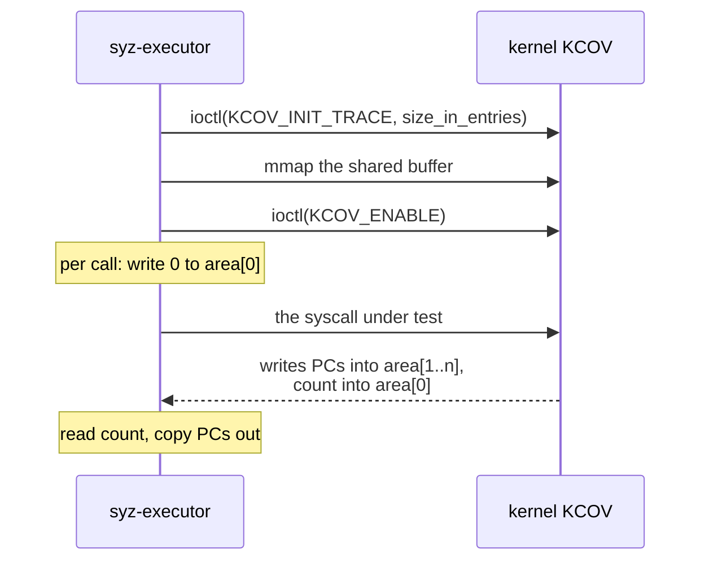

The protocol is a shared buffer whose first word is a count (`executor/executor_linux.h`): reset is `*(uint64*)cov->data = 0`, and reading back is `cov->size = *(cover_data_t*)cov->data`. Note `KCOV_INIT_TRACE` takes a number of *entries*, not bytes — an easy thing to get wrong when reimplementing.

### 5.3 Side by side

| | libFuzzer | syzkaller |
|---|---|---|
| Instrumented by | `-fsanitize=fuzzer` (clang) | `CONFIG_KCOV` (kernel build) |
| Data shape | one byte per edge, **hit counts** | array of PCs, **ordered, with a count** |
| Where the buffer lives | the fuzzer's own address space | shared mmap between kernel and executor |
| Cost per edge | one inline increment | one inline store plus a bounds check in the kernel |
| Reset | `memset` the counter pages | one store to `area[0]` |
| Overflow | impossible (counters saturate per byte) | possible; detected via `cov->data_end` |
| Granularity of a reset | per **input** | per **syscall** (§6.3) |

The hit-count-versus-PC-list difference is the one with real consequences, and §6 is about it.

### 5.4 A convergent detail: fixing up the PC

Both projects discovered that the PC the instrumentation gives you is not the PC you want to symbolize, and both have a per-architecture table for it. libFuzzer, in `FuzzerTracePC.cpp`:

```cpp
ALWAYS_INLINE uintptr_t TracePC::GetNextInstructionPc(uintptr_t PC) {
#if defined(__mips__)
  return PC + 8;
#elif defined(__powerpc__) || defined(__sparc__) || defined(__arm__) ||        \
    defined(__aarch64__) || defined(__loongarch__)
  return PC + 4;
#else
  return PC + 1;
#endif
}
```

syzkaller, in `pkg/cover/backend/pc.go`, has `PreviousInstructionPC` and `NextInstructionPC` with the same shape of table: 5 for amd64/386, 4 for arm64/arm/ppc64le/riscv64/loong64, 6 for s390x, 8 for mips64le, 0 for gVisor.

Two independent projects, the same per-architecture fudge factor, pointing in opposite directions — libFuzzer adjusts *forward* from a call site, syzkaller rewinds *backward* from a return address. If you implement coverage yourself, this is a bug you are guaranteed to hit, and now you know it is normal.

> **Takeaway:** an inline counter array in your own address space is the fastest possible feedback channel, and it is available to you whenever you control the build of the target. The moment the target is a separate privilege domain, you need a shared buffer and an explicit protocol — and that protocol is where reimplementations go wrong.

---

## 6. Features versus signal: the most instructive difference

Both engines refuse to optimize raw coverage directly. Both derive something from it. What they derive is different, and here libFuzzer is the more sophisticated of the two.

### 6.1 What libFuzzer counts as a feature

`TracePC::CollectFeatures` in `FuzzerTracePC.h` is the heart of libFuzzer's feedback, and it folds **four distinct signal sources** into one flat 32-bit feature space:

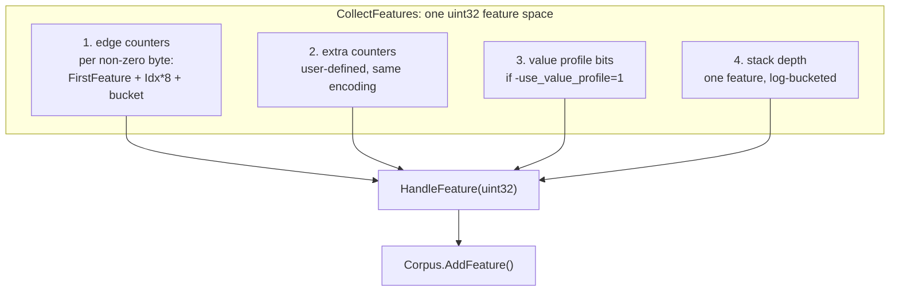

The part to study is the **counter bucketing**, which is where hit counts become features:

```cpp
// Counter bucket: [1] [2] [3] [4-7] [8-15] [16-31] [32-127] [128+]
// Feature number:  0   1   2    3     4       5       6       7
//
// This is a heuristic taken from AFL
```

So an edge executed once, twice, three times, five times and two hundred times are **five different features**. Reaching a loop body is distinct from reaching it twice, and from reaching it a hundred times. That is how libFuzzer notices "this input made the parser loop much deeper" even when no new code was reached — and `use_counters` is on by default (`FuzzerFlags.def:109`).

The stack-depth feature is similar in spirit: `__sancov_lowest_stack` is tracked by `-fsanitize-coverage=stack-depth`, and `CollectFeatures` turns the maximum stack offset into one feature via a step function that "grows similar to 8 * Log_2(A)". Deeper recursion on the same code path is new information.

### 6.2 What syzkaller counts as signal

syzkaller's signal is a set of PCs, with one priority dimension layered on top: feedback from a syscall that **succeeded** outranks feedback from one that failed (`04cbdbd1a`, 2018 — `history...md` §6.1). The reasoning is specific to syscalls: a call returning `EINVAL` mostly exercises argument validation, and thousands of different invalid inputs rediscover the same rejection paths.

There is no hit-count bucketing. An edge hit once and an edge hit a thousand times produce the same signal.

### 6.3 The granularity difference

This one is easy to miss and it matters.

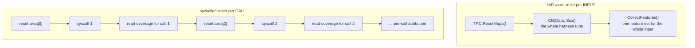

`Fuzzer::ExecuteCallback` (`FuzzerLoop.cpp:597`) calls `TPC.ResetMaps()` once, immediately before `CB(DataCopy, Size)`. Everything the harness does is attributed to the input as a whole.

syzkaller drains coverage **per syscall**, which is what makes it possible to say "call 3 of 8 is the one that reached the new code," and therefore to minimize a program by deleting the calls that contributed nothing. libFuzzer's equivalent operation — `-reduce_inputs` — can only shrink bytes and check whether the whole feature set survived.

Per-call attribution is not free: it costs a reset and a buffer read per syscall instead of per program. syzkaller pays it because programs are short (a handful of calls) and syscalls are expensive anyway.

### 6.4 What each could take from the other

**syzkaller could adopt counter buckets.** Nothing about hit-count bucketing depends on being in-process; KCOV's `KCOV_TRACE_PC` mode reports a PC list rather than counts, but a count per PC is derivable by tallying duplicates in the list. A loop that runs 3 times versus 300 times is currently invisible to syzkaller's signal.

**libFuzzer could adopt per-call attribution** — but cannot, because it has no concept of "calls" inside an input. The structure that makes the attribution possible is exactly the structure libFuzzer declines to model.

> **Takeaway:** "coverage-guided" undersells what both engines do. The useful question is *what counts as new*, and the answers available to you include: a new edge, a new hit-count bucket for a known edge, a new comparison-operand distance, a new stack depth, and a new per-call attribution. Each one is a different definition of progress, and each costs something different to collect.

---

## 7. Mutation: 13 byte operators versus 5 program operators

### 7.1 The two operator sets

libFuzzer's default set, from `MutationDispatcher::ConfigureMutators` in `FuzzerMutate.cpp`:

| Mutator | What it does |
|---|---|
| `EraseBytes` | delete a span |
| `InsertByte` | insert one byte |
| `InsertRepeatedBytes` | insert a run of one byte |
| `ChangeByte` | overwrite one byte |
| `ChangeBit` | flip one bit |
| `ShuffleBytes` | permute a span |
| `ChangeASCIIInt` | find an ASCII integer, change it arithmetically |
| `ChangeBinaryInteger` | find a binary integer, change it arithmetically |
| `CopyPart` | copy a span within the input |
| `CrossOver` | splice in bytes from another corpus input |
| `ManualDict` | insert a token from the user's `-dict` file |
| `PersAutoDict` | insert a token from the auto-learned dictionary |
| `CMP` | insert an operand harvested from a comparison (only if `UseCmp`) |

syzkaller's set, from `prog/mutation.go`:

| Mutator | Weight |
|---|---|
| `Splice` — graft calls from another corpus program | 200 |
| `InsertCall` — add a new call, chosen via the choice table | 100 |
| `MutateArg` — change an argument, type-aware | 100 |
| `Squash` — degrade a structured argument to opaque bytes | 50 |
| `RemoveCall` — delete a call | 10 |

Notice the shape of the difference. Ten of libFuzzer's thirteen operate on *bytes within one input*; syzkaller's two biggest-weight operators (`Splice` at 200 and `InsertCall` at 100, 65% of the 460-point total) operate on the *sequence of calls*. The alphabets are different because the inputs are different in kind. Only three of libFuzzer's mutators have a real syzkaller counterpart: `CrossOver` ≈ `Splice`, `CMP` ≈ hints, and `ChangeBinaryInteger` ≈ part of `MutateArg`.

### 7.2 A real asymmetry: weighted versus uniform

syzkaller's `mutate` picks an operator from a weighted distribution totalling 460. libFuzzer picks uniformly (`FuzzerMutate.cpp:541`):

```cpp
for (int Iter = 0; Iter < 100; Iter++) {
  auto M = Mutators[Rand(Mutators.size())];
  size_t NewSize = (this->*(M.Fn))(Data, Size, MaxSize);
  if (NewSize && NewSize <= MaxSize) {
    ...
    return NewSize;
  }
}
*Data = ' ';
return 1;   // Fallback, should not happen frequently.
```

Every mutator is equally likely. The retry loop is the only adaptivity: a mutator that cannot apply (for example `InsertByte` when `Size == MaxSize`) returns 0 and another is drawn, up to 100 times.

Is uniform worse? Honestly, unproven — and syzkaller's own `prog/prio.go` carries the admission *"the current implementation is very basic, there is no theory behind any constants."* Neither project has a principled derivation. But libFuzzer does record which mutators led somewhere: `MutationDispatcher::RecordSuccessfulMutationSequence` is called from `ReportNewCoverage`, and `MS: 2 CopyPart-ChangeByte-` appears in the output on every `NEW` line. The data to weight the distribution is collected and printed; it is just never fed back into the choice.

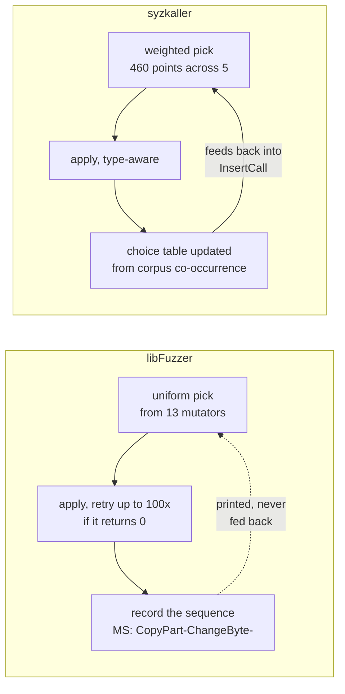

syzkaller has one genuine feedback loop here, and it is not on the operator choice either — it is on *which call to insert*, via the choice table's dynamic component (`2*sqrt(count)` damping on corpus co-occurrence, `prog/prio.go`).

### 7.3 Stacking, and the cold start

libFuzzer stacks mutations: `mutate_depth` defaults to 5 (`FuzzerFlags.def:42`), and `Fuzzer::MutateAndTestOne` (`FuzzerLoop.cpp:727`) applies up to that many in sequence, re-running the target after each one and breaking early on new coverage:

```cpp
for (int i = 0; i < Options.MutateDepth; i++) {
  ...
  NewSize = MD.Mutate(CurrentUnitData, Size, CurrentMaxMutationLen);
  ...
  bool NewCov = RunOne(CurrentUnitData, Size, true, &II, false, &FoundUniqFeatures);
  if (NewCov) {
    ReportNewCoverage(&II, {...});
    break;  // We will mutate this input more in the next rounds.
  }
}
```

syzkaller stacks too, via `ExpectedIterations: 5` and `MutateArgCount: 3`. Same number, arrived at separately.

The cold start is where they diverge sharply. **libFuzzer cannot generate an input from nothing.** With no corpus it starts from a single byte and bit-flips its way forward — the documentation is blunt about it: *"LibFuzzer will work without any initial seeds, but will be less efficient if the library under test accepts complex, structured inputs."* The `-len_control=100` flag (grow the length limit slowly over time) exists to make that climb survivable.

syzkaller *generates* from the descriptions. A fresh syzkaller with an empty corpus still produces valid `open`/`read`/`close` sequences on iteration one. That is the payoff for the whole middle box of §3.

> **Takeaway:** seed corpora matter enormously for byte-oriented fuzzers and much less for model-driven ones. If you are choosing between the two approaches, ask whether you can obtain a good seed corpus cheaply. If you can, byte mutation plus a dictionary is a fraction of the work. If you cannot — as with a syscall interface, where no corpus of valid syscall sequences exists until you build one — you need a model.

---

## 8. Isolation: in-process versus a disposable VM

### 8.1 What "in-process" buys and costs

`Fuzzer::ExecuteCallback` (`FuzzerLoop.cpp:597`) is the whole execution path:

```cpp
uint8_t *DataCopy = new uint8_t[Size];
if (Size) memcpy(DataCopy, Data, Size);
...
UnitStartTime = system_clock::now();
TPC.ResetMaps();
RunningUserCallback = true;
CBRes = CB(DataCopy, Size);
RunningUserCallback = false;
UnitStopTime = system_clock::now();
...
if (!LooseMemeq(DataCopy, Data, Size))
  CrashOnOverwrittenData();
```

Four details worth stealing:

- **The input is copied to a fresh heap buffer** specifically so ASAN can detect an overflow past its end. The comment says so: *"We copy the contents of Unit into a separate heap buffer so that we reliably find buffer overflows in it."*
- **`LooseMemeq` afterwards catches the target writing into its input** — a common harness bug that silently corrupts the corpus. libFuzzer turns it into a hard error.
- **`RunningUserCallback` gates every instrumentation hook.** Look at `__sanitizer_weak_hook_memcmp` and friends in `FuzzerTracePC.cpp`: each one begins `if (!fuzzer::RunningUserCallback) return;`. Without that flag, libFuzzer's own `memcmp` calls would poison the comparison tables with the fuzzer's internal data.
- **Timing is per-input and free**, because it is two `system_clock::now()` calls in the same process.

The cost: there is nothing between the fuzzer and the target. One `_Exit` and the campaign is over.

### 8.2 `-fork=N` is libFuzzer's VM pool

libFuzzer's answer to crash survival is `FuzzerFork.cpp`, documented as:

> **Experimental** mode `-fork=N` (where `N` is the number of parallel jobs) enables oom-, timeout-, and crash-resistant fuzzing with separate processes (using `fork-exec`, not just `fork`). The top libFuzzer process will not do any fuzzing itself, but will spawn up to `N` concurrent child processes providing them small random subsets of the corpus. After a child exits, the top process merges the corpus generated by the child back to the main corpus.

Compare that paragraph to syzkaller's architecture after the 2024 refactor and to the corpus-rotation experiment, and the resemblance is startling:

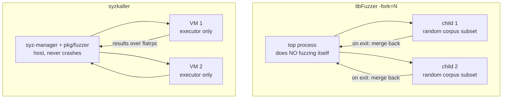

Both put the durable state in a supervisor that does not execute the target, and both hand expendable workers a slice of the problem. libFuzzer arrived there for crash resistance; syzkaller arrived there in 2024 for the same reason (`history...md` §7.2). The "small random subsets of the corpus" detail is literally syzkaller's corpus rotation (`history...md` §6.7), a feature syzkaller enabled, disabled, and re-enabled while unsure whether it helped.

But the differences are decisive:

| | libFuzzer `-fork=N` | syzkaller |
|---|---|---|
| Isolation unit | a process | a virtual machine (or a board) |
| What a crash destroys | one child process | the whole kernel |
| Supervisor shares with worker | the filesystem, the OS, the machine | nothing but a socket |
| Default | **off** (`fork=0`) | the only mode there is |
| `ignore_crashes` default | **0** — a crash still stops everything | crashes are the output |
| Recovery | re-exec a child | reboot, and if that fails, power-cycle |
| State leakage between runs | whatever the OS kept | whatever the kernel kept — the reason snapshot mode exists |

And `-jobs=N`/`-workers=N`, the non-experimental parallelism, is weaker still: independent processes sharing a corpus *directory*, re-reading it periodically (`-reload=1`). No shared coverage map, so each worker rediscovers what the others found. That is precisely the pre-2024 syzkaller problem described in `history...md` §7.1.

> **Takeaway:** the "supervisor holds the state, expendable workers do the dangerous work" pattern is not kernel-specific — libFuzzer needed it too, the moment it wanted to survive the crash it was looking for. If your target can take your fuzzer down, you will end up building this. Build it early; retrofitting it was syzkaller's largest single refactor.

---

## 9. Corpus: storage and scheduling

### 9.1 Storage

libFuzzer's corpus is a directory of files whose names are the SHA-1 of their contents, plus an in-memory `InputCorpus` of `InputInfo` objects. New finds are written with `WriteToOutputCorpus` into the *first* directory passed on the command line. Deduplication is by content hash, implicitly, because the filename *is* the hash.

syzkaller's corpus is `corpus.db` — a versioned, compressed `pkg/db` key-value file holding serialized programs — loaded concurrently at manager startup and rewritten periodically.

The difference is honest minimalism versus operational necessity. libFuzzer's corpus is small, local, and belongs to one process tree. syzkaller's has to survive a manager restart, carry a format version for forward compatibility, and be shippable to `syz-hub`. Neither is wrong for its context.

### 9.2 Scheduling: entropic energy versus corpus weighting

Both engines pick the next input non-uniformly, and both base the choice on **feature rarity**. This is the strongest convergence in the comparison.

libFuzzer's is the **entropic power schedule**, on by default (`FuzzerFlags.def:194`, `entropic=1`). `InputInfo::UpdateEnergy` in `FuzzerCorpus.h` carries its own explanation:

> Assign more energy to a high-entropy seed, i.e., that reveals more information about the globally rare features in the neighborhood of the seed. Since we do not know the entropy of a seed that has never been executed we assign fresh seeds maximum entropy and let `II->Energy` approach the true entropy from above. If `ScalePerExecTime` is true, the computed entropy is scaled based on how fast this input executes compared to the average execution time of inputs. The faster an input executes, the more energy gets assigned to the input.

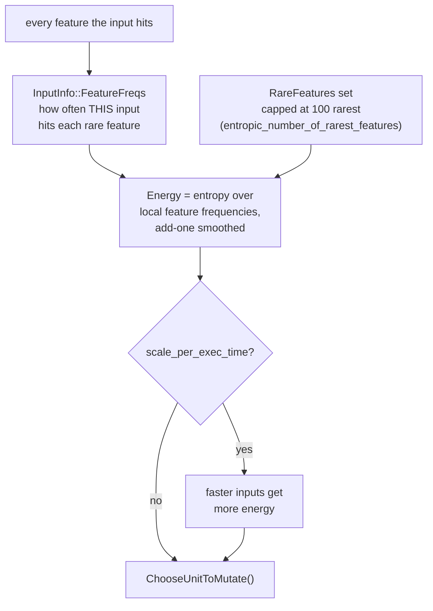

Three mechanisms inside that are worth noting:

- **Fresh seeds get maximum entropy** and decay toward the truth. An optimistic prior, so a new find gets tried before it is judged — the same instinct as syzkaller's smash stage (`history...md` §5.7).
- **Only the rarest features are tracked.** `RareFeatures` is pruned once it exceeds `entropic_number_of_rarest_features` (default 100) with frequency above `entropic_feature_frequency_threshold` (default `0xFF`). Tracking frequency for every feature would cost more than it is worth.
- **Energy updates are sparse** — the code checks `Rand(kSparseEnergyUpdates)` before recomputing, because the entropy calculation is not free.

syzkaller's weighting is coarser but has a dimension libFuzzer lacks: focus areas give each area its own corpus with its own weight, so selection probability is at least `Weight / sum of weights` across *areas* before any within-area choice happens (`history...md` §7.9).

| | libFuzzer | syzkaller |
|---|---|---|
| Basis | information entropy over rare-feature frequencies | signal count, program size, focus-area weights |
| Tracks per-input feature frequencies | yes, for the 100 rarest | no |
| Execution-time bias | optional (`entropic_scale_per_exec_time`) | no |
| Operator-level targeting | no | yes, via the choice table |
| Documented derivation | yes, explained in the source | *"no theory behind any constants"* |

libFuzzer's is more principled. syzkaller's is more operationally flexible. If you are writing your own, libFuzzer's `UpdateEnergy` is the better thing to copy.

> **Takeaway:** uniform corpus selection is leaving the most value on the table of any single choice in a fuzzer, and the fix is cheap. Rank inputs by how much *rare* feedback they produce, give new inputs an optimistic prior, and cap how many features you bother tracking frequencies for.

---

## 10. Hints versus value profile: the same trick, twice

Both projects independently built the mechanism that turns a 32-bit magic-number check from a 4-billion-guess problem into a one-guess problem.

### 10.1 libFuzzer's version

`TracePC::HandleCmp` in `FuzzerTracePC.cpp` runs on every instrumented comparison and does **two** things:

```cpp
template <class T>
void TracePC::HandleCmp(uintptr_t PC, T Arg1, T Arg2) {
  uint64_t ArgXor = Arg1 ^ Arg2;
  if (sizeof(T) == 4)      TORC4.Insert(ArgXor, Arg1, Arg2);
  else if (sizeof(T) == 8) TORC8.Insert(ArgXor, Arg1, Arg2);
  uint64_t HammingDistance = Popcountll(ArgXor);  // [0,64]
  uint64_t AbsoluteDistance = (Arg1 == Arg2 ? 0 : Clzll(Arg1 - Arg2) + 1);
  ValueProfileMap.AddValue(PC * 128 + HammingDistance);
  ValueProfileMap.AddValue(PC * 128 + 64 + AbsoluteDistance);
}
```

1. **It records the operands** in a `TableOfRecentCompares` — a 32-entry ring buffer per width, indexed by the XOR of the operands. `Mutate_AddWordFromTORC` later splices those values into inputs. The header explains the design choice: *"We record the arguments of CMP instructions in this table unconditionally because it seems cheaper this way than to compute some expensive conditions inside `__sanitizer_cov_trace_cmp*`."*

2. **It turns "how close were they?" into coverage.** Hamming distance and absolute distance become features in the value-profile bitmap, so an input that gets a comparison from 20 bits wrong to 3 bits wrong is *rewarded as new coverage* even though no new code ran. This is a gradient where there was none — and it is why `-use_value_profile=1` is powerful enough to deserve the warning in the docs: up to 2x slowdown and a corpus several times larger.

String comparisons get their own treatment in `AddValueForMemcmp`, which computes the length of the common prefix `I` and the Hamming distance of the first differing byte, then indexes by `(PC & 4095) | (I << 12)` — so "matched 3 bytes of the magic string" and "matched 4 bytes" are different features. Progress through a string comparison is visible byte by byte. `__sanitizer_weak_hook_strstr` and `memmem` feed a separate `MemMemTable` of 1024 recently searched-for needles.

`__sanitizer_cov_trace_switch` handles `switch` statements by finding the two case values bracketing the actual value and calling `HandleCmp` against both — with a nice piece of pragmatism:

```cpp
// Skip the most common and the most boring case: all switch values are small.
if (Vals[N - 1] < 256) return;
// Also skip small inputs values, they won't give good signal.
if (Val < 256) return;
```

### 10.2 syzkaller's version

syzkaller gets the same data from `KCOV_TRACE_CMP`, a kernel mode that reports comparison operands instead of PCs, plumbed in by `07c84b670` (2017). The consumer is `prog/hints.go`'s `shrinkExpand`, which takes a comparison operand the kernel observed and substitutes it into the argument that most plausibly produced it, respecting the argument's declared width — a type-aware step libFuzzer cannot take.

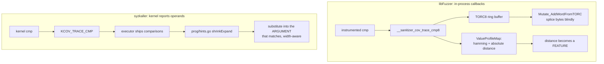

### 10.3 Who has the better half

Each has one half the other lacks.

**libFuzzer's distance-as-coverage is strictly better feedback.** syzkaller's hints are a mutation *source* only; getting closer to passing a check earns no reward unless it actually passes. libFuzzer makes partial progress visible, which means the corpus can climb a gradient. This is the single most valuable idea in libFuzzer that syzkaller does not have.

**syzkaller's type-aware substitution is strictly better application.** libFuzzer splices a harvested 8-byte value at a position it guesses; syzkaller places it in the argument whose declared type can hold it. Blind splicing wastes most attempts on a structured input.

> **Takeaway:** if you implement comparison hints in your own fuzzer — and `rust-clone-lab.md` rates this the highest value-per-line feature available — implement *both* halves. Harvesting operands for mutation is the obvious half. Turning operand distance into a feature so the corpus can hill-climb is the half people skip, and it is the one that solves multi-byte checks.

---

## 11. Minimization: three different jobs

Both projects discovered that "make it smaller" is three separate problems, and solved all three.

### 11.1 Shrinking an input while keeping its value

libFuzzer: `-reduce_inputs=1`, **on by default** (`FuzzerFlags.def:116`). In `Fuzzer::RunOne` (`FuzzerLoop.cpp:510`), if an input hits every one of a corpus entry's unique features and is *smaller*, it replaces it — that is the `REDUCE` line in the output. There is also `-shrink`, still marked experimental.

syzkaller: minimization during triage, preserving the signal-producing predicate, before a program enters the corpus.

Same idea, same place in the pipeline.

### 11.2 Shrinking a whole corpus

libFuzzer's `-merge=1` is the more interesting implementation, and `FuzzerMerge.h` documents the whole protocol in its header comment:

> The outer process collects the set of files and writes their names into a temporary "control" file, then repeatedly launches the inner process until all inputs are processed. **The outer process does not actually execute the target code.**
>
> The inner process reads the control file [...] Before processing every input it writes one line to control file: `STARTED INPUT_ID INPUT_SIZE`. After processing an input it writes [...] `FT INPUT_ID Feature1 Feature2 ...` and `COV INPUT_ID Coverage1 ...`. If a crash happens while processing an input the last line in the control file will be `STARTED INPUT_ID` and so the next process will know where to resume.
>
> It uses a single pass greedy algorithm choosing first the smallest inputs within the same size the inputs that have more new features.

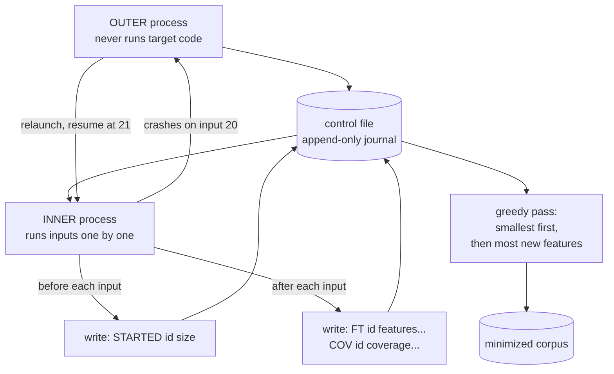

That design is worth studying on its own merits. An **append-only journal plus an idempotent restart** makes a long crash-prone batch job resumable, and `-merge_control_file` plus `killall -SIGUSR1` makes it survivable on preemptible VMs. The outer process is deliberately kept innocent of the target so it cannot be killed by it — the same "supervisor holds the state" principle as `-fork`, applied to a batch job.

`-merge_inner=2` selects `Merger::SetCoverMerge` instead of the greedy pass: an explicit set-cover formulation. syzkaller's corpus minimization is also set-cover, over signal rather than features.

### 11.3 Shrinking a crash

libFuzzer: `-minimize_crash=1`. `Fuzzer::MinimizeCrashLoop` (`FuzzerLoop.cpp:923`) is startlingly simple — it mutates the crashing input over and over and relies on the fact that a crash *exits the process*, so whatever input was in flight when the process dies is by definition a smaller crasher:

```cpp
while (!TimedOut() && TotalNumberOfRuns < Options.MaxNumberOfRuns) {
  MD.StartMutationSequence();
  size_t Size = U.size();
  memcpy(CurrentUnitData, U.data(), Size);
  for (int i = 0; i < Options.MutateDepth; i++) {
    size_t NewSize = MD.Mutate(CurrentUnitData, Size, MaxMutationLen);
    ExecuteCallback(CurrentUnitData, NewSize);
    ...
    Size = NewSize;
  }
}
```

There is no explicit "does it still crash?" check, because the crash handler writes the current unit out and exits. The process dying *is* the test result.

syzkaller's `pkg/repro` cannot work that way. It must: extract candidate programs from a crash log, boot a VM, run a candidate, wait to see whether the machine crashes *or* goes silent *or* hangs, parse the console output, confirm the report title matches, and repeat — all while each attempt costs a boot. That is why reproduction is an entire subsystem rather than a 15-line loop (`syz-execprog-design.md` §5).

> **Takeaway:** the cost of a verification run dictates the shape of your minimization algorithm. In-process, a run is microseconds and you can afford a dumb loop. Cross-machine, a run is a VM boot and you need candidate ranking, caching, and timeouts. Measure your verification cost before choosing an algorithm.

---

## 12. Determinism: a requirement versus a problem to manage

This is the difference with the largest practical consequences, and it is easy to overlook because libFuzzer handles it by *refusing to*.

From `LibFuzzer.md`, in the list of things to remember about a fuzz target:

> * It must be as deterministic as possible. Non-determinism (e.g. random decisions not based on the input bytes) will make fuzzing inefficient.

And the project offers a build macro to help you comply:

> ```cpp
> void MyInitPRNG() {
> #ifdef FUZZING_BUILD_MODE_UNSAFE_FOR_PRODUCTION
>   srand(0);
> #else
>   srand(time(0));
> #endif
> }
> ```

The reasoning is given plainly: a non-deterministic target makes the fuzzer *"treat two similar inputs as significantly different and it will blow up the test corpus."* libFuzzer's answer is to push the problem onto the person writing the harness. That is a legitimate choice — a parser can be made deterministic.

A kernel cannot. Timer interrupts, other CPUs, memory pressure, RCU grace periods, and leftover state from the previous program all mean the same syzkaller program can produce different coverage twice in a row. So syzkaller has to *measure* flakiness and decide what to believe, in `pkg/fuzzer/job.go`:

```go
deflakeNeedRuns         = 3
deflakeMaxRuns          = 5
deflakeNeedCorpusRuns   = 2
deflakeMinCorpusRuns    = 4
deflakeMaxCorpusRuns    = 6
deflakeTotalCorpusRuns  = 20
deflakeNeedSnapshotRuns = 2
```

A new input must reproduce its signal in **3 of at most 5 runs**, and the source file states the statistics it is relying on: *"a program that reproduces 80% of time will pass deflake with 94% probability."*

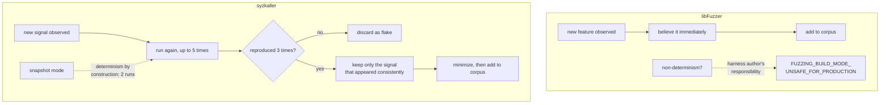

Note the interaction with snapshot mode: `deflakeNeedSnapshotRuns = 2`. Restoring a VM snapshot before every program makes execution nearly deterministic, so the statistical check can be relaxed — which is the measurable payoff that justified rebuilding the transport (`history...md` §7.6). libFuzzer gets that determinism for free, by construction, every run.

> **Takeaway:** decide early whether your target can be made deterministic. If yes, trust your feedback and skip triage entirely — you have just saved yourself a subsystem. If no, budget for deflaking from the start, and treat "did I really observe this?" as a first-class question rather than an edge case. Half-trusting a noisy signal is worse than either extreme: it fills the corpus with noise that then gets scheduled, mutated, and amplified.

---

## 13. Crashes: detection, reporting, deduplication

### 13.1 Detection

libFuzzer installs signal handlers. `Fuzzer::CrashCallback` (`FuzzerLoop.cpp:226`) is the whole of it, and it is candid about its limits:

```cpp
Printf("==%lu== ERROR: libFuzzer: deadly signal\n", GetPid());
PrintStackTrace();
Printf("NOTE: libFuzzer has rudimentary signal handlers.\n"
       "      Combine libFuzzer with AddressSanitizer or similar for better "
       "crash reports.\n");
DumpCurrentUnit("crash-");
PrintFinalStats();
_Exit(Options.ErrorExitCode); // Stop right now.
```

There is also `ExitCallback` for a target that calls `exit()` mid-run, a watchdog thread for `-timeout`, an RSS monitor thread for `-rss_limit_mb` checked once a second, and `-malloc_limit_mb` for a single oversized allocation.

syzkaller has to infer a crash from the outside: watch the serial console, recognize an oops, *and* recognize the absence of output (`NoOutput`, 5 minutes × scale) and a hung machine, because a dead kernel sends nothing at all.

### 13.2 Reporting and deduplication

libFuzzer's report is formatted by whichever sanitizer caught the bug, and the artifact is `crash-<sha1-of-input>`. There is no classification, no title extraction, no guilty-frame analysis, no corrupted-output handling — and no need for any of it, because the campaign stopped and a human is already looking.

The deduplication consequence is worth being explicit about: **libFuzzer deduplicates by input hash, not by bug.** Two different inputs triggering the same bug produce two artifacts. For a developer running one fuzzer that is fine. For a service running thousands of campaigns it is not, which is why syzbot's dedup key is the *canonical report title* extracted by `pkg/report` (`syz-manager-on-board-structure.md` §3.3, §6), and why the difference in effort between the two is roughly "a `printf`" versus "hundreds of per-OS regexes plus corrupted- and suppressed-report classification."

That difference is not a quality gap. It is the difference between a tool and a service — exactly the transition syzkaller made in June 2017 (`history...md` §5.3).

### 13.3 Oracles

Here they are the **SAME**, and both projects' position is identical: the fuzzer finds inputs, a sanitizer decides whether something went wrong.

| libFuzzer | syzkaller | Detects |
|---|---|---|
| ASAN | KASAN | use-after-free, out-of-bounds |
| MSAN | KMSAN | uninitialized memory reads |
| UBSAN | UBSAN | undefined behaviour |
| LSAN | kmemleak | leaks |
| ThreadSanitizer (via the target) | KCSAN | data races |

The leak-detection designs even match in spirit. libFuzzer counts `malloc`/`free` per run and only pays for a full LSan check when the counts disagree, then re-executes to confirm (`TryDetectingAMemoryLeak`, with a comment noting the verification run is excluded from `-runs`). syzkaller similarly defers expensive leak checks rather than running them per program. Both arrived at "cheap always-on heuristic, expensive confirmation on suspicion."

> **Takeaway:** do not write your own bug detector. Both of the most successful coverage-guided fuzzers in existence delegate the oracle entirely to sanitizer infrastructure and spend their own effort on *reaching* the bug. Your fuzzer's job is coverage; the sanitizer's job is judgement.

---

## 14. The deliverable

What does each tool hand a developer when it finds something?

| | libFuzzer | syzkaller |
|---|---|---|
| Artifact | `crash-<sha1>`, the raw input bytes | `repro.syz` plus a generated standalone C program |
| How to reproduce | `./my_fuzzer crash-abc123` | compile and run the C file, or `syz-execprog` the `.syz` |
| Self-contained? | **yes** — input plus the harness binary | needs the right kernel, config, and often the right sandbox |
| Extra context needed | the harness source and build flags | kernel image, `.config`, disk image (`pkg/asset`), sandbox mode |
| Effort to produce | zero — the input already exists | an entire subsystem (`pkg/repro`, `pkg/csource`) |

libFuzzer's reproducer story is genuinely better, and the reason is worth stating plainly: **the input and the environment are the same artifact.** You already have the binary; the bytes are the whole bug.

syzkaller cannot do that. A syscall sequence is meaningless without a kernel, and the kernel is not something you can attach to an email. So syzkaller generates a C program that is standalone *given a kernel* — the same `executor/common_linux.h` source compiled twice, once into the executor and once into the reproducer, with 180 `SYZ_EXECUTOR` preprocessor guards separating the two roles (`syz-execprog-design.md` §5.7). It then uploads the kernel image and disk image to cloud storage so a developer can boot the exact environment (`pkg/asset`, `history...md` §6.10).

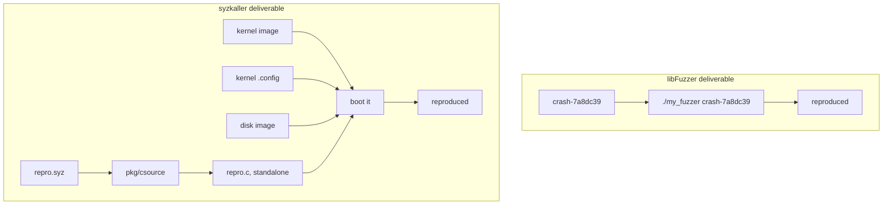

> **Takeaway:** when you design a bug-finding tool, ask what the smallest self-contained artifact is that proves the bug, and work backwards. If the answer is "the input," you are in an excellent position and should keep it that way. If the answer includes "and also an entire operating system," budget for an asset pipeline — it is not optional, and syzkaller spent years learning that.

---

## 15. Focus: the same feature, invented twice

Both projects grew a mechanism for "I care about this part of the code more than the rest," and the two arrived from opposite directions.

libFuzzer's is a **focus function**, set by `TracePC::SetFocusFunction` (`FuzzerTracePC.cpp`). It walks the PC tables looking for a function entry whose symbolized name matches, and keeps a pointer to that single counter:

```cpp
FocusFunctionCounterPtr = Modules[M].Start() + I;
```

Thereafter `ObservedFocusFunction()` is just `FocusFunctionCounterPtr && *FocusFunctionCounterPtr` — did this input reach the function at all? Corpus entries carry `HasFocusFunction`, and if a data-flow trace is available for them, `MutateWithMask` restricts mutation to the input bytes that the trace says actually influence that function (`FuzzerLoop.cpp:754`). `-focus_function=auto` picks one for you.

syzkaller's is **focus areas** (`history...md` §7.9): named sets of files, functions, or raw PCs, each with a *weight*, each with its own corpus.

| | libFuzzer focus function | syzkaller focus areas |
|---|---|---|
| Granularity | one function | many areas, each a file/function/PC set |
| Mechanism | one counter pointer; boolean "reached it" | per-area corpus with proportional selection |
| Bias shape | boolean plus byte-level mutation masking | weights, with an "everything else" escape entry |
| Guides mutation? | **yes** — data-flow trace masks which bytes matter | no — guides *selection* only |
| Auto-selection | `-focus_function=auto` | no |

Again each has a half the other lacks. syzkaller's weights-with-an-escape-hatch is the better *policy* — it never fully blinds the fuzzer to the rest of the code. libFuzzer's data-flow-trace masking is the better *mechanism* — knowing which input bytes reach the function you care about, and mutating only those, is strictly more targeted than anything syzkaller does.

> **Takeaway:** "focus" has two independent halves — choosing what to run, and choosing what to change. Most implementations only do the first. The second needs a notion of which parts of the input influence which parts of the code, which is expensive to obtain but is where the leverage is.

---

## 16. What each project could learn from the other

Keeping this concrete and short.

### syzkaller could take from libFuzzer

| Idea | Where it lives | Why it would help |
|---|---|---|
| **Comparison distance as a feature** | `HandleCmp`, `ValueProfileMap` | The biggest one. Partial progress toward passing a check currently earns nothing. This gives multi-byte checks a gradient to climb. |
| **Hit-count buckets** | `CounterToFeature`, 8 log buckets | A loop that ran 3 times and 300 times are indistinguishable to syzkaller's signal today. |
| **Entropy-based scheduling** | `InputInfo::UpdateEnergy` | A principled, documented alternative to constants with "no theory behind them." |
| **Stack depth as a feature** | `StackDepthStepFunction` | Deeper recursion on known code is new information, and KCOV could plausibly expose it. |
| **Feeding mutator success back** | `RecordSuccessfulMutationSequence` | Both projects collect this data; neither uses it to reweight. libFuzzer at least prints it. |

### libFuzzer could take from syzkaller

| Idea | Why it would help |
|---|---|
| **Weighted mutator selection** | It already records which mutators succeed; the loop back is missing. |
| **Blending structured and byte mutation** | A custom mutator currently replaces the entire default set. syzkaller's per-argument squash is finer-grained. |
| **Dedup by bug, not by input** | Content-hash artifacts mean one bug yields many files. Fine for one developer, unusable as a service. |
| **Tolerating non-determinism** | "Make your target deterministic" excludes whole classes of target rather than handling them. |

The honest summary: **libFuzzer's feedback machinery is more sophisticated; syzkaller's input machinery and operational machinery are more sophisticated.** Neither is behind overall. They optimized different halves of the same loop.

---

## 17. Choosing between them, and what this means for your own fuzzer

### 17.1 The decision

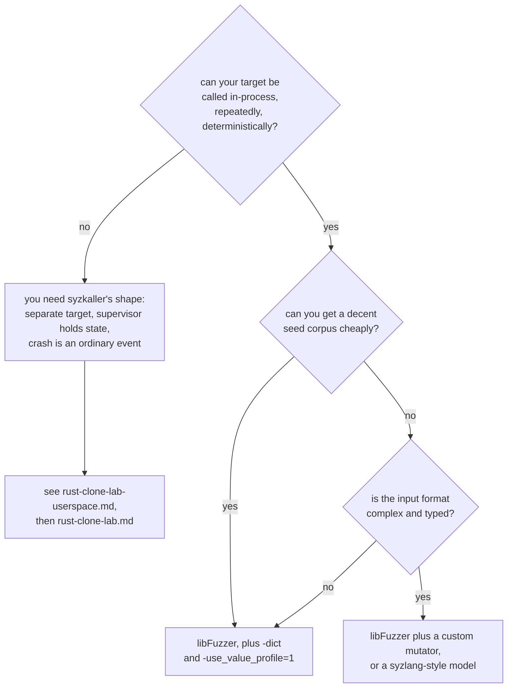

A practical rule: **if a single execution costs more than about a millisecond, the in-process advantage is gone** and you should be thinking about syzkaller's architecture regardless of what your target is. The libFuzzer documentation sets its own bar at 10 ms per input and recommends against it beyond that.

### 17.2 The build list, re-derived

The comparison gives a cleaner justification for the tiering in `rust-clone-lab.md` than the lab could give on its own. These components appear in **both** projects, which means they are inherent to coverage-guided fuzzing and you will have to build them no matter what you are fuzzing:

1. A coverage buffer and a per-execution reset
2. A derivation from raw coverage to a feature or signal set
3. A corpus with non-uniform selection
4. Mutation operators over whatever your input type is
5. Minimization, in all three of its forms (input, corpus, crash)
6. Comparison-operand harvesting — both halves

These appear only in syzkaller, and you need them only if your target is remote and hostile:

7. A wire protocol and an execution request/response path
8. A worker pool whose members are expected to die
9. Out-of-band crash detection, including detecting silence
10. Triage and deflaking
11. Runtime feature detection
12. Reproducer emission for a different machine

And these appear only in syzkaller because its input is a typed program. They are the expensive, optional middle:

13. A description language and compiler
14. A typed program model with resources and ordering
15. A choice table
16. Generation from nothing

> **Takeaway:** the comparison is a budgeting tool. Items 1–6 are the fuzzer. Items 7–12 are the price of your target being able to kill you. Items 13–16 are the price of your interface being typed. Know which you are paying for before you start, because each group is roughly a third of the work and skipping the wrong one costs a rewrite.

---

## 18. Reading the code yourself

The libFuzzer files that actually matter, in the order worth reading them:

| File | Why |
|---|---|
| `FuzzerTracePC.h` | `CollectFeatures` and `CounterToFeature`. The single most important function in libFuzzer. |
| `FuzzerTracePC.cpp` | `HandleCmp`, `AddValueForMemcmp`, `GetNextInstructionPc`, `SetFocusFunction`, and every `__sanitizer_*` entry point. |
| `FuzzerLoop.cpp` | `RunOne` (510), `ExecuteCallback` (597), `MutateAndTestOne` (727), `CrashCallback` (226), `MinimizeCrashLoop` (923). |
| `FuzzerCorpus.h` | `InputInfo::UpdateEnergy` and the entropic schedule, with its reasoning in comments. |
| `FuzzerMutate.cpp` | `ConfigureMutators` for the operator list, `MutateImpl` for the uniform pick and the 100-retry loop. |
| `FuzzerMerge.h` | A header comment that specifies a complete resumable-batch-job protocol in 30 lines. |
| `FuzzerFlags.def` | Every knob with its default. The fastest way to see what is on by default. |
| `llvm/docs/LibFuzzer.md` | The FAQ, especially "When libFuzzer is not a good solution" — the clearest statement anywhere of why syzkaller had to exist. |

Useful experiments on a toy target:

```bash
# Build the doc's own toy example and watch features accumulate.
clang++ -fsanitize=address,fuzzer test_fuzzer.cc && ./a.out

# Watch what value profiling changes: compare cov: and ft: columns.
./a.out -use_value_profile=0 -runs=100000
./a.out -use_value_profile=1 -runs=100000

# See which mutators actually produce finds (the MS: field on NEW lines).
./a.out -runs=200000 2>&1 | grep NEW

# Print every newly covered PC, the analogue of syzkaller's -debug coverage.
./a.out -print_pcs=1 -runs=10000

# Corpus minimization with the resumable control file.
./a.out -merge=1 -merge_control_file=/tmp/ctl NEW_CORPUS OLD_CORPUS
```

Two habits from the other chapters apply here too. **Read the comments next to the constants** — libFuzzer's `CounterToFeature` cites AFL as the source of its bucket boundaries and warns that clients should not rely on them, and `UpdateEnergy` explains its smoothing choice. **Read what the project says it is bad at** — libFuzzer's FAQ is unusually honest, and that honesty is what makes it a good object of comparison.

---

## 19. Where to go next

| Document | What it adds after this one |
|---|---|
| `history-of-major-feature-additions-and-revolutionary-design-changes.md` | §9 dates every syzkaller component discussed above, so you can see which were invented before or after libFuzzer's equivalents. |
| `syzlang-design.md` | The middle box of §3 in full: the language libFuzzer deliberately does without. |
| `syz-execprog-design.md` | What one execution costs when the target is a kernel — the concrete content of §8. |
| `mutation-design.md` | syzkaller's side of §7, §9 and §10 in detail, including the choice table and `shrinkExpand`. |
| `syz-manager-on-board-structure.md` | Everything in §8.2, §12 and §13 that libFuzzer does not have to do. |
| `rust-clone-lab-userspace.md` | Part 1 of the lab: build the §17.2 list against a TFTP server you wrote, where the answers are checkable. |
| `rust-clone-lab.md` | Part 2: build the §17.2 list against a kernel, in order of value. |
