# syzlang Design: Turning a Description of an API into a Working Fuzzer

> **Who this is for.** You have seen that syzkaller reads files describing system calls and somehow turns them into a bug-finding machine. This document explains the language, the four-stage build pipeline that compiles it, why each stage exists, and how syzkaller is now trying to write those descriptions automatically.
>
> If you take one idea away: **syzlang is a model of an API that is rich enough to generate, mutate, minimize, serialize, and compile-to-C — all from one source of truth.** That is a much higher bar than "a grammar," and the design choices follow from it.

---

## 0. Why a description language at all

A kernel's attack surface is its system calls. Fuzzing them naively fails immediately:

```c
syscall(SYS_ioctl, random_int(), random_int(), random_int());
```

The first argument must be a valid file descriptor, obtained from a specific `open` of a specific device. The second must be one of a handful of command codes. The third must point to a struct whose layout depends on the second. Random bytes satisfy none of this, so you spend 100% of your budget being rejected at the front door with `EBADF` and `EINVAL`.

The classical answer is to hand-write a harness per interface. That works and does not scale: Linux has thousands of ioctls across hundreds of drivers.

syzkaller's answer: write the *structure* down once, declaratively, and derive everything from it.

```
open(file filename, flags flags[open_flags], mode flags[open_mode]) fd
read(fd fd, buf buffer[out], count len[buf])
close(fd fd)
open_mode = S_IRUSR, S_IWUSR, S_IXUSR, S_IRGRP, S_IWGRP, S_IXGRP, S_IROTH, S_IWOTH, S_IXOTH
```

From those four lines the engine knows how to produce:

```
r0 = open(&(0x7f0000000000)="./file0", 0x3, 0x9)
read(r0, &(0x7f0000000000), 42)
close(r0)
```

And more than that — **one description drives eight different operations**:

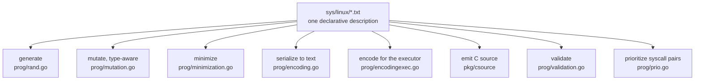

That is the leverage. Each of those is a hard problem; each becomes mechanical once the structure is known.

> **Pattern worth stealing:** if you are building tooling around a structured interface, invest in a machine-readable model of the interface *before* writing the tools. The number of tools that fall out of one good model is the whole return on investment.

---

## 1. The language

### 1.1 Declaration kinds

| Declaration | Example | Purpose |
|---|---|---|
| syscall | `read(fd fd, buf buffer[out], count len[buf])` | a callable entry point |
| syscall variant | `ioctl$FIOCLEX(fd fd, cmd const[FIOCLEX])` | a specialization, named after `$` |
| `resource` | `resource fd[int32]: 0xffffffffffffffff, AT_FDCWD` | a typed value passed between calls |
| `struct` | `struct foo { a int32; b ptr[in, bar] }` | a record |
| union | `fd_set [ in fd; out fd ]` | a tagged alternative |
| int flags | `open_mode = S_IRUSR, S_IWUSR, ...` | a set of integer values |
| string flags | `filenames = "./file0", "./file1"` | a set of strings |
| `type` | `type signalno int32[0:65]` | a named type, optionally templated |
| `include` | `include <fcntl.h>` | a kernel header to pull constants from |
| `incdir` | `incdir <drivers/foo>` | an extra include path |
| `define` | `define SOME_FLAG 1 << 3` | a constant expression if the kernel lacks one |
| `meta` | `meta arches["amd64", "arm64"]` | file-level metadata |

### 1.2 The parser's one-trick dispatch

`pkg/ast/parser.go`, `parseTop()` is small because the grammar is designed to be decidable from one or two tokens:

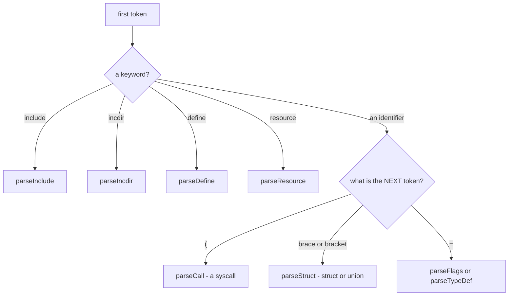

There are only four keywords in the entire language — `include`, `incdir`, `define`, `resource`. Everything else is identified by shape. And `syzlang` does not require declaration before use (unlike C, like Go), which enables a documentation-friendly convention described in the docs:

> It's recommended to declare things in the order of importance so that the reader sees the most important things first. [...] Note: this order is usually the exact opposite of how things are declared in C.

### 1.3 One node type carries most of the syntax

```go
type Type struct {
    Pos        Pos
    // Only one of Value, Ident, String, Expression is filled.
    Value      uint64
    Ident      string
    String     string
    Expression *BinaryExpression
    Colon      []*Type   // parts after ':' - ranges and bitfields
    Args       []*Type   // sub-types in '[]'
}
```

This one shape expresses all of:

| Syntax | How it maps |
|---|---|
| `int32` | `Ident = "int32"` |
| `int32[0:10]` | `Ident = "int32"`, `Args = [0]`, `Colon = [10]` |
| `int32:5` (bitfield) | `Ident = "int32"`, `Colon = [5]` |
| `ptr[in, foo]` | `Ident = "ptr"`, `Args = [in, foo]` |
| `array[int8, 16]` | `Ident = "array"`, `Args = [int8, 16]` |
| `flags[open_mode, int32]` | `Ident = "flags"`, `Args = [open_mode, int32]` |

A uniform node shape makes the checker and generator short, at the cost of validation being a separate pass rather than a parse error.

### 1.4 Resources: ordering constraints for free

This is the most important single feature, so it is worth being precise.

```
resource fd[int32]: 0xffffffffffffffff, AT_FDCWD
resource sock[fd]
resource sock_tcp[sock]

open(file filename, flags flags[open_flags], mode flags[open_mode]) fd
socket$tcp(domain const[AF_INET], type const[SOCK_STREAM], proto const[0]) sock_tcp
connect(fd sock, addr ptr[in, sockaddr], addrlen len[addr])
close(fd fd)
```

Three things fall out:

**Direction implies order.** A syscall's return value is an *output*; its arguments are *inputs*. So a call producing `sock_tcp` must precede a call consuming `sock`. The engine never generates `connect` before some socket-creating call.

**Inheritance implies substitutability.** `sock_tcp` is a `sock` is an `fd`. A call wanting `fd` accepts any of them; a call wanting `sock_tcp` accepts only that. The hierarchy is flattened at compile time into a `Kind` chain, so a runtime compatibility check is a prefix comparison.

**Unsatisfiable calls get disabled.** At startup `TransitivelyEnabledCalls` computes the closure: if nothing on this kernel can produce `fd_cdrom`, then every `ioctl$CDROM*` is disabled. You do not waste cycles on calls that cannot possibly succeed, and the "machine check" report tells you which ones and why.

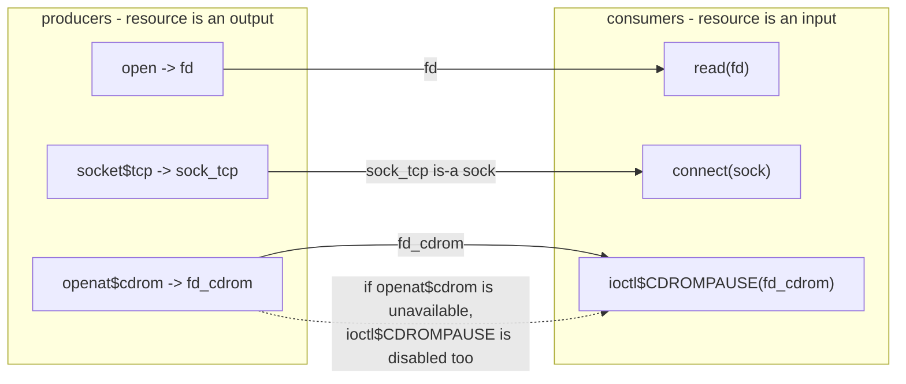

The resource graph is also what feeds the static half of the choice table (see `mutation-design.md`): producer→consumer pairs score 1.5× higher than generic co-occurrence.

> **Pattern worth stealing:** express dependencies as *typed values flowing between operations*, not as explicit ordering rules. You get sequencing, substitutability, reachability analysis, and pair prioritization from one declaration.

### 1.5 Attributes, and where they come from

Attributes annotate syscalls, structs, and fields:

```
syz_mount_image$ext4(...) (timeout[50], prog_timeout[600], fsck["fsck.ext4 -fn"])
ioctl$SOME_REBOOT(fd fd, cmd const[X]) (breaks_returns)
struct packed_thing { a int8; b int32 } [packed]
```

The clever bit: **syscall attributes are not listed anywhere in the compiler.** `pkg/compiler/attrs.go` reflects over a Go struct:

```go
type SyscallAttrs struct {
    Disabled, Timeout, ProgTimeout, IgnoreReturn, BreaksReturns, NoGenerate,
    NoMinimize, NoSquash, RemoteCover, Automatic, AutomaticHelper, KFuzzTest, Snapshot ...
    Fsck       string
    Filesystem string
}
```

Field names are converted to syzlang spelling (`BreaksReturns` → `breaks_returns`), and the Go type decides the attribute shape: `bool` → a flag, `uint64` → `name[N]`, `string` → `name["..."]`. Adding a new syscall attribute means adding one struct field; the language, the parser table, and the generated C header all follow.

What some of them mean, since the names are cryptic:

| Attribute | Effect |
|---|---|
| `timeout[N]` | this call is slow; allow N seconds |
| `breaks_returns` | after this call, return values of later calls are meaningless (e.g. a reboot) |
| `ignore_return` | do not use this call's return value as a resource |
| `no_generate` | never generate this call; it may only appear via a corpus or a hand-written seed |
| `no_minimize` | do not try to simplify this call's arguments |
| `no_squash` | never flatten this call's pointer arguments into raw bytes |
| `remote_cover` | coverage from this call appears on other threads |
| `fsck["..."]` | after a reproducer, run this filesystem checker on the image |
| `kfuzz_test` | this is an in-kernel fuzz target, not a real syscall |
| `automatic` | this description was machine-generated |

Struct and field attributes are a smaller fixed set: `packed`, `size[N]`, `align[N]` on structs; `varlen`, `size[N]` on unions; `in`/`out`/`inout`/`out_overlay`/`if[...]` on fields.

Per-field directions matter more than you would expect: a struct can contain both an input resource and an output resource, which lets you describe `ioctl` structures that both consume and produce handles.

### 1.6 Length expressions and conditional fields

```
write(fd fd, buf ptr[in, array[int8]], count len[buf])
struct msg { hdr_len bytesize[hdr]; hdr header; payload_bits bitsize[payload]; payload array[int8] }
struct cmd { type int32; data int32 (if[value[type] == CMD_A]) }
```

`len`, `bytesize`, `bytesize2/4/8`, `bitsize`, and `offsetof` are internally **one type descriptor** that inspects its own spelled name to decide the divisor. Length fields are auto-computed after every mutation (`assignSizesCall`), so a mutation that grows a buffer updates its length field automatically — and the `LenType` mutation priority is deliberately low (1 out of 10) precisely because the *only* thing mutating a length does is create an inconsistency. Low, but not zero: inconsistent lengths are a bug class.

Conditional fields are implemented by a rewrite. The compiler wraps the field in an anonymous union with two arms — the real value, and a `void` arm guarded by the negated condition:

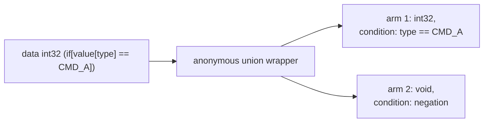

A sentinel struct marks the wrapper so layout code knows to skip attribute lookup on it. Any struct with a conditional field is automatically variable-length. After mutation, `patchConditionalFields` re-selects the correct arm — and the *hints* mechanism explicitly refuses to mutate into a state that violates a condition, with the comment *"Patching unions that no longer satisfy conditions would require much deeper changes... Let's just ignore such mutations."*

> **Pattern worth stealing:** implement a surface-level feature as a rewrite into an existing core construct, when you can. Conditional fields needed no new type kind, no new mutation logic, no new serialization format — only a desugaring pass plus a fixup.

### 1.7 Squashed ANY: a deliberate hole in the type system

Precise types prevent the fuzzer from producing malformed structures — which is sometimes exactly what you want. So syzkaller can *flatten* a typed pointer argument into an opaque sequence of blobs, with resource values preserved:

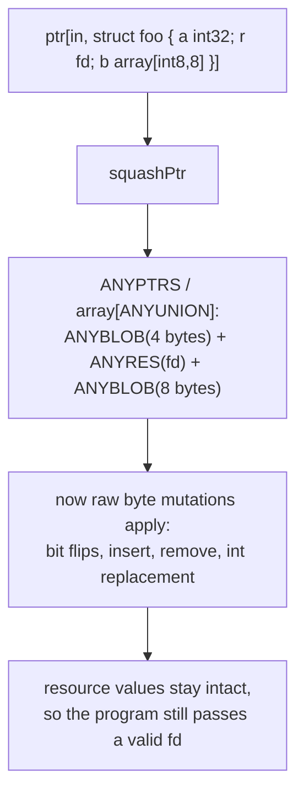

The compiler decides *statically* whether a pointer is squashable (`isSquashableElem`): it must be `in`-direction, the element must be a varlen struct or a large varlen union, and it must not contain nested pointers or an `out_overlay` struct. Because recursive types are not fully known until all syscalls are generated, the `SquashableElem` flag is set in a post-pass — a small detail that reveals how much the compiler has to care about declaration cycles.

There is a cost, and syzkaller tracks it: a squashed program carries `HasAny = true`, which lowers its signal priority. Corpus minimization prefers non-squashed programs for the same coverage, and `sort` in `Corpus.Minimize` puts non-squashed items first. So squashing is used for exploration but loses to a properly-typed equivalent when both exist.

> **Pattern worth stealing:** give yourself a documented escape hatch from your own invariants, and *track which artifacts used it* so you can prefer the clean ones later.

---

## 2. The compilation pipeline

Four build-time stages plus two automatic-description feeders.

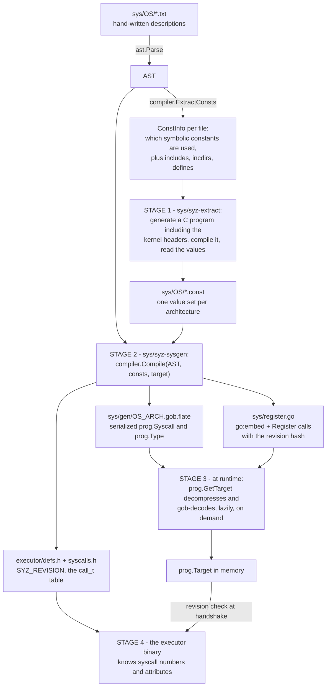

### 2.1 Stage 1: `syz-extract` — getting real constant values

A description says `flags[open_mode]` and `open_mode = S_IRUSR, ...`. But what *number* is `S_IRUSR`? It is a C preprocessor macro, its value can differ per architecture, and it may not exist at all on some.

`syz-extract` resolves this by **asking the compiler**. It generates a small C program:

```c
#include <fcntl.h>          /* from the description's include directives */
#define SOME_FLAG 1 << 3    /* from its define directives */

int main() {
    unsigned long long vals[] = { (unsigned long long)S_IRUSR, ... };
    for (...) printf("%llu", vals[i]);
}
```

compiles it with the target cross-compiler, and runs it. When cross-compiling to an architecture you cannot execute, it instead emits the array into a dedicated ELF section:

```c
__attribute__((section("syz_extract_data"))) unsigned long long vals[] = { ... };
```

and reads that section out of the object file with the target's endianness. **The ground truth is the kernel's own headers**, resolved by the kernel's own toolchain — never a copied-and-pasted number.

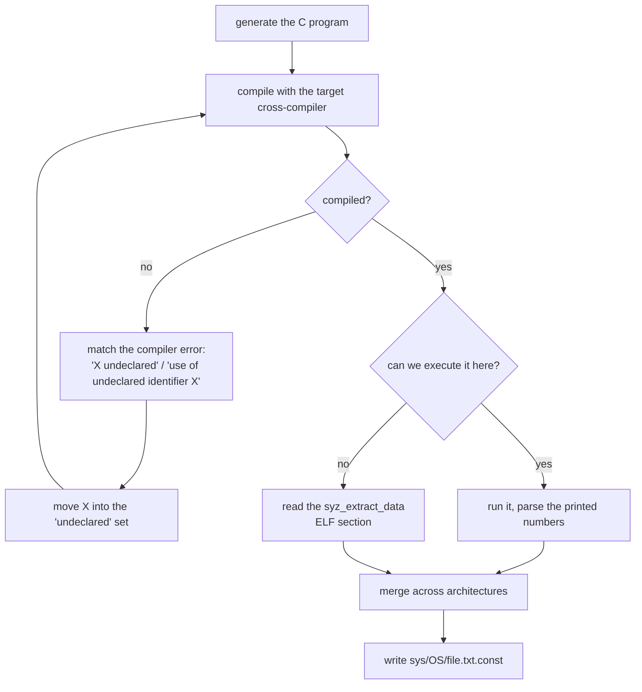

The compile-retry loop is the practical heart of it. A constant missing on this architecture produces a compiler error; the error text is pattern-matched, that constant is moved to an "undeclared" list, and compilation is retried. The `.const` file records `???` for it.

Critically, **a missing constant is not a build failure.** Instead:

- `assignSyscallNumbers` sets the syscall number to `^uint64(0)` and records it in `unsupported`
- `patchConsts` does the same for resources, structs, and fields
- at startup, unsupported syscalls are simply disabled

A constant missing on *every* architecture *is* an error — that is almost certainly a typo. Describing an interface that exists only on arm64 is normal; describing one that exists nowhere is a mistake.

The resulting `.const` file is arch-folded — one header line listing the architectures, then per-constant values — which keeps diffs small when you add an architecture.

> **Pattern worth stealing:** when you need facts about a target environment, *interrogate the environment* rather than encoding the facts. And handle "this fact does not exist here" as data, not as a failure.

### 2.2 Stage 2: `compiler.Compile` — descriptions into type objects

The pipeline is documented in the compiler's own header comment: parse → `ExtractConsts` → user supplies values → `Compile`.

```go
comp := createCompiler(desc.Clone(), target, eh)
comp.filterArch()        // drop declarations not for this arch
comp.typecheck()
comp.flattenFlags()
if consts == nil {       // const-extraction mode
    return &Prog{fileConsts: comp.extractConsts()}
}
comp.assignSyscallNumbers(consts)
comp.patchConsts(consts)
comp.check(consts)       // ~12 semantic passes
syscalls := comp.genSyscalls()
comp.layoutTypes(syscalls)
types := comp.generateTypes(syscalls)
```

Three things to notice.

**The same entry point serves both const extraction and full compilation**, selected by `consts == nil`. Const extraction needs parsing, arch filtering, and type checking to know *which* constants are referenced at all — so reusing the front end is both less code and guaranteed-consistent.

**The semantic passes are many and named.** `checkNames`, `checkFlags`, `checkFields`, `checkTypedefs`, `checkTypes`, `checkTypeValues`, `checkAttributeValues`, `checkFieldPaths`, `checkConstructors`, `checkRecursion`, `checkVarlens`, `collectUnused`. Each is a separate function with a focused job. `checkConstructors` is particularly useful to contributors: it warns about resources that no syscall can produce — the classic beginner mistake of describing a consumer and forgetting the producer.

**Builtin descriptions are prepended** to your AST, which is where `ANYUNION`, `ANYPTRS`, `ANYRES*`, and the `syz_builtin*` pseudo-calls come from.

Then layout and type-table construction:

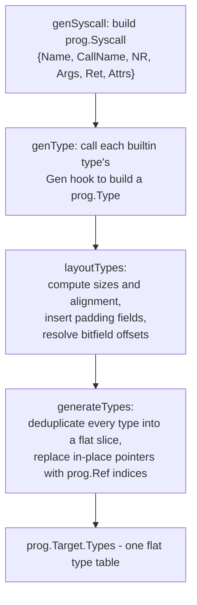

`generateTypes` is why the pipeline works at all for serialization. Types form a cyclic graph (a struct containing a pointer to itself). Flattening to a slice and replacing pointers with integer indices makes the structure acyclic, compact, and trivially serializable. The same trick appears in compilers, scene graphs, and bytecode formats.

> **Pattern worth stealing:** convert a cyclic object graph into a flat table plus integer references before serializing. Deduplication, compactness, and cycle-safety all come at once.

### 2.3 Stage 3: `syz-sysgen` and the embedded blob

`syz-sysgen` is the build driver. For each OS: parse all `.txt` files, deserialize all `.const` files, create one job per architecture, run them concurrently.

Per job:

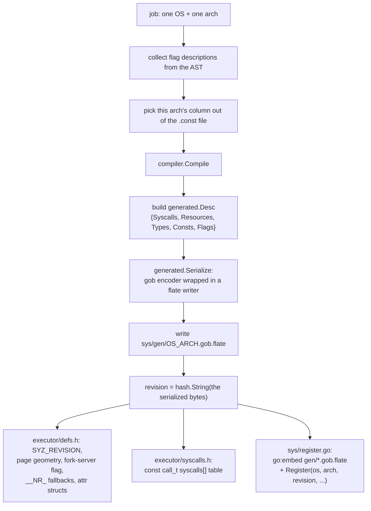

The embedded-blob design (landed Jan 2025, replacing a generated `sys/sys.go`) buys three things:

**Lazy loading.** `prog.RegisterTarget` stores callbacks; `GetTarget` runs the decode inside a `sync.Once`. A binary supporting twelve architectures pays decode cost only for the one you use.

**Small artifacts.** Compressed gob is far smaller than the equivalent Go source, and the Go compiler no longer has to typecheck megabytes of generated literals.

**Readable diffs.** The old approach churned thousands of lines of generated Go on every description change. Now the generated artifact is opaque binary — which is honest, because nobody was reviewing it anyway.

All concrete `prog.Type` implementations plus `prog.Ref`, `prog.BinaryExpression`, and `prog.Value` are `gob.Register`ed so interface values round-trip correctly.

### 2.4 The revision check

Here is the part that is worth copying verbatim into your own designs.

The manager and the executor are **separate binaries that may be built from different trees.** The executor's `syscalls[]` table is an array indexed by the same IDs the manager uses. If the tables disagree — because somebody added a syscall description and rebuilt only one side — the manager asks for syscall #412 and the executor obediently performs a *different* syscall, with correct-looking indices and completely wrong behaviour.

So:

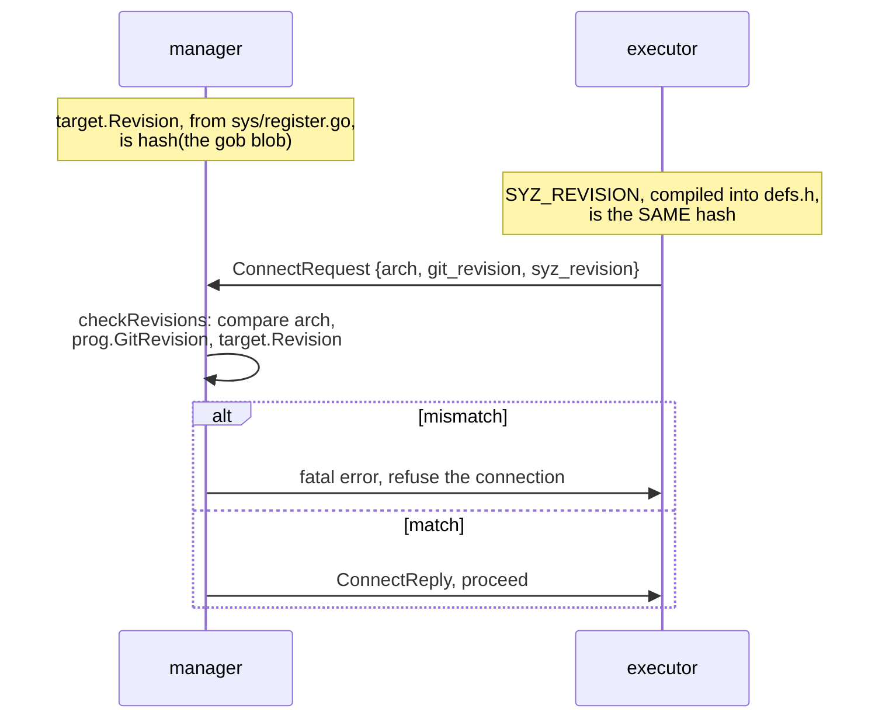

**The content hash of the generated table is the compatibility token.** Not a version number somebody has to remember to bump — a hash that changes automatically whenever the content does.

This is also why `make generate` matters: the docs note that it *"also updates the SYZ_REVISION under `executor/defs.h`, which is required for machine check while running syz-manager."* And why `syz-manager` refuses to start if built without the Makefile — the git revision would not be stamped in.

> **Pattern worth stealing:** when two artifacts must agree on a generated table, make the compatibility token a *content hash of the table*, exchange it at connection time, and refuse to proceed on mismatch. Zero maintenance, and it catches the bug class completely.

### 2.5 The developer workflow

```bash
# 1. edit or add descriptions
vim sys/linux/dev_foo.txt

# 2. extract constant values from the kernel headers (needs cross-compilers)
make extract TARGETOS=linux SOURCEDIR=$KSRC

# 3. regenerate the embedded descriptions and headers (pure text processing)
make generate

# 4. rebuild the binaries
make
```

Practical notes from the documentation:

- `$KSRC` should be the **latest** kernel checkout — mainline, or linux-next for interfaces not yet merged.
- `make extract` overwrites `.config` in `$KSRC` and runs `mrproper` on it. Do not point it at a tree you care about.
- `.const` files are committed **in the same commit** as the `.txt` changes.
- `make generate` needs no kernel source and no compilers.
- For a single file or a single architecture, call `syz-extract` directly:

```bash
make bin/syz-extract
bin/syz-extract -os linux -arch arm64 -sourcedir $KSRC -builddir $LINUXBLD dev_foo.txt
make generate && make
```

- `sudo make install_prerequisites` installs cross-compilers, and may partially fail; an `apt update && apt upgrade` first helps.

### 2.6 Naming conventions, and why they are enforceable

The docs are emphatic:

> Stick with existing kernel names for things, don't invent new names if possible.

Two concrete payoffs:

1. **Searchability.** If the kernel enum is `v4l2_buf_type`, naming it that means you can grep both trees with one term.
2. **Static checking.** `tools/syz-check` compares descriptions against kernel debug info and reports mismatched field types, missing flag values, and wrong struct sizes — *only if the names match*. Convention is what makes the checker possible.

---

## 3. Automatic description extraction

Descriptions were the bottleneck: thousands of lines, all hand-written by people reading kernel source. Since 2024 there are three automatic producers.

### 3.1 Static: `syz-declextract`

A clang-based tool that reads the kernel's actual source, using its `compile_commands.json` so it sees the real compiler flags and the real preprocessor state.

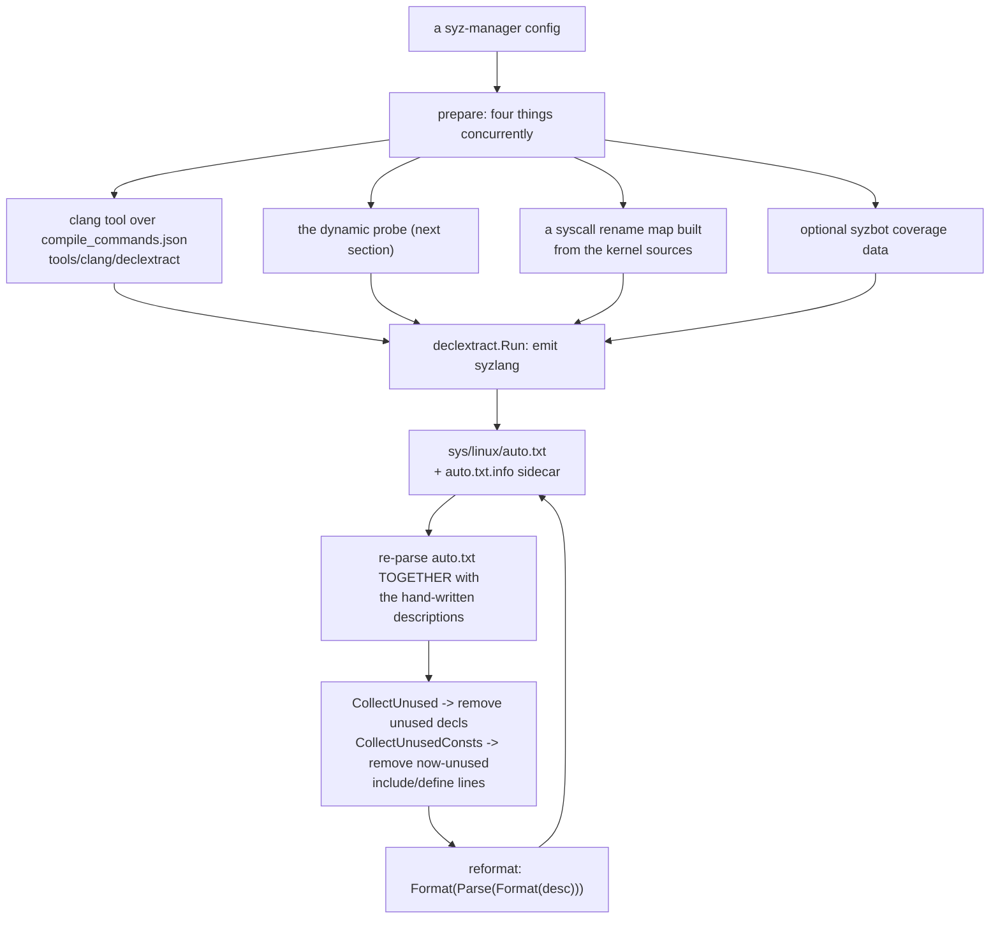

It emits descriptions for syscalls, io_uring operations, structs and their fields, enums, netlink families, and `file_operations` instances.

The feedback loop is the interesting engineering. Auto-generated descriptions *reference* hand-written types, so you cannot validate them in isolation. The generator compiles the **combined** description set, discovers what ended up unused, strips it, strips the now-unneeded `include`/`define` lines, reformats through a parse-format round trip, and rewrites its own output. Generated code that compiles and tidies itself.

Files produced this way carry `meta automatic`, which becomes `SyscallAttrs.Automatic` and relaxes some cross-variant consistency checks — machine-generated variants are not held to the same hand-curated standard.

### 3.2 Dynamic: `ifaceprobe`

Static analysis can see every `file_operations` struct in the kernel. What it cannot easily see is **which device file reaches which one** — that mapping is built at runtime through layers of registration.

So `syz-manager -mode iface-probe` boots a real kernel and finds out:

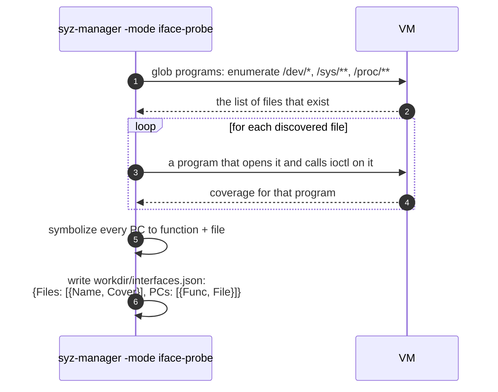

The output answers "opening `/dev/foo` and ioctl-ing it reaches these kernel functions" — exactly the missing link. `syz-declextract` invokes it by shelling out to `syz-manager`, caching the result at `workdir/interfaces.json`.

The mode requires `cover: true` and `sandbox: "none"`, and rejects snapshot mode — it needs full visibility and full privilege to enumerate device files.

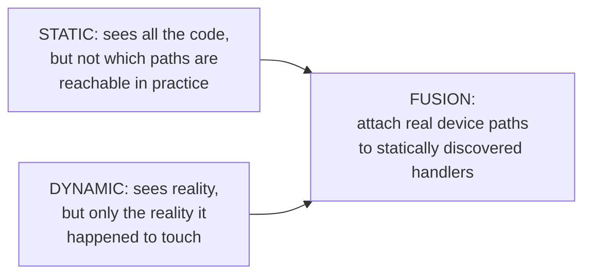

> **Pattern worth stealing:** static and dynamic analysis have complementary blind spots. If you can run the target, do both and join the results on a shared key.

### 3.3 Debug-info based: `pkg/kfuzztest`

A different approach again. KFuzzTest lets kernel developers annotate *internal* functions as fuzz targets. `pkg/kfuzztest` reads `vmlinux`'s DWARF and ELF sections — not source, not a running kernel — to discover those targets, their argument constraints, and their struct layouts, and renders syzlang for them.

`ActivateKFuzzTargets` then injects the resulting syscalls into a live `prog.Target` **at runtime**, so no rebuild is needed. The link back to the language is the `kfuzz_test` call attribute.

When `experimental.enable_kfuzztest` is set, the manager clears all normally-enabled syscalls and enables only the discovered KFuzzTest targets — the engine is pointed at functions instead of syscalls. Several priority functions check `Attrs.KFuzzTest` and behave differently: length fields are not mutated (the harness needs them consistent), and special pointers are never generated because *"they are difficult to identify in the kernel and can lead to false positive crash reports."*

### 3.4 Where the three meet

| Source | Reads | Finds | Weakness |
|---|---|---|---|
| hand-written | human understanding | semantics, correct usage sequences | slow, does not scale |
| `declextract` | kernel source via clang | structure: structs, enums, netlink, fops | cannot know reachability or intent |
| `ifaceprobe` | a running kernel | which paths a file actually reaches | only sees what it tried |
| `kfuzztest` | `vmlinux` DWARF | internal fuzz targets | needs developer annotations |

None replaces the hand-written set. The documentation is candid: *"Currently all syscall descriptions are manually-written. There is an open issue to provide some aid for this process and some ongoing work, but we are not there yet to have a fully-automated way to generate descriptions."* The automation produces breadth; humans produce the depth that makes a sequence of calls actually succeed.

---

## 4. Testing descriptions

A description can be syntactically valid, compile cleanly, and still be wrong — wrong field order, wrong flag values, a missing prerequisite. Two tools address this.

### 4.1 The indirect signal: coverage

Run `syz-manager` and read the coverage report in the web UI. If the driver you just described shows coverage only in its `open` path, the fuzzer is not getting past the front door. The documentation is clear about the limitation, though:

> The fuzzer may get around some bugs in the descriptions by diverging from what the descriptions say, but it makes it considerably harder for the fuzzer to progress.

So coverage tells you *something* is wrong, not *what*.

### 4.2 The direct signal: `sys/<OS>/test/*`

Test files are plain programs with expected results. From `sys/linux/test/80211_scan`:

```
# requires: -sandbox=namespace
r0 = socket$nl_generic(0x10, 0x3, 0x10)
...
```

Two directive forms:

| Directive | Meaning |
|---|---|
| `# requires: prop1 -prop2` | only run when `prop1` holds and `prop2` does not |
| `### call=N errno=M` | assert that call N returned errno M |

Plus `AUTO` for consts and pointers (sequential address allocation), and `<r2=>0x0` for capturing a resource.

`-mode run-tests` expands each file into a **matrix**:

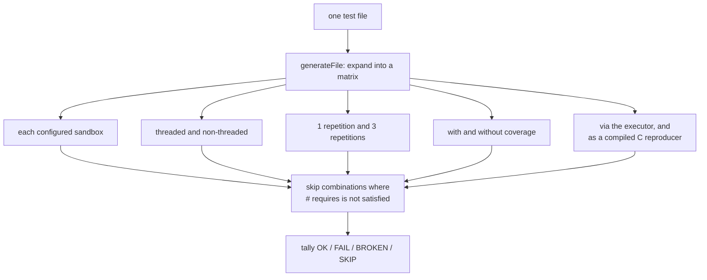

Tests whose syscalls are disabled on this machine are reported **SKIP**, not FAIL — a crucial distinction when the same suite runs against many kernel versions.

Two ways to run them:

```bash
# the full matrix across multiple VMs - thorough, slow
make && bin/syz-manager -config manager.config -mode run-tests

# one test, inside a manually booted VM - fast iteration
syz-execprog -debug -threaded=0 mytest

# just check that your test file parses
go test -run=TestParsing ./pkg/runtest
```

The documentation's advice is good: *"It's always good to add a test at least for 'the main successful scenario' for the subsystem. It will ensure that the descriptions are actually correct and that it's possible for the fuzzer to come up with the successful scenario."*

That second clause is the real point. A passing test proves not just that your description is accurate, but that **a valid path through it exists** — which is what the fuzzer needs.

> **Pattern worth stealing:** for any specification, write executable examples of the *intended successful usage*. They serve as documentation, as regression tests, as fuzzer seeds, and as proof that the specified interface is actually usable.

### 4.3 One more thing that bites everyone

> When updating existing syzkaller descriptions, note that unless there's a drastic change in descriptions for a particular syscall, the programs that are already in the corpus will be kept there, unless you manually clear them out (for example by removing the `corpus.db` file).

If you change a struct layout, existing corpus programs are reinterpreted under the new layout. They may still deserialize, now meaning something different. If results look strange after a description change, `rm workdir/corpus.db` is the first thing to try.

---

## 5. The newest layer: descriptions as agent-accessible data

`pkg/aflow/syzspec` exists so an AI agent can work with descriptions and corpus. Its structure is instructive regardless of the AI framing.

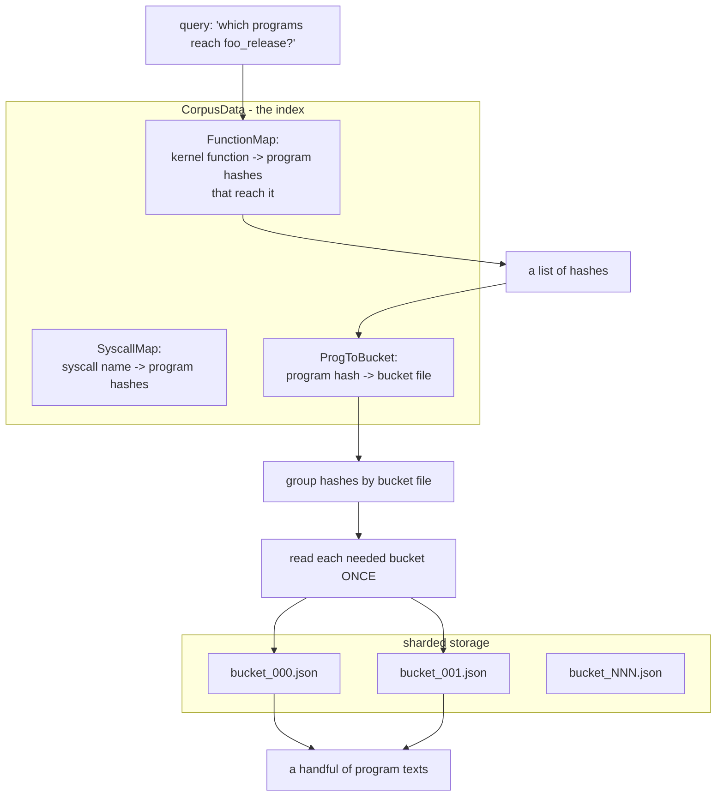

Three design points:

**The index is separate from the payload.** `FunctionMap` and `SyscallMap` hold only hashes. You answer "which programs reach this function?" without touching program text.

**Payload is sharded into numbered buckets.** `ReadPrograms` groups requested hashes by bucket and reads each bucket once. Fetching five reproducers touches two files, not the whole corpus.

**Blobs are swapped out.** `BlobStore.RegisterBlob` / `ReplaceBlobs` / `RestoreBlobs` pull large binary blobs (a 2 MB compressed disk image embedded as an argument) out of program text before showing it to a consumer with a limited context window, and put them back afterwards.

The tools built on top — `read-syz-spec` for paginated reads of `.txt`, `.const`, test, and header files, and `syz-grepper` for regex search with context — are deliberately narrow read-only views.

> **Pattern worth stealing:** separate "the index you query" from "the payload you fetch," shard the payload, and provide a mechanism to elide large opaque values. This is good API design for *any* consumer with a bandwidth or attention limit — a web UI, a mobile client, or a language model.

---

## 6. Takeaways

1. **A rich model of an API pays for itself many times.** One description drives generation, type-aware mutation, minimization, two serialization formats, C code emission, validation, and syscall pair prioritization.
2. **Express dependencies as typed values flowing between operations.** Resources give syzkaller ordering, substitutability, reachability analysis, and prioritization from a single declaration.
3. **Interrogate the environment instead of encoding facts about it.** `syz-extract` compiles a C program against the real kernel headers with the real toolchain. A copied constant is a future bug.
4. **Treat "this does not exist here" as data.** A missing constant disables a syscall and prints a reason. Missing *everywhere* is an error, because that is a typo.
5. **Desugar new surface features into existing core constructs.** Conditional fields became an anonymous union plus a fixup pass — no new type kind, no new mutator, no new format.
6. **Flatten cyclic graphs to a table plus indices before serializing.** Deduplication, compactness, and cycle-safety in one move.
7. **Make generated-table compatibility a content hash exchanged at handshake.** Zero maintenance, and it eliminates silent index skew completely.
8. **Derive the language from the runtime types.** Syscall attributes exist because `prog.SyscallAttrs` has fields. One struct field, and the parser, the language, and the C header all follow.
9. **Keep the specification clean; generate adversarial input separately.** Descriptions state the intended interface; the fuzzer independently supplies `-1`, `INT_MAX`, and 1%-of-the-time out-of-range values.
10. **Give yourself a tracked escape hatch.** Squashed ANY breaks the type system on purpose, and the resulting programs are marked so clean equivalents win later.
11. **Write executable examples of correct usage.** They are documentation, tests, seeds, and proof that a valid path exists — all at once.
12. **Separate index from payload for bandwidth-limited consumers.** Query hashes; fetch sharded buckets; elide large blobs.

---

## 7. Reading the code yourself

| Question | Start here |
|---|---|
| What is the syntax? | `docs/syscall_descriptions_syntax.md`, then any `sys/linux/dev_*.txt` |
| How do I add descriptions? | `docs/syscall_descriptions.md` — the authoritative workflow |
| What are the AST nodes? | `pkg/ast/ast.go`; the lexer is `scanner.go`, the parser `parser.go` |
| How does compilation work? | `pkg/compiler/compiler.go` — read the header comment first |
| How are types instantiated? | `pkg/compiler/gen.go` → `genSyscall`, `genType`, `layoutTypes`, `generateTypes`, `wrapConditionalField` |
| What are the builtin types? | `pkg/compiler/types.go` → the `typeDesc` table |
| What semantic checks run? | `pkg/compiler/check.go` |
| How are consts extracted? | `sys/syz-extract/extract.go` and `fetch.go` → the C template and the retry loop |
| How is the build driven? | `sys/syz-sysgen/sysgen.go`; serialization in `sys/generated/generated.go` |
| What is the runtime representation? | `prog/types.go` and `prog/target.go` → `Syscall`, `SyscallAttrs`, `Target`, `RegisterTarget`, `GetTarget` |
| How do resources constrain order? | `prog/resources.go` → `populateResourceCtors`, `getInputResources`, `TransitivelyEnabledCalls` |
| How does squashing work? | `prog/any.go` → `initAnyTypes`, `complexPtrs`, `squashPtr`; and `isSquashableElem` in `pkg/compiler/types.go` |
| How is static extraction done? | `tools/syz-declextract/declextract.go`, `pkg/declextract/` |
| How is dynamic probing done? | `pkg/ifaceprobe/ifaceprobe.go` |
| How are descriptions tested? | `pkg/runtest/run.go` → `generateFile`; `pkg/manager/seeds.go` → `parseRequires`, `MatchRequirements` |
| How do agents read descriptions? | `pkg/aflow/syzspec/syzlang.go`, `syzfs.go`, `blobs.go`; `pkg/aflow/tool/syzlang/spec.go` |
