# syzkaller의 역사: 주요 기능 추가와 혁신적인 설계 변화

> **이 문서의 독자층.** 여러분은 대규모 자동화 버그 탐지 시스템이 어떻게 구축되는지 궁금하지만, 학술 논문을 읽고 싶지는 않고 아직 커널 보안 전문 용어에 익숙하지 않은 사람입니다. 이 장에서는 *syzkaller가 무엇인지*, *어떻게 지금의 모습이 되었는지*, 그리고 가장 중요하게는 *여러분의 자체 자동화 프로젝트에 차용(steal)할 수 있는 설계 결정이 무엇인지*를 설명합니다.
>
> 여기에 수록된 모든 내용은 블로그 게시물이 아니라 저장소의 실제 git 이력(작성 시점 기준 12,914개의 커밋)에서 직접 도출되었습니다.

---

## 0. 60초 요약

syzkaller는 운영체제 커널에서 버그를 찾아내는 로봇입니다. 이 작업은 다음과 같은 방식으로 수행됩니다:

1. 커널 API에 대한 **기계 판독 가능한 기술(machine-readable description)**(어떤 시스템 콜이 존재하는지, 어떤 인자를 취하는지)을 읽습니다.
2. 이러한 호출들의 무작위적이면서도 그럴듯한(plausible) 시퀀스를 **생성(generate)**합니다.
3. 일회용 가상 머신 내부에서 이를 **실행(run)**합니다.
4. **커널 코드의 어느 라인이 실행되었는지**(커버리지)를 관찰하고, 새로운 코드에 도달한 입력을 보관합니다.
5. 커널이 **충돌(crash)**하는 순간을 감지한 다음, 입력을 최소한의 **재현 프로그램(reproducer)**으로 자동 축소하여 보고합니다.

이 전체 시스템은 한 번에 수년 동안 사람의 개입 없이 무인(unattended)으로 실행됩니다. 이 "수년 동안 무인 실행된다"라는 요구사항은 syzkaller의 설계를 형성한 단 하나의 가장 큰 원동력이며, 아래에서 설명할 거의 모든 변화를 이끈 동인임을 보게 될 것입니다.

### 용어 해설 (Vocabulary decoder)

역사를 살펴보기에 앞서, 필요한 단어들을 정리했습니다. 이 표를 가까이 두고 참고하세요.

| 용어 | 명확한 의미 |
|---|---|
| **syscall** (시스템 콜) | 일반 프로그램에서 커널로 들어가는 유일한 관문. `open`, `read`, `ioctl` 등이 시스템 콜입니다. 공격 표면(Attack surface) = 시스템 콜들의 집합. |
| **fuzzing** (퍼징) | 프로그램이 고장 나는지 확인하기 위해 반-무작위(semi-random) 입력을 대량으로 주입하는 행위. |
| **coverage** (커버리지) | 실행 중에 어떤 코드 위치가 실행되었는지 기록한 것. "이 입력이 우리에게 새로운 것을 알려주었는가?"라는 점수(score)로 사용됩니다. |
| **KCOV** | 커버리지를 보고하는 리눅스 커널 기능. syzkaller의 눈(eyes). |
| **KASAN** | 메모리 오염 버그가 조용히 시스템을 망치도록 내버려 두는 대신, 발생하는 즉시 감지하는 커널 기능. syzkaller의 버그 감지기. |
| **corpus** (말뭉치/코퍼스) | 흥미로운 입력들을 저장해 둔 모음집 — syzkaller의 장기 기억 장소. |
| **mutation** (변이) | 기존 입력에 무작위의 작은 변경을 가하는 작업. |
| **reproducer** (재현 프로그램) | 필요할 때 특정 충돌을 유발하는 최소한의 자체 완비형(self-contained) 프로그램. 개발자에게 전달하는 최종 결과물(deliverable). |
| **syzlang** | 시스템 콜을 기술하기 위한 syzkaller 고유의 소형 언어(little language). |
| **executor** | VM 내부에서 실행되며 실제로 시스템 콜을 수행하는 소형 C++ 프로그램. |
| **manager** | 호스트에서 실행되며 모든 것을 조율(orchestrate)하는 Go 프로그램. |
| **VM / instance** (인스턴스) | 테스트 대상 커널을 실행하는 일회용 가상 머신. 충돌이 발생하는 것이 당연하며, 그것이 바로 목적입니다. |
| **DUT** | "Device Under Test(테스트 대상 디바이스)" — 퍼징 대상 머신으로, 가상 머신이 아닌 실제 하드웨어인 경우를 가리킵니다. |

---

## 1. 프로젝트 이력을 직접 읽는 방법

이것은 다른 곳에도 전용할 수 있는 기술이므로, 명시적으로 직접 진행해 보겠습니다. 낯선 코드베이스를 접했을 때 던지기 좋은 첫 질문은 다음과 같습니다: **"저자가 *가장 먼저* 작성한 것은 무엇이며, *가장 많이* 다시 작성한 것은 무엇인가?"**

아래 명령어는 Go 파일을 수정한 최초의 커밋 100개를 순회하며, 각 커밋에서 추가/삭제된 라인 수를 합산하여 가장 큰 5개를 보여줍니다:

```bash
git log --reverse --format='%H' -- '*.go' |
head -100 |
while read c; do
    changes=$(git show --numstat --format='' "$c" -- '*.go' |
        awk '$1 ~ /^[0-9]+$/ && $2 ~ /^[0-9]+$/ {sum += $1 + $2} END {print sum+0}')
    echo "$changes $c"
done |
sort -nr |
head -5
```

이 저장소에서의 실행 결과:

| 변경 라인 수 | 커밋 | 날짜 | 제목 |
|---:|---|---|---|
| **8025** | `874c5754b` | 2015-10-12 | **initial commit** |
| 2264 | `6922b20d3` | 2015-12-11 | sys: workaround Go compiler bug |
| 1021 | `a63ac433a` | 2015-11-30 | sys: add userfaultfd syscall |
| 985 | `b7800fb0a` | 2015-11-30 | sys: describe some additional syscalls |
| 894 | `9d1895c1b` | 2015-11-29 | add support for bpf syscall |

여기서 두 가지가 두드러지며, 둘 다 훌륭한 교훈입니다.

**교훈 1: 아키텍처는 첫날부터 존재했습니다.** 최초 커밋은 결코 장난감이 아닙니다. 37개 파일에 걸친 8,025줄의 코드였으며, 디렉터리 이름들은 이미 오늘날의 트리에서도 알아볼 수 있는 것들이었습니다:

```
cover/        fuzzer/       ipc/          manager/      master/
prog/         rpctype/      sys/          sysgen/
tools/execlog tools/execprog tools/prog2c tools/stress
vm/local      vm/qemu
```

Dmitry Vyukov는 *완전한 수직 슬라이스(complete vertical slice)*를 만들어 냈습니다: 기술 언어와 컴파일러(`sysgen/`, `sys/`), 생성/변이/최소화/직렬화 기능을 갖춘 인메모리 프로그램 표현(`prog/`), 커버리지 모델(`cover/`), executor로 연결되는 프로세스 간 통신 채널(`ipc/`), 퍼징 루프(`fuzzer/`), 오케스트레이터(`manager/`), VM 백엔드(`vm/qemu`, `vm/local`), 그리고 디버깅 도구들이 포함되었습니다. 그 이후의 모든 작업은 이러한 상자들을 대체하는 것이 아니라, **상자의 깊이를 더해가는(deepening)** 과정이었습니다.

> **자체 프로젝트를 위한 핵심 교훈:** 자동화 파이프라인을 구축할 때는, 각 단계가 비록 100줄짜리 단순한 구조일지라도 전체 종단간(end-to-end) 슬라이스를 먼저 스케치하십시오. 작동하는 골격이 있어야 측정이 가능하며, 측정이야말로 어느 단계에 다음 10,000줄을 투자해야 할지 알려주는 유일한 나침반입니다.

**교훈 2: 커밋 2~5는 사고였으며, 이 사고는 훗날 설계를 통해 제거되었습니다.** 저 4개의 커밋을 자세히 보십시오. 모두 "일부 시스템 콜 기술 추가"라는 내용이지만, 각 커밋마다 `sys/sys.go`에서 약 1,000줄에 달하는 극심한 변동(churn)이 발생합니다. 왜 그랬을까요? 2015년 당시에는 기술 파일로부터 생성된 *생성된(generated)* Go 코드가 **저장소에 직접 커밋**되었기 때문입니다. 시스템 콜 하나를 추가하면 하위의 모든 번호가 다시 매겨져 거대한 diff가 발생했습니다.

이러한 마찰은 결국 두 단계에 걸쳐 해소되었습니다:

- `0d0fbbe73` (2016-08-26) *"overhaul syscall description generation process"* — 코드 생성이 빌드 과정(`make generate`)으로 이동하여, 사람은 `.txt` 파일만 편집하게 되었습니다.
- `79910ad71` (2025-01-23) *"sys/syz-sysgen: serialize descriptions as gob and embed"* — `sys/sys.go`가 완전히 **삭제**되었습니다. 이제 기술 파일들은 압축된 바이너리 블롭으로 컴파일되어 바이너리 내부에 임베드되며, 시작 시 지연(lazily) 디코딩됩니다.

> **핵심 교훈:** 생성된 파일에서 가장 큰 diff가 발생한다면, 그것은 삶의 피할 수 없는 법칙이 아니라 설계상의 악취(design smell)입니다. 생성된 아티팩트는 코드 리뷰가 아니라 빌드 프로세스에 속해야 합니다.

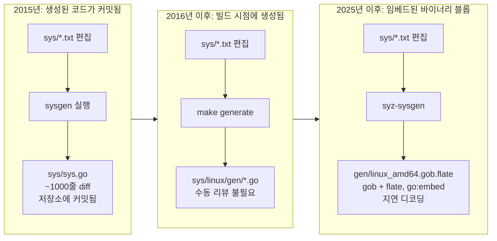

---

## 2. 처음부터 존재했던 아키텍처

타임라인을 살펴보기 전에, 이 머신의 전체 형태를 짚고 넘어가겠습니다. 이 다이어그램은 2015년 *뿐만 아니라* 오늘날에도 대략적으로 유효합니다. 상자 내부의 구현만 바뀌었을 뿐입니다.

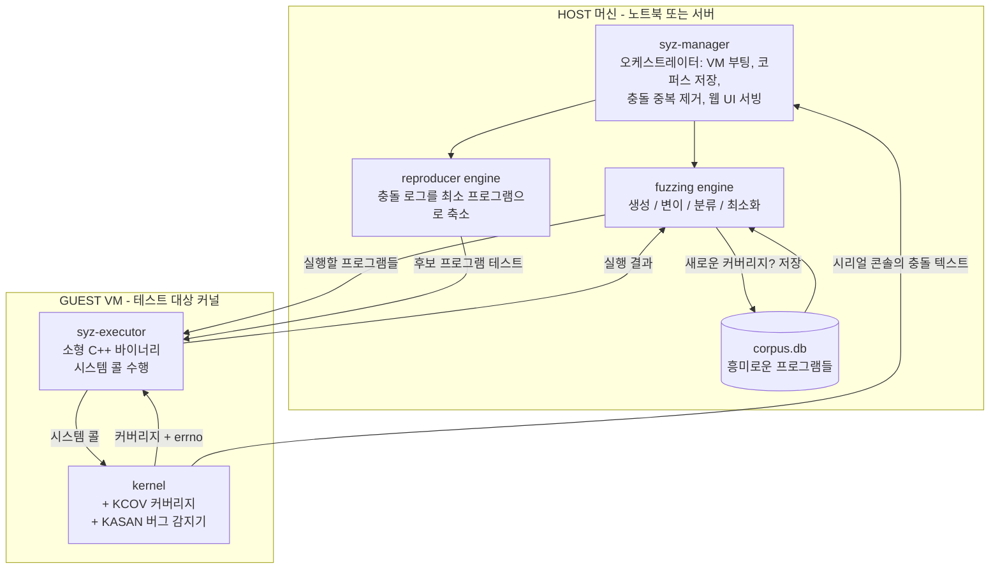

결정적인 비대칭성: **커버리지와 실행 결과는 구조화된 채널을 통해 반환되지만, 충돌은 일반 콘솔 텍스트로 반환됩니다.** 충돌하는 커널은 메시지를 정중하게 직렬화해 줄 수 없습니다 — 죽기 직전에 시리얼 포트로 출력하는 것이 고작입니다. syzkaller의 견고성(robustness) 메커니즘은 거의 전적으로 이 비대칭성을 처리하기 위해 존재합니다.

---

## 3. 타임라인

아래 차트는 지난 11년의 모습을 한눈에 보여줍니다. **모든 주요 설계 변경 사항과 해당 커밋을 연도별로 정리한 목록을 원하신다면 §9로 바로 건너뛰십시오.** 이 섹션은 방향 감각을 잡기 위한 것이고, §9는 집중 연구를 위한 것입니다.

```mermaid
timeline
    title syzkaller 설계의 시대별 흐름
    section 2015 기초 확립
        2015년 10월 : 최초 커밋, 완전한 수직 슬라이스
                     : 호출 우선순위, 선택 테이블
                     : lkvm 및 qemu 백엔드
        2015년 12월 : kmemleak 지원, 첫 번째 추가 버그 감지기
                     : master 제거, 명명 규칙 개편
                     : 기술 파일들을 서브시스템별 .txt 파일로 분할
    section 2016-2017 산업화
        2016년 1월 : 업스트림 KCOV 채택
                   : 일회용 디스크를 위한 qemu -snapshot
                   : 샌드박싱 로직을 executor 내부로 이동
        2016년 8월 : 기술 파일 생성을 빌드 단계로 이전
        2016년 11월 : syz-hub, 인스턴스 간 코퍼스 공유
        2017년 4-5월 : 결함 주입(fault injection), 입력 스매싱(smashing)
                     : pkg/ast, 기술 파일을 위한 실제 파서 도입
        2017년 6월 : syz-ci, 지속적인 커널 빌드 및 테스트
                   : 대시보드 앱, 훗날 syzbot으로 발전
        2017년 8-9월 : 비교 힌트(comparison hints), pkg/compiler 정적 검사
        2017년 9-10월 : fuchsia, windows, freebsd, netbsd 타깃 추가
                      : 모든 OS를 위한 단일 IPC 프로토콜
    section 2018-2023 고도화 및 견고화
        2018년 2월 : 신호(signal)를 순수 커버리지에서 분리
                   : 스쿼시된 ANY, 불투명 블롭 변이
        2018년 5-6월 : pkg/bisect, pkg/build, pkg/vcs
                     : 런타임 호스트 기능 탐지
        2018년 8월 : pkg/runtest, 기술 파일에 대한 테스트 가능성 확보
        2019년 10월 : KCSAN, 데이터 레이스 감지기
        2019년 12월 : 코퍼스 로테이션, 활성화 후 비활성화 그리고 부활
        2020년 10월 : pkg/kconfig, 데이터로서의 커널 설정
        2021년 6월 : syz-verifier, 차분 테스트(differential testing)
        2022년 : 자산(asset) 저장소, 서브시스템 라우팅, pkg/image
    section 2024 대대적인 리팩터링
        2024년 2월 : pkg/fuzzer, 엔진을 VM 외부로 추출
        2024년 3월 : pkg/corpus 패키지 독립 분리
        2024년 4월 : pkg/vminfo, 머신 검증을 호스트로 이전
        2024년 5월 : pkg/flatrpc 스키마, 큐 계층화
        2024년 6월 : executor 러너(runner) 모드, syz-fuzzer 삭제
        2024년 7월 : vm/dispatcher, qemu 스냅샷 퍼징
        2024년 8월 : coveragedb, 시간에 따른 커버리지 추적
        2024년 10월 : 커버리지 필터를 대체하는 관심 영역(focus areas)
        2024년 11-12월 : ifaceprobe, declextract 재작성
    section 2025-2026 자동화의 자동화
        2025년 1월 : 기술 파일들을 gob 블롭으로 임베드
        2025년 9월 : pkg/kfuzztest, 커널 내부 퍼즈 타깃
        2025년 11월 : pkg/codesearch, pkg/updater
        2025년 12월 : 새 엔진 기반으로 syz-verifier 재구축
        2026년 1월 : pkg/aflow, 에이전트 기반 워크플로
        2026년 4월 : lore-relay, AI 결과를 메일링 리스트로 중계
        2026년 6월 : pkg/execbackend, 플러그형 실행 계층
        2026년 8-9월 : crosvm 및 firecracker 백엔드
```

---

## 4. 시대 1 (2015): 기초 확립

### 4.1 직접 작성한 하네스 대신 선언적 기술(Declarative descriptions)

syzkaller에서 가장 중대한 단 하나의 결정은 **API 표면을 코드가 아닌 데이터로 다루었다는 점**입니다. 전통적인 퍼징 하네스는 하나의 인터페이스를 위해 사람이 C 언어로 직접 작성하는 프로그램입니다. 반면 syzkaller는 다음과 같은 텍스트 라인을 읽습니다:

```
open(file filename, flags flags[open_flags], mode flags[open_mode]) fd
read(fd fd, buf buffer[out], count len[buf])
close(fd fd)
```

그리고 이로부터 *모든 것*을 도출합니다: 호출을 생성하는 방법, 다른 인자를 깨뜨리지 않고 하나의 인자만 변이하는 방법, 프로그램을 텍스트로 직렬화하는 방법, 동등한 C 프로그램을 생성하는 방법, 프로그램을 최소화하는 방법까지 도출해 냅니다.

여기서 `fd` 반환 타입이 무엇을 하는지 주목하십시오. `open`은 `fd`를 *생성(produce)*하고, `read`와 `close`는 이를 *소비(consume)*합니다. 이 사실 하나만으로 퍼저는 순서 제약 조건(ordering constraint)을 공짜로 얻게 됩니다 — 퍼저는 `read`가 `open` 뒤에 와야 한다는 것을 알고, 그 결과를 전달해야 한다는 것을 압니다:

```
r0 = open(&(0x7f0000000000)="./file0", 0x3, 0x9)
read(r0, &(0x7f0000000000), 42)
close(r0)
```

무작위 바이트열로는 유효한 파일 디스크립터를 생성하는 것이 사실상 불가능합니다. 기술(descriptions)이야말로 syzkaller가 커널의 정문을 통과할 수 있게 해주는 열쇠입니다. (`eef80b3d7`, 2015-12-28에서 단일 기술 파일을 서브시스템별 파일로 분할했는데, 이는 수천 건의 커뮤니티 기여를 가능하게 한 조직적 변화였습니다.)

> **핵심 교훈:** *구조화된* 인터페이스를 퍼징할 때는 구조에 대한 모델에 투자하십시오. 잘 구성된 입력의 무작위 변이는 무작위 바이트 주입보다 수천 배 더 우수하며, 선언적 모델을 사용하면 기여자가 엔진 코드를 건드리지 않고도 커버리지를 확장할 수 있습니다.

### 4.2 호출 우선순위 (`c9b915608`, 2015-10-14, 개발 이틀째)

"호출 우선순위에 대한 초기 지원"은 프로젝트 시작 직후 등장했습니다. 해결하려는 문제는 이렇습니다: 방금 `socket(...)`을 생성했다고 할 때, 그 다음에 어떤 호출이 와야 할까요? 균등 무작위 선택(uniform random choice)은 거의 모든 시간을 낭비하게 만듭니다.

syzkaller는 **선택 테이블(choice table)**을 구축합니다. 이 테이블은 행렬 형태로, `[X][Y]` 항목은 이미 호출 `X`를 포함하고 있는 프로그램에 호출 `Y`를 추가하는 것이 얼마나 유용한지를 추정합니다. 이 값은 두 가지 소스에서 시드됩니다:

- **정적 유사성(Static similarity)** — 두 호출이 동일한 타입을 다루는가? 리소스를 *생성*하는 호출은 이를 *소비*하는 호출과 짝지어질 때 높은 점수를 받습니다.
- **동적 동시 발생(Dynamic co-occurrence)** — 지금까지 축적된 코퍼스에서 어떤 호출들이 실제로 함께 나타나는가?

이 기능이 개발 3일차에 도입되었다는 사실은, 저자가 퍼징 효율성의 핵심이 입력 생성이 아니라 *입력 선택(input selection)*에 있다는 점을 이미 알고 있었음을 보여줍니다. (상세 내용은 `mutation-design.md` 참조.)

### 4.3 첫날부터 제공된 두 개의 VM 백엔드

`vm/qemu`와 `vm/local`은 모두 최초 커밋에 포함되어 있었고, 나흘 뒤에는 `lkvm`이 추가되었습니다(`587db99ba`). 처음부터 VM은 하드코딩된 `qemu` 호출이 아니라 하나의 **인터페이스**였습니다. 오늘날 이 인터페이스는 QEMU, GCE, Azure, adb(안드로이드 폰), bhyve, VMware, VirtualBox, gVisor, crosvm, Firecracker, proxyapp, 그리고 임베디드 작업에서 핵심적인 **`isolated`**(오직 SSH만으로 실제 하드웨어를 제어함) 백엔드를 지원합니다.

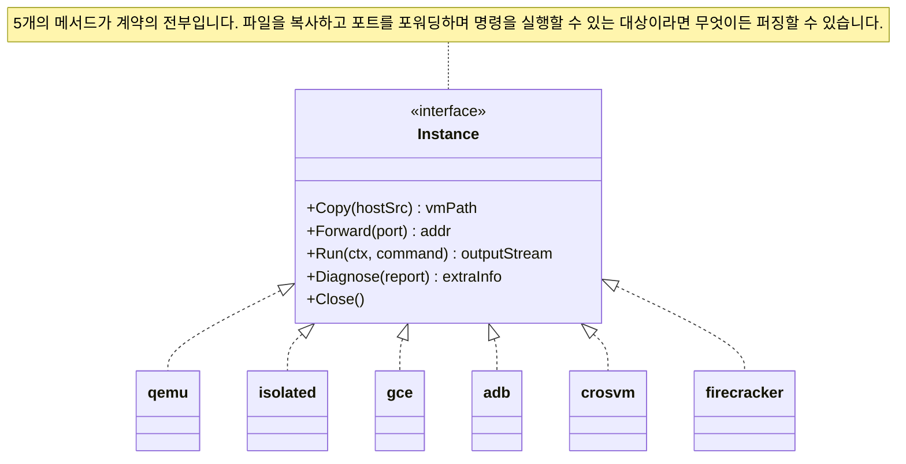

> **핵심 교훈:** 좁은 인터페이스(narrow interface)가 곧 강력한 기능입니다. 파일 복사, 포트 포워딩, 명령 실행, 진단 정보 요청, 종료라는 5개의 메서드만으로 "에뮬레이션 가상 머신", "클라우드 인스턴스", "USB로 연결된 안드로이드 폰", "책상 위의 임베디드 보드"를 모두 추상화하기에 충분합니다.

### 4.4 "master"에서 "hub"로의 진화

최초 커밋에는 `master/` 디렉터리가 포함되어 있었습니다. 2015-12-17의 `8e7ca7c5f` *"remove master and naming overhaul"* 커밋에서 이를 삭제했고, 이 역할은 2016년 11월에 **`syz-hub`**(`cd74cc9cf`)로 다시 돌아왔습니다. Hub의 역할은 매우 좁고 명확합니다: 독립적인 여러 syz-manager 인스턴스(서로 다른 커널, 다른 설정, 다른 사용자)가 다른 어떤 것도 공유하지 않고 오직 **코퍼스 프로그램과 재현 프로그램만 교환**할 수 있도록 하는 것입니다.

이것은 주목할 만한 패턴입니다: 중앙 코디네이터에 대한 첫 번째 시도는 실패하여 삭제되었고, 최종적으로 다시 등장한 대체물은 훨씬 더 축소된 역할 명세를 가졌습니다.

---

## 5. 시대 2 (2016–2017): 도구에서 하나의 시스템(Institution)으로

### 5.1 KCOV (`d5c2595f0`, 2016-01-19)

초기 syzkaller는 커버리지 수집을 위해 커스텀 커널 패치를 사용했습니다. 2016년 1월, 리눅스 메인라인에 갓 병합된 **업스트림 KCOV**를 채택했습니다. 이 시점이 바로 syzkaller가 "패치된 커널이 필요한 도구"에서 "이미 가지고 있는 커널에서도 바로 동작하는 도구"로 거듭난 순간입니다.

> **핵심 교훈:** 자동화에 대상 시스템의 인스트루멘테이션(instrumentation)이 필요하다면, 그 인스트루멘테이션을 업스트림에 반영하는 것이 가장 강력한 레버리지입니다. 연구용 프로토타입을 지속 가능한 인프라로 전환시켜 줍니다.

### 5.2 `qemu -snapshot` (`dfd341e34`, 2016-01-19, 같은 날)

`-snapshot` 옵션을 추가함으로써 QEMU는 디스크 변경 사항을 임시 오버레이에 기록하고 종료 시 이를 폐기하도록 만들었습니다. 퍼저는 이제 파일시스템을 마음껏 오염시킬 수 있으며, 다음 부팅은 항상 깨끗한 상태로 유지됩니다. **일회성(Disposability)이 사후 정리 루틴이 아니라 시스템의 본질적인 속성이 되었습니다.**

> **핵심 교훈:** "스스로 뒤처리를 깔끔하게 정리하는 것"보다 "버리고 새로 만드는 것"을 선호하십시오. 정리(cleanup) 코드는 버그의 온상이며, 재생성(recreation)은 멱등성(idempotent)을 보장합니다.

### 5.3 syz-ci (`6573032ff`, 2017-06-19) 및 대시보드 (`61d1beb28`, 2017-06-22)

3일 간격으로 syzkaller의 *정체성*을 바꾼 두 가지 컴포넌트가 추가되었습니다:

- **syz-ci**는 커널 트리를 지속적으로 가져오고(fetch), 빌드하고, 이에 대해 syz-manager를 실행하며, 업데이트가 발생하면 모든 것을 재시작합니다. 단발성 퍼징 세션을 영구히 작동하는 서비스로 탈바꿈시켰습니다.
- **dashboard/app**은 훗날 **syzbot**으로 알려진 웹 서비스입니다 — 버그 리포트를 등록하고, 어떤 버그가 수정되었는지 추적하며, 메인테이너에게 이메일을 보내고, 패치 테스트를 실행합니다.

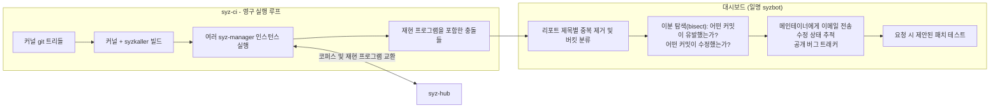

퍼저는 몇 시간 만에 버그를 찾아냅니다. 하지만 버그가 *수정*되려면 사람이 리포트를 읽어야 하며, 이는 리포트의 품질이 뛰어나야 함을 의미합니다: 중복이 제거되고, 이분 탐색(bisect)이 완료되어 있으며, 올바른 메인테이너에게 라우팅되고, C 언어 재현 프로그램이 첨부되어 있어야 합니다. **2017년 이후의 엔지니어링 작업 대부분은 버그 발견율이 아니라 리포트 품질 향상에 관한 것이었습니다.**

> **핵심 교훈:** 모든 버그 탐지 자동화에서 출력 파이프라인(output pipeline)은 탐지 엔진만큼이나 많은 작업이 필요합니다. 아무도 조치하지 않는 탐지 결과는 가치가 0입니다. 처음부터 중복 제거, 원인 귀속(attribution), 심각도 분류(triage)를 예산에 포함하십시오.

### 5.4 비교 힌트 (Comparison hints, `07c84b670`, 2017-08-16)

*"executor, ipc: modify the IO between KCOV ↔ executor ↔ fuzzer"*는 매우 강력한 트릭을 위한 배관(plumbing) 커밋입니다. 일부 커널은 *어떤* 코드가 실행되었는지뿐만 아니라, *어떤 비교 연산이 어떤 피연산자 값으로 일어났는지*까지 보고할 수 있습니다. 예를 들어 커널이 `if (header->magic == 0xCAFEBABE)`를 실행했고 입력 데이터의 해당 위치에 `0x41414141`이 있었다면, 퍼저는 그 매직 넘버를 알아내어 입력 데이터에 끼워 넣습니다.

이것이 퍼저가 40억 번의 시도 대신 단 한 번의 시도로 32비트 매직 값을 맞추는 비결입니다. (상세 내용은 `mutation-design.md`의 힌트 섹션 참조.)

### 5.5 다중 OS 지원 (2017년 9~10월)

6주 만에 다음과 같은 지원이 이루어졌습니다: Fuchsia (`8cb7d3dcf`), Windows (`af442a22d`), FreeBSD (`179a86088`), 그리고 NetBSD, OpenBSD, Darwin, Akaros, Trusty. 기술 언어와 엔진은 본질적으로 OS에 독립적임이 입증되었습니다; 오직 executor의 시스템 콜 호출 계층과 VM 백엔드만이 OS 종속적입니다.

이는 2015년의 계층 구조 설계가 옳았음을 소급하여 증명한 것입니다.

### 5.6 샌드박싱 로직을 executor *내부*로 이동 (`aa1b7fe3a`, `1e06d2baf`, 2016년 1월)

미묘하지만 대단히 중요한 구조적 변화였습니다. 초기에는 퍼징 대상 프로그램을 격리하는 것이 호스트의 몫이었습니다. KCOV가 도입된 지 20일 만에 두 개의 커밋이 이를 내부로 옮겼습니다: *"executor: start moving sandboxing code into executor"*, 그리고 *"executor: new namespace-based sandbox."*

이것이 왜 중요할까요? 샌드박스는 **재현 프로그램의 일부**가 되어야 하기 때문입니다. 호스트가 네임스페이스를 설정한 후 프로그램을 실행하는 방식이라면, 커널 개발자에게 전달하는 C 언어 재현 프로그램은 아무것도 재현하지 못할 것입니다 — 개발자는 여러분의 호스트 환경을 가지고 있지 않기 때문입니다. 샌드박스 설정 코드를 executor와 재현 프로그램이 공유하는 동일한 C 소스 코드로 밀어 넣음으로써, "`sandbox=namespace` 환경에서 실행"이라는 조건이 *프로그램* 자체의 속성이 되어 모든 머신에 이식 가능해집니다.

이것은 프로젝트 전반을 지배하는 핵심 주제의 첫 번째 등장입니다: **버그를 재현하는 데 필요한 모든 것은 경계의 타깃(target) 쪽에 위치해야 합니다.** (각 샌드박스가 실제로 수행하는 작업은 `syz-execprog-design.md` §2.10에 설명되어 있습니다.)

### 5.7 실행 단계: 결함 주입(fault injection)과 스매싱(smashing) (`8f58526cb`, 2017-04-07; `ffb5c7319`, 2017-05-25)

2017년까지 퍼징 루프에는 단 하나의 모드만 존재했습니다: 프로그램을 고르고, 실행하고, 커버리지를 확인하는 것입니다. 6주 간격의 두 커밋은 **서로 다른 입력에는 서로 다른 수준의 집중도가 필요하다**는 개념을 도입했습니다.

`ffb5c7319`는 *스매싱(smashing)*을 추가했으며, 커밋 메시지는 단 세 줄로 설계 근거 전체를 설명합니다:

> 코퍼스에 새로 추가된 각 입력에 대해 100회의 무작위 변이를 수행합니다. 아이디어는 각각의 새로운 입력에 초기 부스트를 제공하는 것입니다. 스매시는 예를 들어 결함 주입(fault injection)을 수행하기에도 적절한 위치입니다.

즉, 방금 코퍼스에 등록된 프로그램은 새로 발견된 코드 경로가 오래된 경로보다 탐색되지 않은 이웃 경로를 더 많이 가지고 있을 것이라는 이론에 따라 집중적인 변이 폭격을 받게 됩니다. 그리고 "스매시는 결함 주입을 수행하기에 적절한 위치"라는 언급은 `8f58526cb`의 통합을 예고한 것이었습니다. 이 커밋은 커널 메모리 할당을 하나씩 체계적으로 실패하도록 만듭니다 — 이를 통해 정상적인 실행에서는 절대 도달하지 않으며 결과적으로 버그가 가득한 오류 처리 경로(error-handling path)를 집중적으로 테스트합니다.

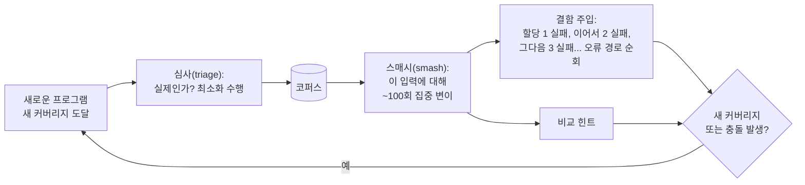

> **핵심 교훈:** 단일 모드로만 실행되는 퍼징 루프는 큰 잠재 가치를 놓치고 있는 것입니다. 작업을 서로 다른 예산(budget)을 가진 *단계(stages)*로 분할하십시오 — 대부분의 입력에는 비용이 적게 드는 폭넓은 탐색을, 유망한 입력에는 비용이 많이 드는 깊이 있는 탐색을 할당하십시오. 2024년의 큐 계층화(queue layers, §7.4)는 이 개념의 산업화된 버전입니다.

### 5.8 기술 파일에 실제 컴파일러 도입 (`127a9c2b6` 2017년 5월 → `pkg/compiler`, 2017년 8~9월)

2015년의 기술 파일 처리는 실용적인 임시방편(hack)이었습니다: `sysgen`이 `.txt` 파일을 느슨하게 파싱하여 Go 코드를 내뿜었습니다. 2017년에 이것이 제대로 된 프런트엔드로 교체되었습니다.

- `127a9c2b6` (2017-05-22) *"pkg/ast: new parser for sys descriptions"* — 실제 토크나이저와 위치 정보를 보존하는 추상 구문 트리(AST)를 도입하여, 에러 발생 시 *몇 번째 라인*인지 표시할 수 있게 되었습니다.
- `a3857c4e9`, `e2ffb4fc9` (2017년 8월): 상수 처리를 생성기에서 `pkg/compiler`로 이전.
- `4074aed7c` *"more static error checking"*, `a7206b24c` *"check and generate types"*, `b06c1bd32` *"verify validity of len targets"*, `8c64b078d` *"detect resources without ctors"* (2017년 8~9월).

마지막 항목은 목록에서 가장 흥미로운 검사입니다. "생성자(constructor)가 없는 리소스"란 시스템 콜들이 *소비*하지만 아무것도 *생성*하지 않는 타입을 기술 파일에 선언했다는 의미입니다 — 따라서 퍼저는 결코 유효한 리소스를 만들 수 없으며, 이를 받는 모든 호출은 쓸모없는 짐이 됩니다. 이 검사가 도입되기 전에는 그런 실수를 알아챌 수 없었지만, 도입 후에는 컴파일 오류가 됩니다.

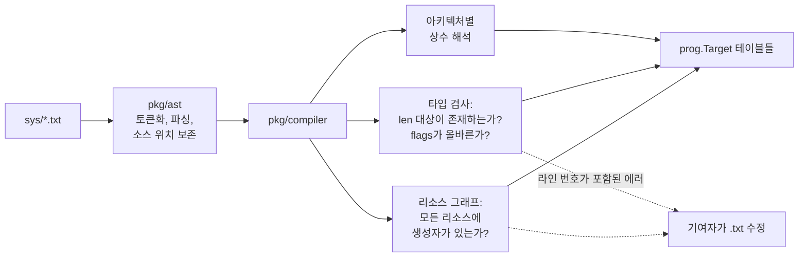

> **핵심 교훈:** DSL(도메인 특화 언어)에 외부 기여자가 생기는 순간, 에러 메시지는 하나의 제품 기능이 됩니다. 잘못된 입력을 받아들인 뒤 나중에 오작동하는 느슨한 파서는 모든 기여자에게 반나절의 시간을 허비하게 만듭니다. 반면 라인 번호를 짚어주는 엄격한 컴파일러는 문제를 30초 만에 해결하게 해줍니다. (언어와 컴파일러의 전체 명세는 `syzlang-design.md`에 있습니다.)

### 5.9 모든 OS를 위한 단일 IPC 프로토콜 (`85b1f93f8`, 2017-10-16)

*"executor, pkg/ipc: unify ipc protocol between linux and other OSes."* 폭발적인 다중 OS 지원 확장 이후, 리눅스와 다른 OS들은 호스트↔executor 프로토콜이 제각각 분기되어 있었습니다. 이를 하나로 통합하는 작업은 화려하지 않은 통합 정리 작업이었지만, 그 덕분에 *다음* 6개 OS 포팅 작업이 저렴해졌으며, 이것이 바로 `pkg/flatrpc` (§7.3)의 직접적인 조상이 되었습니다.

> **핵심 교훈:** "N개의 타깃에서 일단 동작하게 만드는" 질주를 마친 뒤에는 반드시 통합 정리(consolidation) 단계를 계획하십시오. 프로토콜의 두 번째 구현은 추상화가 어떠해야 했는지를 가르쳐 주지만, 다섯 번째 구현은 유지보수 비용을 곱절로 늘릴 뿐입니다.

---

## 6. 시대 3 (2018–2023): 고도화 및 견고화(Hardening)

이 시기에는 이목을 끄는 헤드라인급 커밋은 적지만, 시스템의 하중을 지탱하는 중요한 작업들이 대거 진행되었습니다. 주제는 **"현실 세계에서 살아남기"**입니다. 또한 syzkaller가 단일 프로그램에서 벗어나 *패키지들의 집합체(family of packages)*로 거듭난 시대이기도 합니다 — 오늘날 `pkg/` 디렉터리 중 17개가 이 6년 동안 생성되었습니다.

### 6.1 신호(Signal)는 커버리지가 아니다 (`04cbdbd1a`, 2018-02-20)

*"syz-fuzzer: prioritize signal from successful syscalls."* 커밋 메시지는 단 두 문장으로 이루어져 있으며, 오늘날에도 엔진의 근간을 이루는 중요한 구분을 도입했습니다:

> 성공한 시스템 콜에서 발생한 신호는 실패한 시스템 콜에서 발생한 신호보다 훨씬 더 가치 있습니다.

**커버리지(Coverage)**는 실행된 코드 위치의 가공되지 않은 순수 집합입니다. **신호(Signal)**는 퍼저가 실제로 최적화 대상으로 삼는, 파생되고 우선순위가 매겨진 피드백입니다. 둘은 같은 것이 아니며, 이를 혼동하면 노력이 낭비됩니다: 시스템 콜이 `EINVAL`을 반환하는 경우, 생성된 커버리지는 대부분 인자 유효성 검사 코드입니다. 수천 개의 서로 다른 잘못된 입력들이 모두 동일한 거부 경로를 "새롭게 발견"하게 되며, 이에 보상을 제공하는 퍼저는 오류가 발생하는 온갖 방식을 분류하느라 기꺼이 일주일을 낭비하게 됩니다.

이 변경은 신호에 *우선순위(priority)*라는 차원을 부여했으며, 이것이 바로 `pkg/signal`이 독립된 패키지로 존재하는 이유입니다 — 이 커밋을 통해 생성되었습니다. 동일한 개념이 호출별 커버리지 브래킷(`syz-execprog-design.md` §2.4)과 코퍼스 가중치 부여(`mutation-design.md` §3)에서도 다시 나타납니다.

> **핵심 교훈:** 피드백 지표는 단순한 측정이 아니라 설계상의 결정입니다. "코드가 실행되었는가"는 수집하기 쉽지만 과도하게 보상하기 쉽습니다. 실제로 무엇을 더 많이 얻고 싶은지 자문하고, 지표에 *그것*을 인코딩하십시오.

### 6.2 기술할 수 없는 대상을 변이하기 (`9fe8aa42c`, 2018-02-24)

*"prog: add arbitrary mutation of complex structs"* — `prog/any.go`의 기원이자 syzkaller에서 **스쿼싱(squashing)**이라고 부르는 기법의 시작입니다.

문제점: 기술 파일은 항상 불완전합니다. 넷링크(netlink) 메시지나 `ioctl` 페이로드는 누군가 작성해 둔 케이스에 대해서는 정밀한 구조체로 모델링될 수 있지만, 구조체는 *경직(rigid)*되어 있습니다 — 변이기는 자신이 알고 있는 필드만 변경할 수 있습니다. 스쿼싱은 구조화된 인자를 하나의 불투명한 바이트 블롭(`ANY`)으로 변환하여, 변이기가 이를 원시 바이트로 취급할 수 있게 함으로써 아무도 기술해 두지 않은 인코딩 영역에 도달할 수 있게 합니다.

이것은 "입력을 모델링하라"는 원칙에서 의도적이고 통제된 후퇴(controlled retreat)이며, *언제* 후퇴해야 하는지를 아는 것이 핵심 통찰입니다. 정밀함은 정문을 뚫고 들어가게 해주며, 불투명성은 방 전체를 자유롭게 탐색할 수 있게 해줍니다. (구체적 메커니즘은 `syzlang-design.md` §1.7; 부여되는 변이 가중치는 `mutation-design.md` §4 참조.)

### 6.3 기술 파일에 대한 테스트 가능성 확보 (`2763e04c2` 2018년 7월, `5ba57bfe1` 2018년 8월)

`tools/syz-runtest` 및 `pkg/runtest` — *"syzkaller 프로그램 단위 테스트를 위한 패키지"* — 그리고 예상 결과가 정의된 수기 작성 프로그램들이 모여 있는 `sys/linux/test/` 디렉터리가 추가되었습니다.

이 기능이 도입되기 전에는 기술 파일이 (구문적으로 유효한 것을 넘어서) *의미적으로 올바른지* 알 수 있는 유일한 방법은 커버리지를 보며 눈을 가늘게 뜨고 짐작하는 것뿐이었습니다. 도입 후에는 기여자가 "이 프로그램은 성공해야 하고, 이 프로그램은 `EINVAL`을 반환해야 한다"라고 작성하면 CI가 실제 커널을 대상으로 이를 검증할 수 있게 되었습니다. 기술 파일은 비로소 검증 불가능한 민간전승(folklore)에서 벗어났습니다.

> **핵심 교훈:** 시스템의 동작이 데이터 파일에 의해 구동된다면, 코드와 마찬가지로 그 데이터 파일에도 테스트 하네스가 필요합니다. 그렇지 않으면 품질이 조용히 저하되어 수년 동안 알아차리지 못하게 됩니다.

### 6.4 런타임 기능 탐지 (`06ece2ca6`, 2018-06-12)

테스트 대상 커널이 KASAN, 네트워크 네임스페이스, `/dev/kvm` 등을 지원한다고 가정할 수는 없습니다. 시작 시 syzkaller는 실제 머신을 프로빙합니다: 각 기능을 시도하고, 각 시스템 콜을 호출해 보고, 필요한 파일들을 읽어본 뒤, **동작하지 않는 기능을 비활성화**하고 "머신 검증(machine check)" 리포트를 출력합니다.

이것이 바로 동일한 바이너리가 10년 된 배포판 커널과 최신 linux-next 커널 모두에서 잘 작동하는 이유이며, 사용자가 직접 통제할 수 없는 임베디드 보드 커널에 syzkaller를 적용하려 할 때 가장 중요한 기능입니다. (이 프로빙 로직은 2024년에 게스트에서 호스트로 이전되었습니다 — §7.8.)

### 6.5 syz-ci를 재사용 가능한 패키지들로 분해 (2018년 5~8월)

syz-ci는 2017년에 하나의 거대한 모놀리스(monolith)로 출시되었습니다. 1년 후 분해되었습니다:

| 커밋 | 날짜 | 패키지 | 역할 |
|---|---|---|---|
| `4e1c0dbae` | 2018-05-10 | `pkg/bisect` | 재현 프로그램이 주어지면 버그를 유발한 커밋과 수정한 커밋을 찾음 |
| `2407e7407` | 2018-05-14 | `pkg/instance` | 이미지 빌드, 부팅, 패치 테스트 — 이분 탐색에 필요한 기본 프리미티브 |
| `94ef62054` | 2018-06-21 | `pkg/build` | OS별 커널 빌드 레시피 |
| `43da5e3a1` | 2018-06-27 | `pkg/vcs` | git 작업: fetch, checkout, bisect, 커밋 파싱 |
| `fbedd425b` | 2018-08-01 | `pkg/mgrconfig` | 설정 스키마, 한곳에서 검증 수행 |

개발 순서 자체가 훌륭한 교훈입니다: **이분 탐색(bisection)이 먼저 필요해졌고, 그것이 나머지의 분리를 강제했습니다.** "이 리비전을 빌드하고 테스트하라"가 라이브러리 호출이 되기 전에는 "이진 탐색 과정에서 그것을 40번 반복하라"는 기능이 존재할 수 없었습니다 — 그리고 일단 라이브러리 호출이 되자 syz-ci, 대시보드의 패치 테스트 기능, 이분 탐색기가 모두 이를 공유하게 되었습니다.

> **핵심 교훈:** 새로운 기능에 모놀리스 내부에만 갇혀 있는 역량이 필요할 때, 그 역량을 추출해 내는 작업 *자체가* 해당 기능의 진정한 비용입니다 — 그리고 대개의 경우 추출된 결과물이 기능 자체보다 더 큰 가치를 지닙니다.

### 6.6 대략 1년에 하나씩 추가된 새로운 버그 감지기들

퍼저의 성능은 오라클(oracle, 판정기)의 성능에 의해 제한됩니다. 감지기가 없다면 메모리 오염이 발생해도 커널은 잘못된 데이터를 가진 채 계속 실행될 뿐입니다. syzkaller의 해법은 커널에 새로 추가된 모든 감지기를 통합하는 것이었으며, 패턴은 항상 동일했습니다: 활성화하고, 리포트 형식을 파싱하는 법을 익히고, 리포트 중 어떤 것이 노이즈인지 학습하는 것입니다.

| 감지기 | 최초 지원 | 감지 대상 |
|---|---|---|
| kmemleak | `cf2089138`, 2015-12-03 | 할당된 후 해제되지 않는 메모리(메모리 누수) |
| KASAN | 2016, KCOV와 병행 | Use-After-Free(UAF) 및 범위를 벗어난 접근(OOB), 접근 발생 순간 감지 |
| KMSAN | 2018 (리포트 포맷, `327060ba9`, 2018년 3월) | 초기화되지 않은 메모리 사용 |
| KCSAN | `b2f369e56`, 2019-10-04 | 동시 실행 스레드 간의 데이터 레이스 |

KCSAN은 특히 시사하는 바가 큽니다. 데이터 레이스 감지기는 두 스레드가 실제로 동시에 실행되지 않으면 아무것도 보고하지 않습니다. 이는 *executor*가 진정한 멀티스레드 실행을 지원해야 했고, *fuzzer*는 호출 스케줄링과 `async` 어노테이션에 신경을 써야 했음을 의미합니다. 새로운 감지기는 단순한 설정 옵션 추가에 그치는 법이 드뭅니다; 대개 생성기 쪽에 새로운 요구사항을 부과합니다.

> **핵심 교훈:** 감지와 생성은 서로 결합되어 있습니다. 새로운 부류의 오작동을 관찰하는 오라클을 추가한다는 것은, 대개의 경우 생성기가 그 오라클이 필요로 하는 조건을 만들어내도록 학습시켜야 함을 의미합니다.

### 6.7 코퍼스 로테이션: 정직한 실험 (2019년 12월 → 2020년 10월)

이것은 프로덕션 환경에서 실험을 수행하는 방법을 배우고자 하는 모든 사람에게 이 저장소에서 가장 유익한 이야기입니다. 모든 과정이 단 3개의 커밋 메시지에 명확하게 기록되어 있기 때문입니다.

**`6b36d3386`** (2019-12-30) *"syz-manager: corpus rotation"*:

> 개별 VM 실행마다 시스템 콜/코퍼스/커버리지의 무작위 서브셋을 사용합니다. 가설은 이를 통해 퍼저가 포화 상태(로컬 최적점에 갇힌 상태)에서 더 많은 커버리지를 얻고 더 많은 버그를 찾을 수 있다는 것입니다.

해결하려는 문제는 현실적이었습니다: 수 주간의 퍼징 후에는 코퍼스가 거대해지고, 퍼저는 자신이 선호하는 영역만 반복해서 탐색하게 됩니다. 각 VM에 세상의 무작위 *일부분(slice)*만 제공하면 서로 다른 인스턴스가 서로 다른 로컬 최적점으로 유도될 것이라는 가설이었습니다.

**`6a8d39b1f`** (2020-01-07), 8일 후 — *"disable corpus rotation"*:

> 코퍼스 로테이션이 퍼징에 부정적인 영향을 미친다고 의심되므로 일시적으로 비활성화합니다. 확고한 데이터는 없으며, 가장 쉽게 확인하는 방법은 비활성화한 뒤 어떤 일이 일어나는지 지켜보는 것입니다.

**`c1ff9c10c`** (2020-10-01), 9개월 후 — *"re-enable corpus rotation"*:

> 이전의 커버리지 하락이 완전히 결정적인 것은 아니었으므로 다시 한번 기회를 줍시다. 도움이 될 만한 몇 가지 변경 사항: 로테이션 비율을 1/3 대신 1/5로 적용; 로테이션된 VM에는 필요한 시스템 콜이 활성화되어 있지 않을 수 있으므로 심사(triage) 후보를 보내지 않음; 로테이션된 VM에 새로운 입력/커버리지를 보내지 않고 완전히 격리된 상태로 실행되도록 함.


여기서 얻을 수 있는 세 가지 교훈이 있습니다. 가설은 구현 **이전에 미리 기록**되었기 때문에 나중에 평가할 수 있었습니다. 결과가 모호했을 때의 대응은 말로 논쟁하는 것이 아니라 **변경 사항을 제거하고 기준선을 측정**하는 것이었습니다. 그리고 재활성화는 단순한 롤백의 롤백이 아니었습니다: 첫 번째 시도가 실패할 수밖에 없었던 세 가지 구체적인 이유를 지목했습니다 — 특히 로테이션된 VM에 자신이 수행할 수 없는 심사(triage) 작업이 할당되고 있었는데, 그 프로그램들이 필요로 하는 시스템 콜이 로테이션으로 인해 잘려 나간 절반에 포함되어 있었기 때문이었습니다.

> **핵심 교훈:** 출력이 노이즈가 많은 비율(주당 버그 수)인 시스템에서는 "체감상 더 좋아진 것 같다"는 결코 증거가 될 수 없습니다. 가설을 명시하고, 비활성화 스위치를 유지하며, 판단이 서지 않을 때는 끄고 관찰하십시오. 그것이 논쟁보다 훨씬 저렴합니다.

### 6.8 데이터로서의 커널 설정 (`9b8ec29c5`, 2020-10-15)

`pkg/kconfig`는 `.config` 파일을 프로그래밍 방식으로 파싱하고 조작합니다. 단순한 배관 작업처럼 들릴 수 있지만, 이를 통해 syzbot은 "이 커널을 KASAN을 *포함하고* 오탐을 유발하는 디버그 옵션은 *제외하여* 빌드하라"고 지시할 수 있게 되었고, 새니타이저(sanitizer)별 설정을 생성하며, 버그 리포트에 정확한 설정을 첨부할 수 있게 되었습니다. 커널 빌드 설정이 누군가 붙여넣은 텍스트 덩어리가 아니라, 일급(first-class)의 diff 가능하고 기계 편집 가능한 아티팩트가 된 것입니다.

### 6.9 syz-verifier: 커버리지 없는 퍼징 (`f96cd674a`, 2021-06-23)

진정으로 독창적인 아이디어이며, 살아남았기에 주목할 가치가 있습니다. *동일한* 프로그램을 *두 개의 서로 다른 커널*에서 실행하고 결과를 비교합니다. 커버리지도 필요 없고 충돌도 필요 없습니다 — 반환값의 **차이점(difference)** 자체가 버그 신호입니다.

이는 메인 퍼저가 감지하지 못하는 종류의 버그를 잡아냅니다: 두 커널 모두 충돌하지는 않지만 한쪽이 잘못된 값을 반환하는 무증상 동작 회귀(silent behavioural regressions)입니다. 이 도구는 수년간 조용히 유지되다가 2025년 12월 현대적인 엔진 기반으로 재구축되었습니다 (§8.6) — 이 자체가 2024년 리팩터링이 가져다준 결실을 보여주는 증거입니다.

> **핵심 교훈:** 충돌만이 유일한 오라클이 아닙니다. 차분 테스트(Differential testing) — 동일한 입력에 대해 두 구현체의 결과를 비교 — 는 타깃에 어떤 인스트루멘테이션도 필요로 하지 않으며, 메모리 안전성 버그가 아닌 *정확성(correctness)* 버그를 찾아냅니다.

### 6.10 리포트를 실행 가능하게 만들기 (2022)

한 해 동안 3개의 패키지가 추가되었으며, 모두 사람에게 전달하는 인수인계 과정에 집중되었습니다:

- **`pkg/asset`** (`6db8af716`, 2022-07-15): 재현 프로그램과 관련된 충돌 로그, 커널 이미지, 디스크 이미지를 클라우드 스토리지에 업로드하여, 개발자가 환경을 재구성하느라 애쓰는 대신 *동일한 환경*을 그대로 부팅할 수 있게 했습니다.
- **`pkg/subsystem`** (`2083933ab`, 2022-12-14): 문제의 원인이 된 파일을 커널 서브시스템과 메인테이너 목록에 매핑합니다. 의도적으로 작게 시작했습니다 — 커밋 메시지에는 *"우선은 vfs 서브시스템만 인식하도록 함"*이라고 적혀 있으며, 증거에 기반해 점진적으로 확장되었습니다.
- **`pkg/image`** (`8482d3c10`, 2022-12-17): 이미지 압축 로직을 `prog`에서 분리했습니다. 재현 프로그램에 첨부되는 디스크 이미지는 한 줄짜리 코드보다 더 세심한 처리가 필요했기 때문입니다.

### 6.11 충돌 리포트가 하나의 서브시스템이 되다

`pkg/report`는 커밋 횟수 기준으로 코드베이스에서 가장 많이 수정된 패키지 중 하나입니다. 커밋 로그를 스크롤해 보면 다음과 같은 수백 개의 항목을 발견할 수 있습니다: *"detect corrupted task hung reports"*, *"don't blame kcov"*, *"filter out more corrupted reports due to fault injection"*, *"allow up to 15 lines from Call Trace to first frame"*.

이 패키지가 하는 일: oops 형식을 인식하고, 이를 분류하며(`KASAN: use-after-free`, `KCSAN: data-race`, `general protection fault`, `no output from test machine`), 원인이 된 프레임과 파일을 추출하고, 리포트가 *손상(corrupted)*되었는지(콘솔 출력이 뒤섞임) 아니면 *억제(suppressed)*되었는지(흥미롭지 않은 것으로 알려진 패턴)를 판단합니다.

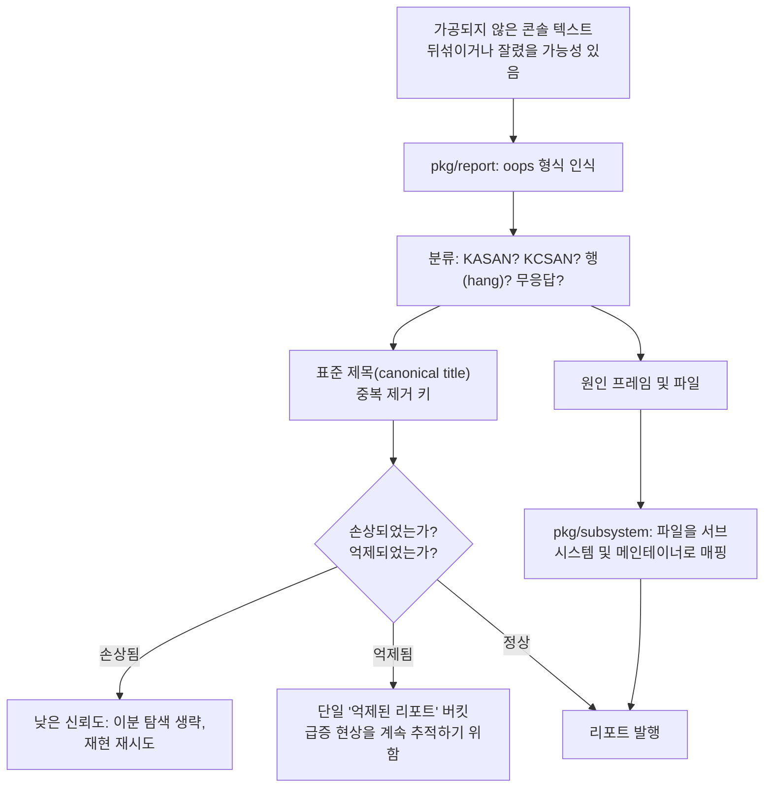

> **핵심 교훈:** 장기 실행되는 자동화에서 *지저분한 현실 세계의 출력을 파싱하는 것*은 단순한 유틸리티 함수가 아니라 독립된 일급 서브시스템입니다. 잘려 나가고, 뒤섞이고, 거짓말을 하는 입력에 대비하십시오.

---

## 7. 시대 4 (2024): 대대적인 리팩터링 — 가장 교훈적인 해

2024년은 성숙한 코드베이스가 뚜렷한 목적의식 하에 완전히 재구조화된 해입니다. 이 장에서 단 하나의 섹션만 읽어야 한다면 바로 이 섹션을 읽으십시오. 여기에 나오는 모든 변화는 소프트웨어 공학에서 널리 인정받는 핵심 패턴들이기 때문입니다.

### 7.1 이전의 형태와 그 문제점

2024년까지는 **두 개**의 Go 프로그램이 존재했습니다:

- 호스트의 `syz-manager`: VM을 부팅하고, 코퍼스를 보관하며, 충돌을 처리합니다.
- **각 VM 내부**의 `syz-fuzzer`: 퍼징 두뇌(brain) — 생성, 변이, 심사, 최소화를 담당하며 로컬 executor 및 RPC를 통해 manager와 통신합니다.

두뇌를 VM 내부에 두는 구조는 치명적인 특성을 갖습니다: **두뇌가 커널과 함께 죽는다는 점입니다.** 충돌이 발생할 때마다 처리 중이던 인플라이트(in-flight) 상태가 파괴되었습니다. 각 VM은 커버리지에 대해 자신만의 부분적인 시야만 가지고 있었기 때문에 N개의 VM이 서로의 작업을 중복 수행했습니다. 디버깅이란 곧 충돌하는 가상 머신 내부의 프로세스를 디버깅하는 것을 의미했습니다. 그리고 코퍼스는 동시에 두 곳에 나뉘어 존재했습니다.

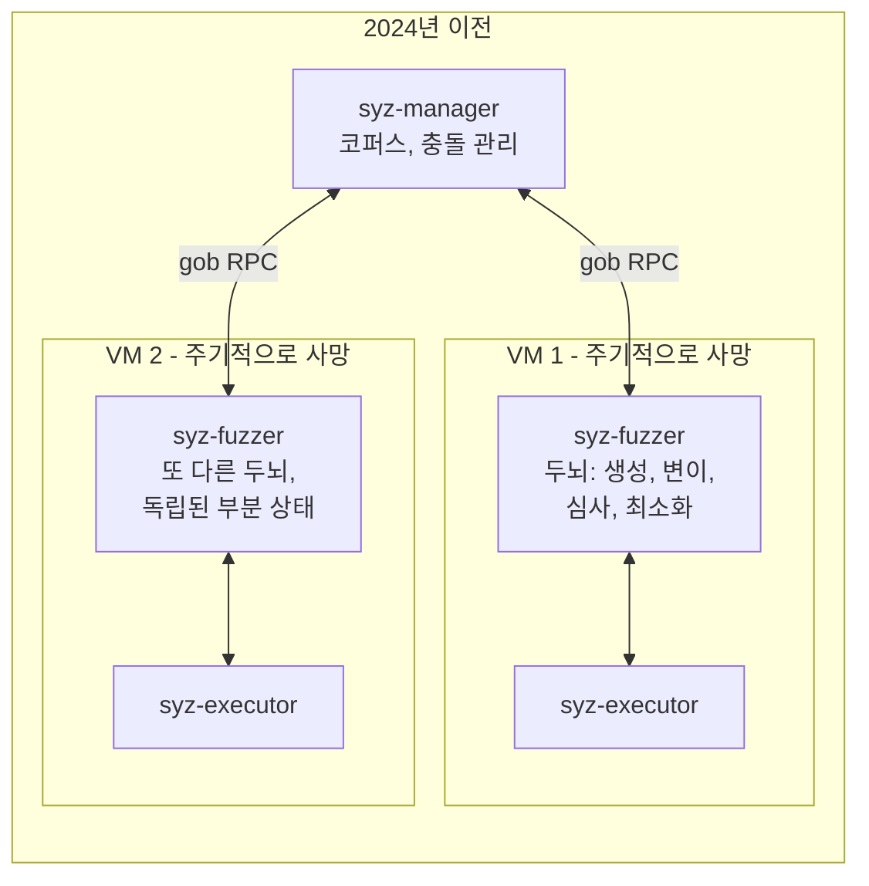

### 7.2 대이동: 엔진을 VM 외부로 추출

일련의 커밋들이 이 구조를 완전히 뒤집었습니다:

| 커밋 | 날짜 | 작업 내용 |
|---|---|---|
| `c35c26ec6` | 2024-02-16 | `pkg/fuzzer`: 퍼징 엔진을 라이브러리로 추출 |
| `fc090d205` | 2024-03-13 | `pkg/corpus`: 코퍼스가 자체 테스트를 갖춘 독립 패키지가 됨 |
| `7009aebcd` | 2024-04-16 | `pkg/vminfo`: 머신 검증(machine check)을 호스트로 이전 (§7.8) |
| `a3ce1723b` | 2024-05-02 | `pkg/flatrpc`: 선언적 바이너리 통신 와이어 스키마 도입 |
| `03820adae` | 2024-05-03 | `pkg/fuzzer/queue`: 실행 요청이 조합 가능한 파이프라인이 됨 |
| `e16e2c9a4` | 2024-06-04 | **executor 러너(runner) 모드 — `syz-fuzzer/`, `pkg/ipc/`, `pkg/host/` 모두 삭제됨** |
| `0ec273733` | 2024-06-27 | `pkg/rpcserver`를 목적별 파일들로 분할 |
| `fc2b08301` | 2024-07-02 | `vm/dispatcher`: 범용 인스턴스 풀 도입 |

그 결과: **호스트에 위치한 단 하나의 두뇌, VM 내부의 단순한 손(dumb hands).**

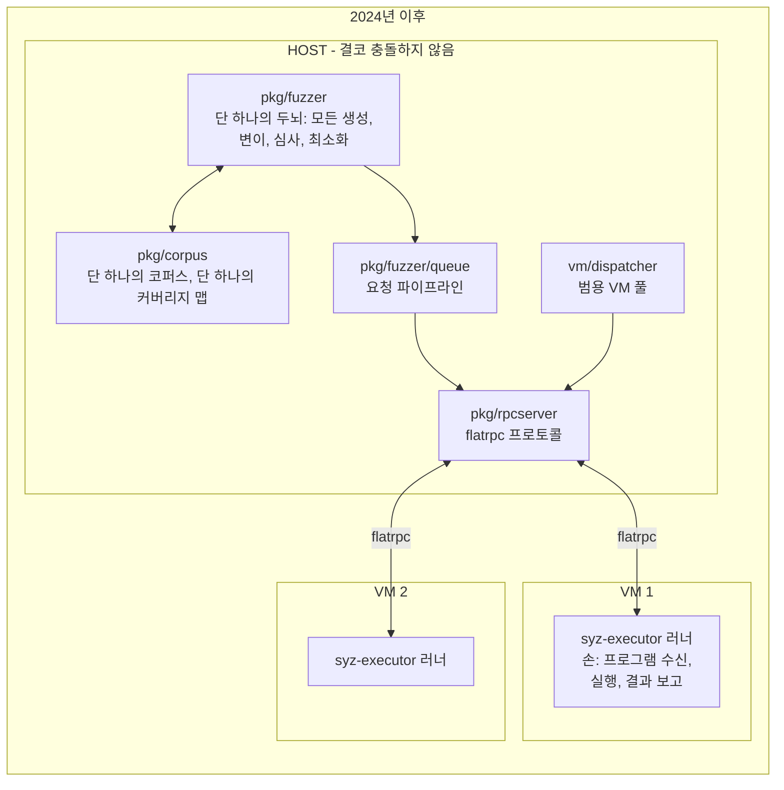

한 번에 네 가지 이점이 실현되었습니다:

1. **상태가 충돌에서 살아남습니다.** 죽어가는 VM은 현재 처리 중인 인플라이트 프로그램만 잃을 뿐이며, 해당 프로그램은 다른 VM의 큐에 자동으로 다시 등록됩니다.
2. **작업 중복이 없습니다.** 단 하나의 커버리지 맵을 유지하므로 VM 7이 VM 3에서 이미 발견한 것을 재발견하느라 시간을 낭비하지 않습니다.
3. **디버깅과 테스트가 쉬워집니다.** 엔진이 이제 완전히 독립된 Go 라이브러리가 되어, VM 없이도 노트북에서 단위 테스트를 수행할 수 있습니다. (`cb2d8b3ae`, 2024-09-04에서 mock을 사용한 rpcserver 단위 테스트가 추가되었는데, 이는 이전에는 불가능했던 일이었습니다.)
4. **게스트 풋프린트가 작아집니다.** VM 내부로 복사해야 하는 바이너리가 소형 C++ 바이너리 하나뿐이므로, 파일시스템 용량이 극히 작은 임베디드 타깃에 엄청난 이점을 제공합니다.

> **핵심 교훈 — 일반 원칙:** *영속적 상태는 파괴되지 않을 곳에 두고, 신뢰할 수 없고 언제든 버려질 수 있는 작업만 위험한 장소에 배치하십시오.* 이는 커널 퍼징을 넘어 브라우저 샌드박스, CI 러너, 로보틱스 등 컴포넌트 유실이 예상되는 모든 시스템에 적용됩니다.

### 7.3 `pkg/flatrpc`: "Go가 인코딩하는 대로" 대신 명시적 스키마

이전 프로토콜은 Go의 `gob` 인코딩이었습니다 — 편리하지만 와이어 포맷이 Go 구조체에 의해 정의되므로 C++ executor가 직접 읽을 수 없었습니다. 새로운 프로토콜은 **FlatBuffers 스키마**(`pkg/flatrpc/flatrpc.fbs`)입니다: 모든 메시지에 대한 명시적이고 언어 중립적이며 버전 관리가 가능한 기술이며, 이를 통해 Go와 C++ 코드가 모두 생성됩니다.

또한 제로 카피(zero-copy) 트릭도 가능해졌습니다: executor는 결과 구조체를 *공유 메모리 내부에 직접 구축*하며, 호스트 측 러너는 파싱 단계 없이 이를 즉시 읽어들입니다.

이 스키마는 자체적인 위험 요소도 스스로 문서화하고 있습니다. 주석 중 하나는 보석과 같습니다:

> 실행 간에 `exec_flags`를 변경하는 것은 executor 프로세스 재시작을 유발하지 않습니다. `env_flags`/`sandbox_arg`를 변경하는 것은 프로세스 재시작을 유발합니다.

이 한 줄에는 이전까지 누군가의 머릿속에만 존재하던 성능에 결정적인 불변 조건(invariant)이 명문화되어 있습니다.

> **핵심 교훈:** 두 언어나 두 머신이 바이트 단위로 합의해야 할 때는 스키마를 문서화하십시오. "구조체가 곧 스키마"라는 방식은 통하지 않는 날이 올 때까지는 잘 작동하지만, 그 대가는 매우 비쌉니다.

### 7.4 `pkg/fuzzer/queue`: 특수 케이스 대신 조합(Composition)

모든 실행은 각자 단 하나의 역할만 수행하는 스택형 계층들을 거쳐 흐르는 `Request`입니다:

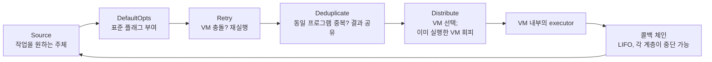

그리고 경쟁하는 작업들 간의 *우선순위* 자체도 하나의 조합된 객체입니다:

```
Order(
    triageCandidateQueue,     # 최우선: 디스크에서 로드된 프로그램 검증
    candidateQueue,
    triageQueue,              # 새로 발견된 프로그램 검증
    Alternate(smashQueue, 3), # 우수 입력 심층 분석, 단 3슬롯 중 2슬롯만 사용
    Callback(genFuzz),        # 폴백: 새로운 프로그램 생성 또는 변이
)
```

`Order`는 작업이 있는 첫 번째 계층을 선택합니다. `Alternate(q, 3)`은 세 번 호출될 때마다 한 번씩 아무것도 반환하지 않음으로써, 탐욕스러운(greedy) 단계가 다른 단계들을 굶주리게(starve) 만드는 것을 방지합니다. 스케줄링 정책이 if-else 덤불 속에 흩어져 있는 대신 단 5줄로 읽기 쉽게 표현됩니다.

> **핵심 교훈:** 서로 다른 우선순위를 가진 N가지 종류의 작업이 있을 때는, 특수 케이스로 가득 찬 스케줄러 대신 소형 콤비네이터(combinator) 라이브러리를 구축하십시오. 정책은 생각보다 훨씬 자주 변경됩니다.

### 7.5 `vm/dispatcher`: 리소스 풀로서의 VM

이전: manager에는 "퍼징을 위해 VM 부팅", "충돌 재현을 위해 VM 부팅", "패치 테스트를 위해 VM 부팅"을 위한 별도의 루프가 존재했습니다. 이후: 슬롯당 하나의 고루틴(goroutine)이 무한 루프를 도는 **범용 풀(generic pool)**로 변경되었습니다:

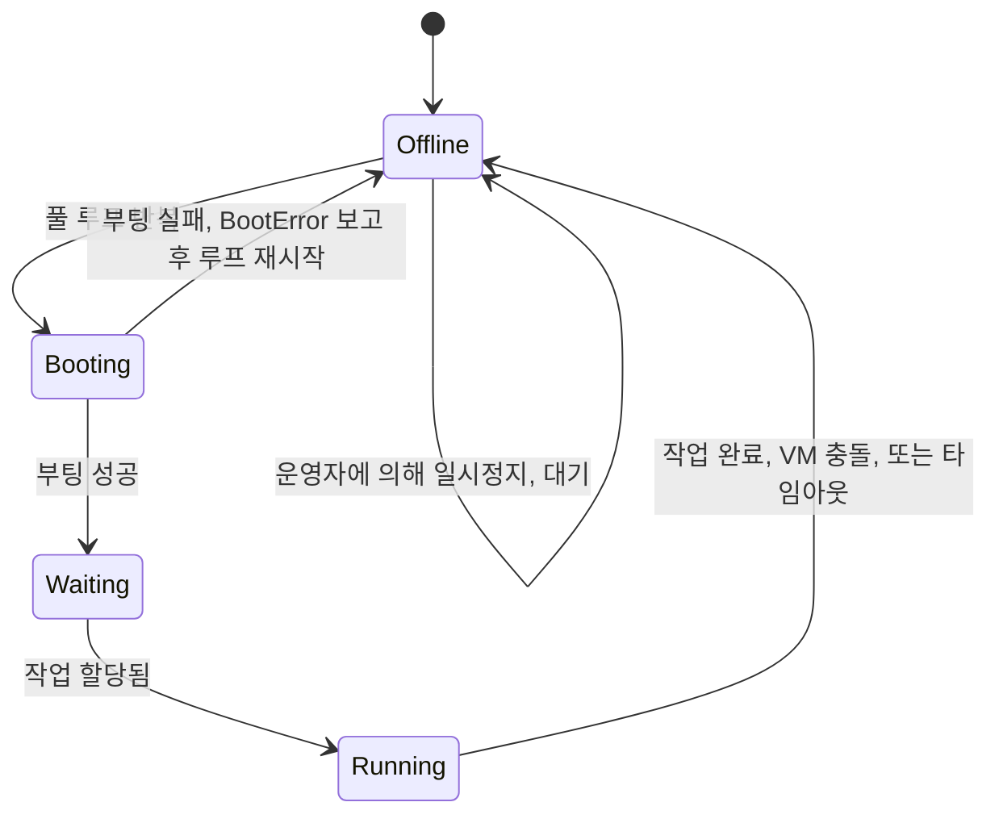

부팅 실패는 예외 상황이 아닙니다; 단지 `BootErrors` 채널에 푸시되는 데이터 항목이자 다음 루프 반복일 뿐입니다. `ReserveForRun(n)`은 재현 작업을 위해 임시로 `n`개의 슬롯을 선점합니다; `TogglePause`는 운영자가 프로세스를 종료하지 않고도 웹 UI에서 퍼징을 동결할 수 있게 해줍니다.

> **핵심 교훈:** 신뢰할 수 없는 워커를 *재시작 가능한 슬롯들의 풀*로 모델링하고, 실패를 전파해야 할 에러가 아니라 채널 상의 데이터로 취급하십시오. "충돌했다"는 것은 메인 루프에서 지극히 일상적인 이벤트여야 합니다.

### 7.6 스냅샷 퍼징 (`4d77b9fe7`, 2024-07-05)

야심 찬 기능입니다. 일반적으로 각 프로그램은 이전 프로그램이 남긴 잔여 파일, 소켓, 메모리 압박 등의 상태가 누적되는 VM에서 실행되므로, 결과가 비결정적(non-deterministic)이 되고 주기적인 재부팅이 강제됩니다. 스냅샷 모드는 부팅 직후 QEMU의 `savevm`으로 VM을 한 번 캡처한 다음, 매 프로그램 실행 직전에 `loadvm`으로 복원합니다.

이를 통해 얻는 보상은 **결정론(determinism)**입니다: 모든 프로그램이 바이트 단위로 동일한 커널 상태를 보게 되므로, 충돌은 재현되거나 재현되지 않거나 둘 중 하나입니다. 간헐적 실패(flakiness)가 사실상 사라지며, 퍼저는 "단순한 일회성 우연이 아니었는지 확인하기 위해 3~5번 반복 실행"하던 비용이 큰 디플레이킹(deflaking) 단계를 단 2회 실행으로 완화할 수 있습니다(`mutation-design.md` §1).

흥미로운 부분은 치러야 했던 대가입니다. 스냅샷을 복원하면 SSH 세션과 RPC 소켓을 포함한 **모든 네트워크 연결이 파괴됩니다** — 코드에는 다음과 같이 분명히 명시되어 있습니다: *"스냅샷 복원을 시작하면 모든 네트워크 연결(ssh 포함)이 끊어집니다."* 따라서 더 빠르고 결정론적인 코어를 구현하기 위해 트랜스포트 계층(TCP 대신 공유 메모리), 로깅(`/dev/stdout` 대신 `/dev/kmsg`), VM 작업 생명주기의 전면적 재설계가 불가피했습니다. 단 하나의 루프를 빠르게 만들기 위해 3개의 서브시스템이 변경되었습니다.

*(이를 구현하는 2단계 백엔드 — RPC로 부팅하고 서버를 닫은 뒤 공유 메모리로 전환 — 는 오케스트레이션이 위치한 `syz-manager-on-board-structure.md` §7에 설명되어 있습니다.)*

> **핵심 교훈:** 결정론은 트랜스포트를 재구조화할 만한 충분한 가치가 있습니다. 하지만 비용의 형태를 주목하십시오: 성능 최적화 작업은 국소적인 영역에 머무는 법이 거의 없습니다. 핫 패스를 최적화하기 전에, 그것이 주변의 어떤 가정을 무효화할지 질문하십시오.

### 7.7 기술 파일 자체의 자동화

기술 파일은 syzkaller의 가장 큰 강점이자 가장 큰 병목이었습니다: 커널 소스 코드를 읽으며 사람이 손으로 직접 작성했습니다. 2024년은 두 가지 방향에서 이를 공략했습니다:

- **`tools/syz-declextract` + `pkg/declextract`** (`3d5fb491e` 2024년 7월, `b2c5a234a` 2024년 12월 재작성): 커널 자체의 소스 코드와 컴파일 데이터베이스(실제 컴파일러 플래그를 파악하기 위함)를 읽어 `sys/linux/auto.txt`로 syzlang을 출력하는 **clang 기반 정적 추출기**.
- **`pkg/ifaceprobe`** (`4f0d9df00`, 2024년 11월): `syz-manager -mode iface-probe`로 실행되는 **동적 프로버**. 실제 커널을 부팅하고 파일시스템을 순회(glob)하여 모든 `/dev/*`, `/sys/*`, `/proc/*` 항목을 찾고, 각각을 열어 `ioctl`을 호출한 뒤 어떤 커널 함수에 도달했는지 기록합니다. 출력물: `interfaces.json`.

이 둘은 서로를 보완합니다. 정적 분석은 `file_operations` 구조체의 *형태*는 알지만 어떤 디바이스 파일이 그 구조체에 도달하는지는 모릅니다; 동적 프로빙은 "`/dev/foo`를 열면 이 함수들에 도달한다"는 사실을 압니다. 둘을 결합하면 정적으로 발견된 핸들러에 실제 디바이스 경로를 연결할 수 있습니다.

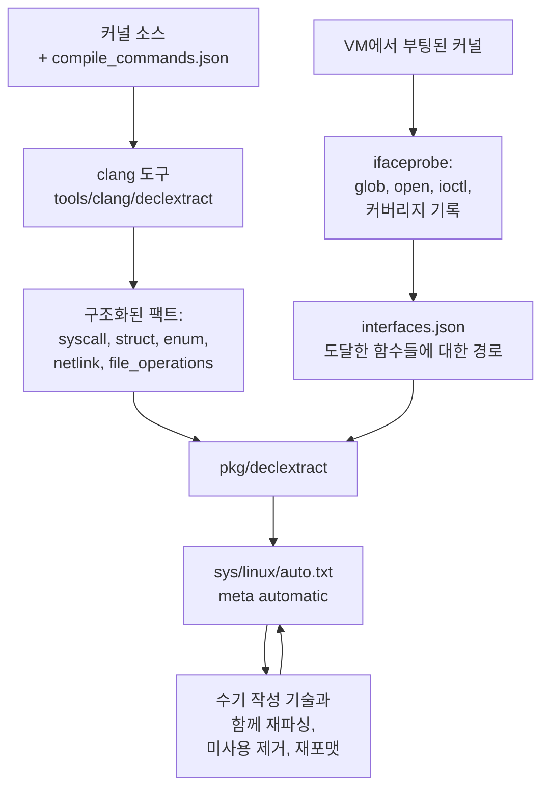

재파싱(re-parse) 루프는 훌륭한 디테일입니다: 자동 생성된 기술은 수기 작성된 타입을 참조하므로, 생성기는 *결합된* 세트를 컴파일하여 최종적으로 사용되지 않은 것을 찾아내고, 이를 제거한 뒤 자체 출력을 다시 작성합니다. 스스로 뒤처리를 하는 생성 코드입니다.

> **핵심 교훈:** 정적 분석과 동적 분석은 상호 보완적인 사각지대를 가집니다. 정적 분석은 모든 코드를 볼 수 있지만 실제로 도달 가능한 경로가 무엇인지 알지 못합니다; 동적 분석은 현실을 보지만 우연히 접촉한 현실만을 봅니다. 둘을 융합하는 것이 각각을 단독으로 사용하는 것보다 뛰어납니다.

### 7.8 아무도 언급하지 않는 전제 조건: `pkg/vminfo` (`7009aebcd`, 2024-04-16)

§7.2에서는 "두뇌가 호스트로 옮겨갔다"고 이야기했습니다. 하지만 두뇌가 *오직 게스트만이 알고 있는 지식*에 의존하고 있는 동안에는 두뇌를 옮길 수 없습니다. `syz-fuzzer`는 `/proc/cpuinfo`를 읽고, 어떤 시스템 콜이 동작하는지 프로빙하고, 커널 모듈을 열거하며, KASAN이 켜져 있는지 확인하던 컴포넌트였습니다. 이 모든 것은 게스트 로컬 지식이었으며, 게스트 내부에서 실행되는 Go 코드에 의해 파싱되었습니다.

`pkg/vminfo`는 이 관계를 뒤집었으며, 커밋 메시지는 진짜 동기를 솔직하게 밝히고 있습니다:

> 이를 통해 로직의 상당 부분을 타깃에서 호스트로 이동하며(#1541), 궁극적으로 타깃 코드를 Go에서 C++로 전환할 수 있게 됩니다. [...] 이제 단순히 주어진 파일 세트를 읽어 내용을 반환하기만 합니다. 나머지 파싱은 호스트에서 수행됩니다.

새로운 프로토콜은 거의 민망할 정도로 단순합니다. 호스트가 묻습니다: *이 파일들의 내용을 달라.* 게스트는 이를 읽어 바이트열로 반환합니다. 모든 해석 작업은 호스트가 수행합니다.

```mermaid
sequenceDiagram
    participant H as HOST pkg/vminfo
    participant G as GUEST executor
    H->>G: RequiredFiles(): /proc/cpuinfo, /proc/modules, ...
    G->>H: 원시 바이트, 해석 없음
    H->>H: MachineInfo(): OS별, 아키텍처별 파싱
    H->>G: 이 N개의 시스템 콜을 프로빙하라
    G->>H: 각각에 대해: 성공 / 실패 시 errno
    H->>H: 활성화할 시스템 콜 세트 결정
    Note over H: 모든 정책은 호스트에 있음;<br/>게스트는 단순한 파일 리더
```

두 가지 결실이 있었습니다. 첫째, 게스트 측이 C++로 표현 가능한 수준으로 축소되어 두 달 뒤 `syz-fuzzer`를 삭제할 수 있었습니다. 둘째 — 그리고 이것이 차용할 만한 가치가 있는 부분인데 — **결정 권한을 호스트로 옮긴 것 자체만으로도 버그들이 수정되었습니다.** `22ee48a28` ("check enabled syscalls on the host")은 동일한 로직이 다른 장소에서 실행되었을 때 무엇이 바뀌었는지 나열합니다: `socket$inet_icmp`는 이전 검사가 sysctl이 ping 소켓을 금지했던 init 네임스페이스에서 실행된 반면 실제 퍼징은 ping 소켓이 허용되는 새로운 네트워크 네임스페이스에서 이루어지기 때문에 *활성화*되었습니다. `get_thread_area`는 amd64의 `/proc/kallsyms`에 나타나지만 32비트 모드에서만 동작하기 때문에 *비활성화*되었습니다. 4개의 블루투스 소켓 패밀리는 `bt_sock_create()`가 `init_net`을 확인하고 즉시 거부하기 때문에 비활성화되었습니다.

이 모든 것들은 퍼저가 도달 가능한 시스템 콜을 건너뛰거나 불가능한 시스템 콜에 슬롯을 낭비하고 있던 무증상 오설정(silent miscalibration)이었으며, 코드를 읽어서 발견된 것은 하나도 없었습니다. 로직의 *위치가 변경*되면서 이전과 이후를 diff할 수밖에 없게 되었기 때문에 수면 위로 드러난 것입니다.

> **핵심 교훈:** 로직을 경계 너머로 옮길 때는 이전과 이후의 결정 내용을 diff하십시오. 그 차이점은 덮어두어야 할 회귀가 아니라, 이전 위치가 숨기고 있던 버그들입니다.

### 7.9 관심 영역이 커버리지 필터를 대체하다 (`9a199dec5`, `479141f70`, 2024-10-24)

이전의 `cover_filter`는 불리언(boolean) 마스크였습니다: 이 파일들은 흥미롭고, 나머지는 모두 무시합니다. "내가 방금 작성한 드라이버만 퍼징하겠다"는 용도로는 유용했지만 전부 아니면 전무(all-or-nothing)였습니다.

관심 영역(Focus areas)은 이를 **가중치(weights)**로 일반화했습니다. 설정 주석에 그 계약이 정확히 명시되어 있습니다:

> 특정 영역에서 프로그램을 선택할 확률은 최소 `Weight / 가중치 합`입니다. `FocusAreas`가 비어 있지 않으면 기본적으로 필터에 포함되지 않는 모든 커널 코드가 무시됩니다. 일부 영역에 퍼징을 집중하면서 나머지 코드도 함께 고려하려면, `Filter`는 비어 있고 가중치는 비어 있지 않은 레코드를 추가하십시오.

```json
"focus_areas": [
    {"name": "net", "filter": {"files": ["^net"]}, "weight": 10.0},
    {"weight": 1.0}
]
```

두 번째 항목 — 빈 필터, 가중치 1 — 이 바로 핵심 설계 디테일입니다. 배타적 필터를 **편향(bias)**으로 변환합니다: 네트워킹에 10배의 주의를 기울이지만, 커널의 나머지 부분에도 여전히 예산의 1/10이 할당되므로 관심 영역 바로 바깥에 있는 버그도 발견할 수 있습니다. `pkg/corpus`는 영역별로 별도의 코퍼스를 유지하여 프로그램이 비율에 따라 선택되도록 하며, `pkg/stat`는 영역별 진행 상황을 보고합니다. 필터는 파일, 함수, 또는 PC별 가중치가 부여된 원시 PC 목록과 매칭될 수 있습니다. `cover_filter`는 여전히 허용되지만 설정 스키마에서 `DEPRECATED!`로 표시됩니다.

> **핵심 교훈:** "어디에 주의를 기울여야 하는가"를 조절하는 손잡이에서는 불리언보다 가중치를 선호하십시오. 불리언 필터는 사용자에게 집중과 완전성 중 하나를 선택하도록 강요하지만, 가중치는 "주로는 이것을 보되" 롱테일(long tail)도 도달 가능한 상태로 유지할 수 있게 해줍니다. "나머지 모든 것에 조금씩"을 의미하는 비상 탈출구 항목을 남겨두십시오.

### 7.10 커버리지가 시간 축을 얻다 (2024년 4~8월)

`pkg/covermerger` (`f10afd693`, 2024-04-26), `pkg/spanner` (`a6c8cb149`, 2024년 7월), `pkg/coveragedb` (`9bd464fce`, 2024년 8월)는 기존 커버리지 코드가 시도하지 않았던 작업을 수행합니다: **여러 커널 버전에 걸쳐 커버리지를 영속화하고 시간에 따라 병합하는 것**입니다.

단일 실행 커버리지는 "이번 세션이 어디에 도달했는가?"에 답합니다. 커버리지 *데이터베이스*는 훨씬 더 가치 있는 질문에 답합니다. 지난 1년 동안 syzkaller가 한 번도 건드리지 않은 파일은 무엇인가? 지난달의 새로운 기술 파일 추가가 실제로 수치를 변화시켰는가? 어떤 서브시스템이 퇴보하고 있는가? 라인 번호가 계속 변경되므로 여러 버전에 걸쳐 병합하는 것은 매우 까다로운 작업이며, 서로 다른 소스 리비전의 커버리지를 조정하는 것만을 전담하는 패키지가 탄생했습니다.

동일한 시기에 `pkg/manager` (`8d09a3b3b`, 2024년 8월)는 재현 루프를 `syz-manager` 바이너리에서 *"잠재적으로 재사용 가능한 기능 조각"*으로 분리해 냈습니다 — 그리고 16개월 후 `syz-verifier`가 이를 기반으로 재구축되면서 그 재사용이 실현되었습니다 (§8.6).

> **핵심 교훈:** 실행 단위로만 관찰하는 지표는 대시보드에 불과하지만, 시간에 걸쳐 축적하는 지표는 관리 도구가 됩니다. 후자는 여러분이 다음에 무엇을 작업해야 할지를 바꿉니다.

---

## 8. 시대 5 (2025–2026): 자동화의 자동화

### 8.1 기술 파일이 임베드된 블롭이 되다 (`79910ad71`, 2025-01-23)

`sys/sys.go`가 마침내 사망했습니다. 이제 기술 파일은 OS별, 아키텍처별로 `gen/<os>_<arch>.gob.flate` — `flate` 압축기를 거친 Go의 `gob` 직렬화 포맷 — 로 컴파일되어 `go:embed`를 통해 임베드되며, 실제로 사용하는 타깃에 대해서만 **지연(lazily)** 디코딩됩니다. 12개 아키텍처용으로 빌드된 `syz-manager`가 시작할 때 더 이상 사용하지도 않을 11개 아키텍처의 비용을 치르지 않습니다.

그 블롭의 해시는 executor에 컴파일되는 `SYZ_REVISION` 상수가 됩니다. 연결 시점에 manager는 자신의 리비전을 executor의 리비전과 비교하여 다를 경우 통신을 거부합니다 — 기술 테이블이 불일치하면 executor가 겉보기에는 올바른 인덱스로 조용히 *엉뚱한 시스템 콜*을 실행하게 되기 때문입니다. 호환성 검사로서의 콘텐츠 해시: 구현 비용은 매우 저렴하면서도 당혹스러운 버그 리포트 부류 전체를 원천 차단합니다.

> **핵심 교훈:** 두 바이너리가 생성된 테이블을 공유해야 할 때는 테이블을 해싱하고 핸드셰이크 시점에 검증하십시오. 조용히 발생하는 인덱스 왜곡(skew)은 겪을 수 있는 최악의 디버깅 경험 중 하나입니다.

### 8.2 `pkg/kfuzztest` (`9a3002038`, 2025-09-15)

완전히 새로운 아이디어: 좁은 시스템 콜 관문을 통해 커널 심층 함수에 도달하려 애쓰는 대신, 커널 개발자가 **내부 함수를 퍼즈 타깃으로 어노테이션**하고 이를 직접 호출할 수 있게 했습니다. syzkaller는 `vmlinux`의 DWARF 디버그 정보를 읽어 이러한 타깃과 그 인자 제약 조건을 발견하고, 런타임에 이에 대한 syzlang을 생성합니다.

이는 "시스템 퍼저"와 "단위 테스트 퍼저" 사이의 경계를 허뭅니다 — 동일한 엔진, 코퍼스, 리포트 파이프라인을 사용하면서 시스템 콜 대신 함수를 직접 겨냥합니다.

### 8.3 `pkg/execbackend` (`fc63d1254`, 2026-06-01)

실행 자체도 플러그형 구현체를 가진 인터페이스가 되었습니다: 전통적인 TCP 기반 RPC 백엔드, 스냅샷 백엔드, 그리고 테스트 헬퍼입니다. manager는 이제 프로그램이 커널에 *어떻게* 도달하는지 알 필요가 없습니다.

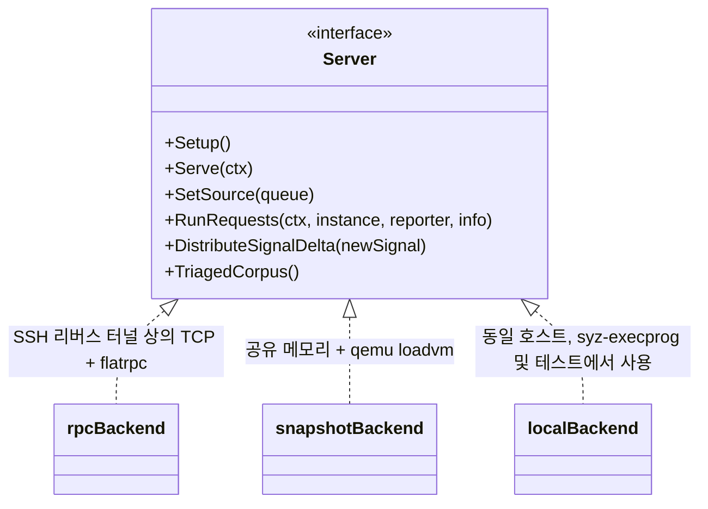

### 8.4 `pkg/aflow` (`45d8f0796` 이후, 2026년 1월): 에이전트 기반 워크플로

가장 최신이자 가장 실험적인 계층입니다. `pkg/aflow`는 syzkaller의 프리미티브 위에서 동작하는 **LLM 기반 워크플로**를 위한 프레임워크로, AI 에이전트가 호출할 수 있는 명명된 도구들을 제공합니다:

- `execute-seed` — 이 syzlang 프로그램을 VM에서 실행하고 캐시된 ID와 어떤 호출이 실패했는지를 반환
- `get-executed-program` — 해당 ID 뒤에 있는 프로그램과 호출별 에러 표시
- `read-syz-spec`, `syz-grepper` — 기술 파일 탐색 및 검색
- 동일한 실행 ID로 키가 지정된 커버리지 도구들

여기에 더해 워크플로들: 버그 수정 패치 적용, KCSAN 평가, Use-After-Free 심사.

LLM을 전혀 사용하지 않더라도 차용할 가치가 있는 두 가지 설계 디테일이 있습니다:

**콘텐츠 주소 지정 캐싱(Content-addressed caching).** 실행의 캐시 키는 (커널 커밋, 커널 설정, 디스크 이미지, VM 유형, VM 설정, 프로그램)의 해시입니다. 동일한 튜플을 두 번 요청하면 어떤 VM도 부팅되지 않습니다. 에이전트가 시행착오를 통해 탐색할 때, 이는 VM 부팅 시간에 묶여 있던 루프를 캐시 적중 시간에 묶인 루프로 변환합니다.

**교육 자료로서의 에러(Errors as teaching material).** 프로그램 파싱에 실패했을 때 도구는 단순히 "syntax error"를 반환하지 않습니다. 관련 syzlang 구문 규칙에 대한 알림을 담은 `BadCallError`를 반환합니다. 에러 메시지는 소비자를 위해 작성됩니다 — 여기서는 우연히 언어 모델이었지만, 동일한 원칙이 인간 개발자에게도 큰 도움이 됩니다.

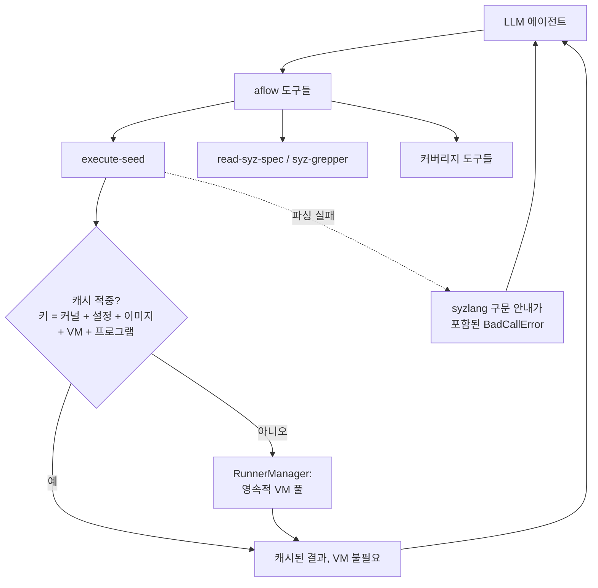

아키텍처 관점에서 `pkg/aflow`의 러너는 `syz-execprog`와 *동일한* 패턴입니다: 로컬 RPC 서버, 러너 모드의 executor, `queue.Source`. 2024년의 리팩터링 덕분에 이 계층은 프로젝트 전체를 포크하는 대신 불과 수백 줄의 코드로 구현될 수 있었습니다.

### 8.5 추가 백엔드들 (2025–2026)

VirtualBox (`f7988ea49`, 2025년 11월), crosvm (`f5ad0fe2f`, 2026년 8월), Firecracker (`a475c03a3`, 2026년 9월). 11년이 지난 후에도 새로운 VM 백엔드 추가는 여전히 일상적인 작업입니다 — 첫날 정의한 인터페이스가 견고하게 유지되었기 때문입니다.

`3c3cdf19a` (2026년 9월)는 규모는 작지만 특징적인 변화입니다: gVisor를 소스에서 빌드하는 것을 중단하고 **릴리스 tarball**로 소비하기 시작했습니다. 2016년의 `qemu -snapshot`과 한 단계 높은 차원에서 동일한 움직임입니다 — 환경을 재현하려 애쓰지 말고, 검증된 환경을 다운로드하여 사용하십시오.

### 8.6 syz-verifier의 재구축 (2025년 12월 ~ 2026년 1월)

2021년의 차분 테스터(§6.9)는 자체 RPC 서버, 자체 executor 배관, 자체 통계를 가지고 있었습니다 — 2024년의 리팩터링을 통해 이미 범용화된 인프라의 사설 복제본이었습니다. 2025년 12월에 이 복제본들이 삭제되었습니다:

- `22fca2542` (2025-12-04) *"prototype for new syz-verifier with new rpcserver and fuzzer"*
- `1687812d1` (2025-12-04) *"remove old rpc server, executor, monitor and stats"*
- `bd964999c` (2025-12-07) *"refactor corpus management"*, `pkg/manager`와 공유
- `445a654a8` (2026-01-13) *"transform syz-verifier from coverage-discovery fuzzer to kernel comparison tool for pre-learned corpus"*

마지막 커밋이 핵심을 명확히 해줍니다. 원래 도구는 탐색기(discoverer)와 비교기(comparator) 두 가지 모두가 되려 했습니다; 재구축된 도구는 오직 비교만 수행하며, 다른 프로세스가 이미 학습해 둔 코퍼스에서 입력을 가져옵니다. 단 하나의 역할, 단 하나의 컴포넌트, 그리고 다른 모든 것은 기존 엔진을 재사용합니다.

> **핵심 교훈:** 공유 인프라가 마침내 구축되었다면, 과거로 돌아가 사설 복제본들을 삭제하십시오. 메인라인이 지원하지 못할 때는 정당화되었던 포크도, 메인라인이 지원할 수 있게 된 순간 순수한 유지보수 비용으로 전락합니다 — 그리고 재작성은 대개의 경우 컴포넌트가 두 가지 역할을 동시에 하고 있었음을 알아차리는 순간이기도 합니다.

### 8.7 커널 소스 및 커널 커뮤니티 주변의 도구들

2025~2026년에 추가된 4개의 패키지는 퍼징 자체와는 직접적인 관련이 없으며, 바로 그 점이 핵심입니다 — syzkaller의 영역이 버그 리포트에 *인접한* 모든 것으로 확장되었습니다:

| 패키지 | 날짜 | 역할 |
|---|---|---|
| `pkg/kcov` (`c9f0a9924`) | 2025-09-15 | fuzzer에 결합되어 있던 KCOV 처리를 독립된 Go 패키지로 분리 |
| `pkg/codesearch` (`280ea308c`) | 2025-11-17 | 커널 빌드를 인덱싱하여 "이 함수의 소스를 보여줘", "주석을 보여줘", "이 파일에 무엇이 정의되어 있는가"를 질의할 수 있게 해주는 두 번째 clang 도구 (declextract에 이어) |
| `pkg/updater` (`a6deb8053`) | 2025-11-24 | syz-ci에서 자체 업데이트 로직을 추출 |
| `pkg/gerrit` (`5f1dd8561`) | 2026-01-29 | 커널의 Gerrit 기반 리뷰 인스턴스를 위한 Gerrit 클라이언트 |
| `pkg/lore-relay` (`ce741359c`) | 2026-04-07 | 대시보드와 `lore` 메일 아카이브를 함께 폴링하여 AI 작업 결과를 실제 메일링 리스트 스레드로 중계 |

`pkg/codesearch`는 주목할 만합니다: LLM 에이전트(§8.4)가 버그에 대해 추론하려면 *커널 코드를 읽어야* 하는데, grep은 충분히 훌륭한 인터페이스가 아니기 때문에 존재합니다. 재사용에 주목하십시오 — 이 도구는 *"declextract 도구의 규칙과 빌드 절차를 따릅니다"*. 즉 기술 추출을 위해 2024년에 구축된 clang 도구 인프라가 전혀 다른 두 번째 소비자를 얻게 된 것입니다.

`pkg/lore-relay`는 출력 파이프라인의 진정한 종착점입니다. 웹 대시보드에만 존재하는 발견 결과는 대부분의 메인테이너가 결코 보지 못합니다; 커널 작업은 메일링 리스트 스레드에서 이루어지므로 리포트가 그곳에 도달해야 합니다. 첫 번째 커밋 이후 11년이 지난 지금도 프로젝트는 여전히 원칙 §5를 위해 일하고 있습니다.

그리고 커널 기여자들을 XP, 레벨, 서브시스템 태그에서 파생된 RPG 직업, 이메일 도메인에서 파생된 "왕국(Kingdoms)"이 있는 *게임화된 리더보드*로 순위를 매기는 `pkg/dungeon` (`15d477690`, 2026-02-17)이 있습니다. 진지한 전제를 담은 장난입니다: syzkaller의 병목은 2017년 이후 인간의 주의력(attention)이었으며, 이는 syzbot 버그를 수정하는 일에 보람을 느끼게 하려는 시도입니다. 이것이 효과가 있는지 여부는 부차적입니다 — 프로젝트가 자신의 제약 조건이 어디에 있다고 믿는지를 가장 명확하게 보여주는 선언입니다.

---

## 9. 연도별 정리: 최초부터 현재까지의 모든 주요 설계 변화

위의 시대별 장에서는 변화를 *주제별*로 그룹화했습니다. 이 섹션은 *연도별*로 그룹화하는데, "무엇이 중요했고, 언제 일어났는가?"에 답하고자 할 때 가장 적합한 관점이기 때문입니다. 각 연도마다 한 문장의 주제와 실제로 설계를 변화시킨 변경 사항들의 표가 제공됩니다.

**유형(Kind)** 열을 가장 먼저 살펴보십시오:

| 유형 | 의미 |
|---|---|
| `DESIGN` | 시스템의 형태를 변경함 — 코드가 위치하는 곳, 상태를 소유하는 주체, 경계가 무엇인지 |
| `FEATURE` | 경계를 허물지 않고 새로운 역량을 추가함 |
| `ORACLE` | 무언가 잘못되었음을 *감지*하는 새로운 방식을 추가함 |
| `TARGET` | 퍼징할 새로운 OS나 새로운 유형의 머신을 추가함 |
| `PROCESS` | 프로젝트가 빌드, 테스트, 또는 리포트하는 방식을 변경함 |

단 3개 연도만 집중적으로 연구하고 싶다면 **2015년**(전체 아키텍처가 한 번에 등장), **2024년**(목적의식을 가지고 재구조화됨), **2017년**(도구에서 서비스로 전환됨)을 연구하십시오.

### 9.1 2015년 — 단 하나의 커밋으로 완성된 전체 머신

syzkaller의 모든 본질은 10월에 스케치되었으며, 남은 몇 달은 그 스케치가 유효하다는 것을 확인하는 데 쓰였습니다.

| 날짜 | 커밋 | 변경 사항 | 유형 |
|---|---|---|---|
| 10-12 | `874c5754b` | **최초 커밋(initial commit)**: 기술 파일 + 컴파일러 + `prog` + 커버리지 + IPC + fuzzer + manager + QEMU/local 백엔드, 총 8,025줄 | `DESIGN` |
| 10-14 | `c9b915608` | 호출 우선순위 및 선택 테이블 — 개발 2일차에 *입력 선택*이 진정한 문제임을 인식 | `DESIGN` |
| 10-16 | `587db99ba` | lkvm 백엔드: 세 번째 VM 백엔드를 통해 인터페이스가 인터페이스임을 입증 | `TARGET` |
| 12-03 | `cf2089138` | kmemleak 지원 — "충돌했다"를 넘어선 최초의 감지기 | `ORACLE` |
| 12-17 | `8e7ca7c5f` | `master/` 삭제: 첫 번째 중앙 코디네이터는 잘못되었음 (§4.4) | `DESIGN` |
| 12-28 | `eef80b3d7` | 기술 파일을 서브시스템별 파일로 분할 — 대규모 기여를 가능하게 한 변화 | `PROCESS` |

### 9.2 2016년 — 특수 커널 요구 중단, 일회성 확보

1월 어느 날의 두 커밋이 syzkaller가 세상에 *요구하는 것*을 바꾸어 놓았고, 세 번째 커밋은 샌드박싱을 버그 재현이 가능한 경계의 안쪽으로 옮겼습니다.

| 날짜 | 커밋 | 변경 사항 | 유형 |
|---|---|---|---|
| 01-19 | `d5c2595f0` | **업스트림 KCOV** 채택 — 커스텀 커널 패치 불필요 (§5.1) | `DESIGN` |
| 01-19 | `dfd341e34` | `qemu -snapshot`: 일회성이 사후 정리 루틴이 아닌 시스템의 속성이 됨 (§5.2) | `DESIGN` |
| 01-20 / 01-22 | `aa1b7fe3a`, `1e06d2baf` | **샌드박싱이 executor 내부로 이동**, 샌드박스가 재현 프로그램 내부에 포함될 수 있게 됨 (§5.6) | `DESIGN` |
| 08-26 | `0d0fbbe73` | 기술 파일 생성이 빌드로 이동; 사람이 생성된 Go 코드를 리뷰하지 않게 됨 (§1) | `PROCESS` |
| 11-17 | `cd74cc9cf` | **syz-hub**: 독립적인 manager들이 코퍼스와 재현 프로그램만 교환 (§4.4) | `FEATURE` |

### 9.3 2017년 — 도구에서 하나의 시스템(Institution)으로

2015년 이후 가장 분주했던 설계의 해. 실행에 *단계(stages)*가 생겼고, 기술 파일에 실제 컴파일러가 도입되었으며, 프로젝트는 멈추지 않는 서비스를 얻었고, 엔진은 OS에 독립적임이 입증되었습니다.

| 날짜 | 커밋 | 변경 사항 | 유형 |
|---|---|---|---|
| 04-07 | `8f58526cb` | **결함 주입(fault injection)**: 할당을 체계적으로 실패시켜 오류 경로 도달 (§5.7) | `FEATURE` |
| 05-22 | `127a9c2b6` | `pkg/ast`: 소스 위치가 보존되는 실제 파서, 에러 발생 시 라인 번호 명시 (§5.8) | `DESIGN` |
| 05-25 | `ffb5c7319` | **스매싱(smashing)**: 새로운 코퍼스 입력에 ~100회 집중 변이 — 서로 다른 입력에는 서로 다른 예산이 주어져야 함 (§5.7) | `DESIGN` |
| 06-19 | `6573032ff` | **syz-ci**: 가져오고, 빌드하고, 퍼징하고, 재시작하기를 영원히 반복. 단발 세션이 서비스가 됨 (§5.3) | `DESIGN` |
| 06-22 | `61d1beb28` | **대시보드 앱** — 훗날 syzbot이 된 시스템. 리포트 품질이 제품이 됨 (§5.3) | `DESIGN` |
| 08-16 | `07c84b670` | KCOV↔executor↔fuzzer 입출력 개편: **비교 힌트**를 위한 배관 구축 (§5.4) | `FEATURE` |
| 08-28 → 09-04 | `a7206b24c`, `b06c1bd32`, `8c64b078d` | `pkg/compiler` **정적 검사**: 타입 검사, `len` 대상, 생성자 없는 리소스 감지 (§5.8) | `PROCESS` |
| 09-20 → 10-23 | `8cb7d3dcf`, `af442a22d`, `179a86088`, `e72955082` | 6주 만에 Fuchsia, Windows, FreeBSD, NetBSD 지원 (§5.5) | `TARGET` |
| 10-16 | `85b1f93f8` | 모든 OS를 위한 단일 IPC 프로토콜 — 빠른 확장 이후의 통합 정리 (§5.9) | `DESIGN` |

### 9.4 2018년 — 피드백 지표와 모놀리스의 분해

syzkaller가 커버리지를 목적 자체로 취급하는 것을 멈추고, 기술할 수 없는 것을 변이하는 법을 배웠으며, 이분 탐색을 가능하게 하기 위해 syz-ci를 라이브러리로 분해한 해입니다.

| 날짜 | 커밋 | 변경 사항 | 유형 |
|---|---|---|---|
| 02-20 | `04cbdbd1a` | **신호 ≠ 커버리지**: 성공한 호출의 피드백이 실패한 호출의 피드백보다 우위를 점함; `pkg/signal` 탄생 (§6.1) | `DESIGN` |
| 02-24 | `9fe8aa42c` | **스쿼시된 ANY**: 기술된 구조체를 불투명 바이트로 변이하여 아무도 작성하지 않은 인코딩에 도달 (§6.2) | `DESIGN` |
| 05-10 | `4e1c0dbae` | `pkg/bisect`: 버그를 유발한 커밋과 수정한 커밋을 탐색 (§6.5) | `FEATURE` |
| 05-14 | `2407e7407` | `pkg/instance`: 라이브러리 호출로서의 빌드-부팅-테스트 — 이분 탐색의 전제 조건 (§6.5) | `DESIGN` |
| 06-12 | `06ece2ca6` | **런타임 기능 탐지**: 실제 머신을 프로빙하여 동작하지 않는 기능 비활성화 (§6.4) | `DESIGN` |
| 06-21 / 06-27 | `94ef62054`, `43da5e3a1` | `pkg/build`, `pkg/vcs`: 커널 빌드 및 git 작업의 재사용성 확보 (§6.5) | `DESIGN` |
| 07-25 / 08-03 | `2763e04c2`, `5ba57bfe1` | **`pkg/runtest`**: 기술 파일이 예상 결과를 갖는 단위 테스트를 갖춤 (§6.3) | `PROCESS` |
| 08-01 | `fbedd425b` | `pkg/mgrconfig`: 하나의 검증된 설정 스키마 | `PROCESS` |

### 9.5 2019년 — 레이스 감지기와 명문화된 가설

| 날짜 | 커밋 | 변경 사항 | 유형 |
|---|---|---|---|
| 10-04 | `b2f369e56` | **KCSAN**: 데이터 레이스 감지, executor가 실제로 병렬 실행하도록 강제함 (§6.6) | `ORACLE` |
| 12-30 | `6b36d3386` | **코퍼스 로테이션**: 로컬 최적점을 벗어나기 위해 각 VM이 세상의 무작위 슬라이스를 받음 (§6.7) | `FEATURE` |

### 9.6 2020년 — 측정, 롤백, 그리고 재측정

기능 면에서는 조용했지만 방법론 면에서는 두드러진 해: 로테이션 실험이 전체 사이클을 돌았고 커널 설정이 기계 편집 가능해졌습니다.

| 날짜 | 커밋 | 변경 사항 | 유형 |
|---|---|---|---|
| 01-07 | `6a8d39b1f` | 로테이션 **비활성화** — *"가장 쉽게 확인하는 방법은 끄고 무슨 일이 일어나는지 보는 것"* (§6.7) | `PROCESS` |
| 09-29 | `df5aa83a3` | `pkg/kcidb`: 커널 CI 공통 데이터베이스에 결과 게시 | `FEATURE` |
| 10-01 | `c1ff9c10c` | 9개월 후 3가지 구체적 수정사항과 함께 로테이션 **재활성화** (§6.7) | `PROCESS` |
| 10-15 | `9b8ec29c5` | `pkg/kconfig`: 파싱 및 diff 가능한 아티팩트로서의 `.config` (§6.8) | `DESIGN` |

### 9.7 2021년 — 인스트루멘테이션이 필요 없는 오라클

| 날짜 | 커밋 | 변경 사항 | 유형 |
|---|---|---|---|
| 06-23 | `f96cd674a` | **syz-verifier**: 하나의 프로그램을 두 커널에서 실행하고 결과 비교. *차이점*이 버그 신호임 (§6.9) | `ORACLE` |
| 07-28 | `5bfcec7df` | `pkg/auth`: syz-hub에서 재사용할 수 있도록 대시보드에서 인증 분리 | `PROCESS` |

### 9.8 2022년 — 인간에게 도달하는 라스트 마일

| 날짜 | 커밋 | 변경 사항 | 유형 |
|---|---|---|---|
| 07-15 | `6db8af716` | **`pkg/asset`**: 재현 프로그램에 필요한 커널 이미지와 디스크 이미지를 업로드하여 개발자가 *동일한* 환경을 부팅하도록 지원 (§6.10) | `FEATURE` |
| 12-14 | `2083933ab` | `pkg/subsystem`: 원인 파일 → 서브시스템 → 메인테이너 목록. vfs 단독으로 시작 (§6.10) | `FEATURE` |
| 12-17 | `8482d3c10` | `pkg/image`: 이미지 압축 로직이 `prog`를 떠남 (§6.10) | `PROCESS` |

### 9.9 2023년 — 내실 다지기(Consolidation)

단독 행으로 기록할 만한 구조적 변경은 없었습니다. `pkg/report`, 기술 파일, 대시보드가 수백 개의 점진적 커밋을 흡수했습니다. 이러한 해가 존재한다는 사실을 아는 것이 중요합니다: 2024년의 리팩터링은 그 전해에 새로운 구조를 만드는 대신 테스트와 정리 작업에 시간을 쏟았기 때문에 *가능*했습니다.

### 9.10 2024년 — 대대적인 리팩터링

여기의 모든 행은 소프트웨어 공학에서 널리 알려진 패턴들이며, 그렇기 때문에 §7에서 이 해를 심도 있게 다루었습니다. 순 효과: **호스트에 위치한 단 하나의 두뇌, VM 내부의 단순한 손.**

| 날짜 | 커밋 | 변경 사항 | 유형 |
|---|---|---|---|
| 02-16 | `c35c26ec6` | `pkg/fuzzer`: 엔진이 호스트 측 라이브러리가 됨 (§7.2) | `DESIGN` |
| 03-13 | `fc090d205` | `pkg/corpus`: 단일 코퍼스, 단일 커버리지 맵, 자체 테스트 구비 (§7.2) | `DESIGN` |
| 04-16 | `7009aebcd` | **`pkg/vminfo`**: 머신 검증이 호스트로 이전 — 아래의 모든 것을 가능하게 한 전제 조건 (§7.8) | `DESIGN` |
| 04-26 | `f10afd693` | `pkg/covermerger`: 커널 리비전 간 커버리지 병합 (§7.10) | `FEATURE` |
| 05-02 | `a3ce1723b` | **`pkg/flatrpc`**: Go `gob`을 대체하는 명시적 언어 중립 와이어 스키마 (§7.3) | `DESIGN` |
| 05-03 | `03820adae` | `pkg/fuzzer/queue`: 조합 가능한 계층으로서의 실행, 5줄 표현식으로 정의되는 우선순위 (§7.4) | `DESIGN` |
| 06-04 | `e16e2c9a4` | **executor 러너 모드; `syz-fuzzer/`, `pkg/ipc/`, `pkg/host/` 삭제** (§7.2) | `DESIGN` |
| 07-02 | `fc2b08301` | `vm/dispatcher`: 재시작 가능한 슬롯 풀로서의 VM; 부팅 실패는 채널 메시지임 (§7.5) | `DESIGN` |
| 07-05 | `4d77b9fe7` | **스냅샷 퍼징**: 매 프로그램 전 `loadvm` 실행, 트랜스포트를 희생하여 결정론 확보 (§7.6) | `DESIGN` |
| 07-29 → 12-02 | `3d5fb491e`, `b2c5a234a` | `syz-declextract`: 커널 소스를 읽고 syzlang을 작성하는 clang 도구 (§7.7) | `FEATURE` |
| 08-28 | `9bd464fce` | `pkg/coveragedb`: 커버리지가 시간 축을 얻음 (§7.10) | `FEATURE` |
| 08-30 | `8d09a3b3b` | `pkg/manager`: 재현 루프가 재사용 가능해짐 — 2025년 12월에 재사용됨 (§7.10) | `DESIGN` |
| 10-24 | `9a199dec5` | **관심 영역(focus areas)**: 주의력이 불리언 필터가 아닌 가중치가 됨 (§7.9) | `DESIGN` |
| 11-26 | `4f0d9df00` | `pkg/ifaceprobe`: 커널을 부팅하고 모든 디바이스 파일을 열어 도달 범위를 기록 (§7.7) | `FEATURE` |

### 9.11 2025년 — 커널 내부의 퍼즈 타깃, 그리고 배당을 지급하기 시작한 엔진

| 날짜 | 커밋 | 변경 사항 | 유형 |
|---|---|---|---|
| 01-23 | `79910ad71` | 기술 파일이 임베드된 `gob`+`flate` 블롭이 됨; **`sys/sys.go` 마침내 삭제**; 해시가 핸드셰이크 검증에 쓰임 (§8.1) | `DESIGN` |
| 09-15 | `9a3002038` | **`pkg/kfuzztest`**: `vmlinux` DWARF를 읽어 어노테이션된 커널 내부 퍼즈 타깃을 발견하고 런타임에 syzlang 생성 (§8.2) | `FEATURE` |
| 09-15 | `c9f0a9924` | `pkg/kcov`: 독립 패키지로서의 KCOV 처리 (§8.7) | `PROCESS` |
| 11-06 | `f7988ea49` | VirtualBox 백엔드 (§8.5) | `TARGET` |
| 11-17 | `280ea308c` | `pkg/codesearch`: 에이전트가 커널을 *읽을* 수 있게 해주는 두 번째 clang 도구 (§8.7) | `FEATURE` |
| 11-24 | `a6deb8053` | syz-ci에서 `pkg/updater` 분리 (§8.7) | `PROCESS` |
| 12-04 | `22fca2542`, `1687812d1` | 공유 rpcserver 및 fuzzer 기반으로 **syz-verifier 재구축**; 사설 복제본 삭제 (§8.6) | `DESIGN` |

### 9.12 2026년 — 에이전트, 그리고 병목으로서의 커뮤니티

| 날짜 | 커밋 | 변경 사항 | 유형 |
|---|---|---|---|
| 01-02 | `45d8f0796` | **`pkg/aflow`**: syzkaller 프리미티브 위의 LLM 기반 워크플로, 콘텐츠 주소 지정 실행 캐싱 구비 (§8.4) | `DESIGN` |
| 01-13 | `445a654a8` | syz-verifier의 역할 단일화: 사전 학습된 코퍼스를 기반으로 커널 비교 (§8.6) | `DESIGN` |
| 01-29 | `5f1dd8561` | `pkg/gerrit`: 커널의 Gerrit 리뷰 인스턴스를 위한 클라이언트 (§8.7) | `FEATURE` |
| 02-17 | `15d477690` | `pkg/dungeon`: 게임화된 기여자 리더보드 — 병목이 어디에 있는지에 대한 선언 (§8.7) | `FEATURE` |
| 04-07 | `ce741359c` | `pkg/lore-relay`: AI 작업 결과를 실제 메일링 리스트 스레드로 중계 (§8.7) | `FEATURE` |
| 06-01 | `fc63d1254` | **`pkg/execbackend`**: 실행 자체가 인터페이스가 됨 — RPC, 스냅샷, 로컬 (§8.3) | `DESIGN` |
| 08-07 | `f5ad0fe2f` | crosvm 백엔드 (§8.5) | `TARGET` |
| 09-02 | `a475c03a3` | Firecracker 백엔드 (§8.5) | `TARGET` |
| 09-11 | `3c3cdf19a` | gVisor를 소스 빌드 대신 릴리스 tarball로 소비 (§8.5) | `PROCESS` |

### 9.13 이 목록의 형태가 시사하는 바

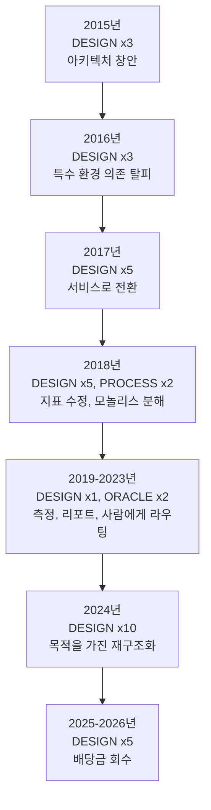

학습자가 얻어야 할 세 가지 패턴:

**설계 변화는 군집(cluster)을 이루지만, 기능은 그렇지 않습니다.** 2015년, 2017년, 2024년이 전체 `DESIGN` 행의 절반 이상을 차지합니다. 그 사이에는 `FEATURE`, `ORACLE`, `PROCESS` 작업의 긴 구간이 있습니다. 지속적으로 재구조화만 하는 코드베이스는 절대 안정화되지 않으며, 재구조화를 전혀 하지 않는 코드베이스는 경화(ossify)됩니다. syzkaller는 이를 폭발적인 집중 기간을 통해 수행하며, 각 집중 기간 전에는 테스트와 정리 기간이 선행됩니다 — 2023년에는 구조적 변화가 전혀 없었으며, 2024년은 그 덕분에 가능했습니다.

**어려운 변화는 추가(addition)가 아니라 재배치(relocation)입니다.** `DESIGN` 행들이 실제로 무엇을 말하는지 보십시오: 커버리지가 패치에서 업스트림으로 이동하고, 샌드박싱이 executor 내부로 이동하고, 머신 검증이 호스트로 이동하고, 엔진이 VM 외부로 이동하고, 통신 포맷이 암시적 방식에서 선언적 방식으로 이동하고, 실행이 인터페이스 뒤로 이동했습니다. 새로운 기능을 추가한 것은 거의 없습니다. 기존 역량을 경계의 더 나은 쪽으로 옮긴 것입니다 — 그리고 *그것*이 다음 라운드의 기능들을 촉발시켰습니다.

**역량(Capability)은 그것을 가능하게 한 변화로부터 수년 뒤에 나타납니다.** `pkg/manager`는 2024년 8월에 재사용 가능해졌고 2025년 12월에 재사용되었습니다. 2024년에 기술 파일 추출을 위해 구축된 clang 도구 인프라는 2025년 11월에 무관한 두 번째 소비자를 얻었습니다. `pkg/aflow`가 프로젝트 전체 포크 대신 수백 줄의 코드로 구현될 수 있었던 것은 *오로지* 2024년의 리팩터링 덕분이었습니다. 재구조화가 가치가 있었는지 판단할 때, 그 증거는 수년의 시차를 두고 나타납니다.

---

## 10. 차용할 만한 5가지 설계 원칙

11년의 세월을 이번 주에 당장 적용할 수 있는 것들로 압축해 봅니다:

### 1. 입력을 추측하지 말고 모델링하라 (Model the input, do not guess it)
무작위 바이트로는 유효한 파일 디스크립터를 생성할 수 없습니다. 대상 인터페이스의 선언적 모델은 비록 부분적이고 약간 부정확하더라도 유효 처리량(throughput)을 수천 배 증가시킵니다. 그리고 모델을 코드가 아닌 *데이터*로 다루면, 다른 사람들이 엔진을 이해하지 않고도 커버리지를 확장할 수 있습니다.

### 2. 영속적 상태를 폭발 반경 밖에 두라 (Keep durable state out of the blast radius)
2024년 리팩터링의 핵심 요체입니다. 잃어서는 안 되는 것과 죽을 것으로 예상되는 것을 식별하고, 그 사이에 좁은 프로토콜을 두십시오. 처리 중이던 인플라이트 작업은 큐에 다시 넣을 수 있지만, 축적된 지식은 다시 도출할 수 없습니다.

### 3. 실패를 정상적인 케이스로 설계하라 (Design for the failure as the normal case)
VM은 충돌합니다 — 그것이 *목적*이며 예외 상황이 아닙니다. 따라서 부팅 실패는 채널 메시지이고, 재시작은 다음 루프 반복이며, 모든 요청은 재시도 시맨틱을 가집니다. 자동화 시스템에서 성공 경로(happy path)만을 유일하게 설계된 경로로 둔다면, 시스템은 수명의 대부분을 불행한 경로(unhappy path)에서 허우적대며 보내게 될 것입니다.

### 4. 모든 경계에서 스키마를 명시하라 (Make the schema explicit at every boundary)
Go와 C++ 사이의 FlatBuffers 스키마. 핸드셰이크 시점에 검증되는 기술 테이블의 콘텐츠 해시. 선언적 VM 타입 레지스트리. 두 컴포넌트가 합의해야 하는 모든 곳에서 합의 내용은 명문화되고 런타임에 검사됩니다.

### 5. 출력 파이프라인이 시스템의 절반이다 (The output pipeline is half the system)
syzkaller는 몇 분 만에 충돌을 찾을 수 있습니다. 그것을 *수정된 버그*로 전환하려면 중복 제거, 심볼화, 최소화, C 재현 프로그램 생성, 이분 탐색, 서브시스템 라우팅, 메인테이너 이메일 발송이 필요합니다 — 퍼저가 이미 잘 작동한 이후에 투입된 수년간의 엔지니어링입니다. 아무도 조치하지 않는 발견 결과는 가치가 없습니다.

---

## 11. 다음으로 읽을 것: 컴포넌트 맵

5개의 문서가 syzkaller의 설계를 다룹니다. 의도적으로 각 문서는 시스템의 **서로 다른 측면**을 다룹니다 — 이 표는 색인이자 완전성 검증(completeness check)입니다. 열 제목을 다음과 같이 읽으십시오: *"내가 컴포넌트 Y에 대해 X를 알고 싶다면 어떤 문서를 보아야 하는가?"*

| 핵심 컴포넌트 | **History** (왜 존재하는가) | **manager-on-board** (어떻게 조율되는가) | **execprog-design** (단일 프로그램이 어떻게 실행되는가) | **mutation-design** (선택이 어떻게 이루어지는가) | **syzlang-design** (API가 어떻게 모델링되는가) |
|---|---|---|---|---|---|
| **기술 파일 / syzlang** | §4.1 API를 *데이터*로 다루기로 한 결정 | — | §2.2 실제로 읽는 텍스트 형태 | §8 1% 범위 무시 정책 | **주요 문서**: 언어, 컴파일러, 상수, `syz-sysgen` |
| **프로그램 모델** (`Prog`/`Call`/`Arg`) | — | — | **주요 문서**: §2.2, 4가지 표현 방식 | §4–5 변이 대상 | §2 `prog.Type` 인스턴스화 방식 |
| **아레나 / 메모리 레이아웃** | — | — | **주요 문서**: §2.3, 고정 베이스 + 상대 오프셋 | — | §1.7 스쿼시된 ANY |
| **Copyin 명령어 스트림** | §7.3 스키마가 필요한 이유 | — | **주요 문서**: §2.3 *해석 실행* | — | — |
| **C 재현 프로그램** (`pkg/csource`) | §5.3 리포트 품질이 중요한 이유 | §8 `strace_bin` 설정 | **주요 문서**: §5.7 *동일한 소스, 컴파일됨* | — | — |
| **KCOV / 커버리지 수집** | §5.1 레버리지로서의 업스트림화 | §3.3 충돌 감지 | **주요 문서**: §2.4 호출별 브래킷 | — | — |
| **신호 vs 커버리지** | §6.1 성공 호출을 우선시한 2018년 결정 | — | §4.8 저장소의 구분 | §3 우선순위 활용 방식 | — |
| **코퍼스** | §7.2 독립 패키지화; §6.7 로테이션 실험 | §1.2 동시 사전 로드 | **주요 문서**: §4 스토리지, `pkg/db`, 버전 관리 | §3 선택 및 가중치 부여 | — |
| **생성(Generation)** | §4.2 개발 2일차의 호출 우선순위 | — | — | **주요 문서**: §8 값 분포 | §1.4 순서 제약으로서의 리소스 |
| **변이(Mutation)** | §6.2 스쿼시된 ANY, 통제된 후퇴 | — | — | **주요 문서**: §4–5 연산자 및 가중치 | — |
| **실행 단계** (스매시, 결함 주입) | §5.7 입력별로 예산이 다른 이유 | — | — | **주요 문서**: §1, §7 스매시 및 힌트 제한 | — |
| **관심 영역 / 커버리지 필터** | **주요 문서**: §7.9 불리언을 대체한 가중치 | — | — | §3 가중치 합성 방식 | — |
| **버그 감지기** (KASAN, KCSAN, leak) | §6.6 매년 하나의 오라클, 각각 치른 비용 | §6 리포트 파이프라인 관점 | §2.4 `slowdown`이 존재하는 이유 | — | — |
| **차분 테스트** (`syz-verifier`) | §6.9 커버리지가 필요 없는 오라클; §8.6 재구축 | — | — | — | — |
| **기술 파일 테스트** (`pkg/runtest`) | §6.3 데이터 파일에도 테스트 필요 | — | — | — | §4 테스트 포맷 |
| **선택 테이블(Choice table)** | §4.2 원래의 아이디어 | — | — | **주요 문서**: §6 정적 + `2*sqrt` 동적 | §1.4 참조하는 리소스 그래프 |
| **힌트** (`KCOV_TRACE_CMP`) | §5.4 배관 커밋 | — | §2.7 `-hints` 플래그 | **주요 문서**: §7 `shrinkExpand`, 제한기 | — |
| **최소화(Minimization)** | — | — | §4.7 *코퍼스* 집합 커버; §5.5 *repro* 축소 | §1 신호 보존 프레디케이트 | — |
| **심사 / 디플레이킹** | — | §1.3 진입 제어 단계 | — | **주요 문서**: §1 5회 중 3회 통계 | — |
| **큐 계층** | §7.4 특수 케이스 대신 조합 | — | **주요 문서**: §3 계층 스택 | §1 우선순위로서의 `Order`/`Alternate` | — |
| **와이어 프로토콜** (flatrpc) | §7.3 경계에서의 스키마 | §4 핸드셰이크 | §2.7 플래그 → 2개 비트마스크 | — | §2.4 리비전 해시 검사 |
| **Executor** | §7.2 "단순한 손"으로 축소 | §3.2 부팅당 `RunRequests` | **주요 문서**: §2.4, §2.6 의사 시스템 콜 | — | §2.4 `syscalls.h`, `SYZ_REVISION` |
| **샌드박스** | — | §8 설정 키 | **주요 문서**: §2.10 각각의 역할 | — | — |
| **VM 추상화** | §4.3 5개 메서드 인터페이스 | **주요 문서**: §2 등록, QEMU 인자 | — | — | — |
| **VM 생명주기 / 디스패처** | §7.5 재시작 가능한 슬롯 풀 | **주요 문서**: §3.1 `Loop`, `runInstance` | — | — | — |
| **베어메탈 / `isolated`** | §4.3 수많은 백엔드 중 하나 | **주요 문서**: §5 pstore, 복구, 전원 제어 | — | — | — |
| **머신 검증(Machine check)** | §6.4 런타임 기능 탐지; §7.8 호스트로 이전 | **주요 문서**: §4 프로브 후 스왑 트릭 | — | — | §2.4 리비전 일치 필요성 |
| **충돌 감지 / 리포트** | §6.11 서브시스템으로서의 파싱 | **주요 문서**: §3.3, §6 파이프라인 | — | — | — |
| **재현 프로그램 추출** | §5.3 출력 파이프라인 | §1.2 `reproVMs` 예산 | **주요 문서**: §5 전체 알고리즘 | — | — |
| **스냅샷 모드** | §7.6 도입 이유와 대가 | **주요 문서**: §7 2단계 백엔드 | — | §1 디플레이킹 감소 이유 | — |
| **기술 파일 자동화** | §7.7 정적 + 동적 융합 | §1.1 `-mode iface-probe` | — | — | **주요 문서**: §3 declextract, ifaceprobe |
| **에이전트 계층** (`pkg/aflow`) | §8.4 가장 최신 계층 | — | §6 캐시된 실행 | — | §6 `syzspec` 인덱스/버킷 |

### 의도적으로 다루지 않은 내용

경계를 솔직하게 밝혀 여러분이 여기서 얻을 수 없는 것이 무엇인지 명확히 합니다:

| 다루지 않은 내용 | 이유 |
|---|---|
| `syz-hub` 내부 구현 | 역할만 설명됨 (History §4.4). 소규모 코퍼스 교환 서비스이며, 일반화하여 배울 만한 설계 패턴은 없습니다. |
| 대시보드 / syzbot 내부 구현 | App Engine 웹 서비스입니다. History §5.3에서 그 역할과 중요성을 설명했습니다; 구현은 설계라기보다는 제품(product)입니다. |
| 이분 탐색 (`pkg/bisect`) | History §6에서 언급됨. git 기반의 빌드 및 테스트 루프입니다; 개념적으로는 단순하지만 운영상 손이 많이 갑니다. |
| 커버리지 *보고서* (`pkg/cover`, `syz-cover`, 웹 UI) | execprog-design §2.5에서 원시 PC 방출을 다루며, 이것이 설계 관점의 핵심입니다. 이로부터 HTML을 렌더링하는 것은 단순 도구류(tooling)입니다. |
| `pkg/report` 정규식 코퍼스 | *아키텍처*는 manager-on-board §3.3 및 §6에 나와 있습니다. OS별 수백 개의 정규식 패턴은 설계가 아니라 데이터입니다. |
| 결함 주입, KCSAN, 메모리 누수 검사 | 등장하는 위치에서 명시됨. 각각은 syzkaller의 설계라기보다는 syzkaller가 활성화하는 커널 기능입니다. |

### 권장 독서 순서


순서가 중요합니다: 프로그램이 무엇인지 이해하기 전에는 변이를 이해할 수 없으며, 단일 실행에 무엇이 필요한지 보기 전에는 manager의 복잡성을 제대로 평가할 수 없습니다.

---

## 부록: 이 장의 모든 주장을 직접 검증하는 방법

위의 모든 진술은 검증 가능합니다. 유용한 레시피들:

```bash
# 특정 패키지나 파일이 언제 도입되었는가?
git log --format='%ad %h %s' --date=short --diff-filter=A --reverse -- 'pkg/fuzzer/fuzzer.go'

# 특정 항목이 언제 삭제되었는가? (삭제를 찾는 것은 대개의 경우 대체물을 설명해 줍니다.)
git log --format='%ad %h %s' --date=short --diff-filter=D -- 'syz-fuzzer/fuzzer.go'

# 특정 커밋이 실제로 무엇을 변경했는가?
git show --stat 874c5754bb22dbf77d6b600ff91f0f4f1fc5073a

# 어떤 파일들이 가장 자주 함께 변경되는가? (숨겨진 결합도를 드러냄)
git log --format='---' --name-only -- '*.go' | sort | uniq -c | sort -rn | head -30

# 누가 서브시스템을 소유하고 있으며 현재의 근거는 무엇인가?
git log -p --follow pkg/fuzzer/job.go | grep -A5 'deflake'
```

어떤 코드베이스에서든 큰 보상을 가져다주는 두 가지 습관:

- **상수 옆의 주석을 읽으십시오.** syzkaller의 매직 넘버들에는 이유가 첨부되어 있습니다. `pkg/fuzzer/job.go`는 "80% 확률로 재현되는 프로그램은 94%의 확률로 deflake를 통과한다"고 설명합니다. `prog/prio.go`는 *"현재 구현은 매우 기본적이며 상수들 뒤에 어떤 이론도 없다"*는 솔직한 고백으로 시작합니다. 이러한 솔직함은 어떤 손잡이가 정밀하게 튜닝되었고 어떤 것이 단순한 추측인지 정확히 알려줍니다.
- **추가뿐만 아니라 삭제를 읽으십시오.** 2015년에 `master/`가 삭제된 것과 2024년에 `syz-fuzzer/`가 삭제된 것은 이 역사에서 가장 많은 정보를 제공하는 두 가지 사건입니다. 프로젝트가 무엇을 제거했는지는 그 프로젝트가 무엇을 배웠는지를 말해줍니다.
