# 변이(Mutation) 설계: syzkaller는 다음에 무엇을 시도할지 어떻게 결정하는가

> **대상 독자:** 퍼저(fuzzer)가 대략 어떤 일을 하는지는 이해하고 계실 것입니다. 이제 그 누구도 명쾌하게 설명해주지 않았던 부분, 즉 **이 숫자들은 도대체 어디서 나온 것인가?**를 알고 싶을 것입니다. 왜 splice 가중치는 200이고 remove-call은 10일까요? 왜 더 많은 커버리지를 가진 프로그램이 더 자주 선택되며, 정확히 얼마나 더 많이 선택될까요?
>
> 이 문서는 실제 상수를 포함하여 syzkaller의 모든 우선순위(priority) 계산 과정을 둘러보는 안내서입니다. 이 문서를 다 읽고 나면 여러분만의 도구를 위한 유사한 우선순위 시스템을 구축할 수 있을 것이며, 더 중요한 점은 syzkaller의 수치 중 어떤 것이 원칙에 입각한 것이고 어떤 것이 추측(guess)임을 인정한 것인지 명확히 알 수 있게 될 것입니다.

---

## 0. 한 문단 요약

퍼저의 처리량(throughput)은 하드웨어에 의해 고정됩니다. 퍼저의 *생산성(productivity)*은 다음에 무엇을 실행할지 선택하는 것에 전적으로 달려 있습니다. syzkaller는 각각 고유한 우선순위 체계를 가진 **5단계 중첩 계층**에서 이 선택을 내립니다:

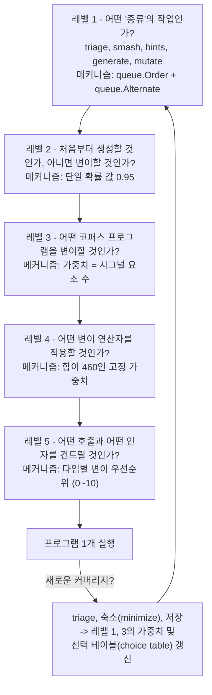

그리고 이에 직교하는(orthogonal) 또 하나의 메커니즘이 있습니다: **어떤 시스템 콜 뒤에 어떤 시스템 콜이 와야 하는가** — 호출을 생성하거나 삽입할 때 사용되는 *선택 테이블(choice table)*입니다.

아래의 모든 내용은 이 6가지 메커니즘 중 하나에 해당합니다.

---

## 1. 레벨 1: 어떤 종류의 작업인가?

퍼저는 단순한 단일 루프가 아닙니다. 매 순간 여러 *종류*의 작업이 다음 실행 슬롯을 차지하기 위해 경쟁합니다. `pkg/fuzzer/fuzzer.go`의 `execQueues`:

```go
ret.source = queue.Order(
    ret.triageCandidateQueue,
    ret.candidateQueue,
    ret.triageQueue,
    queue.Alternate(ret.smashQueue, skipQueue),
    queue.Callback(fuzzer.genFuzz),
)
```

여기서 `skipQueue`는 일반적인 경우 `3`이며, 패치를 테스트할 때는 `2`입니다.

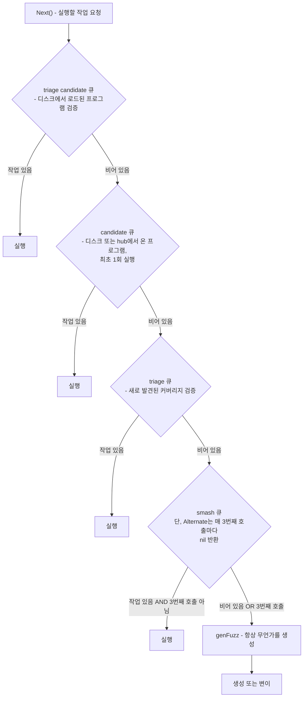

### 이 순서인 이유

`queue.Order`는 엄격한 우선순위(strict priority)를 적용합니다. 작업이 남아 있는 첫 번째 계층이 실행권을 가져갑니다. 이 순서는 명확한 정책을 표현합니다:

1. **Triage는 모든 것에 우선합니다.** 프로그램이 새로운 커버리지를 보이면, 그것이 실제인지(일회성 플레이크가 아닌지) 확인하고 축소(minimize)한 *후에* 이를 기반으로 다음 작업을 쌓아 올려야 합니다. triage를 미루면 코퍼스에 검증되지 않은 쓰레기가 쌓이고, 이후의 모든 변이가 그 오염을 물려받게 됩니다.
2. **후보(Candidate) 작업은 퍼저가 자체 발견한 입력의 triage보다 우선합니다.** `corpus.db`에서 로드되었거나 hub에서 수신된 프로그램은 이미 가치가 검증된 것입니다. 이들을 빠르게 코퍼스에 편입시켜 변이 작업이 양질의 재료를 활용할 수 있게 합니다.
3. **Smash는 조절(throttling)되며, 기아(starvation) 상태에 빠지지 않습니다.** `Alternate(smashQueue, 3)`은 매 3번째 호출마다 아무것도 반환하지 않으므로, smash 작업은 사용 가능한 슬롯 중 최대 3개 중 2개만 차지합니다. smash는 하나의 좋은 입력을 깊이 파고드는(deep exploitation) 작업으로 매우 가치 있지만, 퍼저 전체를 독점해서는 안 됩니다.
4. **`genFuzz`는 최후의 보루(floor)입니다.** `Fuzzer.Next()`는 nil이 반환되면 패닉을 일으키지만, `Callback` 계층은 항상 무언가를 생성하므로 처리할 작업은 상시 존재합니다.

> **차용할 만한 패턴:** 다단계 스케줄링 정책을 작은 콤비네이터들의 조합으로 표현하십시오. `Order`와 `Alternate`의 결합은 단 5줄의 읽기 쉬운 코드로 구현됩니다. 이와 대조적으로 카운터와 `if` 분기로 가득 찬 스케줄러 함수는 기아(starvation) 버그가 숨어들기 쉬운 온상이 됩니다.

### 각 작업 유형이 하는 일

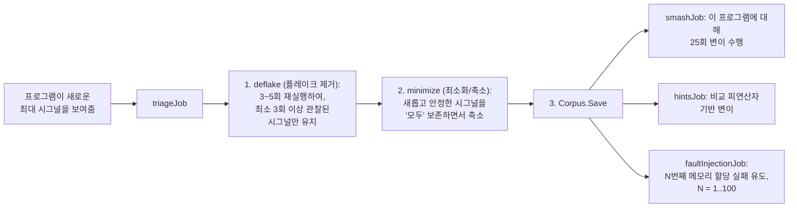

### 디플레이크(deflake) 상수들과 그 이면의 근거

이 부분은 코드베이스 전체에서 가장 문서화가 잘 되어 있는 수치들입니다 (`pkg/fuzzer/job.go`):

| 상수 | 값 | 적용 대상 |
|---|---|---|
| `deflakeNeedRuns` | 3 | 새로 발견된 프로그램 |
| `deflakeMaxRuns` | 5 | 새로 발견된 프로그램 |
| `deflakeNeedCorpusRuns` | 2 | 코퍼스에서 재-triage 중인 프로그램 |
| `deflakeMinCorpusRuns` | 4 | 코퍼스 재-triage |
| `deflakeMaxCorpusRuns` | 6 | 코퍼스 재-triage |
| `deflakeTotalCorpusRuns` | 20 | 코퍼스 재-triage 상한선 |
| `deflakeNeedSnapshotRuns` | 2 | 스냅샷 모드 |

소스 코드에는 다음과 같이 설계 목표가 명시되어 있습니다: **5회 실행 중 3회**에서 공통으로 나타나는 시그널을 선택하는데, 이는 *"80%의 확률로 재현되는 프로그램이 deflake()를 통과할 확률이 94%에 달하기 때문"*입니다. 이는 베르누이 시행 $B(5, 0.8)$에서 성공 횟수가 3회 이상일 확률을 계산하여 검증할 수 있는 엄밀한 통계적 근거입니다.

코퍼스 재-triage에는 더 완화된 '6회 중 2회' 기준이 적용되며, 주석에서 그 이유를 밝히고 있습니다: 수천 개의 코퍼스 프로그램에 엄격한 기준을 적용하여 재등록할 경우 *"축소(minimization), hints, smash, fault injection 단계에서 엄청난 양의 중복 작업이 발생"*하기 때문입니다. 중요도와 리스크에 따라 요구되는 신뢰 수준이 다릅니다.

스냅샷 모드에서는 2회 실행만 필요합니다. 스냅샷 실행은 결정론적(deterministic)이므로 제거해야 할 플레이크가 훨씬 적기 때문입니다.

동작 메커니즘은 교집합(intersection)의 사다리 구조로 이루어집니다:

```go
for j := needRuns - 1; j > 0; j-- {
    intersect := info.signals[j-1].Intersection(thisSignal)
    info.signals[j].Merge(intersect)
}
info.signals[0].Merge(thisSignal)
```

루프가 끝나면 `signals[k]`는 **최소 k+1회 실행에서 관찰된** 시그널을 보유하게 되므로, `signals[needRuns-1]`이 곧 안정적인 시그널이 됩니다. 매우 우아한 방식입니다: 단 하나의 배열로 모든 신뢰 수준을 동시에 도출해 냅니다.

각 반복 실행에는 해당 프로그램을 이미 실행한 실행기(executor) 목록을 담은 `Avoid` 목록이 전달되므로, 재실행은 *서로 다른* VM에서 이루어집니다. VM 3번에서만 나타나는 커버리지 요소는 프로그램의 고유 속성이 아니라 VM 3번의 특정 상태에 기인한 속성이기 때문입니다.

> **차용할 만한 패턴:** 노이즈가 있는 측정을 검증할 때는 신뢰도 목표를 수치로 명시하고, 이를 달성하는 임계값을 선정한 뒤, **그 확률을 주석에 적어 두십시오.** 6개월이 지나면 그 '5회 중 3회'가 원칙에 따른 것이었는지 자의적인 것이었는지 아무도 기억하지 못합니다.

### 축소(Minimization)의 조건자

`triageJob.minimize`는 다음과 같은 조건자를 사용하여 `prog.Minimize`를 실행하며, 조건이 충족될 때만 축소를 수락합니다:

```go
info.newStableSignal.Intersection(mergedSignal).Len() == info.newStableSignal.Len()
```

새롭고 안정한 시그널의 모든 비트가 반드시 보존되어야 합니다. 즉, 축소는 *설계상 시그널 보존적(signal-preserving by construction)*이며, 축소된 프로그램 역시 새로운 코드 영역에 반드시 도달함이 보장됩니다.

두 번째 보호 장치인 `reexecutionSuccess`는 성공하던 호출이 실패하는 호출로 바뀌는 것을 거부합니다. 주석에 따르면 *"성공하는 호출이 훨씬 더 가치 있다"*고 설명합니다. `openat`이 실패하여 그 결과 `ioctl`이 `EBADF`를 반환하는 프로그램은 기술적으로 더 짧고 기술적으로 여전히 해당 커버리지를 유발할 수 있지만, 질적으로 더 나쁜 프로그램입니다. 우리가 관심을 두는 대상을 더 이상 실질적으로 테스트하지 못하게 되기 때문입니다.

---

## 2. 레벨 2: 생성할 것인가, 변이할 것인가?

`pkg/fuzzer/fuzzer.go`의 `genFuzz`는 그 결정의 파급력에 비해 놀라울 정도로 단순합니다:

```go
mutateRate := 0.95
if !fuzzer.Config.Coverage {
    // 실제 커버리지 시그널이 없는 경우, 대체(fallback) 시그널이
    // 취약하므로 프로그램을 더 자주 생성합니다.
    mutateRate = 0.5
}
...
if rnd.Float64() < mutateRate { req = mutateProgRequest(fuzzer, rnd) }
if req == nil { req = genProgRequest(fuzzer, rnd) }
if fuzzer.Config.Collide && rnd.Intn(3) == 0 {
    req = &queue.Request{Prog: randomCollide(req.Prog, rnd), ...}
}
```

커버리지가 정상 작동할 때는 **95% 변이, 5% 신규 생성**입니다.

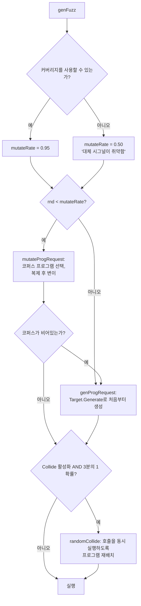

95대 5의 분할이 의미하는 바는 다음과 같습니다: **누적된 지식의 가치는 새로운 무작위성보다 약 20배 더 큽니다.** 코퍼스에 저장된 프로그램은 이미 첫 관문을 통과한 상태입니다. 즉, 올바른 디바이스를 열었고, 유효한 파일 디스크립터를 획득했으며, 올바른 소켓 상태를 설정해 두었습니다. 이를 버리고 처음부터 새로 생성하는 것은 이러한 사전 노력을 낭비하는 셈입니다.

그러나 커버리지를 사용할 수 없을 때 syzkaller는 시스템 콜 번호와 errno에서 파생된 취약한 대체 시그널에 의존합니다. 평가 점수 함수가 약하면 "흥미로운 입력"이라는 개념 자체가 무의미해지므로, 코퍼스에 대한 신뢰도가 떨어지고 탐색(exploration)에 동등한 비중을 두어야 합니다. **활용(exploit)과 탐색(explore)의 비율은 피드백을 얼마나 신뢰할 수 있는가와 직결됩니다.** 이는 참으로 통찰력 있는 설계입니다.

`randomCollide`는 경쟁 상태(race condition)를 찾기 위해 동시성을 만듭니다: 20% 확률로 `DoubleExecCollide`를 사용하고, 나머지 경우에는 `DupCallCollide`, `AssignRandomAsync`, `AssignRandomRerun`을 혼합하여 적용합니다.

> **차용할 만한 패턴:** 탐색/활용 비율을 상수로 고정하지 말고 피드백 품질의 함수로 만드십시오. 점수 평가 함수의 신뢰도가 떨어지면 자동으로 탐색 쪽으로 비중을 옮겨야 합니다.

---

## 3. 레벨 3: 어떤 코퍼스 프로그램을 변이할 것인가?

### 가중치 기반 선택기 (Weighted Picker)

`pkg/corpus/prio.go` — 약 20줄의 코드가 핵심적인 역할을 수행합니다:

```go
type ProgramsList struct {
    progs    []*prog.Prog
    sumPrios int64
    accPrios []int64   // 누적 합
}

func (pl *ProgramsList) saveProgram(p *prog.Prog, prio int) {
    if prio == 0 { prio = 1 }
    pl.sumPrios += int64(prio)
    pl.accPrios = append(pl.accPrios, pl.sumPrios)
    pl.progs = append(pl.progs, p)
}

func (pl *ProgramsList) chooseProgram(r *rand.Rand) *prog.Prog {
    randVal := r.Int63n(pl.sumPrios) + 1
    idx := sort.Search(len(pl.accPrios), func(i int) bool {
        return pl.accPrios[i] >= randVal
    })
    return pl.progs[idx]
}
```

이 코드는 전형적인 **누적 가중치 배열 + 이진 탐색(binary search)** 구조이며, syzkaller 코드베이스에서 가장 재사용 가치가 높은 단일 스니펫입니다.

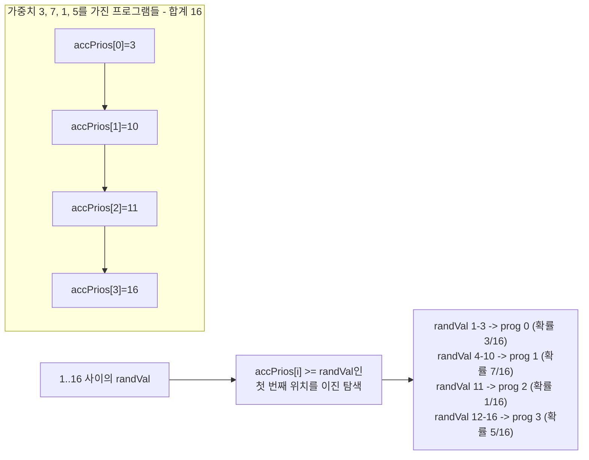

$O(\log n)$의 선택 복잡도, 분할 상환 $O(1)$의 삽입 복잡도, 정확한 비례 배분을 제공합니다. `prio == 0 → 1` 하한선은 어떤 프로그램도 영구적으로 도달 불가능해지지 않도록 보장합니다.

### 가중치: `len(Signal)`

`Corpus.Save`에서 새로운 항목은 `corpus.saveProgram(inp.Prog, len(inp.Signal))` 형태로 등록됩니다. **가중치는 해당 프로그램이 생성한 시그널 요소의 개수입니다.**

따라서 200개의 새로운 엣지를 커버한 프로그램은 1개만 커버한 프로그램보다 변이 대상으로 선택될 확률이 200배 더 높습니다. 이 근거는 일종의 베팅입니다: 많은 코드를 건드린 프로그램은 잠재력이 풍부한 영역에 위치해 있으므로, 약간의 변형을 가했을 때 새로운 경로에 도달할 확률이 더 높다는 판단입니다.

코드를 읽을 때 알아둘 만한 두 가지 함정이 있습니다:

- *기존* 프로그램에 시그널이 병합되어 다시 저장될 때, `saveProgram`은 다시 호출되지 **않습니다**. 선택 가중치는 다음 `Corpus.Minimize()`가 모든 것을 재계산할 때까지 최초 삽입 시 계산된 값으로 유지됩니다. 이는 의도된 단순화입니다: 가중치는 어차피 근사치이며 축소 작업이 주기적으로 실행되기 때문입니다.
- `Corpus.Minimize`는 프로그램 목록을 **제자리(in-place)에서** 비워야 합니다. 통계 객체들이 해당 구조체에 대한 포인터를 유지하고 있기 때문입니다. 주석에도 명시되어 있듯이, 관측 가능성(observability) 요구사항이 데이터 구조 설계를 제약할 수 있음을 보여주는 사례입니다.

### 포커스 영역 (Focus Areas): 그 위의 두 번째 계층

`Corpus.ChooseProgram`은 `focus_areas`가 설정되었을 때 선택적 외부 선택 단계를 추가합니다:

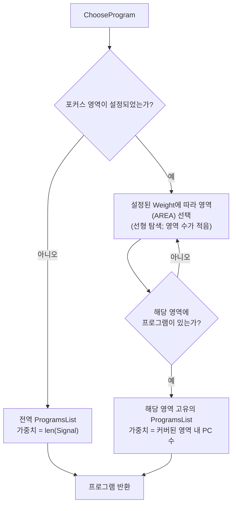

두 가지 서로 다른 가중치 함수에 주목하십시오:

- **전역(Globally)**: 가중치 = 시그널 수 — "이 프로그램이 우리에게 얼마나 많은 것을 알려주었는가?"
- **영역 내(Within an area)**: 가중치 = `inAreaPCs(item.Cover)`, 영역 내에 속하는 커버된 PC의 수 — "이 프로그램이 *이 특정 코드*를 얼마나 많이 건드리는가?"

이것이 바로 "내 새 드라이버를 집중적으로 퍼징하라"는 요구를 처리하는 메커니즘입니다. 소스 파일이나 함수 목록과 가중치를 지정하면, 해당 코드를 건드리는 프로그램이 불균형적으로 더 많이 선택됩니다. `CoverPCs` 목록이 비어 있는 영역은 전역 목록을 재사용하므로, "내 드라이버에 노력의 70%를 쏟고 나머지 전체에 30%를 쏟아라"와 같은 정책을 표현할 수 있습니다.

(현재 구현에서 영역 선택 루프는 가중치 기반이지만 약간의 편향이 존재합니다. 정확한 비율이 필요하다면 알아둘 가치가 있습니다.)

> **차용할 만한 패턴:** 누적 가중치 선택기는 "중요도에 비례한 샘플링"이 필요한 모든 문제로 일반화할 수 있습니다. 그리고 그 조합 방식에 주목하십시오: 먼저 *카테고리*를 가중치 기반으로 선택한 다음, 카테고리 *내부*에서 가중치 기반으로 선택합니다. 두 개의 단순한 계층이 하나의 평면적 분포로는 표현하기 까다로운 우선순위를 매끄럽게 표현해 냅니다.

---

## 4. 레벨 4: 어떤 변이 연산자를 적용할 것인가?

이제 `prog/mutation.go` 내부를 살펴볼 차례이며, 여기에 그 유명한 수치들이 있습니다.

```go
var DefaultMutateOpts = MutateOpts{
    ExpectedIterations: 5,
    MutateArgCount:     3,

    SquashWeight:     50,
    SpliceWeight:     200,
    InsertWeight:     100,
    MutateArgWeight:  100,
    RemoveCallWeight: 10,
}
```

총 가중치 합계 = **460**. 따라서 반복 1회당 확률은 다음과 같습니다:

| 연산자 | 가중치 | 확률 | 동작 설명 |
|---|---:|---:|---|
| `splice` | 200 | **43.5%** | 무작위 코퍼스 프로그램의 *모든* 호출을 임의의 위치에 삽입 |
| `insertCall` | 100 | **21.7%** | 새 호출 하나를 생성하여 뒷부분에 편향되도록 삽입 |
| `mutateArg` | 100 | **21.7%** | 한 호출의 하나 이상의 인자를 변경 |
| `squashAny` | 50 | **10.9%** | 구조화된 포인터 인자를 원시 바이트로 납작하게 만든(squash) 뒤 바이트를 변이 |
| `removeCall` | 10 | **2.2%** | 임의의 호출 하나를 삭제 |

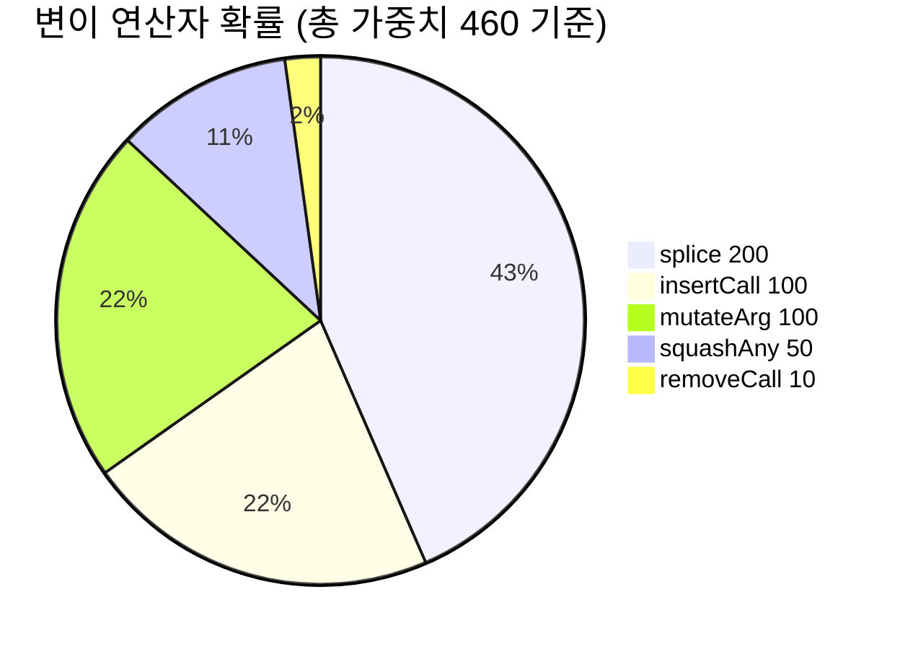

### 철학으로서의 가중치 해석

**Splice가 43.5%로 압도적입니다.** Splicing은 다른 코퍼스 프로그램 전체를 가져와 통째로 주입합니다. 이는 매우 공격적인 연산으로, 프로그램 길이를 두 배로 늘리고 서로 관련 없는 두 하위 시스템 간의 상호작용을 유발할 수 있습니다. 분산이 가장 큰 연산자이자 가장 높은 가중치를 부여받은 연산자인데, 이는 syzkaller가 조심스러운 국소적 수정보다 **이미 잘 작동하는 구성 요소들 간의 교차 수분(cross-pollination)**에 더 큰 베팅을 걸고 있음을 보여줍니다. 유전 알고리즘의 교차(crossover) 이면에 깔린 직관과 동일합니다.

**Remove-call은 2.2%로 거의 쓰이지 않습니다.** 프로그램 축소는 시그널을 보존하며 무작위 삭제보다 훨씬 똑똑한 전용 최소화(minimization) 패스가 담당합니다. 정보를 파괴하기만 하는 변이 연산자에는 예산을 거의 배정하지 않는 것이 타당합니다.

**10.9%의 Squash는 타입 시스템의 탈출구(escape hatch)입니다.** 일반적으로 인자는 타입을 존중하는 방식으로 변이됩니다: `int32[0:10]`은 범위를 벗어나지 않고, 포인터는 유효한 포인터로 유지됩니다. 하지만 실제 버그는 버퍼 크기와 일치하지 않는 길이 필드, 가비지 값을 가리키는 중첩 포인터처럼 *형식이 잘못된(malformed)* 구조체를 필요로 하는 경우가 많습니다. `squashAny`는 타입이 지정된 인자 트리를 불투명한 바이트 블롭으로 변환한 다음 원시 바이트 변이를 적용합니다. 타입 시스템이 더 이상 사용자를 보호하지 않게 되며, 바로 그것이 노리는 목적입니다.

`squashAny`에는 주목할 만한 실행 순서 디테일이 있습니다: 블롭을 변이하기 *전에* `analyze()`를 호출하는데, 주석에 따르면 *"변이 후 블롭이 데이터 영역 경계를 벗어나 커질 수 있으며, 그 경우 analyze가 경계 외 접근으로 충돌할 수 있기 때문"*입니다. 정확성을 보장하는 속성으로서의 연산 순서 제어입니다.

### 루프와 `ExpectedIterations`

```go
for stop, ok := false, false; !stop; stop = ok && len(p.Calls) != 0 && r.oneOf(opts.ExpectedIterations) {
    // 연산자 하나를 선택하여 적용; ok = 성공 여부
}
```

종료 조건을 유심히 살펴보십시오: 루프는 **변이가 *성공한* 경우에만**(`ok`가 반드시 true여야 함) 1/5의 확률로 종료됩니다. 코퍼스가 비어 있어 splice에 실패했거나, 납작하게 만들 대상이 없어 squash에 실패했거나, 이미 호출 제한에 도달하여 insert에 실패한 연산자는 비용이 들지 않으며 루프가 재시도합니다.

따라서 **적용되는 변이의 기댓값은 5회**이며, 실제 횟수는 기하 분포(geometric distribution)를 따릅니다: 때로는 1회, 때로는 15회가 적용됩니다. 이 분포는 매우 중요합니다. 항상 정확히 1회의 변이만 적용하면 너무 국소적으로만 탐색하게 되고, 항상 10회를 적용하면 목표를 지나쳐 버립니다. 기하 분포는 두 가지 스케일을 모두 아우릅니다.

`squashAny`에 달린 주석은 이 가중치들이 명목상의 값일 뿐임을 인정합니다: *"모든 호출에 납작하게 만들 수 있는 대상이 있는 것은 아니므로, 실제로는 우선순위가 더 낮아집니다."* 각 연산자의 *실효* 확률은 프로그램에 따라 달라지는 적용 가능 빈도에 좌우됩니다. 선언된 가중치는 상한선 역할을 합니다.

> **차용할 만한 패턴:** `stop = ok && oneOf(N)` — 실패는 비용 없이 재시도하고, *성공한* 단계의 수를 명시된 평균을 갖는 기하 분포로 만드십시오. 단 두 줄로 "연산자 적용 불가 처리"와 "스텝 크기 다양화"를 모두 해결합니다.

### `mutateArg` 내부: 내부 루프

```go
for stop, ok := false, false; !stop; stop = ok && r.oneOf(ctx.opts.MutateArgCount) {
```

동일한 패턴이 적용되어 `MutateArgCount = 3`이므로, `mutateArg` 호출 1회당 **인자 변이 기댓값은 3회**입니다. 매 변이 후에는 `patchConditionalFields`가 조건을 더 이상 만족하지 않는 조건부 공용체(union) 필드를 수정하고, `assignSizesCall`이 길이 필드를 재계산하여 프로그램의 내부 일관성을 유지합니다.

### `insertCall`과 뒷부분 편향 (End Bias)

```go
idx := r.biasedRand(len(p.Calls)+1, 5)
```

`biasedRand(n, k)`는 $[0, n)$ 범위의 값을 반환하되, $n-1$이 선택될 확률이 $0$이 선택될 확률의 **$k$배**가 되도록 합니다. $k = 5$일 때, 프로그램의 끝부분에 삽입될 확률은 시작 부분에 삽입될 확률보다 5배 높습니다.

이유는 이렇습니다: syzkaller 프로그램은 파이프라인(열기, 설정, 사용) 형태로 구성됩니다. 흥미로운 *새로운* 동작은 대개 프로그램에 이미 존재하는 사전 설정 뒤인 맨 끝에 와야 합니다. 0번 위치에 삽입하면 대개 무관한 접두사만 하나 더 생길 뿐입니다.

구현은 선형 확률 밀도의 역 누적 분포 함수(inverse-CDF) 표본 추출 공식을 사용합니다:

```go
nf, kf := float64(n), float64(k)
rf := nf * (kf/2 + 1) * r.Float64()
bf := (-1 + math.Sqrt(1+2*kf*rf/nf)) * nf / kf
return int(bf)
```

`biasedRand`는 배열 길이, 파일명 길이, 블롭 추가 크기, `resourceCentric`의 호출 체인 길이 등 코드베이스 전반에서 널리 재사용됩니다.

---

## 5. 레벨 5: 어떤 호출과 어떤 인자를 건드릴 것인가?

### 호출 선택: 인자 복잡도에 따른 가중치 부여

```go
func chooseCall(p *Prog, r *randGen) int {
    for _, c := range p.Calls {
        var totalPrio float64
        ForeachArg(c, func(arg Arg, ctx *ArgCtx) {
            prio, stopRecursion := arg.Type().getMutationPrio(...)
            totalPrio += prio
            ctx.Stop = stopRecursion
        })
        prioSum += totalPrio
        callPriorities = append(callPriorities, prioSum)
    }
    if prioSum == 0 { return -1 } // 모든 호출에 인자가 없음.
    return sort.SearchFloat64s(callPriorities, prioSum*r.Float64())
}
```

세 번째 계층에서도 동일한 누적 배열 기법이 다시 등장합니다. **호출의 가중치는 해당 호출이 가진 인자들의 변이 우선순위의 합입니다.** 따라서 200바이트짜리 중첩 구조체를 가진 `ioctl$SOMETHING`은 변경할 가치가 거의 없는 `close(fd)`보다 훨씬 더 자주 선택됩니다.

이는 올바른 직관입니다: 변이 예산은 변이할 거리가 있는 곳으로 흘러가야 합니다.

### 인자 선택: `mutationArgs`

`collectArg`는 선택된 호출의 모든 인자를 순회하며 동일한 누적 배열을 구성하되, 다음 항목들은 건너뜁니다:

- 우선순위가 `dontMutate` (0)인 인자
- 출력 방향(output-direction) 인자 (버퍼나 배열 제외: 출력 스칼라의 값은 어차피 커널에 의해 덮어씌워짐)
- 고정 크기의 0길이 인자

핫 패스(hot path)에서 메모리 할당을 방지하기 위해 `[16]mutationArg` 스택 버퍼를 사용하는데, 이는 가비지 컬렉션(GC) 언어로 퍼저를 작성하는 사람이라면 눈여겨볼 만한 디테일입니다. 그런 다음 `chooseArg`가 `goal := prioSum * r.Float64()`를 계산하고 이진 탐색을 수행합니다.

### 우선순위 테이블: 모든 수치

우선순위 척도 (`prog/mutation.go`):

```go
maxPriority = 10.0
minPriority = 1.0
dontMutate  = 0.0
```

| 타입 | 우선순위 | 근거 |
|---|---|---|
| `ArrayType` | **10** (고정 길이면 0) | 원소 개수와 순서를 변경하는 것은 가치 높은 구조적 변이임 |
| `BufferType` (압축됨) | **10** | *"압축된 버퍼(예: 디스크 이미지)의 변이에 우선순위 부여"* — 파일시스템 이미지는 버그의 보고임 |
| 특수 생성기가 있는 `StructType` / `UnionType` | **10** (재귀 중단) | 직접 작성된 생성기가 최선의 방법을 알고 있으므로, 하위 필드를 추가로 건드리지 않음 |
| `UnionType` (일반, 필드 >1개) | **10** | 활성 공용체 변형(variant)을 전환하는 것은 큰 의미적 변화임 |
| `IntType` (범위 값 ≤256개) | **10** | 작은 범위는 모든 값이 유의미할 가능성이 높음을 의미하므로 모두 시도 |
| `BufferType` (일반) | **8** (`0.8 × max`) | 바이트 블롭은 훌륭한 변이 대상임 |
| `FlagsType` | `rangeSizePrio(len(Vals))`, **비트마스크면 +1** | 비트마스크 플래그는 가산점 부여: *"변이에 더 많은 연산(비트 연산)이 포함될 수 있음"* |
| `ProcType` | **5** (`0.5 × max`) | 프로세스별 고유 값; 적당히 흥미로움 |
| `ResourceType` | **5** | 다른 리소스를 가리키도록 변경하는 것은 유의미하지만 제약이 큼 |
| `VmaType` | **5** | 메모리 매핑 인자 |
| `PtrType` | **3** (`0.3 × max`); 이미 특수 포인터면 **0** | 포인터 *대상*은 자체 인자를 통해 변이되며, 포인터 자체는 상대적으로 덜 변이됨. 소스 코드에서 인정: *"TODO: 이것도 변이해야 하지만, 아직 이를 위한 코드가 없음"* |
| `IntType` (범위 없음) | `log2(bits) + 1` → 8비트는 **4**, 32비트는 **6**, 64비트는 **7** | 비트 폭이 넓은 정수일수록 탐색할 영역이 많음 |
| `IntType` (범위 >256개) | 범위 없는 정수와 동일 | 넓은 범위는 제약 없는 정수처럼 동작함 |
| `LenType` | **1** (`0.1 × max`); KFuzzTest는 **0** | *"LenType 변이는 설명서 기준으로 '잘못된' 결과만 생성함"* — 때로는 바로 그것이 필요한 경우도 있으므로 0은 아님 |
| `ConstType` | **0** | 상수임 |
| `CsumType` | **0** | 자동으로 재계산됨 |
| `BufferType` (출력 전용 및 고정 길이) | **0** | 커널이 값을 덮어씀 |
| `BufferType` (정확히 1개 값을 갖는 문자열) | **0** | *"사실상 상수(상당수가 파일 이름)"* |
| `ArrayType` (고정 길이) | **0** | 변경할 것이 없음 |
| `UnionType` (필드 1개, 일반) | **0** | 전환할 다른 선택지가 없음 |

`rangeSizePrio(size)`:

```go
case size == 0:  0
case size == 1:  1                                    // minPriority
default:         min(size/3 + 4, 9)
```

주석 설명: *"대부분의 호출에서 플래그에 가능한 값이 15개 이하이므로 임계값은 15입니다."* 크기가 15일 때 상한선인 `15/3 + 4 = 9`가 됩니다. 따라서 15개 이상의 값을 가진 플래그 세트는 모두 9로 고정되고, 더 작은 세트는 비례하여 감소합니다.

`ConstType.mutate`와 `CsumType.mutate`는 모두 `panic()`을 발생시킵니다 — 우선순위가 `dontMutate`이기 때문에 코드에 도달할 수 없어야 정상입니다. 이 패닉은 우선순위 테이블과 변이 테이블이 일치함을 확인하는 단언(assertion) 역할을 합니다.

### 솔직한 주석

우선순위 함수 바로 위에 적혀 있는 주석:

> `// TODO: 최적의 우선순위 값을 추정하는 방법을 찾을 것.`
> `// 각 타입에 우선순위를 할당한다. 불리언(boolean)이 기준 타입이며,`
> `// 가능한 값이 두 개뿐이므로 최소 우선순위를 갖는다.`

이 주석은 파일 전체에서 가장 가치 있는 주석입니다. 이 수치들은 최적화 프로세스의 산출물이 아니라, **하나의 기준점(불리언 = 최소 우선순위)을 중심으로 정립된 정보에 근거한 추측(informed guesses)**입니다. 이를 알면 다음 사실을 깨닫게 됩니다:

- 이 수치들을 절대적인 진리로 신성시하지 마십시오.
- 유사한 시스템을 구축할 때, 명확히 이해하고 있는 기준 케이스를 하나 정하고 그에 비례하여 크기를 조정하는 것은 완전히 타당한 방법론입니다.
- 이 영역에는 실질적인 연구 기회가 존재하며, 작성자들도 이를 잘 알고 있습니다.

> **차용할 만한 패턴:** 가중치를 새로 만들어야 할 때는 완전히 이해하고 있는 기준 케이스를 하나 골라 가중치를 정의하고, 다른 모든 것을 그 배수로 표현한 뒤, **그렇게 했다는 사실을 문서화하십시오.**

### 블롭(Blob) 변이: 바이트 수준 연산자들

선택된 대상이 원시 바이트인 경우, `mutateData`는 7개의 연산자 중에서 균등하게 선택합니다:

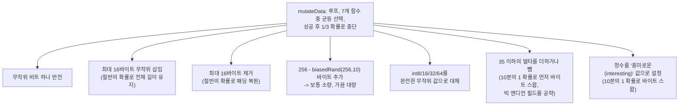

`maxBlobLen = 100 << 10` (100 KB)로 크기 증가를 제한합니다. `maxDelta = 35`는 산술적 증감의 경계를 설정합니다 — 작은 델타는 오프바이원(off-by-one) 및 경계 조건 버그를 찾아내며, 큰 무작위 값은 5번 연산자가 처리합니다.

바이트 스왑 변형이 존재하는 이유는 커널 코드가 네트워크 및 파일시스템 데이터를 빅 엔디언으로 처리하기 때문입니다. 바이트 스왑이 없다면 네트워크 헤더의 길이 필드는 사실상 도달하기 불가능에 가깝습니다.

---

## 6. 선택 테이블: 어떤 시스템 콜 뒤에 어떤 시스템 콜이 오는가

이것은 직관적으로 독립된(orthogonal) 메커니즘입니다 — 기존 프로그램을 변이할 때가 아니라, 프로그램을 *생성*하거나 호출을 *삽입*할 때 사용됩니다. 또한 가장 흥미로운 수학이 적용된 부분이기도 합니다.

`prog/prio.go`의 파일 헤더에는 모델과 주의사항이 함께 명시되어 있습니다:

> 주어진 호출 쌍 X와 Y에 대해, 우선순위는 호출 X를 포함하는 프로그램에 호출 Y를 추가했을 때 새로운 커버리지를 얻을 가능성이 높은지에 대한 우리의 추측입니다. 현재 알고리즘에는 정적(static)과 동적(dynamic)의 두 가지 구성 요소가 있습니다. [...] **참고: 현재 구현은 매우 기초적이며, 어떠한 상수에도 이론적 배경은 없습니다.**

### 두 가지 구성 요소

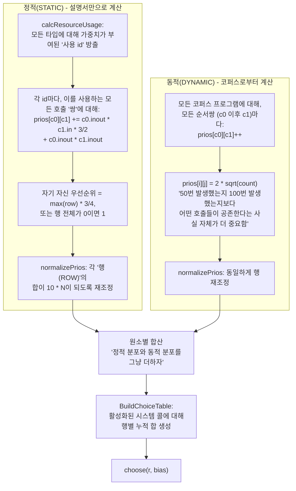

### 정적 구성 요소 상세

`calcResourceUsage`는 모든 시스템 콜의 모든 타입을 순회하며 가중치가 부여된 "사용 id(usage id)"를 방출합니다 — 즉, "이 호출은 이런 종류의 대상을 다룬다"를 뜻하는 토큰입니다:

| 타입 | 사용 id | 가중치 |
|---|---|---|
| `ResourceType` (가장 구체적인 종류) | `res-k1-k2-...` | **10** |
| `ResourceType` (상속 체인의 중간 종류) | `res-k1-...` | **2** |
| `AuxResources`에 나열된 `ResourceType` | `res<Name>` | **1** |
| 구조체/공용체/배열을 가리키는 `PtrType` | `ptrto-<원소 이름>` | **10** |
| `BufferFilename` | `filename` | **10** (`DirIn` 강제) |
| 세부 종류를 가진 `BufferString`/`BufferGlob` | `str-<SubKind>` | **2** |
| `VmaType` | `vma` | **5** |
| 일반 int, blob, text | — | 없음 |

그런 다음 모든 사용 id와 이를 공통으로 사용하는 모든 호출 쌍에 대해 다음을 계산합니다:

```go
prios[w0.call][w1.call] += w0.inout*w1.in*3/2 + w0.inout*w1.inout
```

비대칭성이야말로 핵심입니다. `w.in`은 입력 성격의 방향에 대한 가중치이고, `w.inout`은 전반적인 가중치입니다. `inout × in` 항에 곱해진 `* 3/2`는 **"c0가 리소스를 생성하고, c1이 그 리소스를 소비한다"**는 관계에 일반적인 단순 동시 등장보다 1.5배 더 높은 점수를 부여함을 의미합니다. 소스 코드에도 명시되어 있습니다:

> c0가 리소스를 생성하는 호출이고 c1이 그 리소스를 사용하는 호출일 때 더 높은 우선순위가 할당됩니다.

이는 지극히 정확합니다: `socket` 뒤에 `connect`가 와야 한다는 사실을 아는 것이, `connect`와 `bind`가 어렴풋이 관련되어 있다는 사실을 아는 것보다 훨씬 유용하기 때문입니다.

자기 자신에 대한 우선순위는 `max(row) * 3/4`를 부여받습니다 — *"높아야 하지만, 너무 높아서는 안 된다."* 동일한 시스템 콜을 두 번 호출하는 것(파일 두 개 열기, 소켓 두 개 열기)은 종종 유용하지만, 전체를 지배해서는 안 됩니다.

### 동적 구성 요소와 제곱근(Square Root)

```go
// 50번 발생했는지 100번 발생했는지보다 어떤 호출들이
// 실제로 공존한다는 사실 자체가 더 중요합니다.
// 큰 카운트의 영향을 줄이기 위해 sqrt()를 사용합시다.
prios[i][j] = int32(2.0 * math.Sqrt(float64(val)))
```

이것은 문서 전체에서 가장 범용적으로 전용할 수 있는 아이디어입니다. 단순 동시 등장 횟수는 가혹한 빈익빈 부익부(rich-get-richer) 역학을 유발합니다: 10,000번 등장한 쌍이 다른 모든 것을 압도하고, 퍼저는 거의 그 쌍만 생성하게 되며, 그로 인해 해당 쌍의 등장 횟수가 더욱 증가하여 분포가 완전히 붕괴하게 됩니다.

제곱근은 동적 범위를 압축합니다. 100회 등장 → 20; 10,000회 등장 → 200. 순위 관계는 그대로 유지되지만, 100배의 빈도 차이가 10배의 우선순위 차이로 완화됩니다. 빈번한 쌍이 선호되기는 하되, 모든 것을 빨아들이는 블랙홀(attractor)이 되지는 않습니다.

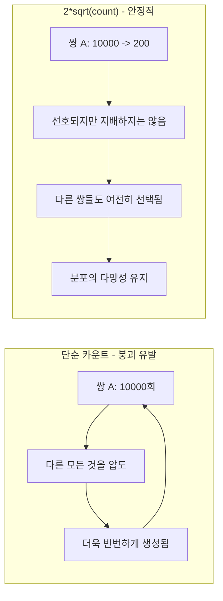

> **차용할 만한 패턴:** 빈도 카운트를 가중치로 사용하기 전에 오목 함수(concave transform; sqrt, log 등)를 적용하십시오. 자체 출력을 다시 입력으로 피드백하는 모든 시스템은 이 기법을 적용하지 않으면 초기에 형성된 선호로 수렴하여 붕괴합니다.

### 행 정규화 (Row Normalization)

`normalizePrios(prios, n)`은 **각 행**의 합이 `10 × N`이 되도록 스케일을 재조정합니다. 여기서 N은 생성 가능한 시스템 콜의 수입니다. 정적 및 동적 구성 요소에 *각각 독립적으로* 적용된 후 합산됩니다.

두 가지 효과가 있습니다. 첫째, 두 구성 요소의 크기가 대등해져서 합산이 의미를 갖게 됩니다 — 그렇지 않으면 우연히 더 큰 숫자를 낸 쪽이 지배해 버립니다. 둘째, 모든 행이 적절한 확률 분포를 형성하므로, "호출 X가 주어졌을 때 다음 호출을 선택하라"는 연산이 X가 가진 관계의 수에 관계없이 일관된 의미를 유지합니다.

### `choose`: 5%의 탈출구

```go
func (ct *ChoiceTable) choose(r *rand.Rand, bias int) int {
    if r.Intn(100) < 5 {
        // 5%의 결정은 완전히 무작위로 내립니다.
        return ct.calls[r.Intn(len(ct.calls))].ID
    }
    if bias < 0 { bias = ct.calls[r.Intn(len(ct.calls))].ID }
    run := ct.runs[bias]
    runSum := int(run[len(run)-1])
    x := int32(r.Intn(runSum) + 1)
    return sort.Search(len(run), func(i int) bool { return run[i] >= x })
}
```

**선택의 5%는 테이블을 완전히 무시합니다.** 이는 엡실론 탐욕(epsilon-greedy)의 엡실론에 해당합니다: 모델이 가치 없다고 판단한 시스템 콜이라도 이따금씩 시도될 수 있도록 보장하는 탐색의 최소 하한선입니다. 이것이 없다면 우선순위 모델이 과소평가한 시스템 콜은 영구적으로 보이지 않게 됩니다 — 그리고 이 모델은 명시적으로 "기초적이며 상수 뒤에 이론이 없다"고 밝히고 있으므로, 분명히 일부 시스템 콜을 과소평가하고 있습니다.

`bias` 매개변수는 `generateCall`에서 전달됩니다:

```go
biasCall := -1
if insertionPoint > 0 {
    insertionCall := p.Calls[r.Intn(insertionPoint)].Meta
    if !insertionCall.Attrs.NoGenerate {
        // 생성 불가능한 호출 쪽으로 편향되지 않도록 주의해야 합니다.
        biasCall = insertionCall.ID
    }
}
idx := s.ct.choose(r.Rand, biasCall)
```

프로그램 내의 **임의의 앞선 호출**이 새 호출의 선택에 편향을 부여합니다. 바로 직전 호출이 아니라 접두부 전체에서 무작위로 고른 호출이므로, 프로그램은 마지막 호출뿐만 아니라 앞선 어떤 부분과도 응집성(coherence)을 발전시킬 수 있습니다.

### 재생성 주기

```go
regenerateEveryProgs := 333
if len(fuzzer.Config.Corpus.Programs()) < 100 {
    regenerateEveryProgs = 33
}
```

주석은 상쾌할 정도로 솔직합니다: *"이 숫자들 이면에는 깊은 아이디어도 계산도 없었습니다."*

테이블을 재구축하는 작업은 시스템 콜 수에 대해 $O(N^2)$이므로 끊임없이 수행할 수는 없습니다. 하지만 동적 구성 요소는 계속 증가하는 코퍼스에 의존합니다. 코퍼스가 아주 작은 초기에는 프로그램이 하나 추가될 때마다 전체 그림이 크게 바뀌므로 33번마다 재구축합니다. 이후에는 333번마다 재구축합니다.

---

## 7. 힌트(Hints): 커널이 답을 알려줄 때

비교 힌트(comparison hints)는 질적으로 완전히 다르므로 별도의 섹션으로 다룰 가치가 있습니다: 단순한 추측이 아니라 **커널의 자체 실행으로부터 추출된 정보**이기 때문입니다.

### 문제 상황

```c
if (header->magic != 0xCAFEBABE)
    return -EINVAL;
/* 흥미로운 핵심 코드 */
```

무작위 변이로 이 값을 맞추려면 약 $2^{32}$번의 시도가 필요합니다. "흥미로운 값" 목록을 뒤져봐도 `0xCAFEBABE`는 거기에 없습니다.

### 메커니즘

`ExecFlagCollectComps`를 활성화하면 계측된(instrumented) 커널이 수행한 모든 비교 연산과 두 피연산자 값을 보고합니다. 따라서 다음과 같은 사실을 알게 됩니다: "PC 0x... 위치에서 커널이 `0x41414141`과 `0xCAFEBABE`를 비교했다." 우리의 입력에는 `0x41414141`이 포함되어 있었습니다. 이제 값을 치환하기만 하면 됩니다.

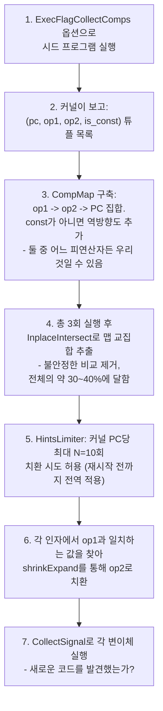

### `shrinkExpand`: 타입 변환(Casts) 처리

이 부분이 영리한 핵심입니다. 커널은 우리가 건넨 값을 그대로 비교하는 경우가 드물며, 대개 먼저 타입 변환을 거칩니다:

```c
void f(u32 v) {
    if ((u8)v == 0xab) { ... }
}
```

우리는 `0x1234`를 전달했습니다. 커널은 `0x34`와 `0xab`를 비교했습니다. 순진하게 값을 치환하면 상위 바이트를 잃어버리고 `0xab`가 됩니다. 올바른 해답은 `0x12ab`입니다 — **하위 바이트에 치환 값을 끼워 넣고 나머지는 유지하는 것**입니다:

```go
replacer := (v &^ mask) | newV
```

`shrinkExpand`는 `{8, 4, 2, 1, -4, -2, -1}` 너비를 시도합니다. 여기서 음수는 부호 확장(sign-extension)을 의미하며(부호 비트가 설정되지 않은 경우 건너뜀), 각 너비에 대해 **리틀 엔디언과 빅 엔디언 해석을 모두** 시도합니다. 주석에서 빅 엔디언이 왜 중요한지 설명합니다:

> 커널 코드는 데이터를 변환하는 것이 아니라(즉, `ntohs(pkt->proto) == ETH_P_BATMAN`이 아님) 상수를 변환합니다.

따라서 네트워크 프로토콜 비교는 바이트 스왑된 상수로 나타나며, 오직 빅 엔디언 매칭을 통해서만 찾아낼 수 있습니다.

또한 생성 시 사용되는 매직 값 목록인 `specialIntsSet`에 이미 존재하는 치환 값은 건너뜁니다. 주석에 따르면 *"특수 정수(0 등)는 이미 높은 확률로 삽입하므로 여기서는 특수 정수로의 치환을 시도하지 않는다"*고 밝힙니다. 어차피 시도할 값에 힌트 예산을 낭비할 이유가 없습니다. 서로 독립적인 두 메커니즘 간의 훌륭한 중복 제거 사례입니다.

### `HintsLimiter`: 과도한 후보 생성 제한

```go
const N = 10  // 전역 기준, 커널 PC당 치환 시도 횟수
```

설계 근거: *"너무 많은 후보가 생성되어 퍼저가 이를 전혀 감당하지 못할 수 있습니다(hints 작업이 무한히 증가함). 힌트가 실제로 변환 없이 입력에서 나온 것이라면 첫 번째 시도에서 바로 맞춰야 합니다."*

단 하나의 hints 작업도 수천 개의 후보를 쏟아낼 수 있습니다. 제한을 두지 않으면 hints 작업이 퍼저가 처리하는 속도보다 빠르게 불어나 다른 모든 작업을 밀어내 버립니다. PC당 10회 제한은 탄탄한 논리를 갖춘 저비용 전역 스로틀입니다: 힌트가 진짜라면 거의 즉시 효과를 발휘하기 때문입니다.

### 제외 대상과 그 이유

`generateHints`는 다음과 같은 인자 종류를 건너뜁니다:

| 제외 대상 | 이유 |
|---|---|
| 출력 방향 인자 | 커널이 값을 씀 |
| `ProcType` | *"무작위 proc 값은 유효성 검사를 통과하지 못함"* |
| `BufferFilename` | *"경로 탈출(escaping paths)을 생성할 수 있음"* — 힌트로 인해 `../../etc/passwd`가 생성될 위험 |
| 선언된 값을 가진 문자열 | *"대개 파일 이름이거나 완전한 열거형... strcmp를 가로채지 않는 한 이들을 변이하는 것은 유용하지 않을 수 있음"* |
| 8비트 이하의 상수 인자 | *"매우 작은 인자이므로 힌트 도움 없이도 맞출 수 있기를 기대함"* — 256개 값은 무차별 대입(brute force)으로도 저렴함 |
| 3바이트 이하의 데이터 인자 | 상동 |

그리고 압축된 버퍼(디스크 이미지)의 경우 4바이트 단위로 이동합니다: *"이미지의 경우 4/8바이트 정렬된 정수만 고려합니다. 매직 넘버와 체크섬을 모두 처리하기에 충분합니다."* 또 하나 주목할 점은 실행 전에 압축 해제된 버퍼의 매핑을 해제한다는 점입니다: *"hints 작업은 라운드 로빈 방식으로 실행되므로 수천 개가 동시에 실행될 수 있기 때문"*입니다. 수천 개의 디스크 이미지가 동시에 압축 해제된 상태로 메모리에 유지되면 메모리가 고갈될 것입니다.

> **차용할 만한 패턴:** 대상 시스템의 내부 결정을 직접 관찰할 수 있다면, 그것은 추측보다 몇 자릿수 이상 뛰어납니다. 하지만 예산을 반드시 제한하십시오 — 산출량이 높은 후보 소스는 상한선을 두지 않으면 스케줄러를 파묻어 버립니다.

---

## 8. 생성: syzkaller가 선택하는 값들

5%의 "처음부터 생성" 경로조차 정밀하게 조율된 분포로 가득 차 있습니다. `prog/rand.go`:

### `randInt`: 정수 분포

```go
v := r.rand64()
switch {
case r.nOutOf(100, 182):            v %= 10              // ~55%  아주 작은 값
case bits >= 8 && r.nOutOf(50, 82): v = specialInts[...] // ~27%  매직 값
case r.nOutOf(10, 32):              v %= 256             // ~7%
case r.nOutOf(10, 22):              v %= 4 << 10         // ~4%
case r.nOutOf(10, 12):              v %= 64 << 10        // ~4%
default:                            v %= 1 << 31         // ~3%
}
switch {
case r.nOutOf(100, 107):            // 그대로 유지          ~93%
case r.nOutOf(5, 7):   v = uint64(-int64(v))             // ~5%   부호 반전
default:               v <<= uint(r.Intn(int(bits)))     // ~2%   시프트
}
```

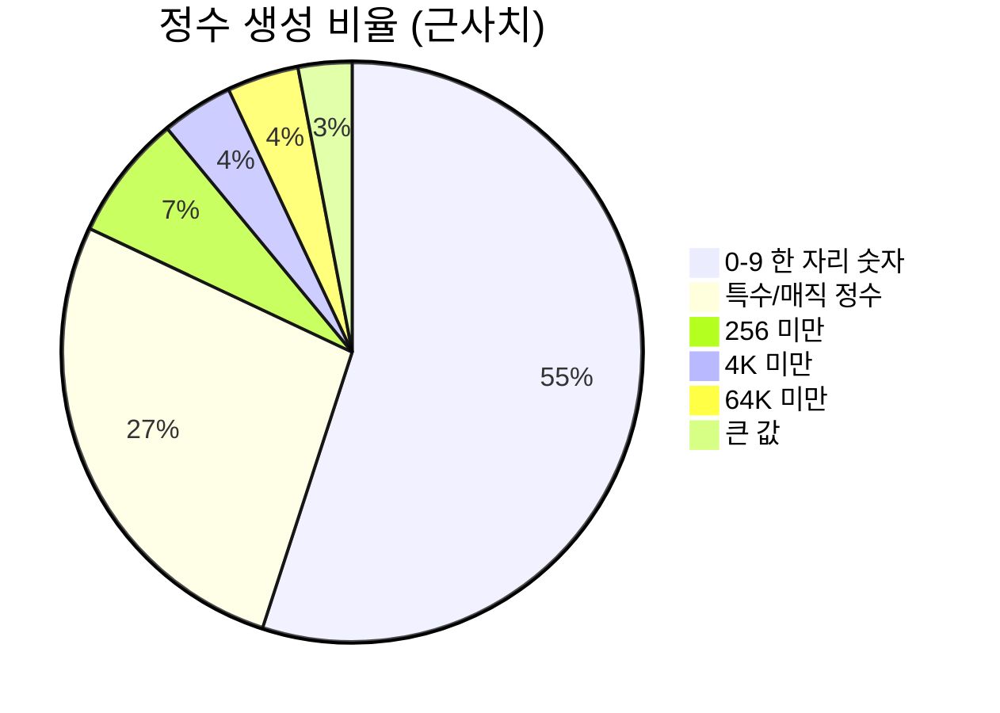

**생성된 정수의 55%는 한 자리 숫자입니다.** 언뜻 이상해 보이지만 생각해보면 당연합니다: 실제 인자는 압도적으로 작습니다(플래그, 작은 카운트, 인덱스, enum 값 등). 균등 분포를 따르는 무작위 64비트 정수는 거의 항상 무의미한 인자이며, 어떤 흥미로운 코드에도 도달하지 못한 채 `EINVAL`로 거부당합니다.

**27%는 `specialInts`에서 추출됩니다.** 세심하게 선별된 매직 값 목록입니다:

```
0..16, 64, 127, 128, 129, 255, 256, 257, 511, 512,
1023, 1024, 1025, 2047, 2048, 4095, 4096,
2^15 - 1, 2^15, 2^15 + 1,    2^16 - 1, 2^16, 2^16 + 1,
2^31 - 1, 2^31, 2^31 + 1,    2^32 - 1, 2^32, 2^32 + 1,
2^63 - 1, 2^63, 2^63 + 1,    2^64 - 1
```

하나하나가 경계값입니다: 페이지 크기, 타입 한계, 부호 전환 지점, 오프바이원 인접값 등입니다. `specialIntIndex`를 통해 `randInt`는 요청된 비트 폭에 맞는 값만 샘플링할 수 있습니다. 바로 이러한 값들에서 정수 오버플로와 버퍼 크기 버그가 발생합니다.

### `randRangeInt`: 의도적으로 설명을 무시하기

```go
if r.oneOf(100) {
    // 주어진 타입 크기에 대해 무작위 값을 생성합니다.
    return r.randInt(bitSize)
}
```

**1%의 확률로 선언된 범위를 완전히 무시합니다.** 이는 `docs/syscall_descriptions.md`에 문서화된 정책과 직접 연결됩니다:

> 정수/문자열 플래그나 정수 필드를 지정할 때는 공식적으로 예상되는 값만 고수하십시오. [...] 퍼저가 올바르고 복잡한 시스템 콜 시퀀스를 스스로 만들어내기는 어려우며, 기술서(description)는 이를 돕기 위한 것입니다. 예상치 못한 정수 값을 만들어내는 것은 쉬우며 퍼저는 이 부분에서 도움을 필요로 하지 않습니다.

요약하자면: 사람은 *의도된* 인터페이스를 기술하고, 퍼저는 *의도되지 않은* 값을 독립적으로 공급합니다. 이 분리가 타당한 두 가지 이유가 있습니다. 첫째, 기술서가 읽기 쉽고 유지보수하기 쉬운 상태를 유지합니다 — 수천 개의 필드에 일일이 `-1`이나 `INT_MAX`를 수작업으로 채워 넣을 필요가 없습니다. 둘째, 퍼저의 값 생성 로직이 개선되면 모든 기술서가 즉시 그 혜택을 받습니다.

`flags`에도 유사한 탈출구가 있습니다: 완전한 무작위 값에 대해 `oneOf(100)`이 적용되고, 0에 대해 `oneOf(50)`이 적용됩니다(*"0은 빈번하게 특별함"*). 선언된 값이 하나뿐인 비-비트마스크 플래그의 경우 특별한 증감(walk-up/walk-down) 변이가 존재하는데, 주석에 따르면 *"특히 len(vv) == 1일 때 변이 과정에서 매우 중요하며, 그렇지 않으면 그 경우 무작위성이 거의 생성되지 않기 때문"*입니다.

> **차용할 만한 패턴:** *올바른 입력에 대한 모델*과 *잘못된 입력의 공급원*을 분리하십시오. 사양(specification)에 적대적 케이스를 오염시키지 말고, 일반화된 방식으로 생성하십시오.

### 특수 포인터 (Special Pointers)

```go
if !r.inGenerateResource && r.oneOf(1000) {
    index := r.rand(len(r.target.SpecialPointers))
    return MakeSpecialPointerArg(a, dir, index), nil
}
```

1/1000의 확률로 포인터가 "특수" 값(NULL, 알려진 잘못된 주소, 커널 주소 등)이 됩니다. 의도적으로 드물게 설정되었습니다: 잘못된 포인터를 가진 대부분의 호출은 즉시 `EFAULT`로 실패하여 아무런 교훈도 주지 못하지만, 아주 가끔 누락된 `access_ok` 검사를 적발해 냅니다. 타깃당 최대 16개의 특수 포인터로 제한됩니다.

### 리소스: 재사용 vs 신규 생성

`ResourceType.generate`는 `nOutOf(8, 10)`을 사용합니다 — **80%는 기존 리소스를 재사용하고, 20%는 새 리소스를 생성합니다.** 재사용은 프로그램의 응집성을 유지하고(자신이 연 파일에 대해 작업 수행), 생성은 새로운 시나리오를 가능하게 합니다(두 번째 파일 열기).

두 가지 의도적인 변칙이 있습니다:

- `r.oneOf(50)`은 재사용 시 더 *느슨한* 종류-접두사(kind-prefix) 일치를 허용합니다 — 예: `fd_sock`이 요구되는 곳에 일반 `fd` 사용 허용.
- `createResource`의 `r.oneOf(1000)`은 의도적으로 *"리소스 하위 종류를 위조(spoof)"*하여 호환되지만 잘못된 리소스 타입을 연결합니다.

둘 다 **타입 혼동(type confusion)이 주요 버그 클래스**이기 때문에 존재합니다. inotify fd를 기대하는 호출에 소켓 fd를 전달하는 것은 커널 코드가 실수하기 딱 좋은 패턴입니다. 기술서의 타입 시스템은 이를 차단하겠지만, 이 두 가지 확률이 의도적으로 그 벽을 무너뜨립니다.

### `resourceCentric`: 작동하는 시나리오 가져오기

가장 영리한 생성기입니다. 유효한 리소스를 생성하기 위해 필요한 설정 호출들을 새로 합성하는 대신 다음을 수행합니다:

1. 코퍼스에서 호환되고 초기화된 리소스를 포함하는 프로그램을 찾습니다.
2. 인자 매핑을 유지한 채 해당 프로그램을 복제합니다.
3. 해당 호출들을 **역방향으로** 순회하며, 해당 리소스와 전이적으로 관련된 호출들만 유지합니다.
4. `2 + biasedRand(len(calls)-1, 10)`개 호출로 자릅니다 — *"더 많은 호출이 더 흥미로운 프로그램을 제공할 수 있음."*

즉, 이미 검증된 양질의 재료로부터 *정상 작동하는 최소한의 설정 시퀀스*를 추출해 냅니다. syzkaller가 6단계의 사전 설정 호출을 필요로 하는 인터페이스에 도달할 수 있는 비결이 바로 이것입니다 — 설정을 처음부터 재발견하는 것이 아니라 복사해 오는 것입니다.

---

## 9. 우선순위 시스템을 구축하는 방법: 레시피

앞서 다룬 내용을 종합하여, 다른 도구에도 전용할 수 있는 방법론을 정리합니다.

### 1. 선택을 내려야 하는 모든 지점을 식별하십시오

선택 지점들을 계층 구조로 정리하십시오. syzkaller의 계층: 어떤 작업 종류인가 → 생성인가 변이인가 → 어떤 프로그램인가 → 어떤 연산자인가 → 어떤 호출인가 → 어떤 인자인가 → 어떤 값인가. 6~7단계의 중첩된 선택이 존재합니다. 정책이 비록 "균등 선택"일지라도 각 단계마다 명확한 정책이 필요합니다.

### 2. 각 레벨에 적합한 메커니즘을 선택하십시오

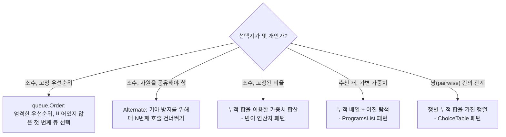

### 3. 기준점 고정(Anchoring)을 통해 가중치를 정하십시오

가장 잘 이해하고 있는 케이스를 하나 골라 가중치를 부여하고, 다른 모든 것을 그 배수로 표현하십시오. syzkaller는 타입 우선순위를 "불리언은 2개의 값만 가지므로 최소 우선순위를 갖는다"는 기준에 고정했습니다. 그 결과: 15개 값을 가진 플래그 세트는 불리언의 9배, 바이트 블롭은 8배, 배열은 10배가 됩니다.

이렇게 결정했다는 사실을 반드시 문서화하십시오. `// TODO: find a way to estimate optimal priority values`라는 주석은 매우 중요한 역할을 합니다 — 미래의 독자들에게 "이것은 추측일 뿐이니 개선하라"고 알려주기 때문입니다.

### 4. 항상 무작위 하한선(Floor)을 포함하십시오

`choose()`의 5% 균등 무작위 선택을 기억하십시오. 여러분의 모델은 예측할 수 없는 방식으로 틀릴 수 있습니다. 작고 무조건적인 탐색 예산은 그로 인한 피해를 제한합니다. 5%는 비용이 거의 들지 않으면서도 "영구적으로 보이지 않는 선택지"가 발생하는 것을 방지합니다.

### 5. 모든 피드백 루프를 감쇠시키십시오

어떤 수치가 생성 대상에 영향을 미치고, 생성된 대상이 다시 그 수치에 영향을 미친다면, 오목 함수(concave transform)를 적용하십시오. `2*sqrt(count)`처럼 말입니다. 이것이 없으면 분포는 초기에 우연히 먼저 발생한 항목 쪽으로 붕괴합니다.

### 6. 활용/탐색 비율을 피드백 품질에 연동하십시오

실제 커버리지가 있을 때는 95% 활용, 없을 때는 50% 활용입니다. 점수 평가 함수가 신뢰할 수 없을 때는 그 함수가 높은 점수를 준 항목들이 실제로는 더 낫지 않습니다.

### 7. 노이즈가 있는 측정은 명시된 신뢰도 목표로 검증하십시오

5회 실행 중 3회 통과는 80% 재현율을 가진 프로그램이 94% 확률로 통과하도록 선택되었습니다. 계산 근거를 주석에 명시하십시오.

### 8. 산출량이 높은 후보 소스는 상한선을 두십시오

`HintsLimiter`의 N=10을 기억하십시오. 소비하는 속도보다 빠르게 후보를 생성하는 메커니즘은 그 후보가 아무리 훌륭하더라도 다른 모든 작업을 굶겨 죽입니다.

### 9. 사양(Specification)과 적대적 입력을 분리하십시오

기술서는 무엇이 *의도되었는지*를 명시하고, 생성기는 *의도되지 않은 것*을 독립적으로 공급합니다. 이렇게 해야 사양의 유지보수성이 보장되고 기능 개선이 전체 시스템에 일괄 적용됩니다.

### 10. 품질 시그널을 끝까지 유지하십시오

시그널 우선순위 비트(호출 성공, 납작하게 압축된 인자 없음)를 통해 세트 커버 최소화(set-cover minimization)가 인간이 읽기 편한 프로그램을 선호하도록 만드십시오. 동일한 효과를 내면서 더 깔끔한 프로그램은 추적할 가치가 있습니다.

---

## 10. 전체 구조도

```mermaid
flowchart TB
    START["Fuzzer.Next"] --> ORD["queue.Order"]
    ORD --> TQ["triage 큐들<br/>최우선 순위"]
    ORD --> SQ["smash 큐<br/>Alternate: 3개 슬롯 중 2개 배정"]
    ORD --> GF["genFuzz 대체 경로"]

    GF --> RATE{"rnd < 0.95?<br/>커버리지 없으면 0.50"}
    RATE -->|변이(mutate)| CP["Corpus.ChooseProgram"]
    RATE -->|생성(generate)| GEN["Target.Generate"]

    CP --> FA{"포커스 영역 설정?"}
    FA -->|예| AREA["Weight에 따라 영역 선택,<br/>이후 영역 내 PC 수로 프로그램 선택"]
    FA -->|아니오| GLOB["시그널 수로 프로그램 선택<br/>누적 배열 + 이진 탐색"]
    AREA --> MUT
    GLOB --> MUT["prog.Mutate"]

    MUT --> OPS["기댓값 5개 연산자:<br/>splice 43.5% / insert 21.7%<br/>mutateArg 21.7% / squash 10.9%<br/>removeCall 2.2%"]
    OPS --> CC["chooseCall:<br/>가중치 = 인자 우선순위의 합"]
    CC --> CA["chooseArg:<br/>타입별 우선순위 0~10"]
    CA --> VAL["값 변이:<br/>mutateInt, mutateData,<br/>flags 순회, 재생성"]

    GEN --> CT["ChoiceTable.choose(bias)"]
    CT --> R5{"5% 완전 무작위?"}
    R5 -->|예| ANY["활성화된 모든 시스템 콜 대상"]
    R5 -->|아니오| ROW["bias 행에서 가중치 추첨:<br/>정적 리소스 유사도<br/>+ 2*sqrt(코퍼스 동시 등장),<br/>각 행은 10*N으로 정규화"]
    ANY --> ARGS
    ROW --> ARGS["인자 생성:<br/>55% 작은 정수, 27% 매직 값,<br/>80% 리소스 재사용,<br/>1% 선언된 범위 무시,<br/>0.1% 특수 포인터"]

    VAL --> EXEC["실행"]
    ARGS --> EXEC
    EXEC --> NS{"새로운 최대 시그널?"}
    NS -->|아니오| START
    NS -->|예| TRI["triageJob:<br/>5회 중 3회 deflake -> 안정한 새 시그널을<br/>모두 보존하며 축소 -> Corpus.Save"]
    TRI --> CHILD["smash 25회 생성,<br/>hints, fault injection 1..100"]
    TRI --> UPD["업데이트:<br/>코퍼스 가중치 = len(stableSignal),<br/>333개 프로그램마다 선택 테이블 재구축,<br/>최대 시그널 델타를 모든 VM에 전파"]
    UPD --> START
    CHILD --> START
```

---

## 11. 직접 코드 읽어보기

| 질문 | 시작 위치 |
|---|---|
| 작업 우선순위는 어떻게 지정되는가? | `pkg/fuzzer/fuzzer.go` → `execQueues`, `genFuzz`, `Next` |
| 작업 유형에는 어떤 것들이 있는가? | `pkg/fuzzer/job.go` → `triageJob`, `smashJob`, `hintsJob`, `faultInjectionJob` |
| 플레이크 제거(deflaking)는 어떻게 동작하는가? | `pkg/fuzzer/job.go` → deflake 관련 상수들 및 `deflake`, `stopDeflake` |
| 코퍼스 프로그램은 어떻게 선택되는가? | `pkg/corpus/prio.go` → `ProgramsList`, `chooseProgram`, `ChooseProgram` |
| 변이 가중치는 얼마인가? | `prog/mutation.go` → `DefaultMutateOpts`, `MutateWithOpts` |
| 타입별 우선순위는 얼마인가? | `prog/mutation.go` → 모든 `getMutationPrio`, 그리고 `rangeSizePrio` |
| 선택 테이블은 어떻게 구축되는가? | `prog/prio.go` → `CalculatePriorities`, `calcStaticPriorities`, `calcResourceUsage`, `calcDynamicPrio`, `normalizePrios`, `choose` |
| 값은 어떻게 생성되는가? | `prog/rand.go` → `randInt`, `specialInts`, `randRangeInt`, `flags`, `biasedRand`, `createResource`, `resourceCentric` |
| 힌트는 어떻게 동작하는가? | `prog/hints.go` → `CompMap`, `MutateWithHints`, `generateHints`, `shrinkExpand`, `HintsLimiter` |
| 축소(Minimization)는 어떻게 동작하는가? | `prog/minimization.go` → `MinimizeMode`, `Minimize`; 그리고 `pkg/manager/seeds.go` → `ReminimizeSubset` |
| 시그널과 커버리지의 차이는 무엇인가? | `pkg/signal/signal.go` → `DiffRaw`, `Merge`, `Minimize`; `pkg/fuzzer/fuzzer.go` → `signalPrio`; `pkg/fuzzer/cover.go` → `Cover` |

마지막 권장 사항: 코드베이스에서 `oneOf(`, `nOutOf(`, `biasedRand(`를 grep으로 검색해 보십시오. 검색 결과 하나하나가 정밀하게 조율된 확률 값이며, 그 근처에는 이를 설명하는 주석이 달려 있습니다. 이들을 순서대로 읽어보는 것이 버그를 실제로 찾아내는 입력이 무엇인지에 대해 프로젝트에 축적된 직관을 흡수하는 가장 빠른 방법입니다.
