# DIY 실습(Lab): Rust로 작성하는 최소 단위의 커버리지 기반 시스템 콜 퍼저 (Coverage-Guided Syscall Fuzzer)

> **이 문서의 대상 독자:** syzkaller의 작동 방식을 읽어보았고, 이를 제대로 이해하기 위해 직접 Rust로 구현해보고 싶은 엔지니어를 대상으로 합니다. syzkaller의 대체품을 만들려는 것이 **아닙니다**. 실제 Linux 커널을 대상으로 커버리지 피드백 루프(feedback loop)를 온전히 완성하는 가장 작은 프로그램을 구현하는 것이 목표입니다.
>
> **두 가지 대상 환경을 다룹니다.** §2–§14에서는 노트북 환경에서 **virtme-ng**를 사용하며, 이는 구현 작업의 막대한 분량을 줄여줍니다. §15에서는 동일한 퍼저를 **네트워크로 연결된 베어메탈(bare-metal) 임베디드 보드**로 전환합니다. 그곳이야말로 지금까지 아무도 퍼징하지 않은 드라이버들이 실제로 존재하는 영역입니다. §3.1에서 소개하는 4개 메서드로 구성된 트레이트(trait) 덕분에 두 대상 환경을 모두 지원할 수 있는 구조가 됩니다.
>
> *무엇을 덜어낼 것인가*를 결정하는 것이 이 문서의 진짜 핵심 주제입니다.

---

## 0. 핵심 명제: 실제로 본질(core)에 해당하는 것은 무엇인가

syzkaller는 Go, C++, 그리고 디스크립션(description) 전반에 걸쳐 약 200,000줄의 코드로 이루어져 있습니다. 버그 추적 제품이 아닌 진정한 *퍼저(fuzzer)*로서 동작하게 만드는 부분은 **약 2,000줄의 Rust**로 작성할 수 있는 루프 하나에 불과합니다:

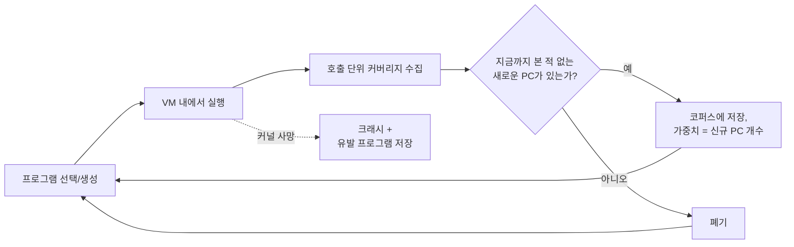

syzkaller의 그 외 모든 기능은 **실습(lab) 환경에는 필요하지 않은** 세 가지 목표 중 하나를 충족하기 위해 존재합니다:

| syzkaller의 목표 | 막대한 비용이 드는 이유 | 실습에 이것이 필요한가? |
|---|---|---|
| **모든** 커널 인터페이스 퍼징 | 디스크립션 *언어(DSL)*, 컴파일러, 아키텍처별 상수 추출, 3,000개 이상의 시스템 콜 디스크립션 필요 | 아니오. 단일 서브시스템의 시스템 콜 20개만 다뤄도 모든 원리를 배울 수 있습니다. |
| 여러 대의 머신에서 **수년간 무인 실행** | VM 풀(pool), 부팅 에러 복구, RPC 프로토콜, 복구 기능이 있는 코퍼스 DB, 포화 감지기 필요 | 아니오. 크래시 발생 시 재부팅되는 단일 VM 하나면 충분합니다. |
| **제3자가 조치 가능한** 리포트 생성 | 중복 제거(deduplication), 심볼화(symbolization), C 재현 코드 생성, 바이섹션(bisection), 메인테이너 라우팅, 대시보드 필요 | 아니오. 분석할 사람은 본인뿐입니다. |

따라서 이번 실습을 관통하는 린 코어(lean-core) 원칙은 다음과 같습니다:

> **피드백 루프는 직접 구축하라. 환경은 virtme-ng로 해결하라. 제품 수준의 부가 기능은 건너뛰어라.**

이 문서의 나머지 내용은 이 한 문장을 구체화한 것입니다.

---

## 1. 직접 구축(Build) / 외부 차용(Buy) / 생략(Skip)

이 문서를 통틀어 가장 중요한 표입니다. 코드를 한 줄이라도 작성하기 전에 반드시 읽어보시기 바랍니다.

### 계층 1 — 직접 구축 (BUILD). 이것이 *프로젝트 그 자체*입니다.

| 컴포넌트 | 대략적 규모 | 외부 차용(Buy)이 불가능한 이유 |
|---|---:|---|
| **호출 테이블 (Call table)** (Rust 데이터로 표현된 "디스크립션") | 150줄 | 퍼징 대상 API의 구조가 다른 모든 컴포넌트의 입력이 됩니다. |
| **프로그램 모델 (Program model)** (호출 + 타입화된 인자 + 리소스 참조) | 200줄 | 변이(mutation), 최소화(minimization), 직렬화 모두에 필요합니다. |
| **게스트 실행기 (Guest executor)** (KCOV 브래킷 + 로우 시스템 콜 디스패치) | 300줄 | 커버리지 측정 장치입니다. 다른 어떤 것도 이를 대신할 수 없습니다. |
| **와이어 포맷 (Wire format)** (호스트 ↔ 게스트 간 프로그램/결과 인코딩) | 200줄 | 자체 프로그램 모델과 정확히 일치해야 합니다. |
| **코퍼스 (Corpus)** (신규성 게이트 + 가중치 선택 + 영속화) | 150줄 | 퍼저의 기억 저장소(메모리)입니다. |
| **생성기 + 변이기 (Generator + mutator)** | 400줄 | 탐색(search) 로직입니다. |
| **최소화기 (Minimizer)** | 80줄 | 30개 호출로 구성된 덩어리를 읽기 쉬운 3개 호출의 재현 코드로 변환합니다. 가장 적은 비용으로 가장 큰 가치를 얻는 기능입니다. |
| **크래시 감지 (Crash detection)** (콘솔 텍스트 스캔) | 100줄 | 이것이 없으면 버그를 찾는 것이 아니라 커버리지만 측정하는 것에 불과합니다. |
| **호스트 드라이버 (Host driver)** (부팅, 공급, 수집, 재시작) | 250줄 | 오케스트레이션(조율) 역할을 하는 접착 코드입니다. |

**≈ 1,800–2,500줄.** 이는 주말이나 2주 정도면 끝낼 수 있는 프로젝트 크기이며, 잘 알려지지 않은 드라이버에서 실제 버그를 찾아낼 수 있습니다.

**각 항목이 다루어지는 위치.** 핵심 요소를 빠뜨리지 않았는지 확인하는 용도로 활용하십시오:

| 계층 1 컴포넌트 | 다루는 절 | 정의되는 대상 |
|---|---|---|
| 호출 테이블 | §5.1–5.4 | `ArgKind`, `SyscallDesc`, `ResState` |
| **프로그램 모델** | **§5.5** | **`Program`, `Call`, `Arg`, `remove_call`** |
| 게스트 실행기 — 커버리지 | §4.1–4.4 | `Kcov`, 리셋/수집 브래킷 |
| **게스트 실행기 — 디스패치** | **§4.5** | **`raw_syscall`, `resolve_args`, 버퍼 할당** |
| 와이어 포맷 | §6 | 요청/응답 바이트, `PC_REWIND` |
| 코퍼스 | §8.1–8.5 | `Corpus`, 신규성 게이트, 가중치 선택, 텍스트 영속화 |
| 최소화기 | §8.6 | `minimize` |
| 생성기 + 변이기 | §9 | `generate`, `rand_int`, `mutate`, `biased_rand` |
| 크래시 감지 | §10 | `scan`, `normalize_title` |
| **호스트 드라이버** | **§7.1–7.3 (전송), §7.4 (루프)** | **`FuzzTarget` 구현체, `main()`** |

굵은 글씨로 표시된 세 가지 항목은 다른 모든 코드 조각들이 암묵적으로 의존하는 핵심입니다. `Program`은 변이기가 변이시키는 대상이고, `raw_syscall`은 KCOV 브래킷이 감싸는 대상이며, 드라이버 루프는 플레이크 완화(deflaking) 비용을 언제 지불할지 결정하는 주체입니다. 코드를 타이핑하기 전에 이 부분들을 먼저 읽으십시오.

### 계층 2 — virtme-ng로 외부 차용 (BUY). 0줄.

| syzkaller가 직접 구축하는 것 | 대신 입력할 명령 |
|---|---|
| `pkg/build` — 커널 컴파일 | `vng -b -f kcov.config` |
| 디스크 이미지 생성, `create-image.sh`, debootstrap | 없음 — virtme-ng가 **호스트 루트 파일시스템**을 게스트에 그대로 마운트(export)함 |
| `pkg/instance` — VM 내부로 `syz-executor` 복사 | 없음 — 호스트의 `target/release/executor`가 게스트 내 동일 경로에서 *이미 접근 가능함* |
| `vm/qemu` — QEMU 명령행 조립, `archConfigs` | `vng --run ./arch/x86/boot/bzImage` |
| SSH 키 생성, `sshd` 설정, `WaitForSSH` | `vng --ssh` / `--console`, 또는 `--exec`를 사용하여 완전히 회피 |
| 포트 포워딩, 역방향 터널 | `--rwdir` (virtiofs) 또는 vsock |
| `vm/vm.go` 콘솔 캡처 | vng의 표준 출력(stdout)이 **곧** 게스트 콘솔 출력임 |
| 부팅 타임아웃 처리 | `timeout 60 vng ...` |
| `pkg/instance/dump.go` — kdump 크래시 커널 + `makedumpfile`, 100회 재시도 | `vng --debug` 후 `vng --dump core.elf` (호스트 측 QMP, §14.1 참조) |

### 계층 3 — 생략 (SKIP). 핵심처럼 보이지만 실제로는 그렇지 않은 항목들.

| 생략 대상 | 생략해도 안전한 이유 | 다시 도입을 고려할 시점 |
|---|---|---|
| **syzlang + 컴파일러 + `syz-extract`** | DSL은 수백 명이 기여하는 3,000개 시스템 콜 규모에서나 진가를 발휘합니다. 20개 시스템 콜 수준에서는 Rust `const` 테이블이 *더 우수합니다*: 타입 검사 보장, 별도 빌드 단계 없음, 정의로 바로 이동(jump-to-definition). | 외부 기여자를 받아야 할 때. |
| **우선순위 비트가 포함된 시그널 (Signal)** | syzkaller는 에지를 해싱하고 2비트 품질 점수를 부여하여 집합 커버(set-cover) 알고리즘이 깔끔한 프로그램을 선호하도록 만듭니다. 소규모 코퍼스에서는 순수 PC 집합만으로도 충분합니다. | 코퍼스가 약 5,000개 프로그램을 초과할 때. |
| **선택 테이블 (Choice table)** (정적 + `2*sqrt` 동적 우선순위 행렬) | 3,000개 시스템 콜 중 "다음에 무엇을 호출할지"를 해결하기 위한 장치입니다. 20개 수준에서는 균등 선택과 리소스 인지 정렬만으로도 충분한 성능을 냅니다. | 시스템 콜 수가 약 200개를 넘어설 때. |
| **트리아지 / 플레이크 완화 (Triage / deflaking)** (5회 중 3회 성공 기준) | 약간의 플레이키(flaky)한 커버리지와 다소 불필요한 코퍼스가 쌓일 수 있지만, 감수할 만합니다. | 커버리지 수치가 너무 요동쳐서 진행 상황을 판별할 수 없을 때. |
| **flatrpc / 정식 RPC 프로토콜** | 공유 디렉터리의 파일 교환이나, 부팅당 단일 프로그램 실행 방식으로 대체 가능합니다. | 초당 100회 초과(>100 exec/s)의 실행 속도가 필요할 때. |
| **VM 풀 / 디스패처** | 단일 VM으로 충분: `loop { boot(); fuzz_until_dead(); }` | 높은 처리량(throughput)이 필요할 때. |
| **샌드박스 모드** | `sandbox=none`, 즉 게스트 내에서 root 권한으로 그대로 실행합니다. | 실습 환경에서는 고려할 필요 없음. |
| **스냅샷 모드** | 순수한 처리량 최적화용입니다. **vng는 이를 지원하지 않으며, virtiofs가 이를 가로막습니다** — §14.2 참조. | 고려할 필요 없음. |
| **C 재현 코드(reproducer) 생성** | 3개 호출로 이루어진 프로그램은 5분이면 수작업으로 C 코드로 옮길 수 있습니다. | 업스트림 커널에 버그를 공식 리포트해야 할 때. |
| **허브, 대시보드, 바이섹션, 에셋 관리, 이메일** | 제품 수준의 부가 기능들입니다. | 고려할 필요 없음. |
| **멀티 OS, 멀티 아키텍처** | 단일 OS(Linux). 베어메탈 실습을 위한 **3개 아키텍처** — 아키텍처별 차이는 매우 작습니다: `libc::SYS_*`, PC 되감기를 위한 `if`문 하나, 3개의 크로스 링커. §15.4 참조. | 4번째 OS를 추가해야 할 때. |
| **비교 힌트 (Comparison hints)** (`KCOV_TRACE_CMP`) | 계층 3 중에서 코드 라인당 가치가 가장 높지만, 기본 루프가 동작하기 전까지는 쓸모가 없습니다. | 4단계, 매직 넘버 검사에서 막혔을 때 도입. |

### 아레나(Arena): 단 하나의 판단이 필요한 지점

syzkaller는 고정 주소(x86-64의 경우 `0x200000000000`)에 16 MiB 영역을 매핑하고 모든 포인터를 상대 오프셋으로 기록합니다. 이것이 바로 syzbot의 `repro.syz`가 언제든 다시 실행될 수 있는 이유입니다.

- **이것이 필요한 경우:** 수정되지 않은 syzbot 재현 코드를 실행하고 싶거나 실행 간에 바이트 단위로 동일한 메모리 배치가 필요한 경우.
- **1단계에서 생략 가능한 경우:** 자체 생성한 프로그램만 실행하면 되는 경우 — 게스트 실행기가 직접 버퍼를 할당하고 시스템 콜에 실제 메모리 주소를 전달하도록 하면 됩니다.

권장 사항: **실습 1–4에서는 생략하고, 실습 5에서 추가하십시오.** 먼저 루프부터 완성하십시오. 나중에 아레나를 추가하는 것은 와이어 포맷과 실행기에 국한된 변경이며, 그때가 되면 아레나의 모든 세부 사항이 왜 존재하는지 명확히 이해하게 될 것입니다.

---

## 2. 실습 0 — 환경 구성

### 2.1 커널 설정 (Kernel config)

`kcov.config` 파일을 생성합니다:

```
CONFIG_KCOV=y
CONFIG_KCOV_INSTRUMENT_ALL=y
CONFIG_KCOV_ENABLE_COMPARISONS=y
CONFIG_DEBUG_FS=y
CONFIG_DEBUG_INFO_DWARF_TOOLCHAIN_DEFAULT=y
CONFIG_KASAN=y
CONFIG_KASAN_INLINE=y
CONFIG_DEBUG_KMEMLEAK=n
CONFIG_RANDOMIZE_BASE=n
CONFIG_FRAME_POINTER=y
```

각 옵션의 필요 이유:

- **`KCOV` + `KCOV_INSTRUMENT_ALL`** — 커버리지 소스입니다. `INSTRUMENT_ALL`이 없으면 명시적으로 포함된 파일에서만 커버리지를 얻게 됩니다.
- **`KCOV_ENABLE_COMPARISONS`** — 실습 8(힌트)에서만 필요합니다. 성능 비용이 들지만 커널 재빌드를 피하기 위해 미리 활성화해 둡니다.
- **`DEBUG_FS`** — `/sys/kernel/debug/kcov`는 debugfs 내에 위치합니다. virtme-ng의 init이 이미 이를 마운트하므로(`mount -t debugfs debugfs /sys/kernel/debug`) 사용자가 추가로 할 일은 없습니다.
- **`KASAN` + `KASAN_INLINE`** — 버그 탐지기입니다. 이것이 없으면 use-after-free가 발생해도 조용히 메모리만 오염시키고 감지되지 않습니다. "커널이 계속 실행됨"을 확실한 리포트로 변환해 주는 핵심 장치입니다.
- **`RANDOMIZE_BASE=n`** — KASLR을 끕니다. 이를 통해 한 번 부팅에서 수집된 PC 값이 다음 부팅에서도 동일한 의미를 갖게 됩니다. KASLR이 켜져 있으면 부팅 간 PC를 비교하기 전에 부팅별 커널 베이스 주소를 빼주어야 하며, 이 과정에서 한 번쯤은 실수가 발생하기 마련입니다.
- **`FRAME_POINTER`** — 리포트에서 더 정확한 스택 트레이스를 얻을 수 있습니다.

빌드 및 정상 부팅 확인:

```bash
cd ~/linux
vng -b -f kcov.config            # 설정 조각을 덧씌워 빌드
vng --run . --exec "ls -l /sys/kernel/debug/kcov"
```

마지막 명령이 파일 정보를 출력한다면 환경 준비는 끝났습니다. 이것이 syzkaller가 3개 문서에 걸쳐 설명하는 "환경 구축"의 전부입니다.

### 2.2 virtme-ng가 실제로 제공하는 것

설치된 virtme-ng (1.41) 기준으로 검증된 구조:

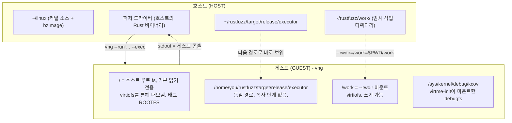

중요한 3가지 사실:

1. **호스트 루트 파일시스템이 곧 게스트 루트 파일시스템입니다** (기본적으로 읽기 전용이며, virtiofs 또는 9p 폴백 사용). 호스트에서 `cargo build`한 바이너리는 게스트에서도 동일한 경로로 실행됩니다. **배포(deploy) 단계가 전혀 없습니다.** 이것 하나만으로 프로젝트에서 `pkg/instance`를 완전히 제거할 수 있습니다.
2. **`--rwdir=게스트경로=호스트경로`**를 통해 쓰기 가능한 공유 디렉터리(virtiofs)를 제공합니다. 이것이 데이터 전송 통로가 됩니다.
3. **virtme-ng의 표준 출력(stdout)이 게스트 콘솔입니다.** 커널 oops 메시지가 터미널에 바로 나타나며, 드라이버가 읽는 파이프로도 바로 들어옵니다. 이는 `vm/vm.go`의 출력 병합 코드를 완전히 대체합니다.

### 2.3 안전 수칙: 첫 퍼징을 실행하기 전에 반드시 읽을 것

**게스트 내부에는 호스트 파일시스템이 마운트되어 있습니다.** 커버리지 기반 시스템 콜 퍼저는 무작위로 `write`, `unlink`, `rename`, `mount`, `ioctl` 호출을 생성합니다. 이것이 퍼저의 본질입니다.

| 위험 요소 | 완화 대책 |
|---|---|
| 퍼저가 `--rwdir`을 통해 소스 트리에 쓰기 작업을 수행함 | `--rwdir`은 반드시 **전용 임시 디렉터리**를 가리키게 하십시오. 리포지토리나 `$HOME`을 지정하지 마십시오. |
| 퍼저가 호스트 루트 파일시스템을 손상시킴 | **`--rw` 플래그를 절대 전달하지 마십시오.** 기본값인 읽기 전용 루트가 안전장치입니다. virtme-ng 도움말에서도 경고합니다: *"this can be dangerous for the host filesystem!"* |
| 게스트에서 파일 생성 시스템 콜을 위한 쓰기 가능한 임시 디렉터리가 필요함 | **`--overlay-rwdir`**을 사용하십시오 — 게스트 내에서는 쓰기 가능하고 종료 시 폐기되며, **호스트에서는 읽기 전용**으로 유지됩니다. 정확히 필요한 프리미티브입니다. |
| 파일시스템을 마운트하거나 블록 디바이스를 건드리는 프로그램 | `--disk`를 설정하지 마십시오. 게스트에는 사용자가 직접 생성한 tmpfs나 루프 디바이스만 제공하십시오. |
| 커널 버그로 인해 virtiofs 상태가 손상됨 | 이를 감수하십시오. 게스트는 1회용 소모품입니다. 게스트에서 접근 가능한 위치에 복구 불가능한 데이터가 없도록 하십시오. |

안전한 실행 명령 골격:

```bash
vng --run ~/linux \
    --rwdir=/work=$PWD/work \          # 전송 전용; 1회용 소모품
    --overlay-rwdir=/scratch \         # 게스트 쓰기 가능, 호스트에는 안전
    --memory 2G --cpus 2 \
    --exec "/path/to/executor --once /work/req.bin /work/res.bin"
```

실행기(executor)가 프로그램을 실행하기 전에 `chdir("/scratch")`를 수행하도록 만드십시오. 비용이 들지 않으면서도 파일 생성 시스템 콜이 공유 영역에 영향을 주지 않도록 완벽히 격리합니다.

---

## 3. 클론의 아키텍처

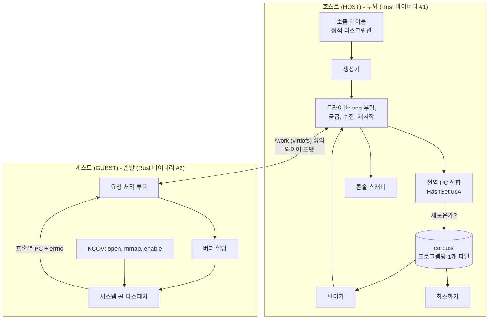

하나의 Cargo 워크스페이스에서 두 개의 바이너리를 빌드합니다:

```
rustfuzz/
├── Cargo.toml              # 워크스페이스
├── common/                 # 공용: 와이어 포맷, 프로그램 모델, 호출 테이블
│   └── src/{lib,prog,wire,table}.rs
├── fuzzer/                 # 호스트 바이너리: 생성, 변이, 코퍼스, vng 제어
│   └── src/{main,corpus,mutate,generate,driver,crash}.rs
└── executor/               # 게스트 바이너리: KCOV + 디스패치
    └── src/{main,kcov,run}.rs
```

**호스트/게스트 분리는 반드시 첫날부터 올바르게 잡아야 하는 단 하나의 아키텍처 결정이며, syzkaller는 이를 정착시키는 데 9년이 걸렸습니다.** 2024년 이전까지는 퍼징의 두뇌가 VM *내부*에서 실행되었기 때문에 커널 크래시가 발생할 때마다 두뇌도 함께 죽었습니다. syzkaller가 결국 도달한 결론에서 시작하십시오: **모든 영속 상태는 호스트에 두고, 게스트는 오직 실행만 담당합니다.** 게스트 바이너리는 코퍼스, 커버리지 이력, 변이에 대해 아무것도 알지 못해야 합니다. 그저 프로그램을 받아 실행하고 결과를 보고할 뿐입니다.

### 3.1 첫날부터 구축해야 할 단 하나의 추상화

드라이버 루프와 퍼징 대상 사이에 트레이트를 하나 둡니다. syzkaller의 `vmimpl.Instance`와 형태가 동일한 4개의 메서드로 구성됩니다:

```rust
pub trait FuzzTarget {
    fn deploy(&mut self) -> anyhow::Result<String>;   // 실행기를 실행 가능한 상태로 준비
    fn exec(&mut self, prog: &Program) -> anyhow::Result<Response>;
    fn drain_console(&mut self) -> String;            // 마지막 호출 이후 출력된 내용 반환
    fn reset(&mut self) -> anyhow::Result<()>;        // 패닉 이후에도 반드시 동작해야 함
}
```

virtme-ng 환경에서 `deploy`는 아무 작업도 하지 않는 no-op이며, `reset`은 프로세스를 종료하는 작업입니다. **네트워크를 통해 연결된 베어메탈 보드** (§15) 환경에서는 `deploy`가 복사나 읽기 전용 마운트가 되고, `reset`은 단계별 전원 제어 루틴이 되지만, *트레이트 상위의 코드는 단 한 줄도 바뀌지 않습니다*. 만약 드라이버 내부에 `Command::new("vng")`를 하드코딩해 두었다면, 나중에 두 번째 타깃을 추가할 때 하루 종일 고통스러운 리팩터링을 해야 할 것입니다. 지금 트레이트를 작성하는 데는 20분이면 충분하며, §15에서 그 진가를 발휘하게 됩니다.

의존성 — 간결하게 유지하십시오:

```toml
[dependencies]
libc = "0.2"          # 로우 syscall(), ioctl 번호
nix = { version = "0.29", features = ["ioctl", "mman"] }
rand = "0.8"
blake3 = "1"           # 콘텐츠 주소 지정 방식 코퍼스 파일명
anyhow = "1"
```

와이어 포맷에는 serde를 사용하지 마십시오. 직접 바이트 단위로 다루는 200줄 정도의 코드를 작성하십시오. 바이트 수준의 정밀한 제어가 필요하며, 추후 `xxd`로 디버깅하게 될 것입니다.

---

## 4. 실습 1 — 실행기: 약 80줄로 구현하는 KCOV

퍼저의 다른 부분이 존재하기 전에, 이것부터 독립적으로 빌드하십시오. 흥미로운 문제로 실패할 가능성이 가장 높은 컴포넌트입니다.

### 4.1 KCOV 프로토콜

`executor/executor_linux.h` 기준으로 검증된 내용:

```rust
// /sys/kernel/debug/kcov ioctl 정의. 계산 방식:
//   _IOC(dir, type, nr, size) = (dir << 30) | (size << 16) | (type << 8) | nr
//   type = 'c' = 0x63
const KCOV_INIT_TRACE: u64 = 0x8008_6301; // _IOR('c', 1, u64):  dir=2, size=8
const KCOV_ENABLE:     u64 = 0x0000_6364; // _IO('c', 100)
const KCOV_DISABLE:    u64 = 0x0000_6365; // _IO('c', 101)
const KCOV_RESET_TRACE:u64 = 0x0000_6368; // _IO('c', 104)

const KCOV_TRACE_PC:  u64 = 0;
const KCOV_TRACE_CMP: u64 = 1;

const COVER_ENTRIES: usize = 64 << 10;  // syzkaller는 512<<10 사용; 여기서는 64K로 충분
```

> **이 상수들은 x86/arm/arm64/riscv에만 유효합니다.** asm-generic의 `_IOC` 인코딩을 사용하기 때문입니다. MIPS, PowerPC, SPARC, Alpha는 방향 비트를 다르게 인코딩하므로 해당 환경에서는 `KCOV_INIT_TRACE`가 `0x40086301`이고 `KCOV_ENABLE`이 `0x20006364`입니다. 이러한 아키텍처를 대상으로 삼을 계획이 있다면 상수를 하드코딩하지 말고 `nix`의 `ioctl_*` 매크로를 사용하여 계산하십시오 — §15.4 참조.

버퍼 레이아웃은 너무나 단순하므로 반드시 머릿속에 기억해 두어야 합니다:

```
area[0]            = 수집된 PC의 개수   <-- 사용자가 쓰기 가능
area[1 ..= area[0]] = 수집된 PC 값들
```

따라서:

- **리셋 (reset)** = `area[0] = 0`. 이것이 전부입니다. (syzkaller도 문자 그대로 `*(uint64*)cov->data = 0`을 수행합니다.)
- **수집 (collect)** = `area[0]`을 읽은 뒤, `area[1..=n]`을 슬라이스합니다.
- **오버플로 (overflow)** = `area[0]`이 용량에 도달한 상태입니다. syzkaller는 보수적으로 `(size + 2) * 8 > data_size`인지 검사합니다.

```rust
pub struct Kcov {
    fd: i32,
    area: *mut u64,
    entries: usize,
}

impl Kcov {
    pub fn open() -> anyhow::Result<Self> {
        let fd = unsafe {
            libc::open(c"/sys/kernel/debug/kcov".as_ptr(), libc::O_RDWR)
        };
        anyhow::ensure!(fd >= 0, "open /sys/kernel/debug/kcov: {}", errno());

        // 크기는 바이트 단위가 아니라 엔트리(ENTRY) 개수 단위임.
        let r = unsafe { libc::ioctl(fd, KCOV_INIT_TRACE as _, COVER_ENTRIES) };
        anyhow::ensure!(r == 0, "KCOV_INIT_TRACE: {}", errno());

        let len = COVER_ENTRIES * 8;
        let area = unsafe {
            libc::mmap(std::ptr::null_mut(), len,
                       libc::PROT_READ | libc::PROT_WRITE,
                       libc::MAP_SHARED, fd, 0)
        };
        anyhow::ensure!(area != libc::MAP_FAILED, "mmap kcov: {}", errno());

        // 시스템 콜을 실행할 바로 그 스레드에서 스레드별로 활성화해야 함.
        let r = unsafe { libc::ioctl(fd, KCOV_ENABLE as _, KCOV_TRACE_PC) };
        anyhow::ensure!(r == 0, "KCOV_ENABLE: {}", errno());

        Ok(Self { fd, area: area as *mut u64, entries: COVER_ENTRIES })
    }

    #[inline]
    pub fn reset(&self) {
        unsafe { std::ptr::write_volatile(self.area, 0) };
    }

    pub fn collect(&self) -> (Vec<u64>, bool) {
        let n = unsafe { std::ptr::read_volatile(self.area) } as usize;
        let overflow = n + 2 > self.entries;
        let n = n.min(self.entries - 1);
        let pcs = unsafe { std::slice::from_raw_parts(self.area.add(1), n) }.to_vec();
        (pcs, overflow)
    }
}
```

### 4.2 브래킷(Bracket) — 이 모든 것이 작동하는 근본적 이유

```rust
for (i, call) in prog.calls.iter().enumerate() {
    let args = resolve_args(call, &results, &mut arena)?;   // §4.5

    kcov.reset();                                   // <-- 호출 직전
    let (ret, err) = unsafe { raw_syscall(CALLS[call.desc].nr, &args) };
    let (pcs, overflow) = kcov.collect();           // <-- 호출 직후

    results.push(CallResult { index: i, retval: ret, errno: err, pcs, overflow });
}
```

**프로젝트의 그 어떤 코드도 이 세 줄만큼 코드 길이 대비 정확도 기여도가 높은 곳은 없습니다.** 실행 직전에 리셋하고, 직후에 수집합니다. 브래킷 위치를 잘못 잡아 시작할 때 한 번 리셋하고 끝날 때 한 번 수집하게 되면, "프로그램이 이 라인들을 건드렸다"는 정보만 얻을 뿐, 누구나 궁금해하는 "어느 호출이 커버리지를 유발했는가"에는 결코 답할 수 없습니다.

### 4.3 마일스톤 1 (통과하기 전까지 다음 단계로 진행하지 말 것)

```bash
cargo build --release -p executor
vng --run ~/linux --exec "$PWD/target/release/executor --selftest"
```

`--selftest`는 다음을 수행해야 합니다: KCOV를 열고, 리셋한 뒤, `getpid()`를 호출하고, 수집하여 PC 개수를 출력합니다. 예상 출력은 0이 아닌 수십 개 수준의 *안정적인* PC 개수입니다:

```
[executor] kcov: 64K entries, fd 3
[executor] getpid() = 1, 23 PCs, overflow=false
[executor] SELFTEST PASS
```

만약 **0 PCs**가 나온다면: `KCOV_ENABLE`이 시스템 콜을 실행한 스레드와 다른 스레드에서 호출되었거나, `CONFIG_KCOV_INSTRUMENT_ALL`이 꺼져 있는 것입니다.
`KCOV_INIT_TRACE`가 `EINVAL`로 실패한다면: 엔트리 개수 대신 바이트 크기를 전달했거나, 단일 fd에 대해 두 번 호출한 것입니다.
`open`이 `ENOENT`로 실패한다면: debugfs가 마운트되지 않은 것입니다. 단, virtme-ng는 이를 자동으로 마운트하므로 `CONFIG_DEBUG_FS` 없이 커널이 빌드되었는지 의심해 보아야 합니다.

### 4.4 나중에 발목을 잡을 수 있는 KCOV의 2가지 특성

**커버리지는 스레드 단위입니다.** `KCOV_ENABLE`은 호출한 태스크에만 적용됩니다. 블로킹 시스템 콜이 프로그램 전체를 멈추는 것을 방지하기 위해 나중에 멀티스레드 실행을 추가한다면, 각 스레드마다 고유한 fd, mmap 영역, `KCOV_ENABLE` 호출이 필요합니다. syzkaller는 모든 스레드에 `cover_t`를 할당합니다.

**일부 작업은 시스템 콜이 반환된 이후에 수행됩니다.** 워크큐(workqueue), 타이머, RCU 콜백, softirq 패킷 처리 등은 시스템 콜에 의해 유발되지만 나중에 다른 태스크에서 실행됩니다. 호출 단위 브래킷은 이를 감지할 수 없습니다. syzkaller는 `KCOV_REMOTE_ENABLE`을 사용하는 보조 커버리지 객체(`extra_cov`)를 통해 이를 처리하며, 특정 호출에 귀속되지 않는 "extra" 커버리지로 보고합니다. **이번 실습에서는 이를 생략합니다.** 지연된 비동기 작업은 볼 수 없다는 점만 인지하십시오. 이 방식으로 구축된 네트워크 퍼저가 초기에 일찍 정체(plateau)되는 것처럼 보이는 이유가 바로 여기에 있습니다.

### 4.5 실행기의 나머지 절반: 디스패치 (Dispatch)

§4.1–4.4는 측정을 다루었습니다. 이번에는 측정 대상 자체이며, 계층 1의 "게스트 실행기" 항목의 나머지 절반에 해당합니다.

#### 호출 규약(Calling convention) 함정

```rust
/// 단일 시스템 콜을 디스패치합니다.
///
/// 중요하며, 흔히 발생하는 전형적인 버그의 원인:
/// 커널은 결과 레지스터에 `-errno`를 반환하지만, libc의 `syscall()` 래퍼는
/// 이를 `-1`과 스레드 로컬 `errno`로 변환합니다.
/// 만약 `if ret < 0 { -ret }`라고 작성하면 모든 오류에 대해 errno 1을 보고하게 됩니다.
/// 여기서 단 한 번 정규화하십시오.
unsafe fn raw_syscall(nr: i64, a: &[u64; 6]) -> (i64, i32) {
    *libc::__errno_location() = 0;
    let ret = libc::syscall(
        nr as libc::c_long,
        a[0] as libc::c_long, a[1] as libc::c_long, a[2] as libc::c_long,
        a[3] as libc::c_long, a[4] as libc::c_long, a[5] as libc::c_long,
    ) as i64;
    let err = if ret == -1 { *libc::__errno_location() } else { 0 };
    (ret, err)
}
```

항상 6개의 인자를 0으로 패딩하여 전달합니다. 이는 여러분이 다룰 모든 아키텍처의 Linux 한계치이며, 시스템 콜이 2개의 인자만 요구하더라도 6개를 전달하는 것은 무해합니다. `libc::syscall`은 가변 인자 함수이며 x86-64, arm64, riscv64에서 동일하게 동작하므로 인라인 어셈블리가 필요하지 않습니다. (더 깔끔하게 errno를 읽고 싶다면 `nix::errno::Errno::last()`를 사용해도 좋습니다.)

#### `Program`을 실제 시스템 콜 인자로 해석하기

게스트의 역할은 세 가지 `Arg` 변형(variant, §5.5)을 6개의 `u64`로 변환하는 것입니다:

```rust
/// 버퍼 인자를 위한 단순 범프 할당기(bump allocator).
/// 단일 mmap을 사용하며 프로그램마다 재사용됩니다.
pub struct Arena { base: *mut u8, len: usize, used: usize }

impl Arena {
    pub fn new(len: usize) -> anyhow::Result<Self> {
        let base = unsafe {
            libc::mmap(std::ptr::null_mut(), len,
                       libc::PROT_READ | libc::PROT_WRITE,
                       libc::MAP_PRIVATE | libc::MAP_ANONYMOUS, -1, 0)
        };
        anyhow::ensure!(base != libc::MAP_FAILED, "arena mmap failed");
        Ok(Self { base: base as *mut u8, len, used: 0 })
    }
    pub fn reset(&mut self) { self.used = 0; }
    /// `data`를 복사해 넣고 커널이 사용할 수 있는 포인터를 반환합니다.
    pub fn put(&mut self, data: &[u8]) -> anyhow::Result<u64> {
        let off = (self.used + 7) & !7;                  // 8바이트 정렬
        anyhow::ensure!(off + data.len() <= self.len, "arena exhausted");
        unsafe { std::ptr::copy_nonoverlapping(data.as_ptr(), self.base.add(off), data.len()) };
        self.used = off + data.len();
        Ok(self.base as u64 + off as u64)
    }
}

fn resolve_args(call: &Call, done: &[CallResult], arena: &mut Arena)
    -> anyhow::Result<[u64; 6]>
{
    let mut out = [0u64; 6];
    for (i, arg) in call.args.iter().enumerate().take(6) {
        out[i] = match arg {
            Arg::Imm(v)            => *v,
            Arg::Buf { data, .. }  => arena.put(data)?,
            // 데이터 흐름 에지: 이전 호출이 실제로 반환한 값을 사용합니다.
            Arg::ResRef(n)         => done.get(*n)
                                          .map(|r| r.retval as u64)
                                          .unwrap_or(u64::MAX),   // 생성자 실패 시
        };
    }
    Ok(out)
}
```

주목할 만한 3가지 사항:

**`ResRef`는 프로그램 자체가 아니라 실행 결과(results)를 참조하여 해석됩니다.** `openat`은 어떤 부팅에서는 fd 3을 반환하고 다른 부팅에서는 fd 7을 반환할 수 있습니다. 프로그램은 "호출 0이 반환한 것"을 가리키고 있으므로 어느 쪽이든 올바르게 동작합니다. 이것이 syzkaller의 copyout 인덱스 메커니즘을 8줄로 구현한 것입니다.

**생성자(producer)가 실패했다고 해서 프로그램을 중단해서는 안 됩니다.** 만약 호출 0이 `-1`을 반환했다면, 호출 1은 fd로 `u64::MAX`를 받아 `EBADF`로 실패합니다. 이것은 *의도된 올바른 동작*입니다. syzkaller도 동일하게 작동하며, 이렇게 실패하는 프로그램도 커널의 에러 경로(error path)에서 커버리지를 생성합니다. 그리고 에러 경로에는 수많은 버그가 숨어 있습니다.

**호출 간이 아니라 프로그램 간에 `arena.reset()`을 호출합니다.** 이후의 호출이 이전 호출이 작성한 버퍼를 읽을 수 있으므로, 인자는 프로그램 전체 실행 동안 유효성을 유지해야 합니다.

> 이 범프 할당기는 syzkaller의 고정 주소 아레나(`syz-execprog-design.md` §2.3)의 원형입니다. 차이점은 syzkaller의 경우 포인터를 프로그램 텍스트 내에서 상대 오프셋으로 기록할 수 있도록 *고정된* 주소에 매핑하여 syzbot 재현 코드의 재현성을 보장한다는 것입니다. 지금 단계에서는 이것이 필요하지 않습니다 — §1의 "아레나: 단 하나의 판단이 필요한 지점"을 참조하십시오.

#### 실행기 진입점 (Executor entry points)

게스트 바이너리에는 정확히 4개의 모드만 제공합니다. 각각은 전송 단계와 매핑됩니다:

| 모드 | 사용 위치 | 동작 |
|---|---|---|
| `--selftest` | 마일스톤 1 | KCOV를 열고, `getpid()`를 실행한 뒤, PC 개수를 출력하고 종료 |
| `--once REQ RES` | virtme-ng 1단계 (§7.1) | 단일 요청 파일을 읽고, 단일 응답 파일을 작성한 뒤 종료 |
| `--stdio` | 보드 1' 단계 (§15.5) | 표준 입력에서 단일 요청을 읽고, 표준 출력으로 응답을 작성한 뒤 종료 |
| `--connect ADDR` | 2단계 / 2'단계 | 호스트에 접속한 뒤, 지속적으로 요청을 처리 |

네 가지 모드 모두 단일 함수 `run_program(&Program, &Kcov, &mut Arena) -> Response`를 공유합니다. 각 모드는 이 함수를 둘러싼 20줄 안팎의 인자 파싱 코드에 불과합니다.

---

## 5. 실습 2 — Rust 데이터로 표현하는 디스크립션

이 단계에서는 syzlang을 직접 구현하지 않기로 의식적인 결정을 내립니다.

### 5.1 타입 모델

syzlang 가치의 약 80%를 담당하는 4가지 핵심 기능만 정확히 구현합니다:

```rust
#[derive(Clone, Copy, PartialEq)]
pub enum Dir { In, Out, InOut }

#[derive(Clone, Copy, PartialEq, Eq, Hash)]
pub enum ResKind { Fd, FdTty, FdSock, FdLoop }   // 소규모 리소스 계층 구조

#[derive(Clone, Copy)]
pub enum ArgKind {
    /// 고정된 값. 커맨드 코드, 매직 상수 등.
    Const(u64),
    /// 정수형. 선택적으로 범위 제한 가능.
    Int { bits: u8, range: Option<(u64, u64)> },
    /// 열거된 값 집합 중 하나. `bitmask`인 경우 OR 결합.
    Flags { vals: &'static [u64], bitmask: bool },
    /// 실행기가 할당하는 버퍼를 가리키는 포인터.
    Buf { dir: Dir, len: LenSpec },
    /// 이전 호출에서 생성된 리소스를 소비.
    Res(ResKind),
    /// 다른 인자의 길이 (인덱스로 지정).
    Len(usize),
}

#[derive(Clone, Copy)]
pub enum LenSpec { Fixed(usize), Range(usize, usize) }

pub struct SyscallDesc {
    pub name: &'static str,
    pub nr: i64,
    pub args: &'static [ArgKind],
    /// 이 호출의 반환값이 생성하는 리소스 종류 (있는 경우).
    pub produces: Option<ResKind>,
}
```

그리고 테이블을 정의합니다. **하나의 서브시스템** — 단일 `/dev` 노드나 하나의 ioctl 제품군을 선택하여 제대로 기술합니다:

```rust
pub static CALLS: &[SyscallDesc] = &[
    SyscallDesc {
        name: "openat$ptmx", nr: libc::SYS_openat,
        args: &[
            ArgKind::Const(-100i64 as u64),                       // AT_FDCWD
            ArgKind::Const(PATH_PTMX),                            // "/dev/ptmx"
            ArgKind::Flags { vals: &[O_RDWR, O_NONBLOCK, O_NOCTTY], bitmask: true },
            ArgKind::Const(0),
        ],
        produces: Some(ResKind::FdTty),
    },
    SyscallDesc {
        name: "ioctl$TIOCSPTLCK", nr: libc::SYS_ioctl,
        args: &[
            ArgKind::Res(ResKind::FdTty),
            ArgKind::Const(0x4004_5431),                          // TIOCSPTLCK
            ArgKind::Buf { dir: Dir::In, len: LenSpec::Fixed(4) },
        ],
        produces: None,
    },
    SyscallDesc {
        name: "write$tty", nr: libc::SYS_write,
        args: &[
            ArgKind::Res(ResKind::FdTty),
            ArgKind::Buf { dir: Dir::In, len: LenSpec::Range(0, 4096) },
            ArgKind::Len(1),
        ],
        produces: None,
    },
    // ... 나머지 15개
];
```

### 5.2 이 규모에서 Rust 테이블이 DSL보다 우수한 이유

| | syzlang | Rust 테이블 |
|---|---|---|
| 빌드 단계 | 파싱 → 검증 → 상수 추출 → 코드 생성 → gob 인코딩 → 임베딩 | 없음 |
| 상수 값 | `syz-extract`가 아키텍처별로 커널 헤더 대상 C 프로그램을 컴파일하여 추출 | `libc::` 상수, 또는 직접 입력한 `const` |
| 타입 에러 | `pkg/compiler`의 12단계 검증 패스에서 감지 | `rustc` 컴파일러가 감지 |
| 코드 탐색 | grep 검색 | 정의로 바로 이동(jump-to-definition) |
| 3,000개 시스템 콜 비용 | 비용 분산(amortized), 충분한 가치 제공 | 감당하기 어려움 |
| 20개 시스템 콜 비용 | 전부 불필요한 오버헤드 | 약 150줄로 해결 |

전환점은 대략 여러 사람이 수백 개 이상의 시스템 콜을 작성할 때 발생합니다. **실습 환경에서는 결코 그 단계에 도달하지 않으므로**, 그 비용을 치를 이유가 없습니다.

덤으로 얻는 이점도 있습니다: **현재 커널에 존재하지 않는 상수는 컴파일 에러로 잡힙니다.** 이는 syzkaller의 "상수를 `???`로 기록하고 런타임에 시스템 콜을 비활성화"하는 방식보다 오히려 낫습니다.

### 5.3 반드시 모방해야 할 syzlang의 단 하나의 시맨틱: 리소스(Resource)

리소스는 편의 기능이 아니라, 퍼저가 진입 관문을 통과하게 만드는 *유일한* 메커니즘입니다. `ioctl`은 특정 `open` 호출에서 생성된 파일 디스크립터를 필요로 합니다. 무작위 정수로는 유효한 디스크립터를 결코 얻을 수 없습니다.

```rust
/// 생성 과정에서 유효한 리소스 상태. syzkaller의 `prog/analysis.go`
/// 상태 추적 로직 전체를 필요한 만큼만 축약한 형태.
#[derive(Default)]
pub struct ResState {
    live: HashMap<ResKind, Vec<usize>>,  // 종류 -> 생성 호출의 인덱스 목록
}

impl ResState {
    /// 리소스는 상위 계층으로 대체 가능: FdTty는 Fd를 만족함.
    fn compatible(have: ResKind, want: ResKind) -> bool {
        have == want || (want == ResKind::Fd && have != ResKind::Fd)
    }

    pub fn pick(&self, want: ResKind, rng: &mut impl Rng) -> Option<usize> {
        let mut candidates: Vec<usize> = self.live.iter()
            .filter(|(k, _)| Self::compatible(**k, want))
            .flat_map(|(_, v)| v.iter().copied())
            .collect();
        candidates.sort_unstable();              // 결정론적 동작 보장
        candidates.choose(rng).copied()
    }

    pub fn record(&mut self, kind: ResKind, call_idx: usize) {
        self.live.entry(kind).or_default().push(call_idx);
    }
}
```

그리고 생성기에서는 선택된 호출이 `Res(k)`를 필요로 하는데 사용 가능한 호환 리소스가 없다면, **생성자(producer)를 먼저 삽입합니다**. 이 루프가 syzkaller의 `createResource`를 축약한 버전이며, 생성된 프로그램이 의미 있는 동작을 하게 만드는 핵심입니다.

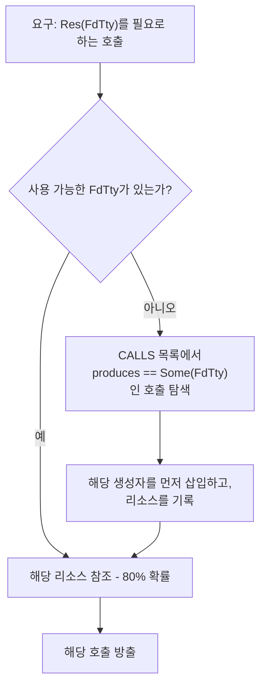

syzkaller의 80/20 비율 편향(`nOutOf(8, 10)`)을 그대로 차용합니다: **80%는 기존 리소스를 재사용하고, 20%는 새 리소스를 생성합니다.** 재사용은 프로그램의 일관성을 유지(열어둔 파일에 대해 작업 수행)하고, 새 리소스 생성은 새로운 시나리오를 탐색(두 번째 파일 열기)하게 만듭니다.

### 5.4 "커널을 안다"는 것의 진짜 의미 — 그리고 그것을 얻는 방법

흔히 syzkaller의 `.txt` 디스크립션이 "커널 구조를 알고 있는" 비결이라고 말합니다. 이는 한 가지 측면에서는 사실이지만 다른 두 가지 측면에서는 오해의 소지가 있으며, 이 차이를 이해해야 여러분이 무엇을 구축해야 하는지 명확해집니다.

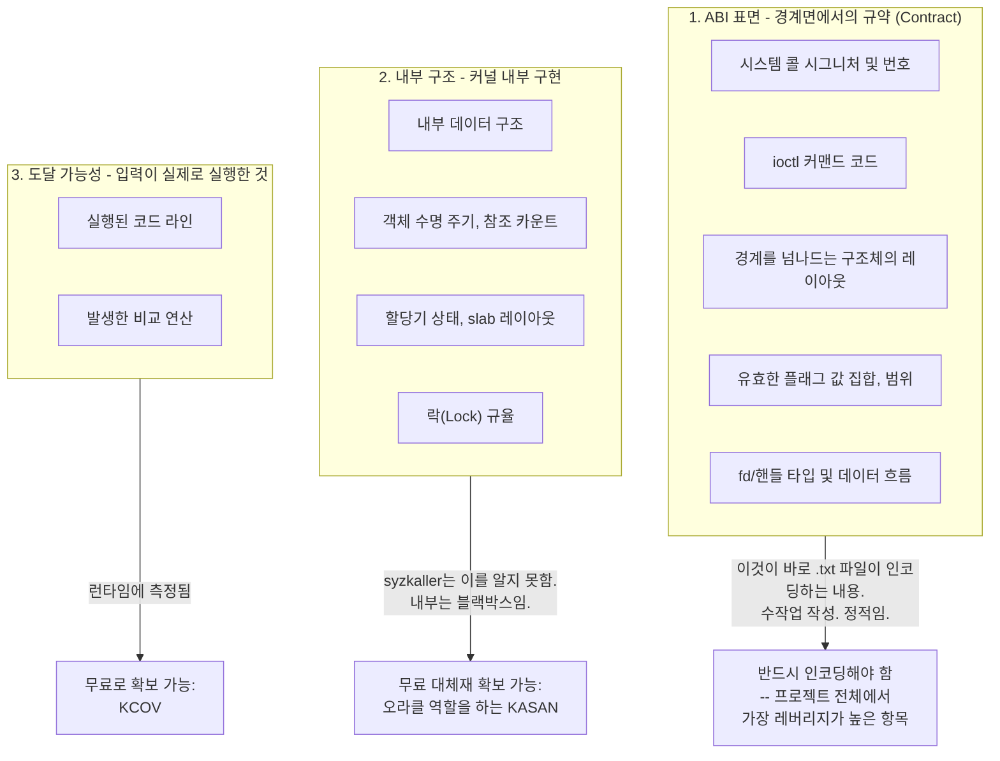

**정리하자면: syzkaller는 커널의 내부 동작을 알고 있는 것이 아닙니다. 경계면에서의 규약(contract)을 알고 있으며, 내부는 두 가지 도구를 통해 관찰할 뿐입니다 — KCOV는 코드가 어디로 흘러갔는지를 알려주고, KASAN은 무언가 고장 났을 때 이를 알려줍니다.** 이러한 역할 분담 덕분에 6개 운영체제 전반에 걸쳐 이식이 가능했던 것입니다. 디스크립션은 API를 모델링하고, 인스트루멘테이션은 그 이면의 모든 것을 처리합니다.

실습 관점에서는 이것이 두 배로 반가운 소식입니다. 범주 1은 반드시 직접 인코딩해야 합니다 — `ioctl(rand(), rand(), rand())`로는 절대 `EBADF`를 넘어설 수 없으므로 이는 타협의 여지가 없습니다. 하지만 범주 2와 3은 실습 0에서 이미 설정한 커널 설정 플래그를 통해 거저 얻을 수 있습니다.

#### 포맷 자체가 지식은 아니다

`.txt` *포맷*이 제공하는 기능과 실습에서의 필요 여부:

| 포맷이 제공하는 것 | 20개 시스템 콜에 필요한가? |
|---|---|
| 파서 및 약 12단계의 시맨틱 검증 패스 | 아니오 — `rustc`가 테이블의 타입을 검사합니다 |
| 커널 헤더 대상 C 컴파일을 통한 아키텍처별 상수 추출 | 아니오 — `libc::` 상수와 단일 타깃으로 충분합니다 |
| 수백 명의 원활한 기여 지원 | 아니오 |
| 커널 DWARF 정보와 대조하는 `syz-check` 검증 | **필요성은 실재함; 메커니즘은 대체 가능함** — 아래 참조 |
| gob 직렬화, 임베딩, 리비전 해싱 | 아니오 |

따라서: **지식은 취하되, 언어(DSL)는 생략하십시오.** 위 목록 중 실제로 필요한 단 하나의 가치 있는 역량은 구조체 레이아웃이 *올바른지* 확인할 수 있는 방법입니다.

#### 구조체 레이아웃 검증: 눈으로 보지 말고 `pahole`을 사용할 것

직접 구축한 시스템 콜 퍼저가 조용히 실패하는 가장 흔한 원인이 바로 이것입니다. 헤더 파일에서 ioctl 인자 구조체를 베껴 적다가 필드 순서나 패딩 홀(padding hole)을 하나 잘못 적으면, 이후 모든 호출이 `EINVAL`을 반환하거나, 혹은 엉뚱한 바이트를 퍼징하면서 겉으로는 성공해 버립니다. 커버리지는 정체되고 원인을 변이기 탓으로 돌리게 됩니다.

syzkaller는 `syz-extract`(실제 헤더에서 상수 추출)와 `syz-check`(커널 DWARF와 디스크립션 비교)를 통해 이를 해결합니다. 이미 디버그 정보가 포함된 커널을 빌드해 두었으므로, 단 하나의 명령어로 동일한 검증 효과를 얻을 수 있습니다:

```bash
# vmlinux에서 직접 정확한 레이아웃, 크기, 오프셋, 패딩 홀 확인
pahole -C sock_fprog ~/linux/vmlinux
pahole -C usbdevfs_ctrltransfer ~/linux/vmlinux

# 서브시스템 탐색 시 특정 접두사와 일치하는 모든 구조체 확인
pahole --sizes ~/linux/vmlinux | grep -i ptm
```

`pahole`은 DWARF를 읽어오므로 컴파일러가 *사용자의 빌드*를 위해 실제로 생성한 결과물(수작업 시 실수하기 쉬운 패딩 포함)을 그대로 출력합니다. 출력 예시:

```
struct sock_fprog {
        unsigned short             len;                  /*     0     2 */
        /* XXX 6 bytes hole, try to pack */
        struct sock_filter *       filter;               /*     8     8 */

        /* size: 16, cachelines: 1, members: 2 */
        /* sum members: 10, holes: 1, sum holes: 6 */
};
```

저 6바이트의 홀(hole)은 눈대중으로는 결코 짐작할 수 없는 영역이며, 이를 잘못 맞추면 뒤따르는 모든 필드의 위치가 틀어집니다.

알아두면 유용한 두 가지 소스:

```bash
# 손으로 옮겨 적지 않고 컴파일러에게 직접 상수 값을 물어보기 (syz-extract 방식):
echo '#include <linux/usbdevice_fs.h>
#include <stdio.h>
int main(){ printf("%lu\n", (unsigned long)USBDEVFS_CONTROL); }' > /tmp/c.c \
  && gcc -o /tmp/c /tmp/c.c && /tmp/c

# 덤프 파일 내에서 실제 커널 데이터 구조 순회 (§14.1 참조):
drgn -c core.elf -s ~/linux/vmlinux
```

`drgn` 명령은 이 절과 §14가 만나는 접점입니다. 메모리 덤프 기능은 사후 분석용일 뿐만 아니라 *실행 중인 커널을 대상으로 커널 구조체 모델이 올바른지 검증하는 수단*이기도 합니다. 이는 실습 환경에서 `syz-check`에 가장 근접한 대안이며 설정 비용도 전혀 들지 않습니다.

#### 간결한 모델링 요령: 유니언 대신 배리언트(Variant) 사용

syzkaller는 "이 ioctl의 인자 구조체는 커맨드 코드에 따라 달라진다"는 것을 조건부 유니언 필드로 모델링하며, 이를 위해 컴파일러에 디슈가링(desugaring) 패스를 두었습니다(`syzlang-design.md` §1.6 참조). 이러한 복잡한 메커니즘은 전혀 필요 없습니다. 각 커맨드를 **독립적인 호출**로 기술하면 됩니다:

```rust
// 유니언 인자를 가진 하나의 ioctl이 아니라, 3개의 개별 호출로 정의:
"ioctl$USBDEVFS_CONTROL"   => args: [Res(FdUsb), Const(USBDEVFS_CONTROL),   Buf{..}]
"ioctl$USBDEVFS_BULK"      => args: [Res(FdUsb), Const(USBDEVFS_BULK),      Buf{..}]
"ioctl$USBDEVFS_SETCONFIG" => args: [Res(FdUsb), Const(USBDEVFS_SETCONFIG), Buf{..}]
```

이것이 바로 syzkaller의 `$variant` 규칙이며, 실습 규모에서는 유니언과 조건부 필드를 완벽히 대체합니다. 테이블의 행 수는 늘어나지만 컴파일러 메커니즘은 0줄이 되며, 각 배리언트는 독립적으로 변이되는 고유한 인자 구조를 갖게 되므로 본래 목적에도 완벽히 부합합니다.

### 5.5 프로그램 모델: 실제로 변이시키는 대상

§5.1은 *스키마(schema)*를 정의했습니다. 이것은 *인스턴스(instance)*를 정의합니다 — 프로젝트의 다른 모든 부분이 건드리는 타입이므로, 이 구조를 올바르게 잡는 것이 이 절의 그 무엇보다 중요합니다.

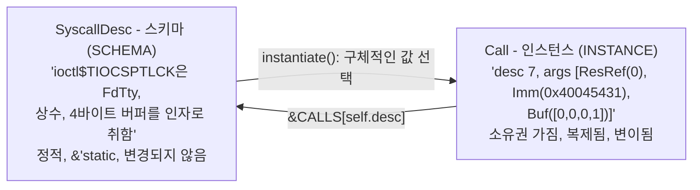

```rust
/// 실행 가능한 단일 구체 프로그램. 생성, 변이,
/// 최소화, 직렬화, 코퍼스 저장, 와이어 전송의 대상이 바로 이것입니다.
#[derive(Clone, Debug, Default, PartialEq)]
pub struct Program {
    pub calls: Vec<Call>,
}

#[derive(Clone, Debug, PartialEq)]
pub struct Call {
    /// 참조가 아닌 `CALLS`에 대한 인덱스입니다. `Program`의 복제(Clone)를
    /// 가볍게 유지하고 손쉽게 직렬화할 수 있게 하며, 타입에 맞게 변이해야 할 때
    /// 언제든 `&CALLS[self.desc]`로 스키마를 복원할 수 있습니다.
    pub desc: usize,
    /// 불변 조건: args.len() == CALLS[desc].args.len()
    pub args: Vec<Arg>,
}

#[derive(Clone, Debug, PartialEq)]
pub enum Arg {
    /// 구체적인 정수 값. Const, Int, Flags, Len은
    /// 값이 선택되고 나면 모두 이 타입으로 축약됩니다.
    Imm(u64),
    /// 실행기가 버퍼에 배치하고 포인터를 전달할 바이트 배열.
    Buf { dir: Dir, data: Vec<u8> },
    /// "호출 N의 반환값을 사용하라." 값이 아닌 데이터 흐름 에지입니다.
    ResRef(usize),
}
```

이 구조에는 나중에 큰 도움이 될 4가지 설계 결정이 담겨 있습니다:

**`&'static SyscallDesc` 대신 `desc: usize` 사용.** 참조를 사용하는 것도 그럴듯해 보이지만, 인덱스를 사용하면 복잡한 라이프타임 관리 없이 `Program`에 `Clone`을 구현할 수 있고, 4바이트로 직렬화되며, 코퍼스 파일에 쓰고 읽어도 온전히 유지되고, `==` 연산자로 두 프로그램을 간단히 비교할 수 있습니다. 스키마가 필요할 때는 배열 조회 한 번이면 충분합니다.

**6개의 `ArgKind`가 3개의 `Arg`로 축약됨.** `Const`, `Int`, `Flags`, `Len`은 인스턴스화되고 나면 모두 단순한 숫자에 불과합니다. *스키마*는 합법적인 값이 무엇인지 변이기가 알 수 있도록 이들을 구분해야 하지만, *인스턴스*는 그럴 필요가 없습니다. 배리언트 수가 적어지면 와이어 포맷, 변이기, 텍스트 직렬화기 코드가 모두 단순해집니다. (§6의 와이어 포맷에 정확히 3개의 `kind` 태그만 존재하는 이유이기도 합니다.)

**호출 인덱스 기반의 `ResRef(usize)`.** 와이어 포맷의 `kind=2`와 일치하고, syzkaller의 copyout 인덱스와 일치하며, 커널이 실제로 어떤 fd 값을 반환하든 프로그램이 유효하게 동작하도록 유지해 줍니다.

**`Len`은 인스턴스화 시점에 계산되고 변이 후에 재계산됨.** `ArgKind::Len(i)`는 "인자 *i*의 길이"를 의미합니다. 버퍼를 변경하는 변이가 일어난 후에는 해당 호출을 순회하며 모든 `Len` 인자를 보정해 주어야 합니다. 그렇지 않으면 영원히 `EFAULT`/`EINVAL` 에러만 보게 됩니다:

```rust
pub fn fix_lens(call: &mut Call) {
    let desc = &CALLS[call.desc];
    for (i, kind) in desc.args.iter().enumerate() {
        if let ArgKind::Len(target) = kind {
            let n = match &call.args[*target] {
                Arg::Buf { data, .. } => data.len() as u64,
                _ => 0,
            };
            call.args[i] = Arg::Imm(n);
        }
    }
}
```

이것이 실습 규모로 축약된 syzkaller의 `assignSizesCall`입니다. 모든 변이 연산자의 끝에서 이 함수를 호출하십시오.

#### `remove_call`: 단순한 최소화기가 망가지는 지점

§8.6에서 경고했던 부분입니다. 인덱스 계산을 미묘하게 틀리기 쉽기 때문에 주의 깊게 살펴볼 가치가 있습니다:

```rust
impl Program {
    /// 호출 `idx`를 제거하고 모든 데이터 흐름 에지를 복구합니다.
    pub fn remove_call(&mut self, idx: usize) {
        self.calls.remove(idx);
        // 제거 후: j < idx인 경우 new[j] == old[j], j >= idx인 경우 new[j] == old[j+1].
        // 리소스는 항상 사용되기 전에 생성되므로, 현재 인덱스가
        // idx 이상인 호출들만 idx 또는 그 이후를 참조할 수 있습니다. 두 가지 경우:
        //     ResRef(n), n  > idx  ->  인덱스가 1 감소함
        //     ResRef(n), n == idx  ->  댕글링(DANGLING); 생성자가 사라짐
        let mut dangling = Vec::new();
        for (i, call) in self.calls.iter_mut().enumerate().skip(idx) {
            for arg in &mut call.args {
                if let Arg::ResRef(n) = arg {
                    if *n == idx { dangling.push(i); }
                    else if *n > idx { *n -= 1; }
                }
            }
        }
        // 재귀 호출 시 앞쪽 인덱스가 유효하게 유지되도록 역순으로 제거합니다.
        for i in dangling.into_iter().rev() {
            self.remove_call(i);
        }
    }
}
```

의존하는 호출들을 함께 제거하는 것이 단순하면서도 올바른 정책입니다. 반면 syzkaller는 댕글링 참조를 해당 리소스 타입의 *기본값*으로 재지정하여 프로그램의 더 많은 부분을 보존합니다. 이는 2차 개선 단계에서 도입하기 좋은 방식이며, syzkaller의 최소화기가 여러분의 최소화기보다 더 작은 결과를 얻는 비결이기도 합니다.

#### 텍스트 직렬화: syzkaller의 포맷 채택

§8.4에서는 코퍼스를 텍스트로 저장합니다. 이 텍스트를 syzkaller 호환 포맷으로 만들면 자체 프로그램과 실제 syzbot 재현 코드가 상호 호환될 수 있습니다:

```
r0 = openat$ptmx(0xffffffffffffff9c, &(0x7f0000000000)='/dev/ptmx\x00', 0x2, 0x0)
ioctl$TIOCSPTLCK(r0, 0x40045431, &(0x7f0000000040)=0x0)
```

- `Arg::Imm(v)` → `0x{v:x}`
- `Arg::Buf{data}` → `&(0x7f0000000000)="hex"` — 이 단계에서 주소는 외형적인 표기에 불과하지만(실행기가 범프 할당하므로), 이를 출력해 두면 syzkaller 도구에서 읽을 수 있고 나중에 실제 아레나를 도입해도 텍스트 형식이 바뀌지 않습니다.
- `Arg::ResRef(n)` → `r{n}`, 다른 곳에서 호출 `i`를 참조할 때 해당 호출 앞에 `r{i} = `를 접두사로 붙입니다.

`to_text`는 약 60줄, `from_text`는 약 100줄이면 작성할 수 있습니다. 파싱 방향은 초기에는 선택 사항이지만, 중요한 코퍼스가 쌓이기 전에 반드시 작성해 두어야 합니다. 파서가 없으면 저장된 코퍼스는 쓰기 전용(write-only) 데이터가 되어버리기 때문입니다.

---

## 6. 실습 3 — 와이어 포맷 (Wire Format)

길이 접두사(length-prefixed), 리틀 엔디언, 수작업 인코딩 방식을 사용합니다. serde는 피하십시오. 게스트가 데이터를 거부할 때 `xxd`로 직접 읽고 디버깅할 수 있어야 합니다.

```
요청 (REQUEST)
  u32  magic = 0x52465A51 ("RFZQ")
  u32  version
  u32  n_calls
  n_calls 만큼 반복:
      i64  syscall_nr
      u8   n_args
      n_args 만큼 반복:
          u8  kind          0=imm 1=buf 2=resref
          -- kind 0: u64 value
          -- kind 1: u32 len, u8 dir, len 바이트
          -- kind 2: u32 call_index  (해당 호출의 반환값 사용)

응답 (RESPONSE)
  u32  magic = 0x52465A52 ("RFZR")
  u32  n_calls
  n_calls 만큼 반복:
      i64  retval
      u8   flags        bit0 실행됨, bit1 완료됨, bit2 커버리지 오버플로
      u32  n_pcs
      n_pcs 만큼 반복: u64 pc
```

바이트 레이아웃보다 중요한 3가지 설계 의도:

**`resref`는 값이 아니라 호출 인덱스입니다.** 게스트는 자체 결과 테이블을 참조하여 이를 해석합니다. 이것이 syzkaller의 `arg_result` / copyout 인덱스 메커니즘이며, `openat`이 fd 3을 반환하든 fd 7을 반환하든 프로그램이 정상 동작하는 이유입니다.

**프로그램 단위 합집합이 아닌, 호출별 PC 목록.** 응답 포맷은 호출별 귀속(attribution) 정보의 유실을 *원천적으로 불가능하게* 만들어야 합니다. 와이어 포맷에 단일 PC 목록만 존재한다면 이미 잘못된 설계입니다.

**첫 커밋부터 버전 필드 포함.** 이 포맷은 앞으로 5번은 바뀌게 됩니다. 게스트가 구조체를 잘못 읽어 침묵하는 것보다 매직 넘버와 버전 불일치로 즉각 실패하는 편이 훨씬 낫습니다.

### 6.1 커버리지 PC: 절대 빠뜨려서는 안 될 보정 작업

KCOV는 인스트루멘테이션된 호출 **이후**의 주소, 즉 반환 주소(return address)를 보고합니다. 이를 `addr2line`에 그대로 전달하면 *다음* 소스 라인이 출력됩니다.

```rust
/// KCOV는 반환 주소를 보고하므로, 명령어 하나를 되감아 실제 호출 지점을 얻습니다.
/// 크로스 빌드 시 올바른 값이 적용되도록 컴파일 타깃에 바인딩합니다. §15.4 참조.
pub const PC_REWIND: u64 = if cfg!(target_arch = "x86_64") { 5 }
    else if cfg!(target_arch = "s390x") { 6 }
    else if cfg!(target_arch = "mips64") { 8 }
    else { 4 };   // aarch64, arm, riscv64, powerpc64, loongarch64

pub fn previous_instruction_pc(pc: u64) -> u64 { pc - PC_REWIND }
```

이 보정은 호출 지점마다 적용하거나 소비자에게 위임하지 말고, **PC를 방출하거나 저장하는 경계면에서 단 한 번** 적용하십시오. syzkaller는 `pkg/cover/backend/pc.go`에서 아키텍처별 테이블을 통해 이를 수행합니다.

이후 호스트에서 심볼화합니다:

```bash
addr2line -e ~/linux/vmlinux -f -i -p 0xffffffff81234567
```

되감기 오프셋을 잘못 맞추면 모든 분석 결과가 명령어 하나씩 어긋나게 되며, 그럼에도 그럴듯해 보이기 때문에 코드 리뷰에서도 쉽게 발견되지 않는 무서운 버그가 됩니다.

---

## 7. 실습 4 — 전송 계층, 그리고 virtme-ng가 이를 단순화하는 이유

반드시 순서대로 3단계를 거칩니다. **바로 3단계로 건너뛰지 마십시오.**

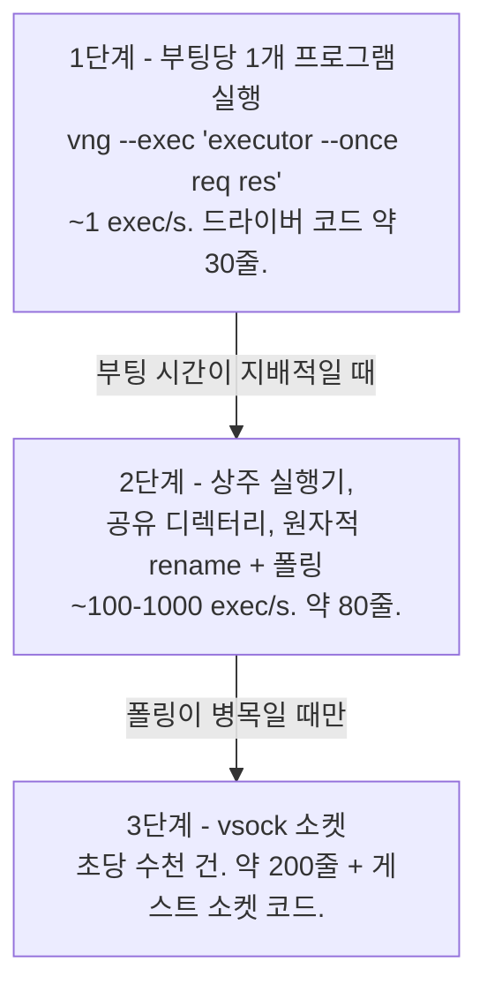

### 7.1 1단계 — 부팅당 1개 프로그램 실행

```rust
fn exec_once(prog: &Program, work: &Path) -> anyhow::Result<Outcome> {
    fs::write(work.join("req.bin"), wire::encode_request(prog))?;
    let _ = fs::remove_file(work.join("res.bin"));

    let out = Command::new("vng")
        .arg("--run").arg(&self.kernel)
        .arg(format!("--rwdir=/work={}", work.display()))
        .arg("--overlay-rwdir=/scratch")
        .arg("--memory").arg("2G")
        .arg("--exec")
        .arg(format!("{} --once /work/req.bin /work/res.bin", self.executor_guest_path))
        .output()?;                           // stdout+stderr = 게스트 콘솔

    let console = String::from_utf8_lossy(&out.stdout).into_owned();
    if let Some(title) = crash::scan(&console) {
        return Ok(Outcome::Crash { title, console });
    }
    match fs::read(work.join("res.bin")) {
        Ok(buf) => Ok(Outcome::Done(wire::decode_response(&buf)?)),
        Err(_)  => Ok(Outcome::NoResult { console }),   // 멈춤(hang) 또는 실행기 사망
    }
}
```

이것만으로도 완전하게 동작하는 퍼저 백엔드가 완성됩니다. 초당 1회 실행 수준이지만 첫 1시간 동안 커버리지가 상승하는 것을 직접 확인할 수 있으며, 전체 루프를 검증하기에 충분합니다. **첫날에는 반드시 여기까지 도달하십시오.**

`--overlay-rwdir=/scratch`를 주목하십시오: 게스트에서는 쓰기 가능하고 종료 시 삭제되며, 호스트에서는 읽기 전용입니다. 실행기가 시작 시 이 디렉터리로 `chdir`하도록 만드십시오.

### 7.2 2단계 — 공유 디렉터리 기반 상주 실행기 (Persistent Executor)

한 번 부팅하여 수천 개의 프로그램을 실행합니다. 호스트 마운트 경로에 대한 직관은 완전히 맞지만, 한 가지 주의점이 있습니다.

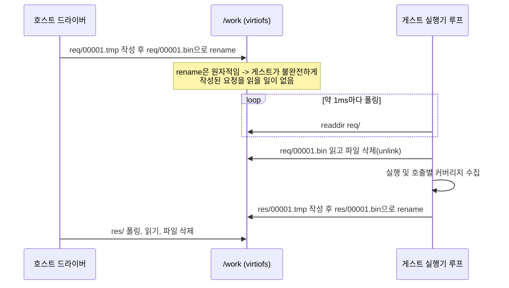

안정성을 보장하는 규칙들:

1. **임시 파일명으로 작성한 뒤 `rename`하십시오.** virtiofs와 9p 모두에서 원자적(atomic)으로 동작합니다. 그렇지 않으면 중간에 잘린 요청을 읽게 되어 저녁 내내 와이어 포맷 탓을 하게 됩니다.
2. **inotify에 의존하지 말고 폴링하십시오.** virtiofs/9p 환경에서의 파일시스템 이벤트 알림은 신뢰할 수 없습니다. 1ms 단위의 `sleep`은 이 속도에서 아무런 지장을 주지 않습니다.
3. **9p보다 virtiofs를 선호하십시오.** virtme-ng는 `virtiofsd`가 사용 가능할 때 자동으로 virtiofs를 선택하고 그렇지 않으면 9p로 폴백합니다. `cache=loose`가 적용된 9p는 메타데이터 가시성이 지연될 수 있습니다. 요청 전달이 지연되는 것처럼 보인다면 어떤 백엔드가 선택되었는지 확인하고 `--force-9p`를 제거해 보십시오.
4. **단일 파일명을 재사용하지 말고 시퀀스 번호를 사용하십시오.** `req.bin`을 재사용하면 게스트가 이전 요청을 다시 읽을 위험이 있습니다.
5. **하트비트(Heartbeat)를 유지하십시오.** 게스트는 매초마다 `work/alive` 파일을 갱신(touch)합니다. 콘솔 출력이 없는 상태에서 하트비트가 멈춘다면 커널이 멈춘(wedged) 것입니다 — 이것이 "무응답" 감지기이며, 실습에서 실제로 필요한 단 하나의 타임아웃 계층입니다.

실용적인 대안: 만약 폴링 일관성 문제로 어려움을 겪는다면, `vng --console` / `--console-client`가 이미 **vsock** 채널을 구성해 두었으며 `--ssh`는 vsock 기반 SSH를 제공합니다. 둘 중 어느 쪽이든 파일시스템 없이 소켓을 통해 길이 접두사 바이너리를 스트리밍할 수 있습니다. 이는 조기에 3단계를 도입하는 셈이며, virtiofs가 문제를 일으킬 때 유용한 우회로가 됩니다.

### 7.3 별도 RPC 프로토콜이 필요 없는 이유

syzkaller에는 FlatBuffers 스키마, 생성된 Go/C++ 코드, 쿠키 핸드셰이크, 리비전 검사, 공유 메모리 기반 결과 구성을 포함하는 `pkg/flatrpc`가 있습니다. 실행기는 C++, 매니저는 Go이고, 서로 다른 브랜치에서 빌드될 수 있으며 처리량이 중요하기 때문에 이 모든 것이 필요합니다.

**반면 여러분은 단일 워크스페이스에서 `common` 크레이트를 공유하는 Rust를 양쪽에서 사용합니다.** 타입 일관성은 컴파일러가 강제합니다. 핸드셰이크는 `magic + version`이면 충분합니다. 이 단순함을 유지하십시오.

### 7.4 드라이버 루프: 이 모든 것을 하나로 엮는 코드

§1의 세 번째 굵은 글씨 항목입니다. 코드는 짧지만, 내부의 *순서*를 올바르게 잡는 것이 관건입니다.

```rust
fn main() -> anyhow::Result<()> {
    let mut target: Box<dyn FuzzTarget> = match std::env::args().nth(1).as_deref() {
        Some("board") => Box::new(BoardTarget::new("192.168.9.2", "/mnt/build/executor")?),
        _             => Box::new(VirtmeTarget::new("~/linux")?),
    };
    target.deploy()?;

    let mut corpus = Corpus::load("corpus")?;
    let mut rng    = rand::thread_rng();
    let mut recent = VecDeque::with_capacity(64);   // 크래시 귀속 분석용
    let mut execs  = 0u64;

    loop {
        // 우선순위 계층 2단계 (mutation-design.md §2):
        // 95%는 기존 프로그램 변이, 5%는 처음부터 새로 생성.
        let prog = if corpus.is_empty() || rng.gen::<f64>() >= 0.95 {
            generate(&mut rng, 20)
        } else {
            let mut p = corpus.choose(&mut rng).unwrap().prog.clone();
            mutate(&mut p, &corpus, &mut rng);
            p
        };

        match classify(target.as_mut(), &prog) {       // 보드 타깃의 경우 §15.6 참조
            Health::Ok(resp) => {
                // ---- 비용이 적게 드는 검사를 먼저 수행. 이 순서가 핵심입니다. ----
                let cover = resp.union_cover();
                if corpus.any_novel(&cover) {
                    // 이제야 비로소 3배의 비용을 들여 플레이크 완화(deflaking, §8.5)를 할 가치가 있습니다...
                    let stable = stable_cover(target.as_mut(), &prog)?;
                    if corpus.any_novel(&stable) {
                        // ...그리고 N배의 비용을 들여 최소화(minimization, §8.6)를 수행합니다.
                        let small = minimize(target.as_mut(), &prog, &stable);
                        corpus.consider(&small, &stable);
                        corpus.save_to_disk("corpus")?;
                    }
                }
            }
            Health::Crashed { title, console } => {
                save_crash(&title, &console, &prog, &recent)?;
                target.reset()?;
            }
            Health::Unreachable => target.reset()?,
        }

        if recent.len() == 64 { recent.pop_front(); }
        recent.push_back(prog);
        execs += 1;
        if execs % 100 == 0 {
            eprintln!("{execs} execs | {} PCs | {} corpus", corpus.pc_count(), corpus.len());
        }
    }
}
```

**중첩된 신규성 검사(novelty check)는 이 루프에서 가장 중요한 한 줄입니다.** 1회 실행은 저렴합니다. 플레이크 완화는 3배의 비용이 듭니다. 최소화는 호출 제거 시도당 1회씩 실행되므로 생성된 프로그램 기준 20–30배의 비용이 듭니다. 모든 입력에 대해 완화와 최소화를 수행한다면, 새로운 정보를 주지 않는 입력에 예산의 99%를 낭비하게 됩니다.

따라서: 1회 실행 후 원시 커버리지로 신규성을 확인하고, 새로워 *보일 때만* 실제로 새로운지 검증하는 비용을 지불하며, 검증을 통과했을 때만 프로그램을 줄이는 비용을 지불합니다.

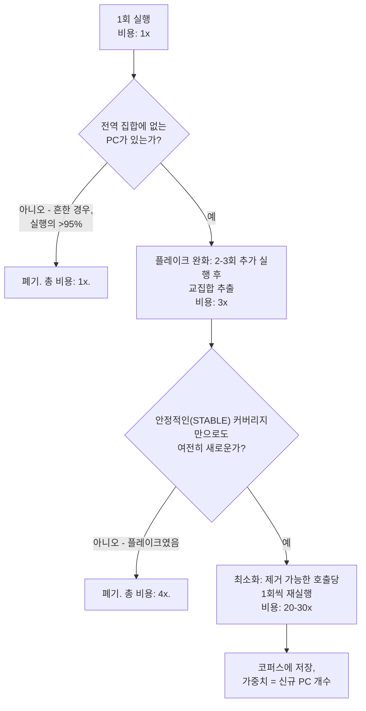

이것이 syzkaller의 파이프라인 형태와 정확히 일치합니다 — `processResult`가 먼저 `addRawMaxSignal`을 확인하고, *그 이후에만* `triageJob`을 시작하여 플레이크를 완화하고 최소화를 진행합니다. 여러분은 복잡한 구조 없이 동일한 경제성을 구현한 것입니다.

루프에서 중요한 2가지 작은 디테일:

**`recent`는 크기가 제한된 링 버퍼이며 크래시 기록에 함께 포함됩니다.** 커널은 직전 프로그램이 아니라 몇 단계 이전의 프로그램 때문에 죽는 경우가 흔합니다. 패닉 시점에 실행 중이던 프로그램은 유력 용의자일 뿐 유죄 확정자가 아닙니다. 최근 64개 프로그램을 저장해 두면 수작업으로 바이섹션할 수 있는 단서가 됩니다. (syzkaller는 `pkg/repro`에서 이를 자동화합니다.)

**`Crashed`뿐만 아니라 `Unreachable`에서도 `target.reset()`을 호출합니다.** 콘솔 출력 없이 멈춘 상태 역시 타깃이 사망한 것입니다. 인지된 크래시에 대해서만 리셋한다면, 퍼저는 멈춰버린 머신을 상대로 무한 루프를 돌며 커버리지 0만 보고하게 될 것입니다.

---

## 8. 실습 5 — 코퍼스 (Corpus)

"코퍼스를 어떻게 관리해야 하는가"라는 질문에 대한 답은 syzkaller의 구현이 암시하는 것보다 훨씬 간단합니다.

### 8.1 데이터 구조

```rust
pub struct Corpus {
    items: Vec<Item>,
    /// 지금까지 관찰된 모든 PC. 신규성 게이트 역할.
    seen: HashSet<u64>,
    /// O(log n) 가중치 선택을 위한 `items`와 병렬인 누적 가중치 배열.
    acc: Vec<u64>,
    total: u64,
}

pub struct Item {
    pub prog: Program,
    /// 선택 가중치 = 이 프로그램이 추가될 당시 기여한 PC 개수.
    pub weight: u64,
    pub cover: Vec<u64>,
}
```

### 8.2 신규성 게이트 (The Novelty Gate)

의사결정 절차의 전체 내용입니다:

```rust
pub fn consider(&mut self, prog: &Program, cover: &[u64]) -> bool {
    let novel: Vec<u64> = cover.iter().copied()
        .filter(|pc| !self.seen.contains(pc))
        .collect();
    if novel.is_empty() {
        return false;                         // 새로운 소득 없음; 폐기
    }
    for pc in &novel { self.seen.insert(*pc); }
    self.push(prog.clone(), novel.len() as u64, cover.to_vec());
    true
}
```

**이것이 커버리지 기반 퍼징의 전부입니다.** 시그널 우선순위, 플레이크 완화, 집합 커버 최소화, 포화 감지 등 그 외 모든 것은 대규모 환경에서 syzkaller에 필요한 고도화 작업일 뿐 지금 단계에서는 필요하지 않습니다.

### 8.3 가중치 기반 선택: 그대로 복사해야 할 단 하나의 알고리즘

syzkaller의 `pkg/corpus/prio.go`는 약 20줄에 불과하며 프로젝트 전체에서 가장 재사용성이 뛰어난 코드 조각입니다:

```rust
fn push(&mut self, prog: Program, weight: u64, cover: Vec<u64>) {
    let w = weight.max(1);                    // 하한선: 도달 불가능해지는 항목 방지
    self.total += w;
    self.acc.push(self.total);
    self.items.push(Item { prog, weight: w, cover });
}

pub fn choose(&self, rng: &mut impl Rng) -> Option<&Item> {
    if self.items.is_empty() { return None; }
    let target = rng.gen_range(1..=self.total);
    let idx = self.acc.partition_point(|&a| a < target);
    Some(&self.items[idx])
}
```

누적 가중치 배열과 이진 탐색: O(log n) 비례 샘플링, O(1) 분할 상환 삽입.

**가중치 = 기여한 신규 PC 개수.** 200개의 새로운 에지를 열어준 프로그램은 1개만 추가한 프로그램보다 변이 대상으로 선택될 확률이 200배 높습니다. 근거: 많은 코드에 도달한 프로그램은 풍부한 인접 영역에 위치하므로 약간의 섭동(perturbation)만으로도 새로운 코드에 도달할 가능성이 더 높다는 베팅입니다. `max(1)` 하한선은 어떤 프로그램도 영구적으로 배제되지 않도록 보장합니다.

### 8.4 영속화: 데이터베이스를 만들지 말 것

syzkaller에는 flate 압축, 툼스톤(tombstone), 컴팩션, 2개의 버전 번호, 부분 복구 시맨틱을 갖춘 커스텀 추가 전용(append-oriented) 키-값 로그 `pkg/db`가 있습니다. 수십만 개의 프로그램을 관리하려면 그것이 필요합니다.

**하지만 여러분이 다룰 프로그램은 수백 개 수준입니다. 파일시스템을 활용하십시오:**

```
corpus/
├── 3a7f1c9e....prog     # 파일명 = blake3(직렬화된 프로그램)
├── 8b2d04f1....prog
└── ...
```

```rust
pub fn save_to_disk(&self, dir: &Path) -> anyhow::Result<()> {
    for item in &self.items {
        let text = item.prog.to_text();                  // 사람이 읽을 수 있는 형식!
        let hash = blake3::hash(text.as_bytes()).to_hex();
        let path = dir.join(format!("{}.prog", &hash[..16]));
        if !path.exists() {
            let tmp = path.with_extension("tmp");
            fs::write(&tmp, &text)?;
            fs::rename(&tmp, &path)?;                    // 원자적 연산
        }
    }
    Ok(())
}
```

거저 얻게 되는 이점: 콘텐츠 주소 지정(동일한 프로그램 중복 방지), 원자적 쓰기, 크래시 안전성, 부분 복구(손상된 파일은 파싱 불가능한 1개 파일로 격리됨), 그리고 결정적으로 **코퍼스를 `cat`으로 직접 볼 수 있습니다**. 이상이 감지되었을 때 `grep -l ioctl corpus/*.prog`는 바이너리 DB가 답할 수 없는 질문에 명쾌하게 답해줍니다.

바이너리 인코딩이 아닌 **텍스트로 저장하십시오.** 이 규모에서는 디버깅 용이성이 데이터 밀도보다 훨씬 중요합니다. syzkaller의 텍스트 형식을 채택하면 실제 syzbot 재현 코드와도 상호 호환됩니다.

### 8.5 플레이키(Flaky) 커버리지: 감수해야 할 부분

커널은 결정론적이지 않습니다. 동일한 프로그램을 두 번 실행해도 타이밍, 스케줄링, 이전 상태, 인터럽트 발생 시점 등에 따라 PC 집합이 달라집니다. 따라서 어떤 프로그램이 다시는 생성하지 못할 일회성 커버리지로 인해 코퍼스에 진입할 수 있습니다.

syzkaller의 해법은 `triageJob`입니다: 3–5회 실행하고 최소 3회 이상 관찰된 시그널만 유지한 뒤, *그 이후에* 최소화하고 저장합니다. 수학적 근거도 제시되어 있습니다 — 80% 확률로 재현되는 프로그램은 94%의 확률로 5회 중 3회 조건을 통과합니다.

**비용 순으로 정리한 선택지:**

| 접근 방식 | 구현 비용 | 결과 |
|---|---|---|
| 플레이크를 감수함 | 0줄 | 코퍼스에 쓰레기 데이터가 다소 누적됨; 커버리지 수치가 출렁임; "새로운 커버리지"를 완전히 신뢰하기 어려움 |
| **3회 중 2회 교집합** | ~25줄 | 대부분의 플레이크 제거; **권장 시작 지점** |
| syzkaller 스타일의 5회 중 3회 | ~60줄 | 실습 규모에서는 한계 효용이 낮음 |

3회 중 2회 버전 구현:

```rust
pub fn stable_cover(&mut self, prog: &Program) -> anyhow::Result<HashSet<u64>> {
    let a = self.exec(prog)?.union_cover();              // HashSet<u64>
    let b = self.exec(prog)?.union_cover();
    let mut stable: HashSet<u64> = a.intersection(&b).copied().collect();

    // 두 실행의 차이가 큰 경우: 세 번째 실행으로 확인
    if stable.len() * 4 < a.len() * 3 {
        let c = self.exec(prog)?.union_cover();
        let ac: HashSet<u64> = a.intersection(&c).copied().collect();
        stable.extend(ac);                               // 3회 중 2회 이상 관찰됨
    }
    Ok(stable)
}
```

*안정적인(stable)* 커버리지에 대해서만 코퍼스 진입을 허용하십시오. 이로 인해 후보 프로그램의 실행 비용이 3배로 증가하며, 이것이 바로 2단계 전송 계층이 중요한 이유입니다.

### 8.6 최소화 (Minimization): 80줄로 얻는 막대한 성과

생성된 프로그램은 대개 20–30개의 호출로 이루어져 있으며 대부분은 무의미합니다. 이러한 프로그램들로 구성된 코퍼스는 실행이 느리고 분석이 불가능합니다.

```rust
pub fn minimize(&mut self, prog: &Program, target: &HashSet<u64>) -> Program {
    let mut best = prog.clone();
    let mut i = best.calls.len();
    while i > 0 {
        i -= 1;
        if best.calls.len() == 1 { break; }
        let mut candidate = best.clone();
        candidate.remove_call(i);              // 리소스 참조도 함께 보정해야 함
        if let Ok(cov) = self.stable_cover(&candidate) {
            let got: HashSet<u64> = cov.into_iter().collect();
            if target.is_subset(&got) {        // 목표 PC가 모두 유지됨
                best = candidate;
            }
        }
    }
    best
}
```

syzkaller에서 차용할 가치가 있는 2가지 디테일:

**역순으로 순회하십시오.** 뒤쪽의 호출일수록 제거 가능성이 높으며, 끝에서부터 제거하면 이미 확인한 리소스 참조의 인덱스를 다시 조정할 필요가 없습니다.

**`remove_call`은 데이터 흐름을 복구해야 합니다.** `r0`를 생성한 호출을 삭제하면, `r0`를 참조하는 모든 위치를 리디렉션하거나 해당 의존 호출도 함께 제거해야 합니다. 단순한 최소화기가 더 이상 실행되지 않는 프로그램을 만들어내는 지점이 바로 여기입니다. `Vec<Option<usize>>` 리매핑 테이블을 유지하고 이후의 모든 `resref` 인자에 적용하십시오.

방어 코드도 그대로 가져옵니다: **호출 수가 1개 미만으로 줄어들지 않도록 보호하십시오.** syzkaller 주석에 실용적인 이유가 적혀 있습니다 — 호출이 0개인 프로그램은 실행기가 즉시 종료되어 다른 종류의 장애처럼 보이기 때문입니다.

---

## 9. 실습 6 — 생성 및 변이

### 9.1 생성 (Generation)

```rust
pub fn generate(rng: &mut impl Rng, n_calls: usize) -> Program {
    let mut prog = Program::default();
    let mut res = ResState::default();
    while prog.calls.len() < n_calls {
        let desc = CALLS.choose(rng).unwrap();
        // 이 호출이 필요로 하지만 현재 없는 리소스에 대해 생성자를 삽입
        for arg in desc.args {
            if let ArgKind::Res(k) = arg {
                if res.pick(*k, rng).is_none() {
                    if let Some(p) = find_producer(*k) {
                        let idx = prog.push(instantiate(p, rng, &res));
                        res.record(*k, idx);
                    }
                }
            }
        }
        let idx = prog.push(instantiate(desc, rng, &res));
        if let Some(k) = desc.produces { res.record(k, idx); }
    }
    prog
}
```

### 9.2 값 생성: syzkaller의 분포 모방

단순한 균등 무작위(uniform randomness)를 사용했다가는 처리량의 대부분을 낭비하게 되는 영역입니다. syzkaller의 `randInt`는 대략 다음과 같습니다:

```rust
pub fn rand_int(rng: &mut impl Rng, bits: u8) -> u64 {
    let v = match rng.gen_range(0..100) {
        0..=54  => rng.gen_range(0..10u64),                   // ~55% 한 자리 수
        55..=81 => *SPECIAL_INTS.choose(rng).unwrap(),        // ~27% 매직 값
        82..=88 => rng.gen::<u64>() % 256,
        89..=92 => rng.gen::<u64>() % (4 << 10),
        93..=96 => rng.gen::<u64>() % (64 << 10),
        _       => rng.gen::<u64>() % (1 << 31),
    };
    truncate(v, bits)
}

/// 이 값들은 모두 경계 지점입니다: 페이지 크기, 타입 한계치,
/// 부호 변환 지점 및 이들의 오프바이원(off-by-one) 인접 값들.
pub static SPECIAL_INTS: &[u64] = &[
    0, 1, 2, 3, 4, 5, 6, 7, 8, 9, 10, 11, 12, 13, 14, 15, 16,
    64, 127, 128, 129, 255, 256, 257, 511, 512,
    1023, 1024, 1025, 2047, 2048, 4095, 4096,
    (1<<15)-1, 1<<15, (1<<15)+1,   (1<<16)-1, 1<<16, (1<<16)+1,
    (1<<31)-1, 1<<31, (1<<31)+1,   (1<<32)-1, 1<<32, (1<<32)+1,
    (1<<63)-1, 1<<63, (1<<63)+1,   u64::MAX,
];
```

**55% 한 자리 수**라는 비율이 이상해 보일 수 있지만, 실제 시스템 콜 인자는 대부분 플래그, 개수, 인덱스, 열거형 값 등 작은 숫자입니다. 균등 무작위로 추출한 u64는 의미 있는 코드에 도달하기도 전에 거의 항상 `EINVAL`로 거부됩니다.

또한 **1% 범위 탈출(range escape)** 규칙도 차용하십시오: 인자에 선언된 범위가 있더라도 1%의 확률로는 이를 무시하고 자유롭게 값을 생성합니다. 테이블은 *의도된* 사양을 명시하고, 퍼저는 독자적으로 *의도치 않은* 값을 공급합니다. 둘을 분리해 두는 덕분에 디스크립션에 `-1`이나 `INT_MAX`를 어지럽게 적어둘 필요가 없어집니다.

### 9.3 변이: 5개가 아닌 3개의 연산자

syzkaller에는 가중치 합이 460인 5개의 연산자가 있습니다 (splice 200, insert 100, mutate-arg 100, squash 50, remove-call 10). 3개로 시작하십시오:

| 연산자 | 가중치 | 비중 | 설명 |
|---|---:|---:|---|
| `splice` | 200 | 50% | 다른 코퍼스 프로그램의 모든 호출을 임의의 위치에 삽입 |
| `insert_call` | 100 | 25% | 새 호출 하나를 생성하여 뒤쪽에 편향되게 삽입 |
| `mutate_arg` | 100 | 25% | 한 호출의 한 인자를 변경 |

`squash` (ANY 메커니즘 필요)와 `remove_call` (최소화기가 시그널을 보존하며 더 잘 수행함)은 생략합니다.

```rust
pub fn mutate(prog: &mut Program, corpus: &Corpus, rng: &mut impl Rng) {
    let (mut applied, mut done) = (false, false);
    while !done {
        applied = match rng.gen_range(0..400) {
            0..=199   => splice(prog, corpus, rng),
            200..=299 => insert_call(prog, rng),
            _         => mutate_arg(prog, rng),
        };
        // 1/5 확률로 중단하되, 반드시 성공적인 변이가 적용된 이후에만 중단.
        done = applied && rng.gen_range(0..5) == 0;
    }
}
```

이 종료 조건을 이해할 필요가 있습니다. 실패한 연산자(코퍼스가 비었을 때의 splice, 호출 수 한도 도달 시의 insert)는 비용이 들지 않으며 즉시 재시도됩니다. **실제 적용되는 변이 횟수의 기댓값은 5회**이며 기하 분포를 따릅니다. 때로는 1회, 때로는 15회가 적용됩니다. 항상 정확히 1회만 적용하면 너무 국소적으로 탐색하고, 항상 10회를 적용하면 범위를 벗어나 버립니다. 기하 분포는 두 줄의 코드로 두 가지 스케일을 모두 만족시킵니다.

`insert_call`의 경우 뒤쪽 편향을 차용하십시오 — syzkaller는 `biasedRand(n+1, 5)`를 사용하여 마지막 위치를 첫 번째 위치보다 5배 더 높은 확률로 선택합니다. 프로그램은 파이프라인 구조(열기, 설정, 사용)를 띠며, 흥미로운 새로운 동작은 대개 끝부분에 위치하기 때문입니다:

```rust
/// [0, n) 범위의 무작위 값 중 n-1이 0보다 k배 더 자주 선택되도록 편향된 함수.
pub fn biased_rand(rng: &mut impl Rng, n: usize, k: usize) -> usize {
    if n <= 1 { return 0; }
    let (nf, kf) = (n as f64, k as f64);
    let r = nf * (kf / 2.0 + 1.0) * rng.gen::<f64>();
    (((-1.0 + (1.0 + 2.0 * kf * r / nf).sqrt()) * nf / kf) as usize).min(n - 1)
}
```

---

## 10. 실습 7 — 크래시 감지 (Crash Detection)

이것이 없으면 퍼저가 아니라 단순 커버리지 측정기에 불과합니다.

```rust
static PATTERNS: &[(&str, &str)] = &[
    ("BUG: KASAN:",            "KASAN"),
    ("BUG: KMSAN:",            "KMSAN"),
    ("WARNING: ",              "WARNING"),
    ("BUG: unable to handle",  "fault"),
    ("general protection fault", "GPF"),
    ("kernel BUG at",          "BUG"),
    ("Kernel panic",           "panic"),
    ("INFO: task .* blocked",  "hung task"),
    ("BUG: soft lockup",       "lockup"),
];

pub fn scan(console: &str) -> Option<String> {
    for line in console.lines() {
        for (pat, _kind) in PATTERNS {
            if line.contains(pat) {
                return Some(normalize_title(line));
            }
        }
    }
    None
}
```

`normalize_title`은 주소와 오프셋을 제거하여 `foo_release+0x1a/0x80`과 `foo_release+0x22/0x80`이 동일한 버킷으로 중복 제거되도록 합니다. 이것이 중복 제거 전략의 전부이며, 실습 규모에서는 충분합니다.

생략되는 내용과 그 사실을 인지해야 하는 이유: syzkaller의 `pkg/report`는 OS별 정규식을 수천 줄에 걸쳐 사용하여 리포트를 분류하고, 원인이 된 프레임과 파일을 추출하며, *손상된(corrupted)* 리포트(깨진 콘솔 출력)를 감지하고, 관심 없는 것으로 알려진 패턴을 *억제(suppress)*합니다. 여러분은 거친 근사치를 사용할 뿐입니다. 대개의 경우 문제가 없지만, 간혹 하나의 버그를 두 개로 오인하여 추적하게 될 수도 있습니다.

저렴하면서도 갖출 가치가 있는 2가지:

**모든 것을 저장하십시오.** 크래시 발생 시 콘솔 텍스트, 프로그램, 최근 실행된 프로그램 이력 전체를 `crashes/<title_hash>/`에 기록하십시오. 디스크 용량은 저렴합니다. 분석할 수 없는 크래시는 낭비된 크래시입니다.

**최근 N개의 프로그램을 보관하십시오.** 커널이 죽었을 때 실행 중이던 프로그램이 가장 유력한 용의자이지만, 실제로는 몇 단계 전의 프로그램으로 인해 커널이 죽는 경우가 많습니다. syzkaller의 재현 코드 추출 로직이 전체 로그를 바이섹션하는 이유가 바로 이것입니다.

---

## 11. 마일스톤

각 마일스톤은 엄격한 관문입니다. 마일스톤을 통과하기 전에는 다음으로 진행하지 마십시오.

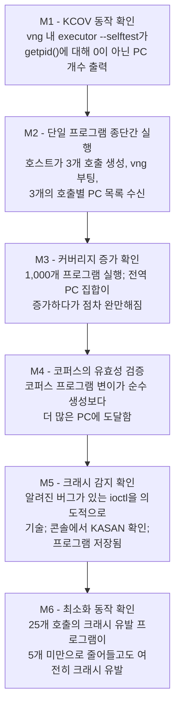

**M4는 전체 아이디어를 검증하는 진정한 시험대입니다.** 두 가지 구성을 각각 1시간 동안 실행해 보십시오: 순수 무작위 생성 vs 코퍼스 프로그램의 95% 변이. 코퍼스 기반 실행이 확연히 더 많은 PC에 도달하지 못한다면 피드백 루프의 어딘가가 고장 난 것입니다 — 신규성 게이트가 모든 입력을 허용하고 있거나(실행 간 PC가 안정적인지, PC 되감기가 일관되게 적용되었는지 확인), 변이기가 프로그램을 섭동하는 것이 아니라 파괴하고 있을 가능성이 높습니다.

**M5를 위해 실제 버그가 나타날 때까지 기다리지 마십시오.** 모듈로 빌드할 수 있는 드라이버에서 오래된 CVE를 찾거나, out-of-bounds 읽기를 수행하는 `ioctl`이 포함된 의도적인 버그 테스트 모듈을 컴파일하십시오. 이를 테이블에 기술하십시오. 크래시를 잡아내는 것을 직접 보지 못한 퍼저는 작동 여부를 알 수 없는 퍼저입니다.

---

## 12. 처리량 기대치

엉뚱한 부분을 최적화하지 않도록 현실적인 기대치를 가지십시오.

| 구성 | 초당 실행 횟수 (Execs/sec) | 병목 지점 |
|---|---:|---|
| 1단계, 부팅당 1개 프로그램, microvm | ~0.5–1 | VM 부팅 (microvm + KVM 환경에서 ~0.3–1초) |
| 1단계, `--disable-microvm` | ~0.2–0.5 | 풀 머신 부팅 |
| 2단계, 상주 실행기, virtiofs 폴링 | ~100–1,000 | 폴링 지연 시간, KCOV mmap 읽기 |
| 2단계 + 3회 중 2회 플레이크 완화 | 후보 프로그램에 대해 ÷3 | 설계상 의도됨 |
| 참고: syzkaller 단일 VM | 수천 건 | — |

교훈: **1단계는 syzkaller보다 1,000배 느리지만 루프를 검증하기에는 여전히 완벽하게 충분합니다.** 몇 시간 동안 커버리지를 키우고 싶은 대상이 생겼을 때 비로소 2단계로 넘어가십시오.

vsock을 도입하기 전에 손쉽게 얻을 수 있는 성능 이점: `--memory 2G` (KASAN은 메모리를 많이 소모함), `--cpus 2`, microvm 활성화 유지, 그리고 한 번의 요청에 여러 프로그램을 묶어(batch) 라운드트립 비용 분산.

---

## 13. 소요 시간 기준 함정 랭킹

| 함정 | 증상 | 해결책 |
|---|---|---|
| **KASLR을 켜둔 채 방치함** | 부팅 간 PC가 일치하지 않음; 커버리지가 정체되지 않음; 코퍼스가 폭발적으로 증가 | `CONFIG_RANDOMIZE_BASE=n`, 또는 부팅별 커널 베이스 주소 감산 |
| **PC 되감기 누락 또는 오류** | 커버리지가 실제 라인의 *다음* 라인에 매핑됨 | 방출 경계에서 `previous_instruction_pc` 한 번 적용 |
| **엉뚱한 스레드에서 `KCOV_ENABLE` 호출** | 항상 0개의 PC 수집 | 시스템 콜을 실행하는 바로 그 스레드에서 활성화 |
| **`KCOV_INIT_TRACE`에 바이트 크기 전달** | `EINVAL` 발생 | 인자는 바이트가 아닌 **엔트리** 개수임 |
| **프로그램 단위로 커버리지 수집** | 특정 호출로 커버리지를 귀속시킬 수 없음 | *각* 호출 직전에 리셋하고 직후에 수집 |
| **공유 디렉터리에 비원자적 쓰기** | 산발적인 와이어 포맷 에러 발생 | 임시 파일 작성 후 `rename` |
| **`remove_call`이 댕글링 리소스 참조를 남김** | 최소화된 프로그램이 실행되지 않음 | 이후의 모든 `resref` 인자에 대한 인덱스 리매핑 |
| **`--rw` 플래그로 퍼징 수행** | 호스트 파일시스템 손상 | 절대 사용 금지; 게스트 임시 작업에는 `--overlay-rwdir` 사용 |
| **하트비트 부재** | 멈춤 현상이 영구적인 무응답으로 보임 | 게스트가 매초 파일을 touch하고 호스트는 타임아웃 검사 |
| **플레이키 커버리지 방치** | 코퍼스가 쓰레기로 가득 참; 진행 상황 측정 불가 | 3회 중 2회 교집합 검증 도입 |
| **단일 요청 파일명 재사용** | 게스트가 이전 요청을 다시 읽음 | 시퀀스 번호 사용 |
| **길이 인자 없는 버퍼 인자** | 시스템 콜이 영원히 `EFAULT`/`EINVAL`로 실패 | 모든 변이 연산자의 끝에서 `fix_lens()` 호출 (§5.5) |
| **libc `syscall()` 반환값을 `-errno`로 취급** | 실패하는 모든 호출이 errno 1을 보고함 | 반환값은 `-1`이며 errno는 별도임; `raw_syscall`에서 정규화 (§4.5) |
| **모든 실행에 대해 완화/최소화 수행** | 예산의 ~99%를 아무것도 배우지 못한 입력에 낭비 | 저렴한 신규성 검사를 먼저 수행한 뒤 비용 지불 (§7.4) |
| **Debian 커널을 `nokaslr` 없이 부팅** | 부팅 간 PC가 절대 일치하지 않음 | 커널 커맨드라인에 `nokaslr` 추가, 또는 `CONFIG_RANDOMIZE_BASE=n` (§15.8) |
| **`CONFIG_NET_9P_VIRTIO`를 9p-tcp 지원으로 오인** | `mount -t 9p -o trans=tcp` 실패 (`EINVAL`) | `CONFIG_NET_9P_FD` 옵션이 필요함 (§15.8) |
| **수작업 전사로 구조체 레이아웃 오류** | 모든 ioctl이 `EINVAL`을 반환하거나 잘못된 바이트를 퍼징; 커버리지 정체 후 변이기 탓 | `pahole -C struct_name vmlinux` — 눈대중으로 패딩을 옮겨 적지 말 것 (§5.4) |
| **퍼징 중 `--debug` 플래그 유지** | microvm이 자동 비활성화되어 부팅이 느려짐, QMP 3636 포트 충돌 | `--debug`는 2단계 트리아지 전용임 (§14.1) |
| **보드: 호출 테이블에 레거시 시스템 콜 포함** | arm64/riscv64용으로 컴파일 실패 (`open`, `stat`, `poll`, `dup2`, `pipe` 등 부재) | `*at`/`*2` 형태와 `libc::SYS_*` 사용, 리터럴 번호 절대 금지 (§15.4) |
| **보드: arm64에서도 PC 되감기를 5로 유지** | 심볼화된 모든 라인이 한 명령어씩 어긋남 (그럴듯해 보임) | `PC_REWIND`를 `cfg!(target_arch)`에 바인딩 (§15.4, §6.1) |
| **보드: `musl` 대신 `gnu` 타깃 사용** | 타깃 루트 파일시스템에서 `GLIBC_2.34 not found` 발생 | 3개 아키텍처 모두 `*-unknown-linux-musl` 정적 타깃 사용 (§15.3) |
| **보드: 시리얼 콘솔 부재** | 패닉 메시지가 잘림; "connection lost" 외에 아무것도 안 보임 | USB-TTL 어댑터 또는 pstore/ramoops 사용 (§15.6) |
| **보드: 1단계 재부팅 대기 방식** | 죽어가는 시스템에 연결되어 쓰레기 데이터를 읽음 | SSH가 *실패*할 때까지 먼저 대기한 후 성공 대기 (§15.7) |
| **보드: 전원 제어 하한선 부재** | 무인 퍼징이 첫 번째 하드 멈춤에서 영구 중단 | 시작하기 전에 `uhubctl`/릴레이/PoE 준비 (§15.7) |
| **보드: 데이터 경로에 `hard` NFS 마운트 사용** | D-state 멈춤이 발생하여 버그와 구별 불가능 | 바이너리는 읽기 전용 마운트, 데이터는 소켓 사용 (§15.5) |
| **보드: 네트워크 스택 퍼징 중 네트워크 FS 사용** | 첫 번째 흥미로운 버그가 터지는 순간 루트 파일시스템이 파괴됨 | 전송 계층과 퍼징 대상은 동일 서브시스템을 공유해선 안 됨 (§15.5) |
| **보드: eMMC/SD에 요청 파일 쓰기** | 며칠 만에 플래시 메모리 수명 다함 | stdio 또는 소켓 사용; 임시 작업은 tmpfs 활용 (§15.9) |

---

## 14. 유혹적인 두 가지 기능: 메모리 덤프와 VM 스냅샷

두 기능 모두 syzkaller에 존재하며 진지한 퍼저라면 응당 갖춰야 할 기능처럼 들리지만, 린 코어(lean-core) 기준선의 **정반대 편**에 위치합니다. 면밀히 구분할 가치가 있습니다.

### 14.1 메모리 덤프 — 외부 차용하되 루프 밖으로 격리할 것

**판정: 계층 2. 작성할 코드 0줄, 트리아지 가치 매우 높음, 단 퍼징 루프 내부에서 실행해선 절대 안 됨.**

vng는 QMP를 통해 이를 제공하며, 그 내부 동작 방식을 정확히 알아둘 필요가 있습니다:

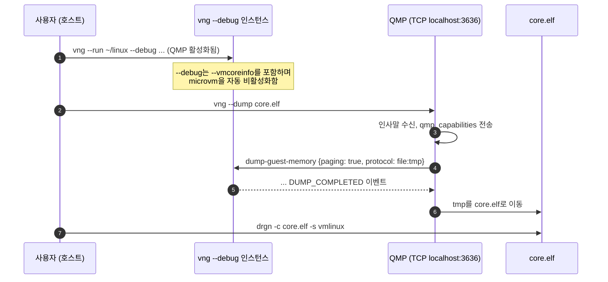

vng 소스 코드에서 확인된 3가지 구현 팩트:

- **하드코딩된 TCP 포트 3636**으로 QMP에 연결하여 `qmp_capabilities`를 보내고, `paging: true` 및 `protocol: file:<tmp>` 옵션으로 `dump-guest-memory`를 호출한 뒤 `DUMP_COMPLETED` 이벤트를 대기합니다.
- `paging: true`는 QEMU가 게스트 페이지 테이블을 순회하도록 하므로 결과물에 **가상 주소**가 포함됩니다 — 이를 통해 단순 RAM 덩어리가 아닌 분석 가능한 덤프가 됩니다. 기본 출력 포맷은 ELF이며 `drgn` 및 `crash`에서 직접 분석 가능합니다.
- `--debug`는 `--vmcoreinfo`를 켜며(소스 주석에 따르면 *"drgn 메모리 덤프에 필수적"*), **microvm을 자동으로 비활성화**합니다(microvm이 *"불완전한 메모리 덤프를 생성하는 것으로 보이기 때문"*).

#### 이것이 syzkaller 방식보다 훨씬 우수한 이유

syzkaller의 `pkg/instance/dump.go`는 kdump 크래시 커널 내의 **게스트 내부**에서 실행됩니다:

```go
maxRetries = 100
retrySleep = 3 * time.Second
cmd = "makedumpfile -F -c -d 0 /proc/vmcore"
```

이를 위해서는 이미지 내에 `kexec`/kdump 설정, `crashkernel=` 메모리 예약, `makedumpfile` 설치, 1시간 타임아웃, 그리고 크래시 커널이 언제 부팅을 마칠지 알 수 없기 때문에 최대 100회의 재시도가 필요합니다. 심지어 퍼징 중 `CONFIG_MAGIC_SYSRQ` 활성화를 원치 않아 스스로 패닉을 유발할 수 없다는 TODO 주석까지 있습니다.

vng는 **게스트의 협조 없이 호스트 측에서 100% 동일한 작업을 수행합니다.** 이는 루트 파일시스템 다음으로 virtme-ng가 제공하는 가장 큰 작업량 절감 효과이며, 첫날부터 연동해 둘 가치가 있습니다.

#### 그러나: 퍼징 루프 내부에 둘 수 없는 3가지 이유

| 제약 사항 | 결과 |
|---|---|
| QMP 포트 **3636이 하드코딩됨** | 한 번에 하나의 `--debug` 인스턴스만 실행 가능; 멀티 VM 계획 원천 차단 |
| `--debug` 사용 시 **microvm 비활성화** | 부팅이 눈에 띄게 느려짐 — ~1 exec/s 환경에서 절대 감당할 수 없음 |
| 덤프 파일 크기가 수백 MB에 달함 | 크래시마다 덤프를 뜨면 반나절 만에 디스크가 꽉 참 |

syzkaller도 반대 방향에서 동일한 결론에 도달했습니다: `rep.Panicked`인 경우에만 덤프를 뜨고, `HasMemoryDump`를 통해 **크래시 타이틀당 단 하나의 덤프만 보관**합니다 — *"디스크 공간 절약을 위해 메모리 덤프는 하나만 보관."*

#### 올바른 패턴: 2단계 분리

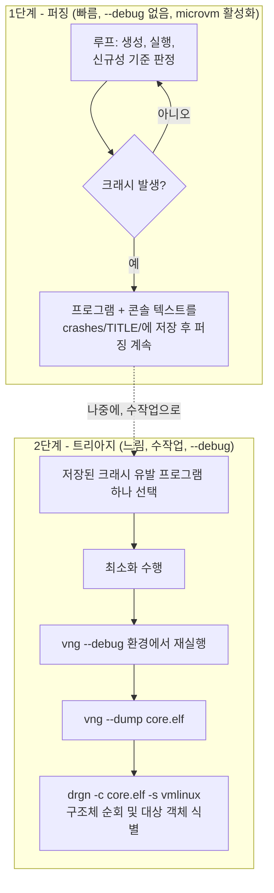

이는 syzkaller가 퍼징과 재현(reproduction)을 분리하는 방식과 일치하며, 비용이 크고 직렬화되어 있으며 디스크를 많이 소모하는 기능을 핫 패스(hot path)에서 완벽히 격리합니다. **드라이버 코드에 `--debug` 경로를 추가하지 마십시오.** README에 한 줄짜리 셸 레시피를 적어두고 필요할 때 수작업으로 실행하십시오:

```bash
# 2단계, 수작업 실행
vng --run ~/linux --debug --rwdir=/work=$PWD/work --overlay-rwdir=/scratch \
    --exec "$PWD/target/release/executor --once /work/repro.bin /work/res.bin" &
sleep 20 && vng --dump core.elf
drgn -c core.elf -s ~/linux/vmlinux
```

진정한 보상은 `drgn`에 있습니다: 커널 데이터 구조를 다루는 Python REPL 환경입니다. use-after-free가 *왜* 발생했는지(어떤 객체, 어떤 참조 카운트, 어떤 리스트인지) 이해하는 데 있어 KASAN 리포트를 읽는 것보다 훨씬 뛰어나며, 대다수 syzkaller 사용자들은 이를 편리하게 누리지 못합니다. 이것을 **학습용 도구**로 취급하십시오. 실습에서는 그것이 핵심 목적입니다.

### 14.2 VM 스냅샷 — 생략할 것, vng는 이를 제공하지 않음

**판정: 계층 3. 생략. 두 가지 독립적인 이유가 있으며, 둘 중 하나만으로도 충분합니다.**

#### 이유 1: vng는 스냅샷을 지원하지 않음

직접 확인했습니다. vng 도움말에 "snapshot"이라는 단어가 두 번 등장하지만(*"a virtualized snapshot of your live system"*, *"copy-on-write snapshot"*), 둘 다 **호스트 파일시스템 마운트**를 가리킬 뿐 VM 상태를 의미하지 않습니다. 코드베이스 어디에도 `savevm`/`loadvm`은 없습니다. 유일한 VM 상태 관련 기능은 단방향인 `--dump`뿐입니다.

물론 직접 제어할 수는 있습니다: `--debug`를 통해 3636 포트의 QMP를 얻을 수 있고, syzkaller의 `vm/qemu/snapshot_linux.go`처럼 QMP의 `human-monitor-command`를 통해 `savevm`/`loadvm`을 호출할 수 있습니다.

#### 이유 2: virtiofs가 스냅샷을 원천 차단함

`savevm`은 연결된 모든 디바이스가 마이그레이션 가능(migratable)할 것을 요구합니다. 그런데 **vng의 루트 파일시스템은 `vhost-user-fs` (virtiofs) 디바이스**이며, 그 상태는 `savevm`이 캡처할 수 없는 외부 `virtiofsd` 프로세스에 존재합니다. 따라서 `savevm`은 마이그레이션 불가능 디바이스 에러와 함께 실패합니다. 직접 단 하나의 명령으로 확인할 수 있습니다:

```bash
vng --run ~/linux --debug --exec "sleep 60" &
printf '{"execute":"qmp_capabilities"}\n{"execute":"human-monitor-command","arguments":{"command-line":"savevm test"}}\n' \
  | nc localhost 3636
```

우회로는 모두 본래 취지를 무색하게 만듭니다: `--force-9p`는 마이그레이션 불가능한 전송 방식을 또 다른 마이그레이션 불가능 방식으로 바꿀 뿐이고, `--disk`를 통한 실제 디스크 이미지는 vng가 절약해 주었던 가장 큰 장점인 루트 파일시스템 구축 작업을 다시 떠안아야 함을 의미합니다. 게다가 `--debug`는 microvm을 끄므로 느린 머신 타입을 스냅샷하게 됩니다.

#### 이유 3: 설령 동작하더라도, syzkaller가 치른 대가를 볼 것

스냅샷 모드는 syzkaller 프로젝트 전체에서 가장 침습적인 서브시스템입니다. 스냅샷을 복원하면 SSH와 RPC 소켓을 포함한 **모든 네트워크 연결이 파괴됩니다**. 따라서 syzkaller는 다음과 같은 작업을 해야 했습니다:

- 전송 계층을 공유 메모리로 전환 — 2개의 `ivshmem` 디바이스와 유닉스 소켓을 통한 도어벨 핸드셰이크 구현;
- 실행기의 표준 출력이 갈 곳을 잃으므로 로깅을 `/dev/kmsg`로 리디렉션;
- 2단계 수명 주기를 갖는 완전히 새로운 두 번째 실행 백엔드(`pkg/execbackend/snapshot.go`) 추가: 머신 검사를 위해 정상 부팅 후, **RPC 서버를 닫고** 공유 메모리로 전환;
- 큐가 비었을 때 작업 함수에서 반환하면 디스패처가 VM을 재부팅하여 스냅샷을 날려버리는 문제를 방지하기 위해, 10ms 동안 sleep하며 폴링하는 미묘한 로직 처리.

실습 환경에서 이는 전송 계층의 전면 재작성과 두 번째 백엔드 구축을 의미합니다.

#### 스냅샷의 유일한 장점과, 그럼에도 탈락하는 이유

스냅샷의 진짜 보상은 속도가 아니라 **결정론성(determinism)**입니다: 모든 프로그램이 바이트 단위로 동일한 커널 상태를 보게 되므로 커버리지 플레이크가 사라지고 플레이크 완화 과정을 완전히 생략할 수 있습니다.

이는 대단히 매력적이며 §8.5를 완전히 삭제할 수 있습니다. 하지만 비용을 비교해 보십시오:

| 접근 방식 | 구현 비용 | 얻는 이점 |
|---|---|---|
| 3회 중 2회 커버리지 교집합 (§8.5) | **~25줄**, 후보 프로그램에 대해서만 3배 실행 비용 | 대부분의 플레이크 제거 |
| VM 스냅샷 | 전송 계층 재작성 + 두 번째 백엔드 + virtiofs와의 사투 | 플레이크 제거 + 높은 처리량 |

**진짜로 필요한 동일한 결과를 얻기 위해, 25줄 코드와 전면 재작성 중 후자를 택할 이유는 없습니다.** 25줄 코드를 선택하십시오.

### 14.3 요약

| 기능 | 판정 | 근거 |
|---|---|---|
| `vng --dump`를 통한 **메모리 덤프** | **외부 차용 — 계층 2, 트리아지 전용** | 비용이 전혀 들지 않고 syzkaller의 복잡한 kdump 체계를 대체하며 `drgn`은 훌륭한 학습 도구임. 단, 3636 포트 고정, `--debug`의 microvm 비활성화, 방대한 덤프 크기로 인해 2단계 전용으로만 사용하고 루프에는 포함하지 않음. |
| **VM 스냅샷** | **생략 — 계층 3** | vng가 지원하지 않고 virtiofs가 차단하며, 실습에 유의미한 유일한 이점(결정론성)은 25줄 코드로 해결 가능함. |
| **`.txt` 파일에 담긴 지식** | **직접 구축 — 계층 1, 가장 높은 레버리지** | 타협 불가능한 필수 요소. 단, syzlang 포맷이 아닌 *ABI 표면 지식*이 본질임. Rust로 인코딩하고 `pahole`로 레이아웃 검증 (§5.4 참조). |

---

## 15. 네트워크를 통한 실제 보드 타깃팅

지금까지는 노트북의 virtme-ng를 전제로 했습니다. 이제 타깃은 책상 위에 이더넷으로 연결된 임베디드 보드이며, 퍼저는 여전히 노트북에서 실행됩니다. 이는 syzkaller의 `isolated` VM 백엔드 영역에 해당하며, 커널 퍼징이 단순한 연습을 넘어 실제 가치를 발휘하는 순간입니다 — 실제 실리콘에만 존재하는 드라이버들이야말로 지금까지 아무도 퍼징하지 않은 영역이기 때문입니다.

결론부터 말하자면: **기존 설계는 이미 준비되어 있으며, 그 비결은 §3에서 채택했던 호스트/게스트 분리 원칙 덕분입니다.** 다만 드라이버를 작성하기 *전에* 마련해 두어야 할 추상화 하나와, 실제로 변경되는 약 10가지 구체적인 사항이 있습니다.

### 15.1 이것이 가능한 이유: `Target` 트레이트

코퍼스, 커버리지 이력, 변이, 최소화, 크래시 기록 등 모든 영속 상태는 호스트에 존재합니다. 게스트 바이너리는 프로그램을 받아 실행하고 보고하는 단순한 역할만 합니다. 따라서 로컬 VM을 네트워크 보드로 교체하는 작업은 정확히 하나의 모듈만 수정하면 됩니다.

첫날부터 드라이버 뒤에 이 구조를 두십시오. syzkaller의 `vmimpl.Instance`와 의도적으로 동일한 형태의 4개 메서드입니다:

```rust
/// 로컬 VM과 책상 위 보드 사이에서 유일하게 달라지는 부분.
pub trait FuzzTarget {
    /// 실행기를 배치하고 이를 호출할 경로를 반환합니다.
    /// virtme-ng: no-op (호스트 루트 fs가 이미 마운트되어 있음).
    /// 보드: 정적 바이너리를 tmpfs로 scp 전송.
    fn deploy(&mut self) -> anyhow::Result<String>;

    /// 단일 프로그램을 실행하고 호출별 결과를 반환합니다.
    /// Err는 프로그램 실패가 아니라 타깃을 더 이상 사용할 수 없음을 의미합니다.
    fn exec(&mut self, prog: &Program) -> anyhow::Result<Response>;

    /// 마지막 호출 이후 타깃이 출력한 모든 내용을 반환합니다.
    /// virtme-ng: vng의 stdout. 보드: 시리얼 포트 출력.
    fn drain_console(&mut self) -> String;

    /// 타깃을 알려진 정상 상태로 강제 복구합니다. 패닉 이후에도 반드시 동작해야 함.
    /// virtme-ng: 프로세스 종료; 다음 부팅은 깨끗함.
    /// 보드: §15.7의 단계별 복구 루틴.
    fn reset(&mut self) -> anyhow::Result<()>;
}
```

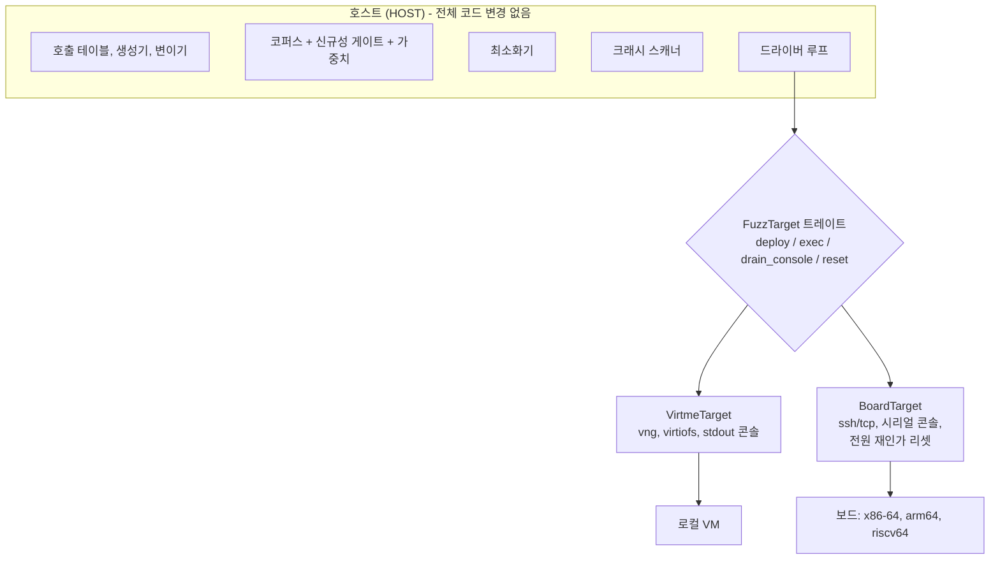

이 트레이트가 이식성 스토리의 전부이며, 4개 메서드인 이유는 syzkaller가 9년 동안 겪은 끝에 4개면 충분하다는 것을 발견했기 때문입니다. 드라이버에 `Command::new("vng")`를 하드코딩해 두었다면 나중에 이를 뜯어고치는 데 하루를 허비하겠지만, 지금 작성해 두면 20분이면 끝납니다.

### 15.2 실제로 변경되는 사항

| 고려 항목 | virtme-ng | 네트워크 연결 보드 |
|---|---|---|
| **루트 파일시스템** | 호스트의 루트 fs, 읽기 전용 마운트 | 보드 자체의 루트 fs. 공유하지 않음. |
| **실행기 배포** | 없음 — 동일 경로에서 이미 접근 가능 | **크로스 컴파일** 후 `scp` 또는 읽기 전용 네트워크 FS 마운트 (§15.5) |
| **아키텍처** | 호스트와 동일한 x86-64 | **x86-64 / arm64 / riscv64** — §15.4 참조; 아키텍처별 작업량은 예상보다 적음 |
| **전송 계층** | virtiofs 공유 디렉터리 | SSH, 또는 TCP 소켓 |
| **커널 배포** | `vng --run bzImage` | 플래시 롬 쓰기 / TFTP+U-Boot / `kexec` / 모듈만 교체 |
| **패닉 후 리셋** | 프로세스 강제 종료 | **전원 차단으로 끝나는 단계별 복구 루틴** |
| **콘솔** | vng의 stdout | **시리얼 UART**, 또는 pstore |
| **커버리지 데이터양** | 무료 (공유 메모리) | 100 Mbit 링크 통과 — 전송 전 중복 제거 필수 |
| **임시 작업 공간** | `--overlay-rwdir`, 종료 시 폐기 | 직접 마운트한 tmpfs; **절대 eMMC에 쓰지 말 것** |
| **타임아웃** | 호스트 기준 속도 | 보드는 5–20배 느릴 수 있음; 타임아웃 배율 적용 |
| **안전 위험** | 호스트 파일시스템 노출 | 보드의 플래시 메모리 / 보드 기기 자체 손상 |

이 중 진정으로 새로운 엔지니어링 작업은 세 가지입니다: 크로스 컴파일(§15.3–15.4), 콘솔 캡처(§15.6), 리셋 복구(§15.7). 나머지는 설정의 문제입니다.

### 15.3 크로스 컴파일: 정적 musl, 3개 타깃

가장 큰 손실은 "배포 단계 없음"의 이점이 사라진다는 것입니다. 이를 만회하는 가장 큰 무기는 **Rust가 정적 musl 바이너리로 매우 손쉽게 크로스 컴파일된다는 사실**이며, 이를 통해 보드의 libc 버전을 맞추는 골치 아픈 문제를 완전히 피해갈 수 있습니다.

실습에서는 정확히 세 가지 아키텍처만 다룹니다. 세 아키텍처 모두 Rust musl 타깃과 Debian 크로스 툴체인을 지원합니다:

| 아키텍처 | Rust 타깃 | Debian 크로스 컴파일러 |
|---|---|---|
| x86-64 | `x86_64-unknown-linux-musl` | 네이티브 컴파일러 |
| arm64 | `aarch64-unknown-linux-musl` | `gcc-aarch64-linux-gnu` |
| riscv64 | `riscv64gc-unknown-linux-musl` | `gcc-riscv64-linux-gnu` |

```bash
rustup target add x86_64-unknown-linux-musl \
                  aarch64-unknown-linux-musl \
                  riscv64gc-unknown-linux-musl
sudo apt install gcc-aarch64-linux-gnu gcc-riscv64-linux-gnu

cargo build --release --target aarch64-unknown-linux-musl -p executor
file target/aarch64-unknown-linux-musl/release/executor
# ELF 64-bit LSB executable, ARM aarch64, statically linked
```

`.cargo/config.toml`:

```toml
[target.x86_64-unknown-linux-musl]
rustflags = ["-C", "target-feature=+crt-static"]

[target.aarch64-unknown-linux-musl]
linker = "aarch64-linux-gnu-gcc"
rustflags = ["-C", "target-feature=+crt-static"]

[target.riscv64gc-unknown-linux-musl]
linker = "riscv64-linux-gnu-gcc"
rustflags = ["-C", "target-feature=+crt-static"]
```

Makefile에 넣기 좋은 전체 일괄 빌드 한 줄 명령어:

```bash
for t in x86_64 aarch64 riscv64gc; do
    cargo build --release --target ${t}-unknown-linux-musl -p executor
done
```

**`gnu`가 아닌 `musl`을 사용하십시오.** 정적으로 링크된 musl 바이너리는 런타임 의존성이 없는 단일 파일입니다 — Debian 루트 fs, BusyBox initramfs, Yocto 이미지 등 어디서나 실행됩니다. `gnu` 타깃은 동적 링크되므로 특히 자주 마주치게 되는 구호스트 환경에서 "GLIBC_2.34 not found" 에러를 내며 실패합니다. 이 선택 하나만으로 사람들이 베어메탈 퍼징을 포기하게 만드는 배포 문제의 전 계층을 제거할 수 있습니다.

호스트 측 `fuzzer` 바이너리는 네이티브로 빌드됩니다 — 오직 `executor`만 크로스 컴파일합니다. 이는 호스트/게스트 분리가 가져다주는 또 다른 이점입니다: **오직 단순한 절반만 크로스 컴파일하면 됩니다.**

해당 바이너리를 보드로 옮기는 방법에는 세 가지 좋은 답이 있습니다 — 변경 시 `scp`, 읽기 전용 네트워크 FS 마운트, 또는 `nfsroot`입니다. 네트워크 마운트가 부적절한 경우까지 포함하여 §15.5에서 다룹니다.

### 15.4 x86-64 / arm64 / riscv64 아키텍처별 작업량 — 생각보다 적습니다

실습 코드 중 4가지 요소가 암묵적으로 x86-64 전용이었습니다. 대상을 이 세 아키텍처로 한정하면 그중 2개는 완전히 사라지고, 세 번째는 단순한 `if`문 하나로 줄어듭니다.

#### 1. KCOV ioctl 번호는 세 아키텍처 모두 동일함 ✓

이것은 매우 다행스러운 소식이며, 다를 것이라 지레짐작하기 쉬우므로 명확히 짚고 넘어갈 가치가 있습니다.

§4.1의 상수들은 **asm-generic `_IOC` 인코딩**을 사용합니다: `_IOC_NONE=0`, `_IOC_WRITE=1`, `_IOC_READ=2`, 크기 14비트, 방향 비트는 30번 비트. **x86-64, arm64, riscv64는 모두 asm-generic을 사용합니다.** 따라서 `KCOV_INIT_TRACE = 0x80086301`, `KCOV_ENABLE = 0x6364`, `KCOV_DISABLE = 0x6365`는 이번 실습의 모든 타깃에서 변경 없이 그대로 올바르게 작동합니다. 아키텍처별 ioctl 코드나 `nix` 매크로가 필요하지 않습니다.

<details>
<summary>참고용 예외 사항</summary>

MIPS, PowerPC, SPARC, Alpha는 인코딩을 재정의하여(`_IOC_NONE=1`, `_IOC_READ=2`, `_IOC_WRITE=4`, 크기 13비트, 방향 29번 비트) `KCOV_INIT_TRACE = 0x40086301`, `KCOV_ENABLE = 0x20006364`가 됩니다. 만약 실습에 MIPS 라우터를 추가할 계획이라면 리터럴 상수를 붙여넣는 대신 `nix`의 `request_code_read!` / `request_code_none!` 매크로를 사용하여 코드를 계산하십시오. 여기서는 범위 밖입니다.
</details>

#### 2. 시스템 콜 번호: 3개가 아닌 2개의 ABI 계통

`openat`은 **x86-64에서 257번**이고 **arm64와 riscv64에서는 모두 56번**입니다 — arm64와 riscv64는 둘 다 *제네릭(generic)* 시스템 콜 ABI(`include/uapi/asm-generic/unistd.h`)를 사용하므로 번호를 거의 완전히 공유하기 때문입니다.

번호 자체보다 중요한 것은 **제네릭 ABI에는 레거시 시스템 콜이 애초에 도입된 적이 없다는 사실**입니다. arm64와 riscv64에는 `open`, `stat`, `lstat`, `poll`, `dup2`, `fork`, `vfork`, `pipe`, `mkdir`, `rmdir`, `unlink`, `symlink`, `link`, `rename`, `chmod`, `chown`, `select`, `epoll_create`, 32비트 `getdents`가 아예 존재하지 않습니다. 모든 아키텍처에 존재하는 `*at` 및 `*2` 형태를 사용하십시오:

| 레거시 호출 대신 | 현대적 표준 호출 사용 |
|---|---|
| `open` | `openat(AT_FDCWD, ...)` |
| `stat` / `lstat` | `newfstatat` |
| `unlink` / `rmdir` | `unlinkat` |
| `mkdir` | `mkdirat` |
| `rename` | `renameat2` |
| `dup2` | `dup3` |
| `pipe` | `pipe2` |
| `poll` | `ppoll` |

강제 메커니즘은 무료로 제공됩니다: `libc::SYS_open`으로 작성된 테이블은 aarch64나 riscv64 환경에서 **컴파일조차 되지 않습니다**. 시스템 콜 번호는 `libc`에 맡기고 절대로 숫자를 하드코딩하지 마십시오:

```rust
// 좋은 예: libc가 컴파일 타임에 타깃 아키텍처별로 번호를 해석하며,
// 해당 아키텍처에 없는 시스템 콜은 런타임 ENOSYS가 아니라 컴파일 에러가 됨.
SyscallDesc { name: "openat$ptmx", nr: libc::SYS_openat, .. }

// 나쁜 예: 2번은 x86-64에서는 `open`이지만 arm64에서는 `write`임. 조용히 치명적인 오류 발생.
SyscallDesc { name: "open$ptmx", nr: 2, .. }
```

**이 순간 여러분은 syzkaller에 아키텍처별 `.const` 파일과 `syz-extract` 단계가 왜 존재하는지 정확히 이해하게 됩니다.** 그 툴체인이 풀고자 했던 문제를 직접 마주한 것입니다. 여러분의 해법은 `libc` + `rustc`이며, 세 아키텍처를 다루기에는 이것으로도 훨씬 저렴하고 완벽히 충분합니다.

특정 타깃 기기가 한 아키텍처에만 존재하는 경우, 빌드 전체가 아니라 테이블 엔트리 수준에서 조건부 컴파일을 적용하십시오:

```rust
#[cfg(target_arch = "aarch64")]
pub static SOC_CALLS: &[SyscallDesc] = &[ /* 벤더 전용 /dev/foo ioctl 목록 */ ];
#[cfg(not(target_arch = "aarch64"))]
pub static SOC_CALLS: &[SyscallDesc] = &[];
```

#### 3. PC 되감기: 2개의 값

```rust
/// KCOV는 반환 주소를 보고하므로, 명령어 하나를 되감아 호출 지점을 얻습니다.
/// x86-64: 5 (`call rel32`의 길이). arm64 및 riscv64: 4 (고정 폭 명령어).
pub const PC_REWIND: u64 = if cfg!(target_arch = "x86_64") { 5 } else { 4 };
```

세 아키텍처를 통틀어 이것이 전부입니다. 이 상수는 **타깃** 아키텍처와 일치해야 하므로, 게스트 실행기나 타깃별로 컴파일되는 코드에 속해야 합니다 — 항상 네이티브 x86-64인 호스트 퍼저에 두어서는 안 됩니다. 만약 호스트에서 되감기를 적용한다면(§6.1 제안 방식), 결과와 함께 타깃 아키텍처 정보를 전달하거나 제어 중인 타깃에 따라 키를 매핑하십시오.

#### 4. `pahole`과 `addr2line`은 타깃의 `vmlinux`와 크로스 binutils 필요

```bash
# arm64
pahole -C my_ioctl_args ~/kernels/arm64/vmlinux
aarch64-linux-gnu-addr2line -e ~/kernels/arm64/vmlinux -f -i -p 0xffff800008123456

# riscv64
pahole -C my_ioctl_args ~/kernels/riscv64/vmlinux
riscv64-linux-gnu-addr2line -e ~/kernels/riscv64/vmlinux -f -i -p 0xffffffff80123456
```

구조체 레이아웃은 세 아키텍처 간에 실제로 다릅니다 — 정렬 규칙과 패딩이 일치하지 않습니다 — 따라서 §5.4의 `pahole` 검증 원칙이 여기서는 *더욱* 중요해집니다. 아키텍처별로 `vmlinux`를 하나씩 보관하고 현재 통신 중인 보드에 맞추어 심볼라이저를 전환하십시오.

#### 요약: 실제 아키텍처별 작업량

| 고려 항목 | x86-64 / arm64 / riscv64 대상 아키텍처별 작업 |
|---|---|
| KCOV ioctl 코드 | **없음** — 3개 모두 동일 |
| KCOV 버퍼 프로토콜 | **없음** — 동일 |
| 시스템 콜 번호 | `libc::SYS_*` 사용; 레거시 시스템 콜 회피, `*at` 형태 사용 |
| PC 되감기 | `if`문 하나: 5 또는 4 |
| 크로스 컴파일 | 3개 타깃 트리플, 2개 크로스 링커 |
| `vmlinux` + binutils | 아키텍처별 1세트 준비 |
| 프로그램 모델, 와이어 포맷, 코퍼스, 변이기 | **없음** — 모두 아키텍처 중립적 |

이것이 진짜 교훈입니다: **퍼저는 아키텍처 중립적이며, 측정 경계면과 툴체인만이 아키텍처에 종속적입니다.** syzkaller가 아키텍처별 코드가 아닌 아키텍처별 데이터를 통해 9개 아키텍처를 지원할 수 있는 비결이 여기에 있습니다.

### 15.5 네트워크 전송 계층

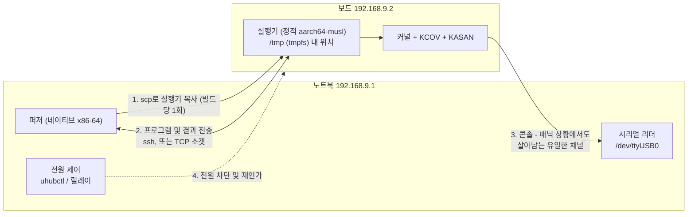

노트북과 보드 간 직결 이더넷, 고정 IP 설정, DHCP 서버 불필요:

```bash
# 노트북 측
sudo ip addr add 192.168.9.1/24 dev enp0s31f6
sudo ip link set enp0s31f6 up
# 보드 측 (시리얼 콘솔이나 init 스크립트에서 실행)
ip addr add 192.168.9.2/24 dev eth0 && ip link set eth0 up
```

#### 1' 단계 — 프로그램당 SSH 1회 실행

`vng --exec`에 직접 대응되며, 여전히 가장 이상적인 첫 단계입니다:

```rust
impl FuzzTarget for BoardTarget {
    fn exec(&mut self, prog: &Program) -> anyhow::Result<Response> {
        let req = wire::encode_request(prog);
        // stdin으로 요청을 파이프로 넣고, stdout으로 응답을 읽음.
        // 보드의 플래시 메모리에 임시 파일을 쓰지 않음.
        let mut child = Command::new("ssh")
            .args(["-o","BatchMode=yes","-o","ConnectTimeout=10",
                   "-o","StrictHostKeyChecking=no",
                   "-i", &self.key, &self.addr,
                   &format!("{} --stdio", self.exec_path)])
            .stdin(Stdio::piped()).stdout(Stdio::piped())
            .spawn()?;
        child.stdin.take().unwrap().write_all(&req)?;
        let out = child.wait_with_output()?;
        Ok(wire::decode_response(&out.stdout)?)
    }
}
```

stdin/stdout으로 파이핑하면 보드의 플래시에 요청 파일을 쓸 필요가 없어집니다 — 이는 매우 중요한 요소입니다(§15.9). SSH 연결 설정에 50–200ms가 소요되므로 대략 초당 5–20회 실행을 기대할 수 있습니다. 아무것도 부팅하지 않기 때문에 **virtme-ng 1단계보다 이미 10배 빠릅니다**.

`ControlMaster`를 추가하여 핸드셰이크 비용을 분산시킬 수 있습니다:

```
# ~/.ssh/config
Host board
    HostName 192.168.9.2
    User root
    ControlMaster auto
    ControlPath ~/.ssh/cm-%r@%h:%p
    ControlPersist 600
```

#### 2' 단계 — TCP 소켓 기반 상주 실행기

보드를 한 번 부팅하여 수천 개의 프로그램을 실행합니다. 여기서 설계상의 핵심 질문은 **누가 누구에게 연결을 거는가(dial)**이며, 답은 대칭적이지 않습니다:

| 방향 | 동작 조건 | 참고 |
|---|---|---|
| 노트북 → 보드 | 보드가 안정적이고 접근 가능한 IP를 가질 때 | 가장 단순함; 직결 이더넷에 적합 |
| **보드 → 노트북** | 항상 동작함 (NAT 뒷단이나 DHCP 환경 포함) | **syzkaller의 선택** — `Forward()`가 `host:port`를 반환하고 실행기가 아웃바운드로 접속 |

**보드가 노트북으로 접속하는 방식**을 권장합니다. 노트북은 고정 포트를 리스닝하고, 보드의 시작 스크립트가 `executor --connect 192.168.9.1:7777`을 실행합니다. 이 방식은 보드가 다른 IP를 할당받아도 동작하며, 보드 측에 인바운드 방화벽 규칙을 열 필요가 없고, 무엇보다 **보드가 재부팅되었을 때 스스로 다시 연결**되므로 복구 루틴에서 별도의 재연결 작업을 신경 쓸 필요가 없습니다.

```rust
// 게스트 측: 아웃바운드 접속 후 영구 서비스 루프.
let mut sock = TcpStream::connect(&manager_addr)?;
sock.set_nodelay(true)?;                       // 처리량이 아닌 지연 시간 우선
let kcov = Kcov::open()?;
loop {
    let prog = wire::read_request(&mut sock)?;  // 블로킹 대기
    let resp = run_program(&prog, &kcov)?;
    wire::write_response(&mut sock, &resp)?;
}
```

보드 측의 시스템 콜 비용에 병목이 걸려 대략 **초당 200–2,000회 실행**을 달성할 수 있습니다.

#### 커버리지 데이터양: 전송 전 중복 제거 필수

virtme-ng에서는 커버리지가 공유 메모리를 통과하므로 비용이 들지 않습니다. 하지만 100 Mbit 이더넷 환경에서는 그렇지 않습니다. 파일시스템을 대상으로 한 단일 시스템 콜이 수만 개의 PC를 생성할 수 있으며, PC당 8바이트씩 계산하면 프로그램당 수백 KB에 달합니다.

syzkaller의 `ExecFlagDedupCover`가 하는 방식을 그대로 적용하십시오 — **전송하기 전에 게스트 내부에서 중복을 제거합니다**:

```rust
pub fn collect_deduped(&self) -> (Vec<u64>, bool) {
    let (mut pcs, overflow) = self.collect();
    pcs.sort_unstable();
    pcs.dedup();
    (pcs, overflow)
}
```

드라이버 내부의 타이트 루프는 동일한 PC를 수천 번 실행하므로, 중복 제거를 통해 페이로드 크기를 대개 10–100배 줄일 수 있습니다. 실행 *순서*가 꼭 필요한 경우에만 원시 트레이스를 유지하십시오. 여전히 대역폭이 부족하다면 정렬된 목록을 varint 기반 델타 인코딩으로 압축하십시오 — 정렬된 PC는 압축률이 매우 뛰어나며 약 30줄이면 구현 가능합니다.

#### 네트워크 파일시스템을 통해 vng의 "배포 단계 없음" 재현하기

virtme-ng의 가장 큰 매력은 공유 *데이터* 디렉터리가 아닙니다 — 호스트 루트 fs 마운트 덕분에 **방금 빌드한 바이너리가 복사 단계 없이 동일한 경로에 즉시 존재한다는 점**입니다. 네트워크 파일시스템을 사용하면 보드에서도 이 특성을 되살릴 수 있습니다. 충분히 시도해 볼 가치가 있으며, 여기서 두 가지 역할 중 *어느 쪽에* 이를 적용해야 하는지 명확히 구분해야 합니다.

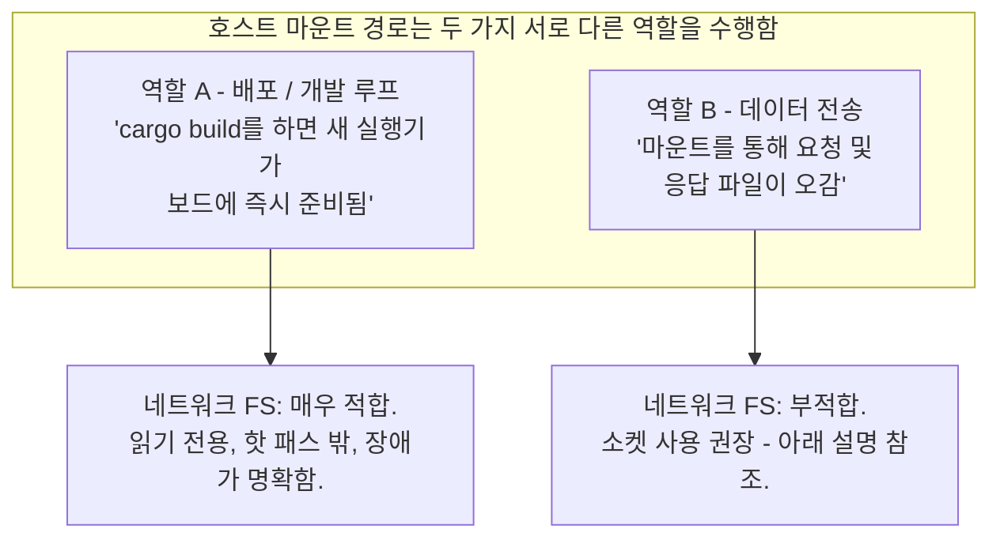

**역할 A에 대해서는 다음 세 가지 중 하나를 선택하십시오.** 모두 유효하며 커널 개입 수준에서 차이가 있습니다.

| 접근 방식 | 보드 커널에 필요한 설정 | 장점 | 단점 |
|---|---|---|---|
| **변경 시 `scp`** | 없음 | 커널 개입 전혀 없음; 멈출 위험 없음; 2 MB 정적 바이너리는 100 Mbit에서 약 0.2초 소요되며 재빌드 시에만 전송 | 마찰이 *완전히* 0은 아님 |
| **읽기 전용 NFS** | `CONFIG_NFS_FS` | 진정한 vng 경험 제공; 커널 내장 클라이언트로 빠름; **`nfsroot`는 임베디드 개발의 표준 워크플로** | 테스트 대상 커널에 NFS 클라이언트를 끌어들임 (아래 참조) |
| **TCP 기반 9p** | `CONFIG_9P_FS` + `CONFIG_NET_9P` (fd/tcp 전송 계층 포함) | **vng가 사용하는 것과 완전히 동일한 프로토콜**, 단지 `trans=virtio` 대신 `trans=tcp` 사용; 서버는 `diod` | 벤더 커널에서 기본 활성화된 경우가 드묾; 설정 확인 필요 |
| **sshfs** | `CONFIG_FUSE_FS` | 기존 SSH 인프라 재사용; 별도 서버 불필요 | 경로 상에 FUSE 포함; *보드 상에* `sshfs` + libfuse 필요 — 닭과 달걀의 배포 문제 |
| SMB/CIFS | `CONFIG_CIFS` | 동작함 | 오버헤드가 가장 크고 임베디드에서 가장 비선호 |

TCP 기반 9p 옵션은 vng와 완전히 동일한 파일시스템 프로토콜을 전송 계층만 바꾸어 사용하는 것이므로 주목할 가치가 있습니다:

```bash
# 노트북: 빌드 디렉터리 서비스
sudo apt install diod
diod -f -l 0.0.0.0:564 -e $PWD/target/aarch64-unknown-linux-musl/release --no-auth

# 보드: 읽기 전용으로 마운트
mount -t 9p -o trans=tcp,port=564,version=9p2000.L,ro 192.168.9.1 /mnt/build
/mnt/build/executor --connect 192.168.9.1:7777 &
```

또한 보드가 루트 파일시스템 전체를 넷부팅할 수 있다면, `nfsroot`를 통해 vng 경험에 가장 가깝게 다가갈 수 있습니다 — 전체 파일시스템이 노트북에 존재하므로 무엇을 수정하든 즉시 반영됩니다:

```
# 보드 커널 커맨드라인
root=/dev/nfs rw nfsroot=192.168.9.1:/srv/board-rootfs,v3,tcp ip=192.168.9.2:192.168.9.1:192.168.9.1:255.255.255.0::eth0:off
```

이는 특이한 방식이 아니라 임베디드 Linux 개발에서 흔히 쓰이는 표준적인 방식이며, BSP가 이미 지원한다면 적극 활용해야 합니다.

#### 안전성 여부를 결정짓는 3가지 주의점

이는 일반론적인 우려가 아니라, 무엇을 퍼징하느냐에 따라 직결되는 구체적인 제약 사항입니다.

**1. 테스트 대상 커널 내에서 네트워크 FS 클라이언트 코드가 실행됩니다.** NFS, CIFS, FUSE 클라이언트는 덩치가 크고 역사적으로 버그가 많았던 서브시스템입니다. 두 가지 결과가 따릅니다: 파일 접근 시마다 NFS 클라이언트의 PC가 커버리지에 잡혀 신규성 게이트에 노이즈를 더하고 코퍼스 항목이 무관한 커버리지의 공로를 가로채게 되며(신경 쓰인다면 주소 범위로 필터링하십시오), *해당 클라이언트의* 버그가 결과에 혼란을 초래할 수 있습니다.

**2. `hard` NFS 마운트는 인터럽트 불가능 슬립(D-state)으로 멈추며 — 이는 찾고자 하는 버그 유형과 정확히 동일해 보입니다.** 만약 퍼저가 네트워크 스택을 멈추게 만들면, 마운트에 접근하는 모든 프로세스가 D-state에 빠져 영원히 멈추며 실행기도 그중 하나가 됩니다. "보드가 멈춤" 현상이 발생했을 때 커널 버그인지, 도달할 수 없는 서버를 기다리는 NFS 때문인지 구별할 수 없게 됩니다. 이를 완화하려면 `soft,timeo=50,retrans=2` 옵션을 사용하여 블로킹 대신 에러를 반환하게 하고, 읽기 실패를 감수하며, 실행기 바이너리를 캐시해 두어야 합니다 — 혹은 더 나아가 역할 A와 역할 B를 분리하여 마운트를 읽기 전용으로 두고 핫 패스 밖으로 빼는 것이 가장 좋습니다.

**3. 전송 계층과 퍼징 대상을 절대 동일한 서브시스템에 두지 마십시오.** 엄격한 철칙입니다:

| 퍼징 대상 | 네트워크 FS 마운트 사용 여부 |
|---|---|
| 네트워크나 FS가 아닌 드라이버 — 카메라 ISP, GPIO, i2c, 암호화 가속기, 입력 기기, DRM | **안전함.** NFS나 9p를 자유롭게 사용하십시오. 편리한 선택입니다. |
| **네트워크 스택, 또는 NIC 드라이버** | **절대 금지.** 루트 파일시스템과 퍼징 대상이 동일한 코드를 공유합니다. 첫 번째 유의미한 버그가 터지는 순간 파일시스템이 함께 죽습니다. 로컬 루트 fs, `scp`, 소켓 전송을 사용하십시오. |
| 파일시스템, 블록 디바이스, MTD | `nfsroot`를 피하십시오. 로컬 읽기 전용 루트 fs와 테스트용 tmpfs 기반 루프 디바이스를 사용하십시오. |
| 네트워크 링크가 통과하는 USB 또는 PCI 스택 | 절대 금지. 네트워크 스택과 동일한 이유입니다. |

#### 역할 B에는 여전히 소켓을 사용할 것

요청/응답 경로에는 네트워크 파일시스템을 사용하지 않는 것을 권장하며, 이유는 성능 때문이 아니라 **장애 원인의 명확한 구분(failure disambiguation)** 때문입니다. 소켓 쓰기가 실패하면 보드가 죽었음을 즉시 알 수 있습니다. 반면 NFS 마운트 쓰기가 실패하면 서버 문제인지, 클라이언트 문제인지, 테스트 중인 커널 문제인지 알 길이 없습니다. 퍼저 자체의 전송 계층이 퍼징 대상 서브시스템과 함께 꼬여버린 상황을 디버깅하는 것은 최악의 경험이며, 소켓을 사용하는 데는 추가 비용이 전혀 들지 않습니다.

**권장 조합:**

```bash
# 보드 시작 스크립트
mount -t debugfs debugfs /sys/kernel/debug
mount -t tmpfs -o size=64M tmpfs /tmp
# 역할 A: 노트북의 빌드 출력 디렉터리를 읽기 전용으로 마운트. 배포 단계 영구 제거.
mount -t nfs -o ro,soft,timeo=50,retrans=2 192.168.9.1:/srv/build /mnt/build
# 역할 B: 소켓을 통한 데이터 전송. 실패 원인이 명확함.
/mnt/build/executor --connect 192.168.9.1:7777 &
```

바이너리에 대해서는 vng 수준의 수정 후 즉시 실행 편의성을 누리면서도, 전송 계층은 명확하고 단순한 에러 모델을 유지할 수 있습니다. 네트워크 관련 기능을 퍼징한다면 `mount` 라인을 변경 시 `scp` 방식으로 대체하기만 하면 되며 약간의 편의성을 제외하면 아무것도 잃지 않습니다.

### 15.6 콘솔: 패닉 상황에서도 살아남는 유일한 채널

VM 환경과의 가장 큰 차이점이며, 잘못 처리할 경우 수많은 버그를 조용히 놓치게 만드는 원인입니다.

virtme-ng에서 콘솔은 QEMU로부터 나오는 파이프이므로 커널이 사망하는 마지막 순간까지 출력을 읽을 수 있습니다. 반면 보드 환경에서는 이더넷을 통해 모니터링하며, **커널 패닉이 발생하면 oops 메시지 출력이 끝나기도 전에 네트워크 스택이 먼저 사망합니다.** 정작 가장 필요한 출력을 잃어버리게 되는 것입니다.

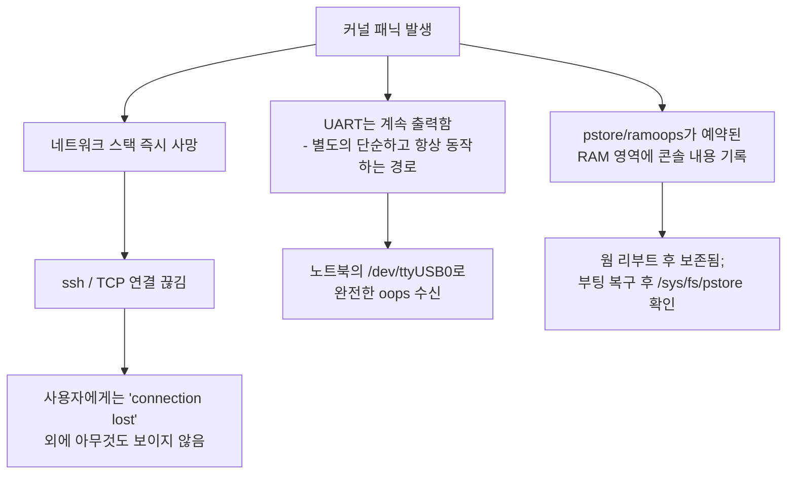

선호도 순으로 정리한 3가지 옵션:

**1. 시리얼 UART — 반드시 이것을 사용하십시오.** 보드의 디버그 헤더에 연결하는 $3짜리 USB-TTL 어댑터입니다. 커널은 드라이버 스택, 네트워크, 메모리 할당 없이도 여기에 메시지를 출력합니다. 커널이 죽어가는 순간에도 정상 작동하며, 그 순간이야말로 콘솔 출력이 필요한 유일한 때입니다.

```
# 보드 커널 커맨드라인
console=ttyS0,115200 earlycon
```

노트북의 백그라운드 스레드에서 시리얼 포트를 지속적으로 읽어 링 버퍼에 저장합니다:

```rust
// 시작 시 한 번 열고 절대 닫지 않습니다. 콘솔은 보드와 통신이
// 끊어진 동안에도 계속 기록되어야 하는 유일한 채널입니다.
let port = serialport::new("/dev/ttyUSB0", 115_200)
    .timeout(Duration::from_millis(50))
    .open()?;
std::thread::spawn(move || {
    let mut buf = [0u8; 4096];
    loop {
        if let Ok(n) = port.read(&mut buf) {
            console_ring.lock().unwrap().extend_from_slice(&buf[..n]);
        }
    }
});
```

두 가지 실용적인 팁: 어댑터 꽂는 순서에 따라 `ttyUSB0`이나 `ttyUSB1`로 바뀌지 않도록 `udev` 룰을 설정하여 항상 `/dev/fuzz-console`로 고정하십시오. 그리고 다른 프로그램(`minicom`, `screen`, ModemManager)이 포트를 점유하지 않도록 하십시오 — `systemctl mask ModemManager`를 실행해 두면 혼란을 줄일 수 있습니다.

**2. pstore / ramoops — 시리얼 헤더가 없을 때의 차선책.** 웜 리부트(warm reboot) 시에도 내용이 보존되는 예약된 RAM 영역입니다. `CONFIG_PSTORE`, `CONFIG_PSTORE_RAM`, `CONFIG_PSTORE_CONSOLE` 설정이 필요하며 디바이스 트리나 커맨드라인을 통해 메모리 영역을 지정해야 합니다:

```
ramoops.mem_address=0x50000000 ramoops.mem_size=0x100000 ramoops.console_size=0x80000
```

이후 보드가 다시 부팅된 *뒤에*:

```bash
cat /sys/fs/pstore/console-ramoops-0   # 완전한 oops 출력
rm /sys/fs/pstore/console-ramoops-0    # 삭제 필수, 그렇지 않으면 이전 크래시를 반복해서 읽음
```

이는 syzkaller의 `isolated` 백엔드의 `pstore: true` 경로와 정확히 동일하며 `rm`을 수행하는 것도 같습니다 — `rm`을 하지 않으면 이후의 모든 크래시가 첫 번째 크래시로 잘못 보고됩니다.

**3. netconsole — 의존하지 마십시오.** 방금 죽어버린 바로 그 네트워크 스택을 공유합니다. 단순 경고에는 유용할지 몰라도 패닉 상황에서는 무용지물입니다.

#### 두 가지 크래시 시그널 병합

크래시 스캐너는 이제 두 개의 입력을 받아 이를 결합해야 합니다:

```rust
pub enum Health { Ok(Response), Crashed { title: String, console: String }, Unreachable }

fn classify(&mut self, exec: anyhow::Result<Response>) -> Health {
    let console = self.drain_console();
    if let Some(title) = crash::scan(&console) {
        return Health::Crashed { title, console };   // 시리얼 콘솔이 알려줌. 결정적 증거.
    }
    match exec {
        Ok(resp) => Health::Ok(resp),
        Err(_) => {
            // 네트워크가 끊겼지만 콘솔은 아직 조용함. UART에 시간을 조금 줌 —
            // oops 출력이 아직 도착하는 중일 수 있음. syzkaller는 잔여 출력을 위해 약 10초 대기함.
            std::thread::sleep(Duration::from_secs(10));
            let console = self.drain_console();
            match crash::scan(&console) {
                Some(title) => Health::Crashed { title, console },
                None => Health::Unreachable,         // 멈춤, 또는 NIC 사망
            }
        }
    }
}
```

잔여 출력을 위한 10초 대기 로직은 syzkaller의 `vm/vm.go`에서 그대로 가져온 것이며, 온전한 리포트와 중간에 잘린 리포트를 가르는 결정적 차이입니다.

### 15.7 복구 사다리 (The Recovery Ladder)

VM은 그냥 강제 종료하면 됩니다. 반면 하드 행(hard-hang)에 빠진 물리 보드는 소프트웨어로 할 수 있는 그 어떤 명령에도 응답하지 않습니다. **물리적으로 전원을 차단하는 최후의 수단이 없다면, 무인 베어메탈 퍼징은 첫 번째 하드 행이 발생하는 순간 영구 중단됩니다** — 올바르게 구현했다면 이는 첫 1시간 이내에 마주하게 될 상황입니다.

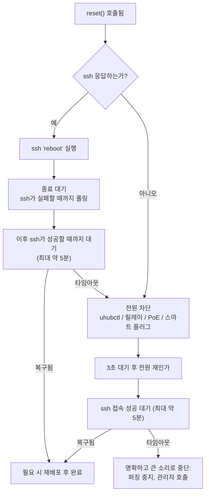

여기서 직관과 다른 두 가지 핵심이 있으며, 둘 다 syzkaller의 `isolated` 백엔드에서 유래한 것입니다:

**2단계 대기 (The two-phase wait).** `ssh reboot`를 실행한 직후 바로 SSH 재접속을 대기해선 안 됩니다. **시스템이 종료되는 동안에도 몇 초 동안은 SSH가 계속 응답하기 때문입니다.** 그랬다가는 즉시 "성공"으로 판정하여 죽어가는 시스템에 접속해 엉뚱한 쓰레기 데이터를 읽게 됩니다. 따라서: 먼저 SSH가 *실패*할 때까지(시스템이 꺼지는 중) 폴링한 뒤, *그 이후에* SSH가 성공할 때까지(시스템이 돌아옴) 폴링해야 합니다. syzkaller의 `waitForReboot`가 정확히 이렇게 동작하며, 직접 문제를 겪어보고 나서야 비로소 깨닫게 되는 코드입니다.

```rust
fn wait_for_reboot(&self, timeout: Duration) -> anyhow::Result<()> {
    let t0 = Instant::now();
    // 1단계: 시스템이 꺼질 때까지 대기.
    while self.ssh_ok() {
        anyhow::ensure!(t0.elapsed() < timeout, "board never went down");
        std::thread::sleep(Duration::from_secs(1));
    }
    // 2단계: 시스템이 다시 켜질 때까지 대기.
    let t1 = Instant::now();
    while !self.ssh_ok() {
        anyhow::ensure!(t1.elapsed() < timeout, "board never came back");
        std::thread::sleep(Duration::from_secs(1));
    }
    Ok(())
}
```

**단계적 에스컬레이션 후 명확한 중단.** 사다리의 마지막 단계는 "영원히 재시도"가 아니라 즉시 중지하고 사람에게 알리는 것입니다. 벽돌이 된 보드를 붙잡고 8시간 동안 조용히 헛도는 퍼저는 5분 만에 실패를 알리고 멈추는 퍼저보다 훨씬 해롭습니다.

#### 전원 제어 옵션

| 방식 | 비용 | 비고 |
|---|---|---|
| 포트별 전원 제어가 가능한 USB 허브의 **`uhubctl`** | ~$20 | USB 전원으로 구동되는 보드. `uhubctl -a off -l 1-1 -p 2`. 규격에 맞다면 가장 간단함. |
| USB 릴레이 보드 | ~$10 | 배럴 잭 전원선을 차단. 모든 보드에 범용적으로 동작함. |
| PoE 스위치 포트 | 기존 보유 시 $0 | `snmpset`으로 포트 전원 제어. PoE 보드에 깔끔함. |
| 로컬 API 지원 스마트 플러그 | ~$15 | 단순하지만 효과적; 클라우드 전용 모델은 피할 것. |
| syzkaller의 트릭 | $0 | `/sys/bus/usb/devices/<n>/authorized`에 `0`을 썼다가 `1`을 씀 — USB 디바이스 인가 해제 후 재인가. USB 전원 보드에서 동작. |

또한 보드에 **하드웨어 와치독(Hardware watchdog)**이 있다면 활성화하십시오 (`/dev/watchdog`, `CONFIG_WATCHDOG`): 커널이 멈췄을 때 핑 전송을 중단하는 유저스페이스 프로세스를 두면 별도의 전원 제어 하드웨어 없이도 상당수의 멈춤 현상에서 무료로 자동 재부팅을 얻을 수 있습니다.

### 15.8 커널: Debian 소스 + 설정 조각 (Config Fragment)

최소한의 바닐라 커널 대신 Debian 커널을 베이스로 사용합니다. 검증된 드라이버가 포함된 안정적인 설정으로 부팅할 수 있어 합리적인 선택이지만, 세 가지 구체적인 문제를 동반합니다. 세 문제 모두 한 번에 해결할 수 있습니다.

#### Debian 순정 커널의 지원 현황

| 필요한 기능 | Debian 순정 커널 | 조치 사항 |
|---|---|---|
| `CONFIG_KCOV` | **비활성화됨** | 재빌드 필수 |
| `CONFIG_KCOV_INSTRUMENT_ALL` | 해당 없음 | 재빌드 필수 |
| `CONFIG_KASAN` | **비활성화됨** (배포판용으로는 너무 느림) | 재빌드 필수 |
| `CONFIG_DEBUG_FS` | 활성화됨 | 조치 필요 없음 |
| `CONFIG_9P_FS`, `CONFIG_NET_9P` | 활성화됨 (대개 `=m`) | `modprobe 9p 9pnet 9pnet_virtio` |
| `CONFIG_NET_9P_FD` (tcp 전송 계층) | `default NET_9P` (대개 `=m`) | 검증 필요; 아래 참조 |
| `CONFIG_NFS_FS` | 활성화됨 (`=m`) | 조치 필요 없음 |
| `CONFIG_RANDOMIZE_BASE` (KASLR) | **활성화됨** | **`nokaslr`로 부팅 — 재빌드 불필요** |
| `pahole`을 위한 완전한 DWARF | `linux-image-*-dbg`로 분리됨 | 해당 패키지 설치 또는 자체 빌드의 `vmlinux` 사용 |

두 가지 항목을 강조할 필요가 있습니다.

**KASLR은 빌드가 아니라 부팅 시점에 끌 수 있습니다.** 커널 커맨드라인에 `nokaslr`를 추가하면 재빌드 없이도 부팅 간 PC를 비교할 수 있게 됩니다. 어차피 KCOV 때문에 재빌드하므로 `CONFIG_RANDOMIZE_BASE=n`도 설정하겠지만, *남이 빌드한* 커널로 부팅할 때는 `nokaslr`를 기억해야 합니다.

**설계에 도입하기 전에 9p-over-TCP 지원을 검증하십시오.** 필요한 심볼은 `CONFIG_NET_9P_FD`입니다 (`tcp`, `unix`, `fd` 전송 계층을 제공하며, vng가 쓰는 `CONFIG_NET_9P_VIRTIO`만으로는 *부족합니다*). 보드에서 확인:

```bash
# 설정이 존재하는지 확인
zgrep -E 'CONFIG_NET_9P|CONFIG_9P_FS' /proc/config.gz 2>/dev/null \
  || grep -E 'CONFIG_NET_9P|CONFIG_9P_FS' /boot/config-$(uname -r)

# 모듈 로드 및 tcp 전송 계층 등록 확인
modprobe 9pnet 9pnet_virtio 9p
ls /sys/module/9pnet/                 # 존재하면 코어 모듈이 로드된 것임
mount -t 9p -o trans=tcp,port=564,version=9p2000.L,ro 192.168.9.1 /mnt/build
```

`trans=tcp`가 `EINVAL`이나 "trans=tcp not supported"로 실패한다면 fd 전송 계층이 누락된 것이므로 설정 조각에 추가해야 합니다.

#### 설정 조각 (Config Fragment)

`lab.config` 파일을 생성합니다. 이는 기존 설정에 추가되는 방식이며 `merge_config.sh`가 Debian 설정 위에 이를 병합합니다:

```
# --- 커버리지: 핵심 목적 ---
CONFIG_KCOV=y
CONFIG_KCOV_INSTRUMENT_ALL=y
CONFIG_KCOV_ENABLE_COMPARISONS=y
CONFIG_DEBUG_FS=y

# --- 버그 감지: 이것이 없으면 커널이 그냥 계속 실행됨 ---
CONFIG_KASAN=y
CONFIG_KASAN_INLINE=y

# --- 부팅 간 일관된 PC 값 유지 ---
# CONFIG_RANDOMIZE_BASE is not set

# --- 심볼화 및 pahole 분석 ---
CONFIG_DEBUG_INFO_DWARF_TOOLCHAIN_DEFAULT=y
# CONFIG_DEBUG_INFO_REDUCED is not set
CONFIG_FRAME_POINTER=y

# --- 전송 계층: TCP 기반 9p (단순 virtio만이 아님) ---
CONFIG_NET_9P=y
CONFIG_NET_9P_FD=y
CONFIG_9P_FS=y
CONFIG_9P_FS_POSIX_ACL=y

# --- 시리얼 헤더가 없을 때 크래시 캡처 (§15.6) ---
CONFIG_PSTORE=y
CONFIG_PSTORE_RAM=y
CONFIG_PSTORE_CONSOLE=y

# --- reset() 테스트를 위해 의도적 패닉 유발 허용 (§15.10 8단계) ---
CONFIG_MAGIC_SYSRQ=y

# --- 다양한 멈춤 현상에 대한 무료 자체 복구 기능 (§15.7) ---
CONFIG_WATCHDOG=y
```

아키텍처별 3가지 주의점:

- **KASAN 종류.** Generic KASAN은 세 아키텍처 모두에서 동작합니다. **arm64**에서는 `KASAN_INLINE` 대신 `CONFIG_KASAN_SW_TAGS=y`를 고려할 수 있습니다 — 메모리 소모가 훨씬 적어 사양이 작은 보드에서 유리합니다. **riscv64**는 generic KASAN만 지원합니다. **x86-64**는 generic + inline이 기본 권장값입니다.
- **riscv64**는 Debian 설정에 포함된 `CONFIG_RISCV_ISA_ZICBOM` 등이 필요합니다 — 제거하지 마십시오. `defconfig` 대신 Debian 설정에서 출발하는 이유가 바로 이 때문입니다.
- `CONFIG_RANDOMIZE_BASE`는 세 아키텍처 모두에 존재하며 `nokaslr` 커맨드라인도 동일하게 작동합니다.

#### 빌드 수행 및 빌드 시간 단축 기법

Debian 기본 설정은 약 4,000개의 모듈을 빌드합니다. 그대로 빌드하면 아키텍처당 1시간 이상 걸립니다. `localmodconfig`가 이를 해결해 주며, 모듈 목록을 *보드*에서 직접 읽어올 수 있습니다:

```bash
# 1. 소스코드 다운로드
sudo apt install linux-source-$(uname -r | cut -d- -f1) || apt source linux
tar xf /usr/src/linux-source-*.tar.xz && cd linux-source-*

# 2. 보드에서 실제로 실행 중인 설정을 베이스로 복사
scp root@192.168.9.2:/boot/config-$(ssh root@192.168.9.2 uname -r) .config
ssh root@192.168.9.2 lsmod > /tmp/board.lsmod

# 3. 보드가 현재 로드한 모듈만 남김 -> 빌드 시간 약 10배 단축
make LSMOD=/tmp/board.lsmod localmodconfig

# 4. 실습용 설정 조각 병합
./scripts/kconfig/merge_config.sh -m .config ../lab.config
make olddefconfig

# 5. .deb 패키지 빌드 (필요 시 크로스 컴파일)
make -j$(nproc) bindeb-pkg                                     # x86-64
make ARCH=arm64   CROSS_COMPILE=aarch64-linux-gnu- -j$(nproc) bindeb-pkg
make ARCH=riscv   CROSS_COMPILE=riscv64-linux-gnu- -j$(nproc) bindeb-pkg
```

`merge_config.sh`는 알아둘 가치가 있는 유용한 도구입니다: 설정 조각을 적용하고, 의존성 누락 등으로 설정하지 못한 심볼이 있으면 명확한 경고를 출력하며, 나머지는 온전히 유지합니다. **출력되는 경고를 반드시 읽으십시오** — `CONFIG_KCOV`가 조용히 누락되면 오후 내내 원인을 찾아 헤매게 됩니다.

이후 보드에 설치합니다:

```bash
scp ../linux-image-*.deb root@192.168.9.2:/tmp/
ssh root@192.168.9.2 'dpkg -i /tmp/linux-image-*.deb && reboot'
```

각 빌드에서 생성된 `vmlinux`는 따로 보관하십시오 — `pahole`과 `addr2line`에 필요하지만 `.deb` 패키지에는 스트립된 이미지만 들어있기 때문입니다.

```bash
mkdir -p ~/kernels/arm64 && cp vmlinux ~/kernels/arm64/
```

#### 새 커널을 보드에 올리는 4가지 방식

가장 덜 번거로운 방식을 선택하십시오.

| 계층 | 방식 | 반복 주기 | 사용 시점 |
|---|---|---|---|
| **모듈만 교체** | KCOV+KASAN이 포함된 커널을 한 번 빌드하여 설치한 뒤, 재빌드된 `.ko` 파일만 `scp` 전송 | **수초** | 단일 드라이버를 퍼징할 때 — **여기서 시작할 것** |
| `dpkg -i` + 재부팅 | 위에서 설명한 워크플로 | ~2분 | Debian 루트 fs 기반의 일반적인 커널 수정 주기 |
| TFTP + U-Boot | 보드가 노트북으로부터 `Image` + DTB를 넷부팅 | ~30초 | 쓰기 가능한 루트 fs가 없거나 커널 수정을 빈번히 할 때 |
| 플래시 롬 직접 쓰기 | 벤더 전용 툴, SD 카드에 `dd` | 수분 소요, 플래시 수명 단축 | 최후의 수단 |

모듈만 교체하는 방식을 주목할 필요가 있습니다: 아키텍처당 기본 커널을 `CONFIG_KCOV_INSTRUMENT_ALL=y`로 **한 번만** 빌드하여 설치해 두면, 이후에는 테스트할 드라이버 하나만 재빌드하면 됩니다. `INSTRUMENT_ALL` 덕분에 out-of-tree로 새로 빌드된 모듈도 추가 플래그 없이 자동으로 인스트루멘테이션됩니다 — 마일스톤 M5'를 위해 *의도적인 버그 모듈*을 빌드할 때도 이 방식을 사용합니다.

참고용 TFTP 설정:

```bash
sudo apt install tftpd-hpa
sudo cp arch/arm64/boot/Image /srv/tftp/
# 보드의 U-Boot 프롬프트에서:
setenv serverip 192.168.9.1; setenv ipaddr 192.168.9.2
setenv bootargs 'console=ttyS0,115200 earlycon nokaslr root=/dev/mmcblk0p2'
tftp 0x80080000 Image; tftp 0x83000000 board.dtb
booti 0x80080000 - 0x83000000
```

U-Boot 자동화는 §15.6에서 열어둔 시리얼 포트를 통해 프롬프트를 제어하는 것을 의미합니다 — "자동 부팅을 중단하고 다음 명령어를 입력"하는 로직은 Rust 약 40줄이면 구현 가능하며, 커널 교체 작업을 `reset()` 루틴의 일부로 통합할 수 있습니다.

### 15.9 플래시 메모리와 RAM: VM에는 없는 2가지 제약

**퍼징 루프 내부에서 보드의 플래시 메모리에 쓰기 작업을 하지 마십시오.** eMMC와 SD 카드는 쓰기 수명이 제한되어 있으며, 시간당 수천 번 반복하는 퍼저는 저가형 SD 카드를 며칠 만에 파괴합니다. 구체적으로:

- 요청과 응답은 파일이 아닌 **stdin/stdout 또는 소켓**을 통해 파이프로 전달하십시오.
- 실행기와 모든 임시 작업 디렉터리는 **tmpfs**에 배치하십시오: `mount -t tmpfs -o size=64M tmpfs /tmp`를 실행하고 프로그램을 실행하기 전에 `chdir("/tmp")`를 호출합니다.
- BSP가 허용한다면 보드의 루트 파일시스템을 **읽기 전용**으로 마운트하십시오. 이는 virtme-ng의 `--overlay-rwdir`에 해당하는 베어메탈 안전장치이며, 부팅에 필요한 루트 fs를 퍼저가 손상시키는 것을 방지합니다.
- 파일시스템 코드를 퍼징하는 경우 실제 파티션이 아닌 **tmpfs 파일 기반의 루프 디바이스**를 제공하십시오.

**메모리.** KASAN은 섀도우 메모리를 위해 주소 공간의 약 1/8을 소모하며 실제 메모리 오버헤드도 상당합니다. 512 MB 보드에서는 메모리가 빠듯하여 버그 리포트 대신 OOM 킬러를 마주할 수 있습니다. 권장 순서: 2 GB 이상의 보드 사용; 또는 arm64에서 일반 KASAN보다 훨씬 가벼운 `CONFIG_KASAN_SW_TAGS` 사용; 혹은 탐지 능력은 떨어지지만 가벼운 `CONFIG_SLUB_DEBUG` + `CONFIG_DEBUG_PAGEALLOC` 조합으로 대체. KCOV 버퍼는 스레드당 `64K 엔트리 × 8 B = 512 KB` 수준으로 어느 쪽이든 무시할 수 있는 수준입니다.

**타임아웃.** 보드는 노트북보다 5–20배 느릴 수 있습니다. syzkaller가 하듯(`Timeouts(slowdown)`; `Scale`은 최대 3으로 제한하되 시스템 콜당 타임아웃은 선형 배율 적용) 모든 타임아웃에 `slowdown` 계수를 곱하십시오. 배율을 적용하지 않으면 정상 동작 중인 보드가 영구 멈춤 상태로 오인될 수 있습니다.

### 15.10 단계별 검증 체크리스트 (Bring-up Checklist)

반드시 순서대로 진행하십시오. 각 단계는 다음 단계로 가기 위한 관문입니다.

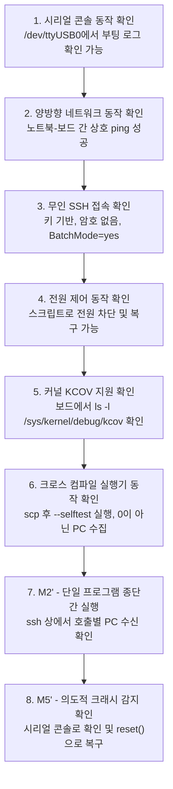

7단계 전에 4단계를 먼저 두는 것은 의도된 것입니다. **보드를 크래시시키기 전에 먼저 복구할 수 있는지 확인하십시오.** 그리고 8단계가 진정한 인수 시험(acceptance test)입니다: 의도적으로 패닉을 유발하고(`CONFIG_MAGIC_SYSRQ` 활성화 시 `echo c > /proc/sysrq-trigger`), 시리얼 콘솔로 완전한 oops가 도달하는지 확인하며, `reset()`이 보드를 정상 복구시키고 퍼징이 재개되는지 확인하십시오. 패닉 복구를 직접 검증해보지 않은 베어메탈 퍼저는 아직 완성된 것이 아닙니다.

debugfs 마운트의 차이점을 기억하십시오: virtme-ng는 이를 자동으로 마운트해 주었습니다. 보드에서는 시작 스크립트에서 직접 마운트해야 합니다:

```bash
mount -t debugfs debugfs /sys/kernel/debug
mount -t tmpfs -o size=64M tmpfs /tmp
ip addr add 192.168.9.2/24 dev eth0 && ip link set eth0 up
/tmp/executor --connect 192.168.9.1:7777 &
```

이것이 syzkaller의 `startup_script` 설정 옵션에 해당하며, 부팅별 초기화 작업을 수행하기에 가장 적절한 위치입니다.

### 15.11 안전 수칙 재점검

베어메탈 환경의 위험 프로파일은 virtme-ng와 비교했을 때 **한 가지 측면에서는 더 안전하고 다른 측면에서는 더 위험합니다**.

| | virtme-ng | 실제 보드 |
|---|---|---|
| 노트북 파일시스템 | **노출됨** — 게스트에 마운트되어 있음 | **전혀 노출되지 않음** |
| 커널 버그로 인한 손상 | VM 내부에 격리됨 | 보드의 플래시 메모리, 부트로더 손상 가능 |
| 최악의 현실적 결과 | 공유 디렉터리의 작업 내용 유실 | **보드가 벽돌(brick)이 됨** |
| 복구 방법 | 프로세스 재시작 | 펌웨어 재플래시, 또는 칩 디솔더링 |

구체적으로: 작업을 시작하기 *전에* 검증된 복구용 이미지와 문서화된 재플래시 절차를 확보해 두십시오. 부트 파티션, 부트로더 환경변수, eFuse에 쓰는 동작은 퍼징 대상에서 제외하십시오 — 기술하려는 서브시스템이 MTD, 부트로더 env, 보안 부팅 상태를 건드릴 수 있다면 호출 테이블에서 의도적으로 해당 디바이스를 배제하십시오. 그리고 팀 전체가 공유하는 단 하나의 프로토타입 보드 대신 망가져도 괜찮은 보드를 사용하십시오.

반대로 큰 장점도 있습니다: 노트북 환경이 게스트로부터 완전히 격리되어 있으므로 virtme-ng 환경처럼 극도의 편집증을 가질 필요 없이 퍼저를 구동할 수 있습니다.

### 15.12 기대 처리량

| 구성 | 초당 실행 횟수 (Execs/sec) | 병목 지점 |
|---|---:|---|
| virtme-ng, 부팅당 1개 프로그램 | ~0.5–1 | VM 부팅 |
| **보드, 프로그램당 SSH 1회** | **~5–20** | SSH 핸드셰이크 (`ControlMaster` 사용 권장) |
| virtme-ng, 상주 실행기 + virtiofs | ~100–1,000 | 폴링 |
| **보드, 상주 실행기 + TCP 소켓** | **~200–2,000** | 보드 상의 시스템 콜 실행 비용 |

프로그램마다 부팅하지 않기 때문에 보드 환경이 virtme-ng 1단계보다 *더 빠릅니다*. 실제 하드웨어에만 존재하는 서브시스템의 경우, 이는 타협안이 아니라 이를 퍼징할 수 있는 유일한 선택지입니다.

---

## 16. 가치 순으로 정리한 향후 추가 기능

M6를 통과한 이후, 가장 높은 가치를 제공하는 기능들입니다:

1. **비교 힌트 (Comparison hints)** (`KCOV_TRACE_CMP`). 프로젝트 전체에서 코드 라인당 가치가 가장 높습니다. 커널이 비교 연산에 사용한 매직 넘버를 알려주면 이를 입력 데이터에 삽입합니다. 도달할 수 없던 `if (magic == 0xCAFEBABE)` 조건을 단 한 번의 추측으로 통과할 수 있게 됩니다. 약 150줄: 두 번째 KCOV 모드, 비교 연산용 `HashMap<u64, HashSet<u64>>`, 축소 캐스팅을 처리하기 위한 `shrink_expand`.
2. **아레나(Arena).** 실제 syzbot 재현 코드를 실행하고 싶어지는 순간 필요해집니다. `0x200000000000` 고정 mmap, 16 MiB, 포인터를 상대 오프셋으로 기록, 쓰기 시 덧셈 연산 1회. `syz-execprog-design.md` §2.3 참조.
3. **멀티스레드 실행.** 호출당 하나의 스레드를 할당하여 블로킹 시스템 콜이 프로그램 전체를 멈추지 않도록 방지합니다. 스레드마다 고유한 KCOV fd와 mmap이 필요합니다.
4. **다중 VM (Multiple VMs).** `Vec<Driver>`와 작업 큐 도입. 반드시 2단계 전송 계층을 구축한 후에 진행해야 하며 코퍼스는 호스트에서 단일 소유권을 유지해야 합니다.
5. **C 재현 코드 생성.** 프로그램 모델이 존재한다면 기계적으로 변환 가능하며 발견한 버그를 업스트림 커널에 공식 리포트할 수 있게 해줍니다.

그리고 아무리 유혹적이더라도 **계속해서 거부해야 할** 항목들: 디스크립션 언어, RPC 스키마, 코퍼스 데이터베이스, VM 풀 추상화, 웹 대시보드, 다중 아키텍처 지원. 이들은 syzkaller에는 정답이지만 여러분에게는 오답입니다. 이 중 두 가지 이상이 필요해지는 순간 여러분은 실습을 만드는 것이 아니라 syzkaller 대체품을 만들고 있는 것이며, 그 시점에서는 syzkaller 프로젝트에 직접 기여하는 것이 정직한 선택입니다.

---

## 17. syzkaller 원본 코드와의 매핑

직접 구현을 마친 후 원본 코드를 분석하고 싶을 때를 위한 매핑입니다:

| 자체 구현 컴포넌트 | 대응되는 syzkaller 원본 | 원본 크기 |
|---|---|---|
| `common/table.rs` | `sys/linux/*.txt` + `pkg/ast` + `pkg/compiler` + `sys/syz-extract` + `sys/syz-sysgen` | ~15,000줄 + 90,000줄의 디스크립션 |
| `common/prog.rs` | `prog/prog.go`, `prog/types.go` | ~3,000줄 |
| `common/wire.rs` | `pkg/flatrpc/*` + `prog/encodingexec.go` + `prog/decodeexec.go` | ~4,000줄 |
| `executor/kcov.rs` | `executor/executor_linux.h` 커버리지 함수들 | ~300줄 |
| `executor/run.rs` | `executor/executor.cc` | ~2,000줄 |
| `fuzzer/corpus.rs` | `pkg/corpus/*` + `pkg/db` + `pkg/manager/seeds.go` | ~2,500줄 |
| `fuzzer/mutate.rs` | `prog/mutation.go` + `prog/rand.go` + `prog/prio.go` | ~3,500줄 |
| `fuzzer/minimize` | `prog/minimization.go` | ~550줄 |
| `fuzzer/crash.rs` | `pkg/report/*` | ~10,000줄 |
| `fuzzer/driver.rs` | `vm/*` + `pkg/instance` + `vm/dispatcher` + `pkg/rpcserver` | ~12,000줄 |
| *(`vng --dump` + `drgn`)* | `pkg/instance/dump.go` — kdump 크래시 커널, `makedumpfile`, 100회 재시도 | ~120줄 + 이미지 설정 |
| *(없음)* | `pkg/repro`, `pkg/csource`, `syz-hub`, `dashboard/`, `syz-ci`, `pkg/bisect`, `pkg/aflow` | ~60,000줄 |
| *(없음 — §14.2 참조)* | `vm/qemu/snapshot_linux.go` + `pkg/execbackend/snapshot.go` + ivshmem 도어벨 | ~700줄 + 전송 계층 재작성 |

여러분이 작성할 약 2,000줄과 syzkaller의 약 200,000줄. 이 비율은 어느 쪽을 비하하는 것이 아닙니다 — §0에서 언급한 세 가지 목표를 달성하기 위해 지불해야 하는 대가입니다. 정확히 어느 1%를 직접 구축하고 있으며 나머지 99%가 왜 존재하는지 명확히 아는 것이야말로 이 실습의 진짜 성과입니다.

---

## 18. 참고: 자주 사용하게 될 핵심 명령어 모음

```bash
# 퍼징용 설정으로 커널 빌드
vng -b -f kcov.config -j $(nproc)

# 환경 정상 동작 확인
vng --run ~/linux --exec "ls -l /sys/kernel/debug/kcov"

# 실행기 자체 테스트(selftest) 실행
cargo build --release
vng --run ~/linux --exec "$PWD/target/release/executor --selftest"

# 단일 프로그램 안전 실행
vng --run ~/linux \
    --rwdir=/work=$PWD/work \
    --overlay-rwdir=/scratch \
    --memory 2G --cpus 2 \
    --exec "$PWD/target/release/executor --once /work/req.bin /work/res.bin"

# 대화형 탐색 (게스트 내부 셸 진입)
vng --run ~/linux --rwdir=/work=$PWD/work --overlay-rwdir=/scratch

# 상주 VM + 별도 제어 채널 (2/3단계)
vng --run ~/linux --rwdir=/work=$PWD/work --console &
vng --console-client

# 수집된 PC 심볼화
addr2line -e ~/linux/vmlinux -f -i -p $(cat work/pcs.txt)

# 게스트 내부에서 어떤 공유 FS 백엔드가 선택되었는지 확인
mount | grep -E 'virtiofs|9p'

# --- ABI 모델링 (실습 2, §5.4) ---

# 사용자의 빌드 DWARF로부터 정확한 구조체 레이아웃 확인 (패딩 홀 포함)
pahole -C sock_fprog ~/linux/vmlinux
pahole --sizes ~/linux/vmlinux | grep -i ptm

# --- 크래시 트리아지 (2단계, §14.1). 퍼징 루프 내에서는 절대 실행 금지. ---

# QMP + vmcoreinfo를 활성화하여 부팅 (--debug는 microvm을 비활성화함)
vng --run ~/linux --debug \
    --rwdir=/work=$PWD/work --overlay-rwdir=/scratch \
    --exec "$PWD/target/release/executor --once /work/repro.bin /work/res.bin" &

# QMP를 통해 게스트 메모리 덤프 (3636 포트 고정; 한 번에 하나의 인스턴스만 가능)
vng --dump core.elf

# 덤프 파일 내 커널 데이터 구조 순회 분석
drgn -c core.elf -s ~/linux/vmlinux

# --- 베어메탈 보드 타깃 (§15) ---

# 실행기 크로스 컴파일, 정적 링크, libc 의존성 없음
rustup target add aarch64-unknown-linux-musl
cargo build --release --target aarch64-unknown-linux-musl -p executor
file target/aarch64-unknown-linux-musl/release/executor   # "statically linked" 확인

# 노트북 측 직결 이더넷 설정
sudo ip addr add 192.168.9.1/24 dev enp0s31f6 && sudo ip link set enp0s31f6 up

# 배포 방식 A: 변경 시 복사 (가장 안전; 커널 개입 없음)
scp target/aarch64-unknown-linux-musl/release/executor root@192.168.9.2:/tmp/

# 배포 방식 B: 읽기 전용 네트워크 마운트 = vng의 "배포 단계 없음" 재현 (§15.5)
#   노트북: /etc/exports -> /srv/build 192.168.9.2(ro,sync,no_subtree_check)
#   보드:
mount -t nfs -o ro,soft,timeo=50,retrans=2 192.168.9.1:/srv/build /mnt/build
#   또는 vng와 동일한 9p 프로토콜을 TCP 상에서 사용:
diod -f -l 0.0.0.0:564 -e /srv/build --no-auth            # 노트북
mount -t 9p -o trans=tcp,port=564,version=9p2000.L,ro 192.168.9.1 /mnt/build

# 보드 부팅별 설정 (시작 스크립트)
mount -t debugfs debugfs /sys/kernel/debug
mount -t tmpfs -o size=64M tmpfs /tmp
/mnt/build/executor --connect 192.168.9.1:7777 &

# 시리얼 콘솔 - 패닉 상황에서도 살아남는 유일한 채널
picocom -b 115200 /dev/ttyUSB0            # 수작업 모니터링
cat /dev/ttyUSB0 | tee console.log        # 파일 로깅

# 보드가 복구된 후 pstore 확인 (차선책)
ssh root@192.168.9.2 'cat /sys/fs/pstore/console-ramoops-0; rm /sys/fs/pstore/console-ramoops-0'

# 전원 재인가 (복구 사다리의 최하단 물리 제어)
uhubctl -a off -l 1-1 -p 2 && sleep 3 && uhubctl -a on -l 1-1 -p 2

# 타깃의 vmlinux와 크로스 binutils로 심볼화
aarch64-linux-gnu-addr2line -e ~/linux-arm64/vmlinux -f -i -p 0xffff800008123456
pahole -C my_ioctl_args ~/linux-arm64/vmlinux

# 콘솔 캡처 및 reset() 검증을 위해 의도적으로 패닉 유발 (M5')
ssh root@192.168.9.2 'echo c > /proc/sysrq-trigger'
```

### 여기에 복제된 메커니즘들의 syzkaller 원본 코드 레퍼런스

| 메커니즘 | syzkaller 소스 위치 |
|---|---|
| KCOV open / mmap / enable / reset / collect | `executor/executor_linux.h` → `cover_open`, `cover_mmap`, `cover_enable`, `cover_reset`, `cover_collect` |
| 호출별 브래킷 | `executor/executor.cc` → 디스패치 전후의 `cover_reset` / `cover_collect` |
| PC 되감기 테이블 | `pkg/cover/backend/pc.go` → `PreviousInstructionPC`, `instructionLen` |
| 가중치 기반 코퍼스 선택 | `pkg/corpus/prio.go` → `ProgramsList`, `chooseProgram` |
| 신규성 게이트 | `pkg/fuzzer/cover.go` → `addRawMaxSignal`; `pkg/signal/signal.go` → `DiffRaw` |
| 변이 가중치 및 루프 | `prog/mutation.go` → `DefaultMutateOpts`, `MutateWithOpts` |
| 정수 분포, 특수 정수들 | `prog/rand.go` → `randInt`, `specialInts`, `biasedRand` |
| 리소스 재사용/생성 편향 | `prog/rand.go` → `ResourceType.generate`, `createResource` |
| 플레이크 완화 임계치 및 근거 | `pkg/fuzzer/job.go` → `deflake*` 상수들 |
| 최소화 | `prog/minimization.go` → `Minimize`, `removeCalls` |
| 아레나 베이스 및 크기 | `sys/targets/targets.go` → `defaultDataOffset`, `NumPages`; `executor/executor_linux.h` → `os_init` |
