# syz-execprog 설계: 단일 프로그램 실행, 코퍼스 저장, 재현 프로그램 생성

> **대상 독자.** `syz-manager`가 거대한 공장 전체라면, `syz-execprog`는 수공구에 해당합니다. 즉, 대상 머신에 직접 복사하여 "*이 정확한 프로그램*이 *그 정확한 동작*을 일으키는가?"라는 질문에 답하기 위해 사용하는 도구입니다. 또한 자동 재현 프로그램(reproducer) 추출을 뒷받침하는 핵심 엔진이기도 합니다.
>
> 이 문서는 서로 연결된 네 가지 주제를 다룹니다: 재현 프로그램 파일을 호출별(per-call) 커널 커버리지로 변환하는 **5단계 파이프라인**(핵심부, §1–§2), 큐를 통해 요청이 흐르는 방식(§3), 코퍼스가 저장되고 로드되는 방식(§4), 그리고 크래시 로그가 최소화된 재현 프로그램으로 변환되는 방식(§5).

---

## 0. `syz-execprog`의 위치와 역할

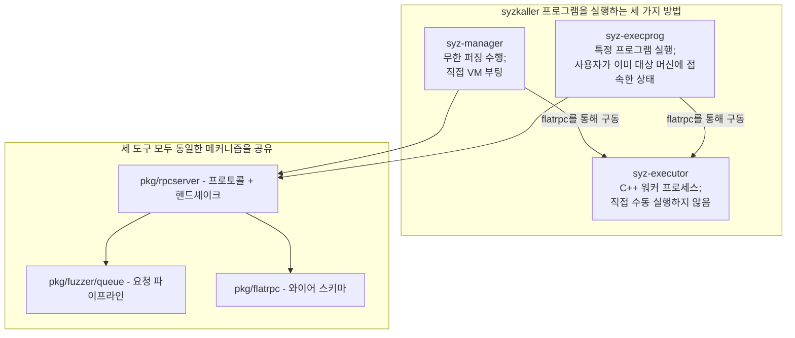

구조적으로 중요한 사실은 다음과 같습니다: **`syz-execprog`는 실행 경로를 단순화하여 재구현한 것이 아닙니다.** 실행 메커니즘 자체를 `syz-manager`와 완전히 공유합니다(자세한 내용은 §2.8 참조). 차이점은 오직 *누가 프로그램을 제공하는가*뿐입니다. 퍼징 엔진 대신 파일에서 프로그램을 공급받습니다.

`syz-execprog`가 수행하는 세 가지 작업:

1. **수동 테스트 / 디버깅.** 대상 VM이나 보드에 `syz-execprog`와 `syz-executor`를 복사한 후 프로그램을 실행하여 각 시스템 콜이 무엇을 반환했는지 확인합니다.
2. **재현 프로그램 검증.** `pkg/repro`가 크래시 원인을 좁혀가는 과정에서 다양한 옵션을 적용하며 수백 번 실행합니다.
3. **가이드 없는 스트레스 퍼징**(`-stress`). `syz-manager`가 아직 구동할 수 없는 대상을 위한 간이 퍼저(poor-man's fuzzer) 역할을 합니다. syzkaller를 새로운 OS나 특이한 하드웨어 보드로 포팅할 때 일반적으로 거치는 첫 단계입니다.

---

## 1. 범위 및 5단계 파이프라인

### 1.1 여기서 "재현(replay)"이 의미하는 바

가장 핵심적인 사용 사례는 명확하며, 정확하게 서술할 가치가 있습니다:

> **수정되지 않은 syzbot 재현 프로그램을 실행하여, 어떤 호출이 어떤 커널 코드 라인에 도달했는지 알아낸다.**

이 문장의 세 가지 단어에는 깊은 의미가 담겨 있습니다.

**수정되지 않은(Unmodified).** syzbot 버그 보고서의 `repro.syz` 첨부 파일을 바이트 단위 그대로 복사해 붙여넣습니다. 수동으로 주소를 수정하거나 포인터를 다시 작성하거나 주석을 제거할 필요가 없습니다. 도구가 사용자의 파일 수정을 요구한다면 모든 버그 리포트 처리는 필사 작업으로 전락하고, 필사 오류는 가짜 "재현 불가" 결과로 이어집니다.

**어떤 호출(Which call).** "프로그램이 이 코드 라인들에 도달했다"가 아니라, "**3번 호출인 `ioctl$TIOCSPTLCK`가 이 코드 라인들에 도달했다**"여야 합니다. 호출 단위의 귀속(per-call attribution)이 핵심 목적입니다. 프로그램 수준의 커버리지 합집합(union)은 프로그램이 드라이버를 건드렸다는 것만 알려줄 뿐이지만, 호출 단위 귀속은 *어떤 시스템 콜*이 버그를 유발하는 경로로 진입했는지를 알려줍니다. 이는 모든 커널 개발자가 가장 먼저 묻는 질문입니다.

**커널 라인(Kernel line).** 커버리지는 원시 프로그램 카운터(raw PC) 값으로 반환됩니다. 이를 `drivers/tty/pty.c:432`와 같은 소스 위치로 변환하려면 정확한 PC 보정(adjustment)과 심볼화(symbolization) 단계가 모두 필요합니다. 이 보정이 잘못되면 모든 결과가 한 인스트럭션씩 어긋나게 됩니다.

### 1.2 범위 경계

| 범위에 포함 (In scope) | 범위에서 제외 (Out of scope) |
|---|---|
| **있는 그대로 재현(Verbatim replay)** — 기본 모드. 파일에 명시된 내용을 정확히 실행. | `syz-manager` — VM 부팅, 코퍼스 유지, 버그 등록을 수행하는 종합 오케스트레이터. |
| **`-stress`** — 로컬 비가이드 퍼저: 현재 머신에서 생성 및 변이하며 무한 루프 실행. | 커버리지 *보고서*(HTML, 소스 주석). `syz-execprog`는 원시 PC 파일을 출력하고, `syz-cover`가 이를 렌더링. |
| **`prog2c`** — 실행 대신 독립형 C 프로그램 출력. | 크래시 중복 제거(deduplication), 바이섹션(bisection), 대시보드 연동. |

재현을 기본 동작으로 두고 퍼징을 플래그 옵션으로 둔 것은 올바른 기본값 설계입니다. 가장 일반적인 상황인 "하나의 프로그램이 있고 그것에 대한 의문이 있는 경우"에는 아무런 부가 작업 없이 즉시 실행(zero-ceremony)될 수 있어야 합니다.

### 1.3 파이프라인

```
repro.syz  ──▶ ⓿ 어떤 형식인가? ──▶ ① 역직렬화 ──▶ ② 아레나 배치 ──▶ ③ 실행 ──▶ ④ 커버리지 출력
                      │                                                     ╎
                      ├─▶ corpus.db (바이너리 키-값)                          ├╌▶ syz_* 의사 시스템 콜
                      ├─▶ 실행 로그 (마커 + oops 텍스트)                       ├╌▶ -stress (변이 + 루프)
                      └─▶ 순수 프로그램 텍스트                                 └╌▶ prog2c (독립형 C)
```

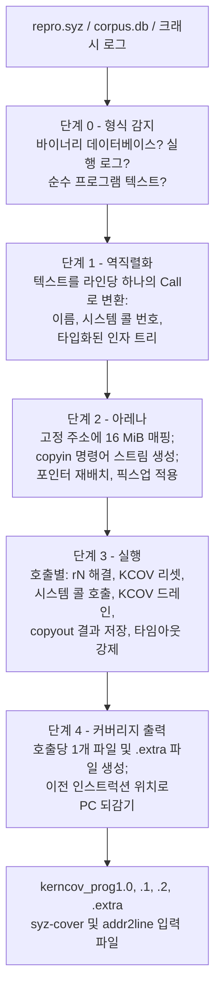

이 5단계 중 두 단계가 전체 설계를 지탱하고 있으며, 가볍게 읽는 독자가 가장 놓치기 쉬운 부분이기도 합니다. 아래에서 자세히 다루겠지만, 핵심 요점은 다음과 같습니다:

**아레나(Arena) 덕분에 이 파일 포맷이 재현 가능해집니다.** 재현 프로그램의 모든 포인터는 고정된 텍스트 기준 주소(textual base)로부터의 오프셋으로 기록됩니다. 단 하나의 메모리 영역을 미리 알려진 단일 주소에 매핑하고 그 안에 인자를 배치하면, *인터프리터가 포인터가 가리키는 타입을 이해하지 못하더라도* 텍스트 형태의 포인터가 실제 유효한 메모리 주소로 변환됩니다. 이것이 바로 바닥부터 재구현할 때 설계를 실현 가능하게 만드는 핵심 기법입니다. 복잡한 타입 시스템 대신 메모리 레이아웃 엔진만 있으면 되기 때문입니다.

**커버리지는 프로그램 단위가 아니라 시스템 콜 단위로 드레인(수집)됩니다.** 각 시스템 콜 직전에 KCOV를 리셋하고 직후에 드레인함으로써 "3번 호출이 이 라인들에 도달했다"고 명확히 보고할 수 있습니다. 이러한 전후 감싸기(bracketing)가 없다면 전체 합집합만 보고할 수 있으며, 합집합으로는 실제로 필요한 질문에 답할 수 없습니다.

---

## 2. 핵심 메커니즘: 파일에서 호출별 커버리지까지

### 2.1 단계 0 — 이 파일은 어떤 형식인가?

`syz-execprog`는 세 가지 형태의 입력을 받아들이며, 확장자나 매직 바이트가 아닌 실제 파싱 시도를 통해 형식을 판별합니다:

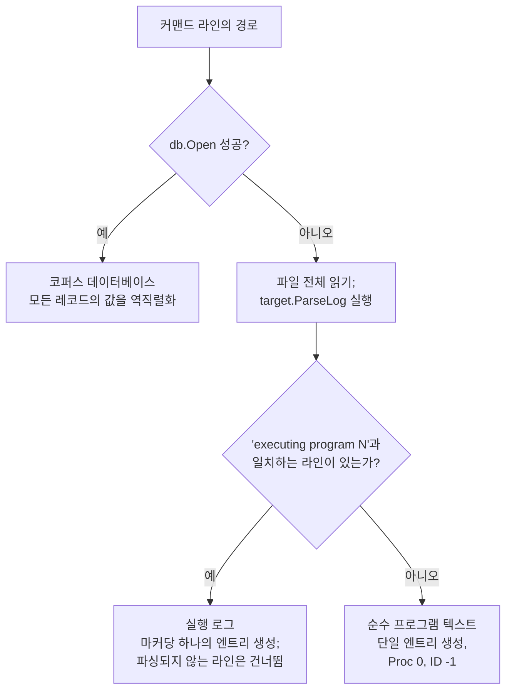

구현 의도는 세 줄의 코드로 요약됩니다:

```go
for _, fn := range files {
    if corpus, err := db.Open(fn, false); err == nil {
        // 바이너리 키-값 데이터베이스: 모든 레코드를 역직렬화
        continue
    }
    data, _ := os.ReadFile(fn)
    for _, entry := range target.ParseLog(data, mode) { ... }
}
```

#### `ParseLog`가 보기보다 훨씬 흥미로운 이유

`prog/parse.go`에는 "로그 파일"을 위한 엄격한 문법(grammar)이 없습니다. 대신 **복구 루프(recovery loop)**를 사용합니다:

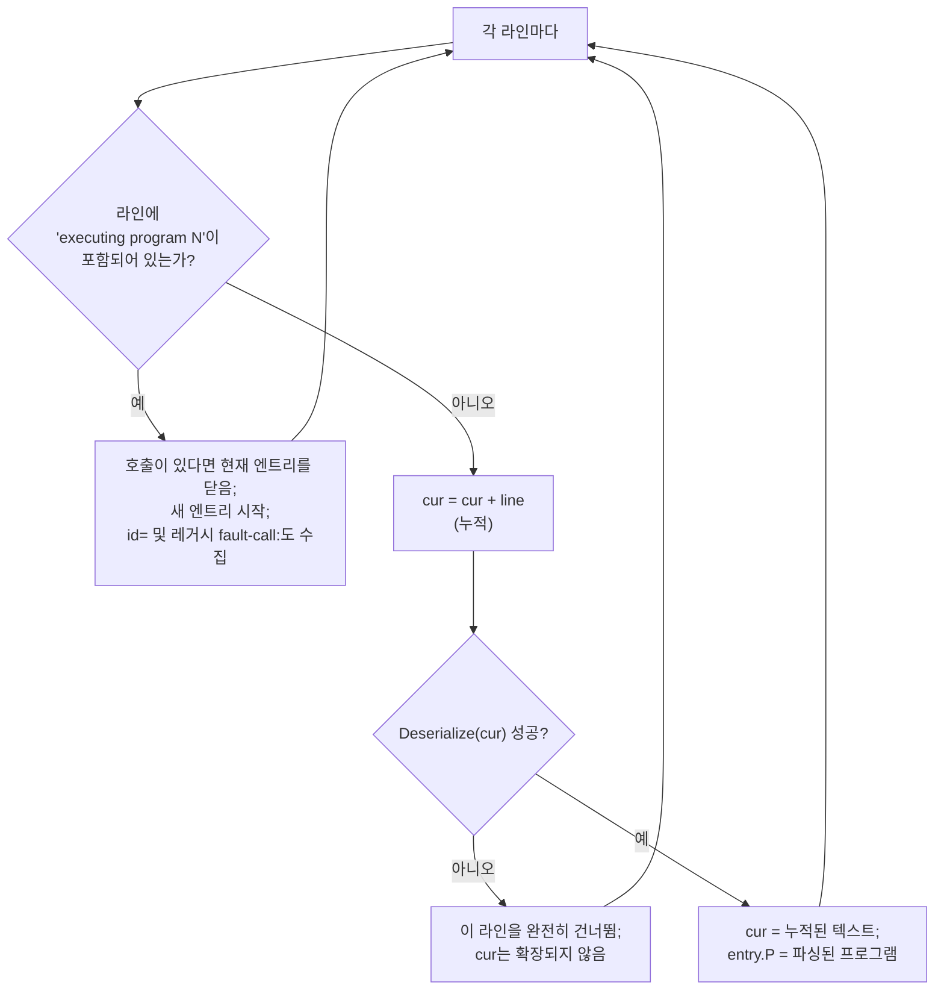

새로운 라인이 추가될 때마다 누적된 전체 버퍼를 다시 파싱하고, 정상 파싱되는 가장 긴 접두사(longest prefix)를 유지합니다. 파싱되지 않는 라인은 조용히 무시되며 누적 버퍼를 **오염시키지 않습니다**.

이 단순한 설계 덕분에 크래시 로그를 수정 없이 직접 실행할 수 있습니다. 실제 로그는 다음과 같은 형태를 띱니다:

```
executing program 2:
r0 = openat$ptmx(0xffffffffffffff9c, &(0x7f0000000000)='/dev/ptmx\x00', 0x2, 0x0)
[  412.881004] ------------[ cut here ]------------
ioctl$TIOCSPTLCK(r0, 0x40045431, &(0x7f0000000040)=0x0)
[  412.883102] BUG: KASAN: use-after-free in foo_release+0x1a/0x80
```

커널의 oops 메시지가 프로그램 텍스트 중간에 임의로 끼어들어 있습니다. 구분 기호도 없고, 이스케이프도 없으며, 다른 CPU의 `printk`에 의해 라인이 중간에 잘리지 않는다는 보장도 없습니다. 엄격한 파서는 이런 파일을 거부합니다. 반면 누적 후 재시도(accumulate-and-retry) 파서는 노이즈를 무시하고 두 시스템 콜 호출을 성공적으로 추출해냅니다.

그리고 `executing program` 마커가 없는 파일은 단순히 단일 엔트리로 처리되므로, 순수 프로그램 텍스트 파일도 동일한 코드 경로로 처리됩니다. 세 번째 별도 파서는 존재하지 않습니다.

> **차용할 만한 패턴:** 제어할 수 없는 콘텐츠와 섞여 있는 출력을 파싱할 때는 잘 구성된 스트림을 요구하기보다 파서를 *감산형(subtractive)*으로 만드십시오. 즉, 누적하고, 시도하고, 실패한 것은 버리는 방식입니다. 단 열 줄 남짓의 코드로 임의의 노이즈에 대한 뛰어난 내구성을 확보할 수 있습니다.

#### 주의해야 할 한 가지 함정

`ParseLog`는 파싱할 수 없는 라인을 조용히 건너뛰며, 여기에는 오타나 알 수 없는 시스템 콜이 포함되어 프로그램 텍스트로 *의도되었으나* 파싱에 실패한 라인도 포함됩니다. 파싱 실패로 인해 호출이 누락된 재현 프로그램은 버그를 재현하지 못할 것이며, 어떤 경고도 호출이 누락되었음을 직접 알려주지 않습니다. 따라서 항상 호출 수를 확인해야 합니다:

```
[execprog] 3 calls, arena at 0x200000000000
```

시작 시점에 파싱된 호출 수를 출력하도록 하면 조용한 누락이 발생했을 때 입력한 파일과의 불일치가 즉각 드러납니다. 파일에는 5개의 호출이 있는데 도구가 3개라고 표시한다면, 어떤 결론을 내리기 전에 멈추고 원인을 파악해야 합니다.

### 2.2 단계 1 — 역직렬화 (Deserialise)

하나의 프로그램은 네 가지 표현 형태로 존재하며, 현재 어떤 형태를 다루고 있는지 파악하면 대부분의 혼란을 방지할 수 있습니다:

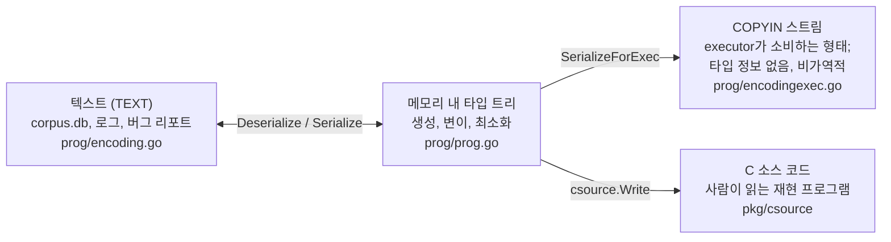

단계 1은 좌측 화살표에 해당하고, 단계 2는 가운데 화살표에 해당합니다. 우측 화살표는 `prog2c`입니다.

텍스트 형태는 완벽한 왕복 변환(round-trippable)만을 목적으로 설계된 줄 단위 언어입니다:

```
r0 = openat$ptmx(0xffffffffffffff9c, &(0x7f0000000000)='/dev/ptmx\x00', 0x2, 0x0)
ioctl$TIOCSPTLCK(r0, 0x40045431, &(0x7f0000000040)=0x0) (fail_nth: 2)
write$binfmt_elf64(r0, &(0x7f0000000100)=ANY=[@ANYBLOB="7f454c46"], 0x4) (async)
```

| 문법 | 의미 |
|---|---|
| `r0 = ` | 이 호출의 반환값을 리소스 슬롯 `r0`에 캡처 |
| `openat$ptmx` | 시스템 콜 `openat`, 디스크립션 변형 `$ptmx` — 시스템 콜 번호와 타입화된 시그니처로 해석됨 |
| `0xffffffffffffff9c` | 일반 정수 인자 (여기서는 `AT_FDCWD`) |
| `&(0x7f0000000000)` | 포인터, *텍스트 기준 주소 + 오프셋*으로 표기됨 |
| `='/dev/ptmx\x00'` | 해당 오프셋에 배치할 바이트 데이터 |
| `=ANY=[@ANYBLOB="..."]` | 스쿼시된(squashed) 인자 — 본래 타입화된 구조체가 위치해야 할 자리에 들어간 원시 바이트 |
| 인자로 사용된 `r0` | 리소스 슬롯 `r0`의 값을 읽어옴 |
| `(fail_nth: 2)` | 호출 속성: 이 호출 내부의 2번째 메모리 할당 시점에 오류 주입 |
| `(async)` | 호출 속성: 다음 호출을 시작하기 전에 이 호출의 완료를 기다리지 않음 |

역직렬화(deserialization)는 라인당 하나의 `Call`을 생성하며, 각 `Call`은 **타입화된 인자 트리(typed argument tree)**를 가집니다:

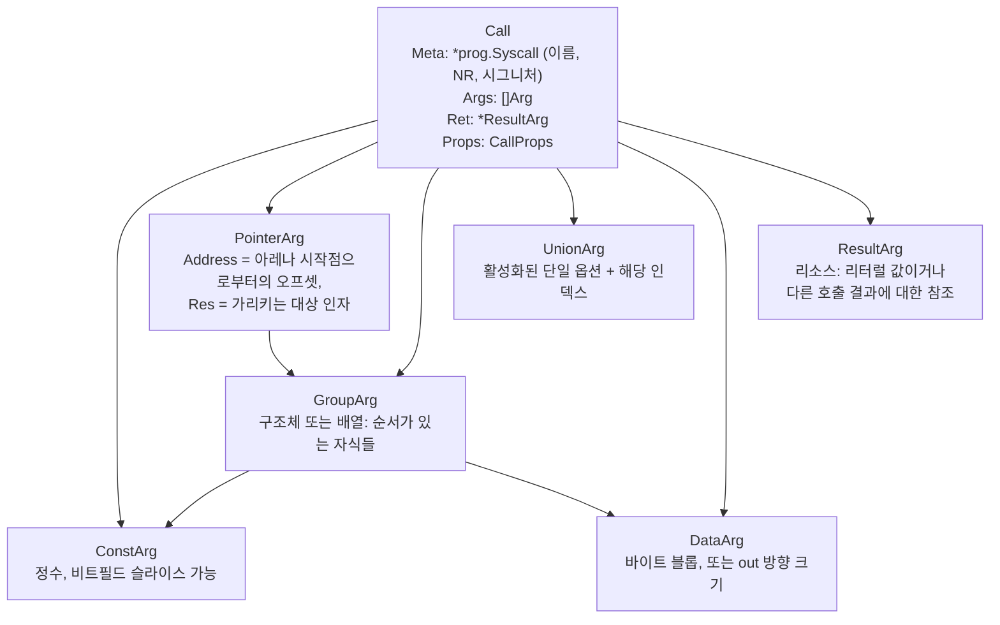

이들 중 세 가지는 재현 메커니즘에서 유독 중요한 역할을 합니다:

**`PointerArg.Address`는 절대 주소가 아니라 상대 오프셋입니다.** 이는 포맷 전체에서 가장 중요한 표현 방식의 결정이며, 텍스트 상에서 절대 주소처럼 보이는 숫자 때문에 쉽게 간과되곤 합니다. `prog/encoding.go`를 보면:

```go
const encodingAddrBase = 0x7f0000000000

func (target *Target) serializeAddr(arg *PointerArg) string {
    // ... 0x<encodingAddrBase + arg.Address> 형태로 출력
}

func (p *parser) parseAddr() (uint64, uint64, error) {
    // ... addr -= encodingAddrBase 수행
}
```

직렬화 시에는 `0x7f0000000000`을 더하고, 파싱 시에는 이를 뺍니다. 따라서 `&(0x7f0000000040)`은 **"데이터 영역 시작점으로부터 오프셋 0x40"**을 의미하며, `0x7f0000000000`은 런타임 의미가 전혀 없는 *표기상의 관례*에 불과합니다. 실제 매핑 주소는 아키텍처별로 독립적으로 결정됩니다(다음 절 참조). 이러한 분리 덕분에 동일한 재현 프로그램 텍스트를 아레나 매핑 주소가 서로 다른 amd64, arm64, 32비트 타깃 모두에서 그대로 실행할 수 있습니다.

**`ResultArg`는 정적 값이 아니라 데이터 흐름 엣지(dataflow edge)입니다.** `r0`은 "숫자 3"이 아닙니다. "첫 번째 호출이 반환한 값"을 의미합니다. 직렬화 시 각 반환값 캡처 호출에는 **copyout 인덱스**가 할당되고, `r0`을 사용하는 모든 곳은 해당 인덱스에 대한 참조로 변환됩니다. 인터프리터는 결과 테이블(result table)을 유지합니다. 이것이 바로 `openat`이 우연히 fd 3 대신 fd 7을 반환하는 환경에서도 재현 프로그램이 정상 동작하는 이유입니다.

**호출 속성은 프로그램 단위가 아니라 개별 호출 단위로 적용됩니다.** `fail_nth`, `async`, `rerun`은 개별 호출과 함께 전달됩니다. "2번 호출 내부의 3번째 kmalloc을 실패시키고, 4번 호출은 기다리지 않고 비동기로 실행한다"는 요구사항을 가진 재현 프로그램은 이를 인라인으로 표현합니다. 이러한 속성을 무시하는 재현 도구는 겉보기 문법만 동일하고 의미는 완전히 다른 프로그램을 실행하게 되어 버그 재현에 실패하게 됩니다. 속성은 파싱하기는 간단하지만 빠뜨리기 쉬우며, "재현 프로그램이 내 도구에서는 동작하지 않는다"는 문제의 흔한 원인이 됩니다.

### 2.3 단계 2 — 아레나 (The Arena)

이 단계는 다른 모든 단계를 가능하게 만드는 기반이므로 가장 자세히 살펴봅니다.

#### 해결해야 할 문제

재현 프로그램에 "이 64바이트 구조체에 대한 포인터를 전달하라"는 지시가 포함되어 있다고 가정해 보겠습니다. 이 지시가 유효하려면 해당 64바이트가 실제로 메모리에 존재해야 하고, 알려진 주소에 있어야 하며, 원래 실행되었을 때와 정확히 동일한 레이아웃으로 배치되어야 합니다. 버그는 단순히 내용물뿐만 아니라 데이터들이 서로 상대적으로 *어디에* 위치하는지에 따라 달라질 수 있기 때문입니다. 또한 해당 구조체 내부의 중첩된 포인터들은 실제로 존재하는 또 다른 메모리 영역을 가리켜야 합니다.

#### 해결책: 단일 고정 매핑과 전체 오프셋 방식

고정된 주소에 단일 메모리 영역을 매핑하고, 모든 포인터를 이 영역 내부의 오프셋으로 표현합니다.

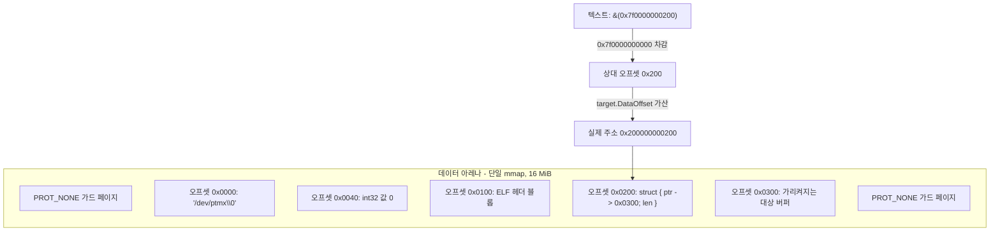

소스 코드에서 검증된 수치들:

| 속성 | 값 | 위치 |
|---|---|---|
| 텍스트 기준 주소 | `0x7f0000000000` | `prog/encoding.go`, `encodingAddrBase` |
| 실제 기준 주소 (64비트 비-ARM) | `0x200000000000` | `sys/targets/targets.go`, `defaultDataOffset()` |
| 실제 기준 주소 (ARM / ARM64) | `0x20000000` | 동일 파일 |
| 실제 기준 주소 (32비트) | `0x80000000` | 동일 파일 |
| 아레나 크기 | **16 MiB** | `target.NumPages = (16 << 20) / target.PageSize` |
| executor에 노출되는 매크로 | `SYZ_DATA_OFFSET`, `SYZ_NUM_PAGES`, `SYZ_PAGE_SIZE` | 자동 생성된 `executor/defs.h` |

소스 코드에서 `0x200000000000` 옆에 달린 주석은 이 수치를 임의로 정한 것이 아니라 실제 제약 조건들을 반영한 것임을 잘 설명해 줍니다:

> ASAN의 64비트 HighMem 영역에 속하는 주소입니다. `0x200000000000`은 arm64와 amd64 모두에서 작동합니다. [...] 실제 퍼징 중에는 ASAN을 켜고 빌드하지 않으므로 `malloc()`으로 할당된 영역과 충분히 멀리 떨어져 있기만 하다면 주소 자체가 크게 중요하지는 않습니다. 또 다른 제약 사항으로 Starnix에서는 사용 가능한 메모리 공간이 `0x400000000000`에서 끝납니다.

즉, 힙과 멀리 떨어져 있고, executor를 ASAN으로 빌드해도 충돌하지 않는 섀도우 메모리 호환 범위 내에 있으며, 플랫폼별 상한선보다 아래에 위치해야 한다는 조건들을 만족합니다. ARM의 경우 사용 가능한 주소 공간이 더 좁기 때문에 다른 값이 할당됩니다.

#### 실제 매핑 코드

```c
os_init(argc, argv, (char*)SYZ_DATA_OFFSET, SYZ_NUM_PAGES * SYZ_PAGE_SIZE);
```

그리고 Linux 구현부(`executor/executor_linux.h`):

```c
// Surround the main data mapping with PROT_NONE pages to make virtual address layout more consistent
// across different configurations (static/non-static build) and C repros.
// One observed case before: executor had a mapping above the data mapping (output region),
// while C repros did not have that mapping above, as the result in one case VMA had next link,
// while in the other it didn't and it caused a bug to not reproduce with the C repro.
mmap(data - SYZ_PAGE_SIZE, SYZ_PAGE_SIZE, PROT_NONE, MAP_ANON|MAP_PRIVATE|MAP_FIXED_EXCLUSIVE, -1, 0);
mmap(data, data_size, PROT_READ|PROT_WRITE|PROT_EXEC, MAP_ANON|MAP_PRIVATE|MAP_FIXED_EXCLUSIVE, -1, 0);
mmap(data + data_size, SYZ_PAGE_SIZE, PROT_NONE, MAP_ANON|MAP_PRIVATE|MAP_FIXED_EXCLUSIVE, -1, 0);
```

네 가지 세부 사항 모두 시스템을 지탱하는 핵심입니다:

1. **`MAP_FIXED`가 아닌 `MAP_FIXED_EXCLUSIVE` 사용.** Linux에서 이는 `MAP_FIXED_NOREPLACE`로 확장됩니다. 일반 `MAP_FIXED`는 기존에 해당 영역에 있던 매핑(잠재적으로 executor 코드 자체의 일부 포함)을 *조용히 언매핑*해 버립니다. 반면 배타적 플래그는 충돌 시 명확한 에러를 반환하며, 코드는 반환된 주소를 확인하여 불일치 시 `failmsg`를 호출합니다. 조용히 다른 메모리를 덮어쓰는 고정 매핑은 디버깅의 악몽이지만, 실패 시 거부하는 매핑은 명확한 에러를 보여줍니다.

2. **`PROT_EXEC` 권한.** 일부 프로그램은 아레나에 기계어 코드를 작성하고 그곳으로 점프합니다(`syz_execute_func`). 따라서 아레나는 쓰기 가능함과 동시에 실행 가능해야 합니다.

3. **두 개의 `PROT_NONE` 가드 페이지.** 주석에는 실제 겪었던 버그 사례가 기록되어 있습니다: executor에서는 재현되던 버그가 C 재현 프로그램에서는 재현되지 않았는데, 원인은 executor의 경우 아레나 바로 위에 다른 매핑(출력 영역)이 존재했던 반면 C 프로그램에는 그것이 없어 커널 내부 VMA 연결 리스트의 next 링크 구조가 달라졌고, 이로 인해 버그 동작이 달라졌던 것입니다. 가드 페이지로 주변 환경을 명시적으로 고정함으로써 두 환경의 가상 메모리 레이아웃을 동일하게 맞춥니다. 이것이 바로 "재현성"을 위해 요구되는 엄격한 환경 제어의 수준입니다.

4. **아레나는 재생성되지 않고 재사용됨.** 아레나는 executor 프로세스당 한 번만 매핑되며 프로그램 실행마다 그 위에 덮어씁니다. 이는 이전 프로그램에서 남은 바이트가 덮어써지지 않는 한 그대로 남아있음을 의미하며, 재현 프로그램이 레이아웃을 명시적으로 지정해야 하는 또 다른 이유이기도 합니다.

#### 데이터 배치: copyin 명령어 스트림

이 부분에서 업스트림 syzkaller는 직관적인 구현 방식과 큰 차이를 보이며, 그 차이는 시사하는 바가 큽니다.

가장 단순한 접근법은 인터프리터에서 2패스를 수행하는 것입니다. 인자 트리를 순회하며 오프셋을 할당하고, 다시 순회하며 바이트를 쓰는 방식입니다. syzkaller는 대신 프로세스 경계를 넘어 작업을 분할합니다:

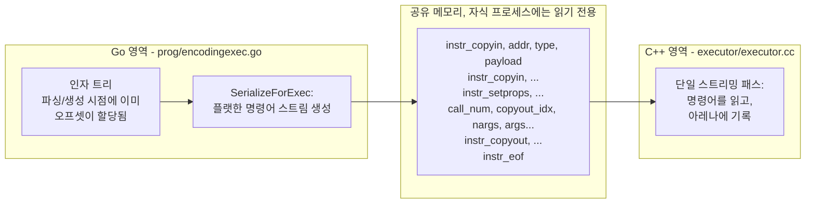

오프셋은 실행 시점의 별도 레이아웃 패스를 통해 할당되지 않습니다. `PointerArg`는 파싱되거나 생성된 순간부터 이미 `Address`를 가지고 있습니다. 프로세스 경계를 넘어 전달되는 것은 **스택이 없는 초소형 인터프리터를 위한 프로그램**이며, C++ 쪽은 `switch` 문이 포함된 단 하나의 `for(;;)` 루프로 구성됩니다.

명령어 집합은 매우 작습니다. `executor/executor.cc`를 보면:

```c
read_input(&input_pos);              // 총 호출 수
for (;;) {
    uint64 call_num = read_input(&input_pos);
    if (call_num == instr_eof) break;
    if (call_num == instr_copyin) {
        char* addr = (char*)(read_input(&input_pos) + SYZ_DATA_OFFSET);
        uint64 typ = read_input(&input_pos);
        switch (typ) { ... }
    }
    ...
}
```

copyin 핸들러의 첫 줄인 **`read_input() + SYZ_DATA_OFFSET`**에 주목하십시오. 이 덧셈 하나가 전체 재배치(relocation) 메커니즘의 전부입니다. 스트림 내의 모든 주소는 상대 주소이며, executor는 현재 아키텍처의 아레나 기준 주소를 더해 재배치합니다.

이 루프에는 눈여겨볼 만한 인코딩 트릭이 있습니다. 명령어들이 음수 센티널(sentinel) 값으로 인코딩되어 *시스템 콜 번호* 슬롯을 공유하므로 인터프리터에 별도의 태그 바이트가 필요하지 않습니다:

| 센티널 | 값 | 의미 |
|---|---:|---|
| `instr_eof` | −1 | 프로그램의 끝 |
| `instr_copyin` | −2 | 아레나에 값 쓰기 |
| `instr_copyout` | −3 | 결과 슬롯으로 값을 읽어내기 |
| `instr_setprops` | −4 | 다음 호출에 대한 호출 속성 설정 |
| *그 외의 값* | ≥ 0 | 실제 시스템 콜 번호 — 이를 실행함 |

6가지 인자 종류와 executor가 각각 처리해야 하는 작업:

| 종류 | 페이로드 | executor가 수행하는 작업 |
|---|---|---|
| `arg_const` | value, size, `bf`, `bf_off`, `bf_len` | `copyin(addr, val, size, bf, bf_off, bf_len)` — 일반 저장 또는 **비트필드를 위한 read-modify-write** 수행 (빅/리틀 엔디안 비트필드 순서 준수) |
| `arg_addr32` / `arg_addr64` | 상대 오프셋 | `*(uint32*|uint64*)addr = offset + SYZ_DATA_OFFSET` — **중첩된 포인터 재배치**, 32비트 또는 64비트 크기 |
| `arg_result` | 메타 정보 (크기, 비트필드), 결과 참조 | `read_result()`로 캡처된 반환값을 조회한 후 `copyin` 수행 — `rN`이 인자 슬롯뿐 아니라 구조체 *내부*까지 전달되는 방식 |
| `arg_data` | 길이 + 인라인 바이트 | `memcpy(addr, input_pos, size)`, 입력 버퍼 경계 검사 포함 (`fail("data arg overflow")`) |
| `arg_csum` | 크기, 종류, 청크 리스트 | 청크 리스트에 대해 **인터넷 체크섬(internet checksum)**을 계산하여 저장 |
| *(명령어)* `instr_setprops` | 호출별 속성 | 다음 호출에 대해 `fail_nth` / `async` / `rerun` 설정 |

체크섬 처리는 사전 계산이 불가능한 항목이므로 더 자세히 살펴볼 필요가 있습니다:

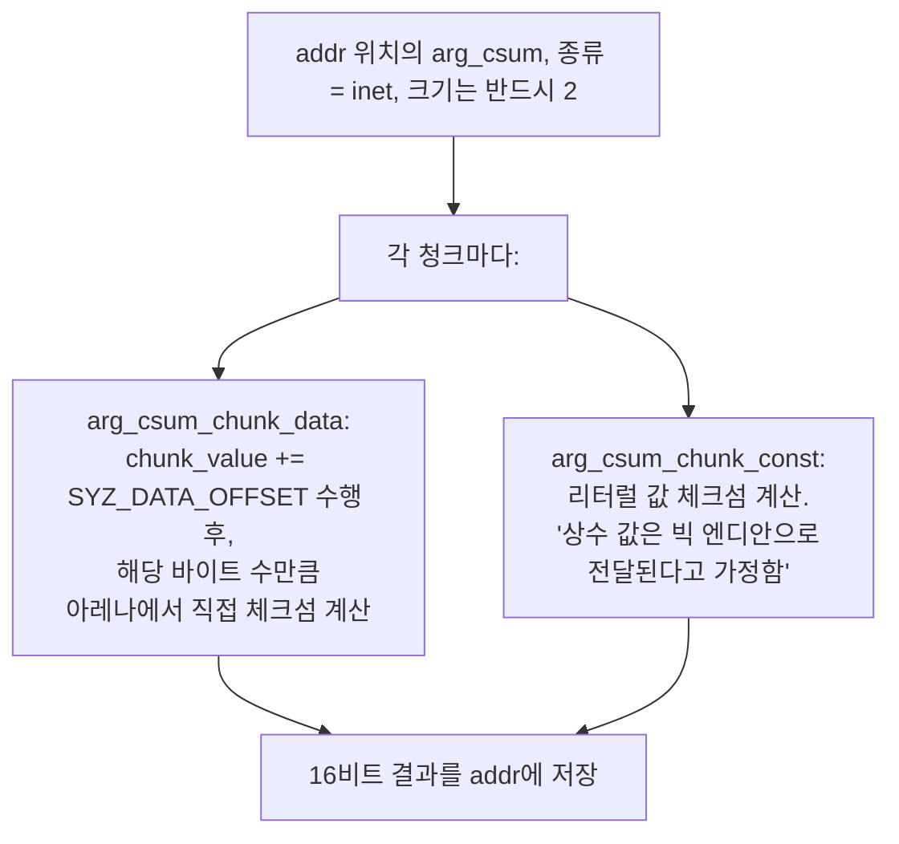

네트워크 패킷의 체크섬은 재배치된 포인터나 `rN`에서 해결된 값을 포함하는 바이트들을 대상으로 계산되므로, 다른 모든 값이 제자리에 배치된 *후*에, *대상 타깃의 주소 공간 내부*에서만 계산될 수 있습니다. 그렇기 때문에 늦은 시점에 실행되어 아레나 메모리를 다시 읽어 들이는 전용 명령어가 존재하는 것입니다. 체크섬 계산을 건너뛰는 도구는 커널의 첫 번째 유효성 검사 단계에서 버그 유발 패킷이 드롭되게 만들며, 그 결과 프로그램은 아무런 에러 없이 실행되지만 버그는 전혀 재현되지 않습니다.

#### 기타 픽스업들과 처리 위치

모든 "픽스업(fixup)"이 아레나 패스에서 일어나는 것은 아닙니다. 무엇이 어디서 처리되는지 구분하면 구현 및 디버깅 시간을 크게 절약할 수 있습니다:

| 픽스업 항목 | 처리 위치 | 비고 |
|---|---|---|
| 비트필드 삽입 | 아레나 패스, `copyin` 내부 | 주변 바이트가 필요하므로 read-modify-write 방식 사용 |
| 중첩 포인터 재배치 | 아레나 패스, `arg_addr32/64` | 스트림에 기준 주소가 필요한 유일한 이유 |
| 인터넷 체크섬 | 아레나 패스, `arg_csum`, 후반부 | 최종 완성된 바이트들을 다시 읽어야 함 |
| `len` / `bytesize` / `bitsize` 필드 | **Go 영역**, `assignSizesCall` | 직렬화 전에 계산됨. 바이트가 기록되는 시점에는 이미 단순 상수로 변환되어 있음 |
| `AUTO` 값 및 주소 | **Go 영역**, 역직렬화 시점 | 파싱 과정에서 구체적인 값/오프셋으로 해결됨. executor는 `AUTO`를 보지 못함 |
| 압축된 디스크 이미지 (zlib) | **의사 시스템 콜 내부** | `syz_mount_image` 실행 시점에 `puff_zlib_to_file` 호출. 아레나는 *압축된* 바이트를 보유함 |

마지막 행은 특히 주의해야 할 함정입니다. 2MB 크기의 파일 시스템 이미지는 재현 프로그램 내에 압축된 블롭 형태로 나타납니다. 아레나는 이를 압축된 상태로 보관하며, 압축 해제는 executor 내부에서 `syz_mount_image`가 실행될 때 발생합니다. 성급하게 먼저 압축을 풀어버리는 재현 도구는 16 MiB 크기의 아레나를 초과해 버릴 것이며, 압축을 전혀 풀지 않는 도구는 쓰레기 데이터를 마운트하게 됩니다.

> **차용할 만한 패턴:** 재배치를 한 곳에 모으고 단일 산술 연산으로 단순화하십시오. syzkaller의 포인터 픽스업 전체 원리는 "스트림은 상대 오프셋이며, 읽을 때 기준 주소를 더한다"가 전부입니다. 중첩 구조, 체크섬, 비트필드 등 다른 모든 요소는 이 위에 합성되며, 덕분에 포맷 자체는 서로 다른 주소 공간을 가진 아키텍처 간에도 아무런 추가 비용 없이 완벽한 이식성을 유지합니다.


---

### 2.4 단계 3 — 실행 (Execute)

호출별로 순서대로 실행됩니다:

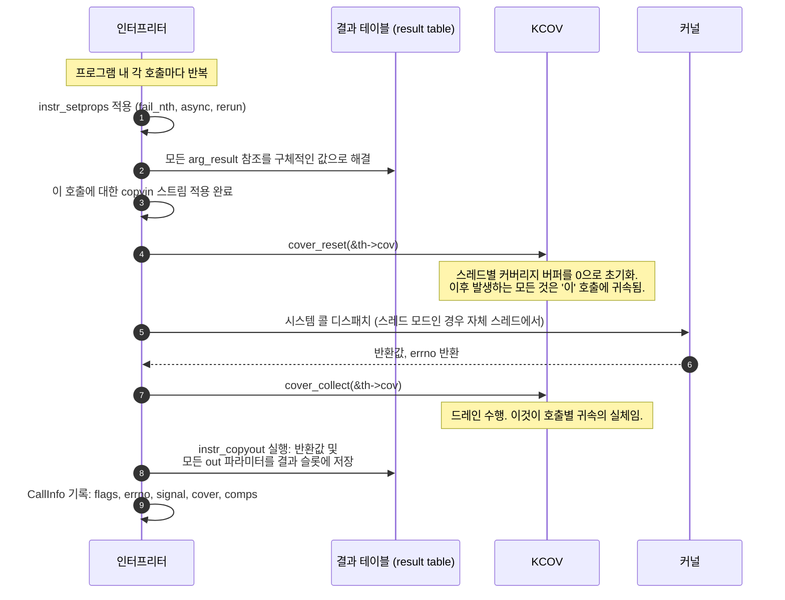

#### 리셋/드레인 감싸기(Bracket)가 승부처인 이유

KCOV는 리셋하기 전까지 PC 값을 계속 누적하는 스레드별 단일 버퍼입니다. 따라서 귀속(attribution)은 전적으로 *언제 리셋하고 언제 읽는가*의 문제입니다:

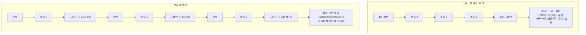

소스 코드에서 `cover_reset(&th->cov)`는 스레드 실행 경로에서 시스템 콜 디스패치 바로 직전에 위치하며, `cover_collect(&th->cov)`는 완료 직후에 위치합니다. 둘 다 `cover_collection_required()`로 보호되어 있어 커버리지 수집이 필요 없는 실행에서는 아무런 오버헤드도 발생하지 않습니다.

코드에서 언급하는 한 가지 미묘한 점이 있습니다. 스레드가 이전(블로킹된) 시스템 콜로 인해 여전히 바쁜 상태라면 다음 시스템 콜을 수신하지 못하며, 따라서 자체적인 `cover_reset`을 수행하지 않습니다. 이것이 스레드 모드와 커버리지 귀속이 상호작용하는 이유 중 하나이며, 전역 단일 버퍼 대신 각 스레드가 독립된 `cov` 객체를 갖는 이유입니다.

#### `extra` 커버리지: 누구에게도 속하지 않는 비동기 작업

시스템 콜에 의해 트리거된 커널 실행 중 일부는 워크큐 작업, 타이머, RCU 콜백, 방금 전송한 패킷의 소프트 인터럽트(softirq) 처리 등과 같이 *나중에*, 다른 스레드에서 수행됩니다. 이러한 작업이 실행될 때쯤이면 원래의 시스템 콜은 이미 반환되었고 해당 호출의 커버리지 버퍼는 드레인된 후입니다.

syzkaller는 개별 호출과 무관하게 독립적으로 수집되어 "extra"로 보고되는 두 번째 커버리지 객체인 `extra_cov`를 통해 이를 처리합니다. 소스 코드의 게이팅 조건은 `flag_extra_coverage && !flag_comparisons`입니다. 비교 데이터(comparison data)는 이미 호출별로 수집되고 크기가 훨씬 크기 때문에 extra 커버리지는 비교 수집과 양립할 수 없습니다.

출력 결과에서 호출별 파일 외에 `.extra` 파일이 함께 생성되는 이유가 바로 여기에 있습니다. 특정 호출로 귀속시킬 수 없는 커버리지를 조용히 버리거나 우연히 실행 중이던 호출에 잘못 귀속시키는 대신, 솔직하게 별도로 보고합니다. 잘못된 정보를 확신에 차서 보고하는 것보다 출처 미상의 데이터를 정직하게 분리하는 것이 훨씬 낫습니다.

#### 타임아웃 계층 (Timeout Tiers)

`sys/targets/targets.go`에서 도출되는 세 가지 중첩된 예산:

| 계층 | 기본값 | 스케일링 | 목적 |
|---|---|---|---|
| **시스템 콜 (Syscall)** | 50 ms | `× slowdown` | 단일 호출이 너무 오래 차단됨; `blocked`/`unfinished`로 표시하고 계속 진행 |
| **프로그램 (Program)** | 5 s | `× Scale` | 프로그램 전체가 멈춤; 포기하고 `hanged` 보고 |
| **무출력 (No output)** | 5 min | `× Scale` | *대상 머신*에서 아무런 출력이 없음; 커널이 정지(dead)된 것으로 간주 |

여기서 `Scale = min(slowdown, 3)`이며, 두 개의 파생 값이 존재합니다: `VMRunningTime` = 1시간 × Scale (계획된 재시작 전까지 단일 VM이 퍼징을 수행하는 시간), 그리고 `NoOutputRunningTime` = NoOutput + 1분.

`slowdown` 인자가 바로 `-slowdown N` 플래그가 존재하는 이유입니다. QEMU TCG 에뮬레이션이나 무거운 계측 도구(KASAN + KCSAN + lockdep) 환경에서는 커널이 10배 이상 느려질 수 있습니다. 스케일링이 없다면 모든 호출이 50ms 시스템 콜 타임아웃에 걸려 모든 프로그램이 멈춘 것처럼 보일 것입니다. 단, 시스템 콜 타임아웃은 선형적으로 스케일링되는 반면 `Scale`은 최대 3으로 제한된다는 점에 유의해야 합니다. 이는 의도된 비대칭성입니다. 개별 호출에는 비례해서 더 많은 시간을 허용하되, 10배 감속으로 인해 5분짜리 무출력 대기 시간이 50분으로 늘어나 죽은 머신을 마냥 기다리는 사태는 방지하기 위함입니다.

시스템 콜 및 프로그램 타임아웃은 핸드셰이크 과정에서 `slowdown`과 함께 `syscall_timeout_ms` 및 `program_timeout_ms`로 executor에 전달됩니다. 호스트 측의 타임아웃으로는 커널 내부에서 블로킹된 시스템 콜을 중단시킬 수 없기 때문에 executor가 로컬에서 이를 직접 강제합니다.

#### 스레드 모드 vs 순차 실행 모드

| | `-threaded=1` (기본값) | `-threaded=0` |
|---|---|---|
| 각 호출이 실행되는 위치 | 자체 스레드 | 메인 스레드, 순차 실행 |
| 블로킹 호출 발생 시 | 차단된 채로 두고 다음 실행 계속 | 모든 실행이 중단(stall)됨 |
| 출력 순서 | 인터리빙(뒤섞임) | 엄격한 위에서 아래 순서 |
| 적합한 용도 | 실제 동작 재현, `async`가 포함된 모든 경우 | **디스크립션 디버깅** |

`-threaded=0`은 *사람이 출력을 읽기에* 적합한 기본값이므로 공식 디버깅 가이드 문서에서 이를 권장합니다. 하지만 블로킹 호출이 영원히 반환되지 않는 것에 의존하거나 `(async)`를 사용하는 재현 프로그램은 스레딩 없이는 재현되지 않습니다. syzbot 재현 프로그램이 `-threaded=0`에서 실패한다면 결론을 내리기 전에 기본값인 스레드 모드로 다시 시도해 보십시오.

### 2.5 단계 4 — 커버리지 출력 (Coverage output)

`-coverfile=kerncov` 옵션을 주면 실행된 각 프로그램마다 호출당 1개 파일과 extra 커버리지 파일 1개가 기록됩니다:

```
kerncov_prog1.0        <- 0번 호출
kerncov_prog1.1        <- 1번 호출
kerncov_prog1.2        <- 2번 호출
kerncov_prog1.extra    <- 백그라운드/지연 작업
kerncov_prog2.0        <- 두 번째 프로그램, 또는 2회차 반복 실행
...
```

이 명명 규칙은 `dumpCoverage`에서 비롯됩니다:

```go
coverFile := fmt.Sprintf("%s_prog%v", ctx.coverFile, ctx.resultIndex.Add(1))
for i, inf := range info.Calls {
    ctx.dumpCallCoverage(fmt.Sprintf("%v.%v", coverFile, i), inf)
}
if info.Extra != nil {
    ctx.dumpCallCoverage(fmt.Sprintf("%v.extra", coverFile), info.Extra)
}
```

프로그램 인덱스는 단조 증가하는 카운터이므로, 단일 프로그램에 대해 `-repeat=3`을 지정하면 `_prog1`, `_prog2`, `_prog3`이 생성됩니다. 각 반복 회차의 커버리지가 개별적으로 귀속되므로 커버리지가 불안정한 호출을 쉽게 찾아낼 수 있습니다.

각 파일은 라인당 하나의 16진수 PC 값을 포함합니다. 그리고 출력 과정에서 절대 건너뛰어서는 안 되는 중요한 변환이 적용됩니다:

```go
for _, pc := range info.Cover {
    prev := backend.PreviousInstructionPC(sysTarget, "", pc)
    fmt.Fprintf(buf, "0x%x\n", prev)
}
```

#### PC를 되감는 이유

KCOV는 계측된 호출 **이후**의 주소, 즉 호출 지점(call site)이 아닌 반환 주소를 보고합니다. 이 주소를 그대로 `addr2line`에 전달하면 *다음* 소스 코드 라인이나 다음 문의 첫 번째 라인, 또는 (기본 블록 경계인 경우) 완전히 엉뚱한 라인이 반환됩니다.

`PreviousInstructionPC`는 명령어 길이 하나만큼을 차감합니다:

| 아키텍처 | 차감 바이트 수 |
|---|---|
| amd64, 386 | 5 |
| arm64, arm, ppc64le, riscv64, loong64 | 4 |
| s390x | 6 |
| mips64le | 8 |
| gVisor | 0 — *"gVisor coverage returns real PCs that don't need adjustment"* |

고정 길이 명령어 집합(ISA)에서는 이것이 정확히 들어맞습니다. x86의 경우 계측기가 삽입하는 `call rel32`의 길이가 5바이트이므로 계측된 코드에 대해서도 정확하게 일치합니다.

이 계산이 틀리면 모든 결과가 미묘하게 어긋나 실제 라인의 *다음* 라인에 커버리지가 귀속됩니다. 이런 종류의 오류는 출력된 결과가 언뜻 그럴듯해 보이기 때문에 코드 리뷰에서도 쉽게 발견되지 않고 살아남습니다.

> **차용할 만한 패턴:** 측정 도구가 관심 대상으로부터 구조적으로 어긋난 위치를 보고할 때는 소비자가 처리하도록 미루거나 호출 지점마다 분산시키지 말고, **데이터를 출력하는 경계 지점에서** 플랫폼별 테이블을 가진 명명된 함수를 통해 단 한 번 보정하십시오.

#### 통합(Union) 파일에 대한 참고 사항

업스트림 `syz-execprog`는 호출별 파일과 `.extra` 파일**만** 작성하며, 결합된 전체 통합 커버리지 파일은 생성하지 않습니다. 통합 파일이 필요한 경우 각 호출별 파일에 대해 `sort -u`를 실행하면 되며, `syz-cover` 및 대부분의 다운스트림 도구는 단일 PC 목록을 바로 입력받을 수 있으므로 유용하게 활용할 수 있습니다:

```bash
sort -u kerncov_prog1.* > kerncov.log
bin/syz-cover --kernel_src=$KSRC --kernel_obj=$KOBJ kerncov.log
```

호출별 귀속을 위한 개별 파일과 빠른 전체 보고를 위한 통합 파일을 모두 생성하는 것은 합리적인 확장이지만, 통합 파일은 업스트림이 기본 생성하는 것이 아니라 추가적인 작업이라는 점을 인지해야 합니다.

### 2.6 의사 시스템 콜 (Pseudo-syscalls): 재현을 조용히 무너뜨리는 주범

재현 프로그램의 모든 라인이 실제 커널 시스템 콜인 것은 아닙니다. syzkaller는 **의사 시스템 콜(pseudo-syscalls)**을 정의합니다. 이는 커널 내부가 아니라 executor의 C++ 코드에서 구현된 `syz_` 접두사가 붙은 함수들입니다. 업스트림 Linux 디스크립션에는 **46개**가 선언되어 있으며, 아키텍처별 변형을 포함하면 `executor/*.h`에 약 52개의 구현체가 존재합니다.

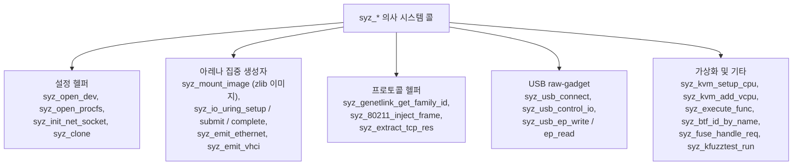

이들이 존재하는 이유는 일부 커널 인터페이스의 경우 단일 시스템 콜과 선언적 인자만으로는 구동할 수 없기 때문입니다. 예를 들어 `syz_mount_image`는 memfd를 생성하고, zlib 이미지를 압축 해제해 넣고, 루프 디바이스를 설정하고, 마운트를 수행해야 합니다. 이는 4개의 시스템 콜과 압축 해제 루틴이 결합된 작업으로, 어떤 디스크립션 언어도 단일 호출 시그니처로 표현할 수 없습니다. 엔진의 관점에서 의사 시스템 콜은 일반 시스템 콜과 완전히 동일합니다. 번호를 부여받고, 자동 생성된 `syscalls[]` 테이블의 엔트리를 가지며, 타입화된 시그니처를 가집니다.

그리고 바로 이 점 때문에 재현 도구를 바닥부터 다시 구현할 때 가장 위험한 부분이 됩니다:

**미구현된 의사 시스템 콜은 대체로 버그를 트리거하는 바로 그 결정적 단계입니다.** `syz_open_dev$foo`는 재현 프로그램이 파일 디스크립터를 얻는 방법입니다. `syz_mount_image`는 손상된 파일 시스템을 제공하는 방법입니다. `syz_usb_connect`는 악의적인 디바이스를 연결하는 방법입니다. 이것들은 부수적인 준비 작업이 아니라 공격 행위 *그 자체*입니다.

따라서 실패 시의 동작 방식이 매우 중요합니다:

| 미구현 의사 시스템 콜 발생 시 동작 | 결과 |
|---|---|
| **0 반환 (성공인 척 위장)** | 최악의 선택. 후속 호출들이 가짜 fd를 받아 엉뚱한 대상을 조작하게 되며, 프로그램은 에러 없이 끝나고 버그는 재현되지 않음. 소중한 오후 시간을 허비하게 됨. |
| **프로그램 즉시 중단(Abort)** | 안전하지만 비효율적: 5개 헬퍼 중 구현되지 않은 1개가 포함되어 있다는 이유로 전체 재현을 포기해야 함. |
| **`ENOSYS` 반환 및 시작 시 경고 출력** | 가장 훌륭한 절충안: 후속 호출들이 `EBADF`로 명확하게 실패하며, 실행 시작 전부터 한계를 인지할 수 있음. |

그렇기 때문에 시작 시점에 이를 안내하는 메시지를 출력할 가치가 있습니다:

```
[execprog] will return ENOSYS: syz_kvm_setup_cpu, syz_80211_inject_frame
[execprog] 3 calls, arena at 0x200000000000
```

단 하나의 시스템 콜이 실행되기도 전에 두 가지 사실이 출력됩니다: *이 실행에서 수행할 수 없는 것*과 *앞으로 수행할 것으로 예상되는 것*. 이후 버그 재현에 실패하더라도 첫 번째 줄이 로그에 남아 있으므로 원인을 찾아 헤맬 필요가 없습니다.

> **차용할 만한 패턴:** 인터페이스를 부분적으로 구현할 때는 **경계에서 결손을 명확히 드러내십시오**. 구현되지 않은 작업은 실제 에러로 실패하게 만들고, 시작 시점에 빈틈을 열거하십시오. 성공을 반환하는 스텁은 누락된 기능을 조용한 오답으로 바꾸어 버리며, 조용한 오답은 누락된 기능보다 훨씬 더 큰 비용을 치르게 합니다.

### 2.7 플래그와 두 가지 비트마스크

```bash
syz-execprog [flags] file-with-programs-or-corpus.db ...
```

| 플래그 | 제어 대상 |
|---|---|
| `-executor` | `syz-executor` 경로 (기본값 `./syz-executor`) |
| `-repeat N` | 프로그램 세트를 N회 실행; `0` = 무한 반복 |
| `-procs N` | 프로그램을 실행할 병렬 프로세스 수 |
| `-threaded` | 블로킹 호출이 나머지를 멈추지 않도록 호출당 1스레드 할당 (기본값 **true**) |
| `-cover` | 커버리지 피드백 신호 수집 |
| `-coverfile F` | 호출별 원시 커버리지를 `F_progN.*` 파일로 덤프 |
| `-dedupcover` | 전송 전 executor 내부에서 커버리지 중복 제거 |
| `-hints` | 비교 수집 실행을 수행하고 힌트 후보 출력 |
| `-sandbox` | `none` / `setuid` / `namespace` / `android` |
| `-sandbox_arg` | 샌드박스 설정에 전달할 숫자 인자 |
| `-debug` | 상세한 executor 출력 — **디스크립션 디버깅 시 필요한 플래그** |
| `-stress` | 가이드 없는 로컬 퍼징 모드 |
| `-syscalls` | `-stress` 모드에서 사용할 쉼표로 구분된 시스템 콜 목록 |
| `-enable` / `-disable` | 기능 활성화/비활성화 선택 |
| `-slowdown N` | 에뮬레이션 또는 무거운 계측 환경을 위한 타임아웃 배율 |
| `-gdb` | gdb 하에서 executor 실행 |
| `-unsafe` | 완화된 프로그램 역직렬화 허용 |
| `-glob` | 프로그램 대신 glob 확장 요청 실행 |

`docs/syscall_descriptions.md`에 소개된 대표적인 디버깅 명령:

```bash
syz-execprog -debug -threaded=0 mytest
```

#### 두 가지 비트마스크

명령행 플래그들은 정확히 두 개의 비트마스크 필드로 압축되며, 둘 사이의 분리는 일종의 성능 계약입니다:

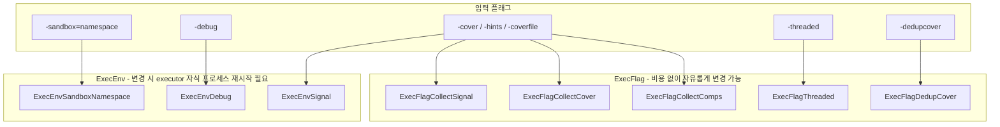

이 규칙은 스키마 자체(`pkg/flatrpc/flatrpc.fbs`)에 명시되어 있습니다:

> 실행 간에 `exec_flags`를 변경해도 executor 프로세스가 재시작되지 않습니다. `env_flags`/`sandbox_arg`를 변경하면 프로세스 재시작이 발생합니다.

이유는 물리적인 제약 때문입니다. 샌드박스는 프로세스가 생성될 때 구성됩니다(권한 포기, 네임스페이스 진입, 마운트 설정). 따라서 이를 변경하려면 새 프로세스가 필요합니다. 반면 "이번 실행에서는 커버리지를 수집하라"와 같은 실행별 옵션은 루프 내부의 조건문에 불과합니다. 퍼저는 이 특성을 활용하여 요청마다 `ExecFlags`를 자유롭게 변경하고 `EnvFlags` 변경은 비용이 큰 작업으로 취급합니다. executor도 이를 엄격히 준수하여 이전과 `env_flags`나 `sandbox_arg`가 달라졌을 때, 요청 타입이 변경되었을 때, 혹은 상태 누적을 제한하기 위해 조건 없이 매 **600**회 실행마다(`kRestartEvery`) 자식 프로세스를 재시작합니다.

> **차용할 만한 패턴:** 옵션을 "변경 비용이 저렴한 것"과 "재시작이 필요한 것"으로 분리하고, *스키마에 이를 명시하십시오*. 그렇지 않으면 훗날 누군가가 핫 루프 안에서 비용이 큰 옵션을 토글하여 처리량이 급락하는 원인을 찾지 못해 헤매게 됩니다.

### 2.8 내부 구조: 1개의 로컬 RPC 서버, 1개의 executor 자식 프로세스

§0에서 언급했던 주장의 구체적인 실체가 여기에 있습니다. `syz-execprog`는 `syz-manager`와 완전히 동일한 RPC 서버를 시작하고, 동일한 핸드셰이크를 수행하며, 동일한 머신 체크를 실행하고, 동일한 `queue.Source` 인터페이스를 통해 요청을 전달합니다. 단지 프로그램의 공급처가 파일이라는 점만 다릅니다.

```mermaid
sequenceDiagram
    autonumber
    participant M as execprog 메인
    participant S as rpcserver (프로세스 내부)
    participant E as syz-executor 러너 (자식 프로세스)

    M->>M: 플래그 파싱, 프로그램 로드 (단계 0 + 1)
    M->>S: RunLocal(ctx, LocalConfig{...})
    S->>S: RPC=":0" 강제 (임의의 미사용 포트), 통계 초기화
    S->>S: Setup(): 리슨 대기
    S->>S: go Serve(ctx)
    S->>E: 스폰: executor runner 0 localhost PORT
    Note over S,E: syz-manager와 완전히 동일한 핸드셰이크:<br/>Hello / ConnectRequest / ConnectReply /<br/>InfoRequest / InfoReply
    S->>S: 머신 체크: 기능 및 시스템 콜 프로브
    S->>M: MachineChecked(features, syscalls)
    M->>M: 감지된 기능 플래그들을 defaultOpts에 OR 연산;<br/>queue.DefaultOpts(ctx, opts) 반환
    Note over M: execprog 자체가 queue.Source 역할을 수행
    loop 프로그램 수 x repeat 완료될 때까지
        S->>M: Next()
        M->>S: Request{Prog, ExecOpts, OnDone: ctx.Done}
        S->>E: ExecRequest (copyin 스트림, 단계 2)
        E->>E: 단계 3: 실행, 커버리지 수집
        E->>S: ExecResult{ProgInfo, output, hanged, error}
        S->>M: req.Done(result) -> 출력, 커버리지 덤프 (단계 4)
    end
    M->>M: 완료 수 == len(progs)*repeat -> 컨텍스트 취소
```

소스 코드 주석에서 강조하는 두 가지 미묘한 부분:

- **RPC 서버는 반드시 executor보다 오래 생존해야 합니다.** 서버가 먼저 종료되면 executor는 닫힌 소켓과 마주치며 혼란스러운 `SYZFAIL` 에러와 함께 종료됩니다. 따라서 서버는 독립된 컨텍스트를 가진 고루틴에서 실행되며, executor의 컨텍스트가 먼저 취소됩니다.
- **`TriagedCorpus` 신호가 즉시 전송됩니다.** 퍼저에서는 코퍼스 선별(triage) 단계 동안 executor가 더 자주 재시작됩니다. `syz-execprog`에는 선별 단계가 없으므로 executor에 즉시 완료 신호를 보냅니다.

결론적으로, `syz-execprog`에서 동작하는 프로그램이 `syz-manager`에서 다르게 동작한다면 이는 매우 의외의 상황이며 조사해 볼 가치가 있습니다. 실행 경로의 코드가 완전히 동일하기 때문입니다.

#### 실행 결과로 반환되는 내용

```
CALL 0: signal 52, coverage 61 errno 0
CALL 1: signal 3, coverage 4 errno 9 unfinished blocked
```

| 플래그 | 의미 |
|---|---|
| `CallFlagExecuted` | 호출이 시작됨 — 이전 호출이 실패한 경우 모든 호출이 시작되지는 않음 |
| `CallFlagFinished` | 호출이 반환됨; 없을 경우 블로킹되어 대기를 중단했음을 의미 |
| `CallFlagBlocked` | 호출이 블로킹됨 |
| `CallFlagFaultInjected` | 이 호출에서 결함 주입(fault injection)이 발생함 |
| `CallFlagCoverageOverflow` | 커버리지 버퍼가 가득 참; **이 호출 및 이후 호출의 데이터가 손실됨** |

`errno 0`은 성공을 의미합니다. 성공할 것으로 예상한 테스트에서 0이 아닌 errno가 반환된다면 디스크립션이 잘못되었거나, 선행 호출이 실패했거나, 커널에 해당 기능이 없는 것입니다. 빠른 분석을 위한 표:

| errno | 일반적인 원인 |
|---|---|
| `ENOSYS` | 시스템 콜 또는 의사 시스템 콜이 현재 커널에서 지원되지 않음 |
| 첫 번째 호출의 `EINVAL` | 인자 타입이나 플래그 값이 잘못됨 |
| 이후 호출의 `EBADF` | 이전 호출이 실제로 기대했던 리소스를 생성하지 못함 |
| `EPERM` / `EACCES` | 샌드박스가 너무 엄격함 — `-sandbox=none`으로 시도해 볼 것 |

**`-coverfile` 사용 시 가장 주의해야 할 것은 `CallFlagCoverageOverflow`입니다.** executor는 크기를 동적으로 늘리지 않도록 설계된 할당기를 사용하여 *공유 메모리에 직접* 결과를 구성합니다. 따라서 많은 양의 코드를 건드리는 시스템 콜의 원시(중복 미제거) 커버리지 추적은 출력 영역을 쉽게 고갈시키며, 그 뒤의 호출들은 이 플래그를 제외하고는 조용히 데이터를 잃게 됩니다. 원시 추적이 반드시 필요한 경우가 아니라면 `-coverfile`과 함께 `-dedupcover`를 전달하십시오. 해당 플래그의 도움말 텍스트에서도 바로 이 문제를 경고하고 있습니다.

### 2.9 바닥부터 재구현할 때 반드시 지켜야 할 사항

`syz-execprog`를 직접 사용하는 대신 자신만의 재현 도구를 작성하는 경우(자원이 제약된 타깃 환경이거나 포맷을 깊이 이해하기 위한 훌륭한 접근입니다), 실수가 초래하는 비용 순으로 정리한 체크리스트는 다음과 같습니다:

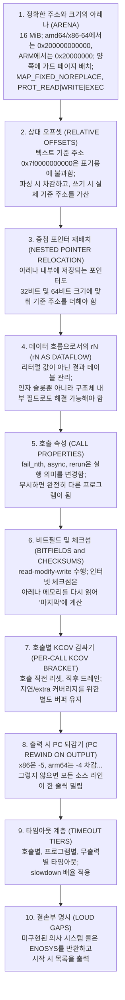

가장 빈번하게 발생하며 문제를 일으키는 3가지 실수와 증상:

| 실수 | 증상 | 발견하기 어려운 이유 |
|---|---|---|
| 중첩 포인터 재배치 누락 | 재현 프로그램이 실행되다가 중간 어딘가에서 `EFAULT` 반환, 버그 미재현 | 최상위 포인터는 정상 작동하므로 대부분의 호출이 성공함 |
| 프로그램 단위로 커버리지 일괄 드레인 | 어떤 호출이 해당 코드에 도달했는지 보고서에서 알 수 없음 | 숫자는 그럴듯하게 나오지만 정작 필요한 질문에 답하지 못함 |
| 미구현 의사 시스템 콜이 0을 반환 | 프로그램이 에러 없이 깔끔하게 끝나지만 버그는 전혀 재현되지 않음 | **어디에도 에러가 표시되지 않음** |

#### 정상 동작 증명하기

재현 도구에 대해 유일하게 의미 있는 인수 테스트(acceptance test)는 엔드투엔드 검증입니다: **알려진 버그에 대한 실제 재현 프로그램을 가져와 실행하고, 커널이 정확히 그 버그를 보고하는지 확인하는 것입니다.** 파일이 파싱된다거나, 아레나가 매핑된다거나, 시스템 콜이 0을 반환한다는 사실만으로는 아무것도 재현하지 못하는 도구와 구별할 수 없습니다.

훌륭한 셀프 테스트는 재현 프로그램과 *함께* 예상되는 크래시 시그니처를 번들로 묶어 검증합니다:

```
selftest 4: replay the bundled sample repro
  expect: KASAN: use-after-free in ...
  result: PASS (crash signature matched)
```

이 테스트는 형식 감지, 역직렬화, 중첩 포인터를 포함한 아레나 레이아웃, `rN` 데이터 흐름, 의사 시스템 콜 설정, 호출별 커버리지, 타임아웃 계층 등 전체 체인을 한 번에 검증합니다. 이 테스트를 통과한다면 각 부품들이 서로 완벽히 맞물려 동작하는 것입니다. 아레나 레이아웃에 대한 단위 테스트만으로는 이를 입증할 수 없습니다.

> **차용할 만한 패턴:** 재구현 프로젝트의 인수 테스트는 "내 출력이 기존 도구의 출력과 닮았는가"가 아니라 "엔드투엔드 효과가 동일하게 발생하는가"여야 합니다. 알려진 양성 케이스와 관찰 가능한 기대 결과를 함께 묶어 CI에서 실행하십시오. 이것이 없는 재구현은 가설에 불과합니다.

---

### 2.10 샌드박스: `-sandbox`가 실제로 변경하는 것

`-sandbox`는 모든 실행 명령에서 등장하며, `ExecEnv`에서는 재시작을 유발하는 비트로, `csource.Options` 및 재현 프로그램 단순화 사다리에서도 나타납니다. 4가지 값이 실제로 *무엇을 하는지* 명확히 알기 어렵고, 그중 하나는 이름마저 오해를 불러일으킵니다.

실제 구현은 `executor/common_linux.h`의 `do_sandbox_none`, `do_sandbox_setuid`, `do_sandbox_namespace`, `do_sandbox_android`에 있습니다.

| 값 | 테스트 프로세스가 얻는 환경 | 사용 시점 |
|---|---|---|
| `none` | **실제로 "아무것도 안 함"이 아님** — 아래 설명 참조 | 최대 권한 도달 범위; `syz-execprog`의 기본값이자 `-mode iface-probe`에서 필수 |
| `setuid` | 비특권 uid로 권한 강등 | 자격 증명을 검사하는 코드 경로를 테스트하고 시스템 피해를 제한할 때 |
| `namespace` | 전체 네임스페이스 세트 + 루트 피벗 격리 | 격리된 환경에서의 퍼징; 일반적인 `syz-manager`의 선택 |
| `android` | setuid + Android uid/gid 및 SELinux 규칙 (`sandbox_arg`로 조정) | Android 타깃 |

#### `sandbox=none`이라는 명칭의 오류

"none"조차도 실제로는 상당한 격리 설정을 수행합니다:

```c
static int do_sandbox_none(void)
{
    // CLONE_NEWPID takes effect for the first child of the current process,
    // so we do it before fork to make the loop "init" process of the namespace.
    if (unshare(CLONE_NEWPID)) { debug("unshare(CLONE_NEWPID): %d\n", errno); }
    int pid = fork();
    if (pid != 0)
        return wait_for_loop(pid);
    sandbox_common();
    drop_caps();
    if (unshare(CLONE_NEWNET)) { debug("unshare(CLONE_NEWNET): %d\n", errno); }
    ...
```

즉, `none` 모드에서도 **PID 네임스페이스**를 unshare하여 루프 프로세스가 pid-1 init 프로세스가 되어 프로그램이 생성한 모든 프로세스를 거두어들이며(reap), **네트워크 네임스페이스**를 unshare하여 생성된 패킷이 실제 외부 네트워크로 유출되지 않도록 막습니다. 또한 `sandbox_common()`과 `drop_caps()`도 호출합니다. 따라서 `none`은 "격리가 없음"을 뜻하는 것이 아니라 *"우리가 항상 필요로 하는 최소한의 위생 조치 외에는 추가적인 특권 축소를 하지 않음"*을 의미합니다.

`unshare` 실패는 의도적으로 치명적 오류로 처리되지 않는데, 주석에 따르면 `sandbox=none`이 root가 아닌 계정으로 실행되는 테스트에서도 자주 사용되기 때문입니다.

#### 이것이 단순 설정이 아닌 설계상의 결정인 이유

결과에 영향을 미치는 세 가지 중요한 파급 효과:

**도달 가능한 버그의 범위를 결정합니다.** `capable(CAP_NET_ADMIN)` 검사 뒤에 있는 코드는 `setuid` 환경에서는 도달할 수 없습니다. 반대로 어떤 버그는 비특권 사용자에 의해서만 트리거되기도 합니다(특권 경로에서는 다른 분기를 타기 때문). 어떤 샌드박스를 선택하느냐에 따라 도달할 수 있는 커널 영역이 결정됩니다.

**변경 비용이 가장 비싼 옵션입니다.** 샌드박스는 프로세스 생성 시점에 구성되므로 `ExecEnv`에 속하며, 변경 시 executor 재시작이 강제됩니다(§2.7). 이러한 배치는 임의로 정해진 것이 아닙니다.

**재현 프로그램 단순화 과정에서 가장 마지막에 제거되는 항목입니다.** `progSimplifies`는 네 번째 단계에서 `Sandbox = "none"`을 시도하고, `cSimplifies`는 더 나아가 `Sandbox = ""`까지 시도합니다(이 경우 모든 net/USB/cgroup 옵션도 함께 제거됨). 여전히 `sandbox=namespace`를 요구하는 재현 프로그램은 개발자에게 더 많은 환경 설정을 요구하므로, 단순화 사다리는 이를 가장 마지막에 철저히 제거하려고 시도합니다. 그리고 이를 완전히 제거하는 데 성공하면 §5.7에서 설명하는 인라인화가 발동되어 C 소스 파일이 극적으로 짧아집니다.

> **차용할 만한 패턴:** 설정 항목이 *도구가 관찰할 수 있는 대상*과 *산출물이 사용자에게 요구하는 환경*을 모두 변화시킨다면, 그것은 단순 설정이 아니라 설계의 핵심 요소입니다. 배포하는 결과물에 이를 명확히 기록해야 합니다.


---

## 3. 큐: 요청이 실제로 흐르는 방식

`syz-manager`와 `syz-execprog` 모두 `pkg/fuzzer/queue`를 통해 작업을 밀어 넣습니다. 작고 조합 가능한 계층들로 구성되어 있으며, 이를 이해하면 얼핏 신비롭게 보이는 많은 동작들의 원리를 명확히 파악할 수 있습니다.

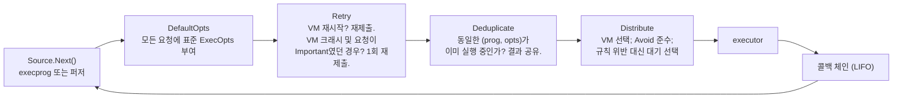

### `OnDone` 콜백 체인

`Request.OnDone(cb)`는 **LIFO(후입선출)** 방식의 체인을 구성합니다. 가장 최근에 등록된 콜백이 먼저 실행되며, 해당 콜백이 `true`를 반환할 때만 이전 콜백으로 호출이 이어집니다. `false`를 반환하면 처리가 그 자리에서 완전히 중단됩니다.

이 하나의 관례를 통해 핵심 로직에 복잡한 특수 예외 처리 없이도 재시도(retry)와 중복 제거(deduplication)를 깔끔하게 구현합니다:

- `Retry`는 콜백을 하나 설치합니다. 상태가 `Restarted`인 경우 요청을 다시 큐에 제출하고 `false`를 반환합니다. 덕분에 원래 요청자는 VM이 실행 도중 죽었다는 사실을 전혀 눈치채지 못합니다. 단지 시간이 조금 더 걸릴 뿐입니다.
- `Deduplicate`는 동일한 요청 해시를 기다리는 모든 대기자에게 단일 실행 결과를 팬아웃(fan-out)해 전달하는 콜백을 설치합니다.

### `Status` 값과 그 의미

| 상태 (Status) | 의미 | 호출자가 중단하는가? |
|---|---|---|
| `Success` | 정상 실행됨 | 아니오 |
| `Restarted` | executor 프로세스가 재시작됨; 결과 없음 | 아니오 |
| `ExecFailure` | executor가 에러를 보고함 | 예 |
| `Crashed` | 실행 도중 VM이 크래시됨 | 예 |
| `Hanged` | 프로그램이 시간 내에 끝나지 않음 | 예 |

### `Avoid`와 분배기 (Distributor)

코퍼스 선별(triage) 과정에서 퍼저는 특정 머신의 일시적 상태로 인한 우연한 결과인지 실제 커버리지인지 구별하기 위해 동일한 프로그램을 *다른* VM에서 실행해 보고 싶어 합니다. `Request.Avoid`는 피해야 할 executor 목록을 지정합니다. `Distributor`는 최근 활성화된 다른 VM이 있는 동안 해당 요청을 지연시키며, 약 1,000번의 스케줄링 틱(tick)이 지난 후에도 불가피하다면 제약을 포기하고 아무 곳에서나 실행합니다(이 위반 횟수는 통계에 기록됨). 교착 상태(deadlock)를 유발할 수 있는 엄격한 제약(hard constraint) 대신 제한된 대기 시간을 갖는 유연한 제약(soft constraint)을 사용한 것입니다.

### 시그널 필터: 훌륭한 방어적 설계의 표본

실행 결과가 돌아오면 `convertCallInfo`는 커널 모듈 전반에 걸쳐 커버리지 주소를 정규화한 후 매우 중요한 검사를 수행합니다: **신호 주소 중 단 하나라도 커널 코드 영역(text range)을 벗어나면, 해당 호출의 모든 신호와 커버리지를 통째로 폐기합니다.** 또한 두 피연산자가 모두 커널 포인터처럼 보이는 비교 힌트도 버립니다.

이유는 명확합니다: executor는 샌드박스 내부에서, 즉 퍼저가 능동적으로 취약점을 찾아 공격하고 있는 코드 환경 내에서 실행됩니다. 손상되거나 악의적으로 조작된 executor가 날조된 커버리지를 보고하여 퍼저에게 극도로 매력적으로 보이는 쓰레기 데이터로 코퍼스를 오염시킬 위험이 있습니다. 피드백 신호의 주소 범위를 검증하는 것은 매우 저렴하면서도 확실한 보험입니다.

> **차용할 만한 패턴:** 신뢰할 수 없는 컴포넌트로부터 들어오는 피드백은 절대적 사실(ground truth)이 아니라 *검증해야 할 입력 데이터*로 취급하십시오. 퍼저의 평가 점수 산출 함수 자체가 공격 표면이 될 수 있습니다.

---

## 4. 코퍼스의 동작 원리

코퍼스(Corpus)는 syzkaller의 장기 기억 장치입니다. 각각의 프로그램이 다른 프로그램들이 도달하지 못한 새로운 코드 영역에 도달하기 때문에 보존할 가치가 있는 프로그램들의 집합입니다.

### 4.1 디스크 저장 포맷: `pkg/db`

`workdir/corpus.db`는 단순한 추가 전용(append-oriented) 키-값 로그 파일입니다:

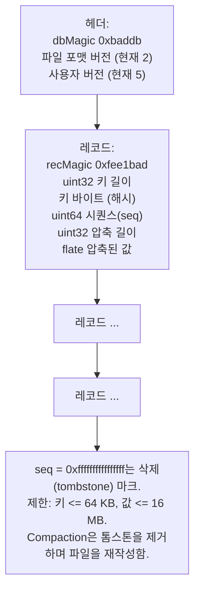

- **키 = 직렬화된 프로그램의 해시.** 콘텐츠 주소 지정(content addressing) 방식을 사용하므로 동일한 프로그램이 중복 저장되지 않으며, "이미 코퍼스에 있는가?"는 단순 맵 조회로 확인됩니다.
- **값은 flate로 압축됨.** 프로그램 텍스트는 반복성이 매우 높기 때문에 수십만 개의 엔트리를 가진 코퍼스에서 압축은 엄청난 공간 절약 효과를 가져옵니다.
- **`Open(filename, repair)`는 사용 가능한 데이터베이스와 에러를 *동시에* 반환할 수 있음.** 갑작스러운 정전으로 끝부분이 잘려 나간 코퍼스 파일도 부분 복구가 가능합니다. 읽을 수 있는 부분을 최대한 읽고, 문제를 보고한 후 압축 정돈(compaction)합니다. 몇 개의 프로그램을 잃는 것이 전체 코퍼스를 날리는 것보다 훨씬 낫습니다.

> **차용할 만한 패턴:** 캐시나 코퍼스처럼 가치 있지만 재생성 가능한 데이터의 경우 엄격한 유효성 검사보다 부분 복구(partial recovery)를 우선시하십시오. "99.8%를 복구하고 나머지는 로그에 기록했다"가 "손상되었으므로 처음부터 다시 시작합니다"보다 훨씬 우수합니다.

### 4.2 사용자 버전: 업그레이드 후 재작업 강제

헤더에 있는 두 번째 버전 번호가 특히 흥미로운 부분입니다. 현재 `CurrentDBVersion = 5`이며, `versionToFlags`는 이전 버전 번호를 프로그램별 플래그 세트로 매핑합니다:

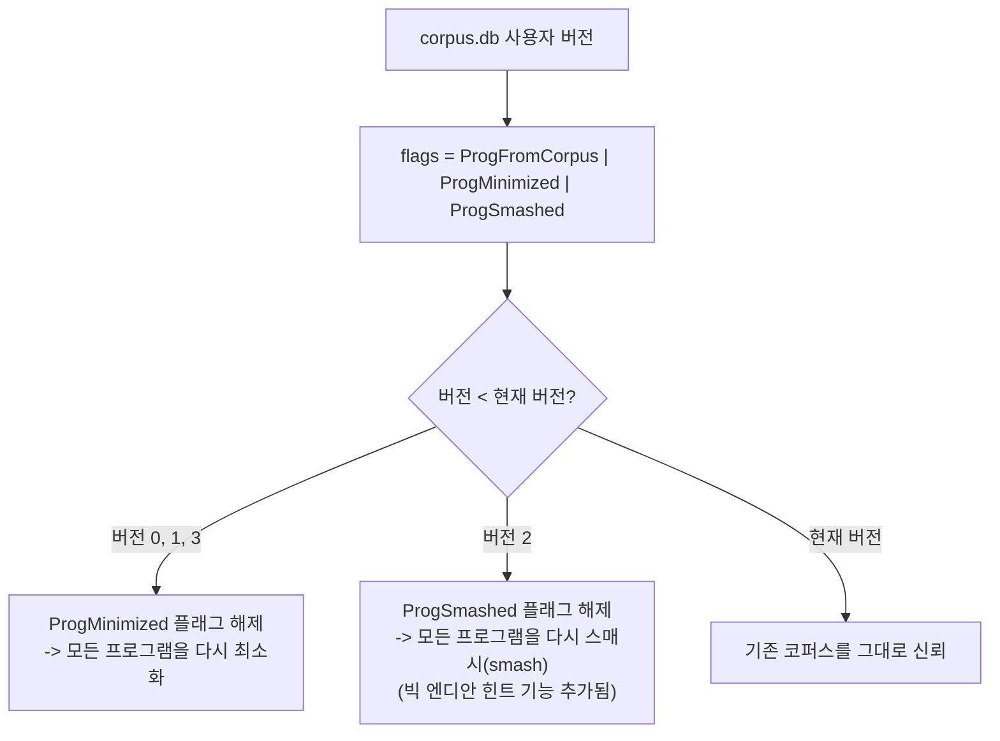

설계상 직면한 문제: syzkaller의 기능은 지속적으로 개선됩니다. 2019년의 최소화 알고리즘으로 줄인 코퍼스는 최신 알고리즘으로 줄인 것보다 품질이 떨어집니다. 하지만 시작할 때마다 거대한 코퍼스 전체를 다시 최소화하려면 몇 시간이 소요됩니다. 해결책은 개선 작업이 머지될 때 버전 번호를 올리고, 버전 차이에 따라 어떤 작업을 다시 수행해야 할지 결정하도록 하는 것입니다.

소스 코드에는 이와 관련된 경고성 주석이 있습니다. 버전 4에서 `ProgSmashed`를 해제했던 변경은 *"느린 syzkaller 인스턴스에서 코퍼스 재선별 작업이 영원히 끝나지 않는 문제"*를 유발하여 결국 롤백되었습니다. 단 한 줄의 변경이 느린 머신에서 초기 준비 과정을 무한 루프에 빠뜨릴 뻔했던 것입니다.

### 4.3 점진적 재작업: `ReminimizeSubset` 및 `ResmashSubset`

버전 번호 상승 시에만 반응하는 대신, 매 시작 시점마다 전체 작업의 작은 일부분을 재수행합니다:

| 함수 | 대상 | 처리량 |
|---|---|---|
| `ReminimizeSubset` | 상위 약 10%의 큰 프로그램 및 `ReminimizeThreshold = 15`개 이상의 호출을 가진 프로그램 | 전체 코퍼스의 최대 1%, 최대 50개 프로그램으로 제한 |
| `ResmashSubset` | 무작위 하위 집합 | 전체 코퍼스의 최대 0.5%, 최대 25개 프로그램으로 제한 |

주석에서 밝힌 배경 논리: *"15개 이상의 시스템 콜을 수행하는 프로그램은 의심스럽게 취급하여 다시 최소화해야 한다"* — 커널의 비결정적 특성(flakiness)으로 인해 최소화는 확률적 과정이며, 따라서 일부 프로그램은 덜 최소화된 상태로 빠져나옵니다. 또한 퍼징 알고리즘은 시간이 지남에 따라 똑똑해지므로 오래된 프로그램들도 언젠가는 다시 한번 기회를 얻어야 합니다.

> **차용할 만한 패턴:** 작고 상한선이 정해진 슬라이스를 백그라운드에서 지속적으로 재처리하는 것이 주기적인 "전체 재생성(rebuild everything)"보다 훨씬 뛰어납니다. 스스로 부하를 제한하고, 유지보수 다운타임이 필요 없으며, 데이터의 품질이 지속적으로 단조 증가합니다.

### 4.4 로딩 과정: `LoadSeeds`

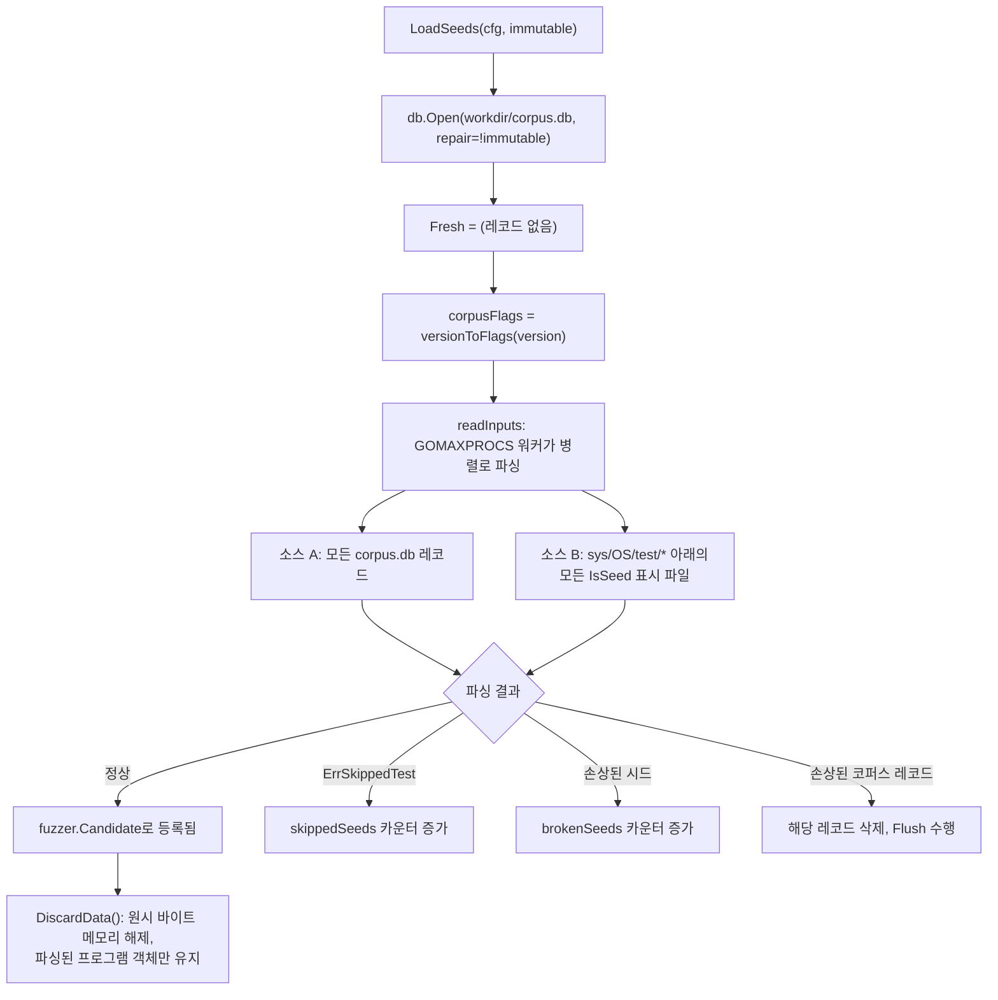

`sys/<OS>/test/*`에서 온 시드들은 `ProgMinimized` 플래그만 받고 **`ProgFromCorpus` 플래그는 받지 않는다**는 점에 주목하십시오. 주석에 따르면: *"시드 프로그램들은 어차피 매 시작 시마다 시도되므로 '코퍼스에서 유래된 것'(여러 번 재실행 대상)으로 간주하지 않는다."* 수동으로 작성된 시드 프로그램은 영구적으로 주입되는 검증된 시나리오 세트이지, 학습을 통해 축적된 지식이 아니기 때문입니다.

### 4.5 실행 중인 머신 환경에 맞춘 필터링

`FilterCandidates(candidates, enabledSyscalls, dropMinimize)`는 다른 커널 환경에서 구축된 코퍼스를 현재 눈앞의 커널 환경에 맞게 조정합니다:

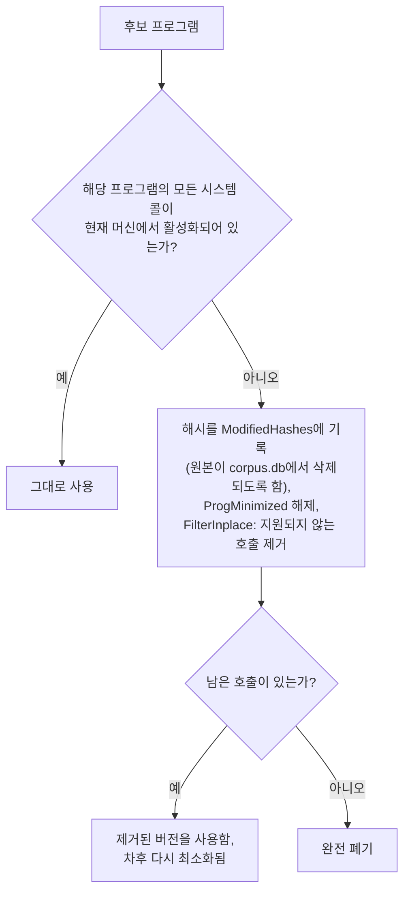

`syz-manager`로 돌아와 보면, `preserve_corpus` 옵션이 켜져 있을 경우 호출이 제거된 원본 프로그램의 해시를 `disabledHashes`에 기억해 두어 최소화 과정에서 완전히 지워지지 않도록 보호합니다. 내일 다른 시스템 콜이 활성화된 새 커널로 부팅할 수도 있는데, 과거에 유용했던 프로그램을 영구히 버려서는 안 되기 때문입니다. 이 덕분에 동일한 `corpus.db`를 서로 다른 커널 설정 간에 안전하게 이동하며 공유할 수 있습니다.

### 4.6 메모리 상의 표현: `pkg/corpus`

```mermaid
classDiagram
    class Corpus {
        +progsMap
        +signal
        +cover
        +focusAreas
        +Save(NewInput)
        +ChooseProgram(rand)
        +Minimize(cover)
        +CallCover()
    }
    class Item {
        +Sig
        +Call
        +Prog
        +HasAny
        +Signal
        +Cover
        +Updates
    }
    class NewInput {
        +Prog
        +Call
        +Signal
        +Cover
        +RawCover
    }
    Corpus "1" --> "many" Item
    NewInput --> Corpus : Save
```

| 필드 | 의미 |
|---|---|
| `Corpus.progsMap` | 프로그램 해시 → `Item` 매핑 |
| `Corpus.signal` | 모든 아이템들의 신호 합집합 |
| `Corpus.cover` | 모든 아이템들의 커버리지 합집합 |
| `Corpus.focusAreas` | 영역별 가중치 기반 선택기 |
| `Item.Sig` | 직렬화된 프로그램의 해시 — 고유 식별자 |
| `Item.Call` | 이 아이템이 기여하는 대상 시스템 콜 |
| `Item.HasAny` | 스쿼시된(ANY) 인자가 포함되어 있는가? |
| `Item.Updates` | 최근 업데이트 기록 (최대 32개) |

`Save()`에는 두 가지 경로가 있습니다:

- **새 프로그램:** `Item`을 생성하여 삽입하고, **신호 원소 개수와 동일한 우선순위**를 부여하여 가중치 선택기에 등록합니다. 새로운 커버리지가 많을수록 향후 변이 대상으로 선택될 확률이 비례하여 높아집니다.
- **기존 프로그램:** 신호와 커버리지를 병합한 *새로운* `Item`을 생성하고(동시성 읽기 작업자가 찢어진 업데이트를 보지 않도록 아이템은 불변 객체로 취급됨), 업데이트 기록을 추가합니다. 여러 시스템 콜에 걸쳐 유용한 프로그램이 무한히 커지는 것을 방지하기 위해 업데이트 기록은 최대 32개로 제한됩니다.

> 가중치 선택기가 작동하는 방식, 포커스 영역의 레이어링, 가중치가 신호 개수인 이유 등 *선택(selection)* 메커니즘은 `mutation-design.md` §3에서 다룹니다. 여기서는 저장 및 영속화 측면만 다룹니다.

어느 쪽이든 전역 신호/커버리지 세트에 병합되고 채널을 통해 `NewItemEvent`를 발행합니다. `syz-manager`에서 이 채널은 `corpusInputHandler`로 연결되어 프로그램을 `corpus.db`에 쓰고 플러시합니다. **영속화는 채널 전송의 부수 효과일 뿐이며 `Save` 내부의 호출이 아닙니다.** 코퍼스 패키지 자체는 파일 시스템이 존재하는지조차 알지 못합니다.

> **차용할 만한 패턴:** 도메인 이벤트를 발행하고, 영속화 여부는 외부의 다른 주체가 결정하게 하십시오. 이 단순한 선택 덕분에 `pkg/corpus`는 파일 시스템 없이도 완벽하게 단위 테스트가 가능합니다.

### 4.7 최소화: 집합 커버 문제 (Set-cover Problem)

`Corpus.Minimize()`는 주기적으로 실행됩니다. 이 함수는 다음 질문에 답합니다: "우리가 지금까지 도달한 모든 커버리지를 여전히 커버하는 가장 작은 프로그램 부분 집합은 무엇인가?"

```mermaid
flowchart TB
    A["각각 Signal 세트를 가진 모든 아이템"] --> B["정렬: 스쿼시된 인자가 없는 것을 우선,<br/>그다음 호출 수가 적은 것을 우선<br/>(작은 프로그램이 더 빠르게 실행됨)"]
    B --> C["signal.Minimize: 탐욕적 집합 커버(greedy set cover).<br/>각 신호 원소마다 해당 원소에 대해 가장 높은<br/>우선순위를 가진 단일 입력을 선택.<br/>고유한 최종 선택자들을 반환."]
    C --> D["선택된 승자들로 progsMap 재구성"]
    D --> E["가중치 리스트들을 제자리(IN PLACE)에서 초기화<br/>(통계 객체들이 내부 포인터를 보유하고 있음)"]
    E --> F["생존 프로그램들을 재삽입하며<br/>모든 선택 가중치 재계산"]
```

매니저 내부의 트리거 로직은 신중하게 설계되어 있습니다:

- **`phaseTriagedCorpus` 이전에는 절대 실행하지 않음.** 초기 선별 중에는 입력을 활발히 추가하는 중이므로 최소화를 돌리면 스래싱이 발생하며, 디스크에서 로드된 코퍼스는 이미 최소화되어 있다고 가정할 수 있습니다.
- **3% 이상 성장했을 때만 실행** (`currSize > lastMinCorpus*103/100`). 최소화 작업은 연산 비용이 듭니다.

최소화 직후, 매니저는 코퍼스 폭발을 방지하기 위해 **시스템 콜별 건전성 검사**를 수행합니다:

```mermaid
flowchart TB
    CC["각 시스템 콜마다 코퍼스 내의<br/>개수와 커버리지 확인"] --> W{"커버리지가 활성화되었는가?"}
    W -->|예| Y1{"개수 < 1000?"}
    Y1 -->|예| ACC["모두 수용"]
    Y1 -->|아니오| Y2{"개수 < 3000 이고<br/>커버리지/개수 >= 10 인가?"}
    Y2 -->|예| ACC
    Y2 -->|아니오| SAT["포화 상태로 표시:<br/>'X의 커버리지가 포화되었으므로,<br/>더 이상의 입력을 수용하지 않음' 로그 출력"]
    W -->|아니오| N1{"개수 < 300?"}
    N1 -->|예| ACC
    N1 -->|아니오| SAT
    SAT --> FILTER["NewInputFilter가 이제 해당 시스템 콜에 대한<br/>새로운 입력을 거부함"]
```

이 수치들은 소스 코드에 명시된 경험적 근거를 바탕으로 합니다: *"가장 포화된 시스템 콜이라도 실제 커버리지는 프로그램당 ~30-60 수준이다(프로그램이 천 개에 달할 때도 마찬가지). 폭발 상황에서는 프로그램당 커버리지가 훨씬 낮아지는 경향이 있다(~0.3-5 수준)."* 따라서 수천 개의 프로그램이 쌓이면서도 실질적인 커버리지를 거의 추가하지 못하는 시스템 콜은 디스크립션 버그, 폴백 커버리지 파손, KCOV 버그 등의 증상이며, 시스템은 코퍼스가 비대해지도록 방치하는 대신 이를 강제로 제한(clamp)합니다.

> **차용할 만한 패턴:** 지속적으로 누적되는 저장소에는 반드시 포화 감지기(saturation detector)가 필요합니다. "비정상적인 비대화"가 수치상 어떤 모습인지 정의하고, 이를 감지하여 알기 쉬운 언어로 로그를 남기며, 유입을 차단하십시오. 특히 *어떤* 시스템 콜이 포화되었는지 명시적으로 로그를 남겨 근본 원인을 수정할 수 있도록 한 점에 주목하십시오.

### 4.8 시그널 vs 커버리지: 서로 다른 역할을 하는 유사 개념

이 둘의 차이는 처음 접할 때 누구나 혼란스러워하는 부분입니다. (`mutation-design.md`에서 신호의 *우선순위*가 퍼저에 의해 어떻게 사용되는지 다루며, 여기서는 저장 측면의 차이만 다룹니다.)

| | **시그널 (Signal)** | **커버리지 (Coverage)** |
|---|---|---|
| 타입 | `map[element]priority` | 프로그램 카운터(PC)들의 집합 |
| 목적 | 퍼저의 참신성(novelty) 평가 점수 | 사람이 보는 리포트; 포커스 영역 매칭 |
| 우선순위 포함 여부 | 예 (0–3) | 아니오 |
| 수집 플래그 | `ExecFlagCollectSignal` | `ExecFlagCollectCover` |
| 주 용도 | "이 입력이 새로운가?", 코퍼스 가중치, 집합 커버 | 웹 UI 커버리지 리포트 |

우선순위 바이트는 `signalPrio`에 의해 계산됩니다:

- 시스템 콜이 **성공**한 경우 (`errno == 0`) 비트 1 설정
- 시스템 콜에 **스쿼시된(ANY) 인자가 없는** 경우 비트 0 설정
- 특정 호출로 귀속되지 않는 "extra" 커버리지의 경우 `0`

두 프로그램이 동일한 신호 원소를 생성할 때 집합 커버 문제에서는 더 높은 우선순위를 가진 프로그램이 승리합니다. 따라서 syzkaller는 **실제로 성공하고 인자가 온전히 타입화된 프로그램**을 체계적으로 우선 선택합니다. 이것이 바로 사람이 읽을 수 있고 개발자가 즉각 조치를 취할 수 있는 프로그램의 특징입니다.

> **차용할 만한 패턴:** 동등한 산출물들을 중복 제거할 때는 품질 점수를 부여하여 가장 우수한 것을 남기십시오. "동등하지만 더 우수한 것"과 "단순히 동등한 것"은 다릅니다.

### 4.9 최대 시그널과 분산 필터

마지막 퍼즐 조각입니다. `pkg/fuzzer/Cover`는 다음을 관리합니다:

- `maxSignal` — 간헐적인 변동(flake)을 포함하여 지금까지 관찰된 모든 신호 원소
- `newSignal` — 마지막 분배 이후 새롭게 발견된 원소들

`addRawMaxSignal`은 참신성 게이트 역할을 합니다: `maxSignal`과의 차집합을 계산하여 차집합이 비어 있다면 "이미 모두 본 것이므로 할 일 없음"을 의미합니다. 새로운 것이 있다면 차집합을 두 세트에 모두 병합하고 반환합니다.

매니저는 주기적으로(`fuzzerLoop`, 초당 2회) 이 델타를 가져와 `DistributeSignalDelta`를 호출하여 연결된 모든 executor에 50,000개 단위 배치로 밀어 넣습니다. executor들은 이를 사용하여 **소스(발생지)에서 직접 필터링**을 수행합니다. 즉, 호스트가 이미 알고 있는 커버리지는 아예 보고조차 하지 않습니다. 성숙한 코퍼스에서는 이것이 엄청난 대역폭 절약으로 이어지며, 호스트 측에 권위 있는 단일 커버리지 맵이 존재하기 때문에 가능한 설계입니다(2024년 대규모 리팩토링의 직접적인 성과).


---

## 5. 크래시 로그에서 최소 재현 프로그램까지

이 영역이 바로 `syz-execprog`가 진가를 발휘하는 곳입니다. `pkg/repro`는 "VM을 부팅하고, 몇 개의 프로그램을 실행했을 때, 커널이 올바른 제목의 크래시를 일으켰는가?"를 오라클(oracle)로 사용하는 탐색 알고리즘입니다. 이는 매우 비싼 오라클이므로, 알고리즘 전체가 오라클 호출 횟수를 최소화하도록 정교하게 설계되어 있습니다.

### 5.1 입력 데이터

크래시 로그는 프로그램 실행 알림과 커널 메시지가 뒤섞인 콘솔 출력입니다:

```
executing program 0:
r0 = openat$foo(...)
ioctl$BAR(r0, ...)
executing program 1:
socket$nl(...)
...
[  412.883102] BUG: KASAN: use-after-free in foo_release+0x1a/0x80
```

따라서 대략 100여 개의 프로그램이 실행되었고 그중 하나가 버그를 일으켰다는 것만 알 수 있습니다. 어쩌면 여러 프로그램의 조합이거나, 타이밍상의 우연이거나, 3번 프로그램이 남긴 잔여 상태와 7번 프로그램이 상호작용한 결과일 수도 있습니다.

### 5.2 전체 알고리즘

```mermaid
flowchart TB
    L["크래시 로그"] --> P["ParseLog: 프로그램 엔트리 추출"]
    P --> Z{"프로그램이 존재하는가?"}
    Z -->|아니오| ERR["ErrEmptyCrashLog:<br/>아무것도 실행하기 전에<br/>커널이 크래시됨"]
    Z -->|예| R["Reporter.Parse: 크래시 제목,<br/>유형, 시작 위치 및<br/>지목된 executor 식별"]
    R --> TRUNC["크래시 발생 '이후'에 시작된<br/>모든 엔트리를 잘라냄"]
    TRUNC --> EP["단계 1 - extractProg:<br/>원인 프로그램 색출"]
    EP --> MP["단계 2 - minimizeProg:<br/>호출 제거 및 인자 단순화"]
    MP --> FAST{"fast 모드인가?"}
    FAST -->|예| REL
    FAST -->|아니오| EC["단계 3 - extractC:<br/>C 재현 프로그램 생성이 가능한가?"]
    EC --> SIMP{"C 재현 프로그램 획득?"}
    SIMP -->|예| SC["단계 4a - simplifyC:<br/>C 수준 옵션 제거"]
    SIMP -->|아니오| SP["단계 4b - simplifyProg:<br/>실행 옵션 제거"]
    SC --> REL
    SP --> REL["단계 5 - calculateReliability:<br/>최대 10회 실행, 3회 크래시 시 중단"]
    REL --> CHK{"신뢰도 >= 0.15?"}
    CHK -->|아니오| REJ["거부: 너무 불안정하여(flaky) 쓸모없음"]
    CHK -->|예| OUT["Result{Prog, Opts, CRepro,<br/>Report, Reliability}"]
```

### 5.3 타임아웃 사다리 (Timeout Ladder)

> §2.4에서 다룬 executor의 **타임아웃 계층**과 혼동하지 마십시오. 그 계층은 단일 시스템 콜, 단일 프로그램, 그리고 응답 없는 단일 머신을 제한합니다. 여기서의 사다리는 `repro`가 크래시가 발생하지 않았다고 판단하기 전까지 전체 *테스트 시도*에 부여하는 실제 벽시계(wall-clock) 시간 예산입니다.

모든 테스트는 시간 예산을 가지고 실행되며, repro는 짧은 시간부터 세 단계 사다리를 시도합니다:

| 단 (Rung) | 값 |
|---|---|
| 1단 | `max(30s, 3 × 프로그램 타임아웃)` |
| 2단 | `max(100s, 20 × 프로그램 타임아웃)` |
| 3단 | `NoOutputRunningTime` |

대부분의 버그는 빠르게 터지며, 짧은 예산을 사용할수록 단위 시간당 더 많은 시도를 할 수 있기 때문에 짧은 시간부터 먼저 시도합니다. 사다리는 크래시 유형에 따라 특화됩니다:

- **제목 없음** ("연결 끊김", "출력 없음"): 1단과 3단만 유지 — 즉시 발생하거나 전체 무출력 대기 시간이 필요하기 때문.
- **메모리 누수(Memory leak)**: 1단 제외 — 누수 탐지는 본질적으로 느림.
- **행(Hang, 무응답)**: 정의상 3단만 유지.
- **Fast 모드**: `{30s, 5m}`만 사용.

> **차용할 만한 패턴:** 오라클 비용을 조절할 수 있다면 가장 저렴한 설정부터 탐색하고 점진적으로 확대하십시오. 그리고 질문의 *종류*에 따라 애초에 답을 줄 수 없는 사다리 단계를 건너뛰도록 만드십시오.

### 5.4 1단계: 원인 프로그램 색출 (extractProg)

```mermaid
flowchart TB
    S["후보 엔트리들"] --> H{"크래시 리포트에<br/>지목된 executor가 있는가?"}
    H -->|예| H1["해당 엔트리를 가장 먼저 시도<br/>- 커널이 준 강력한 힌트"]
    H -->|아니오| H2["lastEntries: 각 proc의 마지막 엔트리를<br/>역순으로 배치<br/>- 최근 것일수록 유력함"]
    H1 --> T
    H2 --> T["각 타임아웃 단마다:"]
    T --> SINGLE["extractProgSingle:<br/>각 후보를 '단독' 실행"]
    SINGLE --> OK{"크래시 발생?"}
    OK -->|예| FOUND["완료: 단일 프로그램으로 충분함"]
    OK -->|아니오| BIS{"엔트리가 2개 이상인가?"}
    BIS -->|아니오| NEXT["다음 타임아웃 단 시도"]
    BIS -->|예| WHOLE["먼저 전체 로그를 통째로 재현"]
    WHOLE --> W{"크래시 발생?"}
    W -->|아니오| GIVEUP["즉시 포기:<br/>전체 로그로도 재현되지 않는다면<br/>어떤 하위 집합으로도 재현 불가"]
    W -->|예| BISECT["bisectProgs: 엔트리 리스트에 대해<br/>이진 탐색(binary search) 수행,<br/>최대 6개 청크 (fast 모드는 2개)"]
    BISECT --> CONCAT["concatenateProgs:<br/>생존한 각 프로그램을 개별 최소화한 후<br/>하나의 프로그램으로 결합"]
```

모두 뼈아픈 경험을 통해 얻은 세 가지 중요한 세부 원칙:

**이진 탐색(바이섹션) 전에 전체 로그를 먼저 재현해 봅니다.** 100개 프로그램을 모두 실행해도 크래시가 나지 않는다면, 그 버그는 로그에 없는 무언가(타이밍, 하드웨어 상태, 다른 커널 버전 등)를 필요로 하는 것이며, 바이섹션을 해봤자 아무것도 증명하지 못한 채 수 시간만 날리게 됩니다. 단 한 번의 사전 테스트가 전체 탐색 낭비를 방지합니다.

**리포트가 지목한 엔트리를 고정(pin)합니다.** `bisectProgs`는 커널이 직접 가리킨 엔트리를 바이섹션 과정에서 버리지 않도록 보호하는 `keepFn`을 사용합니다. 커널의 힌트를 신뢰하십시오.

**`ErrTooManyChunks` 발생 시 중단합니다.** 바이섹션이 6개 이상의 청크로 쪼개진다면 해당 크래시는 극도로 불안정한(flaky) 것이며 바이섹션 결과는 노이즈에 불과합니다. 확신에 찬 오답을 내놓느니 즉시 멈추는 편이 낫습니다.

### 5.5 2~4단계: 두 가지 차원의 축소

재현 프로그램은 두 가지 종류의 복잡성을 가지며, 두 차원 모두 집중적인 축소 대상이 됩니다.

**프로그램 자체** — `MinimizeCrash` 모드의 `prog.Minimize`. 호출을 제거하고, 인자를 단순화하며, 호출 속성을 리셋하고, 각 변경마다 재테스트를 수행합니다. 단, 주석에 실용적인 이유가 명시되어 있듯이 1개 호출 미만으로는 줄이지 않습니다: *"그렇지 않으면 tools/syz-execprog가 즉시 종료되어 버림."*

**실행 옵션** — 버그를 유발하는 데 필요한 환경. `progSimplifies`는 다음 순서로 시도합니다:

1. `Threaded` 제거 (충돌하지 않는 경우에만)
2. `Repeat` 제거 — cgroup 및 net-reset도 함께 해제하고, `Procs = 1`로 설정
3. `Procs = 1` 설정
4. `Sandbox = "none"` 설정

그리고 `cSimplifies`는 개별 기능들을 하나씩 제거하며 이를 더욱 확장합니다: 네트워크 주입, 네트워크 디바이스, 네트워크 리셋, cgroups, binfmt_misc, close-fds, devlink PCI, NIC VF, USB, VHCI, WiFi, 802.15.4, tmpdir, segv 처리.

이것이 그토록 중요한 이유: *"이것을 네트워크 네임스페이스 안에서, USB 에뮬레이션과 cgroup을 켜고, 8개 프로세스로 100번 반복 실행하라"*고 요구하는 재현 프로그램은 개발자에게 거의 쓸모가 없습니다. 반면 *"이 C 파일을 컴파일해서 한 번 실행하라"*는 재현 프로그램은 즉각 수정됩니다. 제거된 옵션 하나하나는 개발자에게 요구하는 부담을 줄여줍니다.

```mermaid
flowchart LR
    A["크래시 로그<br/>100개 프로그램,<br/>8 procs, threaded,<br/>repeat, 전체 샌드박스"] --> B["1개의 원인 프로그램<br/>동일한 옵션"]
    B --> C["3개 호출<br/>동일한 옵션"]
    C --> D["3개 호출<br/>1 proc, repeat 없음,<br/>sandbox none"]
    D --> E["커널을 다운시키는<br/>40줄짜리 C 파일"]
```

주목할 만한 안전장치가 있습니다: `checkOpts`는 "반복 없음(no repeat)"과 1분 이상의 타임아웃을 결합하는 것을 금지합니다. 단순히 반환하고 끝나는 비반복 C 재현 프로그램이 타임아웃까지 멍하니 대기하게 되면 "테스트 머신 무응답"으로 오진되기 때문입니다.

### 5.6 판정 함수: 모든 크래시가 유효한 것은 아니다

`getVerdict`는 테스트가 "크래시"되었는지 여부를 결정하며, 매우 까다롭게 판정합니다:

```mermaid
flowchart TB
    RUN["후보 실행<br/>(인프라 에러 시 최대 3회 재시도)"] --> N{"리포트가 있는가?"}
    N -->|아니오| NO["크래시 아님"]
    N -->|예| SUP{"억제(suppressed) 대상인가?"}
    SUP -->|예| NO
    SUP -->|아니오| LEAK{"누수를 추적 중인데<br/>비누수 리포트가 발생했는가?"}
    LEAK -->|예| NO
    LEAK -->|아니오| PRIO{"낮은 우선순위 리포트인가?<br/>LostConnection, NoOutput,<br/>SyzFailure, UnexpectedReboot"}
    PRIO -->|"예, 그리고 이미 높은<br/>우선순위 크래시를 관찰함"| NO
    PRIO -->|아니오| STRICT{"strict 모드인가?"}
    STRICT -->|"예, 그리고 이 제목이 새로운 것인가"| NO
    STRICT -->|아니오| YES["크래시 인정: 제목을 기록하고,<br/>리포트 보존"]
```

낮은 우선순위 필터는 전형적인 실패를 방지합니다. use-after-free를 좁혀가는 도중에 한 번의 시도에서 우연히 SSH 연결이 끊겼다고 가정해 보겠습니다. "연결 끊김"을 성공으로 인정해 버린다면 알고리즘은 엉뚱한 길로 빠져 네트워크 결함 재현기를 만들어 낼 것입니다. 일단 *진짜* 크래시를 본 이후에는 인프라 노이즈는 카운트하지 않습니다.

Strict 모드는 단순화에 성공한 후 사용됩니다. 더 단순한 변형을 찾았을 때 그것이 제3의 엉뚱한 버그가 아니라 우리가 *이미* 보았던 원래 제목을 여전히 재현하는지 재검증합니다.

### 5.7 C 재현 프로그램 생성: 단일 소스, 이중 컴파일

C 재현 프로그램은 syzbot의 실질적인 최종 산출물입니다. 즉, 커널 개발자가 전달받아 실행하는 바로 그 파일입니다. 또한 직관적인 설계 함정을 훌륭하게 피해 간 곳이기도 하므로 일반적인 문서보다 더 깊이 살펴볼 가치가 있습니다.

#### 직관적인 함정

C 재현 프로그램은 executor가 하는 모든 일을 수행해야 합니다: 정확한 주소에 아레나 매핑, 인자 배치, `rN` 데이터 흐름 해결, 체크섬 계산, 샌드박스 구성, 스레드 생성, 반복 루프 실행, 호출별 타임아웃 준수. 이것이 executor의 업무 전체입니다.

따라서 순진한 설계는 C++ executor와 그에 상응하는 C 코드를 방출하는 Go 코드 생성기라는 **두 개의 구현체**를 두는 것입니다. 이렇게 하면 몇 주 지나지 않아 둘 사이에 차이가 발생하게 되고, 모든 불일치는 아무런 설명도 없는 "repro가 재현되지 않음"으로 귀결됩니다.

#### syzkaller가 대신 선택한 방법

`executor/common_linux.h`는 **두 곳 모두에 컴파일되는 동일한 소스 파일**입니다. 이 파일에는 현재 빌드 중인 소비자가 누구인지를 선택하는 수많은 가드(`SYZ_EXECUTOR`가 무려 180회 등장)가 흩어져 있습니다:

```c
static int do_sandbox_none(void)
{
    if (unshare(CLONE_NEWPID)) { debug("unshare(CLONE_NEWPID): %d\n", errno); }
    int pid = fork();
    if (pid != 0)
        return wait_for_loop(pid);
#if SYZ_EXECUTOR || SYZ_VHCI_INJECTION
    initialize_vhci();
#endif
    sandbox_common();
    drop_caps();
#if SYZ_EXECUTOR || SYZ_NET_DEVICES
    initialize_netdevices_init();
#endif
    ...
```

`SYZ_EXECUTOR`는 executor를 빌드할 때 정의되므로 executor는 *모든* 기능을 가져옵니다. 반면 재현 프로그램의 경우 `SYZ_EXECUTOR`는 정의되지 않으며 해당 프로그램이 실제로 필요로 하는 `SYZ_*` 기능들만 정의됩니다. 이는 `simplifyC`(§5.5)가 `NetInjection`, `Cgroups`, `USB` 등을 제거할 때 가지치기하는 대상과 정확히 일치합니다.

```mermaid
flowchart TB
    SRC["executor/common*.h<br/>단일 소스, 180개의 SYZ_EXECUTOR 가드:<br/>샌드박스, 넷디바이스 설정, 루프 구조,<br/>스레딩, 타임아웃, 의사 시스템 콜"]
    SRC -->|"-DSYZ_EXECUTOR<br/>모든 기능 활성화"| EX["syz-executor<br/>범용 인터프리터:<br/>런타임에 copyin 스트림을 읽음"]
    SRC -->|"SYZ_EXECUTOR 미정의<br/>+ 이 프로그램에 필요한 기능만 정의"| CS["createCommonHeader:<br/>전처리, 치환, 방출"]
    CS --> REPRO["repro.c<br/>직선적 C 코드:<br/>동일한 작업을 펼쳐서(unrolled) 수행"]
    PROG["프로그램"] -->|"copyin/copyout/csum을<br/>C 문장으로 방출"| CS
```

`pkg/csource/csource.go`는 프로그램으로부터 계산된 값들로 템플릿을 채웁니다:

| 플레이스홀더 | 채워지는 내용 |
|---|---|
| `SANDBOX_FUNC` | `do_sandbox_none` / `_setuid` / `_namespace` / `_android` |
| `MMAP_DATA` | `target.DataMmapProg()` — **명시적 시스템 콜로 방출된 아레나 mmap 코드** |
| `SYSCALLS` | 프로그램의 호출들을 직선적 C 코드로 표현 |
| `RESULTS` | `uint64 r[N] = {...}` — `rN` 결과 테이블 |
| `PROCS`, `REPEAT_TIMES` | 단순화된 옵션 값 |
| `CALL_TIMEOUT_MS` | 기본 타임아웃 + `timeout` 속성을 가진 호출에 대한 추가 시간 |
| `ASYNC_CONDITIONS` | `(async)`로 표시된 호출에 대한 `call == 3 \|\| call == 7` 조건 |

그리고 결정적으로, `csource.go`는 자체적인 `copyin`, `copyout`, `generateCsumInet` 함수를 가집니다. 이 함수들은 executor의 명령어 인터프리터(§2.3)와 **완전히 동일한 작업을 수행하지만 스트림을 해석하는 대신 펼쳐진 C 문장(unrolled C statements)으로 방출**합니다. 동일한 시맨틱, 두 가지 실행 전략입니다:

| | Executor | C 재현 프로그램 |
|---|---|---|
| 아레나 | `os_init` 내에서 `SYZ_DATA_OFFSET`에 `mmap` | `MMAP_DATA`: 명시적 시스템 콜로 동일 매핑 수행 |
| 인자 배치 | 공유 메모리에서 `instr_copyin` 해석 | `memcpy`/대입문으로 펼쳐서 코드 생성 |
| `rN` | 테이블에서 `read_result()` 조회 | `r[3]` — C 배열 직접 접근 |
| 체크섬 | `arg_csum` 명령어, 런타임 계산 | 인라인으로 방출된 `csum_inet_*` 호출 |
| 기능 설정 | 전체가 컴파일되어 플래그로 선택됨 | 필요한 `#define`만 정의됨 |

> **차용할 만한 패턴:** 인터프리터와 코드 생성기 양쪽에서 동일한 동작이 필요할 때 두 번 작성하지 마십시오. 타깃 언어로 한 번만 작성하고, 인터프리터를 그 빌드 설정 중 하나로 만드십시오. 그렇지 않으면 오늘은 일치하지만 내일은 조용히 어긋나는 두 개의 구현체를 떠안게 됩니다.

#### 최소 재현 프로그램을 읽기 쉽게 만드는 인라인화

훌륭한 syzbot 재현 프로그램이 왜 그토록 짧은지를 설명해 주는 핵심 세부 사항:

```go
if !ctx.opts.Threaded && !ctx.opts.Repeat && ctx.opts.Sandbox == "" {
    // 가장 단순한 케이스의 경우 시스템 콜들을 main 함수 내부로 직접 인라인화함.
    replacements["SANDBOX_FUNC"] = replacements["SYSCALLS"]
    replacements["SYSCALLS"] = "unused"
}
```

`simplifyC`가 스레딩, 반복, 그리고 샌드박스를 모두 제거하는 데 성공하면, 시스템 콜들이 `main()` 내부로 직접 들어갑니다. 복잡한 루프 비계(scaffolding)도, fork도, 헬퍼 함수도 사라집니다. 개발자가 10초 만에 읽을 수 있는 30줄짜리 파일이 탄생합니다. `simplifyC`가 성공적으로 제거하는 모든 옵션은 운영상의 요구사항을 줄여줄 뿐만 아니라 산출물을 훨씬 더 *짧고 간결하게* 만듭니다.

그런 다음 `repro`는 결과를 컴파일하고 테스트합니다(실제로 재현되지 않는 C 재현 프로그램은 없는 것보다 못합니다). `target.BrokenCompiler`가 설정되어 있다면 이 시도를 완전히 건너뜁니다. `csource`는 독립 실행형 도구인 `syz-prog2c`로도 제공됩니다.

### 5.8 선택 사항: strace

`strace_bin`이 설정되어 있다면 매니저는 완성된 재현 프로그램을 `strace` 하에서 최대 2회 실행하며, **동일한 버그를 생성했을 때만** 출력을 보존합니다. 소스 코드의 근거: *"동일한 버그를 유발한 경우에만 strace 출력을 저장하고자 한다. 그렇지 않으면 syzbot에서 재현하기 어렵고 사용자에게 혼란을 준다."* *다른* 크래시를 유발한 시스템 콜 트레이스는 버그 리포트에서 심각한 방해 요소가 됩니다.

### 5.9 로그 역시 중요한 산출물이다

`repro.Stats`는 `TotalTime`, `ExtractProgTime`, `MinimizeProgTime`, `SimplifyProgTime`, `ExtractCTime`, `SimplifyCTime`과 함께 시도된 모든 과정의 서술적 로그 전체를 기록합니다. 재현에 실패하더라도 이 로그가 보고되므로, 사람은 알고리즘이 *어디까지 진행되었고* *왜 포기했는지*를 확인할 수 있습니다. 로그는 크기가 매우 방대해질 수 있으므로 업로드 전 앞부분 512 KB 접두사와 뒷부분 512 KB 접미사로 잘라내어 보존합니다.


---

## 6. 현대적 계층: 에이전트를 위한 캐시된 실행

`pkg/aflow`는 syzkaller의 가장 최신 계층으로, AI 에이전트가 호출할 수 있는 도구 모음입니다. `execute-seed` 도구는 위의 모든 메커니즘 위에 구축된 *2세대 API*의 형태를 잘 보여줍니다.

```mermaid
flowchart TB
    IN["ReproSyz: syzlang 프로그램 텍스트"] --> PARSE["Strict 모드로 역직렬화"]
    PARSE -->|"파싱 에러"| TEACH["deserializationErrorHelp를 담은<br/>BadCallError:<br/>syzlang 문법 규칙 안내 제공"]
    PARSE --> RESER["파싱된 프로그램을 '다시 직렬화'<br/>'캐시 키가 올바르게 계산되도록 하기 위함'"]
    RESER --> KEY["캐시 키 = 해시값:<br/>커널 커밋 + 커널 설정 해시<br/>+ 이미지 해시 + VM 유형<br/>+ VM 설정 해시 + 프로그램 해시"]
    KEY --> HIT{"캐시 히트?"}
    HIT -->|예| RET["캐시된 결과 반환.<br/>VM 부팅 없음."]
    HIT -->|아니오| RUN["RunnerManager.Submit:<br/>영속적(persistent) VM 풀.<br/>CollectCover + CollectSignal<br/>+ Threaded, ReturnError, ReturnOutput 강제."]
    RUN --> STORE["저장: CallErrors, Coverage,<br/>BugTitle, Report, 콘솔 출력"]
    STORE --> RET
    RET --> OUT["ExecutionCachedID + CallErrors"]
```

LLM 활용 여부와 무관하게 차용할 가치가 있는 네 가지 결정:

**해싱 전에 정규화(Canonicalize)하십시오.** 캐시 키를 계산하기 전에 프로그램을 파싱한 다음 다시 직렬화하므로, 텍스트로는 다르지만 의미상 동일한 두 프로그램이 동일한 캐시 엔트리에 히트합니다. 호출자들이 서식을 일관되지 않게 작성하기 때문에 이 작업이 없다면 캐시는 거의 무용지물이 됩니다.

**환경 전체를 해싱하십시오.** 키에는 커널 커밋, 설정, 디스크 이미지, VM 유형, VM 설정이 포함됩니다. 결과는 그것을 만들어 낸 바로 그 환경에서만 재사용될 수 있으며, 이를 명시적으로 정의함으로써 커널 리빌드 후에 오래된 결과를 반환하는 실수를 원천 차단합니다.

**블롭 대신 핸들(Handle)을 반환하십시오.** `ExecutionCachedID`가 통용 화폐 역할을 합니다: 프로그램이 도달한 영역을 탐색하려면 커버리지 도구에 이를 전달하고, 프로그램 텍스트를 복구하려면 `get-executed-program`에 전달합니다. 소비자는 필요한 것만 요청하여 가져옵니다.

**스레드 모드를 강제하고 이유를 명시하십시오.** 코드 주석: 스레드 모드를 강제하는 이유는 *"블로킹 호출이 영속적 VM 풀의 실행을 멈추지 않도록 하기 위함"*입니다. 여러 요청이 공유하는 풀에서 단 하나의 블로킹 시스템 콜이 모든 작업을 중단시켜서는 안 됩니다.

그리고 가장 깊이 새겨야 할 세부 사항: **에러 메시지는 가르치기 위해 작성되었습니다.** 파싱 실패 시 단순한 "잘못된 입력" 대신 syzlang 문법 규칙을 함께 반환합니다. 여기서의 소비자는 언어 모델이지만, 동일한 원칙이 인간 사용자에게도 에러 메시지를 훨씬 더 유용하게 만듭니다. 에러 메시지는 다음 실수를 예방할 수 있는 훌륭한 기회입니다.

---

## 7. 실전 레시피

### 방금 작성한 디스크립션 디버깅

```bash
# VM 내부에서, syz-execprog와 syz-executor를 복사해 넣은 상태
./syz-execprog -debug -threaded=0 mytest
```

반환된 errno를 §2.8의 분석 표와 대조해 보십시오. 프로그램이 `-threaded=0`에서 기본값과 다르게 동작한다면 블로킹 호출이나 `async` 호출에 의존하고 있는 것입니다(§2.4 참조).

### 코퍼스 프로그램이 도달하는 코드 확인

```bash
./syz-execprog -cover -coverfile=/tmp/cov -dedupcover myprog
sort -u /tmp/cov_prog1.* > /tmp/cov.log     # syz-cover에 전달할 선택적 통합 파일
```

호출별 파일은 `/tmp/cov_prog1.0`, `.1`, ... 및 `.extra`입니다. 명명 규칙과 PC 되감기는 §2.5를 참조하고, 여기서 `-dedupcover`가 중요한 이유는 §2.8을 참조하십시오.

### 비교 힌트 수집

```bash
./syz-execprog -hints -output myprog
```

`ncomps`(관찰된 비교 수)와 `ncandidates`(도출된 변이 후보 수)를 출력합니다. `ncomps`가 높은 프로그램은 많은 값 검사를 거치고 있는 것이므로 매직 넘버를 찾기에 좋은 지점입니다.

### `syz-manager` 지원이 없는 새로운 타깃 스트레스 테스트

```bash
./syz-execprog -stress -procs=4 -syscalls=openat,read,write,close corpus.db
```

코퍼스가 있으면 무작위 생성과 코퍼스 프로그램 변이를 번갈아 수행하고, 코퍼스가 없으면 무작위 생성만 수행합니다. 새로운 OS나 특이한 하드웨어 보드를 처음 부트스트랩할 때 사용하는 모드입니다.

### 간헐적 결함(Flakiness) 테스트를 위해 단일 프로그램 다회 실행

```bash
./syz-execprog -repeat=100 -procs=1 myrepro
```

### 디스크립션 테스트 스위트 전체 검증

```bash
make && bin/syz-manager -config manager.config -mode run-tests
```

여러 대의 VM을 부팅하고 샌드박스, 스레딩 모드, 반복 횟수, 커버리지 설정 전반에 걸쳐 `sys/<OS>/test/*`를 실행합니다. 느리지만 철저합니다. 개발 도중 단일 테스트를 수행할 때는 위의 `syz-execprog` 레시피를 사용하는 것이 훨씬 빠릅니다.

---

## 8. 핵심 교훈 요약

1. **단일 고정 매핑과 상대 오프셋은 메모리 스냅샷에 뛰어난 이식성을 부여합니다.** 아레나가 핵심 개념입니다. 텍스트의 `0x7f0000000000`은 표기용일 뿐이며, 모든 포인터는 오프셋이고, 재배치는 읽기 시점에 `SYZ_DATA_OFFSET`을 한 번 더하는 것입니다. 재현 도구에는 복잡한 타입 시스템 대신 메모리 레이아웃 엔진만 있으면 됩니다.
2. **입력뿐만 아니라 환경까지 제어하십시오.** 아레나 주변의 가드 페이지는 서로 다른 VMA 인접 상태로 인해 버그가 재현되지 않았던 실제 사건 때문에 도입되었습니다. "재현 가능성"은 메모리 레이아웃의 일치까지 의미합니다.
3. **보고하고자 하는 세분성(granularity) 단위로 측정을 감싸십시오.** 각 시스템 콜 직전의 KCOV 리셋과 직후의 드레인이 있었기에 쓸모없는 전체 합집합 대신 "3번 호출이 이 라인들에 도달했다"고 명확히 보고할 수 있습니다.
4. **구조적인 측정 오차는 데이터 방출 경계에서 단 한 번 보정하십시오.** KCOV는 반환 주소를 보고하므로 `PreviousInstructionPC`가 명령어 하나를 차감합니다. 이를 건너뛰면 겉보기에는 그럴듯하지만 모든 소스 라인이 틀어집니다.
5. **부분 구현의 빈틈을 명확히 드러내십시오.** 미구현된 의사 시스템 콜은 `ENOSYS`를 반환하고 시작 시 목록에 표시되어야 합니다. 성공을 반환하는 스텁은 누락된 기능을 조용한 오답으로 둔갑시킵니다.
6. **진단 출력을 다시 입력으로 사용할 수 있게 만드십시오.** syzkaller의 크래시 로그는 유효한 입력 파일이며, `ParseLog`는 누적 후 재시도를 통해 임의로 끼어든 커널 텍스트를 견뎌냅니다. 이 속성이 자동 재현 프로그램 추출의 기반입니다.
7. **하나의 실행 경로, 다양한 프론트엔드.** `syz-execprog`, `syz-manager`, 에이전트 러너 모두 동일한 RPC 서버, 핸드셰이크, 큐를 사용합니다. 분기된 코드 경로는 분기된 버그를 낳습니다.
8. **비용이 저렴한 옵션과 비싼 옵션을 분리하고 문서화하십시오.** `ExecFlag` 대 `ExecEnv` — 전자는 자유롭게 변경 가능하지만 후자는 프로세스 재시작을 강제합니다.
9. **모든 것을 콘텐츠 기반으로 주소 지정(Content-address)하십시오.** 코퍼스는 프로그램 해시로, 실행은 환경 해시로, 호환성은 디스크립션 테이블 해시로 관리됩니다.
10. **재생성 가능한 데이터는 엄격한 유효성 검사보다 부분 복구가 우수합니다.** 손상된 `corpus.db`도 읽을 수 있는 부분을 최대한 건져내고 나머지만 로그로 남깁니다.
11. **누적형 저장소에 수치적 임계치, 명확한 로깅, 상한 제한을 갖춘 포화 감지기를 두십시오.**
12. **비싼 오라클은 신중한 탐색을 요구합니다.** repro 알고리즘은 바이섹션 전에 전체 로그를 먼저 테스트하고, 커널이 지목한 엔트리를 고정하며, 타임아웃을 점진적으로 늘리고, 과도한 변동 시 중단하며, 신뢰도 낮은 결과는 거부합니다.
13. **소비자가 관심을 가지는 모든 축을 따라 축소하십시오.** 호출 수 감소, 요구 옵션 감소, 도구 실행 명령 대신 독립형 C 파일 제공. "최소화"란 그것을 읽어야 하는 사람에게 최소화됨을 뜻합니다.
14. **신뢰하지 않는 컴포넌트의 피드백을 철저히 검증하십시오.** 커널 코드 영역을 벗어난 커버리지 주소는 통째로 폐기됩니다.
15. **소비자를 위해 에러 메시지를 작성하십시오.** 문법 규칙을 포함하는 파싱 실패 메시지는 상수 하나만 더 추가하면 되지만 모두의 시간을 절약해 줍니다.
16. **재구현의 인수 테스트는 엔드투엔드여야 합니다.** 알려진 재현 프로그램을 예상되는 크래시 시그니처와 함께 번들로 묶어 검증하십시오. 그에 못 미치는 검증은 아무것도 재현하지 못하는 도구와 구별할 수 없습니다.

---

## 9. 직접 코드 읽어보기

| 질문 | 여기서부터 확인 |
|---|---|
| execprog는 어떻게 동작하는가? | `tools/syz-execprog/execprog.go` → `main`, `machineChecked`, `Next`, `Done`, `loadPrograms`, `dumpCoverage` |
| **로그 파일과 순수 프로그램은 어떻게 파싱되는가?** | `prog/parse.go` → `ParseLog` — 누적 후 재시도 루프 |
| **텍스트 포인터 기준 주소는 어디에 있는가?** | `prog/encoding.go` → `encodingAddrBase`, `serializeAddr`, `parseAddr` |
| **실제 아레나 주소와 크기는 어디에 있는가?** | `sys/targets/targets.go` → `defaultDataOffset()`, 그리고 `target.NumPages = (16 << 20) / PageSize` |
| **아레나는 어떻게 매핑되는가?** | `executor/executor_linux.h` → `os_init` (가드 페이지, `MAP_FIXED_EXCLUSIVE`, `PROT_EXEC`) |
| **copyin 명령어 스트림이란 무엇인가?** | `prog/encodingexec.go` (작성기, 헤더 주석 필독), `prog/decodeexec.go` (옵코드), `executor/executor.cc` (인터프리터, `instr_copyin` switch 문) |
| **호출별 KCOV 감싸기는 어디서 이루어지는가?** | `executor/executor.cc` → 시스템 콜 디스패치 전후의 `cover_reset` / `cover_collect`; 지연 작업을 위한 `extra_cov` |
| **PC를 되감는 이유는 무엇인가?** | `pkg/cover/backend/pc.go` → `PreviousInstructionPC`, `instructionLen` |
| **타임아웃 계층은 어디에 정의되어 있는가?** | `sys/targets/targets.go` → `Timeouts(slowdown)` |
| **어떤 의사 시스템 콜들이 존재하는가?** | `grep -h '^syz_' sys/linux/*.txt \| sort -u`; 구현체는 `executor/common*.h` |
| 로컬 서버는 어떻게 시작되는가? | `pkg/rpcserver/local.go` → `LocalConfig`, `RunLocal`, `RunInstance` |
| 와이어 포맷은 무엇인가? | `pkg/flatrpc/flatrpc.fbs` — 주석에 불변 조건(invariants)이 담겨 있으므로 주석 필독 |
| 결과는 어떻게 변환되는가? | `pkg/rpcserver/runner.go` → `sendRequest`, `handleExecResult`, `convertCallInfo` |
| 큐는 어떻게 결합되는가? | `pkg/fuzzer/queue/queue.go` → `Request.OnDone`, `Order`, `Alternate`, `Deduplicate`; `retry.go`; `distributor.go` |
| 코퍼스는 어떻게 동작하는가? | `pkg/corpus/corpus.go`, `prio.go`, `minimize.go` |
| DB 포맷은 무엇인가? | `pkg/db/db.go` → 직렬화/역직렬화 쌍 |
| 코퍼스는 어떻게 로드되는가? | `pkg/manager/seeds.go` → `LoadSeeds`, `versionToFlags`, `FilterCandidates`, `ReminimizeSubset` |
| repro는 어떻게 동작하는가? | `pkg/repro/repro.go` → `Run`, `repro`, `extractProg`, `bisectProgs`, `minimizeProg`, `simplifyProg`, `getVerdict` |
| C 코드는 어떻게 생성되는가? | `pkg/csource/csource.go` 및 `tools/syz-prog2c` |
| executor는 무슨 일을 하는가? | `executor/executor_runner.h` → `Runner::Handshake`, `Proc::Execute`; `executor/executor.cc` → `main`, `realloc_output_data` |
| 에이전트의 캐시된 실행은 어떻게 동작하는가? | `pkg/aflow/tool/syzlang/execute.go`, `pkg/aflow/action/crash/execute_seed.go`, `pkg/aflow/runner.go` |
