# syz-manager 보드/타깃 아키텍처: 시작 과정, VM 자동화, 베어메탈(Bare-Metal) 타깃

> **이 문서의 대상 독자.** 상시 운영되는(unattended) 퍼징 서비스가 실제로 어떻게 부팅되고, 가상 머신(VM)을 실행하며, VM의 비정상 종료(crash/death)를 견뎌내는지 이해하고자 하는 엔지니어를 위한 문서입니다. 특히 임베디드 작업에서 핵심적인 내용으로, 동일한 메커니즘이 VM 대신 **책상 위에 놓인 실제 보드(real board)**를 어떻게 제어하는지 다룹니다.
>
> 여기에 기술된 모든 내용은 소스 코드를 기반으로 검증되었습니다. 파일 및 라인 참조는 `syz-manager/manager.go:264`와 같은 형식을 따르므로 소스 코드에서 바로 확인할 수 있습니다.

---

## 0. 그림 한 장으로 이해하는 멘탈 모델 (The mental model in one picture)

`syz-manager`는 **수퍼바이저(supervisor)**입니다. 위험한 요소를 직접 보유하지 않으며, 위험한 작업은 일회용 자식 프로세스(disposable children)에서 수행합니다.

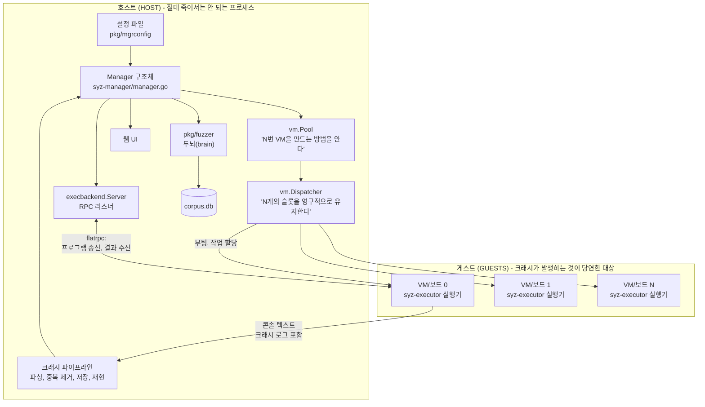

이 모든 동작은 세 가지 역할 분리를 통해 이루어집니다:

1. **Pool vs Dispatcher.** *Pool*은 단일 VM을 구성(construct)하는 방법을 압니다. *Dispatcher*는 고정된 수의 슬롯을 영구적으로 활성 상태로 유지하며, 죽은 VM을 계속해서 재시작합니다. 생성(construction)과 수명 주기(lifecycle)는 서로 다른 문제입니다.
2. **Dispatcher vs RPC 서버.** Dispatcher는 머신을 부팅하고, RPC 서버는 작업을 전달합니다. 이 둘은 오직 VM별 함수 호출을 통해서만 만납니다.
3. **구조화된 채널 vs 콘솔 텍스트.** 실행 결과는 바이너리 프로토콜을 통해 전달됩니다. 반면 크래시는 시리얼 포트에서 긁어모은(scraped) 텍스트로 전달되는데, 죽어가는 커널이 그 이상으로 할 수 있는 일은 없기 때문입니다.

---

## 1. 시작 과정, 단계별 분석 (Startup, step by step)

### 1.1 `main()` — 설정 로드 및 모드 선택

`syz-manager/manager.go`, `main()`:

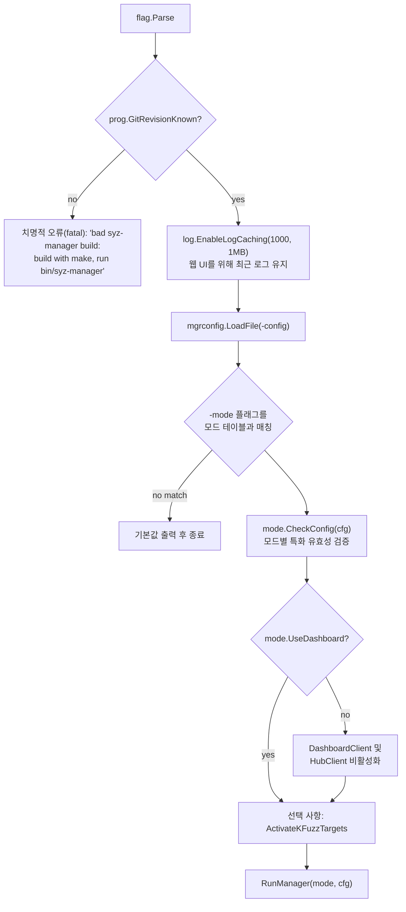

`GitRevisionKnown` 검사는 주목할 가치가 있습니다. syz-manager는 단순한 `go build`로 빌드된 경우 실행을 거부합니다. git 리비전 정보가 `Makefile`에 의해 바이너리에 각인되며, **VM 내부의 executor는 자신의 리비전과 일치하지 않는 manager와의 통신을 거부하기 때문**입니다. 첫 번째 VM 연결 시점이 아니라 시작 단계에서 이를 잡아냄으로써 혼란스러운 디버깅 과정을 미연에 방지합니다.

#### 6가지 모드

동일한 바이너리가 `-mode` 플래그에 따라 6가지 도구로 동작합니다 (`manager.go`, `modes` 테이블):

| 모드 | 수행하는 작업 | 대시보드 | 코퍼스 로드 | 종료 조건 |
|---|---|---|---|---|
| `fuzzing` | 기본값: 영구적으로 퍼징 수행 | 사용 | 사용 | 종료되지 않음 |
| `smoke-test` | VM 부팅, 간단한 프로그램 실행, 퍼징 가능 여부 기본 확인 | 미사용 | 미사용 | 머신 체크(machine check) 완료 후; 크래시 발생 시 0이 아닌 코드로 종료 |
| `corpus-triage` | 기존 코퍼스를 검증(vet)하고 정지 | 미사용 | 사용 | 트리아지 완료 시 |
| `corpus-run` | 코퍼스 프로그램을 지속적으로 재생(replay) | 미사용 | 사용 | 종료되지 않음 |
| `run-tests` | `sys/<os>/test/*`를 테스트 스위트로 실행 | 미사용 | 미사용 | 테스트 완료 시 |
| `iface-probe` | 커널 인터페이스를 동적으로 탐색하고 `workdir/interfaces.json` 작성 | 미사용 | 미사용 | 프로브 완료 시 |

`Mode` 구조체는 단순히 선언적 플래그들(`UseDashboard`, `LoadCorpus`, `ExitAfterMachineCheck`, `FailOnCrashes`)과 선택적 `CheckConfig` 함수로 이루어져 있습니다. `iface-probe`는 이 훅을 사용하여 자신이 처리할 수 없는 구성(스냅샷 모드, `none` 이외의 샌드박스, 또는 커버리지가 비활성화된 경우)을 거부합니다.

> **본받을 만한 패턴:** 모드 간의 차이점을 코드 곳곳에 흩어진 조건문이 아니라 테이블의 *데이터*로 표현하십시오. 7번째 모드를 추가하는 것은 단지 행(row) 하나를 추가하는 일일 뿐입니다.

**`smoke-test`는 새로운 타깃을 올릴(bring-up) 때 가장 자주 사용하게 될 모드입니다.** "커널이 올바르게 빌드되었는가? VM 설정이 제대로 동작하는가? 프로그램을 아예 실행할 수 있기는 한가?"라는 질문에 몇 분 만에 답을 줍니다. 깔끔한 종료 코드와 함께, 커널 oops가 발생한 경우 `workdir/report.json`을 남깁니다. 장시간의 퍼징을 돌리기 전에 항상 여기서부터 시작하십시오.

### 1.2 `RunManager()` — 조립 라인 (the assembly line)

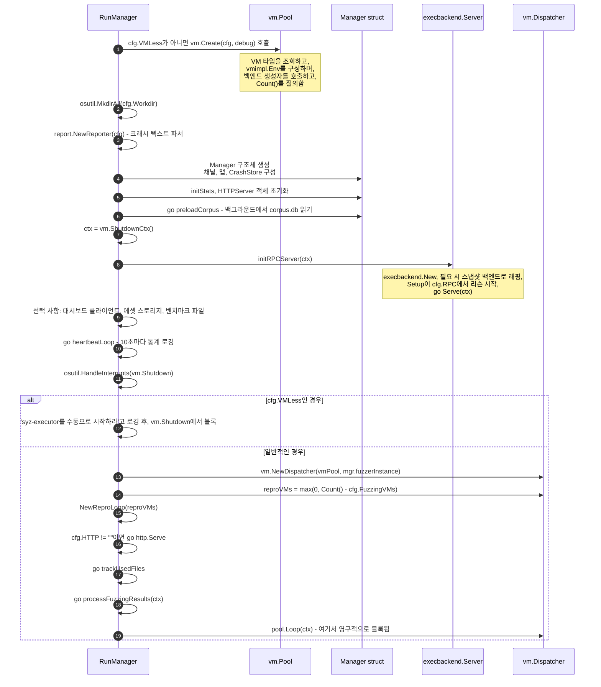

핵심적인 구조적 세부사항 몇 가지가 있습니다:

**코퍼스는 VM 부팅과 병렬로 로드됩니다.** `go mgr.preloadCorpus()`는 수십만 개에 달할 수 있는 `corpus.db` 프로그램을 백그라운드에서 읽고 파싱합니다. 어차피 수십 초가 걸리는 VM 부팅 시간 동안 동시에 진행되는 것입니다. 결과는 `corpusPreload` 채널을 통해 전달되며, 이 데이터가 가장 먼저 필요한 주체는 `<-mgr.corpusPreload`에서 대기(block)합니다. 채널 전달을 통한 깔끔한 병렬 처리입니다.

**`vm.ShutdownCtx()`는 글로벌 정지 신호입니다.** 패키지 레벨에 단 하나의 `vm.Shutdown` 채널이 존재하며, 이를 닫으면 프로그램 내의 모든 루프가 감시하고 있는 컨텍스트가 취소됩니다. `osutil.HandleInterrupts`가 Ctrl-C 신호를 여기에 연결합니다. 모든 곳에서 공유되는 단 하나의 취소 소스입니다.

**`trackUsedFiles`는 작업자 자신의 실수를 방지하는 안전장치입니다.** 30초마다 `syz-executor`, `syz-execprog`, SSH 키, `vmlinux`, 디스크 이미지의 `stat` 정보를 확인하여 시작 시점의 수정 시간과 비교합니다. 이 중 하나라도 변경되면 다음과 같은 직설적인 메시지와 함께 프로세스를 종료합니다: *"don't modify files that syz-manager uses. exiting to prevent harm." (syz-manager가 사용하는 파일을 수정하지 마십시오. 피해를 방지하기 위해 종료합니다.)* manager가 실행 중인 상태에서 syzkaller를 다시 빌드하여 몇 주 동안 원인을 알 수 없는 결과로 고통받던 과거의 문제를 막아줍니다.

> **본받을 만한 패턴:** 장시간 실행되는 자동화 시스템은 실행 중에 자신의 입력 파일이 외부에서 변경되었는지 스스로 감지하고 명확하게 실패해야 합니다. 조용한 불일치는 크래시보다 훨씬 큰 비용을 초래합니다.

**`reproVMs = max(0, Count() - cfg.FuzzingVMs)`** 식은 퍼징과 재현(reproduction) 간의 트레이드오프를 규정합니다. 16대의 머신이 있고 `fuzzing_vms: 12`로 설정했다면, 재현 작업에는 최대 4대까지만 빌려올 수 있습니다. 재현 작업은 머신을 반복해서 재부팅해야 하므로 비용이 매우 큽니다. 따라서 상한을 두는 것입니다.

### 1.3 단계별 상태 머신 (The phase state machine)

manager는 항상 균일하게 바쁘게 돌아가지 않습니다. 여러 단계(phase)를 거쳐 이동하며, 각 단계마다 특정 동작이 활성화(unlock)됩니다:

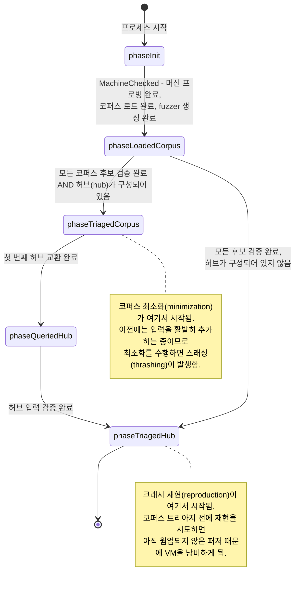

`setPhaseLocked`는 동일한 전이가 반복되면 패닉을 발생시키는데, 이는 상태 머신이 엄격히 선형적임을 보장하는 의도적인 단언(assertion)입니다. `NeedRepro`는 `phase < phaseLoadedCorpus`인 동안 `false`를 반환합니다.

> **본받을 만한 패턴:** 복잡하게 얽힌 불리언 변수 더미보다 명시적인 단계(phase)를 갖춘 시작 *시퀀스*가 훨씬 낫습니다. 비용이 많이 드는 백그라운드 작업은 "시스템이 충분히 웜업되었는가"를 기준으로 게이팅되어야 하며, 그 조건에는 명확한 이름이 부여되어야 합니다.

---

## 2. 설정에서 실행 중인 QEMU까지 (From config to a running QEMU)

### 2.1 타입 등록: 올바른 백엔드가 선택되는 방식

*(5개 메서드로 이루어진 `Instance` 인터페이스 자체와 좁은 인터페이스 규약이 옳았던 이유에 대해서는 `history-...-design-changes.md` §4.3에서 다룹니다. 여기서는 백엔드가 선택되고 생성되는 방식을 살펴봅니다.)*

각 VM 백엔드는 `init()` 함수에서 자신을 등록합니다 (`vm/vmimpl/vmimpl.go`, `Register`):

```go
type Type struct {
    Ctor        ctorFunc
    Overcommit  bool // syz-ci가 Count()보다 많은 인스턴스를 생성할 수 있는지 여부
    Preemptible bool // 연결 유실이 버그가 아니라 정상적인 일로 간주되는지 여부
}
```

- QEMU: `Overcommit: true` — 가상 환경이므로 원하는 만큼 생성 가능.
- GCE: `Overcommit: true, Preemptible: true` — 클라우드 VM은 예고 없이 사라질 수 있으므로, `SYZ-EXECUTOR: PREEMPTED`를 포함하는 연결 유실은 커널 버그로 보고되지 않고 `ErrPreempted`로 변환됨.
- `isolated` (베어메탈): **두 플래그 모두 없음** — 물리 보드의 개수만큼만 정확히 존재함.

`vm/vm.go`는 모든 백엔드 패키지를 블랭크 임포트(`import _`)하므로, `vm`을 임포트하는 것만으로 레지스트리가 채워집니다. `vm.Create`는 `vmimpl.Types[cfg.Type]`을 조회하고, `vmimpl.Env`(이름, OS, 아키텍처, 작업 디렉터리, 이미지, SSH 키 및 사용자, 타임아웃, 스냅샷 플래그, 그리고 `vm` 설정 섹션의 **원시 JSON**)를 빌드한 후 생성자를 호출합니다. 생성자는 해당 JSON을 자체 설정 구조체로 파싱하며, 이것이 각 VM 타입마다 고유한 `vm` 키 목록을 문서화하는 이유입니다.

참고: **`-debug` 모드에서는 인스턴스 수가 강제로 1로 고정됩니다.** N개의 VM 로그가 마구 뒤섞인 화면을 디버깅하고 싶어 하는 사람은 아무도 없기 때문입니다.

### 2.2 QEMU 부팅 시퀀스

`vm/qemu/qemu.go`, `instance.boot()`:

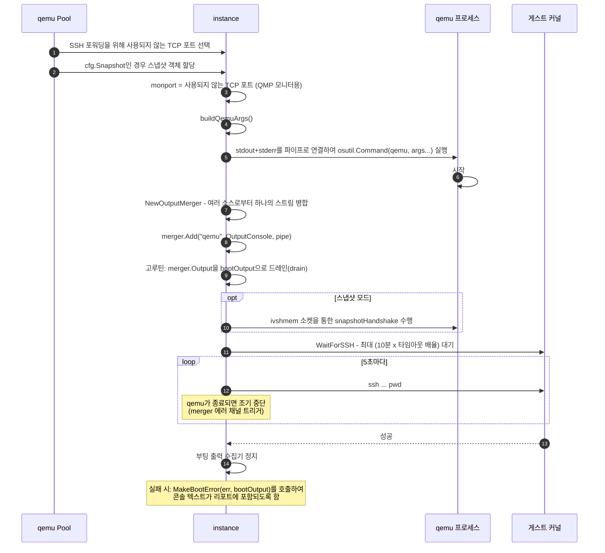

### 2.3 `buildQemuArgs()` — 커맨드 라인 상세 주석

이 구조를 이해하고 나면 "QEMU가 부팅되지 않는 문제"가 원인 모를 미스터리에서 5분짜리 손쉬운 수정 작업으로 바뀝니다. 인자 목록은 정해진 순서대로 조립됩니다:

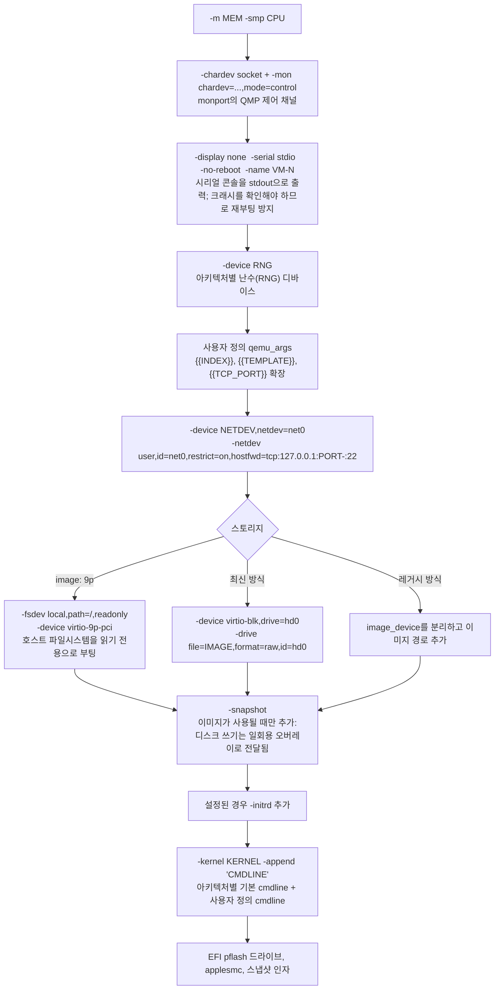

반드시 기억해야 할 두 줄의 핵심 옵션:

**`hostfwd=tcp:127.0.0.1:PORT-:22` 및 `restrict=on`.** QEMU의 유저 모드 네트워킹은 호스트 포트를 게스트의 SSH 포트로 포워딩하며, `restrict=on`은 게스트가 로컬 네트워크의 다른 어떤 곳에도 접근하지 못하도록 격리합니다. 퍼저는 패킷을 전송하는 프로그램을 *반드시* 생성하게 마련입니다. 그러한 패킷이 테스트 머신 외부로 유출되는 것을 원치 않을 것입니다.

**`-snapshot`.** 디스크 쓰기 작업은 임시 오버레이에 기록되며 종료 시 버려집니다. QEMU 설정(`snapshot` 키)에서 기본값은 `true`이며, 이는 *VM 상태 스냅샷 퍼징(VM-state snapshot fuzzing)*을 의미하는 `mgrconfig.Snapshot`과는 완전히 다릅니다. 기억해 둘 만한 안타까운 이름 충돌 사례입니다.

또한 아키텍처별 기본값은 `archConfigs`에 정의되어 있으며 상당히 방대합니다. `linux/amd64`는 `-enable-kvm -cpu host,migratable=off`, `e1000` NIC, `virtio-rng-pci`, 그리고 cmdline `root=/dev/sda console=ttyS0`을 받습니다. `linux/arm64`는 `-machine virt,virtualization=on,gic-version=max -cpu max,...` 및 `console=ttyAMA0`을 받습니다. 새로운 아키텍처를 지원하려는 경우 `archConfigs`가 가장 먼저 살펴봐야 할 장소입니다.

**복원력(Resilience) 디테일:** `Pool.Create`는 일시적인 실패(`"could not set up host forwarding rule"`, `"Device or resource busy"`, `"Address already in use"`)에 대해 생성자를 최대 1,000회 재시도하는 루프로 감싸고 있습니다. 32개의 VM이 동시에 시작될 때 포트 경쟁(race)이 발생할 수 있기 때문입니다. 그러나 `ErrCantSSH`는 즉시 반환됩니다. 부팅에 실패한 커널은 일시적인 결함(flake)이 아니라 조사해야 할 *버그(finding)*이기 때문입니다.

### 2.4 `Forward()`: 게스트가 manager에 도달하는 방식

이 부분은 많은 사람들이 혼란스러워하는 배관(plumbing) 작업이므로 명확하게 설명합니다.

manager의 RPC 서버는 **호스트**에서 리슨합니다. executor는 **게스트** 내부에서 실행되며 호스트로 연결을 맺어야(dial) 합니다. `Forward(port)`는 게스트가 사용해야 할 주소를 반환하지만, QEMU의 경우 QEMU 옵션을 *전혀* 추가하지 않습니다:

```go
func (inst *instance) Forward(port int) (string, error) {
    ...
    inst.forwardPort = port
    return fmt.Sprintf("localhost:%v", port), nil
}
```

터널은 나중에 `Run()`에 의해 생성되며, `forwardPort`를 `vmimpl.SSHArgsForward`에 전달하여 **`-R <port>:127.0.0.1:<port>`** 즉 *역방향(reverse) SSH 터널*을 추가합니다. 흐름은 다음과 같습니다:

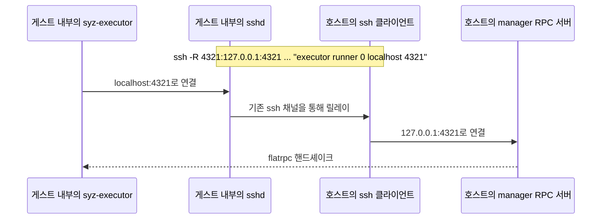

RPC 서버는 외부 라우팅이 가능한 주소를 가질 필요가 전혀 없습니다. `127.0.0.1`에서 포트 `0`으로 리슨할 수 있으며(기본 `cfg.RPC`는 임의의 사용 가능한 포트를 뜻하는 `":0"`), 이미 연결되어 있는 SSH 세션이 트래픽을 전달합니다. 방화벽 설정 문제 하나를 줄일 수 있으며, 로컬 QEMU 게스트든 방 건너편에 놓인 보드든 동일한 방식으로 동작합니다.

반면 GCE의 `Forward`는 실제 내부 IP를 반환합니다. 클라우드 VM끼리는 상호 라우팅이 가능하므로 터널이 필요 없기 때문입니다.

> **본받을 만한 패턴:** 원격 머신으로 연결되는 인증된 채널이 이미 존재한다면, 별도의 리슨 포트를 또 열지 말고 기존 채널 위로 다중화(multiplexing)하십시오. SSH 역방향 터널은 비용이 들지 않으며 방화벽 변경도 필요 없습니다.

---

## 3. VM별 수명 주기: Dispatcher와 `RunRequests` (The per-VM lifecycle: dispatcher and `RunRequests`)

### 3.1 Dispatcher 루프

`vm/dispatcher/pool.go`. `Loop(ctx)`는 **슬롯당 하나의 고루틴**을 실행하며, 각 고루틴의 동작은 다음과 같이 매우 단순합니다:

```go
for ctx.Err() == nil {
    p.runInstance(ctx, inst)
}
```

이것이 재시작 메커니즘의 전부입니다. VM 크래시, 부팅 실패, 타임아웃 등 모든 상황은 단순히 `runInstance`가 반환되는 것일 뿐이며, 외부 루프가 다시 돌아가면서 새 인스턴스를 시작합니다.

```mermaid
sequenceDiagram
    autonumber
    participant L as 슬롯 고루틴
    participant P as Pool
    participant C as 생성자 (vm.Pool.Create)
    participant J as 작업 (mgr.fuzzerInstance)

    L->>P: waitUnpaused() - 사용자가 일시정지한 경우 블록
    L->>L: status = Booting
    L->>C: creator(ctx, index)
    alt 부팅 실패
        C-->>L: error
        L->>P: reportBootError - BootErrors 채널에 푸시
        Note over L: 반환됨; 외부 루프가 다시 부팅을 시도함
    end
    C-->>L: instance
    L->>P: BootTime.Save(elapsed)
    L->>L: status = Waiting
    opt 재현을 위해 슬롯이 예약된 경우
        L->>L: 명시적 작업이 도착하거나 슬롯이 해제될 때까지 블록
    end
    L->>L: status = Running
    L->>J: job(ctx, instance, updateInfo)
    J-->>L: VM이 크래시되거나 시간 예산이 소진되면 반환
    L->>L: 지연 실행(deferred): instance.Close(), status = Offline
```

`reportBootError` 동작에 주목하십시오: 먼저 넌블로킹(non-blocking) 전송을 시도하고, 채널(용량 16)이 가득 차면 `"WARNING: boot error channel is full!"`을 로깅한 뒤 블록합니다. 모든 VM이 부팅에 실패할 경우, 소리 없이 작업이 누적되는 대신 경고를 출력합니다.

`ReserveForRun(n)`은 재현 루프가 머신을 빌려오는 방식입니다: `n`개의 슬롯을 예약 상태로 표시하여, *해당 VM들이 "명시적 작업을 대기하는" 상태로 강제 재부팅*되도록 만듭니다. `TogglePause`는 웹 UI에서 모든 동작을 동결합니다. 둘 다 별도의 하위 시스템이 아니라 동일한 슬롯 상의 상태 전이로 깔끔하게 표현됩니다.

### 3.2 `RunRequests`: VM별 작업이 실제로 수행하는 일

`pkg/execbackend/rpc.go`, `rpcBackend.RunRequests(ctx, inst, reporter, updInfo)` — Dispatcher가 VM 부팅마다 한 번씩 호출하는 함수:

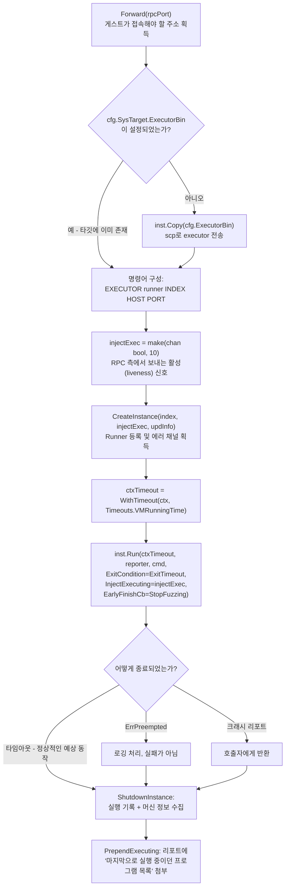

쓸모 있는 버그 리포트와 쓸모없는 버그 리포트를 가르는 세 가지 핵심 요소가 있습니다:

**정상적인 종료 조건은 타임아웃입니다.** `vm.ExitTimeout`은 *허용된(allowed)* 종료 조건입니다. 할당된 `VMRunningTime` 예산을 꽉 채워 실행된 후 강제 종료되는 VM은 성공적인 실행으로 간주됩니다. 그 외의 모든 종료는 의심스러운 상황입니다. 일반적인 "종료 코드 0 = 성공" 관례를 뒤집는 것이 실제 현실과 부합합니다. 이 VM의 임무는 우리가 멈출 때까지 계속 실행되는 것이었기 때문입니다.

**`injectExec`는 까다로운 활성 상태(liveness) 감지 문제를 해결합니다.** VM 모니터는 콘솔에 `NoOutput` 초 동안 아무것도 출력되지 않으면 "테스트 머신으로부터 출력이 없음(no output from test machine)"으로 판정합니다. 그러나 정상적으로 퍼징 중인 VM은 조용합니다. 결과는 콘솔이 아니라 RPC 소켓으로 전달되기 때문입니다. 따라서 RPC 서버는 작업 진행이 확인될 때마다 `injectExec` 채널을 찔러주고, 모니터는 이를 활성 신호로 인식합니다. 이것이 없으면 정상적인 모든 VM이 멈춘 것(hung)으로 오인되어 보고될 것입니다.

**`PrependExecuting`은 결정적 증거(smoking gun)를 첨부합니다.** 크래시 리포트가 반환될 때 manager는 그 순간 실행 중이던 프로그램 목록을 맨 앞에 덧붙입니다. 이 목록이 바로 `pkg/repro`가 범인 프로그램을 찾아내기 위해 나중에 이분 탐색(bisect)하는 대상입니다. 이것이 없다면 크래시 로그는 단순한 텍스트 덩어리에 불과합니다.

### 3.3 출력 모니터링: 크래시를 실제로 감지하는 방식

`vm/vm.go`, `monitorExecution()`은 5가지 케이스를 처리하는 하나의 `select` 루프로 이루어져 있습니다:

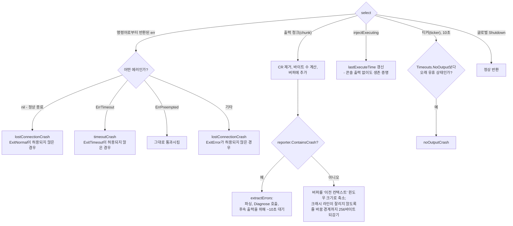

과도한 편집증처럼 보이지만 실제로는 필수적인 두 가지 디테일:

- **256바이트 되감기(rewind).** 콘솔 출력은 임의의 청크 크기로 들어옵니다. 크래시 시그니처가 두 청크에 걸쳐 쪼개질 수 있습니다. 따라서 버퍼를 잘라낸 후, 검사 위치를 256바이트 뒤의 줄 바꿈 경계로 되감습니다. 이를 빠뜨리면 실제 버그를 놓치게 됩니다.
- **크래시가 감지된 후 실행되는 `Diagnose`.** Linux 환경의 QEMU의 경우 lockdep 상태를 덤프하고, 대부분의 리포트 타입에 대해 QMP 모니터를 통해 모든 vCPU의 `info registers`를 덤프합니다. 이 추가 컨텍스트는 `VM DIAGNOSIS:` 마커 뒤에 첨부됩니다. 모니터가 *VM이 아직 살아있는 동안* 크래시를 감지했기 때문에 이러한 정보를 얻을 수 있는 것입니다.

---

## 4. RPC 핸드셰이크 및 머신 체크 (The RPC handshake and the machine check)

본격적인 퍼징이 시작되기 전에 manager와 executor는 사전 협상을 진행합니다. 여기서 syzkaller는 눈앞의 커널이 실제로 무엇을 지원하는지 파악합니다.

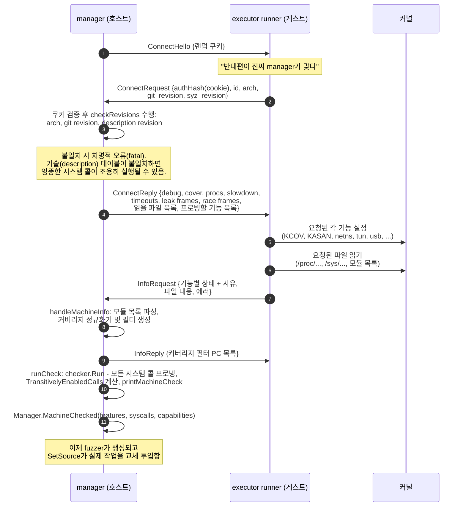

### 왜 이 방식이 영리한가

**executor는 퍼징 프로그램이 아니라 프로브 프로그램을 처리하는 것으로 시작합니다.** RPC 서버의 작업 소스는 교체 가능한 `DynamicSource`로 래핑된 `vminfo.Checker`로 시작합니다. 기능 및 시스템 콜 감지는 *퍼징에서 사용할 파이프라인과 완전히 동일한 파이프라인을 통해 작은 프로그램들을 실행*함으로써 수행됩니다. 그런 다음 `SetSource`가 fuzzer를 원자적으로 교체 투입합니다. 별도의 프로빙 코드 경로가 존재하지 않으며, 프로빙 경로 자체가 매 실행마다 테스트됩니다.

**`TransitivelyEnabledCalls`는 의존성을 추론합니다.** 현재 커널에 `openat$foo`가 존재하지 않는다면 어떤 프로그램도 `fd_foo` 리소스를 생성할 수 없으므로, 이를 필요로 하는 모든 `ioctl$FOO_*` 역시 비활성화됩니다. syscall description에 정의된 리소스 그래프 덕분에 이러한 전이 폐포(transitive closure)를 추가 비용 없이 얻을 수 있습니다.

**"머신 체크(machine check)" 리포트는 최우선 디버깅 도구입니다.** 비활성화된 모든 시스템 콜과 그 이유, 읽을 수 없는 모든 파일, 각 기능과 그 상태가 여기에 나열됩니다. 새로운 타깃에서 예상보다 버그가 적게 나온다면 가장 먼저 이 리포트를 확인하십시오.

**리비전 검사는 콘텐츠 해시를 사용합니다.** `syz_revision`은 컴파일된 syscall description 블롭(blob)의 해시입니다(`syzlang-design.md` 참조). manager와 executor가 서로 다른 트리에서 빌드된 경우 시스템 콜 인덱스가 밀릴 수 있으며, executor는 manager가 411번을 의도했을 때 412번 시스템 콜을 묵묵히 실행하게 될 위험이 있습니다. 핸드셰이크 시점에 해시를 비교함으로써 이러한 문제를 원천 차단합니다.

---

## 5. 베어메탈: `isolated` 백엔드 (Bare metal: the `isolated` backend)

임베디드 제품을 다루는 엔지니어라면 가장 눈여겨보아야 할 섹션입니다. 타깃은 책상 위나 랙에 장착된 보드입니다. 특정 하드웨어가 장착되어 있고, 해당 보드를 위해 직접 빌드한 커널이 올라가 있으며, 하이퍼바이저는 없습니다. `-snapshot`을 사용할 수도 없고, IP를 마음대로 지정할 수도 없으며, 머신이 멈추면 전원을 직접 차단해야 할 수도 있습니다.

### 5.1 `isolated` 백엔드가 가정한 전제 조건

`vm/isolated/isolated.go`의 전체 설정 구조체:

```go
type Config struct {
    Host          string   `json:"host"`           // DUT가 접근할 수 있는 호스트 IP 주소
    Targets       []string `json:"targets"`        // 머신별 (hostname|ip)(:port)?
    TargetDir     string   `json:"target_dir"`     // DUT 상의 작업 디렉터리 - 필수 항목
    TargetReboot  bool     `json:"target_reboot"`  // 복구(repair) 시 DUT 재부팅 여부
    USBDevNums    []string `json:"usb_device_num"` // 전원 재인가를 위한 /sys/bus/usb/devices/ 경로
    StartupScript string   `json:"startup_script"` // 각 시작 후 실행할 스크립트
    Pstore        bool     `json:"pstore"`         // /sys/fs/pstore에서 크래시 로그 수집 여부
    SystemSSHCfg  bool     `json:"system_ssh_cfg"` // ~/.ssh/config 사용 허용 여부
}
```

전제 조건은 의도적으로 극히 최소화되어 있습니다: **"이 머신에 SSH 접속이 가능하고, 쓰기 가능한 디렉터리가 하나 존재한다."** 이것이 전부입니다. `Overcommit`과 `Preemptible` 플래그 모두 없이 등록됩니다. 머신 수는 정확히 `len(Targets)`대만 존재하며, 연결 유실은 실제 비정상 이벤트로 취급됩니다.

`docs/linux/setup_linux-host_isolated.md`에 소개된 실제 설정 예시:

```json
{
    "target": "linux/amd64",
    "http": "127.0.0.1:56741",
    "rpc": "127.0.0.1:0",
    "sshkey": "/path/to/optional/sshkey",
    "workdir": "/syzkaller/workdir",
    "kernel_obj": "/linux-next",
    "syzkaller": "/go/src/github.com/google/syzkaller",
    "sandbox": "setuid",
    "type": "isolated",
    "vm": {
        "targets": [ "10.0.0.1" ],
        "pstore": false,
        "target_dir": "/home/user/tmp/syzkaller",
        "target_reboot": false
    }
}
```

여기에 *무엇이 없는지* 주목하십시오: `image`, `kernel`, `cmdline` 항목이 없습니다. **isolated 백엔드는 커널을 직접 배포하지 않습니다.** 적절한 옵션을 활성화하여 DUT에 커널을 직접 빌드하고 설치해야 합니다:

```
CONFIG_KCOV=y
CONFIG_DEBUG_INFO=y
CONFIG_KASAN=y
CONFIG_KASAN_INLINE=y
# CONFIG_RANDOMIZE_BASE is not set   <- KASLR 비활성화; 커버리지 심볼화가 훨씬 잘 동작함
```

`kernel_obj`는 여전히 호스트의 빌드 디렉터리를 가리켜야 합니다. 심볼화에 필요한 `vmlinux`가 그곳에 있기 때문입니다. DUT는 커널을 실행하고, 호스트는 커널의 주소를 해석합니다.

### 5.2 QEMU vs isolated 비교

```mermaid
flowchart TB
    subgraph Q["QEMU - 가상 환경"]
        Q1["Pool.Create: qemu 프로세스 포크"]
        Q2["설정에 지정된 커널 + 이미지 사용"]
        Q3["-snapshot: 부팅마다 디스크 초기화"]
        Q4["리셋 = 프로세스 종료 후 재실행, 약 10초"]
        Q5["콘솔 = qemu stdout, 항상 사용 가능"]
        Q6["Forward: localhost로의 역방향 ssh 터널"]
        Q7["Diagnose: QMP를 통한 lockdep 덤프 + 레지스터 정보"]
        Q1-->Q2-->Q3-->Q4-->Q5-->Q6-->Q7
    end
    subgraph I["isolated - 물리 환경"]
        I1["Pool.Create: ssh를 통한 repair()만 수행"]
        I2["사용자가 미리 설치해 둔 커널 사용"]
        I3["스냅샷 없음: 상태가 영구적으로 보존됨"]
        I4["리셋 = ssh 재부팅 또는 USB 전원 재인가"]
        I5["콘솔 = dmesg를 실행하는 두 번째 ssh 연결"]
        I6["Forward: cfg.Host:port 반환"]
        I7["Diagnose: 재부팅 후 /sys/fs/pstore 읽기"]
        I1-->I2-->I3-->I4-->I5-->I6-->I7
    end
```

### 5.3 `repair()`: 보드를 기지의 정상 상태로 되돌리기

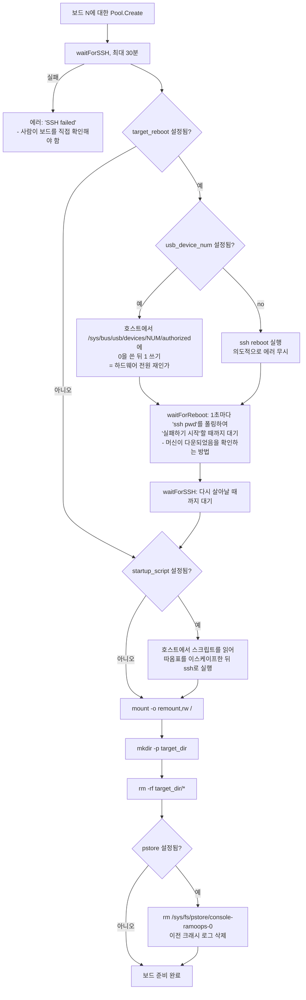

`waitForReboot`의 2단계 재부팅 감지는 직접 데여본 사람만이 작성할 수 있는 로직입니다. 단순하게 생각하면 `ssh reboot`를 날린 뒤 SSH가 다시 될 때까지 기다리면 될 것 같습니다. 하지만 머신이 셧다운되는 *도중에도* SSH는 몇 초간 계속 응답합니다. 따라서 즉시 "성공"으로 판단하여 죽어가는 시스템에 접속했다가 알 수 없는 오류를 겪게 됩니다. 그래서 **먼저 SSH가 실패하기를 기다린 후(머신이 내려가는 중), 다시 SSH가 성공하기를 기다립니다(머신이 다시 올라옴).**

`usb_device_num` 경로는 임베디드 엔지니어의 최후의 구명줄입니다. 커널이 완전히 굳어서(wedged) `reboot` 명령조차 먹히지 않을 때, *호스트*에서 `/sys/bus/usb/devices/<num>/authorized`에 값을 써서 USB 장치의 인가를 해제했다가 다시 인가합니다. 이는 보통 USB 제어 릴레이나 USB 전원 공급 보드를 대상으로 합니다. 소프트웨어로 구동되는 물리적 전원 리셋이며, 사람이 붙어있지 않아도 몇 주 동안 연속으로 베어메탈 퍼징을 가능하게 해주는 핵심 기술입니다. `ctor`의 유효성 검사 규칙에 주의하십시오: `usb_device_num`을 지정할 경우 반드시 타깃당 정확히 하나씩 지정해야 합니다.

`startup_script`는 매 실행 전 보드에 필요한 작업들을 정의하는 곳입니다: 모듈 로드, 인터페이스 활성화, 테스트 파일시스템 마운트, GPIO 설정 등이 여기에 해당합니다.

> **본받을 만한 패턴:** 불안정한 원격 리소스가 있다면 기지의 상태로 되돌리는 명시적인 `repair()` 함수를 작성하고, 단계별로 에스컬레이션하십시오: 소프트 재시도 → 소프트 재부팅 → 하드 전원 차단 → 명확한 실패 보고. 대부분의 "불안정한 하드웨어" 문제는 사실 "복구 사다리(recovery ladder)의 부재"에서 비롯됩니다.

### 5.4 보드에서 크래시 출력 확보하기: `pstore`

VM에서는 시리얼 콘솔이 하이퍼바이저 파이프로 연결되어 있어 커널이 사망하는 바로 그 순간까지 로그를 읽을 수 있습니다. 그러나 보드에서는 SSH를 통해 `dmesg`를 읽는데, 커널 패닉이 발생하면 oops 텍스트가 호스트에 전부 도달하기 *전에* 네트워크 스택이 먼저 죽어버립니다. 정작 가장 필요한 핵심 출력을 잃어버리는 것입니다.

`pstore`가 이 문제를 해결합니다. 죽어가는 커널의 콘솔 출력을 지속성 스토리지(persistent storage) — 주로 웜 리부트(warm reboot) 후에도 데이터가 보존되는 예약 RAM 영역(ramoops)이나 플래시 메모리 — 에 기록하고, 부팅 후 `/sys/fs/pstore/console-ramoops-0`으로 노출해 주는 커널 기능입니다.

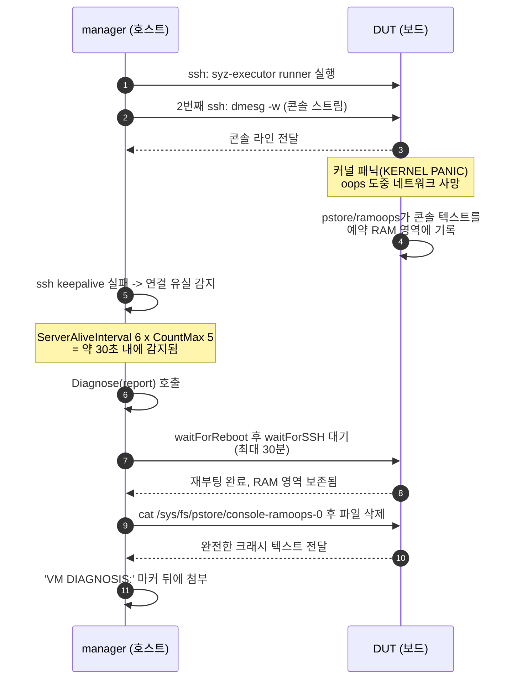

참고할 만한 두 가지 구현 디테일: 첫째, `pstore`가 활성화되면 SSH 콘솔 연결에 `-o ServerAliveInterval=6 -o ServerAliveCountMax=5` 옵션이 추가되어, 죽은 보드를 TCP 타임아웃까지 멍하니 기다리지 않고 약 30초 만에 감지합니다. 둘째, 콘솔 출력은 `dmesg`를 실행하는 *별도의* SSH 연결을 통해 들어옵니다. 즉 병합된 출력 스트림은 콘솔용 `dmesg`, 그리고 작업의 stdout과 stderr라는 3개의 소스를 가집니다. 작업용 SSH 연결이 죽더라도 콘솔 연결이 몇 줄의 로그를 더 전달해 줄 수 있습니다.

> **본받을 만한 패턴:** 장애 모드가 관측 채널 자체를 파괴할 위험이 있다면, 장애를 견디는 독립적인 채널을 마련하십시오. 비휘발성 RAM 로깅, 로그 기능이 있는 하드웨어 워치독, 별도의 관리용 인터페이스 등 필요한 것을 *문제가 터지기 전에* 미리 준비하십시오.

### 5.5 베어메탈에서의 역방향 SSH (Reverse SSH)

`Forward`는 `cfg.Host + ":" + port`를 반환하며, 터널은 이번에도 `SSHArgsForward`에 의해 추가된 `-R` 플래그로 구성됩니다. 이것이 동작하려면 DUT의 `sshd`가 이를 허용해야 합니다:

```
# DUT 내부에서
$ grep Forwarding /etc/ssh/sshd_config
AllowTcpForwarding yes
```

베어메탈 환경 설정에서 가장 흔하게 발생하는 단일 실패 원인입니다. `AllowTcpForwarding`이 `no`로 되어 있으면 executor가 시작된 후 manager에 접속하지 못해 아무런 유용한 메시지도 없이 타임아웃만 발생합니다.

일부 폐쇄적인 보드처럼 SSH 키를 전혀 사용할 수 없는 경우, 문서에서는 기존의 대화형 세션을 다중화하는 방법을 권장합니다:

```
# 호스트의 ~/.ssh/config
Host *
    ControlMaster auto
    ControlPath ~/.ssh/control:%h:%p:%r
```

수동으로 한 번 로그인한 채로 세션을 열어두면, syzkaller가 실행하는 모든 `ssh`/`scp`가 해당 인증 채널을 재사용합니다. 이때 `vm` 섹션에 `"system_ssh_cfg": true`를 설정해야 합니다. 기본적으로 SSH 헬퍼는 재현성을 위해 개인 설정을 무시하도록 `-F /dev/null`을 넘기기 때문입니다.

### 5.6 포기해야 하는 점들과 그 대처법

| 베어메탈에서 포기해야 하는 것 | 초래되는 영향 | 완화 대책 |
|---|---|---|
| `-snapshot` 디스크 리셋 | 상태가 누적됨: 쓰레기 파일, 꼬여버린 네트워크 설정, 디스크 용량 고갈 | 중요한 항목을 리셋하는 `startup_script` 작성; tmpfs 오버레이를 얹은 읽기 전용 루트 파일시스템; 주기적인 이미지 재설치 |
| 빠른 리셋 | 리부트에 10초가 아니라 30초에서 수 분 소요 | 가능한 경우 `target_reboot: false` 사용; 피해 격리를 위해 `sandbox: setuid` 또는 `namespace` 권장 |
| 안정적인 콘솔 | 패닉 시 oops 메시지가 잘림 | `pstore` / ramoops 활용, 또는 실제 하드웨어 시리얼 캡처 장비 사용 |
| 탄력적인 인스턴스 확장 | `Count() == len(targets)`; `Overcommit` 불가 | 보드를 추가하거나 낮은 처리량을 감수 |
| 스냅샷 퍼징 | 지원되지 않음 | 해당 없음 |
| 기본 KASLR 비활성화 심볼화 | 커버리지와 소스 코드 간 매핑 품질 저하 | `# CONFIG_RANDOMIZE_BASE is not set` 설정 |

그리고 이 모든 고생을 감수할 가치가 있는 보상: **실제 하드웨어, 실제 실리콘, 실제 DMA, 실제 인터럽트 타이밍, 그리고 벤더의 실제 BSP 코드 위에서 실제 드라이버를 퍼징한다는 점입니다.** 임베디드 커널 코드의 상당 부분—가장 버그가 많을 법한 부분들—은 QEMU 환경에서는 아예 존재하지도 않습니다. 가상 머신 퍼징을 아무리 돌려도 카메라 ISP 드라이버의 버그는 찾을 수 없습니다.

### 5.7 타깃 셋업 체크리스트 (A bring-up checklist)

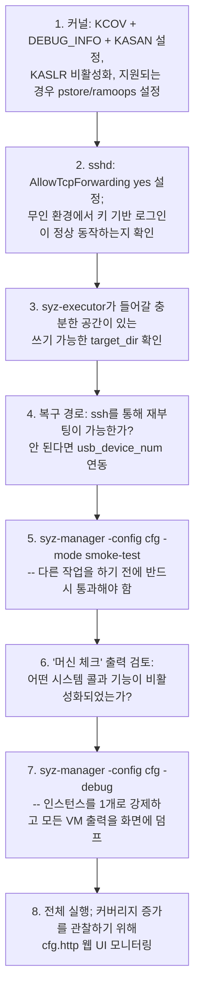

5단계는 타협할 수 없는 필수 과정입니다. 7단계는 5단계가 실패했을 때 디버깅하는 방법입니다. `-debug`는 단일 인스턴스로 강제하고 모든 출력을 콘솔로 스트리밍하므로, 보드가 협조하지 않는 이유를 파악하는 유일하게 온전한 디버깅 방법입니다.

---

## 6. 크래시 파이프라인 (The crash pipeline)

호스트 측에서 `processFuzzingResults`는 3개의 채널을 소비하는 단일 고루틴으로 동작합니다:

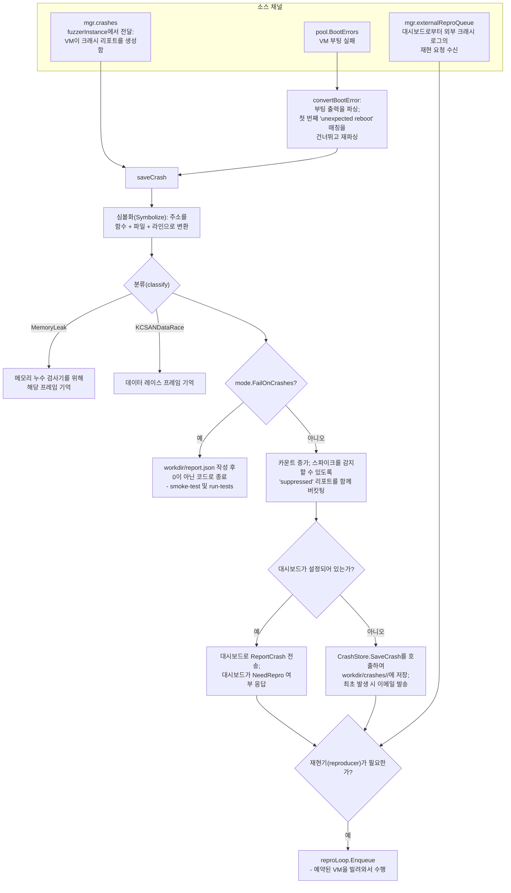

주목할 만한 포인트:

- **부팅 에러도 크래시로 취급됩니다.** 부팅에 실패한 커널은 버그이며, `convertBootError`는 부팅 출력을 리포트로 파싱합니다. 여기서의 정교함: 첫 번째 `UnexpectedReboot` 일치 항목을 지나쳐서 다시 파싱합니다. 그렇지 않으면 모든 부팅 실패의 제목이 "unexpected kernel reboot"가 되어버려 하나의 쓸모없는 버킷으로 전부 중복 제거(dedup)되어 버리기 때문입니다.
- **억제된(Suppressed) 리포트들도 하나의 공통 버킷으로 모읍니다.** 관심 없는 것으로 알려진 리포트를 조용히 버리는 대신, 모두 `"suppressed report"`라는 제목으로 묶어서 카운트를 셉니다. 이 카운터가 급증한다면 시스템에 무언가 변화가 생긴 것이며 이를 감지할 수 있습니다.
- **재현 여부를 결정하는 주체가 다릅니다.** 대시보드가 연동된 경우 대시보드가 결정합니다(글로벌 차원에서 이미 확인된 버그인지 알고 있기 때문). 독립형(standalone) 모드에서는 `needLocalRepro`가 해당 타이틀에 대해 재현기가 이미 존재하는지, 시도 횟수 예산이 소진되었는지 확인합니다.
- **메모리 누수 모드는 특별 취급됩니다.** 누수 검사는 매우 느리므로, 누수 감지 기능이 켜져 있을 때 manager는 해당 인스턴스에서 누수 이외의 크래시에 대해 굳이 재현을 시도하지 않습니다.

---

## 7. 스냅샷 모드: 2단계 백엔드 (Snapshot mode: the two-phase backend)

*(이 기능이 왜 존재하며 프로젝트에 어떤 비용을 치르게 했는지는 `history-of-major-feature-additions-and-revolutionary-design-changes.md` §7.6에서 다룹니다. 이 섹션에서는 오케스트레이션 측면, 즉 백엔드가 어떻게 연결되며 Dispatcher가 무엇을 감수해야 하는지를 살펴봅니다.)*

`cfg.Snapshot`이 설정되면 백엔드는 2단계의 수명 주기를 갖는 스냅샷 데코레이터로 감싸집니다:

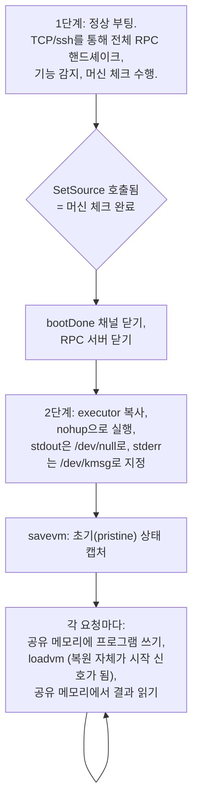

RPC 서버를 닫는 이유: VM 스냅샷을 복원하면 SSH 및 RPC 소켓을 포함한 모든 네트워크 연결이 끊어집니다. 따라서 머신 체크가 끝나면 대화할 통로가 없어집니다. 통신은 공유 메모리 영역(QEMU `ivshmem`)으로 전환되고, executor의 stdout은 더 이상 갈 곳이 없으므로 로깅 대상이 `/dev/kmsg`로 이동합니다.

Dispatcher와의 상호작용에서 얼마나 세심한 주의가 필요한지 보여주는 또 다른 디테일: 요청 큐가 일시적으로 비어 있을 때, 스냅샷 루프는 작업을 반환(return)하지 않고 **10ms 동안 슬립한 후 다시 폴링**합니다. 반환해 버리면 작업이 종료되고, Dispatcher는 이를 "VM 실행 완료"로 해석하여 머신을 재부팅해 버리므로 기껏 캡처한 스냅샷을 날려버리게 됩니다. 소스 코드 주석에도 정확히 이 내용이 적혀 있습니다.

> **본받을 만한 패턴:** 핫 패스(hot path)를 최적화할 때는 주변 프레임워크가 전제하고 있는 모든 가정을 재검토하십시오. 여기서 "작업 함수가 반환되면 작업이 완료된 것이다"라는 명제는 11년 동안 참이었지만, 스냅샷 환경에서는 거짓이 되었습니다.

---

## 8. 위에서 설명한 경로들에 대한 설정 레퍼런스 (Configuration reference)

| 설정 키 | 효과 |
|---|---|
| `type` | VM 백엔드 선택: `qemu`, `isolated`, `gce`, `adb`, `none`, ... |
| `vm` | 해당 백엔드의 생성자에 전달되는 원시 JSON; 키 목록은 백엔드마다 다름 |
| `http` | 웹 UI 주소; 비워두면 UI가 완전히 비활성화됨 |
| `rpc` | RPC 리슨 주소; 기본값 `":0"`은 임의의 가용 포트를 의미하며 이후 SSH 터널로 포워딩됨 |
| `workdir` | `corpus.db`, `crashes/`, 인스턴스별 `instance-N/` 디렉터리가 저장되는 위치 |
| `procs` | VM당 병렬 테스트 프로세스 수; 최대 PID 수로 제한됨; `-debug`에서는 1로 강제됨 |
| `fuzzing_vms` | 퍼징용으로 유지할 최소 머신 수; 나머지는 재현용으로 대여 가능 |
| `sandbox` / `sandbox_arg` | `none`, `setuid`, `namespace`, `android` — 테스트 프로세스의 격리 수준 |
| `cover` | 커버리지 가이드 퍼징 활성화; `iface-probe`에서는 필수 |
| `snapshot` | VM 상태 스냅샷 퍼징 (QEMU의 `-snapshot` 디스크 플래그와 **다름**) |
| `reproduce` | 자동 크래시 재현 활성화 |
| `sshkey` / `ssh_user` | 모든 백엔드에 전달되는 인증 정보 |
| `kernel_obj` | 호스트 측 커널 빌드 디렉터리; 베어메탈에서도 심볼화를 위해 필수 |
| `executor_bin_on_target` / `execprog_bin_on_target` | 타깃에 바이너리가 이미 설치되어 있으므로 복사 과정을 건너뜀 |

파생 값인 `VMLess`는 `type: "none"`에서 비롯됩니다. 이 모드에서 manager는 RPC 서버를 시작한 뒤 사용자에게 `syz-executor`를 직접 실행하라고 안내합니다. 자동화 경로가 전혀 없는 타깃이나 새로운 하드웨어로 포팅할 때 첫 번째 디딤돌로 매우 유용합니다.

---

## 9. 핵심 요약 (Takeaways)

1. **"하나를 만드는 방법"과 "N개를 유지하는 방법"을 분리하라.** `vm.Pool`은 생성하고, `vm.Dispatcher`는 감독합니다. 슬롯당 고루틴 하나씩 `for ctx.Err() == nil { runInstance() }`를 돌리면, 재시작은 복잡한 하위 시스템이 아니라 단순한 루프의 한 번의 반복(iteration)이 됩니다.
2. **5개 메서드로 구성된 좁은 인터페이스로 모든 것을 추상화하라.** 파일 복사, 포트 포워딩, 명령 실행, 진단, 종료. 이 단순한 인터페이스 규약 하나로 에뮬레이터, 클라우드 VM, 스마트폰, 임베디드 보드를 모두 포괄합니다.
3. **이미 확보된 채널 위로 다중화하라.** SSH 역방향 터널을 사용하면 로컬 VM이든 원격 보드든 manager에 라우팅 가능한 IP나 방화벽 예외가 전혀 필요하지 않습니다.
4. **관측 채널의 유실에 대비하라.** `injectExec`는 조용하지만 정상 동작 중인 VM이 멈춘 것으로 판정되지 않도록 지켜주며, `pstore`는 네트워크가 끊어지며 유실된 oops 텍스트를 되살려냅니다.
5. **베어메탈은 복구 사다리(recovery ladder)가 필수적이다.** 소프트 재시도, 소프트 재부팅, 하드웨어 USB 전원 리셋을 거쳐 최후에 명확히 실패를 알립니다. 맨 아래 단계가 없으면 사람이 개입하지 않는 하드웨어 무인 퍼징은 첫 번째 하드 프리징에서 끝나버립니다.
6. **추측하지 말고 프로빙하라.** 머신 체크는 실제 파이프라인을 통해 실제 프로그램을 실행하여 커널이 지원하는 항목을 알아내고 리포트를 출력합니다. 프로빙과 퍼징이 동일한 코드 경로를 사용하므로 매 실행마다 프로빙 경로가 검증됩니다.
7. **핸드셰이크 시점에 빌드 호환성을 검증하라.** 생성된 syscall description 테이블의 내용 해시를 비교함으로써, 인덱스 불일치로 인한 침묵의 오동작 버그들을 시작 시점의 명확한 에러로 전환합니다.

---

## 10. 직접 코드 읽어보기 (Reading the code yourself)

| 궁금한 점 | 여기서부터 시작하십시오 |
|---|---|
| 시작 과정은 어떻게 동작하는가? | `syz-manager/manager.go` → `main`, `RunManager`, `initRPCServer` |
| QEMU 커맨드 라인은 어떻게 조립되는가? | `vm/qemu/qemu.go` → `archConfigs`, `ctor`, `boot`, `buildQemuArgs` |
| 베어메탈 타깃은 어떻게 동작하는가? | `vm/isolated/isolated.go` → `Config`, `Pool.Create`, `repair`, `Run`, `Diagnose` |
| VM 수명 주기는 어떻게 관리되는가? | `vm/dispatcher/pool.go` → `Loop`, `runInstance`, `ReserveForRun`, `TogglePause` |
| 크래시는 어떻게 감지되는가? | `vm/vm.go` → `monitorExecution`, `appendOutput`, `extractErrors` |
| RPC 프로토콜은 무엇인가? | `pkg/flatrpc/flatrpc.fbs`, 그 다음 `pkg/rpcserver/rpcserver.go` 및 `runner.go` |
| VM 부팅마다 무슨 일이 일어나는가? | `pkg/execbackend/rpc.go` → `RunRequests` |
| SSH 명령어는 어떻게 생성되는가? | `vm/vmimpl/util.go` → `sshArgs`, `SSHArgsForward`, `WaitForSSH`, `SCP` |
| 어떤 설정 키들이 존재하는가? | `pkg/mgrconfig/config.go`, 기본값은 `load.go` 참조 |
