# syzlang 설계: API 명세로부터 동작하는 퍼저 만들기

> **이 문서의 대상 독자.** 여러분은 syzkaller가 시스템 콜을 기술하는 파일들을 읽고 이를 어떠한 방식으로든 버그를 찾아내는 머신으로 탈바꿈시키는 모습을 보았을 것입니다. 이 문서는 syzlang 언어, 이를 컴파일하는 4단계 빌드 파이프라인, 각 단계가 존재하는 이유, 그리고 최근 syzkaller가 이러한 명세를 자동으로 작성하기 위해 시도하고 있는 방법들을 설명합니다.
>
> 단 하나의 아이디어만 기억해야 한다면 이것입니다: **syzlang은 단 하나의 진실의 원천(single source of truth)으로부터 생성(generate), 변이(mutate), 최소화(minimize), 직렬화(serialize), C 언어로의 컴파일(compile-to-C)까지 모두 수행할 수 있을 정도로 풍부한 API 모델입니다.** 이는 단순한 "문법(grammar)"보다 훨씬 높은 기준이며, 설계상의 모든 선택은 이로부터 비롯되었습니다.

---

## 0. 명세 언어가 애초에 왜 필요한가

커널의 공격 표면(attack surface)은 시스템 콜입니다. 시스템 콜을 순진하게(naive) 퍼징하면 즉시 실패합니다:

```c
syscall(SYS_ioctl, random_int(), random_int(), random_int());
```

첫 번째 인자는 특정 디바이스를 특정 방식으로 `open`하여 얻은 유효한 파일 디스크립터(file descriptor)여야 합니다. 두 번째 인자는 소수의 지정된 커맨드 코드 중 하나여야 합니다. 세 번째 인자는 두 번째 인자에 따라 레이아웃이 결정되는 구조체(struct)를 가리켜야 합니다. 무작위 바이트는 이 중 어느 것도 만족하지 못하므로, 여러분의 예산(budget) 100%를 입구 컷을 당하며 `EBADF`와 `EINVAL`을 돌려받는 데 낭비하게 됩니다.

고전적인 해결책은 인터페이스마다 하네스(harness)를 직접 손으로 작성하는 것입니다. 이는 동작은 하지만 확장(scale)되지 않습니다. 리눅스에는 수백 개의 드라이버에 걸쳐 수천 개의 ioctl이 존재하기 때문입니다.

syzkaller의 해답은 다음과 같습니다: *구조(structure)*를 선언적으로(declaratively) 딱 한 번만 적어두고, 그로부터 모든 것을 파생시키는 것입니다.

```
open(file filename, flags flags[open_flags], mode flags[open_mode]) fd
read(fd fd, buf buffer[out], count len[buf])
close(fd fd)
open_mode = S_IRUSR, S_IWUSR, S_IXUSR, S_IRGRP, S_IWGRP, S_IXGRP, S_IROTH, S_IWOTH, S_IXOTH
```

엔진은 저 네 줄로부터 다음과 같은 코드를 만들어내는 방법을 알아냅니다:

```
r0 = open(&(0x7f0000000000)="./file0", 0x3, 0x9)
read(r0, &(0x7f0000000000), 42)
close(r0)
```

그리고 그 이상으로 — **하나의 명세가 8가지 서로 다른 연산을 주도합니다**:

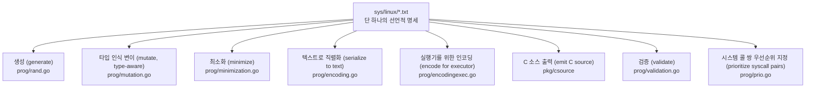

이것이 바로 레버리지(leverage, 지렛대 효과)입니다. 이 연산들 각각은 모두 어려운 문제이지만, 구조를 알고 나면 기계적인 작업이 됩니다.

> **훔쳐 올 만한 가치가 있는 패턴:** 구조화된 인터페이스를 둘러싼 도구를 만들고 있다면, 도구를 작성하기 *전에* 해당 인터페이스의 기계 판독 가능한 모델(machine-readable model)에 투자하십시오. 하나의 좋은 모델로부터 쏟아져 나오는 도구들의 수가 곧 전체 투자 수익률(ROI)이 됩니다.

---

## 1. 언어 (The Language)

### 1.1 선언 종류 (Declaration kinds)

| 선언 | 예시 | 목적 |
|---|---|---|
| syscall | `read(fd fd, buf buffer[out], count len[buf])` | 호출 가능한 진입점 |
| syscall 변종 (variant) | `ioctl$FIOCLEX(fd fd, cmd const[FIOCLEX])` | `$` 뒤에 이름이 붙는 특수화(specialization) |
| `resource` | `resource fd[int32]: 0xffffffffffffffff, AT_FDCWD` | 호출 간에 전달되는 타입이 부여된 값 |
| `struct` | `struct foo { a int32; b ptr[in, bar] }` | 레코드 |
| union | `fd_set [ in fd; out fd ]` | 태그가 붙은 대안(tagged alternative) |
| int flags | `open_mode = S_IRUSR, S_IWUSR, ...` | 정수 값들의 집합 |
| string flags | `filenames = "./file0", "./file1"` | 문자열들의 집합 |
| `type` | `type signalno int32[0:65]` | 명명된 타입, 선택적으로 템플릿화 가능 |
| `include` | `include <fcntl.h>` | 상수를 추출해 올 커널 헤더 |
| `incdir` | `incdir <drivers/foo>` | 추가 include 경로 |
| `define` | `define SOME_FLAG 1 << 3` | 커널에 상수가 없을 때 사용할 상수 표현식 |
| `meta` | `meta arches["amd64", "arm64"]` | 파일 수준 메타데이터 |

### 1.2 파서의 원 트릭 디스패치 (The parser's one-trick dispatch)

`pkg/ast/parser.go`의 `parseTop()`은 문법이 한두 개의 토큰만으로 결정될 수 있도록 설계되었기 때문에 매우 작습니다:

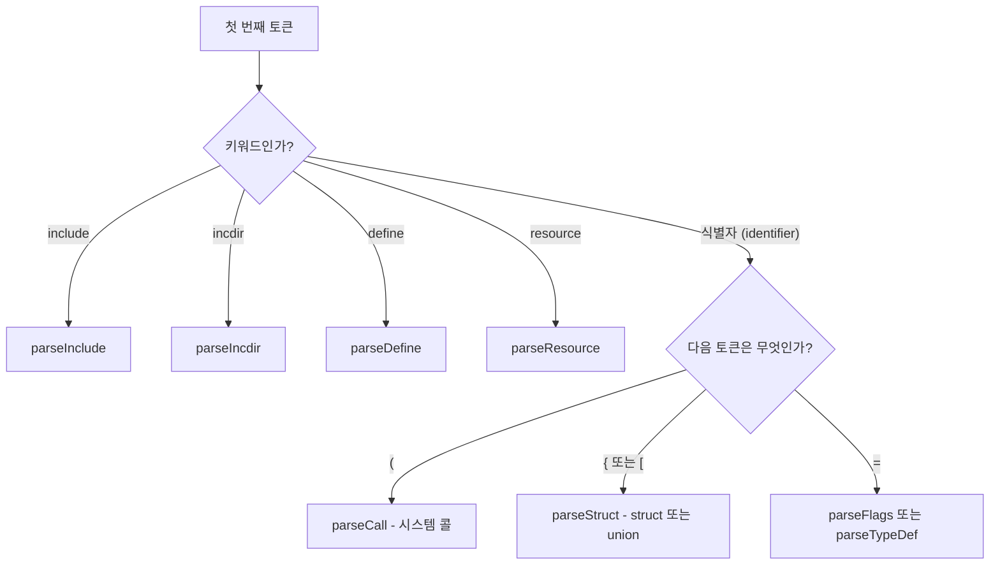

언어 전체를 통틀어 키워드는 단 4개뿐입니다 — `include`, `incdir`, `define`, `resource`. 그 밖의 모든 것은 형태(shape)로 식별됩니다. 그리고 `syzlang`은 (C와 달리, Go처럼) 사용 전 선언을 요구하지 않으므로, 문서에 기술된 다음과 같은 문서 친화적 규칙을 사용할 수 있습니다:

> 독자가 가장 중요한 것을 먼저 볼 수 있도록 중요도 순서대로 선언하는 것이 권장됩니다. [...] 참고: 이 순서는 대체로 C에서 선언하는 방식과 정확히 반대입니다.

### 1.3 대부분의 구문을 담아내는 단 하나의 노드 타입

```go
type Type struct {
    Pos        Pos
    // Value, Ident, String, Expression 중 단 하나만 채워집니다.
    Value      uint64
    Ident      string
    String     string
    Expression *BinaryExpression
    Colon      []*Type   // ':' 뒤의 부분들 - 범위(range) 및 비트필드(bitfield)
    Args       []*Type   // '[]' 안의 하위 타입들
}
```

이 하나의 형태가 다음의 모든 것을 표현합니다:

| 구문 | 매핑 방식 |
|---|---|
| `int32` | `Ident = "int32"` |
| `int32[0:10]` | `Ident = "int32"`, `Args = [0]`, `Colon = [10]` |
| `int32:5` (비트필드) | `Ident = "int32"`, `Colon = [5]` |
| `ptr[in, foo]` | `Ident = "ptr"`, `Args = [in, foo]` |
| `array[int8, 16]` | `Ident = "array"`, `Args = [int8, 16]` |
| `flags[open_mode, int32]` | `Ident = "flags"`, `Args = [open_mode, int32]` |

균일한 노드 형태는 체커와 생성기를 짧게 만들지만, 그 대가로 검증(validation)이 파싱 에러가 아니라 별도의 패스(pass)로 분리됩니다.

### 1.4 리소스: 순서 제약 조건을 공짜로 얻기

이것은 단일 기능 중 가장 중요하므로 명확히 짚고 넘어갈 가치가 있습니다.

```
resource fd[int32]: 0xffffffffffffffff, AT_FDCWD
resource sock[fd]
resource sock_tcp[sock]

open(file filename, flags flags[open_flags], mode flags[open_mode]) fd
socket$tcp(domain const[AF_INET], type const[SOCK_STREAM], proto const[0]) sock_tcp
connect(fd sock, addr ptr[in, sockaddr], addrlen len[addr])
close(fd fd)
```

여기서 세 가지 결과가 도출됩니다:

**방향이 순서를 함의합니다.** 시스템 콜의 반환값은 *출력(output)*이고, 인자는 *입력(input)*입니다. 따라서 `sock_tcp`를 생성하는 호출은 `sock`을 소비하는 호출보다 반드시 선행해야 합니다. 엔진은 소켓을 생성하는 호출보다 앞서 `connect`를 생성하지 않습니다.

**상속이 대체 가능성(substitutability)을 함의합니다.** `sock_tcp`는 `sock`이고, `sock`은 `fd`입니다. `fd`를 요구하는 호출은 이들 중 어느 것이든 수용합니다. `sock_tcp`를 요구하는 호출은 오직 그것만 수용합니다. 이 계층 구조는 컴파일 타임에 `Kind` 체인으로 평탄화(flatten)되므로, 런타임 호환성 검사는 접두사 비교(prefix comparison)에 불과합니다.

**만족할 수 없는 호출은 비활성화됩니다.** 시작 시 `TransitivelyEnabledCalls`가 클로저(closure)를 계산합니다: 이 커널에서 `fd_cdrom`을 생성할 수 있는 것이 아무것도 없다면, 모든 `ioctl$CDROM*`은 비활성화됩니다. 도저히 성공할 수 없는 호출에 사이클을 낭비하지 않으며, "머신 체크(machine check)" 리포트가 어떤 호출이 왜 비활성화되었는지 알려줍니다.

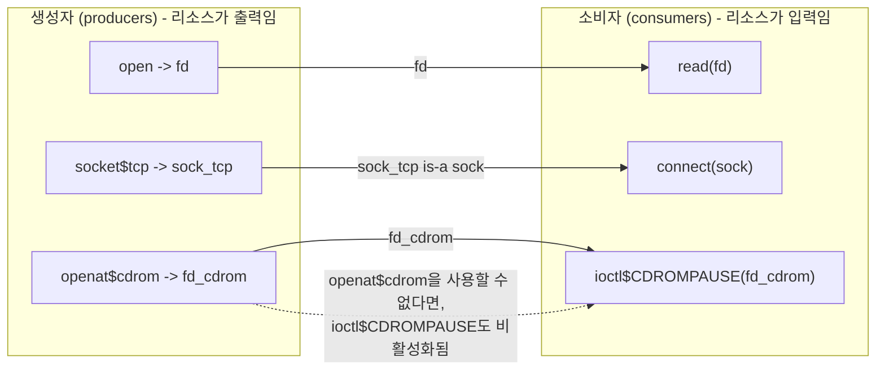

리소스 그래프는 선택 테이블(choice table)의 정적 절반(static half)에도 데이터를 공급합니다(`mutation-design.md` 참조): 생성자→소비자 쌍은 일반적인 동시 발생(co-occurrence)보다 1.5배 높은 점수를 받습니다.

> **훔쳐 올 만한 가치가 있는 패턴:** 의존성을 명시적인 순서 지정 규칙이 아니라 *연산 사이를 흐르는 타입이 지정된 값(typed values)*으로 표현하십시오. 단 하나의 선언으로부터 순서 결정, 대체 가능성, 도달 가능성 분석, 그리고 쌍 우선순위 지정을 모두 얻을 수 있습니다.

### 1.5 속성(Attributes), 그리고 그것이 어디에서 오는가

속성은 시스템 콜, 구조체, 필드에 주석을 답니다:

```
syz_mount_image$ext4(...) (timeout[50], prog_timeout[600], fsck["fsck.ext4 -fn"])
ioctl$SOME_REBOOT(fd fd, cmd const[X]) (breaks_returns)
struct packed_thing { a int8; b int32 } [packed]
```

영리한 부분은 다음과 같습니다: **시스템 콜 속성은 컴파일러 어디에도 하드코딩되어 나열되어 있지 않습니다.** `pkg/compiler/attrs.go`는 Go 구조체에 대해 리플렉션(reflection)을 수행합니다:

```go
type SyscallAttrs struct {
    Disabled, Timeout, ProgTimeout, IgnoreReturn, BreaksReturns, NoGenerate,
    NoMinimize, NoSquash, RemoteCover, Automatic, AutomaticHelper, KFuzzTest, Snapshot ...
    Fsck       string
    Filesystem string
}
```

필드 이름은 syzlang 표기법으로 변환되고(`BreaksReturns` → `breaks_returns`), Go 타입이 속성의 형태를 결정합니다: `bool` → 플래그, `uint64` → `name[N]`, `string` → `name["..."]`. 새로운 시스템 콜 속성을 추가한다는 것은 구조체 필드 하나를 추가하는 것을 의미합니다. 언어, 파서 테이블, 그리고 생성되는 C 헤더가 모두 이를 따릅니다.

이름이 다소 알기 어려울 수 있으므로, 일부의 의미를 정리하면 다음과 같습니다:

| 속성 | 효과 |
|---|---|
| `timeout[N]` | 이 호출은 느리므로 N초를 허용함 |
| `breaks_returns` | 이 호출 이후에는 이후 호출들의 반환값이 무의미해짐 (예: 재부팅) |
| `ignore_return` | 이 호출의 반환값을 리소스로 사용하지 않음 |
| `no_generate` | 이 호출을 절대 생성하지 않음. 코퍼스나 수동 작성된 시드(seed)를 통해서만 나타날 수 있음 |
| `no_minimize` | 이 호출의 인자들을 단순화하려고 시도하지 않음 |
| `no_squash` | 이 호출의 포인터 인자들을 절대 원시 바이트(raw bytes)로 평탄화하지 않음 |
| `remote_cover` | 이 호출의 커버리지가 다른 스레드에 나타남 |
| `fsck["..."]` | 재현(reproducer) 실행 후, 이미지에 대해 이 파일시스템 체커를 실행함 |
| `kfuzz_test` | 실제 시스템 콜이 아니라 커널 내부 퍼즈 타깃임 |
| `automatic` | 이 명세는 머신에 의해 자동 생성되었음 |

구조체 및 필드 속성은 더 작은 고정된 집합입니다: 구조체에 붙는 `packed`, `size[N]`, `align[N]`; 유니온에 붙는 `varlen`, `size[N]`; 필드에 붙는 `in`/`out`/`inout`/`out_overlay`/`if[...]`.

필드별 방향(per-field direction)은 생각보다 중요합니다: 구조체는 입력 리소스와 출력 리소스를 모두 포함할 수 있으며, 이를 통해 핸들을 소비하기도 하고 생성하기도 하는 `ioctl` 구조체를 기술할 수 있습니다.

### 1.6 길이 표현식과 조건부 필드

```
write(fd fd, buf ptr[in, array[int8]], count len[buf])
struct msg { hdr_len bytesize[hdr]; hdr header; payload_bits bitsize[payload]; payload array[int8] }
struct cmd { type int32; data int32 (if[value[type] == CMD_A]) }
```

`len`, `bytesize`, `bytesize2/4/8`, `bitsize`, `offsetof`는 내부적으로 표기된 이름 자체를 검사하여 제수(divisor)를 결정하는 **단 하나의 타입 기술자(type descriptor)**입니다. 길이 필드는 모든 변이 후에 자동으로 다시 계산되므로(`assignSizesCall`), 버퍼를 확장하는 변이는 해당 길이 필드를 자동으로 업데이트합니다 — 그리고 `LenType` 변이 우선순위가 의도적으로 낮은 이유(10점 만점에 1점)도 정확히 길이를 변이하는 것이 하는 *유일한* 일이 불일치(inconsistency)를 만드는 것이기 때문입니다. 낮긴 하지만 0은 아닙니다: 일치하지 않는 길이는 그 자체로 하나의 버그 클래스(bug class)이기 때문입니다.

조건부 필드는 재작성(rewrite)을 통해 구현됩니다. 컴파일러는 필드를 두 개의 갈래(arm)를 가진 익명 유니온으로 감쌉니다 — 실제 값과 조건의 부정으로 보호되는 `void` 갈래:

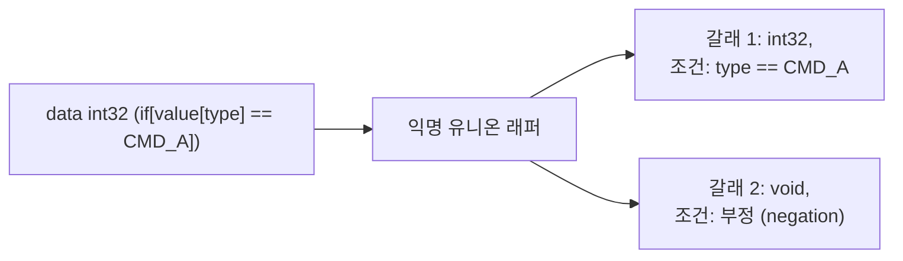

보초(sentinel) 구조체가 래퍼를 표시하여 레이아웃 코드가 그에 대한 속성 조회를 건너뛰도록 합니다. 조건부 필드를 가진 모든 구조체는 자동으로 가변 길이(variable-length)가 됩니다. 변이 후 `patchConditionalFields`가 올바른 갈래를 다시 선택합니다 — 그리고 *힌트(hints)* 메커니즘은 조건을 위반하는 상태로의 변이를 명시적으로 거부하며, 다음과 같은 주석이 달려 있습니다: *"더 이상 조건을 만족하지 않는 유니온을 패치하는 것은 훨씬 더 깊은 변경을 필요로 할 것입니다... 그런 변이는 그냥 무시합시다."*

> **훔쳐 올 만한 가치가 있는 패턴:** 가능할 때마다 겉보기 기능(surface-level feature)을 기존의 핵심 구문으로의 재작성(rewrite)으로 구현하십시오. 조건부 필드는 새로운 타입 종류도, 새로운 변이 로직도, 새로운 직렬화 형식도 필요하지 않았으며 — 오직 디슈가링(desugaring) 패스와 픽스업(fixup)만 필요했습니다.

### 1.7 스쿼시된 ANY: 타입 시스템의 의도적인 구멍

정밀한 타입은 퍼저가 기형적인 구조(malformed structures)를 생성하지 못하도록 막습니다 — 하지만 때로는 기형적인 구조를 생성하는 것이 바로 여러분이 원하는 것일 때가 있습니다. 따라서 syzkaller는 리소스 값을 보존하면서 타입이 지정된 포인터 인자를 불투명한 블롭(opaque sequence of blobs) 시퀀스로 *평탄화(flatten, squash)*할 수 있습니다:

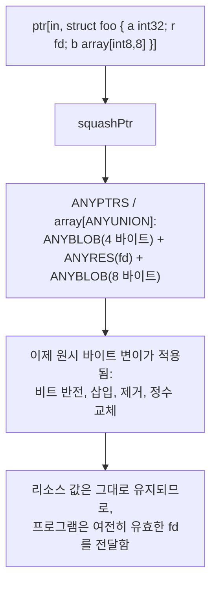

컴파일러는 포인터가 스쿼시 가능한지(squashable) 여부를 *정적으로* 결정합니다(`isSquashableElem`): `in` 방향이어야 하고, 요소가 가변 길이 구조체이거나 큰 가변 길이 유니온이어야 하며, 중첩된 포인터나 `out_overlay` 구조체를 포함하지 않아야 합니다. 모든 시스템 콜이 생성될 때까지는 재귀적 타입을 완전히 알 수 없기 때문에, `SquashableElem` 플래그는 사후 패스(post-pass)에서 설정됩니다 — 이는 컴파일러가 선언 사이클(declaration cycles)에 얼마나 신경을 써야 하는지 보여주는 작은 세부 사항입니다.

여기에는 대가가 따르며, syzkaller는 이를 추적합니다: 스쿼시된 프로그램은 `HasAny = true`를 가지며, 이는 시그널 우선순위를 낮춥니다. 코퍼스 최소화는 동일한 커버리지에 대해 스쿼시되지 않은 프로그램을 선호하며, `Corpus.Minimize`의 `sort`는 스쿼시되지 않은 항목을 먼저 배치합니다. 따라서 스쿼싱은 탐색(exploration)에 사용되지만, 둘 다 존재할 때는 적절히 타입이 지정된 동등한 프로그램에 밀려납니다.

> **훔쳐 올 만한 가치가 있는 패턴:** 스스로 정한 불변식(invariants)에 대해 문서화된 탈출구(escape hatch)를 열어두되, *어떤 아티팩트가 그것을 사용했는지 추적*하여 나중에 깔끔한 아티팩트를 선호할 수 있도록 하십시오.

---

## 2. 컴파일 파이프라인 (The compilation pipeline)

빌드 타임 4단계와 2개의 자동 명세 공급기(automatic-description feeders).

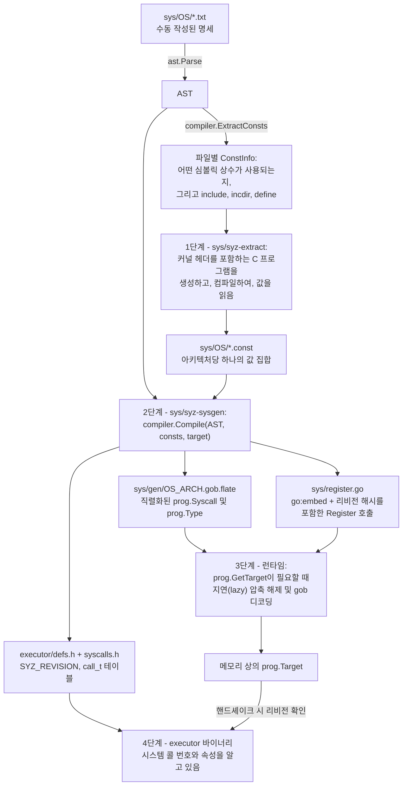

### 2.1 1단계: `syz-extract` — 실제 상수 값 가져오기

명세에는 `flags[open_mode]`와 `open_mode = S_IRUSR, ...`라고 적혀 있습니다. 하지만 `S_IRUSR`은 어떤 *숫자*일까요? 이는 C 전처리기 매크로이며, 그 값은 아키텍처마다 다를 수 있고, 일부 아키텍처에는 전혀 존재하지 않을 수도 있습니다.

`syz-extract`는 **컴파일러에게 물어봄으로써** 이를 해결합니다. 다음과 같은 작은 C 프로그램을 생성합니다:

```c
#include <fcntl.h>          /* 명세의 include 지시문으로부터 */
#define SOME_FLAG 1 << 3    /* 명세의 define 지시문으로부터 */

int main() {
    unsigned long long vals[] = { (unsigned long long)S_IRUSR, ... };
    for (...) printf("%llu", vals[i]);
}
```

이를 타깃 크로스 컴파일러로 컴파일하고 실행합니다. 직접 실행할 수 없는 아키텍처로 크로스 컴파일할 때는 배열을 전용 ELF 섹션으로 출력합니다:

```c
__attribute__((section("syz_extract_data"))) unsigned long long vals[] = { ... };
```

그리고 타깃의 엔디안(endianness)을 고려하여 오브젝트 파일에서 해당 섹션을 읽어냅니다. **진실의 원천은 커널 자체의 헤더**이며, 커널 자체의 툴체인에 의해 해석됩니다 — 복사하여 붙여넣은 숫자가 결코 아닙니다.

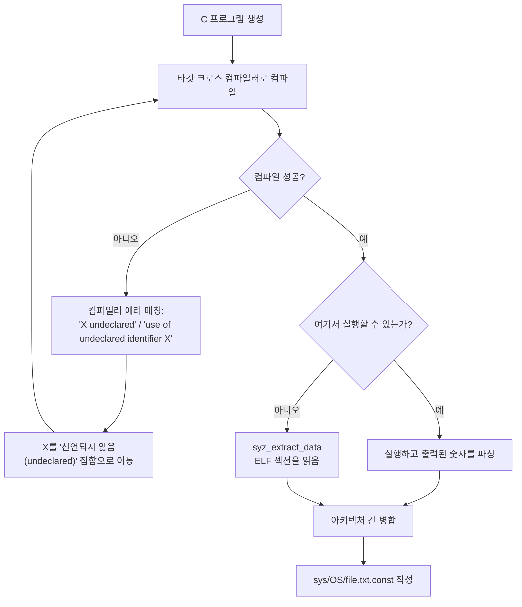

컴파일-재시도 루프(compile-retry loop)는 실질적인 핵심입니다. 해당 아키텍처에 없는 상수는 컴파일러 에러를 발생시킵니다. 에러 텍스트를 패턴 매칭하여 해당 상수를 "선언되지 않음(undeclared)" 목록으로 옮기고 컴파일을 다시 시도합니다. `.const` 파일에는 이에 대해 `???`가 기록됩니다.

결정적으로, **누락된 상수가 빌드 실패를 의미하지는 않습니다.** 대신:

- `assignSyscallNumbers`는 시스템 콜 번호를 `^uint64(0)`으로 설정하고 이를 `unsupported`에 기록합니다.
- `patchConsts`는 리소스, 구조체, 필드에 대해서도 동일하게 처리합니다.
- 시작 시 지원되지 않는 시스템 콜은 단순히 비활성화됩니다.

*모든* 아키텍처에서 누락된 상수는 오류입니다 — 그것은 거의 확실하게 오타이기 때문입니다. arm64에만 존재하는 인터페이스를 기술하는 것은 정상이지만, 어디에도 존재하지 않는 인터페이스를 기술하는 것은 실수입니다.

결과로 생성되는 `.const` 파일은 아키텍처가 접혀 있는(arch-folded) 형태입니다 — 아키텍처들을 나열하는 하나의 헤더 라인, 그 후 상수별 값들 — 이는 아키텍처를 추가할 때 diff를 작게 유지해 줍니다.

> **훔쳐 올 만한 가치가 있는 패턴:** 대상 환경에 대한 사실이 필요할 때, 사실을 하드코딩하기보다 *환경에 직접 질문*하십시오. 그리고 "이 사실은 여기에 존재하지 않는다"를 실패가 아닌 데이터로 취급하십시오.

### 2.2 2단계: `compiler.Compile` — 명세를 타입 객체로 변환

이 파이프라인은 컴파일러 자체의 헤더 주석에 문서화되어 있습니다: 파싱 → `ExtractConsts` → 사용자가 값 제공 → `Compile`.

```go
comp := createCompiler(desc.Clone(), target, eh)
comp.filterArch()        // 이 아키텍처용이 아닌 선언 제거
comp.typecheck()
comp.flattenFlags()
if consts == nil {       // 상수 추출 모드
    return &Prog{fileConsts: comp.extractConsts()}
}
comp.assignSyscallNumbers(consts)
comp.patchConsts(consts)
comp.check(consts)       // 약 12개의 시맨틱 패스
syscalls := comp.genSyscalls()
comp.layoutTypes(syscalls)
types := comp.generateTypes(syscalls)
```

주목해야 할 세 가지가 있습니다.

**동일한 진입점이 상수 추출과 전체 컴파일을 모두 담당**하며, `consts == nil` 여부로 선택됩니다. 상수 추출 역시 *어떤* 상수가 참조되는지 알기 위해 파싱, 아키텍처 필터링, 타입 검사가 필요하므로 프론트엔드를 재사용하는 것이 코드 양도 줄이고 일관성도 보장합니다.

**시맨틱 패스는 다양하며 명확한 이름을 가집니다.** `checkNames`, `checkFlags`, `checkFields`, `checkTypedefs`, `checkTypes`, `checkTypeValues`, `checkAttributeValues`, `checkFieldPaths`, `checkConstructors`, `checkRecursion`, `checkVarlens`, `collectUnused`. 각각은 집중된 역할을 가진 별도의 함수입니다. 특히 `checkConstructors`는 기여자들에게 매우 유용합니다: 어떤 시스템 콜도 생성할 수 없는 리소스에 대해 경고해 줍니다 — 소비자를 기술하고 생성자를 잊어버리는 전형적인 초보자의 실수입니다.

**내장 명세(Builtin descriptions)가 여러분의 AST 앞에 추가**되며, 이것이 바로 `ANYUNION`, `ANYPTRS`, `ANYRES*`, 그리고 `syz_builtin*` 의사 호출(pseudo-calls)이 생겨나는 곳입니다.

그 다음 레이아웃 및 타입 테이블 구성입니다:

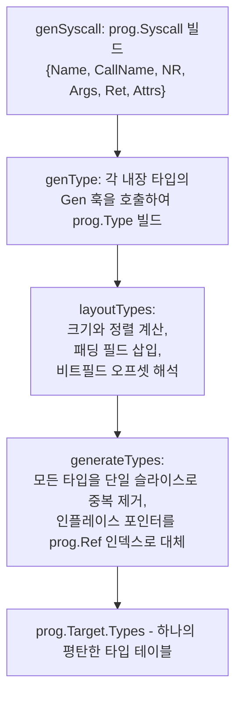

`generateTypes`는 파이프라인이 직렬화에서 원활하게 작동하는 이유입니다. 타입들은 순환 그래프(자기 자신을 가리키는 포인터를 포함하는 구조체)를 형성합니다. 이를 슬라이스로 평탄화하고 포인터를 정수 인덱스로 대체하면 구조가 비순환적이고 간결해지며 직렬화하기 매우 쉬워집니다. 동일한 트릭이 컴파일러, 씬 그래프(scene graphs), 바이트코드 형식에서도 나타납니다.

> **훔쳐 올 만한 가치가 있는 패턴:** 직렬화하기 전에 순환 객체 그래프를 평탄한 테이블과 정수 참조로 변환하십시오. 중복 제거, 간결성, 순환 안전성이 한 번에 확보됩니다.

### 2.3 3단계: `syz-sysgen`과 임베디드 블롭

`syz-sysgen`은 빌드 드라이버입니다. 각 OS에 대해: 모든 `.txt` 파일을 파싱하고, 모든 `.const` 파일을 역직렬화하며, 아키텍처당 하나의 작업을 생성하여 동시 실행합니다.

작업당 수행 흐름:

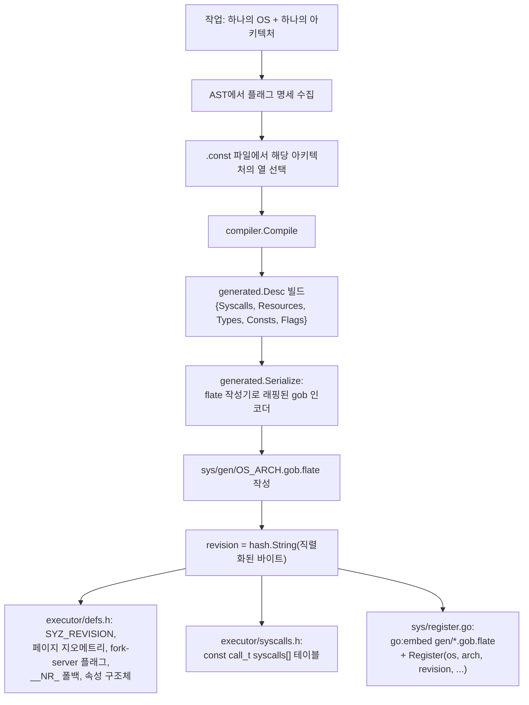

임베디드 블롭 설계(2025년 1월 도입되어 생성된 `sys/sys.go`를 대체함)는 세 가지 이점을 제공합니다:

**지연 로딩(Lazy loading).** `prog.RegisterTarget`은 콜백을 저장하고, `GetTarget`은 `sync.Once` 내부에서 디코딩을 실행합니다. 12개의 아키텍처를 지원하는 바이너리라도 실제 사용하는 단 하나의 아키텍처에 대해서만 디코드 비용을 지불합니다.

**작은 아티팩트 크기.** 압축된 gob은 동등한 Go 소스보다 훨씬 작으며, Go 컴파일러는 더 이상 수 메가바이트에 달하는 생성된 리터럴의 타입을 검사할 필요가 없습니다.

**읽기 쉬운 diff.** 이전 방식은 명세가 변경될 때마다 수천 줄의 생성된 Go 코드를 변경했습니다. 이제 생성된 아티팩트는 불투명한 바이너리입니다 — 어차피 아무도 그것을 리뷰하지 않았으므로 이것이 더 솔직한 방식입니다.

모든 구체적인 `prog.Type` 구현체와 `prog.Ref`, `prog.BinaryExpression`, `prog.Value`는 인터페이스 값이 올바르게 왕복(round-trip)될 수 있도록 `gob.Register`됩니다.

### 2.4 리비전 검사 (The revision check)

여러분의 자체 설계에 그대로 베껴 쓸 만한 가치가 있는 부분이 바로 여기 있습니다.

매니저와 실행기(executor)는 **서로 다른 트리에서 빌드될 수 있는 별도의 바이너리입니다.** 실행기의 `syscalls[]` 테이블은 매니저가 사용하는 것과 동일한 ID로 인덱싱된 배열입니다. 만약 누군가가 시스템 콜 명세를 추가하고 한쪽만 다시 빌드하여 테이블이 일치하지 않게 되면, 매니저는 시스템 콜 #412를 요청하지만 실행기는 정상으로 보이는 인덱스를 가지고 완전히 잘못된 동작을 하는 *다른* 시스템 콜을 고분고분 실행하게 됩니다.

따라서:

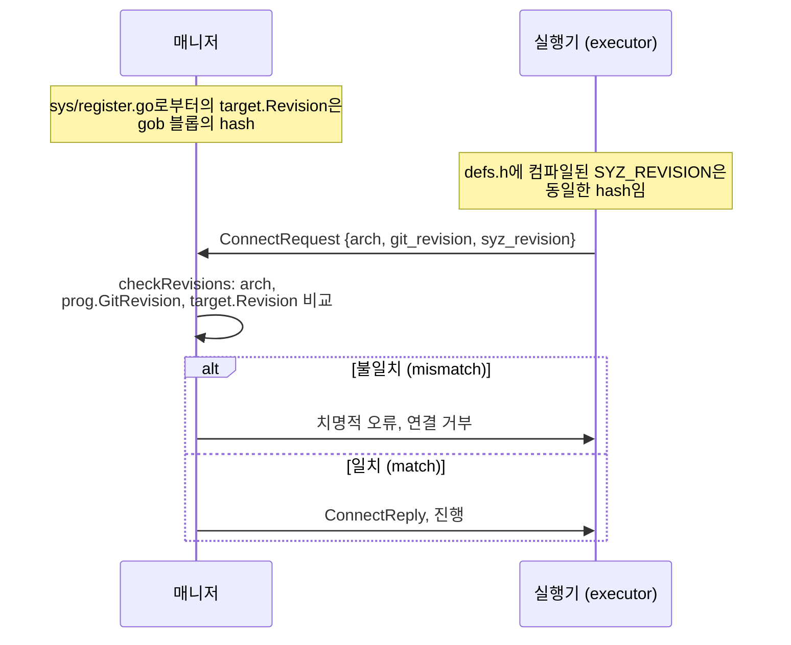

**생성된 테이블의 내용 해시(content hash)가 곧 호환성 토큰이 됩니다.** 누군가 올려주는 것을 기억해야 하는 버전 번호가 아니라, 내용이 변경될 때마다 자동으로 바뀌는 해시입니다.

이것이 `make generate`가 중요한 이유이기도 합니다. 문서에는 *"syz-manager를 실행하는 동안 머신 체크에 필요한 `executor/defs.h`의 SYZ_REVISION도 업데이트합니다"*라고 언급되어 있습니다. 그리고 Makefile 없이 빌드된 `syz-manager`가 시작을 거부하는 이유이기도 합니다 — git 리비전이 찍히지 않기 때문입니다.

> **훔쳐 올 만한 가치가 있는 패턴:** 두 아티팩트가 생성된 테이블에 대해 반드시 일치해야 할 때, 호환성 토큰을 *테이블의 내용 해시*로 만들고 연결 시점에 교환하여 불일치 시 진행을 거부하십시오. 유지보수 비용은 0이며, 이 버그 클래스를 완벽하게 잡아냅니다.

### 2.5 개발자 워크플로

```bash
# 1. 명세 편집 또는 추가
vim sys/linux/dev_foo.txt

# 2. 커널 헤더에서 상수 값 추출 (크로스 컴파일러 필요)
make extract TARGETOS=linux SOURCEDIR=$KSRC

# 3. 임베디드 명세 및 헤더 재생성 (순수 텍스트 처리)
make generate

# 4. 바이너리 다시 빌드
make
```

문서에 나오는 실질적인 팁들:

- `$KSRC`는 **최신** 커널 체크아웃이어야 합니다 — 메인라인, 혹은 아직 머지되지 않은 인터페이스의 경우 linux-next.
- `make extract`는 `$KSRC`의 `.config`를 덮어쓰고 그 위에서 `mrproper`를 실행합니다. 아끼는 트리를 지정하지 마십시오.
- `.const` 파일은 `.txt` 변경 사항과 **동일한 커밋**으로 커밋됩니다.
- `make generate`는 커널 소스나 컴파일러가 필요하지 않습니다.
- 단일 파일 또는 단일 아키텍처의 경우 `syz-extract`를 직접 호출하십시오:

```bash
make bin/syz-extract
bin/syz-extract -os linux -arch arm64 -sourcedir $KSRC -builddir $LINUXBLD dev_foo.txt
make generate && make
```

- `sudo make install_prerequisites`는 크로스 컴파일러를 설치하며, 일부 실패할 수 있습니다. 먼저 `apt update && apt upgrade`를 실행하면 도움이 됩니다.

### 2.6 네이밍 컨벤션, 그리고 강제 가능한 이유

문서에서는 단호하게 강조합니다:

> 사물에 대해 기존 커널 이름을 고수하고, 가능한 한 새로운 이름을 지어내지 마십시오.

두 가지 구체적인 이점이 있습니다:

1. **검색 용이성(Searchability).** 커널 enum이 `v4l2_buf_type`이라면, 똑같이 이름을 붙여야 두 트리를 하나의 검색어로 grep할 수 있습니다.
2. **정적 검사(Static checking).** `tools/syz-check`는 명세를 커널 디버그 정보와 비교하여 필드 타입 불일치, 누락된 플래그 값, 잘못된 구조체 크기를 보고합니다 — *단, 이름이 일치할 때만 가능합니다*. 컨벤션이 있기에 체커가 가능해집니다.

---

## 3. 자동 명세 추출 (Automatic description extraction)

명세는 병목이었습니다: 수천 줄에 달하는 명세를 모두 커널 소스를 읽는 사람들이 직접 손으로 작성했습니다. 2024년부터 세 가지 자동 생성기가 도입되었습니다.

### 3.1 정적 방식: `syz-declextract`

실제 컴파일러 플래그와 실제 전처리기 상태를 볼 수 있도록 커널의 `compile_commands.json`을 사용하여 실제 커널 소스를 읽는 clang 기반 도구입니다.

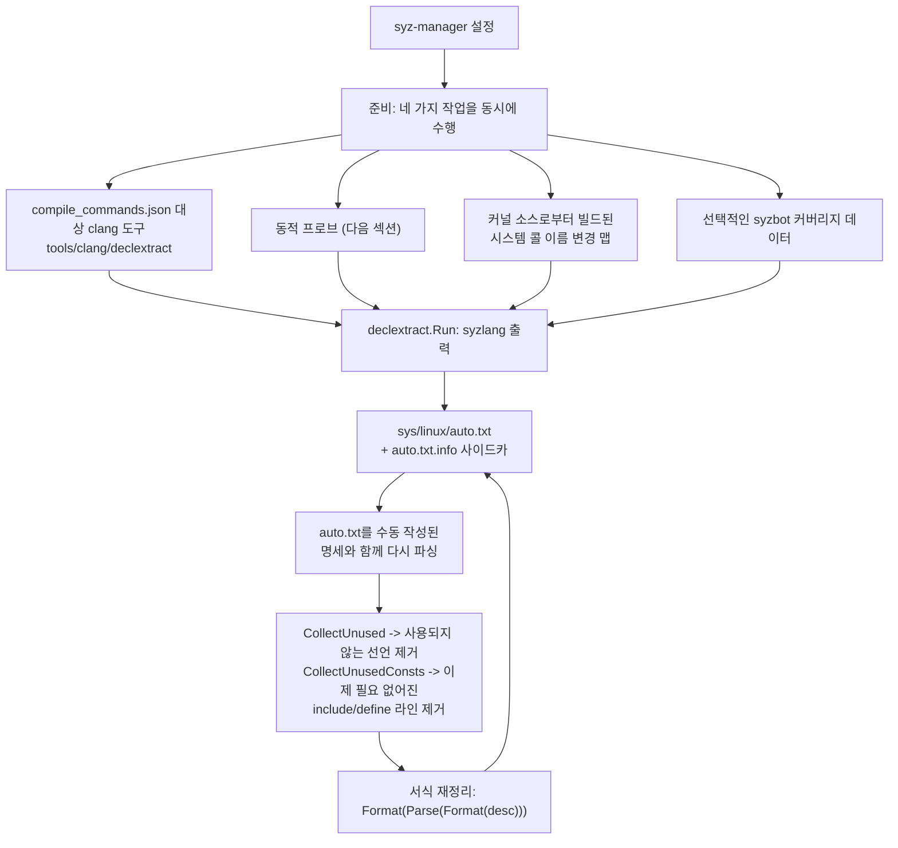

시스템 콜, io_uring 연산, 구조체 및 그 필드, 열거형(enum), netlink 패밀리, `file_operations` 인스턴스에 대한 명세를 출력합니다.

피드백 루프는 흥미로운 엔지니어링 지점입니다. 자동 생성된 명세는 수동으로 작성된 타입을 *참조*하므로, 이를 단독으로 검증할 수 없습니다. 생성기는 **결합된** 명세 세트를 컴파일하고, 사용되지 않게 된 항목을 찾아내어 제거하고, 이제 불필요해진 `include`/`define` 라인을 제거하고, 파싱-포맷 왕복을 통해 서식을 다시 정리한 후 자체 출력을 다시 작성합니다. 스스로 컴파일하고 스스로 정리하는 생성 코드입니다.

이 방식으로 생성된 파일은 `meta automatic`을 가지며, 이는 `SyscallAttrs.Automatic`이 되어 변종 간 일부 일관성 검사를 완화합니다 — 머신이 생성한 변종은 수작업으로 큐레이팅된 것과 동일한 엄격한 기준을 적용받지 않습니다.

### 3.2 동적 방식: `ifaceprobe`

정적 분석은 커널의 모든 `file_operations` 구조체를 볼 수 있습니다. 쉽게 알 수 없는 것은 **어떤 디바이스 파일이 어떤 구조체에 도달하는가**입니다 — 그 매핑은 여러 계층의 등록 과정을 거쳐 런타임에 형성되기 때문입니다.

따라서 `syz-manager -mode iface-probe`는 실제 커널을 부팅하여 이를 알아냅니다:

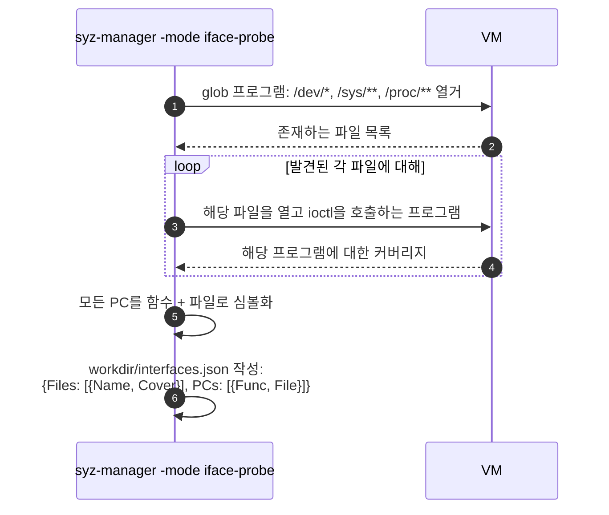

출력 결과는 "'/dev/foo'를 열고 ioctl을 수행하면 이러한 커널 함수에 도달한다"는 질문에 답합니다 — 바로 빠져 있던 연결 고리입니다. `syz-declextract`는 `syz-manager`를 셸로 호출하여 이를 실행하고, 결과를 `workdir/interfaces.json`에 캐싱합니다.

이 모드는 `cover: true` 및 `sandbox: "none"`을 요구하며, 스냅샷 모드를 거부합니다 — 디바이스 파일을 열거하기 위해 완전한 가시성과 전체 권한이 필요하기 때문입니다.

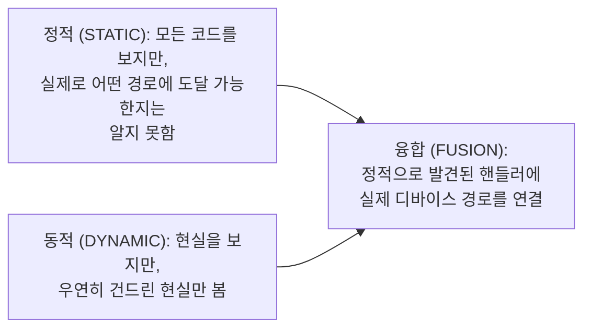

> **훔쳐 올 만한 가치가 있는 패턴:** 정적 분석과 동적 분석은 상호 보완적인 맹점을 가지고 있습니다. 대상 시스템을 실행할 수 있다면 둘 다 수행하고 공유 키를 기준으로 결과를 결합하십시오.

### 3.3 디버그 정보 기반: `pkg/kfuzztest`

또 다른 새로운 접근 방식입니다. KFuzzTest를 통해 커널 개발자는 *내부* 함수에 퍼즈 타깃으로 주석을 달 수 있습니다. `pkg/kfuzztest`는 소스 코드나 실행 중인 커널이 아니라 `vmlinux`의 DWARF 및 ELF 섹션을 읽어 이러한 타깃, 인자 제약 조건, 구조체 레이아웃을 발견하고 이에 대한 syzlang을 렌더링합니다.

그런 다음 `ActivateKFuzzTargets`가 결과 시스템 콜을 **런타임에** 실행 중인 `prog.Target`에 주입하므로 다시 빌드할 필요가 없습니다. 언어로의 역방향 링크는 `kfuzz_test` 호출 속성입니다.

`experimental.enable_kfuzztest`가 설정되면, 매니저는 일반적으로 활성화된 모든 시스템 콜을 지우고 발견된 KFuzzTest 타깃만 활성화합니다 — 엔진이 시스템 콜 대신 함수를 향하도록 설정되는 것입니다. 몇몇 우선순위 함수는 `Attrs.KFuzzTest`를 확인하고 다르게 동작합니다: 길이 필드는 변이되지 않으며(하네스에서 길이가 일관되게 유지되어야 함), 특수 포인터는 생성되지 않습니다. *"커널에서 식별하기 어렵고 오탐(false positive) 충돌 보고로 이어질 수 있기 때문"*입니다.

### 3.4 세 가지 방식이 만나는 지점

| 소스 | 읽는 대상 | 발견하는 내용 | 약점 |
|---|---|---|---|
| 수동 작성 | 인간의 이해 | 의미론(semantics), 올바른 사용 순서 | 느리고 확장성이 없음 |
| `declextract` | clang을 통한 커널 소스 | 구조: 구조체, 열거형, netlink, fops | 도달 가능성이나 의도를 알 수 없음 |
| `ifaceprobe` | 실행 중인 커널 | 파일이 실제로 도달하는 경로 | 시도해 본 것만 볼 수 있음 |
| `kfuzztest` | `vmlinux` DWARF | 내부 퍼즈 타깃 | 개발자의 주석이 필요함 |

어느 것도 수동으로 작성된 세트를 대체하지 못합니다. 문서에서는 솔직하게 밝히고 있습니다: *"현재 모든 시스템 콜 명세는 수동으로 작성됩니다. 이 프로세스를 돕기 위한 미해결 이슈와 진행 중인 작업이 있지만, 명세를 완전히 자동화된 방식으로 생성하는 단계에는 아직 도달하지 못했습니다."* 자동화는 폭(breadth)을 넓히고, 인간은 일련의 호출 시퀀스가 실제로 성공하도록 만드는 깊이(depth)를 만들어냅니다.

---

## 4. 명세 테스트하기 (Testing descriptions)

명세는 구문적으로 유효하고 컴파일이 깔끔하게 되더라도 여전히 틀릴 수 있습니다 — 잘못된 필드 순서, 잘못된 플래그 값, 누락된 선행 조건 등이 원인일 수 있습니다. 두 가지 도구가 이를 다룹니다.

### 4.1 간접 신호: 커버리지

`syz-manager`를 실행하고 웹 UI에서 커버리지 리포트를 확인하십시오. 방금 기술한 드라이버의 커버리지가 오직 `open` 경로에서만 나타난다면, 퍼저가 입구 컷을 통과하지 못하고 있는 것입니다. 그러나 문서에서는 그 한계를 분명히 밝히고 있습니다:

> 퍼저는 명세에 적힌 내용에서 벗어남으로써 명세의 일부 버그를 우회할 수도 있지만, 이는 퍼저가 진전을 이루는 것을 상당히 어렵게 만듭니다.

따라서 커버리지는 *무언가* 잘못되었다는 것만 알려줄 뿐, *무엇이* 잘못되었는지는 알려주지 않습니다.

### 4.2 직접 신호: `sys/<OS>/test/*`

테스트 파일은 기대 결과를 포함하는 일반 프로그램입니다. `sys/linux/test/80211_scan`의 예시:

```
# requires: -sandbox=namespace
r0 = socket$nl_generic(0x10, 0x3, 0x10)
...
```

두 가지 지시문 형식:

| 지시문 | 의미 |
|---|---|
| `# requires: prop1 -prop2` | `prop1`이 성립하고 `prop2`가 성립하지 않을 때만 실행 |
| `### call=N errno=M` | 호출 N이 errno M을 반환했음을 단언(assert) |

여기에 상수와 포인터를 위한 `AUTO`(순차 주소 할당)와 리소스를 캡처하기 위한 `<r2=>0x0`이 추가됩니다.

`-mode run-tests`는 각 파일을 하나의 **매트릭스(matrix)**로 확장합니다:

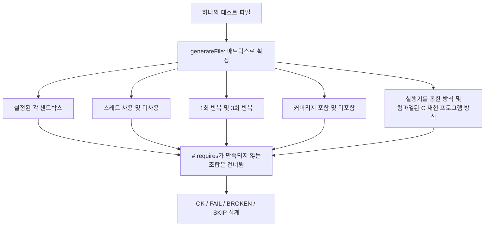

이 머신에서 시스템 콜이 비활성화된 테스트는 FAIL이 아니라 **SKIP**으로 보고됩니다 — 동일한 스위트를 여러 커널 버전에서 실행할 때 이는 매우 중요한 구별점입니다.

실행하는 두 가지 방법:

```bash
# 여러 VM에 걸친 전체 매트릭스 실행 - 철저하지만 느림
make && bin/syz-manager -config manager.config -mode run-tests

# 수동으로 부팅한 VM 내부에서 단일 테스트 실행 - 빠른 반복 작업
syz-execprog -debug -threaded=0 mytest

# 테스트 파일이 파싱되는지만 확인
go test -run=TestParsing ./pkg/runtest
```

문서의 조언은 유용합니다: *"하위 시스템에 대해 적어도 '주요 성공 시나리오(the main successful scenario)'에 대한 테스트를 추가하는 것이 항상 좋습니다. 이를 통해 명세가 실제로 올바른지, 그리고 퍼저가 성공적인 시나리오를 구성해 내는 것이 가능한지 확인할 수 있습니다."*

두 번째 문장이 진짜 핵심입니다. 통과하는 테스트는 명세가 정확하다는 것뿐만 아니라, **명세를 통과하는 유효한 경로가 실제로 존재한다**는 것을 증명합니다 — 이것이 바로 퍼저에게 필요한 것입니다.

> **훔쳐 올 만한 가치가 있는 패턴:** 어떤 사양이든 *의도된 성공적인 사용법*에 대한 실행 가능한 예제를 작성하십시오. 이들은 문서이자, 회귀 테스트이자, 퍼저 시드이자, 명세된 인터페이스가 실제로 사용 가능하다는 증거로서 동시에 기능합니다.

### 4.3 모두를 곤란하게 만드는 또 한 가지 문제

> 기존 syzkaller 명세를 업데이트할 때, 특정 시스템 콜에 대한 명세에 급격한 변경이 있지 않는 한 코퍼스에 이미 있는 프로그램은 수동으로 지우지 않는 한(예: `corpus.db` 파일 삭제) 그대로 유지된다는 점에 유의하십시오.

구조체 레이아웃을 변경하면 기존 코퍼스 프로그램은 새로운 레이아웃에 맞춰 재해석됩니다. 이들은 여전히 역직렬화될 수 있지만 이제는 다른 의미를 갖게 됩니다. 명세를 변경한 후 결과가 이상해 보인다면 `rm workdir/corpus.db`가 가장 먼저 시도해야 할 조치입니다.

---

## 5. 최신 계층: 에이전트가 접근 가능한 데이터로서의 명세

`pkg/aflow/syzspec`은 AI 에이전트가 명세 및 코퍼스와 함께 작업할 수 있도록 하기 위해 존재합니다. 그 구조는 AI라는 맥락을 떠나서도 많은 것을 시사합니다.

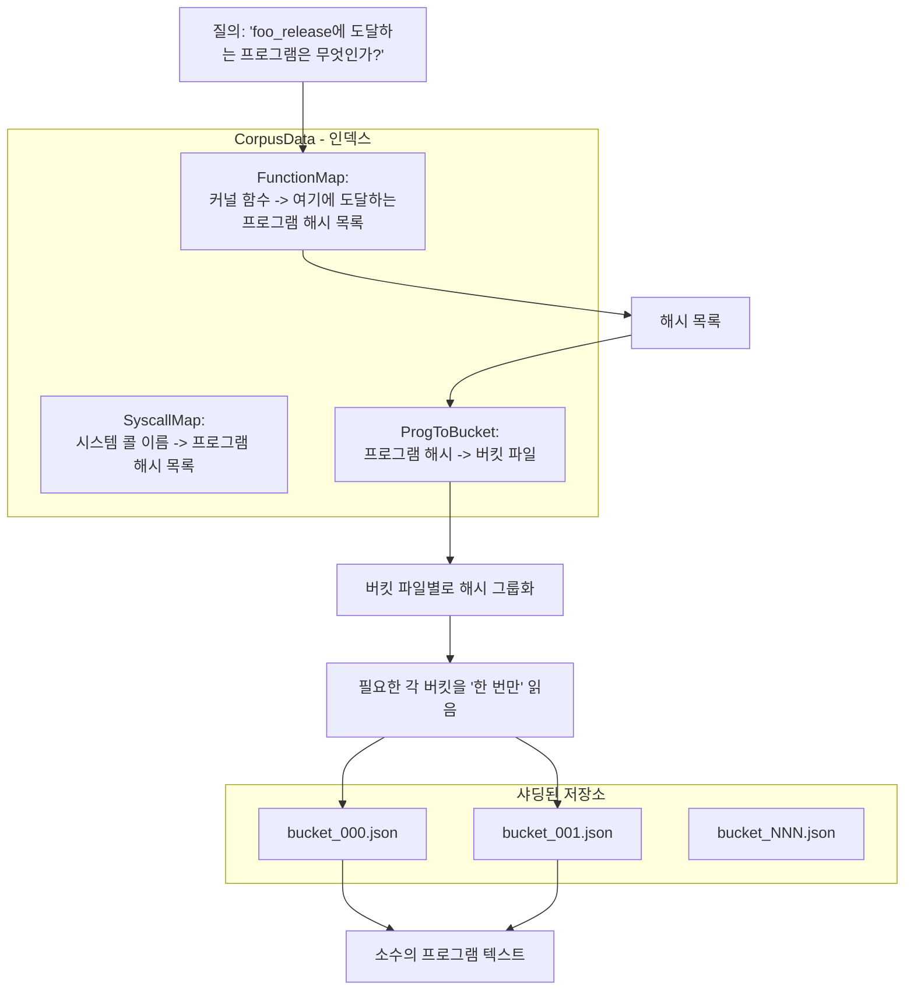

세 가지 설계 포인트:

**인덱스는 페이로드와 분리되어 있습니다.** `FunctionMap`과 `SyscallMap`은 해시만을 보유합니다. 프로그램 텍스트를 건드리지 않고도 "어떤 프로그램이 이 함수에 도달하는가?"에 답할 수 있습니다.

**페이로드는 번호가 매겨진 버킷으로 샤딩(sharding)됩니다.** `ReadPrograms`는 요청된 해시를 버킷별로 그룹화하고 각 버킷을 한 번씩만 읽습니다. 5개의 재현 프로그램을 가져올 때 전체 코퍼스가 아니라 2개의 파일만 건드립니다.

**블롭은 외부로 분리(swap out)됩니다.** `BlobStore.RegisterBlob` / `ReplaceBlobs` / `RestoreBlobs`는 제한된 컨텍스트 윈도우를 가진 소비자에게 보여주기 전에 프로그램 텍스트에서 대용량 바이너리 블롭(인자로 임베디드된 2MB 압축 디스크 이미지 등)을 제거하고, 이후에 다시 복원합니다.

그 위에 구축된 도구들 — `.txt`, `.const`, 테스트, 헤더 파일의 페이지 단위 읽기를 위한 `read-syz-spec`, 컨텍스트와 함께 정규식 검색을 수행하는 `syz-grepper` — 은 의도적으로 좁게 정의된 읽기 전용 뷰입니다.

> **훔쳐 올 만한 가치가 있는 패턴:** "질의하는 인덱스"와 "가져오는 페이로드"를 분리하고, 페이로드를 샤딩하며, 불투명한 대용량 값을 생략할 수 있는 메커니즘을 제공하십시오. 이는 대역폭이나 집중도에 제한이 있는 *모든* 소비자(웹 UI, 모바일 클라이언트, 거대 언어 모델)를 위한 훌륭한 API 설계입니다.

---

## 6. 핵심 요약 (Takeaways)

1. **풍부한 API 모델은 여러 배의 보답을 합니다.** 하나의 명세가 생성, 타입 인식 변이, 최소화, 두 가지 직렬화 형식, C 코드 출력, 검증, 그리고 시스템 콜 쌍 우선순위 지정을 모두 구동합니다.
2. **의존성을 연산 사이를 흐르는 타입이 지정된 값으로 표현하십시오.** 리소스는 단 하나의 선언으로부터 syzkaller에 순서 결정, 대체 가능성, 도달 가능성 분석, 우선순위 지정을 제공합니다.
3. **환경에 대한 사실을 인코딩하지 말고 환경에 직접 질문하십시오.** `syz-extract`는 실제 툴체인을 사용하여 실제 커널 헤더에 대해 C 프로그램을 컴파일합니다. 복사된 상수는 미래의 버그입니다.
4. **"여기에 존재하지 않는다"를 데이터로 취급하십시오.** 누락된 상수는 시스템 콜을 비활성화하고 이유를 출력합니다. *모든 곳*에서 누락된 경우에만 오류인데, 이는 오타이기 때문입니다.
5. **새로운 겉보기 기능을 기존 핵심 구조로 디슈가링(desugar)하십시오.** 조건부 필드는 익명 유니온과 픽스업 패스로 바뀌었습니다 — 새로운 타입 종류도, 새로운 변이자도, 새로운 형식도 필요하지 않았습니다.
6. **직렬화 전에 순환 그래프를 테이블과 인덱스로 평탄화하십시오.** 중복 제거, 간결성, 순환 안전성을 한 번에 해결합니다.
7. **생성된 테이블의 호환성을 핸드셰이크 시 교환되는 내용 해시로 만드십시오.** 유지보수 비용은 0이며, 조용한 인덱스 왜곡(silent index skew)을 완전히 제거합니다.
8. **런타임 타입으로부터 언어를 파생시키십시오.** 시스템 콜 속성은 `prog.SyscallAttrs`에 필드가 있기 때문에 존재합니다. 구조체 필드 하나만 추가하면 파서, 언어, C 헤더가 모두 따라옵니다.
9. **명세는 깨끗하게 유지하고, 적대적 입력(adversarial input)은 별도로 생성하십시오.** 명세는 의도된 인터페이스를 기술하며, 퍼저는 `-1`, `INT_MAX`, 그리고 1% 확률의 범위를 벗어난 값을 독립적으로 공급합니다.
10. **추적 가능한 탈출구(escape hatch)를 마련하십시오.** 스쿼시된 ANY는 의도적으로 타입 시스템을 깨뜨리며, 그 결과로 생성된 프로그램은 표시되어 나중에 깨끗한 동등물이 우선권을 가질 수 있도록 합니다.
11. **올바른 사용법에 대한 실행 가능한 예제를 작성하십시오.** 이들은 문서, 테스트, 시드, 그리고 유효한 경로가 존재한다는 증거가 한 번에 되어 줍니다.
12. **대역폭이 제한된 소비자를 위해 인덱스와 페이로드를 분리하십시오.** 해시를 질의하고, 샤딩된 버킷을 가져오며, 대용량 블롭을 생략하십시오.

---

## 7. 직접 코드 읽어보기

| 질문 | 시작 지점 |
|---|---|
| 문법은 어떻게 되는가? | `docs/syscall_descriptions_syntax.md`, 그리고 아무 `sys/linux/dev_*.txt` |
| 명세는 어떻게 추가하는가? | `docs/syscall_descriptions.md` — 공식 워크플로 문서 |
| AST 노드는 무엇인가? | `pkg/ast/ast.go`; 렉서는 `scanner.go`, 파서는 `parser.go` |
| 컴파일은 어떻게 작동하는가? | `pkg/compiler/compiler.go` — 헤더 주석을 먼저 읽을 것 |
| 타입은 어떻게 인스턴스화되는가? | `pkg/compiler/gen.go` → `genSyscall`, `genType`, `layoutTypes`, `generateTypes`, `wrapConditionalField` |
| 내장 타입에는 무엇이 있는가? | `pkg/compiler/types.go` → `typeDesc` 테이블 |
| 어떤 시맨틱 검사가 실행되는가? | `pkg/compiler/check.go` |
| 상수는 어떻게 추출되는가? | `sys/syz-extract/extract.go` 및 `fetch.go` → C 템플릿과 재시도 루프 |
| 빌드는 어떻게 구동되는가? | `sys/syz-sysgen/sysgen.go`; 직렬화는 `sys/generated/generated.go` |
| 런타임 표현은 무엇인가? | `prog/types.go` 및 `prog/target.go` → `Syscall`, `SyscallAttrs`, `Target`, `RegisterTarget`, `GetTarget` |
| 리소스는 어떻게 순서를 제약하는가? | `prog/resources.go` → `populateResourceCtors`, `getInputResources`, `TransitivelyEnabledCalls` |
| 스쿼싱은 어떻게 동작하는가? | `prog/any.go` → `initAnyTypes`, `complexPtrs`, `squashPtr`; 그리고 `pkg/compiler/types.go`의 `isSquashableElem` |
| 정적 추출은 어떻게 수행되는가? | `tools/syz-declextract/declextract.go`, `pkg/declextract/` |
| 동적 프로빙은 어떻게 수행되는가? | `pkg/ifaceprobe/ifaceprobe.go` |
| 명세는 어떻게 테스트되는가? | `pkg/runtest/run.go` → `generateFile`; `pkg/manager/seeds.go` → `parseRequires`, `MatchRequirements` |
| 에이전트는 명세를 어떻게 읽는가? | `pkg/aflow/syzspec/syzlang.go`, `syzfs.go`, `blobs.go`; `pkg/aflow/tool/syzlang/spec.go` |
